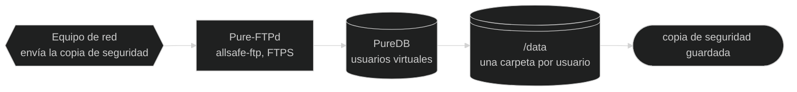
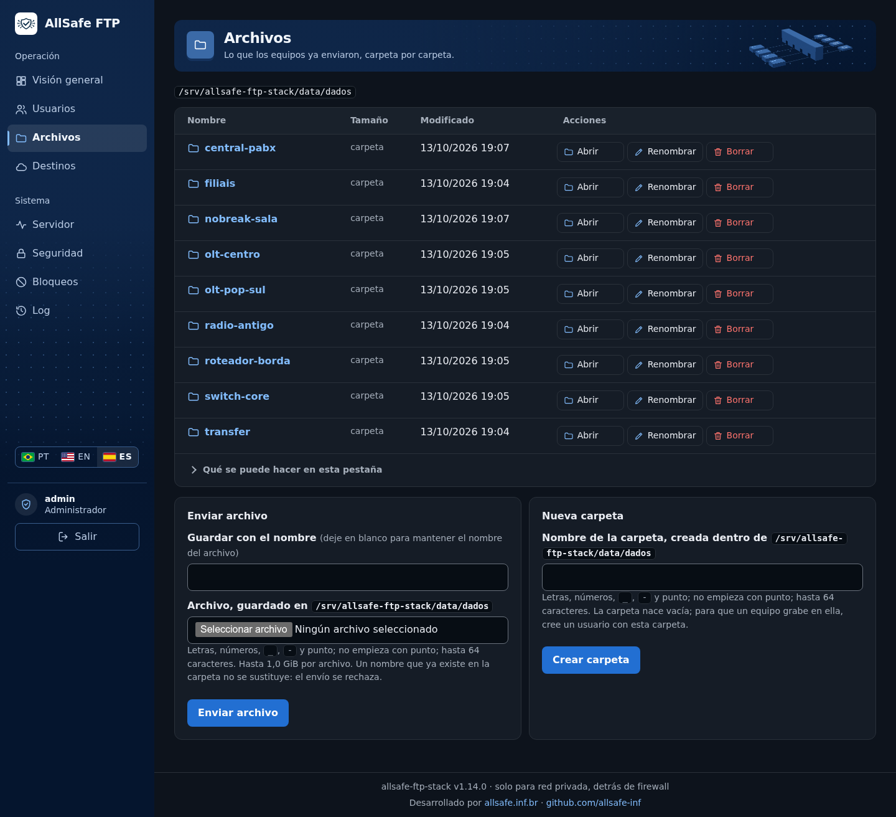
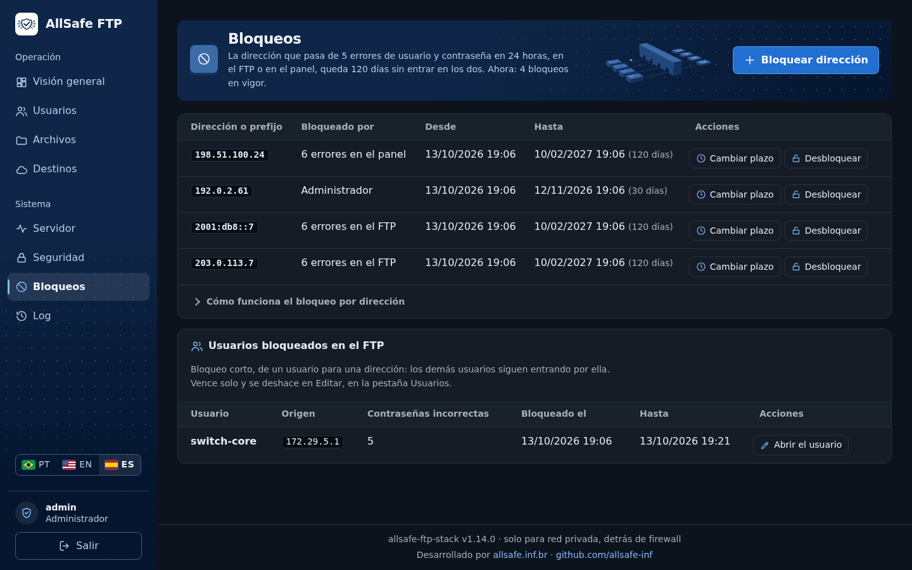
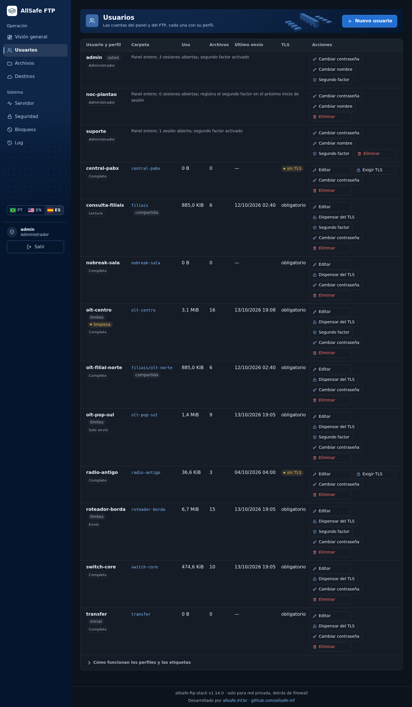
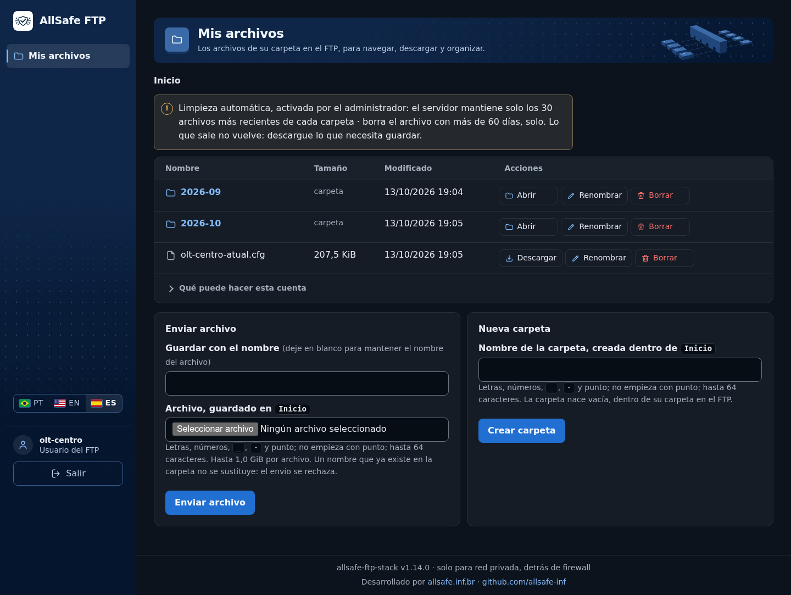
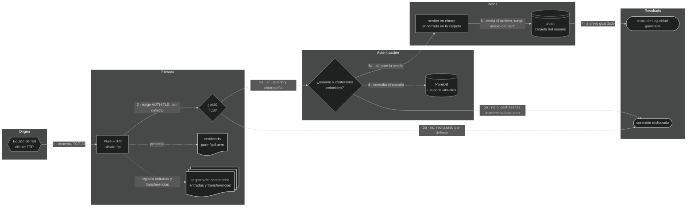
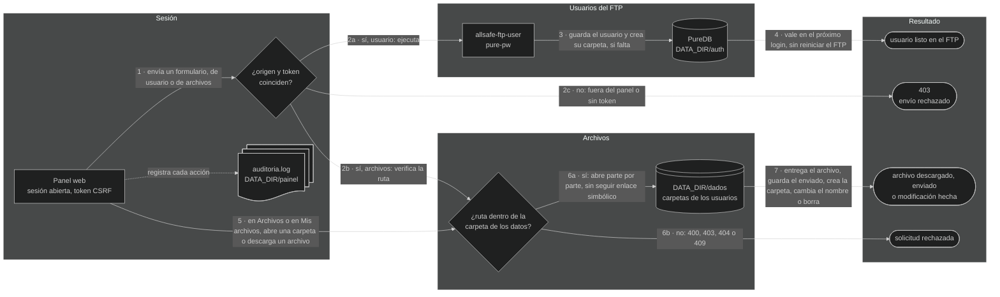

<div align="center">

<a href="web/marca/logo-320.png"></a>

# 📁 allsafe-ftp-stack

**Servidor FTP dedicado (Pure-FTPd) con FTPS obligatorio por defecto, usuarios virtuales, chroot y panel web seguro detrás del nginx, para guardar en un solo lugar las copias de seguridad y los archivos de equipos de red, cámaras, empresas y personas, en red privada.**

[](README.md)
[-6e7781?style=for-the-badge)](README.pt-BR.md)
[](README.es.md)

Desarrollado por [allsafe.inf.br](https://allsafe.inf.br) · [github.com/allsafe-inf](https://github.com/allsafe-inf)


[](LICENSE)


<a href="doc/es/imagenes/painel-principal.png"></a>

<sub><b>v1.14.0</b> · panel web, pestaña Visión general · captura del 2026-10-13</sub>

<!-- diagrama: doc/es/diagramas/vision-general-diagrama.mmd -->


<sub>Nivel 1 · Diagrama · [fuente](doc/es/diagramas/)</sub>

<sub><b>v0.48.0</b> · visión general de la stack · 2026-10-09</sub>

</div>

**Secuencia:** Equipo de red ➜ Pure-FTPd (`allsafe-ftp`) ➜ PureDB ➜ `/data` ➜ copia de seguridad guardada

> 🧱 **Uso solo en red privada.** Por defecto, esta stack es para red interna: escucha **solo en IP privada** (`10.0.0.0/8`, `172.16.0.0/12`, `192.168.0.0/16` o `127.0.0.1`), **detrás de firewall**, y no debe publicarse en internet ni recibir redirección de puertos desde el borde. Una dirección pública solo entra por decisión de quien instala, con `REDE_PERMITIR_IP_PUBLICO=sim` y firewall en el servidor: lea antes la [alerta](doc/es/seguridad.md#ip-publico). Detalles en [doc/es/seguridad.md](doc/es/seguridad.md#rede-privada).

> 📌 **Repositorio oficial:** [github.com/allsafe-inf/allsafe-ftp-stack](https://github.com/allsafe-inf/allsafe-ftp-stack). Las versiones salen primero en él, y es en él donde se reciben issues y pull requests. La copia en `github.com/CarlosSuporteISP/allsafe-ftp-stack` es un espejo, actualizado después.

---

<details>
<summary>Índice — haga clic para expandir</summary>

[Qué es](#o-que-e) · [Aspectos destacados](#destaques) · [Imágenes](#imagens) · [Instalación rápida](#instalacao) · [Cómo funciona](#como-funciona) · [Arquitectura](#arquitetura) · [Tecnologías](#tecnologias) · [Puertos y binds](#portas) · [Configuración](#configuracao) · [Seguridad](#seguranca) · [Pruebas](#testes) · [Estructura de archivos](#arquivos) · [Documentación](#documentacao) · [Plan](#plano) · [Versión](#versao) · [Proyectos relacionados](#relacionados) · [Créditos](#creditos) · [Licencia](#licenca)

</details>

---

<a name="o-que-e"></a>

## 💡 Qué es

Un servidor de archivos para guardar, en un solo lugar, copias de seguridad y archivos: la copia de seguridad de la configuración de routers, switches, OLT y radios, las grabaciones de cámaras y grabadores que guardan por FTP, y los archivos de empresas y de personas. Cada cuenta entra con usuario y contraseña, solo ve su propia carpeta y, por defecto, solo puede entrar por conexión cifrada. Las cuentas se crean desde el navegador, en un **panel web seguro**, o desde la línea de comandos. En el mismo panel, los archivos recibidos se consultan y **se descargan desde el navegador**, por quien administra y por el dueño de los archivos, que entra con el usuario y la contraseña del FTP y ve solo su propia carpeta; con el permiso del administrador, el dueño también **envía archivos desde el navegador**. Cada cuenta puede tener la carpeta elegida por quien administra.

Son **tres contenedores**: el servidor FTP, el panel y el **nginx**, la única puerta de entrada del panel. El FTP usa la base local **PureDB** en lugar de PostgreSQL: menos memoria, menos superficie de ataque y autenticación sin latencia de red. El panel es pequeño a propósito: administradores con usuario y contraseña, sin JavaScript, sin acceso al Docker y sin puerto de red propio; quien habla HTTPS con el navegador es el nginx, que verifica la red de origen y el volumen de solicitudes antes de reenviar. En los tres, el sistema de archivos raíz es de solo lectura, las `capabilities` son mínimas y los secretos quedan fuera de la imagen y del Git.

| | |
|---|---|
| **Para qué** | Recibir por FTPS copias de seguridad y archivos de equipos de red, cámaras, empresas y personas, y consultar todo desde el navegador |
| **Tecnologías** | Docker Compose · Debian 13 · Pure-FTPd · PureDB · OpenSSL · nginx · Bash · Python |
| **Acceso** | Cliente FTP con **TLS explícito** (`AUTH TLS`) en el puerto `21/tcp`, modo pasivo en el rango del perfil (`30000-30049/tcp` en el `small`) · panel en `https://<IP privado>:8443`, por el nginx |
| **Requisitos** | Docker Engine con Docker Compose v2 o más reciente · CPU y memoria del perfil elegido (2 vCPU y 2 GB en el `small`) · una IP **privada** dedicada · firewall en el host que libere solo la red interna |

> **Panel web:** solo en red interna, detrás de firewall, como el resto de la stack. Rechaza por código la dirección que no sea privada. Cómo usarlo: [doc/es/panel.md](doc/es/panel.md).

> ⚠️ **Equipo antiguo sin TLS:** para el equipo que no admite TLS existe la opción `FTP_TLS_MODE=0` (o `1`). Con ella, **la contraseña y los archivos viajan en texto plano**: úsela solo en red interna aislada, y la stack lo avisa en el `deploy.sh`, en el registro del contenedor y en el panel. Vea [doc/es/seguridad.md](doc/es/seguridad.md#ftp-sem-tls).
>
> Para dispensar del TLS **solo a los usuarios de los equipos antiguos**, manteniendo obligados a los demás, el administrador marca cada uno en la pestaña Usuarios del panel, al crear el usuario o después: [TLS por usuario](doc/es/seguridad.md#tls-por-usuario).

---

<a name="destaques"></a>

## ✨ Aspectos destacados

| Aspecto | En la práctica |
|---|---|
| **FTPS explícito obligatorio por defecto** | Sin `AUTH TLS` no hay login: usuario y contraseña no pasan en texto plano. El modo sin TLS, para equipo antiguo, es una elección explícita y avisada |
| **Usuarios virtuales en PureDB** | No son cuentas del sistema; cada uno queda encerrado (`chroot`) en su propia carpeta |
| **Bloqueo por intento en el FTP** | Cinco contraseñas incorrectas desde la misma dirección bloquean al usuario para ella por 15 minutos; el administrador ajusta el límite de cada usuario y desbloquea desde el panel |
| **Bloqueo por dirección, IPv4 e IPv6** | La dirección que pasa de cinco errores de usuario y contraseña en 24 horas queda 120 días sin entrar al FTP ni al panel, y la entrada correcta pone el conteo en cero. En la pestaña Bloqueos, el administrador bloquea una dirección o un prefijo, libera y cambia el plazo |
| **Bind local por defecto** | Arranca en `127.0.0.1`; usted abre solo una IP **privada** dedicada, con firewall en el host |
| **Red privada por defecto** | Hecha para red interna, detrás de firewall; dirección pública solo por una opción explícita, con alerta |
| **IPv6, si usted quiere** | Desactivado por defecto. Con `REDE_IPV6=sim`, el FTP y el panel atienden también por IPv6, con la misma regla de red privada del IPv4 |
| **Solo el panel publicado, si se quiere** | El panel puede abrirse por un proxy o túnel del propio servidor, con el FTP cerrado en la red privada; la dirección del cliente solo se acepta del proxy declarado |
| **Panel web seguro** | Crea usuarios, les cambia la contraseña y los elimina desde el navegador: solo HTTPS, sesión que termina con 4 horas sin uso, bloqueo después de cinco contraseñas incorrectas y registro de cada acción |
| **Segundo factor en la entrada del panel** | Obligatorio por defecto para toda cuenta del panel, administrador y usuario del FTP: después de la contraseña, el panel pide el código de seis dígitos de una aplicación autenticadora (TOTP). Quien todavía no lo registró lo registra en la propia entrada, por código QR. Solo en el panel: el FTP no cambia |
| **Archivos desde el navegador** | El administrador navega, envía, descarga, renombra y borra; el dueño de los archivos entra con el usuario y la contraseña del FTP, ve solo su propia carpeta y hace lo que su perfil permite. Enviar por el panel depende del permiso dado a cada usuario |
| **Otras carpetas por cuenta** | El administrador libera a una cuenta, solo en el panel, carpetas además de la suya, cada una con su propio permiso: lectura, envío o completo. Sirve para la carpeta común a varios usuarios y para la cuenta de consulta. La carpeta del registro sigue privada, y el FTP no cambia |
| **Limpieza automática** | Por cuenta, el administrador manda conservar solo los últimos archivos de cada carpeta o solo los de los últimos días; el panel borra el resto por sí solo, cada cierto tiempo. Desactivada por defecto |
| **Envío a S3, rclone y bot de Telegram** | En la pestaña Destinos, el administrador conecta una carpeta a un almacenamiento S3, para la segunda copia o para guardar fuera y liberar el disco, a un remoto del rclone, para lo que el S3 no alcanza (servidor de archivos, nube de archivos, almacenamiento de proveedor de nube o servicio de transferencia de archivos, en 41 tipos), y a un bot de Telegram, que entrega en instantes cada archivo que llega a una persona, un grupo o un canal, hasta el tamaño que el bot acepta. Cada tipo acepta hasta 20 destinos, y un destino nuevo puede usar el acceso de otro, para otra carpeta, otro bucket u otro grupo. El bot solo envía y el remoto del rclone solo recibe. En la pestaña Archivos, un botón manda un archivo en el acto. La copia del sistema entero, cifrada, va a un S3 con el botón o por rutina. Nada se borra en el destino. Sin configuración por defecto |
| **Salud del servidor en el panel** | La pestaña Servidor muestra los tres contenedores de la stack, cada uno con lo que usa de procesador, memoria y procesos frente a lo que se le asignó, y el procesador, la memoria, el disco y la red del FTP del servidor, con el historial de los últimos minutos |
| **Monitoreo del servicio en el panel** | La pestaña Servicio muestra cuántos usuarios y archivos guarda el servicio, el tamaño de cada carpeta y, para cada destino guardado (S3, rclone o bot de Telegram, cuantos haya), lo que ya se envió, lo que no, con el motivo, y lo que está en la cola, con el nombre de los archivos. La pantalla solo lee, y la Visión general trae el resumen |
| **nginx delante del panel** | Solo el nginx publica el puerto del panel: TLS 1.2 y 1.3, HTTP/2, lista de redes permitidas, límite de solicitudes y de conexiones por dirección; el panel queda sin puerto de red |
| **Contenedores endurecidos** | `read_only`, `cap_drop: ALL`, `no-new-privileges`, límites de CPU, memoria y PID; el nginx corre sin `root` y sin ninguna `capability` |
| **Secretos en archivo** | Las contraseñas quedan en `.secrets/`, nunca en la imagen ni en el `compose.yaml`; la del panel, solo como hash |
| **Copia de seguridad cifrada** | Un comando guarda la copia ya cifrada; solo la clave privada de `.secrets/` la abre, y una copia alterada o cortada no se restaura |
| **Registro del contenedor** | Una línea por entrada, contraseña incorrecta, bloqueo, envío, descarga, archivo renombrado y archivo borrado en el FTP, con el usuario y la dirección; rotado por Docker (10 MB × 3) |
| **Cinco perfiles de capacidad** | `--size small`, `medium`, `large`, `xlarge` o `extended` ajusta sesiones, rango pasivo y recursos; el `deploy.sh` verifica si el servidor tiene la CPU y la memoria del perfil |

---

<a name="imagens"></a>

## 📸 Imágenes

El panel web, pestaña por pestaña. La pestaña Visión general es la imagen del inicio de esta página, los administradores están en la pestaña Usuarios, junto con las cuentas del FTP, y la pantalla Mis archivos es la del usuario del FTP, que entra con el nombre y la contraseña del FTP.

| | |
|---|---|
| <a href="doc/es/imagenes/aba-usuarios.png"></a> | <a href="doc/es/imagenes/aba-arquivos.png"></a> |
| **Usuarios** — crea cada cuenta, elige el perfil, cambia la contraseña, la carpeta y los límites, desbloquea y elimina | **Archivos** — navega por las carpetas de los usuarios, envía y descarga archivos, crea carpetas, renombra y borra |
| <a href="doc/es/imagenes/aba-destinos.png"></a> | <a href="doc/es/imagenes/aba-servidor.png"></a> |
| **Destinos** — envía por sí solo los archivos de una carpeta a un almacenamiento S3, a un remoto del rclone y por un bot de Telegram, con prueba y envío en el acto | **Servidor** — el uso y el límite de procesador, memoria y procesos de cada contenedor, y los recursos del servidor |
| <a href="doc/es/imagenes/aba-seguranca.png"></a> | <a href="doc/es/imagenes/aba-bloqueios.png"></a> |
| **Seguridad** — verifica red, TLS, certificados, bloqueos, contraseñas y contacto de seguridad | **Bloqueos** — las direcciones y los prefijos bloqueados, por error de usuario y contraseña o por el administrador, con bloqueo nuevo, desbloqueo y cambio del plazo |
| <a href="doc/es/imagenes/aba-atividade.png"></a> | <a href="doc/es/imagenes/aba-administradores.png"></a> |
| **Log** — quién entró, desde dónde, qué descargó, qué envió y qué se modificó | **Administradores** — están en la pestaña Usuarios, cada persona con su propio nombre y su propia contraseña |
| <a href="doc/es/imagenes/aba-meus-arquivos.png"></a> | |
| **Mis archivos** — el usuario del FTP ve su propia carpeta y hace en ella lo que su perfil permite | |

<sub><b>v1.14.0</b> · panel web, una foto por pestaña · capturas del 2026-10-13</sub>

Todas las pantallas, menú por menú, con la explicación de cada una: [fotos de la aplicación](doc/es/aplicacion/README.md).

---

<a name="instalacao"></a>

## 🚀 Instalación rápida

```bash
git clone https://github.com/allsafe-inf/allsafe-ftp-stack.git
cd allsafe-ftp-stack
sudo install -d -o "$USER" /srv/allsafe-ftp-stack   # carpeta de los datos, de las copias y de los temporales; como root, omítalo
./deploy.sh        # crea el .env, genera las contraseñas, levanta el FTP, el panel y el nginx y espera a que queden healthy
```

**Un comando, sin preguntas.** Sin `.env`, el `deploy.sh` crea uno a partir del ejemplo, con todo en `127.0.0.1`: solo el propio servidor accede, y los datos quedan en `/srv/allsafe-ftp-stack` (para usar otro lugar, cambie `DATA_DIR`, `BACKUP_DIR` y `TEMP_DIR` en el `.env`). Antes de actuar verifica el Docker, el Compose, si el servidor tiene la CPU y la memoria del perfil y si los puertos están libres. Puede ejecutarse cuantas veces haga falta: lo que ya existe (contraseñas, datos, contenedores iguales) queda como está.

<details>
<summary>Contraseñas generadas y ajuste para la red interna — haga clic para expandir</summary>

El `deploy.sh` **genera una contraseña fuerte** en `.secrets/ftp-usuario-inicial-senha.txt` (`0600`) si el archivo está vacío: guárdela para el cliente FTP. Para usar una contraseña propia, escríbala en ese archivo antes de ejecutar.

Al final, el script muestra las direcciones del FTP y del panel (`Painel: https://<IP>:8443`) y **en qué archivo** está cada contraseña, sin mostrarlas. El panel abre con el usuario de `PAINEL_ADMIN_USER` (`admin`, si no se cambia) y la contraseña inicial de `.secrets/painel-admin-inicial-senha.txt`; cámbiela después del primer acceso, en la pestaña Usuarios.

Para atender la red interna, ajuste en el `.env` (modelo en [`.env.example`](.env.example)) y ejecute `./deploy.sh` de nuevo:

| Variable | Cambie a |
|---|---|
| `FTP_BIND_IP` | la IP **privada** del servidor en la red interna (`0.0.0.0` siempre se rechaza; IP pública, solo con la [opción propia](doc/es/seguridad.md#ip-publico)) |
| `FTP_PASSIVE_IP` | la IP privada que el equipo ve (normalmente la misma) |
| `FTP_CERT_CN` | el hostname (o la IP) que va en el certificado |
| `PAINEL_BIND_IP` | la IP **privada** por donde se abrirá el panel; con `127.0.0.1` solo abre en el propio servidor |

</details>

| Quiero | Comando |
|---|---|
| Arrancar con otro porte | `./deploy.sh --size medium` (o `large`, `xlarge`, `extended`); el porte queda guardado en el `.env` |
| Solo validar, sin levantar nada | `./deploy.sh --check-only` |
| Actualizar los paquetes de las imágenes | `./deploy.sh --atualizar` |
| Abrir el panel | `https://<PAINEL_BIND_IP>:8443` en el navegador, con el usuario de `PAINEL_ADMIN_USER` y la contraseña de `.secrets/painel-admin-inicial-senha.txt` |
| Cambiar el usuario o la contraseña del panel | desde el panel, pestaña Usuarios, en la fila del administrador |
| Crear otro administrador del panel | desde el panel, pestaña Usuarios, **Nuevo usuario** con el perfil Administrador |
| Recuperar el acceso al panel | `./scripts/painel-senha.sh --gerar` (otro administrador: `--usuario NOME`) |
| Pedir un código además de la contraseña en la entrada del panel | ya viene activado para toda cuenta (`PAINEL_SEGUNDO_FATOR_OBRIGATORIO=sim`): cada una registra la aplicación autenticadora en la primera entrada. Vea [Segundo factor](doc/es/panel.md#segundo-fator) |
| Restablecer el segundo factor de quien perdió el dispositivo | un administrador, en la pestaña Usuarios, o `docker compose exec painel python3 /opt/painel/servidor.py --segundo-fator desligar NOME` (usuario del FTP: `ftp.NOME`). La cuenta lo registra de nuevo en la entrada siguiente |
| Crear un usuario | desde el panel, pestaña Usuarios, o `./manage-user.sh add backup-olt` |
| Limitar lo que hace un usuario (envía sin borrar, solo envía sin ver las copias, o solo descarga) | desde el panel, pestaña Usuarios, **Editar**, tarjeta **Perfil**, o `./manage-user.sh perfil backup-olt envio`: vea [Perfiles](doc/es/panel.md#perfis) |
| Descargar una copia recibida | desde el panel, pestaña Archivos, botón **Descargar** en la fila del archivo |
| Dejar que el dueño de los archivos descargue los suyos | abre el panel con el usuario y la contraseña del FTP y ve solo su propia carpeta; para que el panel acepte solo administradores, `PAINEL_ACESSO_USUARIOS_FTP=nao` en el `.env` y `./deploy.sh` |
| Dejar que un usuario envíe archivos desde el navegador | desde el panel, pestaña Usuarios, **Editar**, casilla **Permitir que este usuario envíe archivos por el panel**, o `./manage-user.sh limites backup-olt enviar=1`: vea [Enviar archivo por el panel](doc/es/panel.md#enviar-arquivo) |
| Dar a un usuario acceso a otra carpeta, solo lectura o más | desde el panel, pestaña Usuarios, **Editar**, tarjeta **Otras carpetas**, o `./manage-user.sh outras backup-olt comum/relatorios leitura`: vea [Otras carpetas](doc/es/panel.md#outras-pastas) |
| Conservar solo los archivos más nuevos de una cuenta | desde el panel, pestaña Usuarios, **Editar**, tarjeta **Limpieza automática**, o `./manage-user.sh retencao backup-olt ultimos=30`: vea [Limpieza automática](doc/es/panel.md#limpeza) |
| Mandar los archivos de una carpeta a un S3, a un remoto del rclone o a Telegram | desde el panel, pestaña Destinos, **Configurar** en la tarjeta del destino; para un solo archivo, pestaña Archivos, botón **Telegram**, **rclone** o **S3** en su fila: vea [Destinos](doc/es/panel.md#destinos) |
| Mandar la copia del sistema entero a un S3 | desde el panel, pestaña Destinos, abra la tarjeta **Copia del sistema**, **Configurar** y **Copiar y enviar ahora**: vea [Copia del sistema a S3](doc/es/panel.md#copia-do-sistema) |
| Bloquear una dirección o un prefijo | desde el panel, pestaña Bloqueos, **Bloquear dirección**, o `./manage-user.sh endereco-bloquear 203.0.113.7 30`: vea [bloqueo por dirección](doc/es/seguridad.md#bloqueio-por-endereco) |
| Crear una carpeta y fijar un usuario a ella | desde el panel, pestaña Archivos, **Nueva carpeta** y **Nuevo usuario en esta carpeta**, o `./manage-user.sh add olt01 clientes/olt-01` |
| Guardar una copia de seguridad | `./scripts/backup.sh`, que la guarda cifrada; para volver a ella, `./scripts/restaurar.sh <cópia>`. Guarde `.secrets/backup-chave-privada.txt` fuera del servidor |
| Ver el estado | `docker compose ps` |
| Eliminar, manteniendo los datos | `./deploy.sh --remover` |
| Eliminar y borrar los datos | `./deploy.sh --remover --apagar-dados` (pide escribir `apagar`) |

Paso a paso comentado en [doc/es/instalacion.md](doc/es/instalacion.md).

---

<a name="como-funciona"></a>

## 🔄 Cómo funciona

El equipo se conecta al puerto `21/tcp`, pide TLS, entra con usuario y contraseña, queda encerrado en su propia carpeta y envía el archivo por el modo pasivo. El dibujo del inicio muestra ese camino; el flujograma completo, con los rechazos, y el del panel están en los menús de abajo.

<details>
<summary>Flujograma completo del FTP, con la secuencia escrita — haga clic para expandir</summary>

<!-- diagrama: doc/es/diagramas/funcionamiento-flujograma.mmd -->


<sub>Nivel 2 · Flujograma · [fuente](doc/es/diagramas/)</sub>

| Nº | De ➜ A | Qué ocurre |
|---|---|---|
| 1 | Equipo de red ➜ Pure-FTPd | El equipo abre la conexión de control en el puerto `21/tcp` del host, entregada al contenedor en `2121/tcp` |
| 2 | Pure-FTPd ➜ ¿pidió TLS? | Por defecto (`FTP_TLS_MODE=2`), el servidor solo acepta seguir si el cliente pide `AUTH TLS`; se presenta el certificado `pure-ftpd.pem` |
| 3a | ¿pidió TLS? ➜ ¿usuario y contraseña coinciden? | Sí: el cliente envía usuario y contraseña, ya cifrados |
| 3b | ¿pidió TLS? ➜ conexión rechazada | No: por defecto, la sesión en texto plano se rechaza. Solo entra sin TLS el usuario dispensado por un administrador en el panel, o quien esté en una instalación con `FTP_TLS_MODE=0` o `1`, opciones para [equipo antiguo](doc/es/seguridad.md#ftp-sem-tls) |
| 4 | ¿usuario y contraseña coinciden? ➜ PureDB | La cuenta se busca en la base de usuarios virtuales (`/auth/pureftpd.pdb`) |
| 5a | ¿usuario y contraseña coinciden? ➜ sesión en chroot | Sí: la sesión abre encerrada en la carpeta del usuario |
| 5b | ¿usuario y contraseña coinciden? ➜ conexión rechazada | No: `530 Login authentication failed`. Por defecto, 5 contraseñas incorrectas desde la misma dirección en 15 minutos bloquean al usuario para esa dirección por 15 minutos; el límite de cada usuario se ajusta en el panel: [bloqueo por intento](doc/es/seguridad.md#bloqueio-por-tentativa). La dirección, IPv4 o IPv6, que pasa de 5 errores en 24 horas, con cualquier usuario, queda 120 días sin entrar al FTP ni al panel: [bloqueo por dirección](doc/es/seguridad.md#bloqueio-por-endereco) |
| 6 | sesión en chroot ➜ `/data` | El archivo sube por el canal de datos en modo pasivo, en el rango del perfil (`30000-30049/tcp` en el `small`) |
| 7 | `/data` ➜ copia de seguridad guardada | El archivo queda guardado en la carpeta del usuario, dentro del volumen |

**Apoyo**

| Quién | Usa | Cómo |
|---|---|---|
| Pure-FTPd | certificado `pure-ftpd.pem` | lo presenta al cliente en la negociación TLS |
| Pure-FTPd | registro del contenedor | registra cada entrada y cada transferencia, con el usuario y la dirección |

</details>

### Panel web

Cómo el nginx y el panel deciden si atienden una solicitud, en dos flujogramas: desde la apertura de la página hasta la sesión, y qué ocurre con cada solicitud de la sesión, hasta el usuario listo en el FTP.

<details>
<summary>Flujogramas del panel web, con la secuencia escrita — haga clic para expandir</summary>

<!-- diagrama: doc/es/diagramas/panel-flujograma.mmd -->
```mermaid
%%{init: {"theme": "dark"}}%%
flowchart LR
    subgraph QUEM["Quién usa"]
        usuario@{ shape: person, label: "Usuario<br>navegador en la red interna" }
    end
    subgraph FRENTE["Frente web"]
        nginx@{ shape: rect, label: "nginx<br>allsafe-ftp-nginx, HTTPS" }
        rede@{ shape: diam, label: "¿red permitida<br>y dentro del límite?" }
    end
    subgraph ENTRADA["Entrada"]
        painel@{ shape: rect, label: "Panel web<br>allsafe-ftp-painel, socket Unix" }
        senha@{ shape: diam, label: "¿usuario y contraseña<br>coinciden?" }
        hash@{ shape: doc, label: "administradores<br>nombre y hash de la contraseña" }
        ftp@{ shape: rect, label: "Pure-FTPd<br>allsafe-ftp, red interna" }
        fator@{ shape: diam, label: "¿la cuenta ya tiene<br>segundo factor?" }
        cadastro@{ shape: rect, label: "registro del segundo factor<br>código QR y clave nueva" }
        codigo@{ shape: diam, label: "¿el código de la aplicación<br>coincide?" }
        chave@{ shape: doc, label: "segundo-fator<br>clave de cada cuenta" }
    end
    subgraph SESSAO["Sesión"]
        sessao@{ shape: rect, label: "sesión de 4 h<br>cookie y token CSRF" }
        pedidos@{ shape: subproc, label: "solicitudes de la sesión<br>flujograma de las solicitudes" }
    end
    subgraph RESULTADO["Resultado"]
        atendido@{ shape: stadium, label: "solicitud atendida" }
        recusa@{ shape: stadium, label: "solicitud rechazada" }
    end

    usuario -- "1 · abre https, TCP 8443" --> nginx
    nginx -- "2 · verifica el origen y la tasa de solicitudes" --> rede
    rede -- "3a · sí: reenvía por el socket Unix" --> painel
    rede -- "3b · no: 403 o 429" --> recusa
    painel -- "4 · pide usuario y contraseña y verifica" --> senha
    senha -- "5a · sí: ve si la cuenta ya tiene segundo factor" --> fator
    senha -- "5b · no: 5 errores bloquean la dirección" --> recusa
    fator -- "6a · sí: pide el código de seis dígitos" --> codigo
    fator -- "6b · no, y es obligatorio: muestra la clave" --> cadastro
    fator -- "6c · no, y no es obligatorio: abre la sesión" --> sessao
    cadastro -- "7 · pide el primer código de la aplicación" --> codigo
    codigo -- "8a · sí: abre la sesión" --> sessao
    codigo -- "8b · no: 5 errores terminan la espera" --> recusa
    sessao -- "9 · cada solicitud pasa por las verificaciones" --> pedidos
    pedidos -- "10a · aceptada" --> atendido
    pedidos -- "10b · rechazada" --> recusa
    painel -. "administrador: compara con el hash" .-> hash
    painel -. "otro nombre: el servidor FTP verifica la contraseña" .-> ftp
    painel -. "segundo factor: guarda la clave en el registro y calcula el código" .-> chave
```

<sub>Nivel 2 · Flujograma · [fuente](doc/es/diagramas/)</sub>

| Nº | De ➜ A | Qué ocurre |
|---|---|---|
| 1 | Usuario ➜ nginx | El navegador abre `https://<dirección>:8443`; solo HTTPS, con TLS 1.2 o 1.3, en HTTP/2 cuando el navegador lo acepta |
| 2 | nginx ➜ ¿red permitida y dentro del límite? | La dirección de origen se compara con `PAINEL_REDES_PERMITIDAS`, y la solicitud, con los límites de tasa, de conexiones y de tamaño |
| 3a | ¿red permitida y dentro del límite? ➜ Panel web | Sí: el nginx reenvía la solicitud por el socket Unix, con la dirección del cliente |
| 3b | ¿red permitida y dentro del límite? ➜ solicitud rechazada | No: `403` para red de fuera, `429` para demasiadas solicitudes; el panel ni recibe la solicitud |
| 4 | Panel web ➜ ¿usuario y contraseña coinciden? | El panel verifica de nuevo la red y el nombre de host, muestra la pantalla de entrada, que pide usuario y contraseña, y verifica lo que se escribió |
| 5a | ¿usuario y contraseña coinciden? ➜ ¿la cuenta ya tiene segundo factor? | Sí: antes de abrir la sesión, el panel ve si la cuenta, de administrador o de usuario del FTP, ya tiene el [segundo factor](doc/es/panel.md#segundo-fator) registrado |
| 5b | ¿usuario y contraseña coinciden? ➜ solicitud rechazada | No: `401`, sin decir cuál de los dos falló; cinco errores en 15 minutos bloquean la dirección (`429`) |
| 6a | ¿la cuenta ya tiene segundo factor? ➜ ¿el código de la aplicación coincide? | Sí: no se abre ninguna sesión. El panel guarda una espera de 5 minutos, atada a la dirección, y pide el código de seis dígitos de la aplicación autenticadora |
| 6b | ¿la cuenta ya tiene segundo factor? ➜ registro del segundo factor | No, y el segundo factor es obligatorio (`PAINEL_SEGUNDO_FATOR_OBRIGATORIO=sim`, el valor por defecto): no se abre ninguna sesión. El panel sortea una clave, guarda una espera de 10 minutos, atada a la dirección, y muestra el código QR y la clave |
| 6c | ¿la cuenta ya tiene segundo factor? ➜ sesión de 4 h | No, y el segundo factor no es obligatorio: abre la sesión solo con la contraseña, con cookie y token CSRF |
| 7 | registro del segundo factor ➜ ¿el código de la aplicación coincide? | La cuenta lee la clave con la aplicación autenticadora y escribe el primer código. La clave solo se guarda si coincide |
| 8a | ¿el código de la aplicación coincide? ➜ sesión de 4 h | Sí: abre la sesión, con cookie y token CSRF. La del administrador alcanza todas las pestañas; la del usuario del FTP, solo la pantalla Mis archivos. El mismo código no vale una segunda vez |
| 8b | ¿el código de la aplicación coincide? ➜ solicitud rechazada | No: en la entrada, `401`, y el error cuenta para el bloqueo de la dirección; cinco errores terminan la espera y la entrada vuelve a empezar por la contraseña. En el registro, `400`: no se guarda nada y vuelve la misma pantalla |
| 9 | sesión de 4 h ➜ solicitudes de la sesión | Cada solicitud hecha con la sesión abierta pasa por las verificaciones del flujograma de las solicitudes, justo abajo |
| 10a | solicitudes de la sesión ➜ solicitud atendida | Aceptada: el usuario queda listo en el FTP, el archivo se descarga o la modificación se hace |
| 10b | solicitudes de la sesión ➜ solicitud rechazada | Rechazada: nada cambia, y el rechazo queda en la auditoría |

**Apoyo**

| Quién | Usa | Cómo |
|---|---|---|
| Panel web | administradores (`DATA_DIR/painel/administradores`) | compara la contraseña escrita con el hash `scrypt` del administrador, en cada entrada; el nombre que no existe pasa por el mismo cálculo |
| Panel web | Pure-FTPd (`allsafe-ftp`, red interna de la stack) | no es administrador con esa contraseña y la entrada de los usuarios del FTP está activada: entra al servidor FTP con el nombre y la contraseña y sale enseguida, en TLS con el certificado verificado; quien dice si la contraseña vale es el servidor |
| Panel web | segundo-fator (`.secrets/segundo-fator/`) | registro: guarda la clave de la cuenta después del primer código correcto. Entrada: lee la clave y calcula el código del instante, con un paso de 30 segundos de margen hacia cada lado |

**Solicitudes de la sesión**

Qué hace el panel con cada solicitud después de la entrada: el formulario que crea, edita o elimina un usuario, y la carpeta o el archivo pedido en la pestaña Archivos o en la pantalla Mis archivos.

<!-- diagrama: doc/es/diagramas/panel-solicitudes-flujograma.mmd -->


<sub>Nivel 2 · Flujograma · [fuente](doc/es/diagramas/)</sub>

| Nº | De ➜ A | Qué ocurre |
|---|---|---|
| 1 | Panel web ➜ ¿origen y token coinciden? | Todo formulario enviado se verifica dos veces: el origen tiene que ser el propio panel y el token CSRF tiene que ser el de la sesión. Formulario de usuario, solo lo tiene el administrador; los de archivos, el administrador y el usuario del FTP, este según su perfil |
| 2a | ¿origen y token coinciden? ➜ `allsafe-ftp-user` | Sí, formulario de usuario: el panel llama al comando, con la contraseña por la entrada estándar |
| 2b | ¿origen y token coinciden? ➜ ¿ruta dentro de la carpeta de los datos? | Sí, formulario de archivos, de la pestaña Archivos o de la pantalla Mis archivos (enviar archivo, crear carpeta, renombrar o borrar): sigue a la verificación de la ruta |
| 2c | ¿origen y token coinciden? ➜ 403 | No: `403`, sin modificar nada, para el envío que no partió del panel o que vino sin el token de la sesión |
| 3 | `allsafe-ftp-user` ➜ PureDB | La cuenta se guarda en `DATA_DIR/auth`, con bloqueo para una modificación a la vez, y la carpeta del usuario nuevo se crea en `DATA_DIR/dados`, si todavía no existe; la dispensa del TLS de un usuario queda en la `sem-tls.lista`, en la misma carpeta de la base |
| 4 | PureDB ➜ usuario listo en el FTP | El FTP lee la base en cada login: vale en el acto, sin reiniciar |
| 5 | Panel web ➜ ¿ruta dentro de la carpeta de los datos? | En la pestaña Archivos, el administrador abre una carpeta o descarga un archivo; en la pantalla Mis archivos, el usuario del FTP hace lo mismo, solo en su carpeta. Esas solicitudes no llevan formulario, y la ruta se verifica de la misma manera |
| 6a | ¿ruta dentro de la carpeta de los datos? ➜ `DATA_DIR/dados` | Sí: el panel abre cada parte de la ruta sin seguir enlaces simbólicos, a partir de la carpeta de los datos, para el administrador, y a partir de la carpeta del registro, para el usuario del FTP |
| 6b | ¿ruta dentro de la carpeta de los datos? ➜ solicitud rechazada | No: `400` para ruta o nombre que intenta salir de la carpeta, `403` para enlace simbólico, `404` para lo que no existe, `409` para nombre ya usado |
| 7 | `DATA_DIR/dados` ➜ archivo descargado, enviado o modificación hecha | El archivo sale como adjunto, en bloques; el archivo enviado solo recibe nombre en la carpeta después de llegar entero, sin sustituir lo que existe; la carpeta nueva nace vacía, del usuario `ftpdata`; el archivo o la carpeta elegida se renombra o se borra |

**Apoyo**

| Quién | Usa | Cómo |
|---|---|---|
| Panel web | `auditoria.log` (`DATA_DIR/painel`) | registra cada entrada, rechazo, descarga y modificación |

</details>

---

<a name="arquitetura"></a>

## 🏗️ Arquitectura

Tres contenedores en una red propia: `ftp` (Pure-FTPd), `painel` (Python) y `nginx`, la única puerta de entrada del panel. Los datos quedan en el host, en `DATA_DIR`, y las contraseñas en `.secrets/`.

<!-- diagrama: doc/es/diagramas/arquitectura-mapa.mmd -->
```mermaid
%%{init: {"theme": "dark"}}%%
flowchart LR
    subgraph USO["Quién usa"]
        operador@{ shape: person, label: "Usuario<br>opera la stack" }
        equip@{ shape: hex, label: "Equipo de red<br>cliente FTP" }
    end
    subgraph HOST["Host"]
        scripts@{ shape: console, label: "deploy.sh<br>manage-user.sh" }
    end
    subgraph CONTAINERS["Contenedores · red allsafe-ftp-network"]
        nginx@{ shape: rect, label: "nginx<br>allsafe-ftp-nginx, 8443/tcp" }
        painel@{ shape: rect, label: "Panel web<br>allsafe-ftp-painel, socket Unix" }
        ftp@{ shape: rect, label: "Pure-FTPd<br>allsafe-ftp, 2121/tcp" }
    end
    subgraph VOLUMES["Volúmenes"]
        vnginx@{ shape: lin-cyl, label: "DATA_DIR/nginx<br>socket y copia del certificado" }
        vpainel@{ shape: lin-cyl, label: "DATA_DIR/painel<br>administradores y auditoría" }
        vauth@{ shape: cyl, label: "DATA_DIR/auth<br>PureDB" }
        vdata@{ shape: lin-cyl, label: "DATA_DIR/dados<br>archivos enviados" }
        vcerts@{ shape: lin-cyl, label: "DATA_DIR/certs<br>certificado del FTP" }
    end
    subgraph RESULTADO["Resultado"]
        fim@{ shape: stadium, label: "copia de seguridad guardada" }
    end

    operador -- "1 · ./deploy.sh" --> scripts
    scripts -- "2 · docker compose build y up -d --wait" --> nginx
    operador -- "3 · HTTPS, TCP 8443" --> nginx
    nginx -- "4 · reenvía por el socket Unix" --> painel
    painel -- "5 · crea, edita o elimina el usuario" --> vauth
    equip -- "6 · FTPS, TCP 21 a 2121" --> ftp
    ftp -- "7 · guarda el archivo" --> vdata
    vdata -- "8 · archivo en el volumen" --> fim
    nginx -. "lee, solo lectura" .-> vnginx
    painel -. "crea el socket" .-> vnginx
    painel -. "escribe" .-> vpainel
    painel -. "administra y lee" .-> vdata
    painel -. "verifica la contraseña del FTP" ..-> ftp
    ftp -. "consulta" .-> vauth
    ftp -. "lee el certificado" .-> vcerts
    painel -. "lee para la copia del sistema" .-> vcerts
```

<sub>Nivel 2 · Mapa · [fuente](doc/es/diagramas/)</sub>

| Nº | De ➜ A | Qué ocurre |
|---|---|---|
| 1 | Usuario ➜ `deploy.sh` | El usuario ejecuta `./deploy.sh` en el host |
| 2 | `deploy.sh` ➜ nginx | El script valida la configuración, construye las imágenes (`docker compose build`) y levanta los tres contenedores (`up -d --wait`), en el orden `ftp`, `painel` y `nginx`: cada uno espera a que el anterior quede `healthy`, y el nginx, la puerta de entrada del panel, es el último |
| 3 | Usuario ➜ nginx | El usuario abre el panel por HTTPS en `8443/tcp`: quien atiende es el nginx, que verifica la red de origen y la tasa de solicitudes |
| 4 | nginx ➜ Panel web | La solicitud aceptada se reenvía al panel por el socket Unix, con la dirección del cliente |
| 5 | Panel web ➜ `DATA_DIR/auth` | El panel crea, edita o elimina el usuario en el PureDB |
| 6 | Equipo de red ➜ Pure-FTPd | El cliente se conecta por FTPS en `21/tcp`, mapeado a `2121/tcp` |
| 7 | Pure-FTPd ➜ `DATA_DIR/dados` | El archivo se guarda por el canal pasivo, en el rango del perfil (`30000-30049/tcp` en el `small`) |
| 8 | `DATA_DIR/dados` ➜ copia de seguridad guardada | El archivo queda en la carpeta del usuario, en el host |

**Apoyo**

| Quién | Usa | Cómo |
|---|---|---|
| nginx | `DATA_DIR/nginx` | lee el socket y el certificado, solo lectura |
| Panel web | `DATA_DIR/nginx` | crea el socket y copia el certificado, en cada arranque |
| Panel web | `DATA_DIR/painel` | guarda el certificado, los administradores y la auditoría |
| Panel web | `DATA_DIR/dados` | crea carpetas, renombra, borra y lee los archivos para la descarga |
| Panel web | Pure-FTPd | verifica la contraseña del usuario del FTP que entra al panel, por la red interna de la stack |
| Pure-FTPd | `DATA_DIR/auth` (PureDB) | consulta los usuarios |
| Pure-FTPd | `DATA_DIR/certs` | lee el certificado |
| Panel web | `DATA_DIR/certs` | lee, solo lectura, para la [copia del sistema](doc/es/panel.md#copia-do-sistema) enviada al S3 |

**Configuración, secretos y registro**

El mapa muestra las piezas y los volúmenes. La configuración, los secretos y el registro están en esta tabla:

| Quién | Usa | Cómo |
|---|---|---|
| `deploy.sh` y `manage-user.sh` | `.env` | crea, lee y guarda el perfil |
| Pure-FTPd | `.secrets` (`ftp-usuario-inicial-senha.txt`) | lee la contraseña en el arranque, solo lectura |
| Panel web | `.secrets` (`painel-admin-inicial-senha-hash.txt`) | lee el hash inicial en el arranque, solo lectura |
| Pure-FTPd | registro del contenedor | registra cada entrada y cada transferencia, con el usuario y la dirección |

<details>
<summary>Piezas, puertos, carpetas, imágenes y entrypoints — haga clic para expandir</summary>

| Pieza | Papel | Puerto | Datos en |
|---|---|---|---|
| Contenedor `allsafe-ftp` (servicio `ftp`) | Pure-FTPd con FTPS, `chroot` y límites | `21/tcp` ➜ `2121/tcp` y el rango pasivo del perfil (`30000-30049/tcp` en el `small`) | — |
| Contenedor `allsafe-ftp-painel` (servicio `painel`) | Panel web que administra los usuarios del FTP; atiende solo al nginx, por socket Unix | ninguno | — |
| Contenedor `allsafe-ftp-nginx` (servicio `nginx`) | Frente web del panel: HTTPS, redes permitidas, límite de solicitudes y archivos estáticos | `8443/tcp` ➜ `8443/tcp` | — |
| Carpeta `DATA_DIR/auth` | Base PureDB de los usuarios virtuales, compartida por el FTP y el panel | — | `/auth` |
| Carpeta `DATA_DIR/dados` | Archivos enviados, una carpeta por usuario | — | `/data` |
| Carpeta `DATA_DIR/certs` | Clave y certificado TLS del FTP (`pure-ftpd.pem`); el panel solo lee la carpeta, para la copia del sistema | — | `/etc/ssl/private` en el FTP; `/certs` en el panel, solo lectura |
| Carpeta `DATA_DIR/painel` | Certificado del panel, administradores (nombre y hash de la contraseña), `auditoria.log`, el idioma elegido por cada cuenta (`idiomas`) y la lista de quién tiene el segundo factor activado (`segundo-fator`) | — | `/painel` |
| Carpeta `DATA_DIR/nginx` | Socket del panel y copia del certificado, rehechos en cada arranque; el nginx solo lee | — | `/nginx` |
| Secreto `ftp_usuario_inicial_senha` | Contraseña del usuario inicial (`.secrets/ftp-usuario-inicial-senha.txt`), solo lectura | — | `/run/secrets/ftp_usuario_inicial_senha` |
| Secreto `painel_admin_inicial_senha_hash` | Hash de la contraseña inicial del primer administrador del panel (`.secrets/painel-admin-inicial-senha-hash.txt`), solo lectura | — | `/run/secrets/painel_admin_inicial_senha_hash` |
| Secreto `backup_chave_publica` | Clave pública que cifra la copia del sistema enviada al S3 (`.secrets/backup-chave-publica.txt`), solo lectura, en el panel | — | `/run/secrets/backup_chave_publica` |
| Red `allsafe-ftp-network` | Bridge dedicado, subred `172.29.1.0/29` | — | — |

- **Imágenes:** [`Dockerfile`](Dockerfile) con tres objetivos sobre el mismo `debian:trixie-slim` (Debian 13), fijado por digest: `ftp` (`pure-ftpd` y el usuario `ftpdata`, uid y gid **10000**), `painel` (lo mismo, con `python3`) y `nginx` (solo `nginx` y `openssl`, con el usuario `frente`, uid y gid **10001**). Las tres llevan el `LICENSE` y el `NOTICE` del proyecto en `/usr/share/doc/allsafe-ftp-stack/`.
- **Entrypoint del FTP:** [`ftp/entrypoint.sh`](ftp/entrypoint.sh) crea el usuario inicial una vez y aplica la contraseña del secreto cuando cambia, genera el certificado autofirmado en el primer arranque y ejecuta el `pure-ftpd`.
- **Entrypoint del panel:** [`painel/entrypoint.sh`](painel/entrypoint.sh) verifica la red privada, genera el certificado del panel, prepara la carpeta del nginx y ejecuta el [`painel/servidor.py`](painel/servidor.py), el punto de entrada de los módulos del panel.
- **Entrypoint del nginx:** [`nginx/entrypoint.sh`](nginx/entrypoint.sh) se niega a correr como `root`, verifica la red privada, arma la configuración a partir de [`nginx/nginx.conf.modelo`](nginx/nginx.conf.modelo) y ejecuta el `nginx`, que también entrega los archivos estáticos de [`web/`](web/): la hoja de estilo y la marca.

</details>

Detalle completo, con el modelo del arranque, en [doc/es/arquitectura.md](doc/es/arquitectura.md).

---

<a name="tecnologias"></a>

## 🛠️ Tecnologías

Docker Compose, Debian 13, Pure-FTPd, OpenSSL, nginx, Python y Bash, con la versión real verificada en el host donde se validó la stack.

<details>
<summary>Tecnologías, con nombre y versión — haga clic para expandir</summary>

| Tecnología | Versión | Papel |
|---|---|---|
| Docker Engine | 29.8.2 | Ejecuta los contenedores (versión del host donde se validó la stack) |
| Docker Compose | 5.5.1 | Levanta los servicios, los volúmenes y la red a partir del [`compose.yaml`](compose.yaml) |
| Debian | 13 (trixie-slim, fijada por digest) | Imagen base |
| Pure-FTPd | 1.0.50 (paquete Debian `1.0.50-2.2`) | Servidor FTP con TLS, `chroot` y usuarios virtuales |
| PureDB | incluido en el Pure-FTPd 1.0.50 | Base local de los usuarios virtuales |
| OpenSSL | 3.5.7 (serie 3.5 de Debian 13) | Genera los certificados autofirmados y aporta el TLS |
| nginx | 1.26.3 (paquete Debian `nginx`) | Frente web del panel: HTTPS, redes permitidas, límite de solicitudes y archivos estáticos |
| Python | 3.13.5 (paquete Debian `python3`) | Panel web, solo con la biblioteca estándar |
| tini | 0.19.0 (`docker-init` del Docker Engine) | Proceso 1 de cada contenedor (`init: true`) |
| Bash | 5.2 | Scripts del host y de los contenedores |

</details>

<details>
<summary>Peso de los lenguajes y de los servicios, medido — haga clic para expandir</summary>

Medido el 2026-10-05, en la versión `0.32.0`, con los tres contenedores en reposo, en el porte `small`:

| Servicio | Lenguaje o programa | Memoria en uso | Límite del porte | Imagen |
|---|---|---|---|---|
| `ftp` | Pure-FTPd, en C, con entrada en Bash | 2,7 MiB | 256 MiB | 208 MB |
| `painel` | Python, solo con la biblioteca estándar | 12,9 MiB | 192 MiB | 258 MB |
| `nginx` | nginx, en C | 3,2 MiB | 64 MiB | 145 MB |

- **Total en reposo:** cerca de 19 MiB de memoria y procesador cerca de cero.
- **Respuesta del panel:** la pantalla de entrada, con una conexión HTTPS nueva en cada solicitud, respondió en 2,8 ms en la mediana de 30 solicitudes (de 2,4 ms a 3,8 ms).
- **Frente web, medido el 2026-10-07, en la versión `0.42.0`:** la pantalla de entrada entera (página, estilo y tres imágenes) llegó en 8,8 ms por una sola conexión, en HTTP/2; antes eran 11,0 ms en cinco conexiones. El estilo pasó de 6957 a 2175 bytes en la red. El clic hecho después de 20 y de 45 segundos sin actividad tardó 0,8 ms, por la misma conexión; antes, 2,0 ms, con conexión nueva. La memoria del nginx quedó en 3,5 MiB.
- **Sin dependencia de terceros:** el panel no instala ningún paquete de PyPI y no tiene JavaScript; lo que hay que actualizar es la imagen base y los paquetes de Debian.
- **Tamaño del código, en la versión `0.51.0`:** 7302 líneas de Python en 30 módulos, de las cuales 1750 son el catálogo de los textos en inglés, 1073 de CSS, 7710 de Bash y 708 de Perl, contando la batería de pruebas.
- **De dónde viene el peso de las imágenes:** de la base `debian:13-slim`, con 119 MB, común a las tres.
- **Imagen del FTP, medida el 2026-10-09, en la versión `0.48.0`:** pasó de 208 MB a 218 MB con el `age`, que cifra la copia de seguridad. Las otras dos no cambiaron, y nada nuevo se instala en el host.
- **Panel con cientos de usuarios, medido el 2026-10-09, en la versión `0.50.0`:** con 501 usuarios en el registro, la pestaña Usuarios (297 KB de página) responde en 8,5 ms y la Visión general en 5,1 ms, en la mediana de 30 solicitudes; antes eran 33,2 ms y 17,0 ms, porque la carpeta de cada usuario se comparaba con la de todos los demás. La lectura del registro tarda 1,2 ms y se sigue haciendo en cada solicitud.
- **Panel rediseñado, medido el 2026-10-10, en la versión `0.51.0`:** con 10 usuarios, las siete pantallas del administrador responden de 2,3 ms a 3,7 ms en la mediana de 30 solicitudes. Con 501 usuarios, la pestaña Usuarios (491 KB de página) responde en 10,8 ms, la pestaña Archivos (355 KB) en 7,8 ms y la Visión general en 6,2 ms; en inglés, la diferencia queda en hasta 0,4 ms. En reposo, los tres servicios suman cerca de 27 MiB de memoria, y las imágenes siguen con 218 MB, 258 MB y 145 MB.

</details>

---

<a name="portas"></a>

## 🔌 Puertos y binds

FTP en `21/tcp` más el rango pasivo del perfil; panel en `8443/tcp`, por el nginx. Todo en `127.0.0.1` hasta que el `.env` indique una IP privada.

<details>
<summary>Tabla de puertos y binds — haga clic para expandir</summary>

| Puerto (host) | Protocolo | Bind por defecto | Para qué sirve |
|---|---|---|---|
| `${FTP_PORT:-21}` | TCP | `${FTP_BIND_IP:-127.0.0.1}` | canal de control FTP (mapeado a `:2121` en el contenedor) |
| `30000-30049` | TCP | `${FTP_BIND_IP:-127.0.0.1}` | canal de datos en **modo pasivo**; rango del perfil `small` (50 puertos = 50 clientes), hasta `30000-31599` en el `extended` |
| `${PAINEL_PORT:-8443}` | TCP | `${PAINEL_BIND_IP:-127.0.0.1}` | panel web, HTTPS; quien publica es el nginx (mapeado a `:8443` en el contenedor `allsafe-ftp-nginx`) |

El rango pasivo es 1:1 entre host y contenedor. Al cambiar `FTP_PASSIVE_PORT_*`, alinee la cantidad de puertos con el `FTP_MAX_CLIENTS`. El contenedor del panel no publica puerto: habla solo con el nginx, por un socket Unix.

</details>

---

<a name="configuracao"></a>

## ⚙️ Configuración

Toda la configuración viene del `.env`, creado a partir del [`.env.example`](.env.example). El `./deploy.sh --size <perfil>` **guarda en el `.env`** los valores de `profiles/<perfil>.env` y el nombre del perfil en `FTP_PROFILE`, cambiando solo el dimensionamiento (límites de sesión, rango pasivo, CPU, memoria, PID y `nofile`).

<details>
<summary>Los cinco perfiles de capacidad — haga clic para expandir</summary>

| Perfil | Host de referencia | Sesiones simultáneas | Cuándo usar |
|---|---|---|---|
| [`small`](profiles/small.env) | 2 vCPU · 2 GB | ~50 | por defecto: cubre a la mayoría de los proveedores |
| [`medium`](profiles/medium.env) | 4 vCPU · 4 GB | ~120 | recolección nocturna por lotes (~50 a 200 equipos) |
| [`large`](profiles/large.env) | 8 vCPU · 8 GB | ~300 | más de 200 equipos o varios recolectores concurrentes |
| [`xlarge`](profiles/xlarge.env) | 16 vCPU · 16 GB | ~600 | operación grande, con varias regiones o varios recolectores en el mismo servidor |
| [`extended`](profiles/extended.env) | 32 vCPU · 32 GB | ~1200 | el porte más grande: servidor dedicado, miles de equipos en ventanas cortas |

</details>

Cada perfil amplía el rango pasivo junto con `FTP_MAX_CLIENTS`: ajuste el firewall del host al cambiar. El `deploy.sh` rechaza el perfil que pide más CPU o memoria de la que el servidor tiene. Todas las variables en [doc/es/configuracion.md](doc/es/configuracion.md); la tabla completa de los perfiles en [doc/es/perfiles.md](doc/es/perfiles.md).

---

<a name="seguranca"></a>

## 🔐 Seguridad

- **Red privada por defecto:** IP privada, detrás de firewall, sin redirección de puertos desde internet. Vea [red privada y firewall](doc/es/seguridad.md#rede-privada).
- **IP pública solo por elección:** `REDE_PERMITIR_IP_PUBLICO=sim` acepta dirección pública y exige TLS obligatorio; la stack lo advierte en el `deploy.sh`, en el registro de los contenedores y en el panel. Solo con firewall en el servidor. Vea [IP pública](doc/es/seguridad.md#ip-publico).
- **IPv6 solo por elección:** `REDE_IPV6=sim` publica el FTP y el panel también en IPv6, en `::1` por defecto. La regla es la misma del IPv4: solo `::1` y rango local único, y dirección global solo con la opción de IP pública. Vea [IPv6](doc/es/configuracion.md#ipv6).
- **Solo el panel publicado, sin exponer el FTP:** `PAINEL_PROXY_CONFIAVEL` declara el proxy o el túnel que corre en el propio servidor. El panel pasa a contar la contraseña incorrecta y la sesión por la dirección del cliente que este informa, y la dirección escrita en un encabezado por cualquier otro se ignora. Vea [panel por proxy o túnel](doc/es/seguridad.md#painel-por-proxy).
<details>
<summary>Protecciones aplicadas, una por una — haga clic para expandir</summary>

- Bind en `127.0.0.1` por defecto: abra solo una IP privada dedicada y libere en el firewall del host únicamente las redes que envían copias de seguridad.
- TLS **obligatorio** para entrar por defecto (`FTP_TLS_MODE=2`), `chroot` en todos, sin usuario anónimo, sin DNS inverso.
- **Bloqueo por intento en el FTP:** la dirección que se equivoca en la contraseña de un usuario cinco veces en 15 minutos queda bloqueada para ese usuario por el mismo tiempo; el límite y el tiempo se ajustan por usuario, y el administrador desbloquea desde el panel. Vea [bloqueo por intento](doc/es/seguridad.md#bloqueio-por-tentativa).
- **Bloqueo por dirección, en el FTP y en el panel:** la dirección, IPv4 o IPv6, que pasa de cinco errores de usuario y contraseña en 24 horas, con cualquier nombre de usuario, queda 120 días sin entrar a ninguno de los dos, con ninguna cuenta; la entrada correcta pone el conteo en cero. La pestaña Bloqueos del panel lista las direcciones, y el administrador bloquea una dirección o un prefijo, libera o cambia el plazo. Un prefijo solo lo bloquea el administrador. Vea [bloqueo por dirección](doc/es/seguridad.md#bloqueio-por-endereco).
- **Sin TLS solo para quien el administrador dispense:** en el panel, al crear el usuario o en Editar, el administrador marca a los usuarios de los equipos antiguos, uno por uno; los demás siguen obligados a usar TLS, y sin ningún dispensado la sesión sin TLS se rechaza antes de la contraseña. Vea [TLS por usuario](doc/es/seguridad.md#tls-por-usuario).
- **Sin TLS para todos solo por elección:** `FTP_TLS_MODE=0` o `1` existe para el equipo antiguo que no habla TLS. Contraseña y archivos pasan en texto plano, y la stack lo avisa en el `deploy.sh`, en el registro del contenedor y en el panel. Solo en red interna aislada. Vea [equipo sin TLS](doc/es/seguridad.md#ftp-sem-tls).
- `read_only` en el sistema de archivos raíz, `cap_drop: ALL` (solo vuelven las estrictamente necesarias), `no-new-privileges`, límites de CPU, memoria, PID y `nofile`.
- Contraseña en `.secrets/ftp-usuario-inicial-senha.txt` (mínimo de 12 caracteres, `0600`), fuera de la imagen e ignorada por Git. Vea [doc/es/secretos.md](doc/es/secretos.md).
- **Copia de seguridad cifrada:** el `scripts/backup.sh` cifra con la clave pública de `.secrets/` y nada sin cifrar llega al disco; solo la clave privada abre la copia. Vea [la clave de la copia](doc/es/backup.md#chave).
- nginx delante del panel: es el único puerto publicado, corre sin `root` y sin `capability`, acepta solo las redes de `PAINEL_REDES_PERMITIDAS` y limita solicitudes y conexiones por dirección.
- **Normas seguidas:** FTP sobre TLS, TLS 1.2 y 1.3, HTTP, cookie, descarga, `security.txt` y `robots.txt` verificados contra las RFC, con la situación de cada una. Vea [conformidad con las RFC](doc/es/seguridad.md#conformidade-rfc).
- Panel solo por HTTPS y solo desde red privada: contraseña guardada como hash `scrypt`, sesión que termina con 4 horas sin uso y a las 12 horas de cualquier forma, bloqueo después de cinco contraseñas incorrectas, protección contra CSRF, sin JavaScript, sin acceso a Docker y con registro de cada acción. Vea [doc/es/panel.md](doc/es/panel.md#protecoes).
- Logs rotados (`max-size: 10m`, `max-file: 3`).

</details>

El camino más seguro para cada decisión de quien instala, en flujograma, está en [buenas prácticas antes de producción](doc/es/seguridad.md#boas-praticas); lo que se ataca en cada versión, en [pruebas ejecutadas](doc/es/seguridad.md#testes-executados). Modelo de amenaza y el endurecimiento línea por línea en [doc/es/seguridad.md](doc/es/seguridad.md).

---

<a name="testes"></a>

## 🧪 Pruebas

| Quiero | Comando | Resultado esperado |
|---|---|---|
| Verificar sintaxis y Compose, sin levantar nada | `./scripts/validate.sh` | `painel OK: <n> módulos Python`, `idioma OK: <n> textos do painel com tradução em inglês e em espanhol, <n> mensagens do comando de usuários`, `marca OK: 6 arquivos em web/marca/`, `política de segurança OK: SECURITY.md aponta para SEGURANCA_CONTATO_EMAIL, sem endereço fixo`, `licença OK: LICENSE (Apache-2.0), NOTICE, MARCA.md e a linha SPDX em <n> arquivos de código`, `compose OK com <perfil>.env` para los cinco perfiles y `Validacao FTP concluida.` |
| Verificar la instalación en marcha | `./scripts/validate.sh --runtime` | lo mismo, más `servico ftp: running, healthy`, igual para `painel` y `nginx`, y el usuario inicial en el PureDB o eliminado por el administrador |
| Ejecutar la batería completa: funcional, seguridad y red | `./tests/testar.sh` | una línea por caso y, al final, `Bateria aprovada: nenhum desvio.` |

La batería levanta una instancia de prueba separada, en `127.0.0.2`, y la elimina al terminar: la instalación en uso no se toca. Son 112 casos funcionales, 162 de seguridad y 19 de red, y ninguna versión se publica con desvío. Lo que la batería de seguridad intenta, objetivo por objetivo, está en [pruebas ejecutadas](doc/es/seguridad.md#testes-executados); las opciones del script, en [Scripts](doc/es/scripts.md#testar).

---

<a name="arquivos"></a>

## 🗂️ Estructura de archivos

En la raíz están el `compose.yaml`, el `Dockerfile` y los comandos del día a día (`deploy.sh`, `manage-user.sh`). Cada servicio tiene su carpeta, con lo que va dentro de la imagen: `ftp/`, `painel/` y `nginx/`; `web/` guarda los archivos estáticos que el nginx entrega, con el logo y el ícono en `web/marca/`; `scripts/` tiene lo que corre fuera de los contenedores; `tests/` tiene la batería de pruebas. El `LICENSE`, el `NOTICE` y el `MARCA.es.md` dicen la licencia del código, la autoría y la regla de la marca.

<details>
<summary>Archivo por archivo — haga clic para expandir</summary>

| Ruta | Qué es |
|---|---|
| [`compose.yaml`](compose.yaml) | Definición de los servicios `ftp`, `painel` y `nginx`, volúmenes, red, límites y healthchecks |
| [`compose.ipv6.yaml`](compose.ipv6.yaml) | Superposición leída solo con `REDE_IPV6=sim`: publica los puertos también en IPv6 y da la subred IPv6 a la red de los contenedores |
| [`Dockerfile`](Dockerfile) | Imágenes sobre Debian 13 slim: objetivos `ftp` y `painel`, con Pure-FTPd y el usuario `ftpdata`, y objetivo `nginx` |
| [`deploy.sh`](deploy.sh) | Instala, aplica de nuevo, actualiza o elimina la stack en un comando |
| [`manage-user.sh`](manage-user.sh) | Acceso directo del host para `add` (con la carpeta y el perfil, si quiere), `passwd`, `pasta`, `perfil`, `del` y `list` de usuarios |
| [`ftp/entrypoint.sh`](ftp/entrypoint.sh) | Prepara el usuario inicial y el certificado y ejecuta el `pure-ftpd` |
| [`ftp/saude.sh`](ftp/saude.sh) | Healthcheck del FTP: abre el puerto de control y espera el saludo del servidor |
| [`ftp/usuario.sh`](ftp/usuario.sh) | Gestión de usuarios **dentro** de los contenedores (llamado por el `manage-user.sh` y por el panel) |
| [`painel/servidor.py`](painel/servidor.py) | Panel web, en Python solo con la biblioteca estándar, detrás del nginx: punto de entrada, con los modos `--hash` y `--saude` |
| [`painel/`](painel/), demás archivos `.py` | Los otros módulos del panel, un tema por archivo: configuración, contraseña, sesión, auditoría, estado de la stack, atención, rutas y una pestaña por archivo. Lista en [Panel web](doc/es/panel.md#modulos) |
| [`painel/entrypoint.sh`](painel/entrypoint.sh) | Verifica la red privada, genera el certificado del panel y ejecuta el servidor |
| [`nginx/nginx.conf.modelo`](nginx/nginx.conf.modelo) | Modelo de la configuración del nginx: HTTPS, HTTP/2, redes permitidas, límites, archivos estáticos y reenvío al panel |
| [`nginx/cabecalhos.conf`](nginx/cabecalhos.conf) | Encabezados de seguridad de las respuestas que da el propio nginx (páginas de error y archivos estáticos) |
| [`nginx/erro/`](nginx/erro/) | Páginas de error del nginx, en texto |
| [`nginx/entrypoint.sh`](nginx/entrypoint.sh) | Verifica la red privada, arma la configuración y ejecuta el nginx |
| [`nginx/saude.sh`](nginx/saude.sh) | Healthcheck del nginx: pide `/saude` por HTTPS, de extremo a extremo |
| [`web/estilo.css`](web/estilo.css) | Apariencia del panel, entregada directamente por el nginx |
| [`web/robots.txt`](web/robots.txt) | Aviso a los robots de búsqueda de que nada del panel es para indexar, entregado directamente por el nginx |
| [`web/marca/`](web/marca/) | Logo e ícono del panel, entregados directamente por el nginx: seis archivos listos y, en `fonte/`, las dos artes de origen |
| [`scripts/painel-senha.sh`](scripts/painel-senha.sh) | Recupera el acceso al panel desde el host: define la contraseña de un administrador o crea el administrador, guardando solo el hash |
| [`scripts/rede-privada.sh`](scripts/rede-privada.sh) | Funciones que rechazan IP y red que no sean privadas y que tratan la opción de IP pública |
| [`scripts/ambiente.sh`](scripts/ambiente.sh) | Función que lee una clave del `.env` sin ejecutar el archivo |
| [`scripts/backup.sh`](scripts/backup.sh) | Guarda la copia de seguridad cifrada de los datos, de los usuarios, de los certificados y de la auditoría en `BACKUP_DIR` |
| [`scripts/restaurar.sh`](scripts/restaurar.sh) | Devuelve la stack al estado de una copia, guardando antes el estado actual |
| [`scripts/validate.sh`](scripts/validate.sh) | Verificación de sintaxis, de la marca, de la licencia y del Compose de todos los perfiles y, con `--runtime`, de los tres servicios en marcha |
| [`scripts/gerar-marca.sh`](scripts/gerar-marca.sh) | Genera los archivos de `web/marca/` a partir de las artes de origen; solo se ejecuta cuando el logo cambia |
| [`tests/testar.sh`](tests/testar.sh) | Batería de pruebas funcional, de seguridad y de red, en instancia de prueba propia |
| [`tests/comum.sh`](tests/comum.sh) | Funciones de la batería: registro de los casos, auxiliares de FTP y del panel y escritura de los resultados |
| [`tests/etapas/`](tests/etapas/) | Los casos de la batería, un archivo por etapa, en el orden del nombre |
| [`profiles/`](profiles/) | Perfiles de capacidad (`--size small\|medium\|large\|xlarge\|extended`) |
| [`.env.example`](.env.example) | Modelo de configuración, copiado a `.env` |
| `.secrets/` | Un archivo por secreto, con el nombre de lo que guarda, y el `LEIAME.txt` que explica cada uno (ignorados por Git) |
| [`VERSION`](VERSION) | Versión actual, en un solo lugar |
| [`.github/repo.meta`](.github/repo.meta) | Descripción y temas del repositorio y las líneas de largo plazo, aplicados en cada publicación |
| [`CHANGELOG.md`](CHANGELOG.md) | Historial de cambios por versión |
| [`LICENSE`](LICENSE) | Licencia Apache 2.0: vale para el código, la configuración, los scripts, las pruebas y la documentación |
| [`NOTICE`](NOTICE) | Aviso de autoría, que acompaña toda copia y toda versión derivada |
| [`MARCA.es.md`](MARCA.es.md) | Pedido sobre el logo y el ícono de ALL-SAFE: quedan en el uso propio, salen en contrato o venta a terceros |
| [`SECURITY.es.md`](SECURITY.es.md) | Política de seguridad: a quién avisar de una falla, qué enviar y qué versiones reciben corrección |
| [`doc/es/`](doc/es/README.md) | Documentación, diagramas y fotos de la aplicación, en español |
| `doc/en/` y `doc/pt-BR/` | La misma documentación, en inglés y en portugués |

</details>

---

<a name="documentacao"></a>

## 📚 Documentación

Índice: [doc/es/README.md](doc/es/README.md).

| Guía | Tema |
|---|---|
| [Instalación](doc/es/instalacion.md) | Requisitos previos y paso a paso comentado |
| [Configuración](doc/es/configuracion.md) | Todas las variables del `.env` |
| [Perfiles](doc/es/perfiles.md) | Perfiles `small`, `medium`, `large`, `xlarge` y `extended`: dimensionamiento y rango pasivo |
| [Arquitectura](doc/es/arquitectura.md) | Contenedores, entrypoints, volúmenes y opciones del Pure-FTPd |
| [Seguridad](doc/es/seguridad.md) | Red privada, modo sin TLS para equipo antiguo, modelo de amenaza y endurecimiento aplicado |
| [Secretos](doc/es/secretos.md) | Qué queda en `.secrets/` y cómo cambiarlo |
| [Scripts](doc/es/scripts.md) | Qué hace cada script, parámetros y salida esperada |
| [Operación](doc/es/operacion.md) | Usuarios, certificado real, logs y actualización |
| [Copia de seguridad y restauración](doc/es/backup.md) | Copia de seguridad en un comando, restauración y qué guardar aparte |
| [Panel web](doc/es/panel.md) | Abrir el panel, pestañas, usuarios, descarga de los archivos, contraseña, certificado, auditoría y protecciones |
| [Fotos de la aplicación](doc/es/aplicacion/README.md) | Todas las pantallas del panel, menú por menú, con la explicación de cada una |
| [Solución de problemas](doc/es/solucion-de-problemas.md) | Errores comunes y cómo diagnosticar |

---

<a name="plano"></a>

## 🗺️ Plan

El plan de creación y cambio de la stack (fases, pruebas, evidencias y avance) **no se publica en este repositorio**: queda en la carpeta local `doc/planos/` y en un repositorio privado propio, solo del plan.

---

<a name="versao"></a>

## 🏷️ Versión

**1.15.0**, registrada en [`VERSION`](VERSION). Cambios por versión en [`CHANGELOG.md`](CHANGELOG.md). Cada versión publicada tiene una etiqueta `vX.Y.Z` y una Release en el [repositorio oficial](https://github.com/allsafe-inf/allsafe-ftp-stack/releases), el de la empresa; el espejo en la cuenta personal recibe la misma versión enseguida.

La versión avanza en cada publicación, siempre en el número del medio (`1.1.0`, `1.2.0`) o en el primero: el número de corrección queda en cero. `0.x` fue la fase de construcción; **la `1.0.0` es la primera versión lista para producción** y abre la línea de largo plazo (LTS) `1.x`. Las versiones se renumeraron el 2026-10-11: el [`CHANGELOG.md`](CHANGELOG.md) trae lo que cambió en cada una y la tabla con los números de antes.

---

<a name="relacionados"></a>

## 🔗 Proyectos relacionados

| Proyecto | Relación |
|---|---|
| `allsafe-sftp-stack` · `allsafe-scp-stack` · `allsafe-tftp-stack` | Otros servidores de transferencia para copia de seguridad de equipos |
| `allsafe-zabbix-isp-stack` | Monitorea los contenedores de esta stack |
| `allsafe-ntp-nts-stack` | Mantiene correcto el reloj del host, del cual depende el certificado TLS |

---

<a name="creditos"></a>

## 🤝 Créditos

| Quién | Aporte | Enlace |
|---|---|---|
| **ALL-SAFE** (allsafe.inf.br) | Desarrollo y mantenimiento del proyecto; el logo y el ícono del panel son suyos | [allsafe.inf.br](https://allsafe.inf.br) · [github.com/allsafe-inf](https://github.com/allsafe-inf) |
| **Carlos** (@CarlosSuporteISP) | Ideación y dirección · proyecto inicial, código y Docker (imagen, Compose, scripts y endurecimiento), hechos a mano, sin IA | [github.com/CarlosSuporteISP](https://github.com/CarlosSuporteISP) |
| **Claude** (Claude Code, Anthropic) | Evolución del proyecto: mejoras, nuevas funcionalidades, documentación y plan | [claude.com/claude-code](https://claude.com/claude-code) |

<details>
<summary>Proyectos oficiales usados — haga clic para expandir</summary>

| Proyecto | Uso aquí | Licencia | Origen | Fuente |
|---|---|---|---|---|
| Pure-FTPd | Servidor FTP y base PureDB | ISC, permisiva al estilo BSD | [pureftpd.org](https://www.pureftpd.org) | [github.com/jedisct1/pure-ftpd](https://github.com/jedisct1/pure-ftpd) |
| Debian | Imagen base `debian:trixie-slim` | Software libre conforme a las DFSG; cada paquete mantiene su propia licencia | [debian.org](https://www.debian.org) | [hub.docker.com/_/debian](https://hub.docker.com/_/debian) |
| OpenSSL | TLS y generación del certificado | Apache-2.0 | [openssl.org](https://www.openssl.org) | [github.com/openssl/openssl](https://github.com/openssl/openssl) |
| nginx | Frente web del panel: termina el HTTPS, limita tasa y conexiones y sirve los archivos fijos | BSD de 2 cláusulas | [nginx.org](https://nginx.org/) | [github.com/nginx/nginx](https://github.com/nginx/nginx) |
| Python | Panel web, solo con la biblioteca estándar | PSF License 2.0 | [python.org](https://www.python.org/) | [github.com/python/cpython](https://github.com/python/cpython) |
| Docker Engine | Ejecución del contenedor | Apache-2.0 | [docs.docker.com/engine](https://docs.docker.com/engine/) | [github.com/moby/moby](https://github.com/moby/moby) |
| Docker Compose | Orquestación del servicio | Apache-2.0 | [docs.docker.com/compose](https://docs.docker.com/compose/) | [github.com/docker/compose](https://github.com/docker/compose) |

</details>

---

<a name="licenca"></a>

## 📄 Licencia

El código, la configuración, los scripts, las pruebas y la documentación son libres bajo la [Licencia Apache 2.0](LICENSE): cualquier persona o empresa puede usar, copiar, modificar y distribuir, gratis o cobrando, llevando junto el `LICENSE` y el [`NOTICE`](NOTICE).

El nombre ALL-SAFE, el logo y el ícono son marca de ALL-SAFE, y sobre ellos hay un solo pedido:

| Situación | Logo e ícono de ALL-SAFE |
|---|---|
| Uso propio, o distribución gratuita | Pueden quedar |
| Contrato o venta a terceros | Salen: se quitan o se cambian por los de quien entrega |

El pedido completo está en [Marca ALL-SAFE](MARCA.es.md). El cambio del logo y del ícono, en un comando, está en [Marca del panel](doc/es/panel.md#marca).
