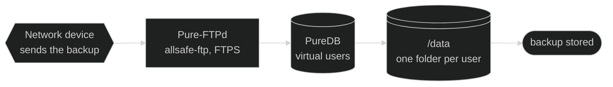
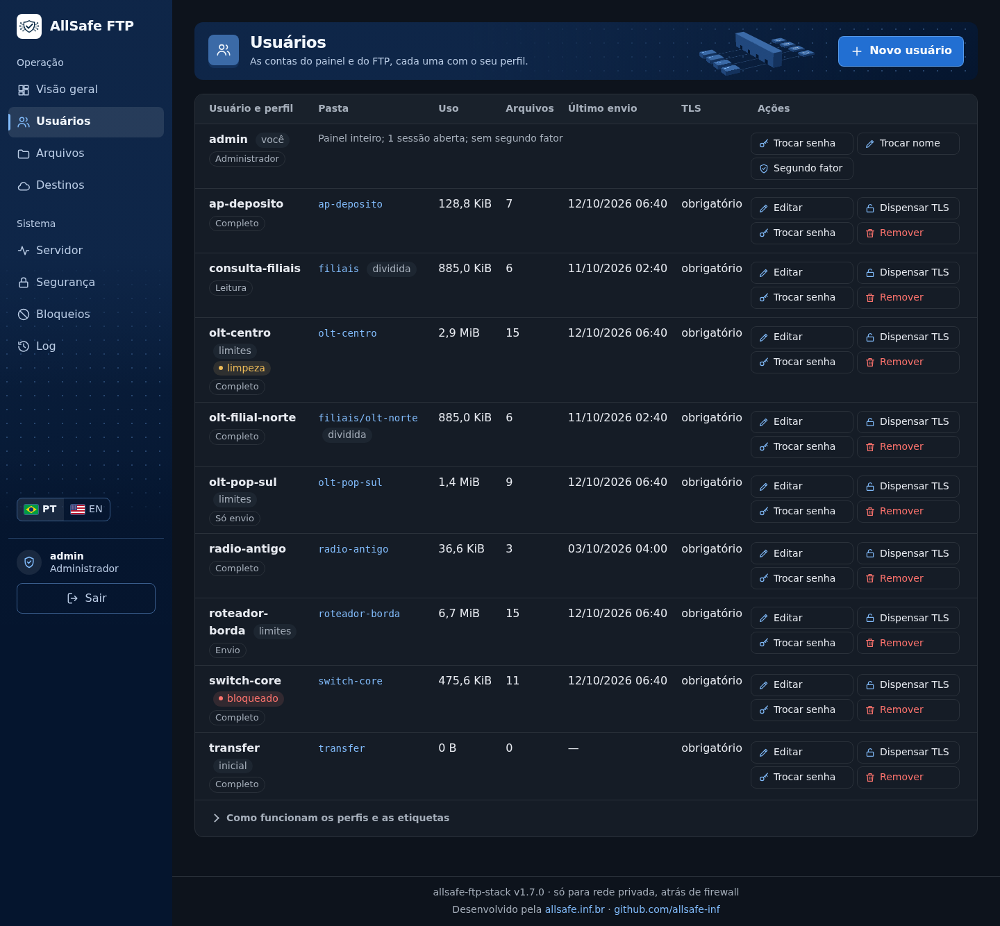
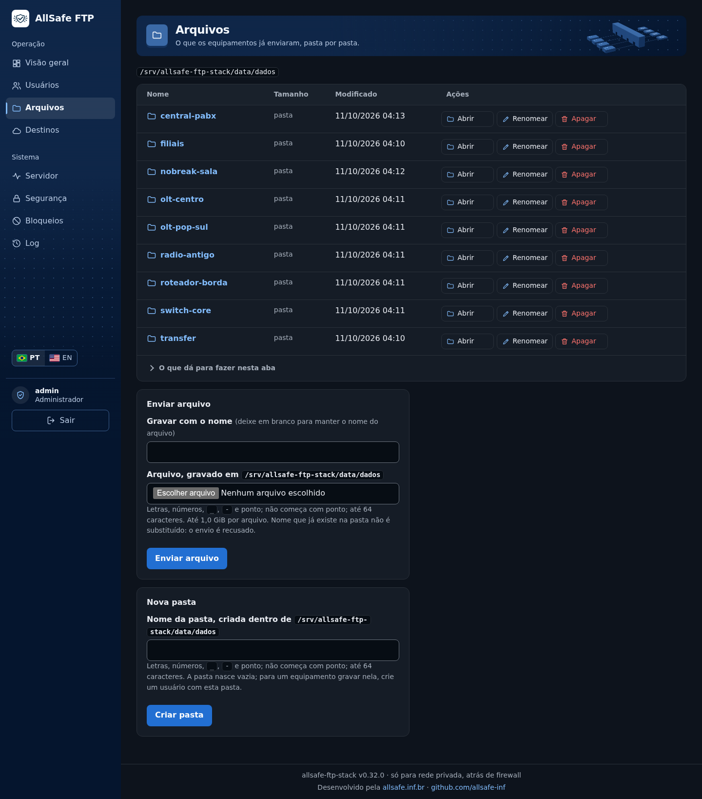
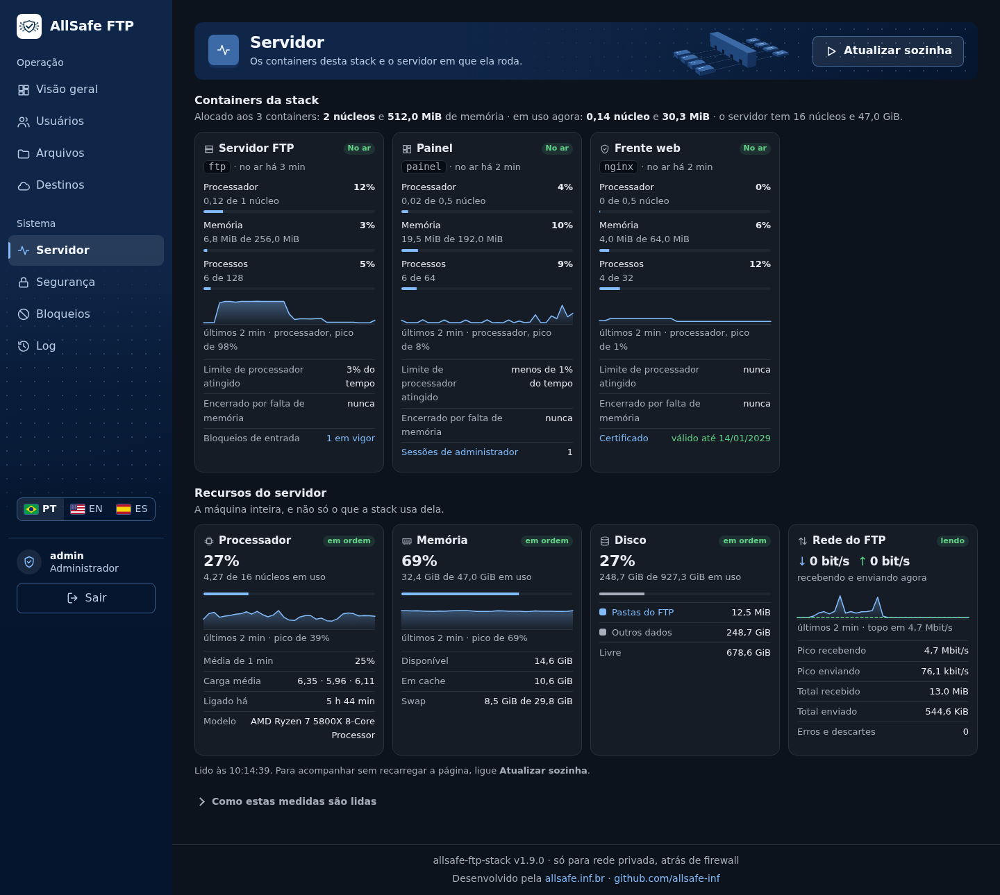
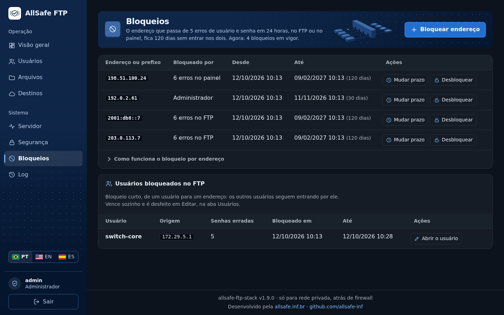
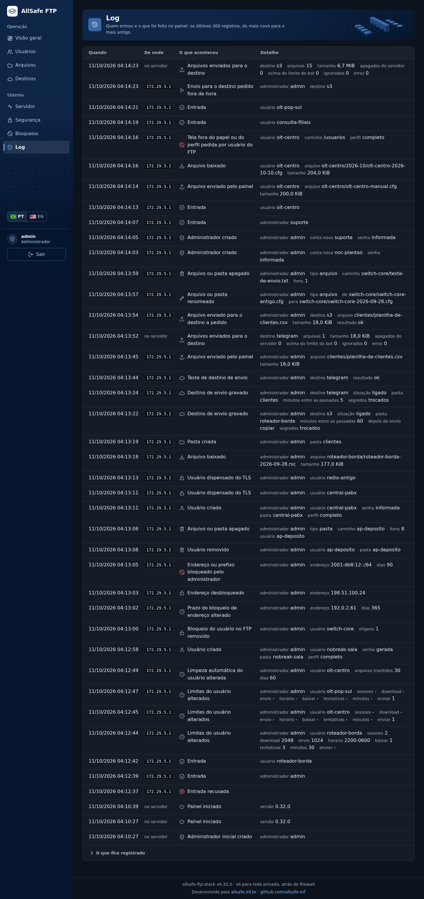
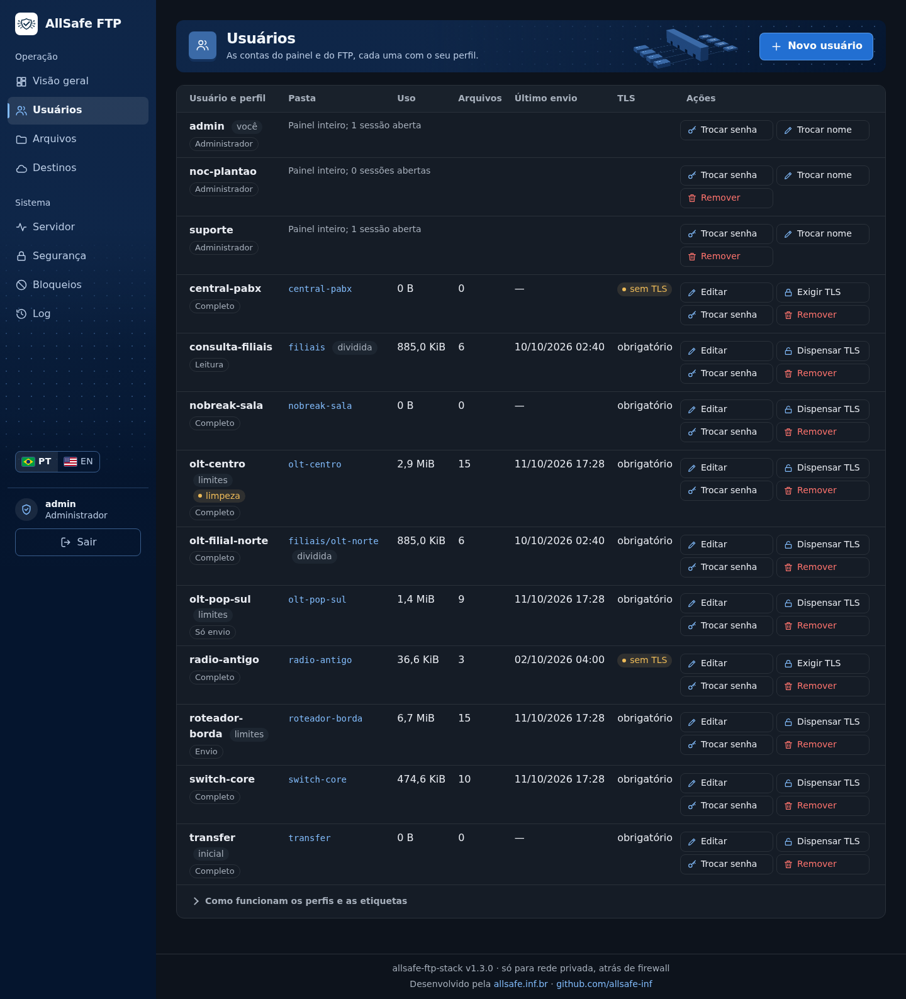
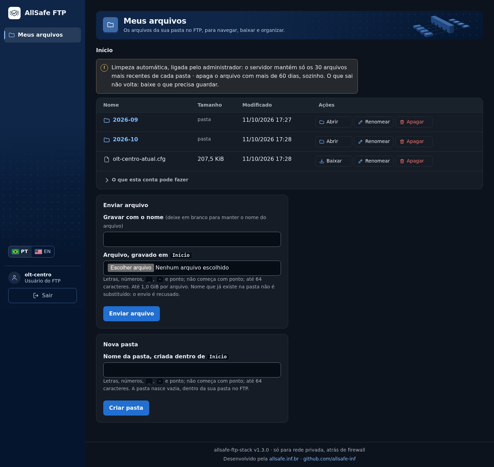
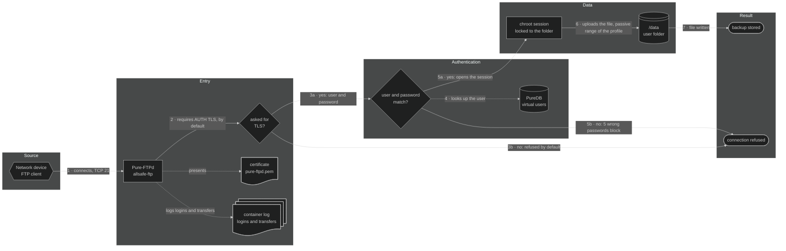
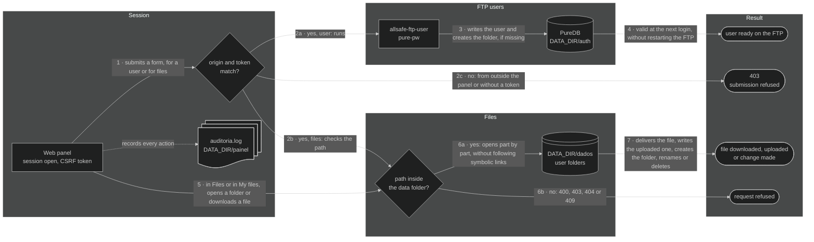

<div align="center">

<a href="web/marca/logo-320.png"></a>

# 📁 allsafe-ftp-stack

**Dedicated FTP server (Pure-FTPd) with FTPS required by default, virtual users, chroot and a secure web panel behind nginx, to keep in one place the backups and files of network devices, cameras, companies and people, on a private network.**

[](README.md)
[-6e7781?style=for-the-badge)](README.pt-BR.md)

Developed by [allsafe.inf.br](https://allsafe.inf.br) · [github.com/allsafe-inf](https://github.com/allsafe-inf)


[](LICENSE)


<a href="doc/pt-BR/imagens/painel-principal.png"></a>

<sub><b>v0.30.0</b> · web panel, Overview tab · captured on 2026-10-10</sub>

<!-- diagrama: doc/en/diagrams/overview-diagram.mmd -->

<sub>Level 1 · Diagram · [source](doc/en/diagrams/)</sub>

<sub><b>v0.29.0</b> · stack overview · 2026-10-09</sub>

</div>

**Sequence:** Network device ➜ Pure-FTPd (`allsafe-ftp`) ➜ PureDB ➜ `/data` ➜ backup stored

> 🧱 **For private networks only.** By default, this stack is for an internal network: it listens **only on a private IP** (`10.0.0.0/8`, `172.16.0.0/12`, `192.168.0.0/16` or `127.0.0.1`), **behind a firewall**, and must not be published on the internet or receive a port forward from the edge. A public address is only accepted by choice of whoever installs, with `REDE_PERMITIR_IP_PUBLICO=sim` and a firewall on the server: read the [warning](doc/en/security.md#ip-publico) first. Details in [doc/en/security.md](doc/en/security.md#rede-privada).

> 📌 **Official repository:** [github.com/allsafe-inf/allsafe-ftp-stack](https://github.com/allsafe-inf/allsafe-ftp-stack). Versions are released there first, and that is where issues and pull requests are received. The copy at `github.com/CarlosSuporteISP/allsafe-ftp-stack` is a mirror, updated afterwards.

---

<details>
<summary>Contents — click to expand</summary>

[What it is](#o-que-e) · [Highlights](#destaques) · [Screenshots](#imagens) · [Quick install](#instalacao) · [How it works](#como-funciona) · [Architecture](#arquitetura) · [Technologies](#tecnologias) · [Ports and binds](#portas) · [Configuration](#configuracao) · [Security](#seguranca) · [Tests](#testes) · [File structure](#arquivos) · [Documentation](#documentacao) · [Plan](#plano) · [Version](#versao) · [Related projects](#relacionados) · [Credits](#creditos) · [License](#licenca)

</details>

---

<a name="o-que-e"></a>

## 💡 What it is

A file server to keep backups and files in one place: the configuration backups of routers, switches, OLTs and radios, the recordings of cameras and recorders that save over FTP, and the files of companies and people. Each account signs in with a user and a password, sees only its own folder and, by default, can only sign in over an encrypted connection. Accounts are created in the browser, in a **secure web panel**, or on the command line. In the same panel, the files received are browsed and **downloaded in the browser**, by whoever administers and by the owner of the files, who signs in with the FTP user and password and sees only their own folder; with the administrator's permission, the owner also **uploads files in the browser**. Each account can have its folder chosen by whoever administers.

There are **three containers**: the FTP server, the panel and **nginx**, the only way into the panel. The FTP uses the local **PureDB** database instead of PostgreSQL: less memory, less attack surface and authentication with no network latency. The panel is small on purpose: administrators with user and password, no JavaScript, no access to Docker and no network port of its own; nginx is the one that speaks HTTPS with the browser, and it checks the source network and the volume of requests before forwarding. In all three, the root file system is read-only, the `capabilities` are minimal and the secrets stay outside the image and outside Git.

| | |
|---|---|
| **What for** | Receiving over FTPS the backups and files of network devices, cameras, companies and people, and browsing everything in the browser |
| **Technologies** | Docker Compose · Debian 13 · Pure-FTPd · PureDB · OpenSSL · nginx · Bash · Python |
| **Access** | FTP client with **explicit TLS** (`AUTH TLS`) on port `21/tcp`, passive mode in the range of the profile (`30000-30049/tcp` on `small`) · panel at `https://<private IP>:8443`, through nginx |
| **Requirements** | Docker Engine with Docker Compose v2 or newer · CPU and memory of the chosen profile (2 vCPU and 2 GB on `small`) · one dedicated **private** IP · firewall on the host allowing only the internal network |

> **Web panel:** internal network only, behind a firewall, like the rest of the stack. It refuses, in code, any address that is not private. How to use it: [doc/en/panel.md](doc/en/panel.md).

> ⚠️ **Old device without TLS:** for the device that does not support TLS there is the option `FTP_TLS_MODE=0` (or `1`). With it, **password and files travel in plain text**: use it only on an isolated internal network, and the stack warns about it in `deploy.sh`, in the container log and in the panel. See [doc/en/security.md](doc/en/security.md#ftp-sem-tls).
>
> To exempt from TLS **only the users of the old devices**, keeping the others required to use it, the administrator marks each one in the Users tab of the panel, when creating the user or later: [per-user TLS](doc/en/security.md#tls-por-usuario).

---

<a name="destaques"></a>

## ✨ Highlights

| Highlight | In practice |
|---|---|
| **Explicit FTPS required by default** | Without `AUTH TLS` there is no login: user and password do not travel in plain text. The mode without TLS, for old devices, is an explicit choice, with a warning |
| **Virtual users in PureDB** | They are not system accounts; each one is locked (`chroot`) to its own folder |
| **Blocking by attempts on the FTP** | Five wrong passwords from the same address block the user for that address for 15 minutes; the administrator adjusts the limit of each user and unblocks in the panel |
| **Blocking by address, IPv4 and IPv6** | The address that goes over five user and password errors in 24 hours stays 120 days without signing in to the FTP and to the panel, and a successful sign-in resets the count. In the Blocks tab, the administrator blocks an address or a prefix, unblocks it and changes the period |
| **Local bind by default** | It starts on `127.0.0.1`; you open only one dedicated **private** IP, with a firewall on the host |
| **Private network by default** | Made for an internal network, behind a firewall; a public address only through an explicit option, with a warning |
| **Only the panel published, if you want** | The panel can be opened through a proxy or tunnel on the server itself, with the FTP closed on the private network; the client address is only accepted from the declared proxy |
| **Secure web panel** | Creates users, changes passwords and removes users in the browser: HTTPS only, a session that ends after 4 hours without use, blocking after five wrong passwords and a record of every action |
| **Files in the browser** | The administrator browses, uploads, downloads, renames and deletes; the owner of the files signs in with the FTP user and password, sees only their own folder and does what their profile allows. Uploading through the panel depends on a permission given to each user |
| **Automatic cleanup** | Per account, the administrator tells the panel to keep only the last files of each folder or only those of the last days; the panel deletes the rest by itself, from time to time. Off by default |
| **Server health in the panel** | The Server tab shows the three containers of the stack, each with what it uses of processor, memory and processes against what was allocated to it, and the processor, the memory, the disk and the FTP network of the server, with the history of the last minutes |
| **nginx in front of the panel** | Only nginx publishes the panel port: TLS 1.2 and 1.3, HTTP/2, list of allowed networks, limit of requests and of connections per address; the panel has no network port |
| **Hardened containers** | `read_only`, `cap_drop: ALL`, `no-new-privileges`, CPU, memory and PID limits; nginx runs without `root` and without any `capability` |
| **Secrets in files** | The passwords stay in `.secrets/`, never in the image or in `compose.yaml`; the panel one, only as a hash |
| **Encrypted backup copy** | One command writes the copy already encrypted; only the private key in `.secrets/` opens it, and a copy that was changed or cut does not restore |
| **Container log** | One line per login, wrong password, block, upload, download, renamed file and deleted file on the FTP, with the user and the address; rotated by Docker (10 MB × 3) |
| **Five capacity profiles** | `--size small`, `medium`, `large`, `xlarge` or `extended` adjusts sessions, passive range and resources; `deploy.sh` checks whether the server has the CPU and the memory of the profile |

---

<a name="imagens"></a>

## 📸 Screenshots

The web panel, tab by tab. The Overview tab is the image at the top of this page, the administrators are in the Users tab, together with the FTP accounts, and the My files screen is the one of the FTP user, who signs in with the FTP name and password.

| | |
|---|---|
| <a href="doc/pt-BR/imagens/aba-usuarios.png"></a> | <a href="doc/pt-BR/imagens/aba-arquivos.png"></a> |
| **Users** — creates each account, chooses the profile, changes the password, the folder and the limits, unblocks and removes | **Files** — browses the user folders, uploads and downloads files, creates folders, renames and deletes |
| <a href="doc/pt-BR/imagens/aba-servidor.png"></a> | <a href="doc/pt-BR/imagens/aba-seguranca.png"></a> |
| **Server** — the usage and the limit of processor, memory and processes of each container, and the resources of the server | **Security** — checks network, TLS, certificates, blocks, passwords and security contact |
| <a href="doc/pt-BR/imagens/aba-bloqueios.png"></a> | <a href="doc/pt-BR/imagens/aba-atividade.png"></a> |
| **Blocks** — the blocked addresses and prefixes, by user and password errors or by the administrator, with new block, unblock and change of period | **Log** — who signed in, from where, what they downloaded, what they uploaded and what was changed |
| <a href="doc/pt-BR/imagens/aba-administradores.png"></a> | <a href="doc/pt-BR/imagens/aba-meus-arquivos.png"></a> |
| **Administrators** — they are in the Users tab, each person with their own name and their own password | **My files** — the FTP user sees their own folder and does in it what their profile allows |

<sub><b>v0.30.0</b> · web panel, one screenshot per tab · captured on 2026-10-10</sub>

Every screen, menu by menu, with the explanation of each one: [application screenshots](doc/pt-BR/aplicacao/README.md).

---

<a name="instalacao"></a>

## 🚀 Quick install

```bash
git clone https://github.com/allsafe-inf/allsafe-ftp-stack.git
cd allsafe-ftp-stack
sudo install -d -o "$USER" /srv/allsafe-ftp-stack   # folder for the data, the copies and the temporary files; as root, skip it
./deploy.sh        # creates the .env, generates the passwords, starts the FTP, the panel and nginx and waits until they are healthy
```

**One command, no questions.** Without a `.env`, `deploy.sh` creates one from the example, with everything on `127.0.0.1`: only the server itself has access, and the data stays in `/srv/allsafe-ftp-stack` (to use another place, change `DATA_DIR`, `BACKUP_DIR` and `TEMP_DIR` in the `.env`). Before acting it checks Docker, Compose, whether the server has the CPU and the memory of the profile and whether the ports are free. It can be run as many times as needed: what already exists (passwords, data, identical containers) stays as it is.

<details>
<summary>Generated passwords and adjustment for the internal network — click to expand</summary>

`deploy.sh` **generates a strong password** in `.secrets/ftp-usuario-inicial-senha.txt` (`0600`) if the file is empty: keep it for the FTP client. To use a password of your own, write it to that file before running.

At the end, the script shows the FTP and panel addresses (`Painel: https://<IP>:8443`) and **in which file** each password is, without showing them. The panel opens with the user in `PAINEL_ADMIN_USER` (`admin`, if not changed) and the initial password in `.secrets/painel-admin-inicial-senha.txt`; change it after the first access, in the Users tab.

To serve the internal network, adjust the `.env` (template in [`.env.example`](.env.example)) and run `./deploy.sh` again:

| Variable | Change to |
|---|---|
| `FTP_BIND_IP` | the **private** IP of the server on the internal network (`0.0.0.0` is always refused; a public IP, only with its [own option](doc/en/security.md#ip-publico)) |
| `FTP_PASSIVE_IP` | the private IP that the device sees (normally the same) |
| `FTP_CERT_CN` | the hostname (or IP) that goes into the certificate |
| `PAINEL_BIND_IP` | the **private** IP through which the panel will be opened; with `127.0.0.1` it only opens on the server itself |

</details>

| I want to | Command |
|---|---|
| Start with another size | `./deploy.sh --size medium` (or `large`, `xlarge`, `extended`); the size is written to the `.env` |
| Only validate, without starting anything | `./deploy.sh --check-only` |
| Update the packages of the images | `./deploy.sh --atualizar` |
| Open the panel | `https://<PAINEL_BIND_IP>:8443` in the browser, with the user in `PAINEL_ADMIN_USER` and the password in `.secrets/painel-admin-inicial-senha.txt` |
| Change the panel user or password | in the panel, Users tab, on the row of the administrator |
| Create another panel administrator | in the panel, Users tab, **New user** with the Administrator profile |
| Recover access to the panel | `./scripts/painel-senha.sh --gerar` (another administrator: `--usuario NOME`) |
| Create a user | in the panel, Users tab, or `./manage-user.sh add backup-olt` |
| Limit what a user does (uploads without deleting, only uploads without seeing the backups, or only downloads) | in the panel, Users tab, **Edit**, **Profile** card, or `./manage-user.sh perfil backup-olt envio`: see [Profiles](doc/en/panel.md#perfis) |
| Download a backup that was received | in the panel, Files tab, **Download** button on the row of the file |
| Let the owner of the files download their own | they open the panel with the FTP user and password and see only their own folder; for the panel to accept only administrators, `PAINEL_ACESSO_USUARIOS_FTP=nao` in the `.env` and `./deploy.sh` |
| Let a user upload files in the browser | in the panel, Users tab, **Edit**, checkbox **Allow this user to upload files through the panel**, or `./manage-user.sh limites backup-olt enviar=1`: see [Uploading files through the panel](doc/en/panel.md#enviar-arquivo) |
| Keep only the newest files of an account | in the panel, Users tab, **Edit**, **Automatic cleanup** card, or `./manage-user.sh retencao backup-olt ultimos=30`: see [Automatic cleanup](doc/en/panel.md#limpeza) |
| Block an address or a prefix | in the panel, Blocks tab, **Block address**, or `./manage-user.sh endereco-bloquear 203.0.113.7 30`: see [blocking by address](doc/en/security.md#bloqueio-por-endereco) |
| Create a folder and lock a user to it | in the panel, Files tab, **New folder** and **New user in this folder**, or `./manage-user.sh add olt01 clientes/olt-01` |
| Keep a backup copy | `./scripts/backup.sh`, which writes it encrypted; to go back to it, `./scripts/restaurar.sh <copy>`. Keep `.secrets/backup-chave-privada.txt` off the server |
| See the state | `docker compose ps` |
| Remove, keeping the data | `./deploy.sh --remover` |
| Remove and delete the data | `./deploy.sh --remover --apagar-dados` (asks you to type `apagar`) |

Commented step by step in [doc/en/installation.md](doc/en/installation.md).

---

<a name="como-funciona"></a>

## 🔄 How it works

The device connects on port `21/tcp`, asks for TLS, signs in with user and password, stays locked to its own folder and uploads the file in passive mode. The drawing at the top shows that path; the full flowchart, with the refusals, and the one of the panel are in the menus below.

<details>
<summary>Full flowchart of the FTP, with the written sequence — click to expand</summary>

<!-- diagrama: doc/en/diagrams/how-it-works-flowchart.mmd -->

<sub>Level 2 · Flowchart · [source](doc/en/diagrams/)</sub>

| No. | From ➜ To | What happens |
|---|---|---|
| 1 | Network device ➜ Pure-FTPd | The device opens the control connection on port `21/tcp` of the host, delivered to the container on `2121/tcp` |
| 2 | Pure-FTPd ➜ asked for TLS? | By default (`FTP_TLS_MODE=2`), the server only goes on if the client asks for `AUTH TLS`; the `pure-ftpd.pem` certificate is presented |
| 3a | asked for TLS? ➜ user and password match? | Yes: the client sends user and password, already encrypted |
| 3b | asked for TLS? ➜ connection refused | No: by default, a plain-text session is refused. Without TLS, only the user exempted by an administrator in the panel gets in, or whoever is on an installation with `FTP_TLS_MODE=0` or `1`, options for [old devices](doc/en/security.md#ftp-sem-tls) |
| 4 | user and password match? ➜ PureDB | The account is looked up in the virtual users database (`/auth/pureftpd.pdb`) |
| 5a | user and password match? ➜ chroot session | Yes: the session opens locked to the user folder |
| 5b | user and password match? ➜ connection refused | No: `530 Login authentication failed`. By default, 5 wrong passwords from the same address in 15 minutes block the user for that address for 15 minutes; the limit of each user is adjusted in the panel: [blocking by attempts](doc/en/security.md#bloqueio-por-tentativa). The address, IPv4 or IPv6, that goes over 5 errors in 24 hours, with any user, stays 120 days without signing in to the FTP and to the panel: [blocking by address](doc/en/security.md#bloqueio-por-endereco) |
| 6 | chroot session ➜ `/data` | The file goes up through the data channel in passive mode, in the range of the profile (`30000-30049/tcp` on `small`) |
| 7 | `/data` ➜ backup stored | The file is written to the user folder, inside the volume |

**Support**

| Who | Uses | How |
|---|---|---|
| Pure-FTPd | `pure-ftpd.pem` certificate | presents it to the client in the TLS negotiation |
| Pure-FTPd | container log | logs every login and every transfer, with the user and the address |

</details>

### Web panel

How nginx and the panel decide whether to serve a request, in two flowcharts: from the opening of the page to the session, and what happens with each request of the session, down to the user ready on the FTP.

<details>
<summary>Flowcharts of the web panel, with the written sequence — click to expand</summary>

<!-- diagrama: doc/en/diagrams/panel-flowchart.mmd -->
```mermaid
%%{init: {"theme": "dark"}}%%
flowchart LR
    subgraph QUEM["Who uses it"]
        usuario@{ shape: person, label: "User<br>browser on the internal network" }
    end
    subgraph FRENTE["Web front end"]
        nginx@{ shape: rect, label: "nginx<br>allsafe-ftp-nginx, HTTPS" }
        rede@{ shape: diam, label: "allowed network<br>and within the limit?" }
    end
    subgraph ENTRADA["Sign-in"]
        painel@{ shape: rect, label: "Web panel<br>allsafe-ftp-painel, Unix socket" }
        senha@{ shape: diam, label: "user and password<br>match?" }
        hash@{ shape: doc, label: "administradores<br>name and password hash" }
        ftp@{ shape: rect, label: "Pure-FTPd<br>allsafe-ftp, internal network" }
    end
    subgraph SESSAO["Session"]
        sessao@{ shape: rect, label: "4 h session<br>cookie and CSRF token" }
        pedidos@{ shape: subproc, label: "session requests<br>requests flowchart" }
    end
    subgraph RESULTADO["Result"]
        atendido@{ shape: stadium, label: "request served" }
        recusa@{ shape: stadium, label: "request refused" }
    end

    usuario -- "1 · opens https, TCP 8443" --> nginx
    nginx -- "2 · checks the source and the request rate" --> rede
    rede -- "3a · yes: forwards through the Unix socket" --> painel
    rede -- "3b · no: 403 or 429" --> recusa
    painel -- "4 · asks for user and password and checks" --> senha
    senha -- "5a · yes: opens the session of the administrator or of the FTP user" --> sessao
    senha -- "5b · no: 5 errors block the address" --> recusa
    sessao -- "6 · every request goes through the checks" --> pedidos
    pedidos -- "7a · accepted" --> atendido
    pedidos -- "7b · refused" --> recusa
    painel -. "administrator: compares with the hash" .-> hash
    painel -. "any other name: the FTP server checks the password" .-> ftp
```
<sub>Level 2 · Flowchart · [source](doc/en/diagrams/)</sub>

| No. | From ➜ To | What happens |
|---|---|---|
| 1 | User ➜ nginx | The browser opens `https://<address>:8443`; HTTPS only, with TLS 1.2 or 1.3, over HTTP/2 when the browser accepts it |
| 2 | nginx ➜ allowed network and within the limit? | The source address is compared with `PAINEL_REDES_PERMITIDAS`, and the request, with the limits of rate, of connections and of size |
| 3a | allowed network and within the limit? ➜ Web panel | Yes: nginx forwards the request through the Unix socket, with the client address |
| 3b | allowed network and within the limit? ➜ request refused | No: `403` for a network from outside, `429` for too many requests; the panel does not even receive the request |
| 4 | Web panel ➜ user and password match? | The panel checks the network and the host name again, shows the sign-in screen, which asks for user and password, and checks what was typed |
| 5a | user and password match? ➜ 4 h session | Yes: it opens the session, with cookie and CSRF token. The administrator's reaches every tab; the FTP user's, only the My files screen |
| 5b | user and password match? ➜ request refused | No: `401`, without saying which of the two was wrong; five errors in 15 minutes block the address (`429`) |
| 6 | 4 h session ➜ session requests | Every request made with the session open goes through the checks of the requests flowchart, right below |
| 7a | session requests ➜ request served | Accepted: the user is ready on the FTP, the file is downloaded or the change is made |
| 7b | session requests ➜ request refused | Refused: nothing changes, and the refusal goes to the audit log |

**Support**

| Who | Uses | How |
|---|---|---|
| Web panel | administrators (`DATA_DIR/painel/administradores`) | compares the typed password with the `scrypt` hash of the administrator, at every sign-in; a name that does not exist goes through the same computation |
| Web panel | Pure-FTPd (`allsafe-ftp`, internal network of the stack) | it is not an administrator with that password and the sign-in of FTP users is on: it logs in to the FTP server with the name and the password and logs out right away, over TLS with the certificate checked; the server is the one that says whether the password is valid |

**Session requests**

What the panel does with each request after the sign-in: the form that creates, edits or removes a user, and the folder or the file requested in the Files tab or in the My files screen.

<!-- diagrama: doc/en/diagrams/panel-requests-flowchart.mmd -->

<sub>Level 2 · Flowchart · [source](doc/en/diagrams/)</sub>

| No. | From ➜ To | What happens |
|---|---|---|
| 1 | Web panel ➜ origin and token match? | Every form submitted is checked twice: the origin has to be the panel itself and the CSRF token has to be the one of the session. Only the administrator has the user form; the file forms, the administrator and the FTP user, the latter according to their profile |
| 2a | origin and token match? ➜ `allsafe-ftp-user` | Yes, user form: the panel calls the command, with the password on standard input |
| 2b | origin and token match? ➜ path inside the data folder? | Yes, file form, from the Files tab or from the My files screen (upload file, create folder, rename or delete): it goes on to the check of the path |
| 2c | origin and token match? ➜ 403 | No: `403`, without changing anything, for the submission that did not come from the panel or that came without the session token |
| 3 | `allsafe-ftp-user` ➜ PureDB | The account is written to `DATA_DIR/auth`, with a lock for one change at a time, and the folder of the new user is created in `DATA_DIR/dados`, if it does not exist yet; the TLS exemption of a user goes to `sem-tls.lista`, in the same folder as the database |
| 4 | PureDB ➜ user ready on the FTP | The FTP reads the database at every login: it is valid right away, without restarting |
| 5 | Web panel ➜ path inside the data folder? | In the Files tab, the administrator opens a folder or downloads a file; in the My files screen, the FTP user does the same, only in their folder. These requests carry no form, and the path is checked in the same way |
| 6a | path inside the data folder? ➜ `DATA_DIR/dados` | Yes: the panel opens each part of the path without following symbolic links, starting from the data folder, for the administrator, and from the folder in the account record, for the FTP user |
| 6b | path inside the data folder? ➜ request refused | No: `400` for a path or name that tries to leave the folder, `403` for a symbolic link, `404` for what does not exist, `409` for a name already in use |
| 7 | `DATA_DIR/dados` ➜ file downloaded, uploaded or change made | The file goes out as an attachment, in blocks; the uploaded file only gets a name in the folder after arriving whole, without replacing what exists; the new folder is born empty, owned by the user `ftpdata`; the chosen file or folder is renamed or deleted |

**Support**

| Who | Uses | How |
|---|---|---|
| Web panel | `auditoria.log` (`DATA_DIR/painel`) | records every sign-in, refusal, download and change |

</details>

---

<a name="arquitetura"></a>

## 🏗️ Architecture

Three containers on a network of their own: `ftp` (Pure-FTPd), `painel` (Python) and `nginx`, the only way into the panel. The data stays on the host, in `DATA_DIR`, and the passwords in `.secrets/`.

<!-- diagrama: doc/en/diagrams/architecture-map.mmd -->
```mermaid
%%{init: {"theme": "dark"}}%%
flowchart LR
    subgraph USO["Who uses it"]
        operador@{ shape: person, label: "User<br>operates the stack" }
        equip@{ shape: hex, label: "Network device<br>FTP client" }
    end
    subgraph HOST["Host"]
        scripts@{ shape: console, label: "deploy.sh<br>manage-user.sh" }
    end
    subgraph CONTAINERS["Containers · allsafe-ftp-network network"]
        nginx@{ shape: rect, label: "nginx<br>allsafe-ftp-nginx, 8443/tcp" }
        painel@{ shape: rect, label: "Web panel<br>allsafe-ftp-painel, Unix socket" }
        ftp@{ shape: rect, label: "Pure-FTPd<br>allsafe-ftp, 2121/tcp" }
    end
    subgraph VOLUMES["Volumes"]
        vnginx@{ shape: lin-cyl, label: "DATA_DIR/nginx<br>socket and copy of the certificate" }
        vpainel@{ shape: lin-cyl, label: "DATA_DIR/painel<br>administrators and audit" }
        vauth@{ shape: cyl, label: "DATA_DIR/auth<br>PureDB" }
        vdata@{ shape: lin-cyl, label: "DATA_DIR/dados<br>uploaded files" }
        vcerts@{ shape: lin-cyl, label: "DATA_DIR/certs<br>FTP certificate" }
    end
    subgraph RESULTADO["Result"]
        fim@{ shape: stadium, label: "backup stored" }
    end

    operador -- "1 · ./deploy.sh" --> scripts
    scripts -- "2 · docker compose build and up -d --wait" --> nginx
    operador -- "3 · HTTPS, TCP 8443" --> nginx
    nginx -- "4 · forwards through the Unix socket" --> painel
    painel -- "5 · creates, edits or removes the user" --> vauth
    equip -- "6 · FTPS, TCP 21 to 2121" --> ftp
    ftp -- "7 · writes the file" --> vdata
    vdata -- "8 · file on the volume" --> fim
    nginx -. "reads, read-only" .-> vnginx
    painel -. "creates the socket" .-> vnginx
    painel -. "writes" .-> vpainel
    painel -. "manages and reads" .-> vdata
    painel -. "checks the FTP password" ..-> ftp
    ftp -. "looks up" .-> vauth
    ftp -. "reads the certificate" .-> vcerts
```
<sub>Level 2 · Map · [source](doc/en/diagrams/)</sub>

| No. | From ➜ To | What happens |
|---|---|---|
| 1 | User ➜ `deploy.sh` | The user runs `./deploy.sh` on the host |
| 2 | `deploy.sh` ➜ nginx | The script validates the configuration, builds the images (`docker compose build`) and starts the three containers (`up -d --wait`), in the order `ftp`, `painel` and `nginx`: each one waits for the previous one to be `healthy`, and nginx, the way into the panel, is the last |
| 3 | User ➜ nginx | The user opens the panel over HTTPS on `8443/tcp`: nginx is the one that answers, and it checks the source network and the request rate |
| 4 | nginx ➜ Web panel | The accepted request is forwarded to the panel through the Unix socket, with the client address |
| 5 | Web panel ➜ `DATA_DIR/auth` | The panel creates, edits or removes the user in PureDB |
| 6 | Network device ➜ Pure-FTPd | The client connects over FTPS on `21/tcp`, mapped to `2121/tcp` |
| 7 | Pure-FTPd ➜ `DATA_DIR/dados` | The file is written through the passive channel, in the range of the profile (`30000-30049/tcp` on `small`) |
| 8 | `DATA_DIR/dados` ➜ backup stored | The file stays in the user folder, on the host |

**Support**

| Who | Uses | How |
|---|---|---|
| nginx | `DATA_DIR/nginx` | reads the socket and the certificate, read-only |
| Web panel | `DATA_DIR/nginx` | creates the socket and copies the certificate, at every start |
| Web panel | `DATA_DIR/painel` | writes the certificate, the administrators and the audit log |
| Web panel | `DATA_DIR/dados` | creates folders, renames, deletes and reads the files for the download |
| Web panel | Pure-FTPd | checks the password of the FTP user who signs in to the panel, over the internal network of the stack |
| Pure-FTPd | `DATA_DIR/auth` (PureDB) | looks up the users |
| Pure-FTPd | `DATA_DIR/certs` | reads the certificate |

**Configuration, secrets and log**

The map shows the parts and the volumes. The configuration, the secrets and the log are in this table:

| Who | Uses | How |
|---|---|---|
| `deploy.sh` and `manage-user.sh` | `.env` | creates, reads and writes the profile |
| Pure-FTPd | `.secrets` (`ftp-usuario-inicial-senha.txt`) | reads the password at start, read-only |
| Web panel | `.secrets` (`painel-admin-inicial-senha-hash.txt`) | reads the initial hash at start, read-only |
| Pure-FTPd | container log | logs every login and every transfer, with the user and the address |

<details>
<summary>Parts, ports, folders, images and entrypoints — click to expand</summary>

| Part | Role | Port | Data in |
|---|---|---|---|
| Container `allsafe-ftp` (service `ftp`) | Pure-FTPd with FTPS, `chroot` and limits | `21/tcp` ➜ `2121/tcp` and the passive range of the profile (`30000-30049/tcp` on `small`) | — |
| Container `allsafe-ftp-painel` (service `painel`) | Web panel that administers the FTP users; serves only nginx, through a Unix socket | none | — |
| Container `allsafe-ftp-nginx` (service `nginx`) | Web front end of the panel: HTTPS, allowed networks, request limit and static files | `8443/tcp` ➜ `8443/tcp` | — |
| Folder `DATA_DIR/auth` | PureDB database of the virtual users, shared by the FTP and the panel | — | `/auth` |
| Folder `DATA_DIR/dados` | Uploaded files, one folder per user | — | `/data` |
| Folder `DATA_DIR/certs` | TLS key and certificate of the FTP (`pure-ftpd.pem`) | — | `/etc/ssl/private` |
| Folder `DATA_DIR/painel` | Panel certificate, administrators (name and password hash), `auditoria.log` and the language chosen by each account (`idiomas`) | — | `/painel` |
| Folder `DATA_DIR/nginx` | Panel socket and copy of the certificate, remade at every start; nginx only reads | — | `/nginx` |
| Secret `ftp_usuario_inicial_senha` | Password of the initial user (`.secrets/ftp-usuario-inicial-senha.txt`), read-only | — | `/run/secrets/ftp_usuario_inicial_senha` |
| Secret `painel_admin_inicial_senha_hash` | Hash of the initial password of the first panel administrator (`.secrets/painel-admin-inicial-senha-hash.txt`), read-only | — | `/run/secrets/painel_admin_inicial_senha_hash` |
| Network `allsafe-ftp-network` | Dedicated bridge, subnet `172.29.1.0/29` | — | — |

- **Images:** [`Dockerfile`](Dockerfile) with three targets on the same `debian:trixie-slim` (Debian 13), pinned by digest: `ftp` (`pure-ftpd` and the user `ftpdata`, uid and gid **10000**), `painel` (the same, with `python3`) and `nginx` (only `nginx` and `openssl`, with the user `frente`, uid and gid **10001**). All three carry the project `LICENSE` and `NOTICE` in `/usr/share/doc/allsafe-ftp-stack/`.
- **FTP entrypoint:** [`ftp/entrypoint.sh`](ftp/entrypoint.sh) creates the initial user once and applies the password from the secret when it changes, generates the self-signed certificate at the first start and runs `pure-ftpd`.
- **Panel entrypoint:** [`painel/entrypoint.sh`](painel/entrypoint.sh) checks the private network, generates the panel certificate, prepares the nginx folder and runs [`painel/servidor.py`](painel/servidor.py), the entry point of the panel modules.
- **nginx entrypoint:** [`nginx/entrypoint.sh`](nginx/entrypoint.sh) refuses to run as `root`, checks the private network, builds the configuration from [`nginx/nginx.conf.modelo`](nginx/nginx.conf.modelo) and runs `nginx`, which also delivers the static files in [`web/`](web/): the style sheet and the brand.

</details>

Full detail, with the startup model, in [doc/en/architecture.md](doc/en/architecture.md).

---

<a name="tecnologias"></a>

## 🛠️ Technologies

Docker Compose, Debian 13, Pure-FTPd, OpenSSL, nginx, Python and Bash, with the real version checked on the host where the stack was validated.

<details>
<summary>Technologies, with name and version — click to expand</summary>

| Technology | Version | Role |
|---|---|---|
| Docker Engine | 29.8.2 | Runs the containers (version of the host where the stack was validated) |
| Docker Compose | 5.5.1 | Starts the services, the volumes and the network from [`compose.yaml`](compose.yaml) |
| Debian | 13 (trixie-slim, pinned by digest) | Base image |
| Pure-FTPd | 1.0.50 (Debian package `1.0.50-2.2`) | FTP server with TLS, `chroot` and virtual users |
| PureDB | built into Pure-FTPd 1.0.50 | Local database of the virtual users |
| OpenSSL | 3.5.7 (3.5 series of Debian 13) | Generates the self-signed certificates and provides TLS |
| nginx | 1.26.3 (Debian package `nginx`) | Web front end of the panel: HTTPS, allowed networks, request limit and static files |
| Python | 3.13.5 (Debian package `python3`) | Web panel, with the standard library only |
| tini | 0.19.0 (`docker-init` of Docker Engine) | Process 1 of each container (`init: true`) |
| Bash | 5.2 | Scripts of the host and of the containers |

</details>

<details>
<summary>Weight of the languages and of the services, measured — click to expand</summary>

Measured on 2026-10-05, on version `0.20.1`, with the three containers idle, on the `small` size:

| Service | Language or program | Memory in use | Limit of the size | Image |
|---|---|---|---|---|
| `ftp` | Pure-FTPd, in C, with a Bash entrypoint | 2.7 MiB | 256 MiB | 208 MB |
| `painel` | Python, with the standard library only | 12.9 MiB | 192 MiB | 258 MB |
| `nginx` | nginx, in C | 3.2 MiB | 64 MiB | 145 MB |

- **Total when idle:** about 19 MiB of memory and processor close to zero.
- **Panel response:** the sign-in screen, with a new HTTPS connection at every request, answered in 2.8 ms at the median of 30 requests (from 2.4 ms to 3.8 ms).
- **Web front end, measured on 2026-10-07, on version `0.26.1`:** the whole sign-in screen (page, style and three images) arrived in 8.8 ms over a single connection, on HTTP/2; before, it was 11.0 ms over five connections. The style went from 6957 to 2175 bytes on the network. The click made after 20 and after 45 seconds idle took 0.8 ms, over the same connection; before, 2.0 ms, with a new connection. The nginx memory stayed at 3.5 MiB.
- **No third-party dependency:** the panel installs no PyPI package and has no JavaScript; what there is to update is the base image and the Debian packages.
- **Size of the code, on version `0.30.0`:** 7302 lines of Python in 30 modules, of which 1750 are the catalog of the English texts, 1073 of CSS, 7710 of Bash and 708 of Perl, counting the test suite.
- **Where the weight of the images comes from:** from the `debian:13-slim` base, with 119 MB, common to the three.
- **FTP image, measured on 2026-10-09, on version `0.29.0`:** it went from 208 MB to 218 MB with `age`, which encrypts the backup copy. The other two did not change, and nothing new is installed on the host.
- **Panel with hundreds of users, measured on 2026-10-09, on version `0.29.2`:** with 501 users in the database, the Users tab (297 KB of page) answers in 8.5 ms and the Overview in 5.1 ms, at the median of 30 requests; before, it was 33.2 ms and 17.0 ms, because the folder of each user was compared with that of all the others. Reading the user database takes 1.2 ms and is still done at every request.
- **Redesigned panel, measured on 2026-10-10, on version `0.30.0`:** with 10 users, the seven administrator screens answer in 2.3 ms to 3.7 ms at the median of 30 requests. With 501 users, the Users tab (491 KB of page) answers in 10.8 ms, the Files tab (355 KB) in 7.8 ms and the Overview in 6.2 ms; in English, the difference is up to 0.4 ms. When idle, the three services add up to about 27 MiB of memory, and the images are still 218 MB, 258 MB and 145 MB.

</details>

---

<a name="portas"></a>

## 🔌 Ports and binds

FTP on `21/tcp` plus the passive range of the profile; panel on `8443/tcp`, through nginx. Everything on `127.0.0.1` until the `.env` names a private IP.

<details>
<summary>Table of ports and binds — click to expand</summary>

| Port (host) | Protocol | Default bind | What it is for |
|---|---|---|---|
| `${FTP_PORT:-21}` | TCP | `${FTP_BIND_IP:-127.0.0.1}` | FTP control channel (mapped to `:2121` in the container) |
| `30000-30049` | TCP | `${FTP_BIND_IP:-127.0.0.1}` | data channel in **passive mode**; range of the `small` profile (50 ports = 50 clients), up to `30000-31599` on `extended` |
| `${PAINEL_PORT:-8443}` | TCP | `${PAINEL_BIND_IP:-127.0.0.1}` | web panel, HTTPS; nginx is the one that publishes it (mapped to `:8443` in the `allsafe-ftp-nginx` container) |

The passive range is 1:1 between host and container. When changing `FTP_PASSIVE_PORT_*`, match the number of ports to `FTP_MAX_CLIENTS`. The panel container publishes no port: it only talks to nginx, through a Unix socket.

</details>

---

<a name="configuracao"></a>

## ⚙️ Configuration

All the configuration comes from the `.env`, created from [`.env.example`](.env.example). `./deploy.sh --size <profile>` **writes to the `.env`** the values of `profiles/<profile>.env` and the name of the profile in `FTP_PROFILE`, changing only the sizing (session limits, passive range, CPU, memory, PIDs and `nofile`).

<details>
<summary>The five capacity profiles — click to expand</summary>

| Profile | Reference host | Simultaneous sessions | When to use |
|---|---|---|---|
| [`small`](profiles/small.env) | 2 vCPU · 2 GB | ~50 | default: covers most providers |
| [`medium`](profiles/medium.env) | 4 vCPU · 4 GB | ~120 | nightly batch collection (~50 to 200 devices) |
| [`large`](profiles/large.env) | 8 vCPU · 8 GB | ~300 | more than 200 devices or several concurrent collectors |
| [`xlarge`](profiles/xlarge.env) | 16 vCPU · 16 GB | ~600 | large operation, with several regions or several collectors on the same server |
| [`extended`](profiles/extended.env) | 32 vCPU · 32 GB | ~1200 | the largest size: dedicated server, thousands of devices in short windows |

</details>

Each profile widens the passive range together with `FTP_MAX_CLIENTS`: adjust the host firewall when changing. `deploy.sh` refuses the profile that asks for more CPU or memory than the server has. All the variables in [doc/en/configuration.md](doc/en/configuration.md); the full table of the profiles in [doc/en/profiles.md](doc/en/profiles.md).

---

<a name="seguranca"></a>

## 🔐 Security

- **Private network by default:** private IP, behind a firewall, with no port forward from the internet. See [private network and firewall](doc/en/security.md#rede-privada).
- **Public IP only by choice:** `REDE_PERMITIR_IP_PUBLICO=sim` accepts a public address and requires TLS; the stack warns about it in `deploy.sh`, in the container logs and in the panel. Only with a firewall on the server. See [public IP](doc/en/security.md#ip-publico).
- **Only the panel published, without exposing the FTP:** `PAINEL_PROXY_CONFIAVEL` declares the proxy or the tunnel that runs on the server itself. The panel then counts the wrong password and the session by the client address that it reports, and the address written in a header by anyone else is ignored. See [panel through proxy or tunnel](doc/en/security.md#painel-por-proxy).
<details>
<summary>Protections applied, one by one — click to expand</summary>

- Bind on `127.0.0.1` by default: open only one dedicated private IP and allow in the host firewall only the networks that send backups.
- TLS **required** to sign in by default (`FTP_TLS_MODE=2`), `chroot` for everyone, no anonymous user, no reverse DNS.
- **Blocking by attempts on the FTP:** the address that gets the password of a user wrong five times in 15 minutes is blocked for that user for the same time; the limit and the time are adjusted per user, and the administrator unblocks in the panel. See [blocking by attempts](doc/en/security.md#bloqueio-por-tentativa).
- **Blocking by address, on the FTP and on the panel:** the address, IPv4 or IPv6, that goes over five user and password errors in 24 hours, with any user name, stays 120 days without signing in to either, with any account; a successful sign-in resets the count. The Blocks tab of the panel lists the addresses, and the administrator blocks an address or a prefix, unblocks it or changes the period. A prefix is only blocked by the administrator. See [blocking by address](doc/en/security.md#bloqueio-por-endereco).
- **Without TLS only for whoever the administrator exempts:** in the panel, when creating the user or in Edit, the administrator marks the users of the old devices, one by one; the others are still required to use TLS, and with nobody exempt the session without TLS is refused before the password. See [per-user TLS](doc/en/security.md#tls-por-usuario).
- **Without TLS for everyone only by choice:** `FTP_TLS_MODE=0` or `1` exists for the old device that does not speak TLS. Password and files travel in plain text, and the stack warns about it in `deploy.sh`, in the container log and in the panel. Only on an isolated internal network. See [device without TLS](doc/en/security.md#ftp-sem-tls).
- `read_only` on the root file system, `cap_drop: ALL` (only the strictly necessary ones come back), `no-new-privileges`, CPU, memory, PID and `nofile` limits.
- Password in `.secrets/ftp-usuario-inicial-senha.txt` (minimum of 12 characters, `0600`), outside the image and ignored by Git. See [doc/en/secrets.md](doc/en/secrets.md).
- **Encrypted backup copy:** `scripts/backup.sh` encrypts with the public key in `.secrets/` and nothing unencrypted reaches the disk; only the private key opens the copy. See [the key of the copy](doc/en/backup.md#chave).
- nginx in front of the panel: it is the only published port, runs without `root` and without `capability`, accepts only the networks in `PAINEL_REDES_PERMITIDAS` and limits requests and connections per address.
- **Standards followed:** FTP over TLS, TLS 1.2 and 1.3, HTTP, cookie, download, `security.txt` and `robots.txt` checked against the RFCs, with the status of each one. See [RFC conformance](doc/en/security.md#conformidade-rfc).
- Panel only over HTTPS and only from a private network: password stored as a `scrypt` hash, a session that ends after 4 hours without use and after 12 hours in any case, blocking after five wrong passwords, CSRF protection, no JavaScript, no access to Docker and a record of every action. See [doc/en/panel.md](doc/en/panel.md#protecoes).
- Rotated logs (`max-size: 10m`, `max-file: 3`).

</details>

The safest path for each decision of whoever installs, as a flowchart, is in [best practices before production](doc/en/security.md#boas-praticas); what is attacked at every version, in [tests run](doc/en/security.md#testes-executados). Threat model and the hardening line by line in [doc/en/security.md](doc/en/security.md).

---

<a name="testes"></a>

## 🧪 Tests

| I want to | Command | Expected result |
|---|---|---|
| Check syntax and Compose, without starting anything | `./scripts/validate.sh` | `painel OK: <n> módulos Python`, `idioma OK: <n> textos do painel com tradução em inglês, <n> mensagens do comando de usuários`, `marca OK: 6 arquivos em web/marca/`, `política de segurança OK: SECURITY.md aponta para SEGURANCA_CONTATO_EMAIL, sem endereço fixo`, `licença OK: LICENSE (Apache-2.0), NOTICE, MARCA.md e a linha SPDX em <n> arquivos de código`, `compose OK com <perfil>.env` for the five profiles and `Validacao FTP concluida.` |
| Check the running installation | `./scripts/validate.sh --runtime` | the same, plus `servico ftp: running, healthy`, likewise for `painel` and `nginx`, and the initial user in PureDB or removed by the administrator |
| Run the full suite: functional, security and network | `./tests/testar.sh` | one line per case and, at the end, `Bateria aprovada: nenhum desvio.` |

The suite starts a separate test instance, on `127.0.0.2`, and removes it when it finishes: the installation in use is not touched. There are 73 functional cases, 124 security cases and 14 network cases, and no version is published with a deviation. What the security suite tries, target by target, is in [tests run](doc/en/security.md#testes-executados); the options of the script, in [Scripts](doc/en/scripts.md#testar).

---

<a name="arquivos"></a>

## 🗂️ File structure

At the root are `compose.yaml`, the `Dockerfile` and the day-to-day commands (`deploy.sh`, `manage-user.sh`). Each service has its folder, with what goes inside the image: `ftp/`, `painel/` and `nginx/`; `web/` holds the static files that nginx delivers, with the logo and the icon in `web/marca/`; `scripts/` has what runs outside the containers; `tests/` has the test suite. `LICENSE`, `NOTICE` and `TRADEMARK.md` state the license of the code, the authorship and the rule of the brand.

<details>
<summary>File by file — click to expand</summary>

| Path | What it is |
|---|---|
| [`compose.yaml`](compose.yaml) | Definition of the services `ftp`, `painel` and `nginx`, volumes, network, limits and healthchecks |
| [`Dockerfile`](Dockerfile) | Images on Debian 13 slim: targets `ftp` and `painel`, with Pure-FTPd and the user `ftpdata`, and target `nginx` |
| [`deploy.sh`](deploy.sh) | Installs, reapplies, updates or removes the stack in one command |
| [`manage-user.sh`](manage-user.sh) | Host shortcut for `add` (with the folder and the profile, if you want), `passwd`, `pasta`, `perfil`, `del` and `list` of users |
| [`ftp/entrypoint.sh`](ftp/entrypoint.sh) | Prepares the initial user and the certificate and runs `pure-ftpd` |
| [`ftp/saude.sh`](ftp/saude.sh) | FTP healthcheck: opens the control port and waits for the greeting of the server |
| [`ftp/usuario.sh`](ftp/usuario.sh) | User management **inside** the containers (called by `manage-user.sh` and by the panel) |
| [`painel/servidor.py`](painel/servidor.py) | Web panel, in Python with the standard library only, behind nginx: entry point, with the `--hash` and `--saude` modes |
| [`painel/`](painel/), other `.py` files | The other modules of the panel, one subject per file: configuration, password, session, audit log, state of the stack, request handling, routes and one tab per file. List in [Web panel](doc/en/panel.md#modulos) |
| [`painel/entrypoint.sh`](painel/entrypoint.sh) | Checks the private network, generates the panel certificate and runs the server |
| [`nginx/nginx.conf.modelo`](nginx/nginx.conf.modelo) | Template of the nginx configuration: HTTPS, HTTP/2, allowed networks, limits, static files and forwarding to the panel |
| [`nginx/cabecalhos.conf`](nginx/cabecalhos.conf) | Security headers of the responses that nginx itself gives (error pages and static files) |
| [`nginx/erro/`](nginx/erro/) | Error pages of nginx, in text |
| [`nginx/entrypoint.sh`](nginx/entrypoint.sh) | Checks the private network, builds the configuration and runs nginx |
| [`nginx/saude.sh`](nginx/saude.sh) | nginx healthcheck: requests `/saude` over HTTPS, end to end |
| [`web/estilo.css`](web/estilo.css) | Look of the panel, delivered directly by nginx |
| [`web/robots.txt`](web/robots.txt) | Notice to search robots that nothing in the panel is to be indexed, delivered directly by nginx |
| [`web/marca/`](web/marca/) | Logo and icon of the panel, delivered directly by nginx: six ready files and, in `fonte/`, the two source artworks |
| [`scripts/painel-senha.sh`](scripts/painel-senha.sh) | Recovers access to the panel from the host: sets the password of an administrator or creates the administrator, writing only the hash |
| [`scripts/rede-privada.sh`](scripts/rede-privada.sh) | Functions that refuse an IP and a network that are not private and that handle the public IP option |
| [`scripts/ambiente.sh`](scripts/ambiente.sh) | Function that reads a key from the `.env` without executing the file |
| [`scripts/backup.sh`](scripts/backup.sh) | Writes the encrypted backup copy of the data, the users, the certificates and the audit log to `BACKUP_DIR` |
| [`scripts/restaurar.sh`](scripts/restaurar.sh) | Returns the stack to the state of a copy, keeping the current state first |
| [`scripts/validate.sh`](scripts/validate.sh) | Check of syntax, of the brand, of the license and of the Compose of every profile and, with `--runtime`, of the three running services |
| [`scripts/gerar-marca.sh`](scripts/gerar-marca.sh) | Generates the files in `web/marca/` from the source artworks; only runs when the logo changes |
| [`tests/testar.sh`](tests/testar.sh) | Functional, security and network test suite, on a test instance of its own |
| [`tests/comum.sh`](tests/comum.sh) | Functions of the suite: record of the cases, FTP and panel helpers and writing of the results |
| [`tests/etapas/`](tests/etapas/) | The cases of the suite, one file per stage, in the order of the name |
| [`profiles/`](profiles/) | Capacity profiles (`--size small\|medium\|large\|xlarge\|extended`) |
| [`.env.example`](.env.example) | Configuration template, copied to `.env` |
| `.secrets/` | One file per secret, named after what it keeps, and the `LEIAME.txt` that explains each one (ignored by Git) |
| [`VERSION`](VERSION) | Current version, in one place only |
| [`CHANGELOG.md`](CHANGELOG.md) | History of changes per version, in Portuguese |
| [`LICENSE`](LICENSE) | Apache 2.0 license: it covers the code, the configuration, the scripts, the tests and the documentation |
| [`NOTICE`](NOTICE) | Notice of authorship, which goes with every copy and every derived version |
| [`TRADEMARK.md`](TRADEMARK.md) | Request about the ALL-SAFE logo and icon: they stay in own use, they come out in a contract or sale to third parties |
| [`SECURITY.md`](SECURITY.md) | Security policy: whom to tell about a flaw, what to send and which versions receive fixes |
| [`doc/en/`](doc/en/README.md) | Documentation, diagrams and application screenshots, in English |
| `doc/pt-BR/` | The same documentation, in Portuguese |

</details>

---

<a name="documentacao"></a>

## 📚 Documentation

Index: [doc/en/README.md](doc/en/README.md).

| Guide | Subject |
|---|---|
| [Installation](doc/en/installation.md) | Prerequisites and commented step by step |
| [Configuration](doc/en/configuration.md) | All the variables of the `.env` |
| [Profiles](doc/en/profiles.md) | Profiles `small`, `medium`, `large`, `xlarge` and `extended`: sizing and passive range |
| [Architecture](doc/en/architecture.md) | Containers, entrypoints, volumes and Pure-FTPd options |
| [Security](doc/en/security.md) | Private network, mode without TLS for old devices, threat model and hardening applied |
| [Secrets](doc/en/secrets.md) | What stays in `.secrets/` and how to change it |
| [Scripts](doc/en/scripts.md) | What each script does, parameters and expected output |
| [Operation](doc/en/operation.md) | Users, real certificate, logs and update |
| [Backup and restore](doc/en/backup.md) | Backup copy in one command, restore and what to keep apart |
| [Web panel](doc/en/panel.md) | Opening the panel, tabs, users, download of the files, password, certificate, audit log and protections |
| [Application screenshots](doc/pt-BR/aplicacao/README.md) | Every screen of the panel, menu by menu, with the explanation of each one |
| [Troubleshooting](doc/en/troubleshooting.md) | Common errors and how to diagnose them |

---

<a name="plano"></a>

## 🗺️ Plan

The plan for creating and changing the stack (phases, tests, evidence and progress) **is not published in this repository**: it stays in the local folder `doc/planos/` and in a private repository of its own, for the plan only.

---

<a name="versao"></a>

## 🏷️ Version

**0.31.0**, recorded in [`VERSION`](VERSION). Changes per version in [`CHANGELOG.md`](CHANGELOG.md). Each published version has a `vX.Y.Z` tag and a Release in the [official repository](https://github.com/allsafe-inf/allsafe-ftp-stack/releases), the company one; the mirror in the personal account receives the same version next.

The version advances at every publication: `0.x` is the construction phase, one version per phase of the plan; **`1.0.0` is the first version ready for production** and opens the long-term line `1.x`. What changed in each version is in [`CHANGELOG.md`](CHANGELOG.md).

---

<a name="relacionados"></a>

## 🔗 Related projects

| Project | Relation |
|---|---|
| `allsafe-sftp-stack` · `allsafe-scp-stack` · `allsafe-tftp-stack` | Other transfer servers for device backups |
| `allsafe-zabbix-isp-stack` | Monitors the containers of this stack |
| `allsafe-ntp-nts-stack` | Keeps the host clock right, on which the TLS certificate depends |

---

<a name="creditos"></a>

## 🤝 Credits

| Who | For what | Link |
|---|---|---|
| **ALL-SAFE** (allsafe.inf.br) | Development and maintenance of the project; the logo and the icon of the panel are theirs | [allsafe.inf.br](https://allsafe.inf.br) · [github.com/allsafe-inf](https://github.com/allsafe-inf) |
| **Carlos** (@CarlosSuporteISP) | Conception and direction · initial project, code and Docker (image, Compose, scripts and hardening), done by hand, without AI | [github.com/CarlosSuporteISP](https://github.com/CarlosSuporteISP) |
| **Claude** (Claude Code, Anthropic) | Evolution of the project: improvements, new features, documentation and plan | [claude.com/claude-code](https://claude.com/claude-code) |

<details>
<summary>Official projects used — click to expand</summary>

| Project | Use here | License | Origin | Source |
|---|---|---|---|---|
| Pure-FTPd | FTP server and PureDB database | ISC, permissive in the BSD style | [pureftpd.org](https://www.pureftpd.org) | [github.com/jedisct1/pure-ftpd](https://github.com/jedisct1/pure-ftpd) |
| Debian | Base image `debian:trixie-slim` | Free software according to the DFSG; each package keeps its own license | [debian.org](https://www.debian.org) | [hub.docker.com/_/debian](https://hub.docker.com/_/debian) |
| OpenSSL | TLS and generation of the certificate | Apache-2.0 | [openssl.org](https://www.openssl.org) | [github.com/openssl/openssl](https://github.com/openssl/openssl) |
| nginx | Web front end of the panel: terminates HTTPS, limits rate and connections and serves the static files | 2-clause BSD | [nginx.org](https://nginx.org/) | [github.com/nginx/nginx](https://github.com/nginx/nginx) |
| Python | Web panel, with the standard library only | PSF License 2.0 | [python.org](https://www.python.org/) | [github.com/python/cpython](https://github.com/python/cpython) |
| Docker Engine | Running the container | Apache-2.0 | [docs.docker.com/engine](https://docs.docker.com/engine/) | [github.com/moby/moby](https://github.com/moby/moby) |
| Docker Compose | Orchestration of the service | Apache-2.0 | [docs.docker.com/compose](https://docs.docker.com/compose/) | [github.com/docker/compose](https://github.com/docker/compose) |

</details>

---

<a name="licenca"></a>

## 📄 License

The code, the configuration, the scripts, the tests and the documentation are free under the [Apache License 2.0](LICENSE): any person or company can use, copy, change and distribute them, for free or for a charge, taking along the `LICENSE` and the [`NOTICE`](NOTICE).

The ALL-SAFE name, the logo and the icon are a trademark of ALL-SAFE, and there is a single request about them:

| Situation | ALL-SAFE logo and icon |
|---|---|
| Own use, or distribution for free | They can stay |
| Contract or sale to third parties | They come out: they are removed or replaced by those of whoever delivers |

The full request is in [ALL-SAFE trademark](TRADEMARK.md). Replacing the logo and the icon, in one command, is in [Panel brand](doc/en/panel.md#marca).
