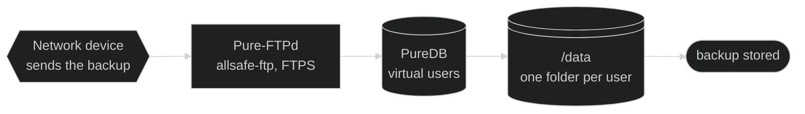

# 📚 Documentation — allsafe-ftp-stack

🌐 **English** · [Português (Brasil)](../pt-BR/README.md)

↩ [Project README](../../README.md)

## 💡 In a few words

This folder explains the stack **as it is today**: how to install, configure, operate and fix the FTP server that receives the backup of the network devices, the web panel that administers its users and nginx, which stays in front of the panel. Each guide starts with a summary for whoever has never seen the project and keeps the technical detail in collapsed menus. What is still going to change stays in the plan, not here.

<!-- diagrama: diagrams/overview-diagram.mmd -->

Level 1 · Diagram · [source](diagrams/)

**Sequence:** Network device ➜ Pure-FTPd (`allsafe-ftp`) ➜ PureDB ➜ `/data` ➜ backup stored

> 🧱 **For private networks only:** by default, private IP, behind a firewall, off the internet. A public address only through an explicit option, with a warning. See [Security](../pt-BR/seguranca.md#rede-privada).

---

Contents — click to expand

[Guides](#guias) · [Where to start](#por-onde-comecar) · [Where the data stays](#onde-ficam-os-dados) · [Diagrams](#diagramas) · [Images](#imagens) · [Plan](#plano)

---

## 📖 Guides

| No. | Guide | Subject |
|---|---|---|
| 1 | [Installation](installation.md) | Prerequisites, commented step by step, first validation and how to undo |
| 2 | [Configuration](configuration.md) | All the variables of the `.env`: name, what it is for, valid values and default |
| 3 | [Profiles](profiles.md) | Profiles `small`, `medium`, `large`, `xlarge` and `extended`: sizing, what the server needs to have and the impact on the passive range |
| 4 | [Architecture](architecture.md) | Containers, images, entrypoints, volumes, network and the options of `pure-ftpd` |
| 5 | [Security](../pt-BR/seguranca.md) | Private network and firewall, the public IP option and its warning, only the panel published through a proxy or tunnel, the mode without TLS for old devices, the best practices before production as a flowchart, the tests run at every version, threat model, exposed surface, protections of the panel and of nginx, RFC conformance and the hardening of Compose line by line |
| 6 | [Secrets](secrets.md) | What stays in `.secrets/`, who generates each file and how to change the FTP and panel passwords |
| 7 | [Scripts](scripts.md) | What each script does, parameters and expected output |
| 8 | [Operation](operation.md) | Users, real certificate, logs and image update |
| 9 | [Backup and restore](backup.md) | Backup copy in one command, checked and reversible restore, what to keep apart, another server and scheduled copy |
| 10 | [Web panel](panel.md) | Opening the panel, what there is in each tab, users in the browser, download of the files, password, certificate, audit log and protections |
| 11 | [Application screenshots](../pt-BR/aplicacao/README.md) | Every screen of the panel, menu by menu: the screenshot, what it is for, how to get there and what there is in each one |
| 12 | [Troubleshooting](troubleshooting.md) | Symptom, cause, how to check and fix |

---

## 🧭 Where to start

| Situation | Read, in this order |
|---|---|
| First time | [Installation](installation.md) ➜ [Web panel](panel.md) ➜ [Configuration](configuration.md) ➜ [Profiles](profiles.md) |
| Creating the account of a device | [Web panel](panel.md#usuarios) or [Operation](operation.md#usuarios) |
| Downloading a backup that a device uploaded | [Files and download](panel.md#arquivos) |
| Downloading your own files with the FTP account | [FTP user in the panel](panel.md#usuario-ftp) |
| Creating a folder or choosing the folder of a user | [Users in the panel](panel.md#usuarios) ➜ [Files and download](panel.md#arquivos) |
| Seeing the screens of the panel before installing | [Application screenshots](../pt-BR/aplicacao/README.md) |
| Before production | [Private network and firewall](../pt-BR/seguranca.md#rede-privada) ➜ [Best practices before production](../pt-BR/seguranca.md#boas-praticas) ➜ [Operation](operation.md#certificado-real-de-producao) ➜ [Backup and restore](backup.md#automatica) |
| Old device that does not speak TLS | [Device without TLS](../pt-BR/seguranca.md#ftp-sem-tls) ➜ [Configuration](configuration.md#tls) ➜ [Troubleshooting](troubleshooting.md#ftp-sem-tls) |
| Replacing the logo, delivering under a contract or selling | [Panel brand](panel.md#marca) ➜ [ALL-SAFE trademark](../../TRADEMARK.md) |
| Reporting a security flaw | [Security policy](../../SECURITY.md) ➜ [Security contact](configuration.md#contato-de-seguranca) |
| Keeping or recovering the data | [Backup and restore](backup.md) |
| Something broke | [Troubleshooting](troubleshooting.md) |

---

## 💽 Where the data stays

| What | Where it stays on the host | Inside the container |
|---|---|---|
| Files uploaded by the devices | `DATA_DIR/dados` | `/data` |
| Virtual users (PureDB) | `DATA_DIR/auth` | `/auth` |
| TLS key and certificate of the FTP | `DATA_DIR/certs` | `/etc/ssl/private` |
| Certificate, administrators and audit log of the panel | `DATA_DIR/painel` | `/painel` |
| Panel socket and copy of the certificate, for nginx (remade at every start) | `DATA_DIR/nginx` | `/nginx` |
| Password of the initial user | `.secrets/ftp-usuario-inicial-senha.txt`, in the project folder | `/run/secrets/ftp_usuario_inicial_senha` (read-only) |
| Initial password of the panel, only the hash | `.secrets/painel-admin-inicial-senha-hash.txt`, in the project folder | `/run/secrets/painel_admin_inicial_senha_hash` (read-only) |
| Configuration | `.env`, in the project folder | environment variables |
| Logs | `local` driver of Docker, 10 MB × 3 | `stdout` |

`DATA_DIR` is a folder of the host set in the `.env` (default `/srv/allsafe-ftp-stack/data`). The backup copies go encrypted to `BACKUP_DIR` ([Backup and restore](backup.md)) and the temporary files to `TEMP_DIR`: see [Configuration](configuration.md#pastas-e-nomes). The stack creates no named volume.

---

## 📐 Diagrams

Every diagram appears in the guides straight from the `.mmd` source, with a dark background and with the **zoom and pan controls** in the corner of the diagram itself. The [`diagrams/`](diagrams/) folder holds the source of each one and the [`visualizador.html`](diagrams/visualizador.html). The SVG images (dark, `<name>.svg`, and with a white background, `<name>-claro.svg`) **do not go to the repository**: they are generated on the computer, stay only in the local folder and the viewer opens any of them, also with zoom and pan. Whoever only reads does not need them: the diagram block in each guide already comes from the source.

| Diagram | Level | Where it appears |
|---|---|---|
| [overview-diagram.mmd](diagrams/overview-diagram.mmd) | 1 | [Project README](../../README.md) and this index |
| [how-it-works-flowchart.mmd](diagrams/how-it-works-flowchart.mmd) | 2 | [Project README](../../README.md#como-funciona) |
| [architecture-map.mmd](diagrams/architecture-map.mmd) | 2 | [Project README](../../README.md#arquitetura) and [Architecture](architecture.md) |
| [startup-model.mmd](diagrams/startup-model.mmd) | 3 | [Architecture](architecture.md#subida) |
| [installation-diagram.mmd](diagrams/installation-diagram.mmd) | 1 | [Installation](installation.md) |
| [configuration-diagram.mmd](diagrams/configuration-diagram.mmd) | 1 | [Configuration](configuration.md) and [Profiles](profiles.md) |
| [security-diagram.mmd](diagrams/security-diagram.mmd) | 1 | [Security](../pt-BR/seguranca.md) |
| [per-user-tls-flowchart.mmd](diagrams/per-user-tls-flowchart.mmd) | 2 | [Security](../pt-BR/seguranca.md#tls-por-usuario) |
| [blocking-by-attempts-flowchart.mmd](diagrams/blocking-by-attempts-flowchart.mmd) | 2 | [Security](../pt-BR/seguranca.md#bloqueio-por-tentativa) |
| [blocking-by-address-flowchart.mmd](diagrams/blocking-by-address-flowchart.mmd) | 2 | [Security](../pt-BR/seguranca.md#bloqueio-por-endereco) |
| [best-practices-flowchart.mmd](diagrams/best-practices-flowchart.mmd) | 2 | [Security](../pt-BR/seguranca.md#boas-praticas) |
| [secrets-diagram.mmd](diagrams/secrets-diagram.mmd) | 1 | [Secrets](secrets.md) |
| [scripts-diagram.mmd](diagrams/scripts-diagram.mmd) | 1 | [Scripts](scripts.md) |
| [users-diagram.mmd](diagrams/users-diagram.mmd) | 1 | [Operation](operation.md) |
| [backup-diagram.mmd](diagrams/backup-diagram.mmd) | 1 | [Backup and restore](backup.md) |
| [panel-diagram.mmd](diagrams/panel-diagram.mmd) | 1 | [Web panel](panel.md) |
| [panel-flowchart.mmd](diagrams/panel-flowchart.mmd) | 2 | [Project README](../../README.md#como-funciona) and [Web panel](panel.md#como-decide) |
| [panel-requests-flowchart.mmd](diagrams/panel-requests-flowchart.mmd) | 2 | [Project README](../../README.md#como-funciona) and [Web panel](panel.md#como-decide) |
| [diagnosis-diagram.mmd](diagrams/diagnosis-diagram.mmd) | 1 | [Troubleshooting](troubleshooting.md) |

---

## 📸 Images

The screenshots are real captures of the panel, in the dark theme. In the Markdown, every screenshot is clickable and opens the file itself at full size; each folder has a `visualizador.html` to open, zoom and pan the images outside GitHub.

| Folder | What it keeps | Where it appears | Viewer |
|---|---|---|---|
| [`images/`](../pt-BR/imagens/) | The main image and one image of each tab of the panel | [Project README](../../README.md#imagens) | [`visualizador.html`](../pt-BR/imagens/visualizador.html) |
| [`application/images/`](../pt-BR/aplicacao/imagens/) | The screenshots of each menu, form, refusal and confirmation | [Application screenshots](../pt-BR/aplicacao/README.md) | [`visualizador.html`](../pt-BR/aplicacao/imagens/visualizador.html) |

---

## 🗺️ Plan

The plan for creating and changing the stack (phases, tests, evidence and progress) **is not published in this repository**: it stays in the local folder `doc/planos/` and in a private repository of its own, for the plan only.

---

⬅️ [Project README](../../README.md) · 🏠 [Documentation](README.md) · ➡️ [Installation](installation.md)
