# 📸 Application screenshots — allsafe-ftp-stack

[-6e7781?style=for-the-badge)](../../pt-BR/aplicacao/README.md)

↩ [Project README](../../../README.md) · [Documentation index](../README.md)

## 💡 In a few words

Every screen of the web panel, menu by menu, with a screenshot of each one and an explanation of what can be done on it. The screenshots are real captures of version **1.8.0**, in dark theme and in English, with example users, such as `olt-centro`, `switch-core` and `roteador-borda`. The panel follows the light or dark theme of the system and also opens in Portuguese and in Spanish: see [Language](#idioma). Click any screenshot to open it at full size.

The panel has a sign-in screen, eight tabs for whoever administers it (Overview, Users, Files, Destinations, Server, Security, Blocks and Log) and one screen for the FTP user, which changes with the profile of the account: My files or File upload. The folders the administrator granted to the account beyond its own open on the Granted folder screen. The administrators are in the Users tab, together with the FTP accounts. How to open it, how to create administrators and what protects the panel are in [Web panel](../panel.md).

> 🧱 **Private network use only:** by default, the panel opens only on a private IP, behind a firewall, off the internet. See [Security](../security.md#rede-privada).

Contents — click to expand

[Sign in](#entrar) · [Overview](#visao-geral) · [Users](#usuarios) · [Administrators](#administradores) · [Files](#arquivos) · [My files](#meus-arquivos) · [Destinations](#destinos) · [Server](#servidor) · [Security](#seguranca) · [Blocks](#bloqueios) · [Log](#atividade) · [Language](#idioma) · [How the screenshots were made](#como-foram-feitas)

---

## 🚪 Sign in

<a href="images/entrar.png">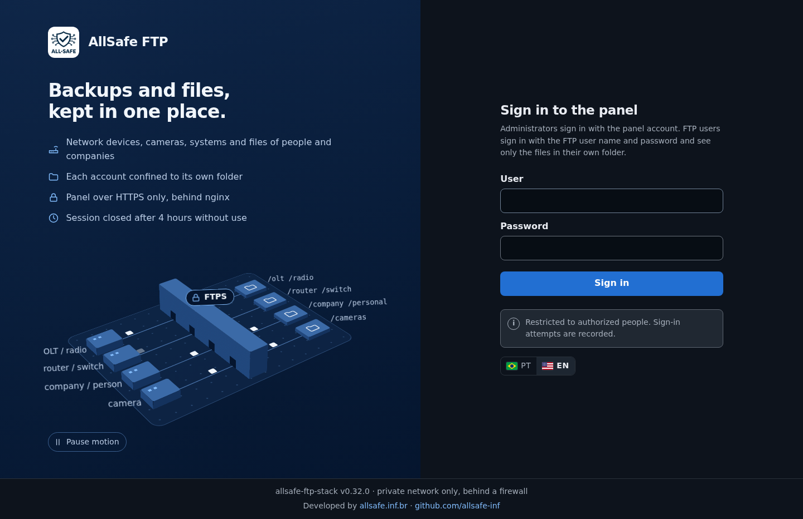</a>

<b>v1.9.0</b> · sign-in screen · captured on 2026-10-12

**What it is for:** checking the user name and the password before showing any data of the stack. It is the same screen for whoever administers and for the FTP user.

**How to get there:** open `https://<panel address>:8443` in the browser. Without a session, any address of the panel leads to this screen.

| Screen item | What it does |
|---|---|
| **User** | Takes the name of the administrator or the name of the FTP user. On the first installation, the administrator is the one in `PAINEL_ADMIN_USER` (`admin`, if it was not changed) |
| **Password** | Takes the password of the account. The one of the first administrator is in `.secrets/painel-admin-inicial-senha.txt`; the one of the FTP user is the same the device uses |
| **Sign in** | Checks the account: the administrator goes to the Overview tab and the FTP user, to the My files screen. The account that already has the second factor goes through the [Verification code](#entrar) screen first; the one that does not have it yet, with the second factor required, through the [Set up the second factor](#entrar) screen |
| Text below the title | Says who signs in through this screen. With `PAINEL_ACESSO_USUARIOS_FTP=nao`, it becomes `Administration panel of the stack.` |
| Note below the button | Reminds that use is restricted to authorized people and that sign-in attempts are recorded. The sign-in screen does not say how the installation is published: only the administrator reads that, after signing in |
| **PT** · **EN** · **ES** | Switch the language of the screen before sign-in; the choice is kept in the browser: see [Language](#idioma) |
| Left side | Presents the stack: the headline, three points (each device confined to its own folder, panel over HTTPS only and the session time without use) and the scene in which router, switch, OLT and radio send the backup over FTPS to the folders. On a narrow screen, only the logo and the headline remain |
| **Pause motion** | Stops the animation of the scene and resumes it; with the system set to reduce motion, the scene already opens stopped |

Sign in ➜ Sign-in refused — click to expand

### Sign in ➜ Sign-in refused

<a href="images/entrar-recusada.png">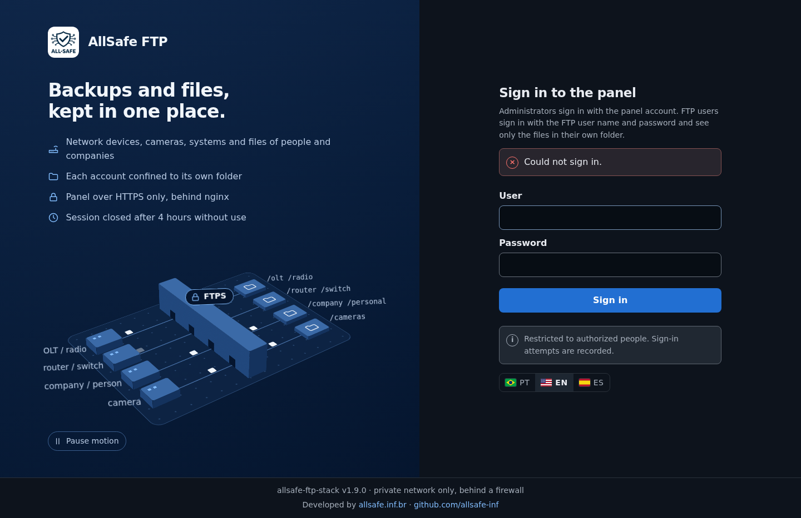</a>

<b>v1.9.0</b> · sign-in screen, sign-in refused · captured on 2026-10-12

| Message | When it appears | What to do |
|---|---|---|
| Could not sign in. | The user name or the password is wrong; the screen does not say which of the two | Check both fields and try again |
| Too many attempts. Wait a few minutes and try again. | Five wrong sign-ins from the same address in 15 minutes | Wait for the block to pass; the right account is refused too while it lasts |
| The page expired. Try again. | The screen stayed open too long before being submitted | Submit again |
| address blocked for too many user name and password errors | The address is on the list of the Blocks tab: by default, it went over 5 user name and password errors in 24 hours, on FTP or on the panel. It is plain text, without the sign-in screen, on any address of the panel | Ask an administrator to unblock it: see [Blocks](#bloqueios) |

Sign in ➜ Set up the second factor — click to expand

### Sign in ➜ Set up the second factor

<a href="images/entrar-cadastro.png">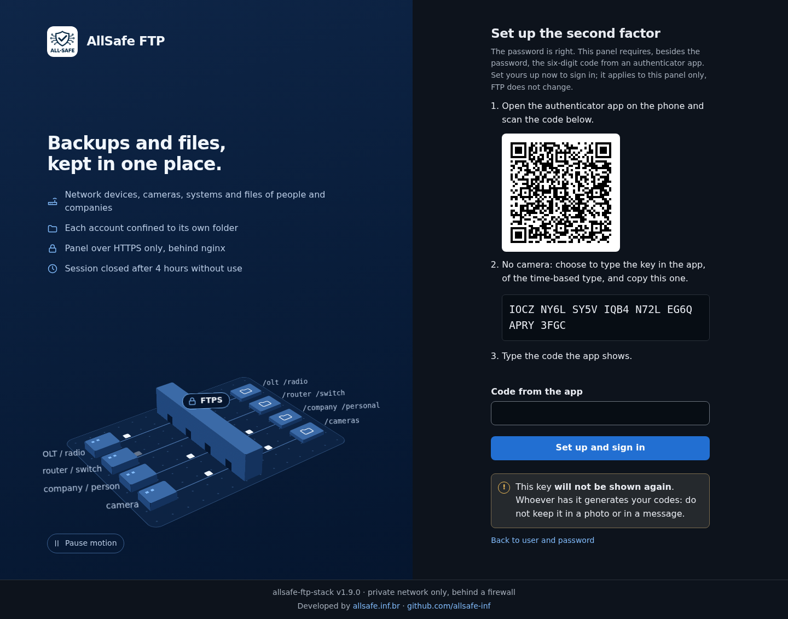</a>

<b>v1.9.0</b> · sign-in screen, second factor setup, with an example key that was not saved · captured on 2026-10-12

With `PAINEL_SEGUNDO_FATOR_OBRIGATORIO=sim`, which is the default, it appears right after the password for every account that has not set up an authenticator app yet, administrator or FTP user: the right password does not open the panel, it leads to this screen. Any authenticator app of time-based codes (TOTP) works. It applies only to the sign-in to this panel: FTP does not change.

| Screen item | What it does |
|---|---|
| QR code | It is the key, for the app to read with the camera. The account shows in it as `AllSafe FTP:<account>@<panel address>` |
| Key in groups | The same key, to type into the app when there is no camera, choosing the time-based type |
| **Code from the app** | Takes the six digits the app started to show: it is the proof that it read the key |
| **Set up and sign in** | Saves the key, closes the other sessions of the account and opens the panel: the Overview tab for the administrator, the My files screen for the FTP user |
| **Back to user and password** | Goes back to the sign-in screen without setting anything up |

**Expected result:** the panel opens, and the next sign-ins of the account go through the Verification code screen, below.

| Message | When it appears | What to do |
|---|---|---|
| The code does not match the key on this screen. Check the time on the phone, wait for the next code and try again. | The code typed is not that of the key shown. Nothing is saved, the screen comes back with the same key and the error does not count as a user name and password error | Wait for the next code. If it goes on, check the time on the phone |
| The page expired. Try again. | The screen stayed open too long before being submitted | Submit again |
| Too many attempts. Wait a few minutes and try again. | Five wrong sign-ins from the same address in 15 minutes, adding up passwords and codes | Wait |

After 10 minutes without the first code, the sign-in screen comes back, without a message, and the key shown is discarded: the following sign-in shows another one.

> ⚠️ **The key appears only on this screen, until it is confirmed.** Whoever has it generates the codes of the account: do not keep it in a photo or in a message. Until the account sets up its app, whoever knows the password does the setup: see [Web panel](../panel.md#segundo-fator).

Sign in ➜ Verification code — click to expand

### Sign in ➜ Verification code

<a href="images/entrar-codigo.png">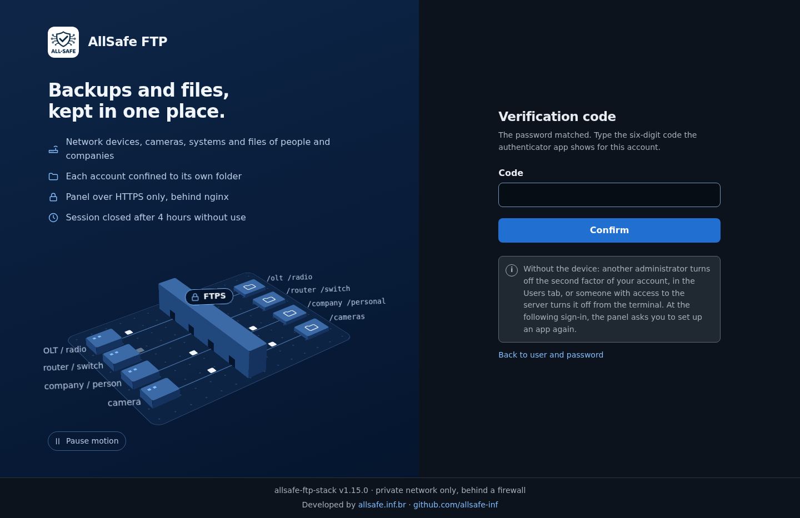</a>

<b>v1.9.0</b> · sign-in screen, second factor code · captured on 2026-10-12

It appears for every account that already has the [second factor](#segundo-fator), administrator or FTP user: the right password does not open the panel, it leads to this screen. The account that does not have it yet, with the second factor required, goes through the Set up the second factor screen, above; with `PAINEL_SEGUNDO_FATOR_OBRIGATORIO=nao`, it signs in with the password only.

| Screen item | What it does |
|---|---|
| **Code** | Takes the six digits the authenticator app shows for this account right now |
| **Confirm** | Checks the code and opens the panel: the Overview tab for the administrator, the My files screen for the FTP user |
| Note below the button | Tells the way out for whoever is without the device: for the administrator, another administrator turns off the second factor of the account, in the Users tab, or someone with access to the server turns it off from the terminal; for the FTP user, the administrator turns it off. With the second factor required, it reminds that the following sign-in asks to set up an app again |
| **Back to user and password** | Goes back to the sign-in screen without opening the panel |

| Message | When it appears | What to do |
|---|---|---|
| The code does not match. Wait for the app to show the next one and try again. | The code is wrong, has expired or was already used once | Wait for the next code. If it goes on, check the time on the phone |
| Could not sign in. | Five wrong codes in a row: the wait for the code ends and the sign-in screen comes back. After five minutes without the code, the sign-in screen also comes back, without a message | Sign in again with user and password, once the block of the address has passed |
| Too many attempts. Wait a few minutes and try again. | Five wrong sign-ins from the same address in 15 minutes, adding up passwords and codes, or ten refused codes for the same account in 15 minutes, from any address | Wait, or ask an administrator to turn off the second factor of the account |
| The second factor of this account is on, but its secret is not on the server. An administrator or someone with access to the server has to turn it off. | The key of the account is not in `.secrets/segundo-fator/`: this is the case of a server restored from a backup | Turn off the second factor of the account and set it up again: see [Web panel](../panel.md#segundo-fator) |

A wrong code counts as a user name and password error of the address, just like a wrong password.

Technical detail — sign-in and session

- Route `GET /entrar` shows the form; `POST /entrar` checks the administrator account first, by the `scrypt` hash in `DATA_DIR/painel/administradores`, and then, if the sign-in of FTP users is on, the FTP account, by a login on the FTP server itself.
- Response `401` for a wrong user name or password, `429` for a blocked address and `400` for an expired form. Each case writes `entrada_falha` or `entrada_bloqueada` to the [audit log](../panel.md#auditoria), without the name that was typed.
- With the second factor on, `POST /entrar` with the right password does not create a session: it writes `entrada_senha_ok` and leads to `GET /entrar/codigo`, with the cookie `__Host-etapa` (`Secure`, `HttpOnly`, `SameSite=Strict`), valid for 5 minutes and only from the same address. `POST /entrar/codigo` answers `401` for the wrong code (`entrada_codigo_recusado`), `429` for the paused account and `503` for the account turned on without the key on the server (`entrada_fator_sem_segredo`); the session only starts with the accepted code.
- With `PAINEL_SEGUNDO_FATOR_OBRIGATORIO=sim`, the account that does not have the second factor yet does not get a session with the right password either: `POST /entrar` writes `entrada_senha_ok` and leads to `GET /entrar/cadastro`, with the same cookie `__Host-etapa`, here valid for 10 minutes. The key shown stays only in the memory of that wait and is saved by the `POST /entrar/cadastro` that brings the first right code; it writes `fator_cadastrado_na_entrada`, closes the other sessions and waits of the account and starts the session. The wrong code gets `400`, without an event and without counting towards the block of the address. The wait of one path does not serve the other: the setup one does not check a code and the code one does not set up; outside its path, the wait is closed and the answer goes back to `/entrar`.
- The address on the block list gets `403` in plain text on every route, even with an open session, with the event `recusa_endereco`: see [Blocking by address](../security.md#bloqueio-por-endereco).
- Signing in with the FTP account takes a few seconds: it is the time the FTP server spends checking the password. See [FTP user in the panel](../panel.md#usuario-ftp).
- The session lives in the cookie `__Host-sessao` (`Secure`, `HttpOnly`, `SameSite=Strict`) and closes after 4 hours without use or after 12 hours, whichever comes first.
- A submission is only accepted when it comes from the panel itself: the `Origin` header has to be the address of the panel. Details in [Web panel](../panel.md#protecoes).

---

## 📊 Overview

<b>v1.9.0</b> · Overview menu · captured on 2026-10-12

**What it is for:** seeing at once whether the FTP is up and which details to type into the device that will send the backup.

**How to get there:** it is the first screen of the administrator after sign-in; menu ➜ **Overview**.

| Screen item | What it shows |
|---|---|
| **FTP server** | `Up` or `Down`, and the TLS mode in use, with a shortcut to the Security tab |
| **Users** | Number of FTP users, with a shortcut to the Users tab |
| **Space used** | Sum of the users' folders and the free space on the disk, with a shortcut to the folders, in the Files tab |
| **Last upload** | Date of the newest file among all folders, with a shortcut to the Files tab |
| **FTP certificate** | The date the certificate expires and how many days are left, with a shortcut to the fingerprint, in the Security tab |
| **Server and containers** | CPU and memory of the whole server and of the three containers of the stack, in use and allocated, with a shortcut to the Server tab |
| **Files received per day** | One column per day for the last 14 days, with the total of the period on top. It counts what is in the folders now, by the date of each file: what was deleted or replaced is not counted |
| **Last upload per user** | The users split by the date of the newest file in the folder of each one: in the last 24 hours, between 1 and 7 days, more than 7 days ago and with no file in the folder. Below, the list of those who have not uploaded for more than 7 days, with a shortcut to the Users tab |
| **Space per folder** | The folders that take the most space, from the largest to the smallest, each with the bar, the size and the number of files, and the shortcut to the folder in the Files tab |
| **Recent activity** | The last six records of the panel, with the time and the address of whoever did it, and the shortcut to the Log tab |
| **Details to set up the device** | Server, control port, passive ports, protocol and where the user comes from: what to fill in on the device |
| Menu of every screen | On the left, on a screen 1280 px wide or more: the symbol and the name, the eight tabs in two groups (**Operation** and **System**), each with its icon and the tab in use marked, and, at the bottom, the language buttons **PT**, **EN** and **ES**, the name and the role of whoever signed in and the **Sign out** button. On a narrower screen, the menu becomes a band at the top, with the tabs in a row that scrolls sideways. With the installation published, a warning sign stays next to **Security** |
| Title of each tab | The name of the tab and a sentence that says what it is for |
| Footer of every screen | The version of the stack, the private network reminder (or, for the administrator only, how the installation is published), the authorship and the address of the official repository |

Nothing is changed through this tab.

Overview ➜ Alert of user without TLS — click to expand

### Overview ➜ Alert of user without TLS

<a href="images/visao-geral-alerta-tls.png">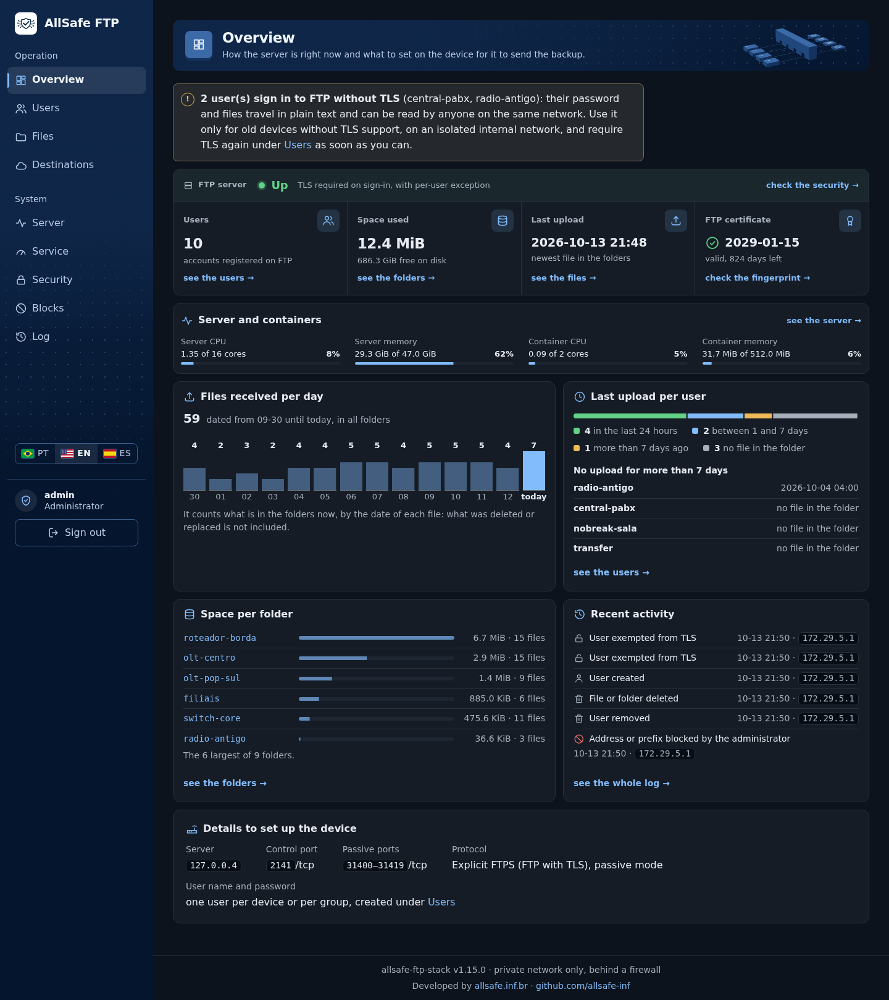</a>

<b>v1.9.0</b> · Overview menu, alert of user without TLS · captured on 2026-10-12

| Alert at the top of the screen | When it appears | How it goes away |
|---|---|---|
| How many and which users sign in to FTP without TLS | With at least one user exempt from TLS | When the last one is required to use TLS again, in [Users ➜ Require TLS](#usuarios) |
| The FTP accepts password and file in plain text | With `FTP_TLS_MODE` at `0` or `1` | When the variable goes back to `2` or `3` |

The same alert opens the Security tab. The conditions for exempting a user are in [TLS per user](../security.md#tls-por-usuario) and those of FTP without TLS, in [Device without TLS](../security.md#ftp-sem-tls).

Technical detail — where each number comes from

- Route `GET /`.
- `Up` is the answer of the control port of the `ftp` service, over the internal network of the stack (`ftp:2121`).
- Users come from the FTP user database (`DATA_DIR/auth`); space, number of files and last upload are read from `DATA_DIR/dados`.
- The **Server and containers** card shows the same readings as the [Server tab](#servidor).
- Server, port and passive range are the values of `FTP_PASSIVE_IP`, `FTP_PORT` and `FTP_PASSIVE_PORT_*` in the `.env`: see [Configuration](../configuration.md#rede-e-portas).

---

## 👥 Users

<b>v1.9.0</b> · Users menu · captured on 2026-10-12

**What it is for:** creating the account of each device or person, choosing its profile, choosing and changing the folder it is confined to, changing the password, giving it limits of its own, allowing file upload through the panel, turning on the automatic cleanup of old files, removing the block for wrong passwords and removing the account, with or without the folder, without the command line. It is also where the administrators of the panel are.

**How to get there:** menu ➜ **Users**.

| Screen item | What it does |
|---|---|
| **New user** | Opens the registration form, for an FTP user or an administrator |
| User and profile | Name of the account and, below it, its profile: Administrator, Full, Upload, Upload only or Read only. The tag `initial` marks the user created by the installation (`FTP_USER`) |
| Administrator rows | They stay at the top of the list, without folder or TLS, with the tag `you` on the account in use: see [Administrators](#administradores) |
| Folder | Where the files of that user are kept on the server. The address opens the folder in the Files tab |
| Tag `shared` | The folder is reached by more than one user: each one handles the files of the other as far as their profile allows |
| Tag `limits` | The user has a limit of their own, saved in **Edit**; hovering the mouse shows each one |
| Tag `cleanup` | Automatic cleanup is on for the user, in **Edit**: the panel deletes the old files of their folder on its own; hovering the mouse shows the rule |
| Tag `blocked` | The FTP is refusing the user for too many wrong passwords coming from one address; it goes away on its own at the end of the period, or in **Edit** |
| Usage · Files · Last upload | Space taken, number of files and date of the most recent upload |
| TLS column · **Exempt from TLS** · **Require TLS** | How the user signs in to FTP and the way to change it: see [Users ➜ TLS per user](#usuarios) |
| **Edit** | Opens the screen of the user, with the change of profile and of folder, the limits of their own, the automatic cleanup and the blocks |
| **Change password** | Opens the password change form of that user |
| **Second factor** | It only appears on the row of the user who already set up the second factor at the sign-in to the panel: it opens the screen that turns theirs off. See [Second factor of the FTP user](#segundo-fator) |
| **Remove** | Opens the removal confirmation of that user, including the initial one |
| **How profiles and tags work** | Collapsed below the list: explains each profile, says in which folder of the server the users are confined and what the tags `shared`, `limits`, `cleanup`, `blocked` and `no TLS` mean |

The initial user has its password and folder changed and is removed like the others. Once removed, it does not come back on the next starts of the FTP; to have it again, create a user with the same name. The password changed here holds until the file `.secrets/ftp-usuario-inicial-senha.txt` is changed. See [Secrets](../secrets.md#trocar-a-senha).

The profile decides what the account does, on FTP and in the panel:

| Profile | On FTP | In the panel |
|---|---|---|
| Administrator | Not an FTP account | Every tab: see [Administrators](#administradores) |
| Full | Lists, downloads, uploads, creates folders, renames, deletes and overwrites | My files screen: browses, downloads, creates folders, renames and deletes; with the permission, uploads files |
| Upload | Lists, downloads, uploads and creates folders. Does not delete, rename or overwrite what has already arrived | My files screen: browses, downloads and creates folders; with the permission, uploads files |
| Upload only | Uploads and creates folders. Does not list or download anything, not even what it uploaded itself | File upload screen: the details for sending by FTP; with the permission, uploads files through it |
| Read only | Only lists and downloads | My files screen: browses and downloads; does not upload |

The permission to upload files through the panel is given user by user, in the **Limits** card of the **Edit** screen: see [Users ➜ Limits](#usuarios). Without it, the account only uploads by FTP.

The profile applies in the folder of the record and on FTP. In the other folders the administrator grants to the account, in the panel only, the permission given in each one applies: see [Users ➜ Other folders](#usuarios).

The screen of each profile is in [My files](#meus-arquivos); the rules, the shared folder and what changes on a switch, in [Web panel](../panel.md#perfis).

Users ➜ New user — click to expand

### Users ➜ New user

<a href="images/usuarios-novo.png">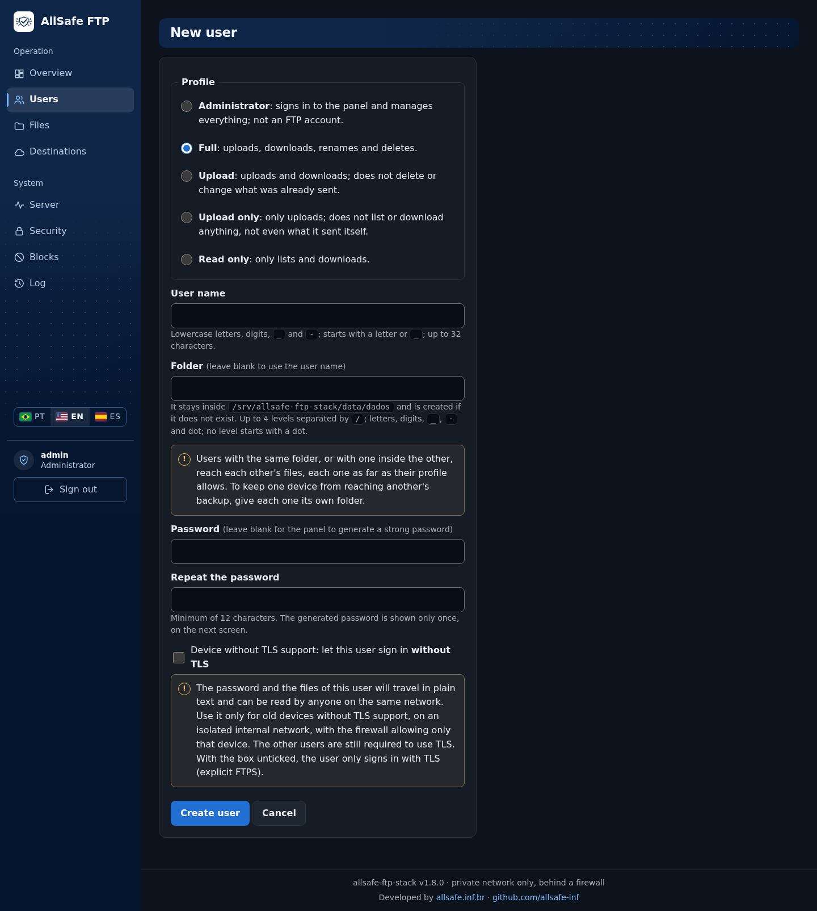</a>

<b>v1.9.0</b> · Users menu, New user form · captured on 2026-10-12

| Field | Required | What to fill in |
|---|---|---|
| Profile | Yes | Full, Upload, Upload only or Read only, for the FTP account. Administrator registers whoever administers the panel: see [Administrators ➜ New administrator](#administradores) |
| User name | Yes | Lowercase letters, numbers, `_` and `-`; starts with a letter or `_`; up to 32 characters |
| Folder | No | Left blank, it is the user name. When chosen, it stays inside `DATA_DIR/dados`, with up to 4 levels separated by `/`, and is created if it does not exist. The field suggests the folders that already exist |
| Password | No | 12 characters or more. Left blank, the panel generates a strong password |
| Repeat the password | Only with the password filled in | The same password |
| **Device without TLS support** box | No | Tick it only for the old device that does not speak TLS: the user is born already exempt. Unticked, the user only signs in with TLS |

**Expected result:** the list comes back with the message `User created.` and the user already signs in over FTPS, without restarting the FTP, confined to the chosen folder and with the chosen profile.

> ⚠️ **Shared folder:** two users with the same folder, or with one inside the other, reach each other's files, each one as far as their profile allows. In the user list at the start of this section, `filiais/olt-norte` is inside `filiais`, the folder of a lookup account, with the Read only profile, and both carry the tag `shared`: the lookup account downloads what the OLT uploaded and does not write or delete anything. For one device not to reach the backup of another, give each one its own folder.

Users ➜ New user refused — click to expand

### Users ➜ New user refused

<a href="images/usuarios-novo-recusado.png">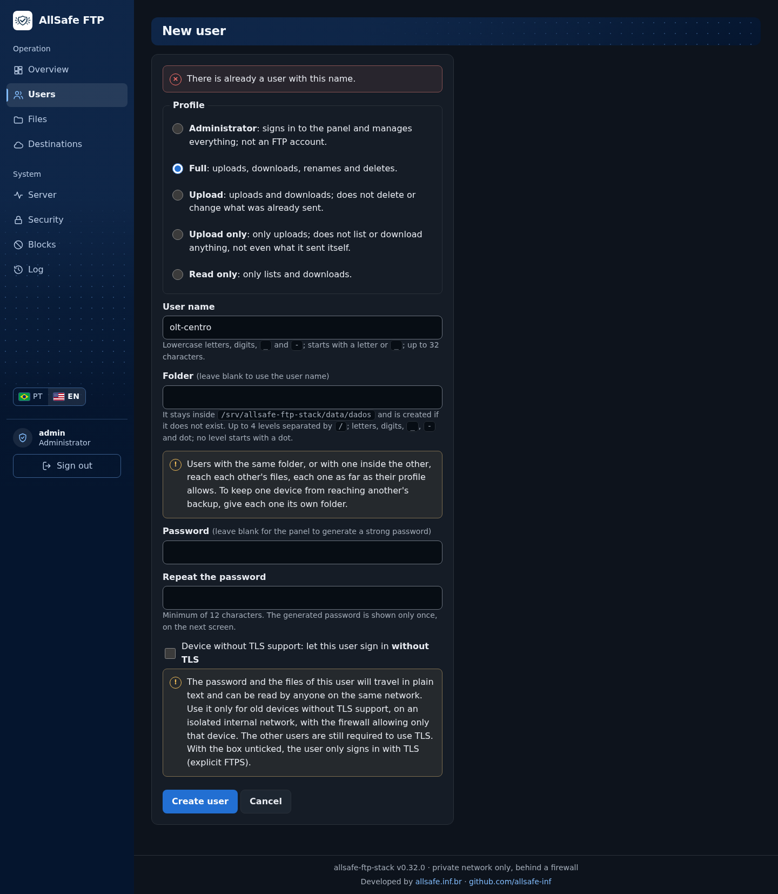</a>

<b>v1.9.0</b> · Users menu, registration refused · captured on 2026-10-12

The panel returns the form with the reason at the top and nothing is created.

| Message | Reason |
|---|---|
| Invalid name. See the rule below the field. | The name breaks the rule of letters, numbers, `_` and `-` |
| There is already a user with this name. | The name is already in use |
| Invalid folder. See the rule below the field. | The folder breaks the rule, has more than 4 levels or a level starts with a dot |
| The two passwords do not match. | The two password fields differ |
| The password must have 12 to 128 characters. | Password too short or too long |

A folder that goes through a symbolic link, or through a name that already belongs to a file, is refused too, with the reason in the same band.

Users ➜ Password generated by the panel — click to expand

### Users ➜ Password generated by the panel

<a href="images/usuarios-senha-gerada.png">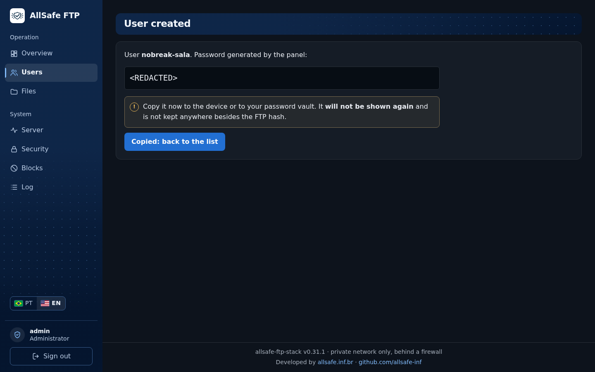</a>

<b>v1.9.0</b> · Users menu, generated password · captured on 2026-10-12

It appears when the two password fields are left blank, on registration or on a password change. The password is shown **only once**: copy it to the device or to the password vault before leaving the screen. In the screenshot, the value was replaced by `<REDACTED>`.

Users ➜ Edit — click to expand

### Users ➜ Edit

<b>v1.13.0</b> · Users menu, Edit user screen · captured on 2026-10-13

It gathers what changes in a user without creating it again. The name does not change: it is with it that the device signs in to FTP.

| Card | What it does |
|---|---|
| Top | Shows the user, leads to **Change password** and goes back to the list |
| **Blocks** | Only appears when the FTP is refusing the user for too many wrong passwords: see [Users ➜ Blocks](#usuarios) |
| **Profile** | Shows the profile of the account and switches to another of the four FTP profiles |
| **Folder** | Shows the current folder, with the number of files and the space taken, and changes the folder of the user |
| **Other folders** | Grants the user, in the panel only, folders beyond the one of the record, each with its own permission: see [Users ➜ Other folders](#usuarios) |
| **TLS** | Says whether the user signs in with or without TLS and leads to the confirmation of the change: see [Users ➜ TLS per user](#usuarios) |
| **Limits** | Saves the user's own limits and the permission to upload files through the panel: see [Users ➜ Limits](#usuarios) |
| **Automatic cleanup** | Turns on, changes and turns off the rule that deletes the old files of the user's folder on its own: see [Users ➜ Automatic cleanup](#usuarios) |

**Profile change:** select the profile and click **Save profile**. The list comes back with the message `Profile changed. It applies on the user's next FTP sign-in.` The change closes the session of the user in the panel; the FTP session that is already open carries on with the previous profile until it ends. The card reminds of two points of care:

- **Upload:** the file belongs to the server as soon as it finishes arriving, and from then on the user does not delete it, rename it or overwrite it. A device that always uploads with the same file name needs the Full profile.
- **Upload only:** a repeated name does not replace the previous file, and the new one is stored with the date and time in its name. A device that uploads with a temporary name and renames at the end, or that checks the upload by listing the folder, needs another profile.

Administrator is not among the options: administrator and FTP user are separate registrations, and going from one to the other means removing the account and creating the other.

| Field of the Folder card | Required | What to fill in |
|---|---|---|
| New folder | Yes | The same rule as on registration: inside `DATA_DIR/dados`, with up to 4 levels separated by `/`; it is created if it does not exist |

**Expected result:** after **Change folder**, the list comes back with the message `Folder changed. The files of the previous folder stay in it.` The user lands in the new folder on the next FTP login, and their session in the panel is closed. With automatic cleanup on, the change turns the rule off, since it belonged to the previous folder, and the message ends with `Automatic cleanup was turned off: the rule belonged to the previous folder.`

| Message | Reason |
|---|---|
| This is already the user's folder. | The new folder is the same as the current one |
| Invalid folder. See the rule below the field. | The folder breaks the rule, has more than 4 levels or a level starts with a dot |

> ⚠️ **The files do not follow the change:** what was in the previous folder stays in it, neither moved nor deleted, and the user no longer reaches it.

Users ➜ Limits — click to expand

### Users ➜ Limits

<a href="images/usuarios-limites-gravados.png">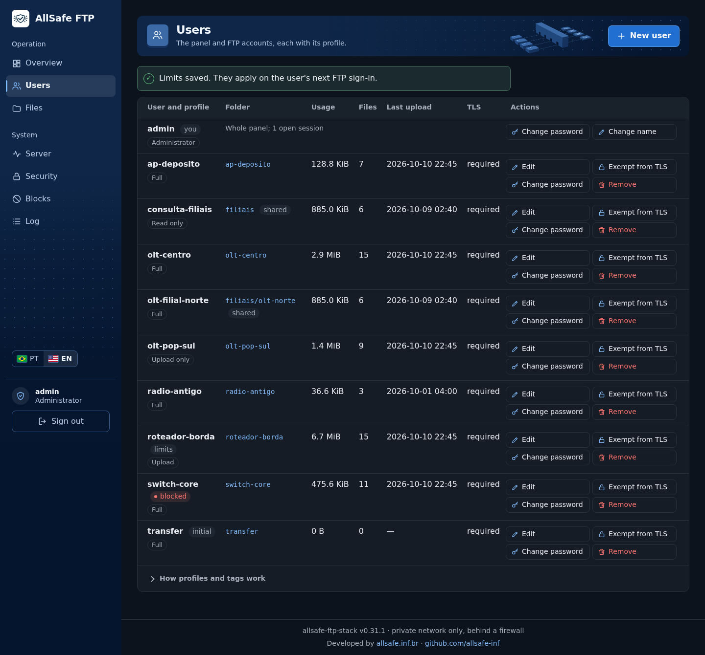</a>

<b>v1.9.0</b> · Users menu, limits saved · captured on 2026-10-12

The **Limits** card of the **Edit** screen applies only to that user, whether it is the account of a device, which only uploads, or that of a person, who signs in, uploads and downloads. A blank field means no limit of its own: the one of the stack applies.

| Field | Where it applies | What to fill in |
|---|---|---|
| Simultaneous FTP sessions | FTP | From 1 to the `FTP_MAX_CLIENTS` of the stack |
| Download rate, in KB per second | FTP and the user's downloads through the panel | From 1 to 10,000,000 |
| Upload rate, in KB per second | FTP and the user's uploads through the panel | From 1 to 10,000,000 |
| Hours when FTP accepts sign-in: from · to | FTP and the user's sign-in to the panel | Start and end, in hours and minutes; it may cross midnight, such as `22:00` to `06:00` |
| Simultaneous downloads through the panel | Panel | From 1 to 8; left blank, 2 |
| Wrong FTP passwords before the block | FTP | From 1 to 100; `0`: this user is never blocked; left blank, the default of the stack |
| Minutes of block | FTP | From 1 to 1440; left blank, the default of the stack |
| **Allow this user to upload files through the panel**, to their folder, box | Panel | Ticked, the account uploads files through its screen, besides FTP. It applies to the Full, Upload and Upload only profiles; the Read only profile does not upload. Unticked, the user only uploads by FTP |

**Expected result:** after **Save limits**, the list comes back with the message `Limits saved. They apply on the user's next FTP sign-in.` and the tag `limits` next to the name; hovering the mouse over it shows each limit of the user. To remove a limit, clear the field and save again.

The upload permission applies immediately. A file uploaded through the panel is at most the size of `PAINEL_ENVIO_MAX_MB` (1024 MB, by default), follows the upload rate of the user and never replaces a file that already exists: see [My files ➜ Upload file](#meus-arquivos).

In the screenshot of the **Edit** screen, `roteador-borda` has 2 sessions, 2048 KB per second of download, 1024 of upload, sign-in from `22:00` to `06:00`, 1 download at a time through the panel and a 30-minute block on the third wrong password. Its folder shows as granted to `olt-centro`, which reads it through the panel: see [Users ➜ Other folders](#usuarios).

> ⚠️ **Upload rate and small files:** with the upload rate set, the server holds each uploaded file for about `256 ÷ rate` seconds. For a device that sends many small files, use a high rate or leave it blank. The values and what each limit changes for the user are in [Web panel](../panel.md#limites).

Users ➜ Other folders — click to expand

### Users ➜ Other folders

<a href="images/usuarios-outras-pastas.png">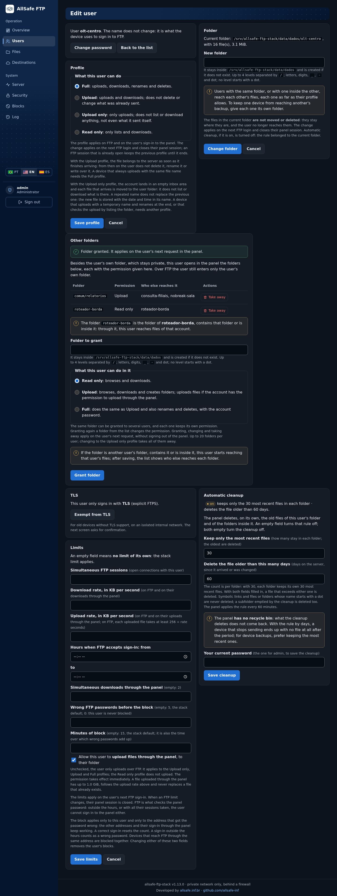</a>

<b>v1.13.0</b> · Users menu, Other folders card · captured on 2026-10-13

Grants a user folders beyond the one of the record, in the panel only and each with its own permission. The folder of the record stays private, and by FTP the account keeps signing in only to it.

| Part of the card | What it shows or does |
|---|---|
| List | One row per granted folder: the folder, the permission, **Who else reaches it** and the **Take away** button |
| Warning below the list | Appears when the folder is the one of another user, contains that user's folder or is inside it, and says whose it is |
| **Folder to grant** | The folder, with the same rule as the folder of the user; it is created if it does not exist |
| **What this user can do in it** | Read only: browses and downloads. Upload: also creates folders and, with the permission to upload through the panel, uploads files. Full: also renames and deletes, with the password of the account |
| **Grant folder** | Saves. Granting again a folder from the list changes its permission |

**Expected result:** the card comes back with `Folder granted. It applies on the user's next request in the panel.`; the change of permission, with `Permission changed. It applies on the user's next request in the panel.`; and **Take away**, with `Folder taken away from the user. The files stay in it.`

In the screenshot, `olt-centro` opens in the panel the shared folder `comum/relatorios`, where it also uploads, and reads the folder of `roteador-borda` without being able to change it. The shared folder is the same one of `consulta-filiais` and `nobreak-sala`, which only read.

Up to 20 folders per user; the Upload only profile gets none. The rules and what happens on removal and on a change of profile are in [Web panel](../panel.md#outras-pastas); what the user sees, in [My files ➜ Granted folder](#meus-arquivos).

Users ➜ Automatic cleanup — click to expand

### Users ➜ Automatic cleanup

<a href="images/usuarios-editar-limpeza.png">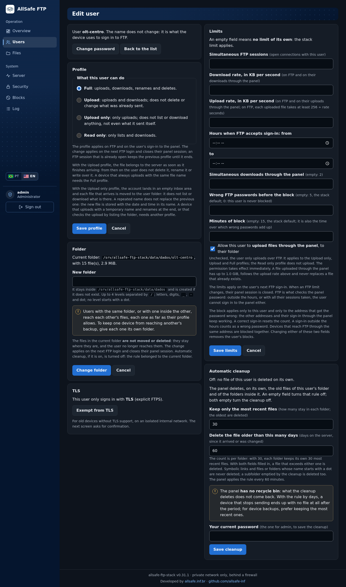</a>

<b>v1.9.0</b> · Users menu, Automatic cleanup card · captured on 2026-10-12

The **Automatic cleanup** card of the **Edit** screen makes the panel delete, on its own, the old files of that user's folder and of the folders inside it. It starts turned off: with no rule saved, no file is deleted on its own.

| Field | Required | What to fill in |
|---|---|---|
| Keep only the most recent files | No | How many files stay in each folder, from 1 to 100,000; the oldest ones go. The count is per folder: with `30`, each folder keeps its 30 most recent files |
| Delete the file older than this many days | No | Days on the server, from 1 to 3,650, counted since the file arrived or was changed |
| Your current password | Yes | The password of whoever is using the panel, to confirm |

A blank field turns that rule off, and both blank turn the cleanup off. With both filled in, the file that goes past either one is deleted.

<a href="images/usuarios-limpeza-gravada.png">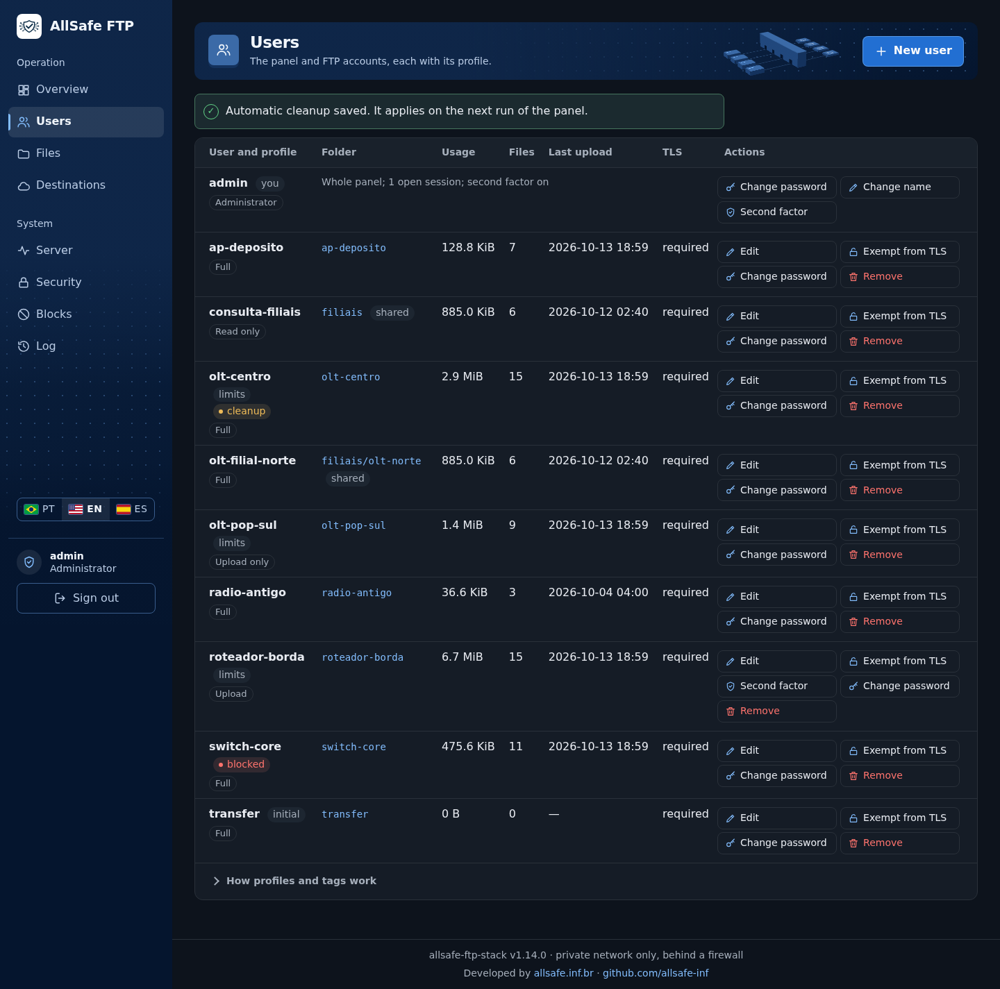</a>

<b>v1.9.0</b> · Users menu, automatic cleanup saved · captured on 2026-10-12

**Expected result:** after **Save cleanup**, the list comes back with the message `Automatic cleanup saved. It applies on the next run of the panel.` and the tag `cleanup` next to the name; hovering the mouse over it shows the rule. Saved with both fields blank, the message is `Automatic cleanup turned off. No file of this user is deleted on its own.`

In the screenshot, `olt-centro` keeps the 30 most recent files of each folder and no file older than 60 days.

| What the cleanup does | How |
|---|---|
| When it runs | On its own, every `PAINEL_RETENCAO_MINUTOS` minutes (60, by default); with `0`, the rule stays saved and is not applied, and the card says so |
| What never goes | Symbolic links and files or folders whose name starts with a dot |
| Subfolder | The one the cleanup empties goes with it; the folder of the user stays |
| Shared folder | The rule deletes the old files of every user that reaches the folder, and the card says who they are |
| Folder change | Turns the rule off, since it belonged to the previous folder |
| Record | Each run that deletes something is in the Log tab, with the user and the amount |

> ⚠️ **The cleanup cannot be undone:** the panel has no recycle bin, and what the cleanup deletes only comes back from a backup. With the rule by days, a device that stops uploading is left with no file at all after the period: for device backups, prefer keeping the most recent ones. The full rules are in [Web panel](../panel.md#limpeza).

Users ➜ Blocks — click to expand

### Users ➜ Blocks

<a href="images/usuarios-editar-bloqueios.png">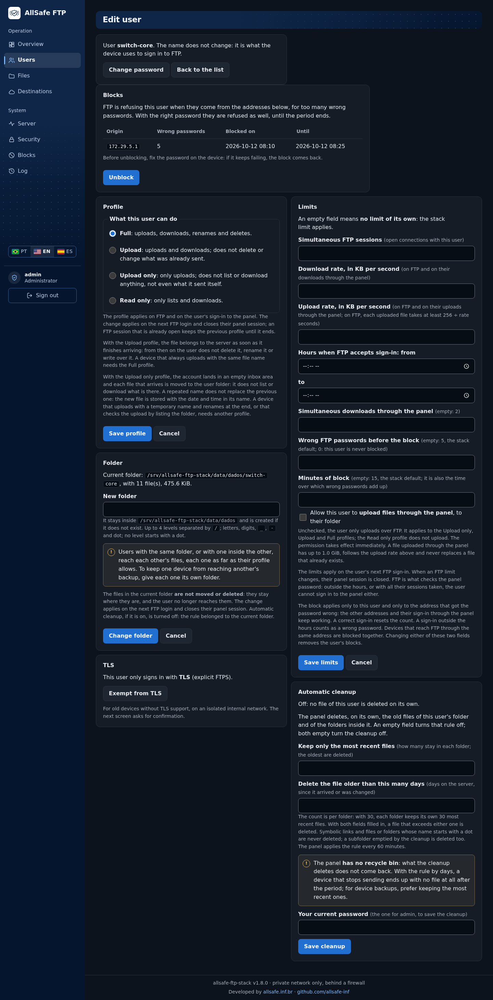</a>

<b>v1.9.0</b> · Users menu, Blocks card · captured on 2026-10-12

The address that gets the password of a user wrong on FTP too many times is blocked for that user, for the configured time: until then, not even the right password gets in from there. In the list, the name gains the tag `blocked`; hovering the mouse over it shows the addresses.

| Card item | What it shows |
|---|---|
| Origin | The address the wrong passwords came from |
| Wrong passwords | How many were counted up to the block |
| Blocked on · Until | The time of the block and the time it goes away on its own |
| **Unblock** | Removes every block of the user immediately |

1. Fix the password on the device: if it keeps getting it wrong, the block comes back.
2. Click **Unblock**.

<a href="images/usuarios-desbloqueado.png">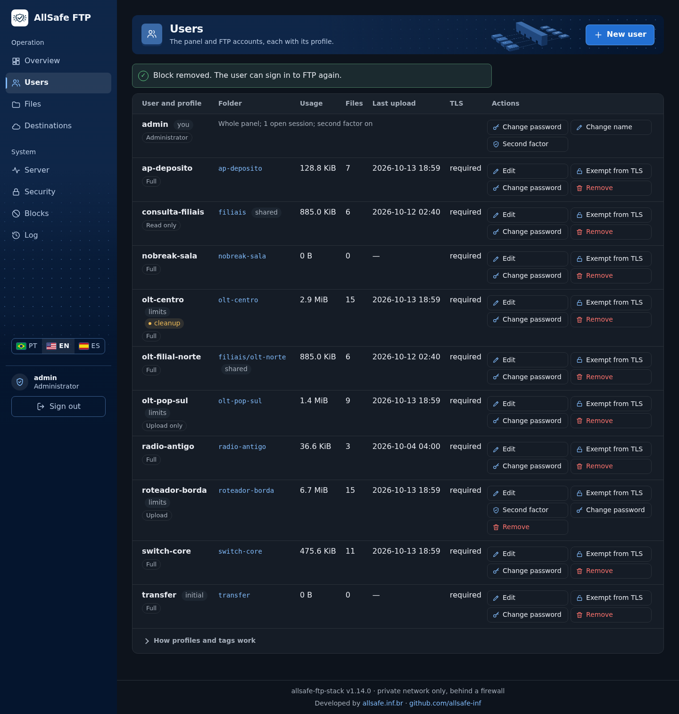</a>

<b>v1.9.0</b> · Users menu, after the unblock · captured on 2026-10-12

**Expected result:** the list comes back with the message `Block removed. The user can sign in to FTP again.`, without the tag `blocked`, and the next sign-in of the device goes through.

In the screenshot, the origin is the address of the host on the internal network of the photographed stack, because the wrong passwords came from the server itself. What counts as a wrong password is in [Security](../security.md#bloqueio-por-tentativa).

This is the short block, of one user for one address. The address that fails too much, with any account, is blocked as a whole, on FTP and on the panel: see [Blocks](#bloqueios).

Users ➜ Change password — click to expand

### Users ➜ Change password

<a href="images/usuarios-trocar-senha.png">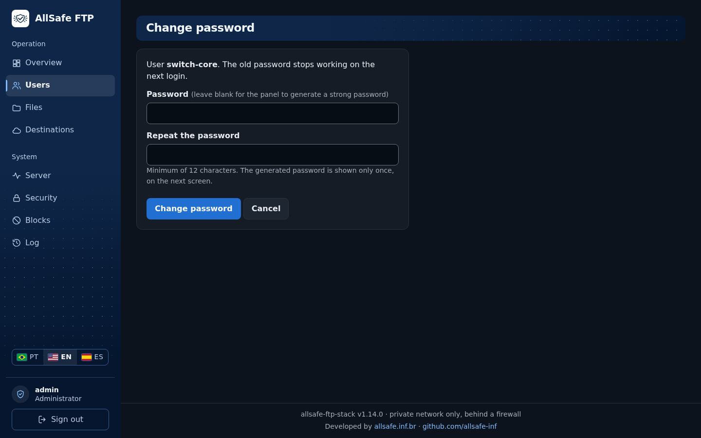</a>

<b>v1.9.0</b> · Users menu, Change password form · captured on 2026-10-12

| Field | Required | What to fill in |
|---|---|---|
| Password | No | 12 characters or more. Left blank, the panel generates a strong password |
| Repeat the password | Only with the password filled in | The same password |

**Expected result:** the list comes back with the message `Password changed.`, the old password stops working on the next login of the device and the session of that user in the panel, if there is one, is closed.

Users ➜ Remove — click to expand

### Users ➜ Remove

<a href="images/usuarios-remover.png">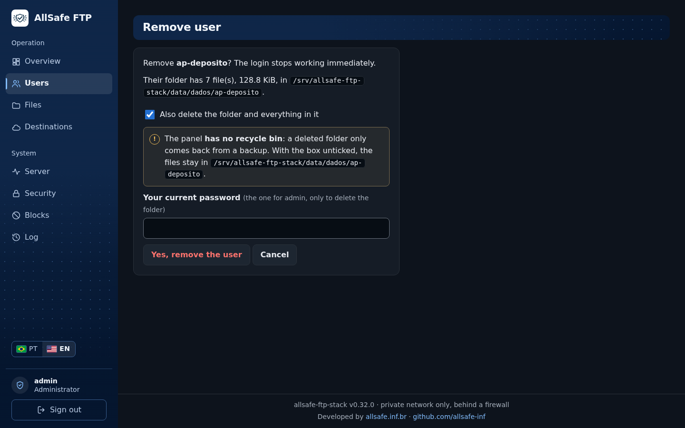</a>

<b>v1.9.0</b> · Users menu, removal confirmation · captured on 2026-10-12

| Screen item | What it does |
|---|---|
| Warning about the files | Shows how many files the user has, how much they take and in which folder they stay; in a shared folder, it says who else reaches it |
| **Also delete the folder and everything in it** box | Only appears when the folder belongs to this user alone. Ticked, the folder goes together with the account, with everything inside it and with no recycle bin |
| **Your current password** | Asked for only when the box is ticked: it is the password of whoever is using the panel |
| **Yes, remove the user** | Deletes the account: the login stops working immediately |
| **Cancel** | Goes back to the list without changing anything |

<a href="images/usuarios-removido.png">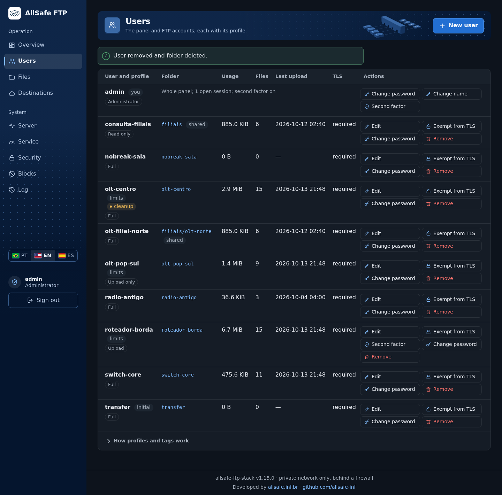</a>

<b>v1.9.0</b> · Users menu, after the removal · captured on 2026-10-12

**Expected result:** with the box ticked and the right password, as in the screenshot, the list comes back with the message `User removed and folder deleted.` and the folder is gone. Without the box, the message is `User removed. The files stay in the folder.`: the folder stays in `DATA_DIR/dados` and remains visible in the Files tab, where it can be deleted later.

<a href="images/usuarios-remover-inicial.png">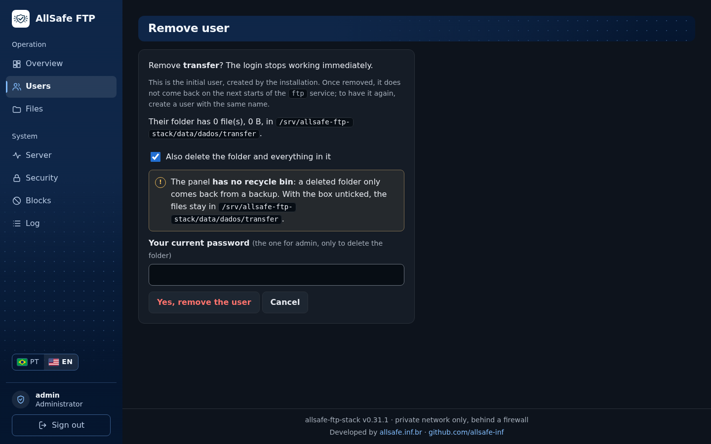</a>

<b>v1.9.0</b> · Users menu, removal of the initial user · captured on 2026-10-12

The initial user, the `FTP_USER` of the installation (`transfer`, in the example), is removed the same way, with or without the folder. The screen warns that it does not come back on the next starts of the `ftp` service: to have it again, create a user with the same name.

Users ➜ TLS per user — click to expand

### Users ➜ TLS per user

<a href="images/usuarios-tls.png">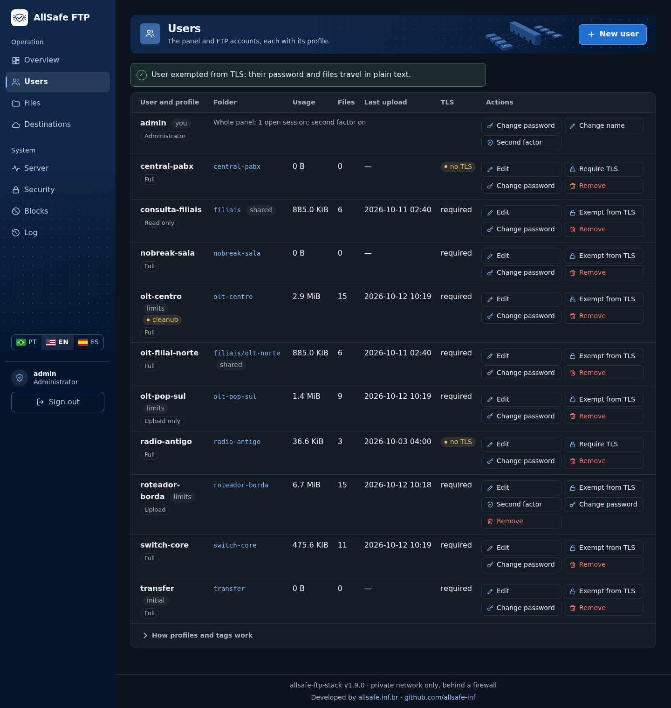</a>

<b>v1.9.0</b> · Users menu, TLS column · captured on 2026-10-12

The column and the two buttons are for the old device that does not speak TLS: it alone is exempted, and the others remain required. The same is done on creation, with the **Device without TLS support** box of **New user**, and in the **TLS** card of the **Edit** screen.

| Screen item | What it does |
|---|---|
| TLS column | `required` for whoever only signs in with TLS and `no TLS` for whoever was exempted |
| **Exempt from TLS** | Opens the confirmation to let that user sign in without TLS |
| **Require TLS** | Opens the confirmation to require TLS again from whoever is exempt |
| **Device without TLS support** box, in **New user** | Creates the user already exempt from TLS; unticked, the user only signs in with TLS |
| **TLS** card, in **Edit** | Says how that user signs in and leads to the same confirmation |

<a href="images/usuarios-novo-sem-tls.png">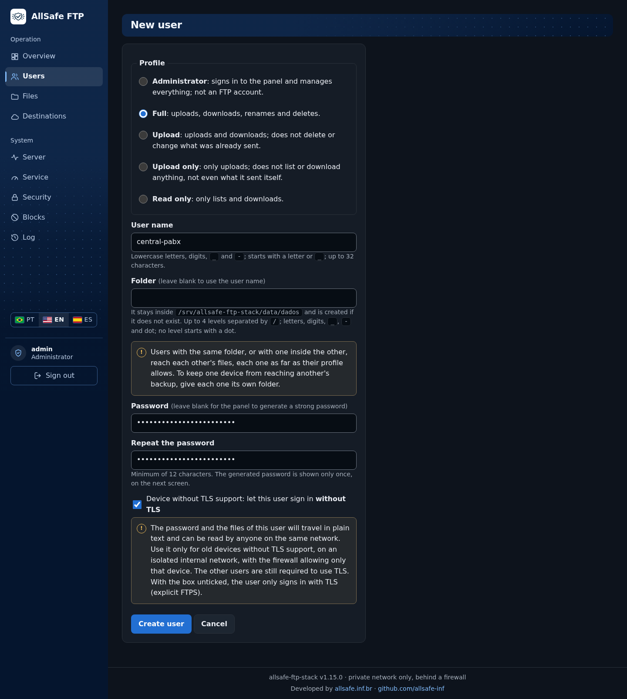</a>

<b>v1.9.0</b> · Users menu, new user without TLS · captured on 2026-10-12

On creation, the ticked box saves the user already exempt, and the list comes back with the message `User created and exempted from TLS: their password and files travel in plain text.`

<a href="images/usuarios-editar-tls.png">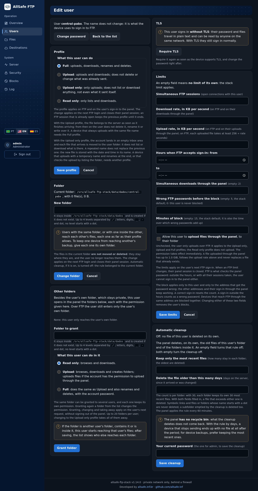</a>

<b>v1.9.0</b> · Users menu, TLS card of the Edit screen · captured on 2026-10-12

On the **Edit** screen, the **TLS** card says how the user signs in and has the button to change it: **Exempt from TLS** for whoever is required, **Require TLS** for whoever is exempt. For the user that already exists, the button opens the confirmation:

<a href="images/usuarios-tls-dispensar.png">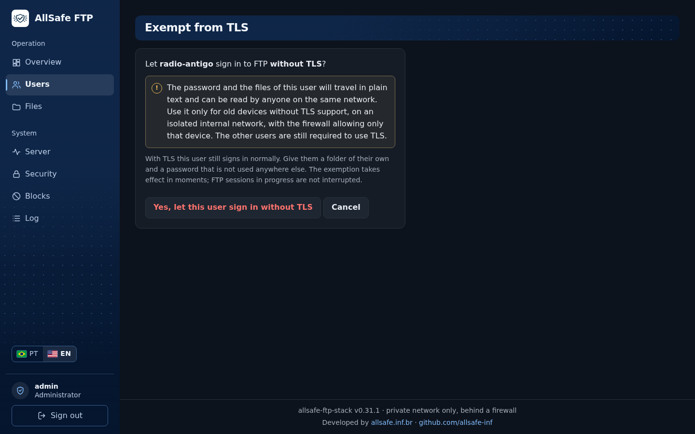</a>

<b>v1.9.0</b> · Users menu, confirmation of the exemption from TLS · captured on 2026-10-12

**Expected result:** the list comes back with the message `User exempted from TLS: their password and files travel in plain text.`, their row shows `no TLS` and the Overview and Security tabs open with the alert. The exemption applies within moments, without dropping whoever is connected. On requiring it again, the message is `The user is required to use TLS again.`

> ⚠️ **Exemption from TLS:** the exempt user sends password and file in plain text. Use it only for the old device that does not speak TLS, on an isolated internal network, with a folder and a password of its own, and change the password when requiring it again. The conditions are in [TLS per user](../security.md#tls-por-usuario).

Technical detail — routes and command used

- Routes: `GET /usuarios`, `/usuarios/novo`, `/usuarios/editar?usuario=<name>`, `/usuarios/senha?usuario=<name>`, `/usuarios/remover?usuario=<name>` and `/usuarios/tls?usuario=<name>`; the submission of each form is a `POST` to the same route, with the CSRF token of the session. The exception is the Edit screen, which sends the profile to `POST /usuarios/perfil`, the folder to `POST /usuarios/pasta`, the limits to `POST /usuarios/limites`, the automatic cleanup to `POST /usuarios/limpeza` and the unblock to `POST /usuarios/desbloquear`.
- The exemption from TLS applies with `FTP_TLS_EXCECOES=sim`, which is the default, `FTP_TLS_MODE=2` and without `REDE_PERMITIR_IP_PUBLICO=sim`. Outside that, the column, the buttons and the box disappear, the route `/usuarios/tls` answers `404` and the list of exempt users stays stored, without effect.
- The panel calls the same `allsafe-ftp-user` as [`manage-user.sh`](../../../manage-user.sh): panel and command line change the same accounts. See [Operation](../operation.md#usuarios).
- Each change writes `usuario_criado`, `senha_trocada`, `pasta_trocada`, `perfil_trocado`, `limites_alterados`, `retencao_alterada`, `bloqueio_removido`, `usuario_removido`, `tls_dispensado` or `tls_exigido` to the [audit log](../panel.md#auditoria), with the administrator who did it and without the password.
- The generated password has 32 random characters and is not kept: only the hash goes to the FTP user database.
- Sessions, rates and hours are kept in the FTP user database, and it is `pure-ftpd` that applies them on each sign-in; the downloads through the panel and the blocking by attempts are kept in files of the stack itself: [Limits per user](../panel.md#limites).
- The rule of the automatic cleanup is kept in a file of the stack itself, and the panel is what applies it, writing `retencao_aplicada` on each run that deletes something and `retencao_falhou` when it does not finish: [Automatic cleanup](../panel.md#limpeza).
- Changing the wrong passwords before the block or the minutes of block removes the blocks of the user; changing their password and removing them does too.
- In the **New user** form, the fields of each kind of account appear according to the selected profile, without JavaScript; the submission is always `POST /usuarios/novo`.
- The rules of the folder and what the `shared` mark checks are in [Users through the panel](../panel.md#usuarios); how the profile is applied on FTP, in [Profiles](../panel.md#perfis).

---

## 🛡️ Administrators

<a href="images/administradores.png">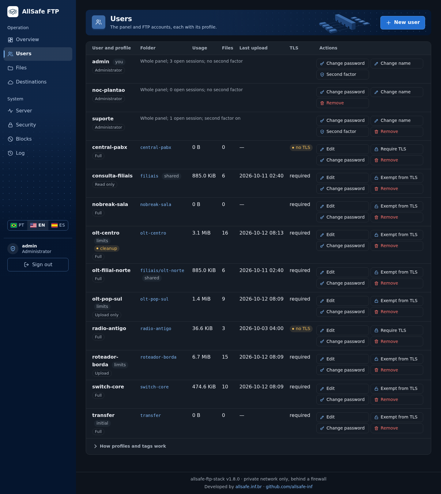</a>

<b>v1.9.0</b> · Users menu, administrators in the list · captured on 2026-10-12

**What it is for:** giving each person who administers the panel their own user name and password, and changing the user name and the password of the first administrator after the installation.

**How to get there:** menu ➜ **Users**. There is no tab of its own: the administrators stay at the top of the list, before the FTP users.

| Screen item | What it does |
|---|---|
| **New user** | Opens the registration; with the **Administrator** profile selected, the account created is an administrator |
| User and profile | Name of the account, with `Administrator` below it. The tag `you` marks the account of whoever is using the panel |
| Folder | In place of the folder, `Whole panel`, how many browsers are inside the panel with that account right now and the state of the second factor: `second factor on`, `no second factor` or, with the second factor required, `sets up the second factor at the next sign-in` |
| **Change password** | Opens the password change, one's own or another's |
| **Change name** | Opens the change of the sign-in name, one's own or another's |
| **Second factor** | On the account that has the second factor, one's own or that of another administrator, opens the screen to turn it off. On one's own account without a second factor, opens the screen to turn it on: it is the path of the optional second factor and of whoever turned off their own and wants to set it up again without leaving the panel |
| **Remove** | Opens the removal confirmation. It does not appear on one's own account: this way there is always one administrator left |

All of them have the same access, and what each one does is in the Log tab with the name of whoever did it. The panel accepts up to 20 administrators. Administrator and FTP user are separate registrations: there is no switching from one to the other, only removing the account and creating the other.

Administrators ➜ New administrator — click to expand

### Administrators ➜ New administrator

<a href="images/administradores-novo.png">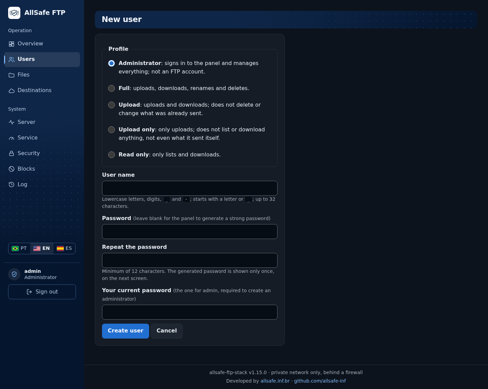</a>

<b>v1.9.0</b> · Users menu, New user form with the Administrator profile · captured on 2026-10-12

Click **New user** and select the **Administrator** profile: the folder and TLS fields give way to your current password.

| Field | Required | What to fill in |
|---|---|---|
| Profile | Yes | Administrator |
| User name | Yes | Lowercase letters, numbers, `_` and `-`; starts with a letter or `_`; up to 32 characters |
| Password | No | 12 characters or more. Left blank, the panel generates a strong password and shows it only once |
| Repeat the password | Only with the password filled in | The same password |
| Your current password | Yes | The password of whoever is using the panel, to confirm |

**Expected result:** the list comes back with the message `Administrator created.` and the new administrator signs in right away, without restarting anything.

Administrators ➜ Change password — click to expand

### Administrators ➜ Change password

<a href="images/administradores-trocar-senha.png">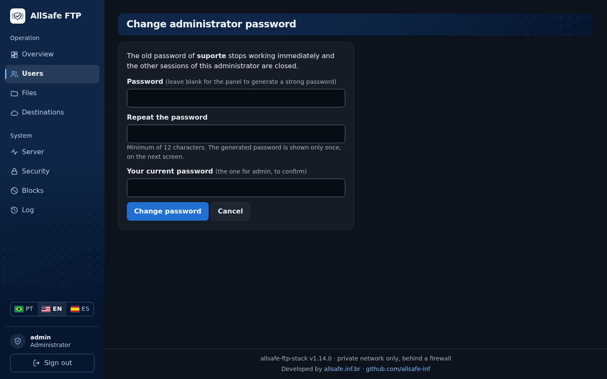</a>

<b>v1.9.0</b> · Users menu, Change administrator password form · captured on 2026-10-12

| Field | Required | What to fill in |
|---|---|---|
| Password | No | The new password, with 12 characters or more. Left blank, the panel generates one |
| Repeat the password | Only with the password filled in | The same password |
| Your current password | Yes | The password of whoever is using the panel, to confirm |

**Expected result:** the list comes back with the message `Password changed. The other sessions of this administrator were closed.` and the old password stops working immediately.

This is where the initial password of the installation is changed after the first access. With no administrator able to sign in, the password is reset from the server: [Recovering access](../panel.md#senha).

Administrators ➜ Change name — click to expand

### Administrators ➜ Change name

<a href="images/administradores-trocar-nome.png">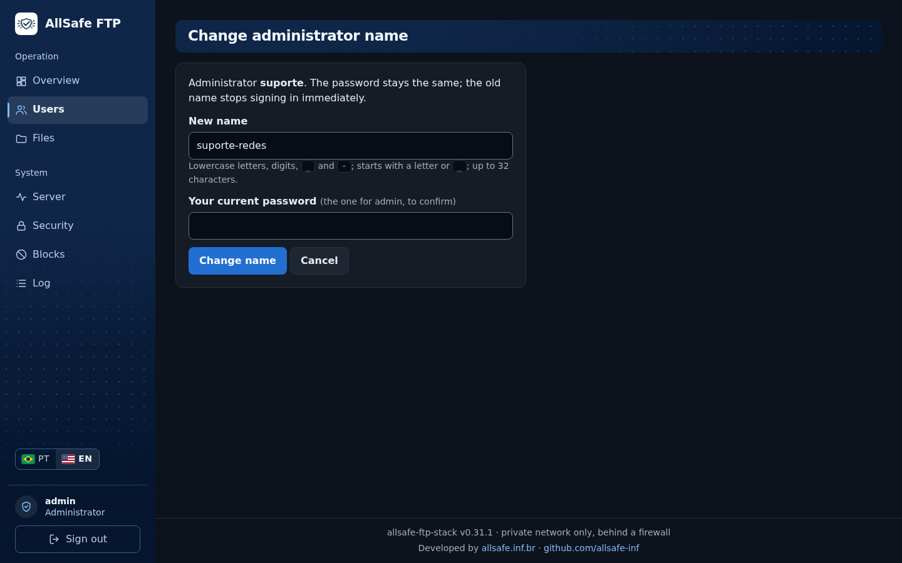</a>

<b>v1.9.0</b> · Users menu, Change administrator name form · captured on 2026-10-12

| Field | Required | What to fill in |
|---|---|---|
| New name | Yes | The same rule as the user name; different from the current one and from every other administrator |
| Your current password | Yes | The password of whoever is using the panel, to confirm |

**Expected result:** the list comes back with the message `Name changed. The other sessions of this administrator were closed.` Sign-in is now by the new name, with the same password.

Changing the name of the first administrator through the panel does not touch the `.env`: `PAINEL_ADMIN_USER` is only used while no administrator exists.

Administrators ➜ Remove — click to expand

### Administrators ➜ Remove

<a href="images/administradores-remover.png">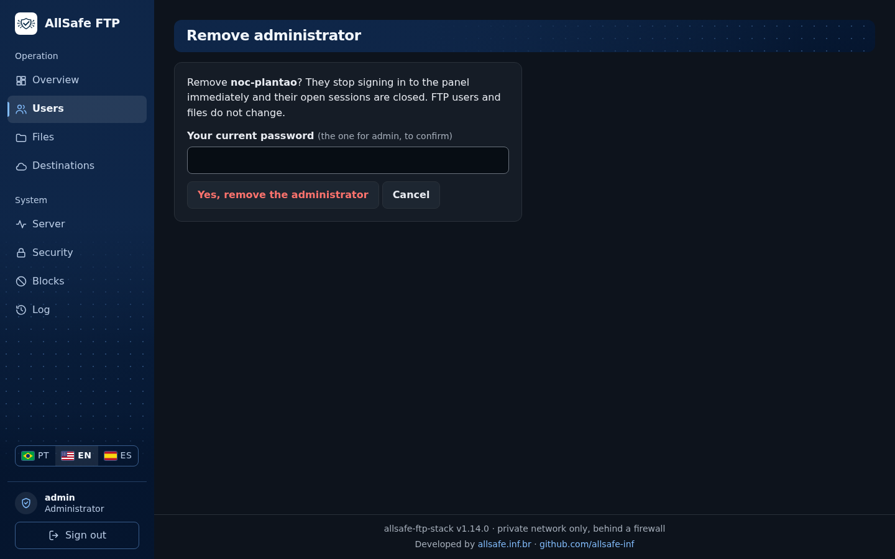</a>

<b>v1.9.0</b> · Users menu, administrator removal confirmation · captured on 2026-10-12

| Screen item | What it does |
|---|---|
| Your current password | Confirms that whoever asks for the removal is the owner of the session |
| **Yes, remove the administrator** | Deletes the account: it stops signing in immediately and its open sessions are closed |
| **Cancel** | Goes back to the list without changing anything |

**Expected result:** the list comes back with the message `Administrator removed. Their sessions were closed.` The FTP users and the files do not change.

Administrators ➜ Second factor — click to expand

### Administrators ➜ Second factor

<a href="images/administradores-segundo-fator.png">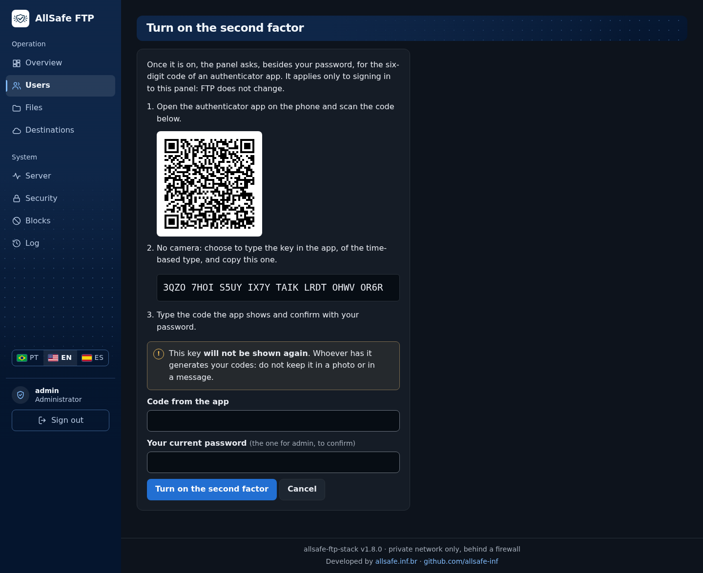</a>

<b>v1.9.0</b> · Users menu, Turn on the second factor screen, with the optional second factor and an example key that was not saved · captured on 2026-10-12

With the second factor required, which is the default, each account sets up its own at sign-in: see [Sign in ➜ Set up the second factor](#entrar). This screen is that of the optional second factor (`PAINEL_SEGUNDO_FATOR_OBRIGATORIO=nao`) and of whoever turned off their own and wants to set it up again without leaving the panel: click **Second factor** on the row of your own account. Each administrator turns on their own, with any authenticator app of time-based codes (TOTP).

| Screen item | What it does |
|---|---|
| QR code | It is the key, for the app to read with the camera. The account shows in it as `AllSafe FTP:<administrator>@<panel address>` |
| Key in groups | The same key, to type into the app when there is no camera, choosing the time-based type |
| **Code from the app** | Takes the six digits the app started to show: it is the proof that it read the key |
| Your current password | Confirms that whoever turns it on owns the session |
| **Turn on the second factor** | Saves the key and closes the other sessions of the account |
| **Cancel** | Goes back to the list without turning anything on |

**Expected result:** the list comes back with the message `Second factor turned on. The next sign-in of this account asks for the code from the app; its other sessions were closed.` and the row of the account starts to say `second factor on`.

> ⚠️ **The key appears only on this screen, until it is confirmed.** Whoever has it generates the codes of the account: do not keep it in a photo or in a message. While the first code does not arrive, the screen opened again shows the same key, for up to 10 minutes; after that, a new one.

### Administrators ➜ Turn off the second factor

<a href="images/administradores-segundo-fator-desligar.png">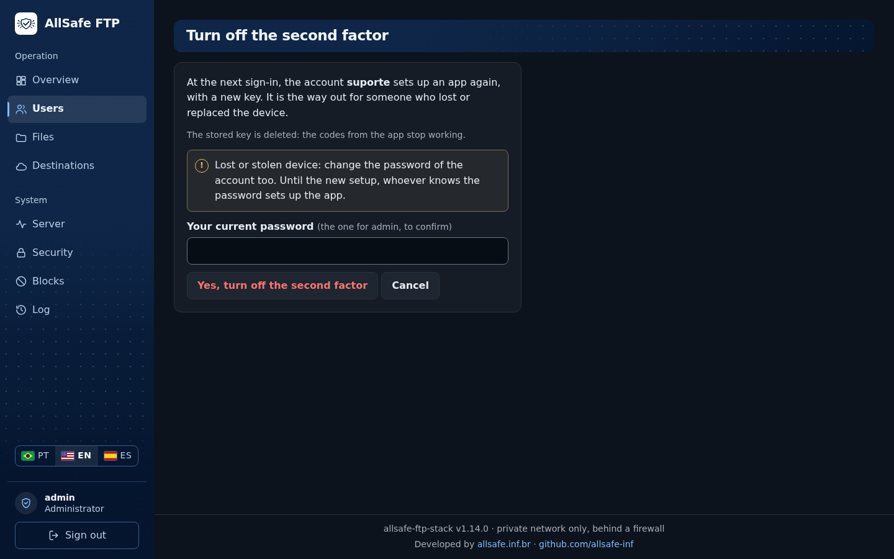</a>

<b>v1.9.0</b> · Users menu, Turn off the second factor screen, of the account of another administrator · captured on 2026-10-12

With the second factor on, the same **Second factor** button opens this screen, on one's own row or on that of another administrator: it is the way out for someone who lost the device. With the second factor required, turning it off is sending the account to set it up again: at the following sign-in, it goes through the Set up the second factor screen, with a new key.

| Screen item | What it does |
|---|---|
| Your current password | Confirms that whoever turns it off owns the session; it is not the password of the changed account |
| **Yes, turn off the second factor** | Deletes the stored key: the codes from the app stop working. With the second factor required, the account sets up an app again at the following sign-in; with the optional one, it goes back to signing in with user and password only |
| **Cancel** | Goes back to the list without changing anything |

**Expected result:** the list comes back with the message `Second factor turned off. At the next sign-in, the account sets up an app again.` or, with the optional second factor, `Second factor turned off. The account goes back to signing in with user and password only.`; in this case, to turn it on again, the owner of the account repeats the step above, with a new key.

> ⚠️ **Lost or stolen device: change the password of the account too.** With the second factor required, until the new setup, whoever knows the password sets up the app.

### Users ➜ Second factor of the FTP user

<b>v1.9.0</b> · Users menu, Turn off the second factor screen, of an FTP user · captured on 2026-10-12

The FTP user sets up their second factor at the sign-in to the panel, and only there. After that, their row in the Users tab gets the **Second factor** button, which opens this screen: the administrator only turns it off, does not see the key and does not set it up for them. It applies to the panel only: on FTP, the account keeps signing in with the password.

| Screen item | What it does |
|---|---|
| Your current password | Confirms that whoever turns it off owns the session; it is not the password of the user |
| **Yes, turn off the second factor** | Deletes the stored key of the user. With the second factor required, they set up an app again at the following sign-in; with the optional one, they go back to signing in to the panel with user and password only |
| **Cancel** | Goes back to the list without changing anything |

**Expected result:** the list comes back with the same message as when an administrator is turned off, and the **Second factor** button leaves the row of the user. Removing the user through the panel also deletes their second factor.

Technical detail — refusal messages, routes and file

| Message | Reason |
|---|---|
| Your current password does not match. Nothing was changed. | The Your current password field is wrong; five refusals in 15 minutes block the address |
| There is already an administrator with this name. | The name is already in use |
| The new name is the same as the current one. | The name change changed nothing |
| Limit of 20 administrators reached: remove one before creating another. | The panel already has 20 administrators |
| The code does not match the key on this screen. Check the time on the phone, wait for the next code and try again. | The code typed on the Turn on the second factor screen is not that of the key shown |
| The key shown has expired. Scan the new one in the app and try again. | The Turn on the second factor screen stayed more than 10 minutes without the first code; the screen comes back with another key |
| The second factor of (name) is off. Only the administrator turns on their own, because the key stays on the device of whoever signs in. | The address of the screen was opened for the account of another administrator who has no second factor |

- Registration is `POST /usuarios/novo`, with the profile `administrador`. The old addresses still work: `GET /administradores` leads to the Users tab and `GET /administradores/novo`, to the form with the Administrator profile selected.
- Routes of the other screens: `GET /administradores/senha?admin=<name>`, `/administradores/nome?admin=<name>` and `/administradores/remover?admin=<name>`; the submission of each form is a `POST` to the same route, with the CSRF token of the session.
- Second factor: `GET /administradores/fator?admin=<name>` shows the screen to turn it on or the one to turn it off; the submission is a `POST` to `/administradores/fator/ligar` or `/administradores/fator/desligar`. It writes `admin_fator_ligado` or `admin_fator_desligado`. The list of who turned it on is kept in `DATA_DIR/painel/segundo-fator` and the key of each one, in `.secrets/segundo-fator/<name>.txt`. An FTP user gets `404` on these routes.
- Second factor of the FTP user: `GET /usuarios/fator?usuario=<name>` shows the screen to turn it off and the submission is a `POST` to `/usuarios/fator/desligar`, which writes `usuario_fator_desligado`. Their account in the list is `ftp.<name>` and the key is kept in `.secrets/segundo-fator/ftp.<name>.txt`. An FTP user also gets `404` on these routes.
- The administrators are kept in `DATA_DIR/painel/administradores` (`0600`, owned by `root`), one `name:hash` line per account. Only the `scrypt` hash is written.
- Each change writes `admin_criado`, `admin_senha_trocada`, `admin_renomeado` or `admin_removido` to the [audit log](../panel.md#auditoria), with who did it and who was changed; the wrong current password writes `admin_senha_atual_recusada`.
- The full rules are in [Administrators of the panel](../panel.md#administradores).

---

## 📁 Files

<a href="images/arquivos.png">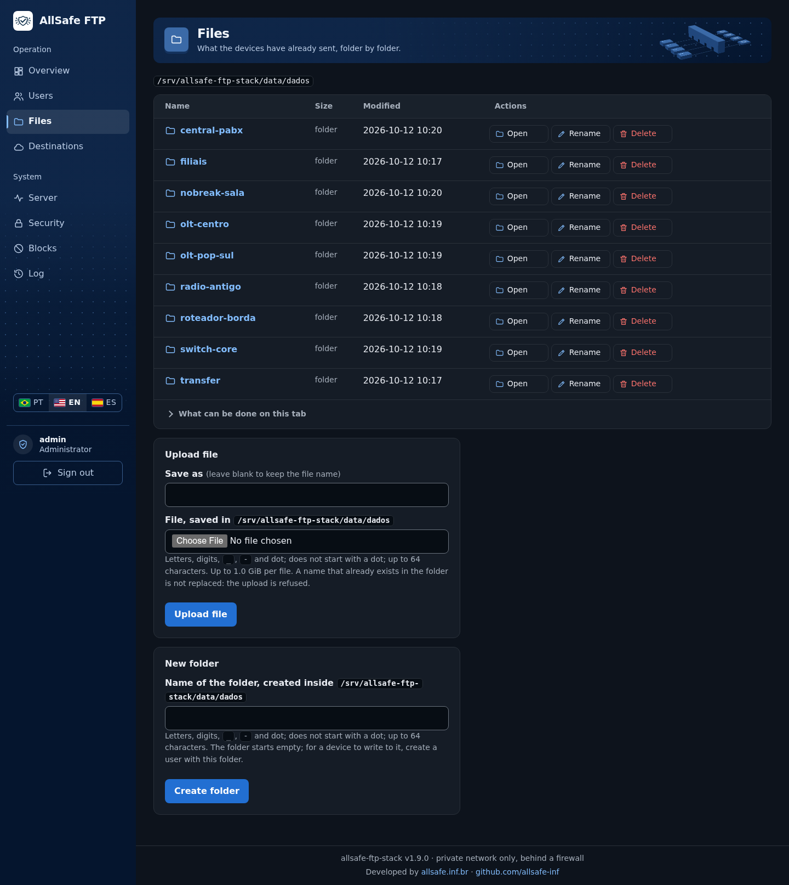</a>

<b>v1.9.0</b> · Files menu · captured on 2026-10-12

**What it is for:** seeing what each device uploaded, downloading a backup through the browser, uploading a file to any folder, creating the folder of a new user, renaming and deleting files and folders, without an FTP client.

**How to get there:** menu ➜ **Files**. In the Users tab, the address in the **Folder** column opens the folder of that user directly.

| Screen item | What it does |
|---|---|
| Path at the top of the list | Shows the open folder and goes back to any level |
| Name of a folder | Enters the folder |
| Size · Modified | Size of the file and date of the last change |
| **Download** | Hands the file to the browser, with the original name |
| **Telegram** · **rclone** · **S3** | With the destination saved in the Destinations tab, sends that file to the destination right away |
| **Rename** | Opens the screen that changes the name of the file or of the folder, inside the same folder, and asks for your current password; a name that already exists is refused |
| **Delete** | Opens the confirmation screen: it shows what is going away, asks for the ticked box and your current password and deletes for good, with no recycle bin |
| **New folder** | Creates an empty folder inside the one that is open |
| **Upload file** | Takes a file from the browser and writes it to the folder that is open; a name that already exists is refused |
| **New user in this folder** | Inside a folder, opens the user registration with the Folder field filled in |

The panel browses, downloads, uploads, creates folders, renames and deletes. The devices keep uploading by FTP: the upload from here is for the one-off file, of whoever is at the browser. The folder of an FTP user is not renamed or deleted from here: it goes together with the user, in [Users ➜ Remove](#usuarios). The rules and the limits are in [Web panel](../panel.md#arquivos).

Files ➜ Folder of a user and download — click to expand

### Files ➜ Folder of a user and download

<a href="images/arquivos-pasta.png">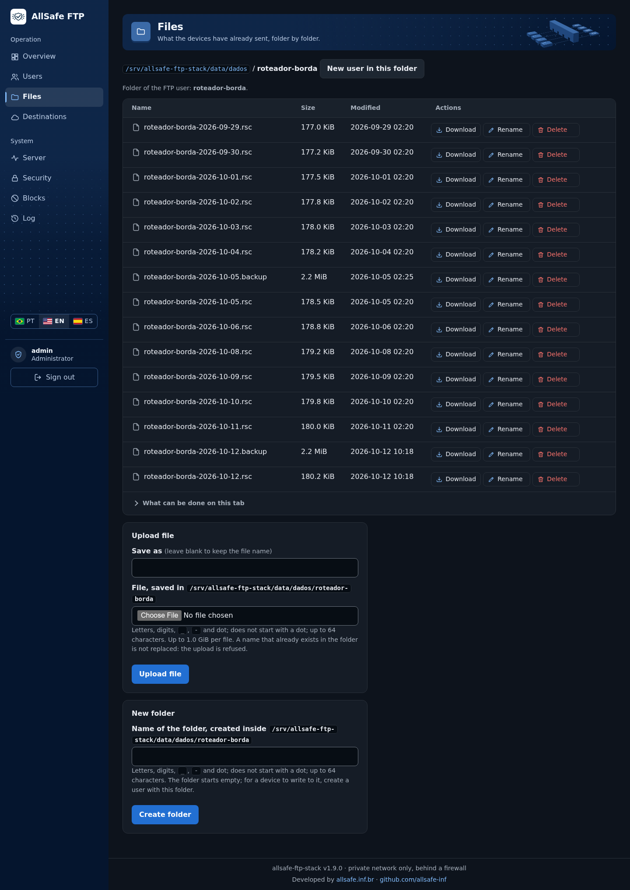</a>

<b>v1.9.0</b> · Files menu, folder of a user · captured on 2026-10-12

1. Click the name of the folder to enter it.
2. Check, in the line `Folder of the FTP user`, whose folder it is.
3. Click **Download** on the row of the file.

**Expected result:** the browser saves the file with the original name, identical to what the device uploaded, and the Log tab gains the line `File downloaded`, with the administrator, the path and the size.

| Limit | Value |
|---|---|
| Downloads at the same time | 8, adding up administrators and FTP users; the next one gets the screen `Too many downloads at the same time` |
| Items shown per folder | 2000, with a warning when there are more |
| Resume | There is none: if the connection drops, the download starts over |

Files ➜ New folder — click to expand

### Files ➜ New folder

<a href="images/arquivos-pasta-criada.png">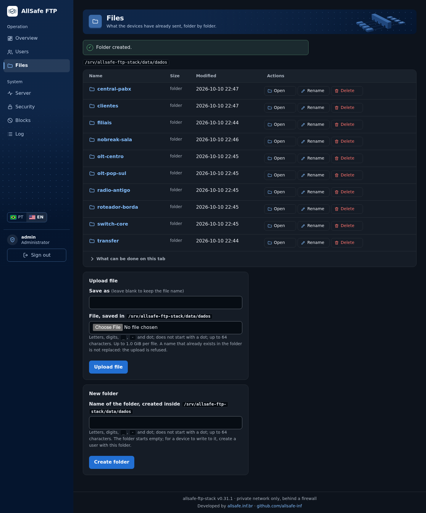</a>

<b>v1.9.0</b> · Files menu, folder created · captured on 2026-10-12

| Field | Required | What to fill in |
|---|---|---|
| Name of the folder | Yes | Letters, numbers, `_`, `-` and dot; does not start with a dot; up to 64 characters. One folder at a time: to create `clientes/olt-01`, create `clientes`, enter it and create `olt-01` |

**Expected result:** the list comes back with the message `Folder created.` and the new folder, empty, already with the owner and the permission that the FTP uses. For a device to write to it, enter the folder and click **New user in this folder**.

| Message | Reason |
|---|---|
| Path not accepted. | The name breaks the rule or tries to leave the data folder |
| There is already a folder or a file with this name. | The name is already in use in that folder |
| The panel does not follow symbolic links. | The destination goes through a symbolic link |
| Folder or file not found. | The destination folder no longer exists |

Files ➜ Upload file — click to expand

### Files ➜ Upload file

<a href="images/arquivos-enviado.png">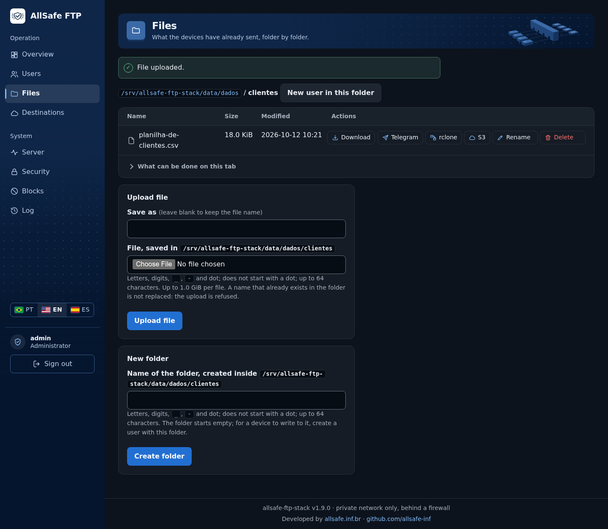</a>

<b>v1.9.0</b> · Files menu, after the upload · captured on 2026-10-12

1. Enter the folder where the file should stay.
2. In the **Upload file** card, choose the file.
3. Click **Upload file**.

| Field | Required | What to fill in |
|---|---|---|
| Save as | No | The name the file gets on the server: letters, numbers, `_`, `-` and dot; does not start with a dot; up to 64 characters. Left blank, the name of the chosen file is kept |
| File | Yes | The file to upload, one at a time; the label of the field says which folder it will be written to |

**Expected result:** the folder comes back with the message `File uploaded.` and the file in the list, already with the owner and the permission that the FTP uses, and the Log tab gains the line `File uploaded through the panel`, with the administrator, the path and the size.

| Limit | Value |
|---|---|
| Size of each file | The one in `PAINEL_ENVIO_MAX_MB`: 1024 MB, by default |
| Uploads at the same time | 4, adding up administrators and FTP users; the next one gets the screen `Too many uploads at the same time` |
| Name that already exists in the folder | It is not replaced: the upload is refused |
| Resume | There is none: if the connection drops, what arrived is discarded and the upload starts over |

| Message or screen | Reason |
|---|---|
| Screen `No file chosen` | The form was submitted without a file |
| Screen `Name not accepted` | The name of the file, or the one in the **Save as** field, breaks the rule |
| Screen `Name already in use` | There is already a folder or a file with this name in that folder; nothing is replaced |
| File too large: the panel accepts up to 1.0 GiB per file. | The file goes over the size of `PAINEL_ENVIO_MAX_MB`; the value in the message follows the variable |
| Screen `No space left` | The server has no free space for the file |

Files ➜ Send to a destination — click to expand

### Files ➜ Send to a destination

<a href="images/arquivos-enviado-ao-destino.png">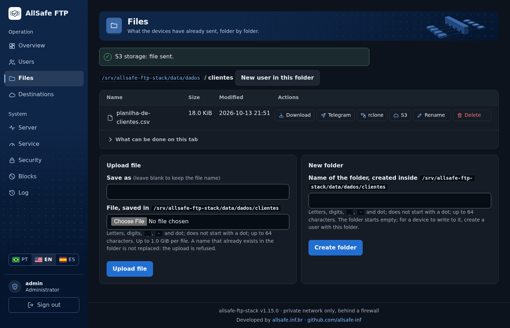</a>

<b>v1.9.0</b> · Files menu, after the send to a destination · captured on 2026-10-12

Once a destination is saved in the [Destinations](#destinos) tab, each file gets a button with its name, **Telegram**, **rclone** or **S3**, next to **Download**. The button sends that file to the destination right away, without waiting for the run.

1. Enter the folder of the file.
2. On the line of the file, click **Telegram**, **rclone** or **S3**.
3. With more than one destination of that type ready, choose the **Destination that receives** and click **Send**.

<a href="images/arquivos-escolher-destino.png">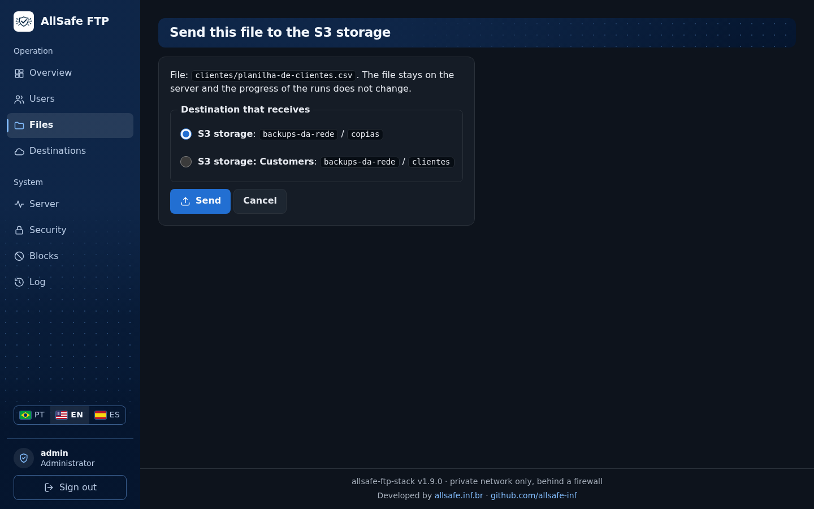</a>

<b>v1.9.0</b> · Files menu, choice of the destination · captured on 2026-10-12

**Expected result:** the page comes back to the same folder with the message `S3 storage: file sent.`, `rclone remote: file sent.` or `Telegram bot: file sent.`, with the name of the destination when it has one, and the Log tab gets the line `File sent to the destination on request`, with the administrator, the destination and the file.

| Item | How it works |
|---|---|
| When the buttons appear | Only for the type that has a destination saved with its secrets; with no destination, the list stays as before |
| Who has the buttons | Only the administrator: the My files screen, of the FTP user, does not show them |
| File of another folder | The button works for any file of the data, inside or outside the folder of the destination, and works with the destination turned off |
| The file on the server | It is never deleted by this send, not even with S3 in **Keep in S3** |
| Sending again | Through the bot, the chat receives another message; in S3 and in rclone, the same name is written over |
| Path on the rclone remote | The same the file has inside the data, starting at the folder on the remote |
| SFTP remote that has not gone through **Test** yet | The send does not go, and the message says the panel has not stored the key of the server yet |
| Send that takes long | Past 20 seconds, the message says the send continues in the background, and the result appears in the Log tab |
| Send that does not work | The message gives the reason in one sentence, such as an empty file or one larger than the bot limit |

Files ➜ Rename — click to expand

### Files ➜ Rename

<a href="images/arquivos-renomear.png">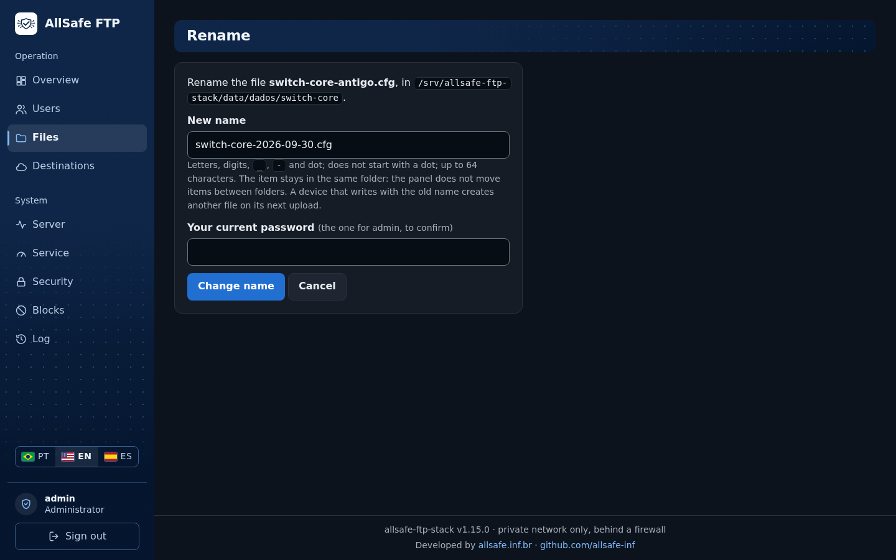</a>

<b>v1.9.0</b> · Files menu, Rename screen · captured on 2026-10-12

| Field | Required | What to fill in |
|---|---|---|
| New name | Yes | Letters, numbers, `_`, `-` and dot; does not start with a dot; up to 64 characters |
| Your current password | Yes | The password of whoever is using the panel, to confirm |

<a href="images/arquivos-renomeado.png">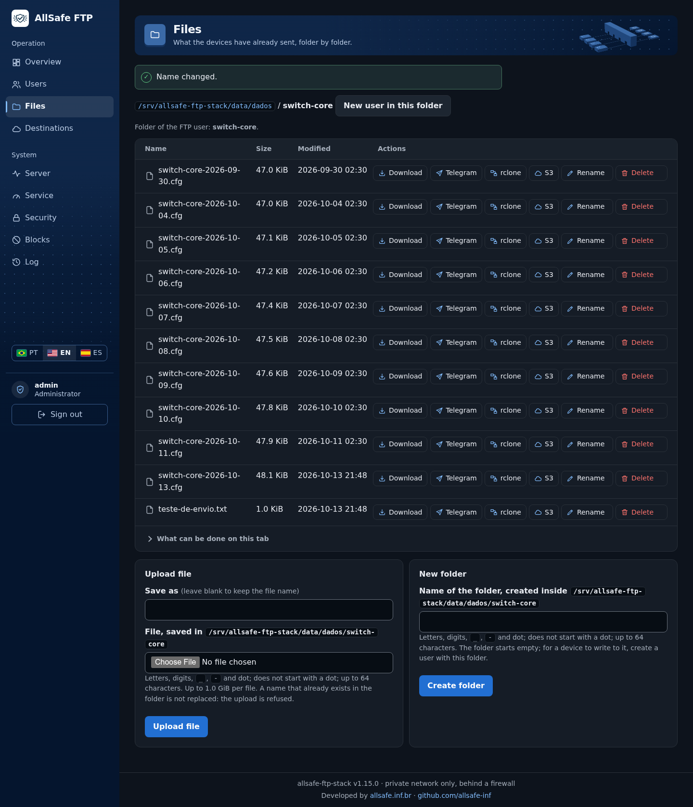</a>

<b>v1.9.0</b> · Files menu, after the name change · captured on 2026-10-12

**Expected result:** the folder comes back with the message `Name changed.` and the item with the new name, in the same place. The panel does not move from one folder to another, and the device that writes with the old name creates another file on the next upload.

| Message | Reason |
|---|---|
| Name not accepted. See the rule below the field. | The name breaks the rule |
| The item already has this name. | The new name is the same as the current one |
| There is already a folder or a file with this name. | The name is already in use in that folder; nothing is replaced |
| Your current password does not match. Nothing was changed. | The Your current password field is wrong; five refusals in 15 minutes block the address |

Files ➜ Delete — click to expand

### Files ➜ Delete

<a href="images/arquivos-apagar.png">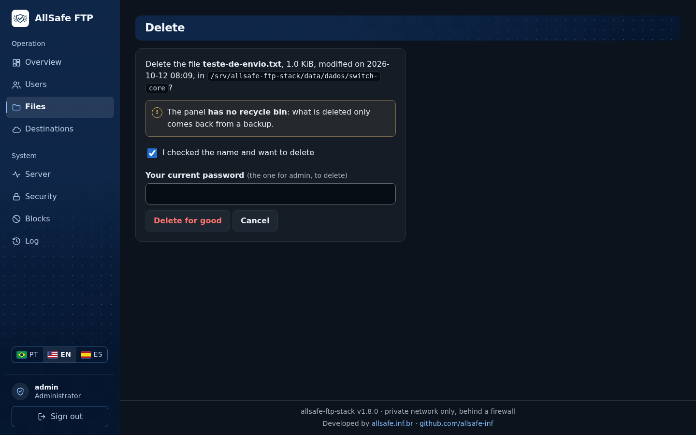</a>

<b>v1.9.0</b> · Files menu, delete confirmation · captured on 2026-10-12

| Screen item | What it does |
|---|---|
| First line | Says what is going away: the file, with the size and the date, or the folder, with the number of files and the space of everything inside it |
| **I checked the name and want to delete** box | Required: without it nothing is deleted |
| **Your current password** | The password of whoever is using the panel, to confirm |
| **Delete for good** | Deletes the file, or the folder with everything inside it |
| **Cancel** | Goes back to the folder without changing anything |

<b>v1.9.0</b> · Files menu, after deleting · captured on 2026-10-12

**Expected result:** the folder comes back with the message `Deleted.` and without the item, and the Log tab gains the line `File or folder deleted`.

> ⚠️ **Deleting cannot be undone:** the panel has no recycle bin, and what was deleted only comes back from a backup. See [Backup](../backup.md).

| Message or screen | Reason |
|---|---|
| Tick the confirmation box. Nothing was deleted. | The box was left unticked |
| Your current password does not match. Nothing was deleted. | The Your current password field is wrong; five refusals in 15 minutes block the address |
| Screen `Partly deleted` | The folder holds more than the panel deletes in one request: repeat to continue |
| Screen `Nothing was deleted` | The panel is already deleting another folder, or an item could not be removed |

<a href="images/arquivos-pasta-de-usuario.png">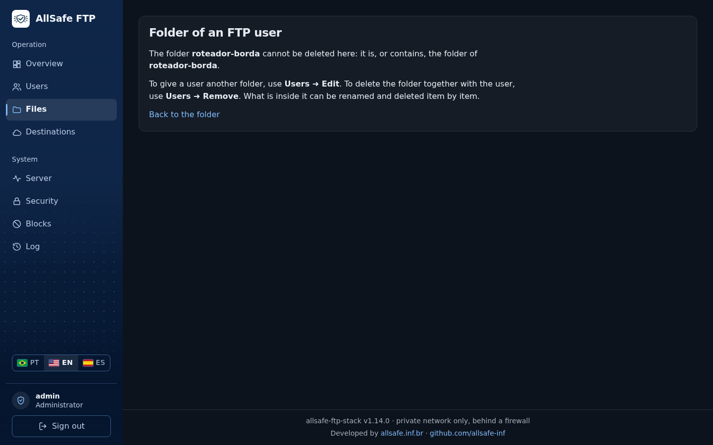</a>

<b>v1.9.0</b> · Files menu, user folder refused · captured on 2026-10-12

The folder of an FTP user, and the folder that has the one of a user inside it, is not renamed or deleted through the Files tab: the user database would be left pointing to a folder that does not exist. To give the user another folder, use **Users ➜ Edit**; to delete the folder together with the user, **Users ➜ Remove**. What is inside it is renamed and deleted item by item.

Technical detail — routes and protections

- Routes: `GET /arquivos?pasta=<path>` lists, `GET /arquivos/baixar?arquivo=<path>` hands over and `POST /arquivos/pasta` creates the folder, with the CSRF token. `GET /arquivos/renomear?item=<path>` and `GET /arquivos/apagar?item=<path>` show the screen of each action, and the submission is a `POST` to the same route. `POST /arquivos/enviar` takes the file, as `multipart/form-data`, with the CSRF token.
- The path is always relative to `DATA_DIR/dados`, opened part by part and without following symbolic links. A path with `..` gets `400` and a symbolic link, `403`, both with the event `recusa_caminho`.
- The file goes out as an attachment (`Content-Disposition: attachment`, RFC 6266 and RFC 8187), in 64 KiB blocks, without being loaded into memory: the browser saves it and never opens it.
- The new folder is born with the owner `ftpdata` and the mode `0750`, the same as the folders created by FTP.
- The uploaded file is written straight to disk, without being loaded into memory and without a name, in the destination folder itself, and only gets a name when it arrives whole, by `link()`, which does not replace what exists. The interrupted upload leaves nothing behind in the folder, and the panel does not open or interpret the content.
- The name is changed by a single system call, which refuses the name that already exists; the folder is emptied from the inside out, and a symbolic link inside it is deleted as a link, without touching the destination.
- One delete request removes up to 50,000 items or works for up to 20 seconds, and the panel does one deletion at a time.
- The folder of an FTP user, or the one that has one inside it, answers `409` on the screen and on the submission.
- The events `arquivo_baixado`, `arquivo_interrompido`, `arquivo_enviado`, `envio_interrompido`, `pasta_criada`, `item_renomeado` and `item_apagado` are in the [audit log](../panel.md#auditoria); the content of the file is never recorded.
- The full behaviour is in [Files and download](../panel.md#arquivos) and in [Upload file](../panel.md#enviar-arquivo).

---

## 📥 My files

<a href="images/meus-arquivos.png">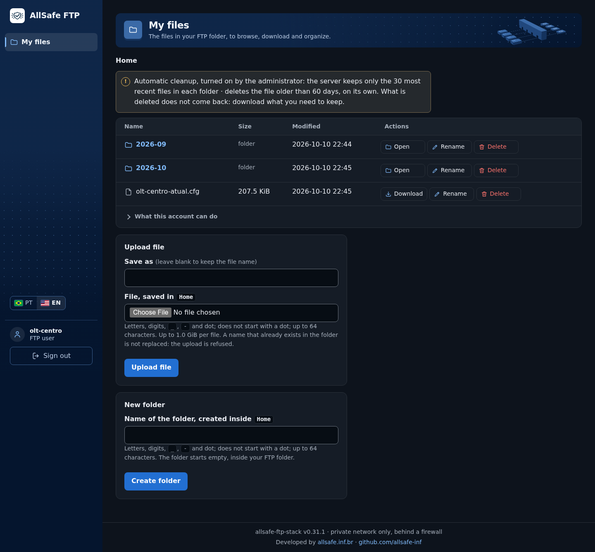</a>

<b>v1.9.0</b> · My files screen, of the FTP user with the Full profile · captured on 2026-10-12

**What it is for:** the owner of the files browses their own folder and downloads the backups through the browser, without depending on whoever administers and without a new account. What else they do depends on the profile of the account and, for file upload, on the permission the administrator gives.

**How to get there:** open the address of the panel and sign in with **the FTP name and password**, the same ones the device uses. It is the screen the FTP user lands on; the folders the administrator granted to them are in the menu.

| Screen item | What it does | Profiles that have it |
|---|---|---|
| Path at the top of the list | Shows the open folder, starting from **Home**, and goes back to any level | Full, Upload and Read only |
| Name of a folder · **Open** | Enters the folder | Full, Upload and Read only |
| Size · Modified | Size of the file and date of the last change | Full, Upload and Read only |
| **Download** | Hands the file to the browser, with the original name | Full, Upload and Read only |
| **New folder** | Creates an empty folder inside the one that is open | Full and Upload |
| **Upload file** | Takes a file from the browser and writes it to the folder that is open | Full, Upload and Upload only, with the permission to upload through the panel |
| **Rename** | Opens the screen that changes the name of the file or of the folder, inside the same folder, and asks for the FTP password of the account | Full |
| **Delete** | Opens the confirmation, which asks for the FTP password of the account; deletes for good, with no recycle bin | Full |
| Automatic cleanup warning | Above the list, when the administrator turned on the cleanup of the folder: it states the rule and reminds that what goes does not come back | Full, Upload and Read only |
| **What this account can do** | Collapsed below the list: says what the profile of the account allows and whether it uploads files from here | Full, Upload and Read only |
| **PT** · **EN** · **ES** | Switch the language of the account: see [Language](#idioma) | All |
| **Sign out** | Closes the session immediately | All |

On this screen, the user sees only the folder of their record and what is inside it. The path of the folder on the server does not appear, and the menu has only the screen of the account and the folders granted to it, without the administration tabs, with the name of the user and the role **FTP user**. The button the profile does not have does not appear, and the action requested directly by the address answers `404`. Uploading a file from here depends on a permission the administrator gives to each account: without it, the **Upload file** card does not appear and upload is by FTP only. The account with the Upload only profile has another screen: see [My files ➜ Upload only profile](#meus-arquivos).

My files ➜ Inside a folder — click to expand

### My files ➜ Inside a folder

<a href="images/meus-arquivos-pasta.png">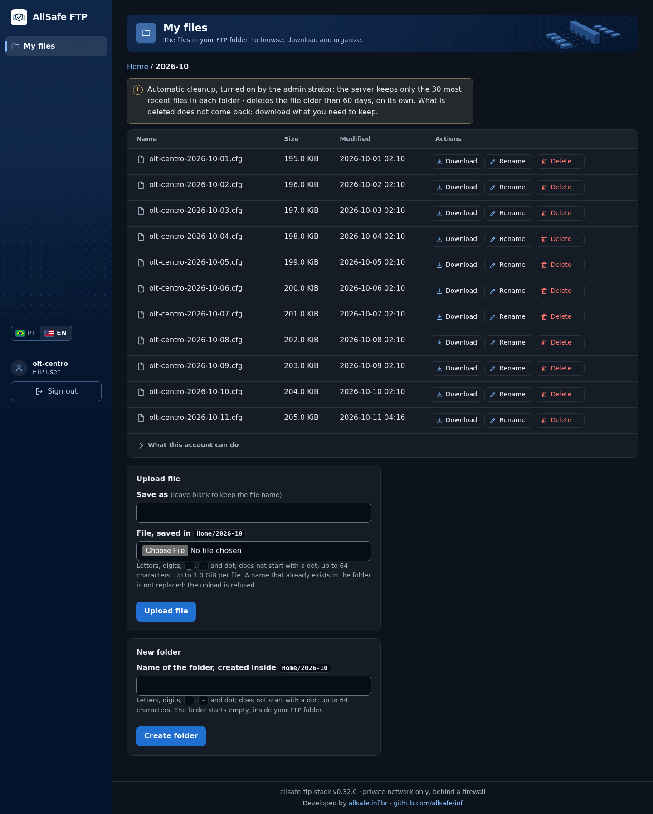</a>

<b>v1.9.0</b> · My files screen, inside a folder · captured on 2026-10-12

1. Click the name of the folder to enter it.
2. Click **Download** on the row of the file.
3. Click **Home**, in the path at the top, to go back to the folder of the user.

**Expected result:** the saved file is identical to what the device uploaded, and the Log tab, which only the administrator sees, gains the line `File downloaded`, with the name of the FTP user, the path and the size.

| Limit | Value |
|---|---|
| Sessions per FTP user | 3; the fourth sign-in closes the oldest one |
| Downloads at the same time per user | 2, or the number saved in their limits; the next one gets the screen `Too many downloads at the same time` |
| After changing the password, the folder or the profile, or removing the user | Their session is closed on the next request |

My files ➜ Upload file — click to expand

### My files ➜ Upload file

<a href="images/meus-arquivos-enviado.png">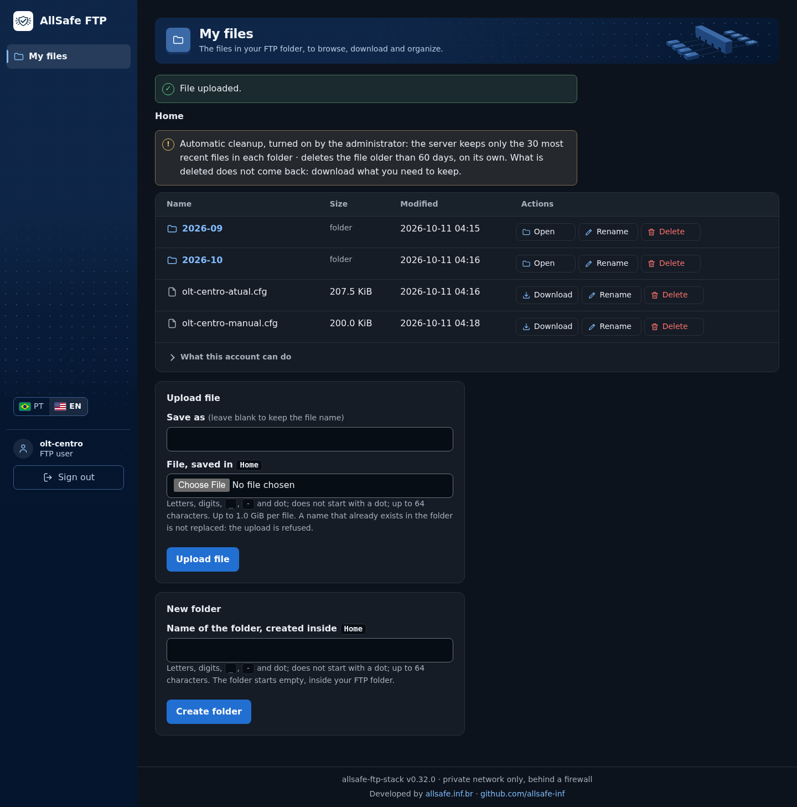</a>

<b>v1.9.0</b> · My files screen, after the upload · captured on 2026-10-12

The **Upload file** card appears for the account that has the permission **Allow this user to upload files through the panel**, ticked by the administrator in [Users ➜ Limits](#usuarios). The Read only profile does not upload, with or without the permission.

1. Enter the folder where the file should stay.
2. In the **Upload file** card, choose the file.
3. Click **Upload file**.

| Field | Required | What to fill in |
|---|---|---|
| Save as | No | The name the file gets on the server; left blank, the name of the chosen file is kept |
| File | Yes | The file to upload, one at a time |

**Expected result:** the folder comes back with the message `File uploaded.` and the file in the list, and the Log tab, which only the administrator sees, gains the line `File uploaded through the panel`, with the name of the FTP user, the path and the size.

| Rule | How it applies |
|---|---|
| Size of each file | The one in `PAINEL_ENVIO_MAX_MB`: 1024 MB, by default |
| Uploads at the same time | One per account; the next one gets the screen `Too many uploads at the same time` |
| Rate | The upload rate saved in the limits of the user, if there is one |
| Name that already exists | With the Full and Upload profiles, the upload is refused and nothing is replaced. With the Upload only profile, the new file is stored with the date and time in its name |
| Without the permission | The upload requested directly by the address gets the screen `Upload not allowed` and is recorded |

My files ➜ Upload profile — click to expand

### My files ➜ Upload profile

<a href="images/meus-arquivos-envio.png">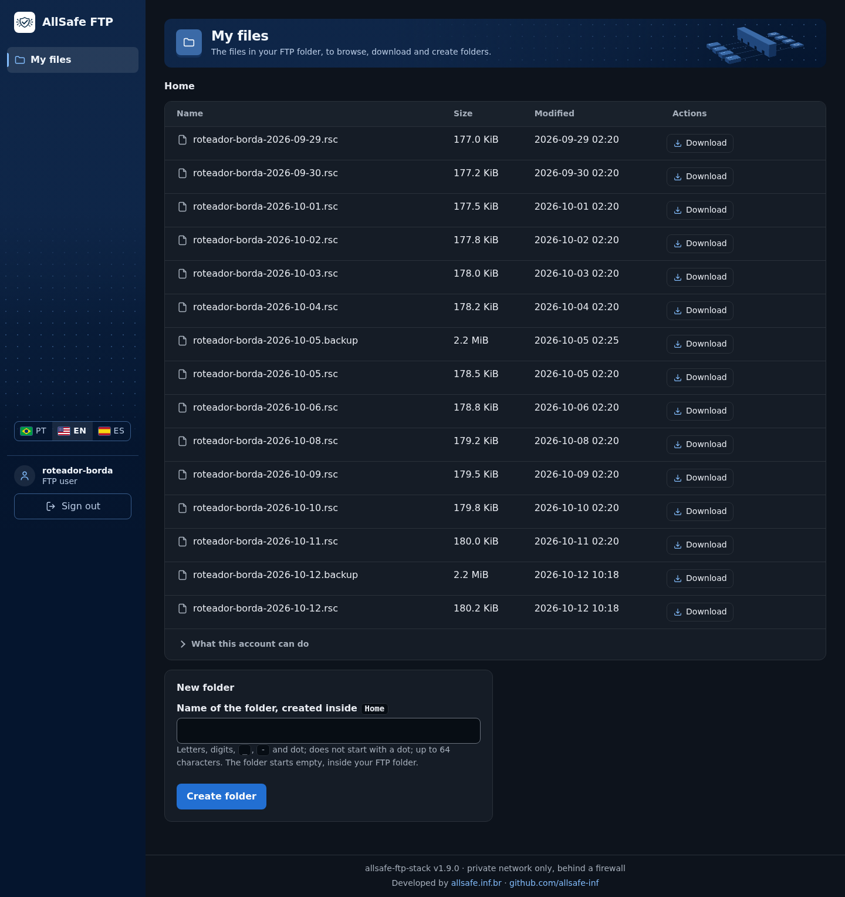</a>

<b>v1.9.0</b> · My files screen, Upload profile · captured on 2026-10-12

The account with the Upload profile browses, downloads and creates folders. There is no **Rename** or **Delete**: what has already reached the server stays as it arrived, on FTP and on the panel. In the screenshot, `roteador-borda` does not have the permission to upload through the panel, and the **Upload file** card does not appear.

My files ➜ Read only profile — click to expand

### My files ➜ Read only profile

<a href="images/meus-arquivos-leitura.png">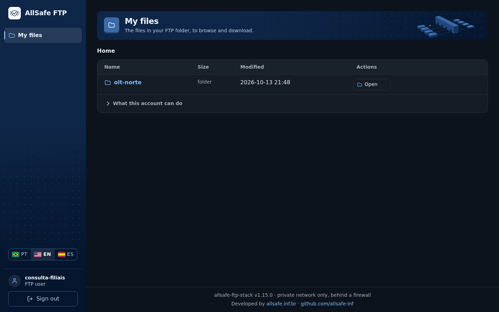</a>

<b>v1.9.0</b> · My files screen, Read only profile · captured on 2026-10-12

The account with the Read only profile only browses and downloads, and does not upload by any path. In the screenshot, the folder of `consulta-filiais` is `filiais`, which has the folder of `olt-filial-norte` inside it: the lookup account downloads what the OLT uploaded and writes nothing.

My files ➜ Upload only profile — click to expand

### My files ➜ Upload only profile

<a href="images/meus-arquivos-so-envio.png">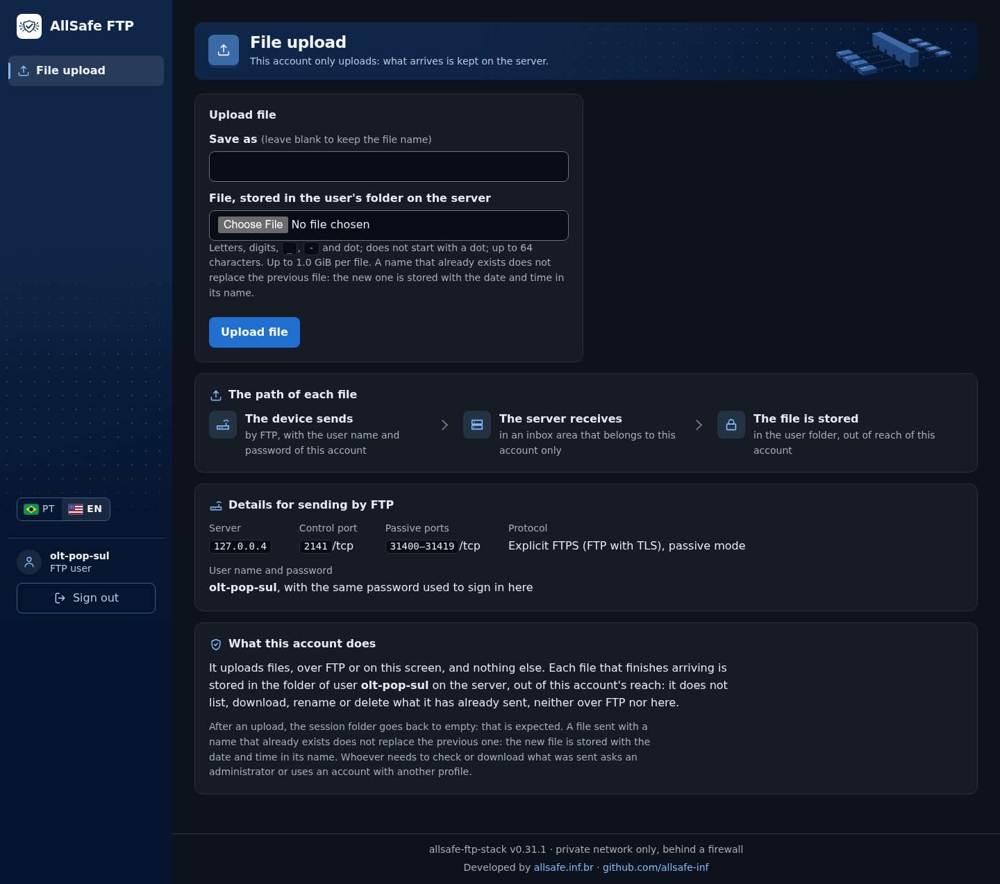</a>

<b>v1.9.0</b> · File upload screen, Upload only profile · captured on 2026-10-12

The account with the Upload only profile does not see the backups, not even the ones it uploaded itself. In place of My files, it opens the **File upload** screen, which explains the path of the file and has the details to set up the device.

| Card | What it shows |
|---|---|
| **Upload file** | Only with the permission to upload through the panel: takes a file from the browser and stores it in the folder of the user, without showing what is in it |
| **The path of each file** | Three steps: the device uploads by FTP, the server receives it in an entry area that belongs to that account alone and the file is stored in the folder of the user, out of its reach |
| **Details for sending by FTP** | Server, control port, passive ports, protocol and the user: what to fill in on the device |
| **What this account does** | That it only uploads, that the folder of the session is empty again after each upload and that the file with a repeated name is stored with the date and time in its name, without replacing the previous one |

With the permission, the account uploads by FTP or through this screen, and nothing else: the message `File uploaded.` confirms the arrival, and the file with a repeated name comes back with `File uploaded. There was already one with this name: the new one was stored with the date and time in its name.`

Whoever needs to check or download what was uploaded asks an administrator or uses an account with another profile. The rules of this profile are in [Web panel](../panel.md#perfis).

My files ➜ Granted folder — click to expand

### My files ➜ Granted folder

<a href="images/pasta-liberada.png">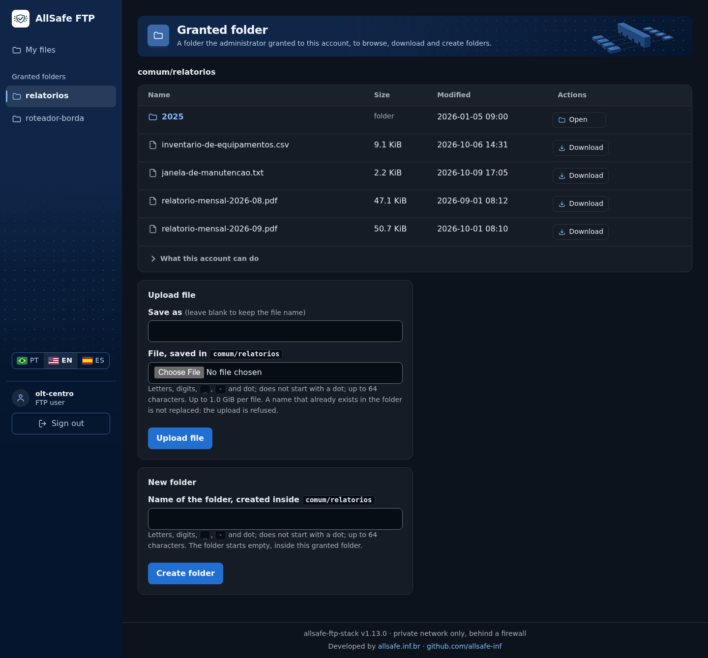</a>

<b>v1.13.0</b> · Granted folder screen, permission Upload · captured on 2026-10-13

Each folder the administrator granted to the account gets an entry in the menu, in the **Granted folders** group, with the last name of the path; the whole path appears at the top of the screen. The screen works like My files, with what the permission of that folder allows, and not the profile of the account.

| Permission in the folder | What the screen has |
|---|---|
| Read only | The list, with **Open** and **Download** |
| Upload | Also the **New folder** card and, with the permission to upload through the panel, the **Upload file** card |
| Full | Also **Rename** and **Delete** on each row, with the FTP password of the account |

In the screenshot, `olt-centro` has the permission Upload in `comum/relatorios`: it browses, downloads, creates folders and uploads, but does not rename or delete, although its profile is Full. In `roteador-borda`, the other entry of the menu, it only browses and downloads.

The collapsed **What this account can do** says the folder was granted by the administrator, that it opens only in the panel and that other accounts may have access to it, without saying which. A folder the administrator takes away leaves the menu on the next request, and its address starts answering `404`. The rules are in [Web panel](../panel.md#outras-pastas).

Technical detail — what the FTP account reaches

- Routes of the session of the FTP user, by profile. Upload only: `GET /` (leads to `/meus-arquivos`), `GET /meus-arquivos`, `POST /idioma` and `POST /sair`. Read only adds `GET /meus-arquivos?pasta=<path>` and `GET /meus-arquivos/baixar?arquivo=<path>`. Upload adds `POST /meus-arquivos/pasta`. With the permission to upload through the panel, Upload only, Upload and Full gain `POST /meus-arquivos/enviar`; without it, the route answers `403`, with the event `recusa_envio`. Full adds `GET` and `POST` on `/meus-arquivos/renomear?item=<path>` and `/meus-arquivos/apagar?item=<path>`.
- Any other route answers `404`. When it is an administration route, or an action the profile of the account does not have, the event `recusa_papel` is recorded, with the user, the path and the profile.
- In the granted folders, the same routes apply under `/pastas/<identificador>`, by the permission given in that folder and not by the profile: the list, `/baixar`, `/pasta`, `/enviar`, `/renomear` and `/apagar`. A folder that is not granted to the account answers `404`, with the event `recusa_pasta`; an action the permission does not have, `404`, with `recusa_papel`.
- Renaming and deleting check the FTP password of the account; the wrong password writes `usuario_senha_atual_recusada`.
- The one that checks the password is `pure-ftpd`, by a login on the internal network of the stack; the panel does not read the hash of the user database.
- The path is always relative to the folder of the record, which is its root, or to the granted folder, when the request is for one of them, with the same checks as the [Files tab](#arquivos).
- `PAINEL_ACESSO_USUARIOS_FTP=nao` turns this sign-in off: the panel starts accepting administrators only.
- The full behaviour is in [FTP user in the panel](../panel.md#usuario-ftp).

---

## ☁️ Destinations

<b>v1.9.0</b> · Destinations menu · captured on 2026-10-12

**What it is for:** sending by itself, out of the server, the files that arrive in a folder. There are three types of destination, with up to 20 of each: the S3 storage, which holds the second copy or keeps the files and frees the disk, the rclone remote, which takes the folder to a file server, to a file cloud, to the storage of a cloud provider or to a file transfer service, in 41 types, and the Telegram bot, which delivers each new file to a person, a group or a channel.

**How to get there:** menu ➜ **Destinations**. Only the administrator has the tab.

| Item on the screen | What it shows or does |
|---|---|
| Tag next to the name | `not configured`, `on`, `off` or `secrets missing`; on the rclone SFTP remote that has not gone through **Test** yet, `test pending` |
| Address · Bucket and prefix · Region | Where S3 sends to, as it was saved |
| Remote type · Folder on the remote | In rclone, the chosen type and the folder of the remote where the files are written |
| Folder sent | The folder of the data the destination follows, with the folders inside it |
| Runs | How often the panel checks the folder |
| After sending | In S3, **Copy** or **Keep in S3**; in rclone, always **Copy** |
| Largest file the bot sends · Message language | The limit of each send through the bot and the language of the caption and of the notices |
| Access key and secret key · Remote access · Bot token and chat | They only say the secrets are saved: the value is not shown on screen |
| Server key | On the SFTP remote, after **Test**: the type and the fingerprint of the key the panel stored, to compare with the one on the server |
| Last run | When it was and how many files went, with the total size; when it stops before the end, the reason in one sentence |
| Sent since it was turned on | The total of files and of size the destination has already received |
| **System copy** card | At the top of the tab, collapsed: the title and the tag stay visible, and a click on the title opens the card. It already comes open when there is a copy in progress, a copy that was not finished or secrets missing. The tag is `not configured`, `schedule on`, `button only`, `in progress` or `secrets missing`; the destination, the bucket and the folder, the schedule and the last copy, with the date, the size, the files and the name of the object |
| Copy and send now · Change | Requests the system copy right away, in the background · opens the form of the copy: the S3 that receives it, the folder in the bucket, the days and the time of the schedule |
| Still arriving | Files that changed less than two minutes ago: they go in a later run |
| Waiting for another destination | In S3 with **Keep in S3**, files already stored there that only leave the server when the other destinations of the folder deliver them |
| **Test** | Writes a small object to S3 or a small file to the rclone remote, or sends the test message through the bot, with what is saved |
| **Send now** | Requests a run out of schedule; refresh the page to follow it |
| **Change** | Opens the form with what is saved; a blank secret keeps the saved one |
| **New with the same access** | Opens the form of a new destination of the same type, with the secrets of this one |
| **Remove** | Opens the confirmation that deletes the settings, the progress and the secrets of that destination, and only of it |
| **New S3** · **New remote** · **New bot** | At the top of the screen, after the first destination of the type: they open the blank form of one more |
| **How the panel sends** | At the top of the screen, collapsed: one click opens the summary of the rules: how the panel leaves the server, regular files only and where the secrets are kept |

Each destination has its own folder, interval and secrets, and one does not depend on the other. S3 and the rclone remote send everything in the folder, including what was already there when they were turned on, at each interval. The bot sends only what arrives after it is turned on: within a few seconds when the file arrives whole by FTP or through the panel, and at each interval what showed up in the folder another way. The complete rules are in [Web panel](../panel.md#destinos).

Destinations ➜ Before configuring — click to expand

### Destinations ➜ Before configuring

<a href="images/destinos-sem-destino.png">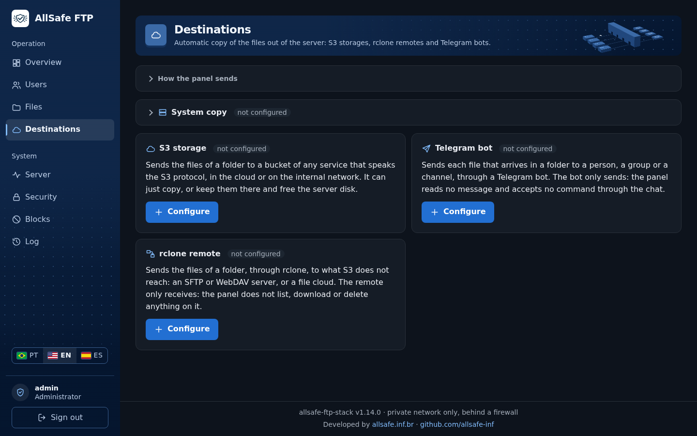</a>

<b>v1.9.0</b> · Destinations menu, no destination saved · captured on 2026-10-12

The installation is born with no destination: until the administrator saves one, nothing leaves the server and the panel opens no connection to the outside. Each card says what the destination does and leads to its form, through the **Configure** button.

Destinations ➜ S3 storage — click to expand

### Destinations ➜ S3 storage

<a href="images/destinos-s3.png">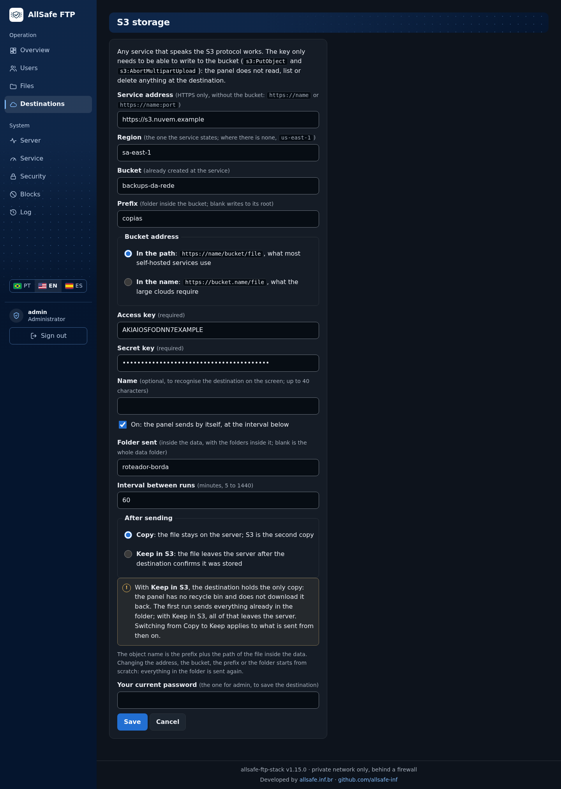</a>

<b>v1.9.0</b> · Destinations menu, S3 form · captured on 2026-10-12

Any service that speaks the S3 protocol works, in the cloud or on the internal network. Before you start, create the bucket at the service and a key that can only write to it.

1. In the Destinations tab, click **Configure** on the **S3 storage** card.
2. Fill in the address, the region, the bucket and the two keys.
3. Choose the folder sent, the interval and what happens after sending.
4. Type your password and click **Save**.

| Field | Required | What to fill in |
|---|---|---|
| Service address | Yes | `https://name` or `https://name:port`, HTTPS only and without the bucket |
| Region | Yes | The one the service states; where there is none, `us-east-1` |
| Bucket | Yes | The name of the bucket, already created at the service |
| Prefix | No | The folder inside the bucket; blank writes to its root |
| Bucket address | Yes | **In the path** (`https://name/bucket/file`) or **In the name** (`https://bucket.name/file`), as the service requires |
| Access key | Yes | The key that can write to the bucket. In **Change**, blank keeps the saved one |
| Secret key | Yes | The other half of the key. In **Change**, blank keeps the saved one |
| Name | No | Up to 40 characters, to recognise the destination on the screen when there is more than one of the type |
| On | No | Checked, the panel sends by itself; unchecked, the settings are kept and nothing leaves |
| Folder sent | No | The folder inside the data, which must exist; blank is the whole data folder |
| Interval between runs | Yes | Minutes, 5 to 1440 |
| After sending | Yes | **Copy**: the file stays on the server. **Keep in S3**: the file leaves the server after the destination confirms it was stored |
| Your current password | Yes | The password of whoever is in the session, to save the destination |

<a href="images/destinos-gravado.png">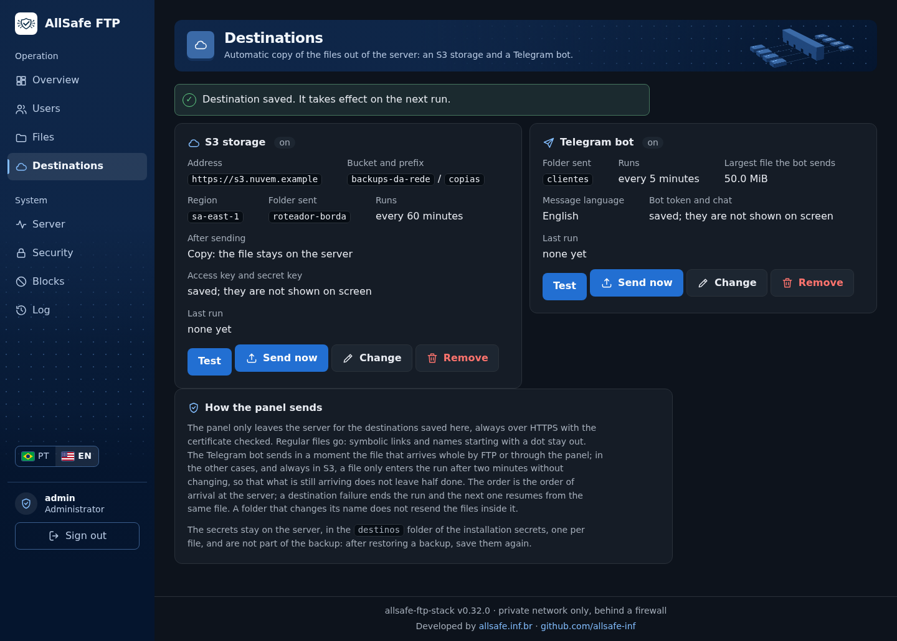</a>

<b>v1.9.0</b> · Destinations menu, after saving · captured on 2026-10-12

**Expected result:** the tab comes back with the notice `Destination saved. It takes effect on the next run.`, and the card shows the `on` tag, the address, the bucket, the folder and that the keys are saved, without showing them. The first run starts within a minute and sends everything already in the folder.

> ⚠️ **Keep in S3 leaves a single copy:** the file leaves the server once it is stored at the destination, and the panel has no recycle bin and does not download it back. Start with **Copy**, check the objects in the bucket and only then switch.

| Message | Reason |
|---|---|
| Invalid address: use https://name or https://name:port, in lowercase and without a path. | The address is not HTTPS, has an uppercase letter or carries the bucket or a path |
| Invalid bucket: 3 to 63 characters, with lowercase letters, digits, dot and hyphen. | The bucket name is outside the rule |
| The folder does not exist inside the data. Create it in Files or check the name. | The folder sent was not found |
| Fill in both secrets of the destination: neither is saved yet. | On the first save, one of the keys was left blank |
| Invalid interval: 5 to 1440 minutes. | The interval is out of range |

Destinations ➜ rclone remote — click to expand

### Destinations ➜ rclone remote

<a href="images/destinos-rclone-tipo.png">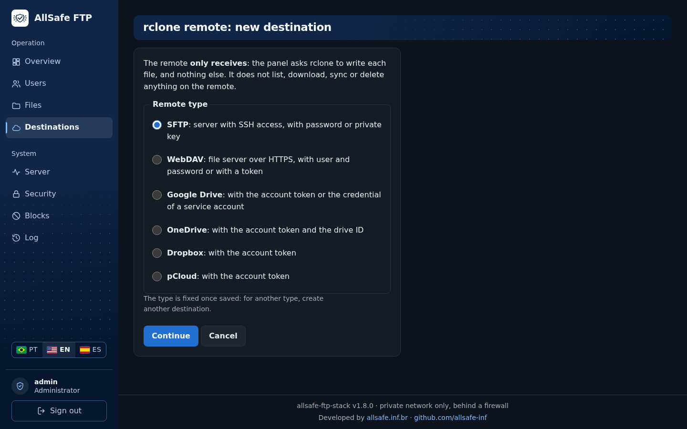</a>

<b>v1.10.0</b> · Destinations menu, choice of the remote type · captured on 2026-10-12

rclone is the file sending program that comes inside the panel image. Through it, the folder goes to what S3 does not reach, in 41 remote types: file servers (SFTP, WebDAV, FTP with TLS and Seafile), file clouds (Google Drive, OneDrive, Dropbox, pCloud, Box, Mega and others), cloud provider storage and file transfer services for businesses. The remote only receives: the panel does not list, download, sync or delete anything on it.

1. In the Destinations tab, click **Configure** on the **rclone remote** card.
2. Choose the **Remote type** in the list, split into four groups, and click **Continue**.

<b>v1.9.0</b> · Destinations menu, SFTP remote form · captured on 2026-10-12

3. Fill in the **Folder on the remote**, the **Folder sent** and the **Interval between runs**.
4. Under **Remote access**, fill in the fields of the chosen type.
5. Type your password and click **Save**.

| Field | Required | What to fill in |
|---|---|---|
| Folder on the remote | No | Where the files are written, with up to 16 levels separated by slashes; blank is the folder the remote opens in |
| Name | No | Up to 40 characters, to recognise the destination on the screen when there is more than one of the type |
| On | No | Checked, the panel sends by itself; unchecked, the settings are kept and nothing leaves |
| Folder sent | No | The folder inside the data, which must exist; blank is the whole data folder |
| Interval between runs | Yes | Minutes, 5 to 1440 |
| Server | Yes | In SFTP, the name or the IP address, without the port |
| Port | No | Blank means 22 |
| User | Yes | The account of the server that receives the files |
| Password | One of the two | The password of the account, when the access is not by key |
| Private key | One of the two | The whole file, from the BEGIN line to the END line, in place of the password |
| Private key passphrase | No | Only when the key is encrypted |
| Server public key | No | One per line, as in the SSH known hosts file; when blank, **Test** stores the one the server presents |
| Your current password | Yes | The password of whoever is in the session, to save the destination |

The access fields change with the type. Those of the other 40 types are in [Web panel](../panel.md#destinos). The form of each type brings only its own fields and, when the account has some condition, the notice about it. The one of Mega, for example, asks for the user and the password:

<b>v1.10.0</b> · Destinations menu, Mega remote form, with an example account that was not saved · captured on 2026-10-12

<b>v1.9.0</b> · Destinations menu, remote saved and not tested yet · captured on 2026-10-12

6. Back in the tab, click **Test** on the card of the remote.

<b>v1.9.0</b> · Destinations menu, remote after the test · captured on 2026-10-12

**Expected result:** on saving, the tab comes back with the notice `Destination saved. It takes effect on the next run.` and the card of the remote, with the type, the folder on the remote, the folder sent and the access saved, without showing it. In SFTP, the card keeps the `test pending` tag. The test writes the file `allsafe-ftp-stack-teste.txt` to the folder of the remote and answers `Test finished: the destination received it.`; the card turns to `on` and gets the **Server key** line, with the fingerprint to compare with the one on the server. The first run starts within a minute and sends everything already in the folder.

| Situation | What happens |
|---|---|
| SFTP remote without **Test** | Nothing is sent: the panel has not stored the key of the server yet |
| Server key different from the stored one | The sending stops, and the card tells the reason; if the change was made by the server itself, save the access again and test |
| Type that asks for the **Account token**, such as Google Drive, OneDrive, Dropbox, pCloud and Box | The token is obtained outside the panel, with the `rclone authorize` command the screen shows, on a computer with a browser, and pasted into the **Account token** field |
| FTP remote | It only sends with TLS, explicit or implicit, and with the certificate of the server checked |
| Mega and Proton Drive with two-step verification | The account does not work as a destination: the panel has no way to give the code at each send |
| Bucket type, such as Backblaze B2 and Azure Blob Storage | The **Folder on the remote** is required and starts with the name of the bucket or of the container, which must already exist |
| **Change** | The saved access does not come back to the screen: left blank, the saved one stays; to change any part of it, fill in the whole access again |
| Remote type | It is fixed once saved: for another type, create another destination |
| Path on the remote | The same the file has inside the data, starting at the folder on the remote; it writes over whatever has the same name |
| The file on the server | It stays there: the remote receives a copy, and the panel deletes nothing on the remote |

| Message | Reason |
|---|---|
| Choose the remote type. | **Continue** was clicked with no type selected |
| Invalid folder on the remote: up to 16 levels separated by slashes, with letters, numbers, spaces, _, - and dots. | The folder on the remote is outside the rule |
| Incomplete access: enter the password, the private key, the token or the credential that opens the remote. The whole access fits in 16 KiB. | The secret of the access is missing, or it is over the size |
| The passphrase is only for an encrypted private key: an encrypted key requires the passphrase, and an unencrypted key takes none. | The passphrase was filled in without an encrypted key, or the encrypted key came without the passphrase |
| Fill in the remote access: there is none saved to keep. | On the first save, the access fields were left blank |

Destinations ➜ Telegram bot — click to expand

### Destinations ➜ Telegram bot

<b>v1.9.0</b> · Destinations menu, bot form · captured on 2026-10-12

Before you start, create the bot with the Telegram bot creator and keep the token it hands over. Add the bot to the group or the channel that will receive; for a person, they must have started the chat with the bot.

1. In the Destinations tab, click **Configure** on the **Telegram bot** card.
2. Fill in the bot token and the receiving chat.
3. Choose the folder sent, the interval and the message language.
4. Type your password and click **Save**.

| Field | Required | What to fill in |
|---|---|---|
| Bot token | Yes | The whole text the bot creator hands over. In **Change**, blank keeps the saved one |
| Receiving chat | Yes | The number of the person or of the group (a group one starts with `-`) or the `@name` of the channel. In **Change**, blank keeps the saved one |
| Name | No | Up to 40 characters, to recognise the destination on the screen when there is more than one of the type |
| On | No | Checked, the panel sends by itself; unchecked, the settings are kept and nothing leaves |
| Folder sent | No | The folder inside the data, which must exist; blank is the whole data folder |
| Interval between runs | Yes | Minutes, 5 to 1440: it is the check of what did not go right away |
| Message language | Yes | Português, English or Español, for the caption of each file and the notices |
| Your current password | Yes | The password of whoever is in the session, to save the destination |

**Expected result:** the tab comes back with the notice `Destination saved. It takes effect on the next run.` and the card with the `on` tag. From then on, each file that arrives whole in the folder, by FTP or through the panel, goes to the chat within a few seconds, as a document, with the path, the size and the date in the caption.

| Situation | What the bot does |
|---|---|
| File that was already in the folder when the destination was turned on | Does not send it: only what arrives afterwards goes |
| File larger than the limit, 50 MiB by default | Does not send the file: the chat receives a notice with the path, the size and the date |
| Empty file | Does not send it |
| Message written in the chat | Nothing: the bot only sends, does not read the chat and accepts no command |

Destinations ➜ Several destinations of the same type — click to expand

### Destinations ➜ Several destinations of the same type

<b>v1.9.0</b> · Destinations menu, new destination with the access of another one · captured on 2026-10-12

Each type accepts up to 20 destinations. A new destination can use the access of one that already works: it is the way to send another folder to the same bucket, the same folder to another bucket, another folder to the same server through rclone or another folder to another group through the same bot.

1. On the card of the destination that already works, click **New with the same access**.
2. Give the destination a **Name** and change the **Folder sent** or the place: the prefix or the bucket, in S3; the folder on the remote, in rclone; the chat, in the bot.
3. Leave the secrets blank, type your password and click **Save**. In rclone, the access is a single one: left blank, the whole access of the source destination applies.

<b>v1.9.0</b> · Destinations menu, with two S3 destinations · captured on 2026-10-12

**Expected result:** the tab comes back with the notice `Destination saved. It takes effect on the next run.` and one more card, with the type and the given name. The secret left blank was copied from the other destination inside the server, without going through the browser.

| Item | How it works |
|---|---|
| **New S3** · **New remote** · **New bot** | They open the blank form, for a destination with other keys, with another access or with another bot |
| Same folder to the same place | Refused, with `This destination already exists`: change the folder or the place |
| Limit | 20 destinations per type; with the 20 saved, the buttons for a new destination disappear until one is removed |
| Progress | Each destination has its own: changing, testing or removing one does not touch the others |
| Several destinations on the same folder | The bots deliver first, then the rclone remotes, the S3 destinations that copy and, last, the ones that keep; the one that keeps only deletes from the server after all the others have delivered |

Destinations ➜ Test and Send now — click to expand

### Destinations ➜ Test and Send now

<b>v1.9.0</b> · Destinations menu, after the test · captured on 2026-10-12

1. On the card of the destination, click **Test**.
2. To skip the wait for the interval, click **Send now** and refresh the page afterwards.

**Expected result:** the test answers `Test finished: the destination received it.`: in S3, the object `allsafe-ftp-stack-teste.txt` was written under the chosen prefix; on the rclone remote, the file with the same name in the folder of the remote, and, in SFTP, the panel stored the key of the server; through the bot, the chat received the test message from the panel. **Send now** answers `Run requested: the panel starts in a moment. Refresh the page to follow it.`, and the **Last run** line starts showing how many files went.

| Item | How it works |
|---|---|
| **Test** with the destination turned off | It works: the test uses what is saved and sends no file |
| Test that does not work | The notice gives the name of the destination and the reason in one sentence, such as `the service refused the credential or the permission` |
| **Send now** in S3 and in rclone | Respects the two-minute wait for a file without changes; what is still arriving stays on the **Still arriving** line |
| Password | Neither button asks for the password: they do not change the settings |

What each reason means and what to do is in [Troubleshooting](../troubleshooting.md#destinos).

Destinations ➜ System copy — click to expand

### Destinations ➜ System copy

<b>v1.9.0</b> · Destinations menu, system copy form · captured on 2026-10-12

The **System copy** card, at the top of the tab, sends the whole system, encrypted, to one of the saved S3 storages. It stays collapsed: a click on the title opens it. Open, it offers **Configure** once there is an S3 with its secrets.

1. Click the title of the **System copy** card, to open it, and click **Configure**.
2. Choose the **S3 storage that receives it** and the **Folder in the bucket**.
3. In **Schedule**, type every how many days the copy is made, and the **Time of the schedule**; with `0`, only by the button.
4. Type your password and click **Save**.
5. Back on the tab, open the card again, click **Copy and send now** and refresh the screen right after.

<b>v1.9.0</b> · Destinations menu, after the system copy · captured on 2026-10-12

**Expected result:** on saving, the notice is `System copy saved. The schedule applies from now on.`; after the button, `System copy requested: it runs in the background. Refresh the screen to follow it.` At the end, the **Last copy** line brings the date, the size, the number of files and the name of the object written to the bucket.

| Item | How it works |
|---|---|
| What goes | The folders `auth`, `dados`, `certs` and `painel`, in a single file, encrypted with the public key of the copy, plus its `.sha256` |
| What does not go | The `.env` and the secrets of the installation and of the destinations: they are kept apart, with the private key of the copy |
| Old copies | The panel only sends: none is deleted, and how long they stay is up to the rule of the bucket |
| One at a time | With a copy in progress, the card has the tag `in progress` and the button is gone |
| Copy that does not finish | No object stays at the destination, and the card tells the reason in one sentence |
| Restore | Download the two objects and use `scripts/restaurar.sh`: see [Copy in S3, by the panel](../backup.md#no-s3) |

The complete operation is in [System copy to S3](../panel.md#copia-do-sistema).

Destinations ➜ Remove — click to expand

### Destinations ➜ Remove

<b>v1.9.0</b> · Destinations menu, removal confirmation · captured on 2026-10-12

1. On the card of the destination, click **Remove**.
2. Type your password and click **Yes, remove the destination**.

**Expected result:** the tab comes back with the notice `Destination removed: its settings and secrets were deleted.` and the card as `not configured`. What was already sent stays at the destination, and no file on the server is deleted.

Technical detail — routes, secrets and events

- Routes `GET /destinos`, `GET` and `POST /destinos/s3`, `/destinos/rclone` and `/destinos/telegram`, `POST /destinos/testar`, `POST /destinos/agora`, `GET` and `POST /destinos/arquivo`, `GET` and `POST /destinos/remover`, `GET` and `POST /destinos/copia` and `POST /destinos/copia/agora`. Every `POST` carries the token of the session; saving and removing also ask for the current password. For the FTP user, all of them answer `404`.
- The settings are in `DATA_DIR/painel/destinos/<destino>.conf` and the progress, in `<destino>.estado`. The secrets are in `SECRETS_DIR/destinos`, one per file, with mode `0600`, and never go back to the screen, to the Log tab or to the audit log.
- The panel only leaves the server over HTTPS, with the certificate checked, and does not follow redirects. Through the rclone remote, it also leaves over FTP with TLS, with the certificate checked, and, on SFTP, over SSH, with the server key checked.
- The events `destino_gravado`, `destino_teste`, `destino_pedido`, `destino_arquivo`, `destino_enviado`, `destino_falhou`, `destino_pulado` and `destino_removido`, and those of the system copy, `copia_gravada`, `copia_pedida`, `copia_enviada`, `copia_falhou` and `copia_sem_destino`, stay in the [audit log](../panel.md#auditoria).
- With `PAINEL_DESTINOS=nao` in the `.env`, the tab leaves the menu and no run happens: see [Configuration](../configuration.md#painel).
- The complete operation is in [Destinations: S3, rclone and Telegram bot](../panel.md#destinos), and the one of the system copy, in [System copy to S3](../panel.md#copia-do-sistema).

---

## 🖥️ Server

<b>v1.9.0</b> · Server menu · captured on 2026-10-12

**What it is for:** following how much each container of the stack uses of what was allocated to it and how much is left on the machine the stack runs on.

**How to get there:** menu ➜ **Server**; in the Overview, the shortcut `see the server` of the **Server and containers** card.

| Screen item | What it shows |
|---|---|
| **Auto-refresh** | Reloads the tab every 10 seconds; turned on, it becomes **Stop refreshing**. The automatic reload does not renew the session: without use by whoever is in front of the screen, it closes in the usual time |
| Summary line | How many cores and how much memory were allocated to the three containers, how much is in use now and the size of the server |
| **FTP server** · **Panel** · **Web front end** | One box per container (`ftp`, `painel` and `nginx`): `Up` and for how long, CPU, memory and processes, each with the use and the allocated limit, and the chart of the CPU in the last minute, with the peak |
| CPU limit reached · Killed for lack of memory | In which share of the period of the chart the CPU quota of the container ran out and how many times it was killed for lack of memory since it started |
| Last line of each box | What is specific to the service: sign-in blocks in force, on FTP; administrator sessions, on the panel; validity of the certificate, on the web front end |
| **Server resources** ➜ CPU | Use of the whole machine, with the 1-minute average, the load average, how long it has been on and the model of the processor |
| **Server resources** ➜ Memory | In use, available, cached and swap |
| **Server resources** ➜ Disk | Use of the disk of the data folder, split into FTP folders, other data and free |
| **Server resources** ➜ FTP network | How much the FTP receives and sends now, the peaks, the totals since the service started and the errors and drops |
| Line `Read at` | The time of the reading that is on the screen |
| **How these measurements are read** | Collapsed at the end of the tab: where each number comes from and how long the history is kept |

Nothing is changed through this tab, and only the administrator sees it. The limits of each container are those of `*_CPU_LIMIT`, `*_MEMORY_LIMIT` and `*_PIDS_LIMIT` in the `.env`: see [Configuration](../configuration.md#limites-de-recurso-do-container).

Technical detail — where the measurements come from

- Route `GET /servidor`; with `?auto=1`, the response carries the `Refresh` header of 10 seconds. The page does not use JavaScript.
- Each container reads its own use and the limits it received in `compose.yaml`; none of them accesses the Docker of the host.
- The history keeps the last 10 minutes, with one reading every 5 seconds, and starts over when the panel restarts.
- The memory in use does not count the file cache the system releases when it needs to.
- The full behaviour is in [Web panel](../panel.md#servidor).

---

## 🔐 Security

<b>v1.9.0</b> · Security menu · captured on 2026-10-12

**What it is for:** checking, on one screen, whether the installation is within what the stack requires: private network, TLS, valid certificates, isolated panel and published security contact.

**How to get there:** menu ➜ **Security**.

| Screen item | What it shows |
|---|---|
| Summary at the top | How many items were checked, how many are in order, how many need attention, how many have a problem and how many the panel does not check or do not apply |
| Public address | Whether the stack refuses a public address (the default) or whether it was accepted with `REDE_PERMITIR_IP_PUBLICO=sim`; with `PAINEL_AVISO_EXPOSICAO=nao`, this is where it is said that the warning of the menu, of the top of the tab and of the footer is hidden |
| Panel behind a proxy or tunnel | Whether the panel accepts the client address informed by a proxy or tunnel (`PAINEL_PROXY_CONFIAVEL`) and from which addresses it accepts it; left blank, which is the default, the line says the panel is not published that way |
| FTP address · IP announced in passive mode | Where the FTP listens and the IP it tells the client, marked as private or public |
| FTP TLS | The mode in use (`FTP_TLS_MODE`), whether the per-user exception is on and who is exempt |
| FTP certificate · Panel certificate | Validity and SHA-256 fingerprint, to compare with the one the FTP client and the browser show |
| Panel address · Web front end | Where nginx publishes the panel and how it forwards the requests |
| Who can open the panel | The networks of `PAINEL_REDES_PERMITIDAS`; a public network in the list is highlighted |
| Session | Time without use, maximum time and block for wrong sign-in |
| Second factor | With the second factor required, says that every account of the panel, administrator or FTP user, goes through the password and the code from the app, and lists the administrators who have not set it up yet. With the optional one, the item is called `Second factor of the administrators` and says whether all of them sign in with the password and the code, or who signs in with the password only; it asks for attention when the panel is reached from outside the private network and someone is without it. In both cases, it asks for attention when an account is on without the key on the server |
| Sign-in of FTP users | Whether the FTP users sign in to the panel (`PAINEL_ACESSO_USUARIOS_FTP`) and how their password is checked |
| Blocking by attempts on FTP | How many wrong passwords from the same address block a user and for how long (`FTP_BLOQUEIO_TENTATIVAS` and `FTP_BLOQUEIO_MINUTOS`), and who is blocked now |
| Blocking by address | How many user name and password errors, in how many hours, block an address on FTP and on the panel, for how many days (`BLOQUEIO_ENDERECO_ERROS`, `BLOQUEIO_ENDERECO_HORAS` and `BLOQUEIO_ENDERECO_DIAS`), and how many are blocked now, with the shortcut to the Blocks tab |
| Cost of FTP passwords | Whether every password is stored with the cost of the current size profile, or which users still have the previous one |
| Security contact | The e-mail published in `/.well-known/security.txt` (`SEGURANCA_CONTATO_EMAIL`), or the warning that there is no contact |
| Panel container | Read-only root and no access to the Docker of the host |
| Host firewall | Reminder: the panel does not see the firewall; the check is up to whoever administers the server |

Nothing is changed through this tab. The example firewall rules are in [Security](../security.md#rede-privada).

Security ➜ Alert of user without TLS — click to expand

### Security ➜ Alert of user without TLS

<b>v1.9.0</b> · Security menu, alert of user without TLS · captured on 2026-10-12

With at least one user exempt from TLS, the tab opens with the alert and the **FTP TLS** line swaps the checked mark for the attention one, with the number and the names of those who sign in without TLS.

**Expected result:** after **Users ➜ Require TLS** on the last exempt user, the alert goes away and the line says again that everyone signs in with TLS.

Technical detail — what each line reads

- Route `GET /seguranca`.
- The fingerprints are calculated from the files of `DATA_DIR/certs` (FTP) and `DATA_DIR/painel/tls` (panel), the same ones the services use.
- The lines with address and network come from the `.env`. By default the stack refuses to start with a value that is not private; with `REDE_PERMITIR_IP_PUBLICO=sim`, the public address and network appear with the attention mark: [Security](../security.md#ip-publico).
- The cost of the passwords compares the memory stored in the password of each user with the one of the current size profile, calculated from `FTP_MAX_CLIENTS`; the hash does not leave the user database: [Cost of the passwords](../security.md#custo-das-senhas).
- The contact is the value of `SEGURANCA_CONTATO_EMAIL`; the file `/.well-known/security.txt` follows RFC 9116: [Security contact](../security.md#contato-de-seguranca).
- The last line has no checked mark on purpose: no container of the stack reads the firewall rules of the host.

---

## 🚫 Blocks

<b>v1.9.0</b> · Blocks menu · captured on 2026-10-12

**What it is for:** following the addresses that got user name and password wrong too many times, releasing one of them, blocking for a longer or a shorter time and blocking a new address, or a whole network, before it gets anything wrong.

**How to get there:** menu ➜ **Blocks**; in the Security tab, the **Blocking by address** line says how many are blocked.

| Screen item | What it shows or does |
|---|---|
| Sentence below the title | The rule in use (how many errors, in how many hours and for how many days) and how many addresses are blocked now |
| **Block address** | Opens the screen that blocks a new address or a prefix: see [Blocks ➜ Block address](#bloqueios) |
| Address or prefix | The address, IPv4 or IPv6, or the whole network that cannot connect to FTP or to the panel |
| Blocked by | How many errors were counted and where, `on FTP` or `on the panel`; `Administrator` on the block made by whoever administers |
| Since · Until | When the block started and when it goes away on its own, with the period in days |
| **Change period** | Opens the screen of the address, at the **Period** card |
| **Unblock** | Opens the same screen, at the **Unblock** card |
| **Search address** | Search field, which appears when the list goes over 10 addresses |
| **How blocking by address works** | Collapsed below the list: what the block refuses, what resets the count of errors and what is never blocked on its own |
| **Users blocked on FTP** | The short block, of one user for one address, with the shortcut **Open the user**: see [Users ➜ Blocks](#usuarios) |

The blocked address is refused with any account, even with the right password, on FTP (with and without TLS, in active or passive mode) and on the panel. By default, the block comes on the sixth user name and password error in 24 hours and lasts 120 days: these are the values of `BLOQUEIO_ENDERECO_ERROS`, `BLOQUEIO_ENDERECO_HORAS` and `BLOQUEIO_ENDERECO_DIAS`, and with `BLOQUEIO_ENDERECO_ERROS=0` the automatic block is turned off. It applies to IPv4 and to IPv6. On its own, the block is always of one address, and the sign-in with the right user name and password resets the count of its errors; a prefix, only the administrator blocks. The server itself, the internal network of the stack and the proxies of `PAINEL_PROXY_CONFIAVEL` are never blocked on their own. The rules are in [Security](../security.md#bloqueio-por-endereco).

> ⚠️ **Shared address:** devices that reach the server from the same address, behind NAT, are blocked together. Before unblocking, find out which of them has the wrong password.

Blocks ➜ Block address — click to expand

### Blocks ➜ Block address

<b>v1.9.0</b> · Blocks menu, Block address or prefix screen · captured on 2026-10-12

| Field | Required | What to fill in |
|---|---|---|
| Address or prefix | Yes | An address, IPv4 or IPv6, such as `203.0.113.7` or `2001:db8::7`, or a whole network, such as `203.0.113.0/24`. An IPv4 prefix goes from `/8` to `/31` and an IPv6 one, from `/16` to `/127` |
| Keep blocked for | Yes | Days counted from now, from 1 to 3650; it comes filled in with the period of the automatic block |

<b>v1.9.0</b> · Blocks menu, after the block · captured on 2026-10-12

**Expected result:** after **Block**, the list comes back with the message `Block saved: it applies to FTP and to the panel from the next request.` and the new row, with `Administrator` in the **Blocked by** column. What was blocked no longer connects to FTP or to the panel, with any account, until the period ends or someone unblocks it. An address that was already in the list only has its period changed, with the message `Block period changed.`

| Message | Reason |
|---|---|
| Invalid address or prefix: use an IPv4 address, an IPv6 address or a prefix, such as 203.0.113.7, 2001:db8::7 or 203.0.113.0/24. | What was typed is not an address or a prefix, or the prefix is too wide |
| This address belongs to the server itself: it cannot be blocked. | The target is the server itself |
| Invalid period: 1 to 3650 days. | The period is out of range |
| This block would catch the address you are using the panel from | The target is, or contains, the address of whoever is asking for the block; the message says which one it is and ends with `Nothing was blocked.` |
| This block would catch the internal network of the stack or a trusted proxy | The target is, or contains, the internal network of the stack or a proxy of `PAINEL_PROXY_CONFIAVEL`, through which the visitors arrive |

> ⚠️ **A prefix blocks everyone inside it:** a whole blocked network takes along the devices that are in it, including those that sign in with the right password. Check the prefix before saving and prefer the single address when it is enough.

Blocks ➜ Change period — click to expand

### Blocks ➜ Change period

<b>v1.9.0</b> · Blocks menu, screen of the address · captured on 2026-10-12

| Field | Required | What to fill in |
|---|---|---|
| Keep blocked for | Yes | Days counted from now, from 1 to 3650. The new period replaces the current one: it is for blocking longer or for shortening the block |

<b>v1.9.0</b> · Blocks menu, after the period change · captured on 2026-10-12

**Expected result:** after **Save period**, the list comes back with the message `Block period changed.` and the **Until** column shows the new date. A number out of range returns the screen with `Invalid period: 1 to 3650 days.`

Blocks ➜ Unblock — click to expand

### Blocks ➜ Unblock

1. Fix the password on the device: if it keeps getting it wrong, the block comes back.
2. Click **Unblock** on the row of the address.
3. On the screen of the address, click **Unblock**.

<b>v1.9.0</b> · Blocks menu, after the unblock · captured on 2026-10-12

**Expected result:** the list comes back with the message `Block removed: whoever was in it can connect to FTP and to the panel again.`, the address connects again on the next request and the count of its errors starts over. For a prefix, every address in it connects again. If the block had already gone away, the message is `This block is no longer in force.`

The administrator whose own address got blocked does not open the panel: the release is from the server, with `./manage-user.sh endereco-liberar <address>`.

Technical detail — routes and events

- Routes: `GET /bloqueios` lists, with `?q=<text>` for the search; `GET /bloqueios/novo` shows the blocking screen and `POST /bloqueios/novo` saves the block; `GET /bloqueios/endereco?ip=<address or prefix>` shows the screen of the address; `POST /bloqueios/prazo` saves the period and `POST /bloqueios/liberar` unblocks. Every `POST` carries the CSRF token of the session.
- The list is a single one for FTP and for the panel; from the terminal, it is the one of `./manage-user.sh enderecos`, and the manual block is `./manage-user.sh endereco-bloquear <address or prefix> [days]`.
- The events `endereco_bloqueado`, `endereco_bloqueado_manual`, `endereco_prazo`, `endereco_desbloqueado` and, on each request refused on the panel, `recusa_endereco` are in the [audit log](../panel.md#auditoria).
- The full behaviour is in [Blocks](../panel.md#bloqueios).

---

## 📜 Log

<b>v1.9.0</b> · Log menu · captured on 2026-10-12

**What it is for:** knowing who signed in to the panel, from where, what was changed and who downloaded each file.

**How to get there:** menu ➜ **Log**.

| Column | What it shows |
|---|---|
| When | Date and time of the record, from the newest to the oldest |
| From | Address of whoever made the request, always whole and on a single line, whether IPv4 or IPv6; `on the server` for what the panel itself records, such as the start of the service |
| What happened | The event, in one sentence and with an icon: the table below lists the main ones. Refusal and block come out in red; change not completed and interrupted download, in yellow |
| Detail | Who did it (`administrator` or `user`), who or what was changed, the path and the size of the file. Password and token never appear |

| What happened | When it appears |
|---|---|
| Panel started · Initial administrator created | The service of the panel started, with the version, and the account of the first administrator was created on installation |
| Sign-in · Sign-in refused · Sign-in blocked by the attempt limit · Sign-out | Someone signed in, got the user name or the password wrong, had the address blocked or signed out |
| Password accepted, waiting for the second factor · Second factor code refused · Sign-in refused: second factor on without the secret on the server | Sign-in of an account that has, or is required to have, the second factor: the password matched, the code from the app was refused, or the key of the account is not on the server |
| User created · Password changed · User folder changed · User profile changed · User removed | Change of an FTP user, with the administrator who did it |
| Other folder granted to a user · Other folder taken away from a user | An administrator granted an FTP user a folder beyond the one of the record, or changed its permission, and took it away, with the user, the folder and the permission |
| User limits changed · FTP block of the user removed | Limits saved, with the value of each one, and block for wrong password removed in **Edit** |
| User automatic cleanup changed · Automatic cleanup: old files deleted · Automatic cleanup not completed | The rule saved or turned off in **Edit**, with the administrator who did it; each run that deleted something, with the user and the amount; and the run that did not finish |
| Address blocked for user name and password errors · Address or prefix blocked by the administrator · Address block period changed · Address unblocked · Request from a blocked address | The panel blocked an address, an administrator blocked, changed the period or released it in the Blocks tab, and each refused request from a blocked address |
| User exempted from TLS · User requires TLS again | Change of the TLS of a user |
| File downloaded · Download interrupted | Download through the Files tab or through the My files screen, complete or cut before the end |
| File uploaded through the panel · Upload interrupted · Upload through the panel without the permission | Upload through the Files tab, through the My files screen or through the File upload screen, complete or cut before the end, and the upload requested by an account that does not have the permission |
| Upload destination saved · Upload destination test · Upload to the destination requested ahead of time · Upload destination removed | Change, test and run requested in the Destinations tab, with the administrator who did it and the destination; no secret is recorded |
| Files sent to the destination · File sent to the destination on request · Upload to the destination not completed · File refused by the destination left behind | Each run that sent something, with the count and the size; the send requested by the button of a file; the run that stopped before the end, with the reason; and the file the destination refused three times |
| Folder created · File or folder renamed · File or folder deleted | Change through the Files tab or through the My files screen, with the path; the deleted one also appears when the folder goes together with the user |
| Administrator created · Administrator password changed · Administrator renamed · Administrator removed | Change of an administrator, with who did it and who was changed |
| Second factor set up at sign-in · Second factor turned on · Second factor turned off · Second factor of an FTP user turned off · Second factor turned off from the terminal | The account set up its own at sign-in; the administrator turned on their own in the Users tab; an administrator turned off their own, that of another administrator or that of an FTP user, with who did it and whose it was; and the turning off done on the server |
| Current password refused | Change of an administrator refused by the confirmation password |
| FTP password refused on confirmation | An FTP user got their own password wrong when confirming a name change or a deletion on the My files screen |
| Screen outside the role or profile requested by an FTP user | An FTP user requested an administration tab, or an action their profile, or their permission in the granted folder, does not have, and got `404` |
| Folder not granted requested by an FTP user | An FTP user requested by address a folder that is not granted to them and got `404` |
| FTP user session closed | The password, the folder or the profile of the user changed, or the user was removed |
| File path refused | Request that tries to leave the data folder or that goes through a symbolic link |

The tab shows the last 300 records, and the collapsed **What is recorded**, below the list, sums up what goes into them. The transfers of the devices by FTP are not here: they are in the FTP log, in [Operation](../operation.md#logs).

Technical detail — file and events

- Route `GET /atividade`.
- The records come from `DATA_DIR/painel/auditoria.log` (`0600`, owned by `root`). The full list of events, with the name of each one in the file, is in [Web panel](../panel.md#auditoria).
- The name typed in a refused sign-in is not written: it is common for the password to end up in that field by mistake.
- In the screenshot, `172.29.5.1` is the address of the host seen by the internal network of the photographed stack: the access came from the server itself.

---

## 🌐 Language

<b>v1.9.0</b> · sign-in screen, in Portuguese · captured on 2026-10-12

**What it is for:** using the panel in Portuguese, in English or in Spanish. Each account chooses its own, and the choice of one does not change the screen of the others.

**How to get there:** **PT**, **EN** and **ES** buttons, at the bottom of the menu of every screen and below the note of the sign-in screen.

| Item | How it works |
|---|---|
| **PT** · **EN** · **ES** | Switch the language immediately, on the same screen. Portuguese is the default |
| On the sign-in screen | The choice is kept in the browser, for one year |
| After sign-in | The choice is kept on the server, one per account, of administrator or of FTP user: it applies in any browser the account signs in from |
| Account that never chose | Signs in with the language the browser kept and, without that, in Portuguese |
| In English | The date becomes `year-month-day` and the numbers use a decimal point |
| In Spanish | The date and the numbers stay as in Portuguese |
| What does not change | Names of users, folders and files, the audit log file and the messages of the FTP and of the scripts |

<b>v1.9.0</b> · Overview menu, in Portuguese · captured on 2026-10-12

<b>v1.9.0</b> · Users menu, in Portuguese · captured on 2026-10-12

<b>v1.9.0</b> · sign-in screen, in Spanish · captured on 2026-10-12

<b>v1.9.0</b> · Overview menu, in Spanish · captured on 2026-10-12

Technical detail — where the choice is kept

- The switch is a `POST /idioma`, with the token of the session or, on the sign-in screen, the one of the form; there is no switch by `GET`.
- On the sign-in screen, the choice goes in the cookie `__Host-idioma` (`Secure`, `HttpOnly`, `SameSite=Lax`), which only accepts `pt`, `en` or `es`.
- After sign-in, it is kept in `DATA_DIR/painel/idiomas` (`0600`), one line per account.
- The language switch does not create an audit record.
- The full behaviour is in [Language](../panel.md#idioma).

---

## 🎞️ How the screenshots were made

Real captures of the running panel, made with Playwright on Google Chrome, at 1440×900, in dark theme and in English; three screens were repeated in Portuguese and two in Spanish, for the [Language](#idioma) section. The guides in Portuguese and in Spanish have the same screens, photographed with the panel in each language. The photographed stack was a demonstration installation, separate from the installation in use: it came up on `127.0.0.4`, with its own container names, network, data folder and secrets, and received example users and files over FTPS; the uploads through the panel used example files, created for the screenshot. Where the panel states the folder of the server, as in the caption of the Users tab and on the **Edit** screen, the demonstration shows the default folder of `.env.example`, in place of the temporary folder it actually came up in.

The destinations in the screenshots are example services, which came up together with the demonstration and only exist on its internal network: the names end in `.example`, the access key is an example identifier, and no file left the machine. The example bot only receives what the panel sends, and the example SFTP server of the rclone remote is a container of the demonstration itself.

No password appears in the images: the password, secret key and token fields are masked by the browser and the generated password was replaced by `<REDACTED>` before the capture. The demonstration ran with the second factor required, and the example accounts set up their own at sign-in; the second factor keys that appear, on the setup screen and on the turn-on one, are examples and were not saved, and the turn-on screen was photographed with the optional second factor. The fingerprints are those of the self-signed certificates of the photographed installation; each installation generates its own. The e-mail of the security contact is an example address.

The addresses of the Blocks tab are documentation addresses (RFC 5737 and `2001:db8::/32`, from RFC 3849) and entered the list through the same command the FTP and the panel use to block. `172.29.5.1` is the host seen by the internal network of the demonstration: the access and the wrong passwords came from the server itself. In the Server tab and in the **Server and containers** card, the server resources are those of the machine the demonstration ran on.

To open the images outside GitHub, with zoom and pan: [`images/visualizador.html`](images/visualizador.html).

---

⬅️ [Web panel](../panel.md) · 🏠 [Documentation](../README.md) · ➡️ [Troubleshooting](../troubleshooting.md)
