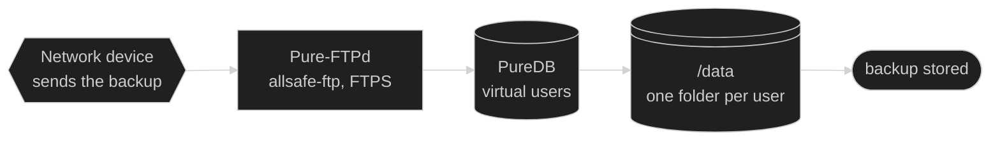

# 🏗️ Architecture — allsafe-ftp-stack

🌐 **English** · [Português (Brasil)](../pt-BR/arquitetura.md)

↩ [Project README](../../README.md) · [Documentation index](README.md)

## 💡 In a few words

The stack has three containers: the FTP server, the web panel that manages its users and nginx, the front door of the panel. Four "drawers" survive restarts: one for the uploaded files, one for the list of users, one for the FTP certificate and one for the certificate and the history of the panel. A fifth folder, rebuilt at every start, connects nginx to the panel. The user operates through the panel or from the host, with scripts; the network devices connect to the FTP port and send the backup.

<!-- diagrama: diagrams/overview-diagram.mmd -->

<sub>Level 1 · Diagram · [source](diagrams/)</sub>

**Sequence:** Network device ➜ Pure-FTPd (`allsafe-ftp`) ➜ PureDB ➜ `/data` ➜ backup stored

---

<details>
<summary>Contents — click to expand</summary>

[Architecture map](#mapa) · [Components](#componentes) · [Volumes](#volumes) · [Network](#rede) · [Startup model](#subida) · [`pure-ftpd` options](#flags-do-pure-ftpd) · [Healthcheck](#healthcheck) · [Hardening](#endurecimento-resumo)

</details>

---

<a name="mapa"></a>

## 🗺️ Architecture map

The three containers, the host folders and who talks to whom, in the order in which things happen.

<details>
<summary>Architecture map, with the written sequence — click to expand</summary>

<!-- diagrama: diagrams/architecture-map.mmd -->
```mermaid
%%{init: {"theme": "dark"}}%%
flowchart LR
    subgraph USO["Who uses it"]
        operador@{ shape: person, label: "User<br>operates the stack" }
        equip@{ shape: hex, label: "Network device<br>FTP client" }
    end
    subgraph HOST["Host"]
        scripts@{ shape: console, label: "deploy.sh<br>manage-user.sh" }
    end
    subgraph CONTAINERS["Containers · allsafe-ftp-network network"]
        nginx@{ shape: rect, label: "nginx<br>allsafe-ftp-nginx, 8443/tcp" }
        painel@{ shape: rect, label: "Web panel<br>allsafe-ftp-painel, Unix socket" }
        ftp@{ shape: rect, label: "Pure-FTPd<br>allsafe-ftp, 2121/tcp" }
    end
    subgraph VOLUMES["Volumes"]
        vnginx@{ shape: lin-cyl, label: "DATA_DIR/nginx<br>socket and copy of the certificate" }
        vpainel@{ shape: lin-cyl, label: "DATA_DIR/painel<br>administrators and audit" }
        vauth@{ shape: cyl, label: "DATA_DIR/auth<br>PureDB" }
        vdata@{ shape: lin-cyl, label: "DATA_DIR/dados<br>uploaded files" }
        vcerts@{ shape: lin-cyl, label: "DATA_DIR/certs<br>FTP certificate" }
    end
    subgraph RESULTADO["Result"]
        fim@{ shape: stadium, label: "backup stored" }
    end

    operador -- "1 · ./deploy.sh" --> scripts
    scripts -- "2 · docker compose build and up -d --wait" --> nginx
    operador -- "3 · HTTPS, TCP 8443" --> nginx
    nginx -- "4 · forwards through the Unix socket" --> painel
    painel -- "5 · creates, edits or removes the user" --> vauth
    equip -- "6 · FTPS, TCP 21 to 2121" --> ftp
    ftp -- "7 · writes the file" --> vdata
    vdata -- "8 · file on the volume" --> fim
    nginx -. "reads, read-only" .-> vnginx
    painel -. "creates the socket" .-> vnginx
    painel -. "writes" .-> vpainel
    painel -. "manages and reads" .-> vdata
    painel -. "checks the FTP password" ..-> ftp
    ftp -. "looks up" .-> vauth
    ftp -. "reads the certificate" .-> vcerts
```
<sub>Level 2 · Map · [source](diagrams/)</sub>

| No. | From ➜ To | What happens |
|---|---|---|
| 1 | User ➜ `deploy.sh` | The user runs `./deploy.sh` on the host |
| 2 | `deploy.sh` ➜ nginx | The script validates the configuration, builds the images (`docker compose build`) and starts the three containers (`up -d --wait`), in the order `ftp`, `painel` and `nginx`: each one waits for the previous one to become `healthy`, and nginx, the front door of the panel, is the last |
| 3 | User ➜ nginx | The user opens the panel over HTTPS on `8443/tcp`: nginx answers, checking the source network and the request rate |
| 4 | nginx ➜ Web panel | The accepted request is forwarded to the panel through the Unix socket, with the client address |
| 5 | Web panel ➜ `DATA_DIR/auth` | The panel creates, edits or removes the user in PureDB |
| 6 | Network device ➜ Pure-FTPd | The client connects over FTPS on `21/tcp`, mapped to `2121/tcp` |
| 7 | Pure-FTPd ➜ `DATA_DIR/dados` | The file is written through the passive channel, in the range of the profile (`30000-30049/tcp` on `small`) |
| 8 | `DATA_DIR/dados` ➜ backup stored | The file stays in the user folder, on the host |

**Support**

| Who | Uses | How |
|---|---|---|
| nginx | `DATA_DIR/nginx` | reads the socket and the certificate, read-only |
| nginx | `DATA_DIR/nginx/estado` | writes the resources of its own container, the only folder it writes to |
| Web panel | `DATA_DIR/nginx` | creates the socket, copies the certificate and prepares the `estado` folder of nginx, at every start |
| Web panel | `DATA_DIR/painel` | writes the certificate, the administrators and the audit log |
| Web panel | `DATA_DIR/dados` | creates folders, renames, deletes and reads the files for download |
| Web panel | Pure-FTPd | checks the password of the FTP user who signs in to the panel, over the internal network of the stack |
| Pure-FTPd | `DATA_DIR/auth` (PureDB) | looks up the users |
| Pure-FTPd | `DATA_DIR/certs` | reads the certificate |

**Configuration, secrets and log**

The map shows the parts and the volumes. The configuration, the secrets and the log are in this table:

| Who | Uses | How |
|---|---|---|
| `deploy.sh` and `manage-user.sh` | `.env` | creates, reads and writes the profile |
| Pure-FTPd | `.secrets` (`ftp-usuario-inicial-senha.txt`) | reads the password at start, read-only |
| Web panel | `.secrets` (`painel-admin-inicial-senha-hash.txt`) | reads the initial hash at start, read-only |
| Pure-FTPd | container log | records every sign-in and every transfer, with the user and the address |

</details>

---

<a name="componentes"></a>

## 🧩 Components

| Part | Where | Role |
|---|---|---|
| `ftp` service | [`compose.yaml`](../../compose.yaml) | Container of the FTP server (`allsafe-ftp`) |
| `painel` service | [`compose.yaml`](../../compose.yaml) | Container of the web panel (`allsafe-ftp-painel`); it only starts after `ftp` becomes `healthy` and publishes no port |
| `nginx` service | [`compose.yaml`](../../compose.yaml) | Container of the web front end (`allsafe-ftp-nginx`), the only published port of the panel; it only starts after `painel` becomes `healthy` and restarts together with it |
| Images | [`Dockerfile`](../../Dockerfile) | Three targets on the same `debian:trixie-slim` (Debian 13), pinned by digest. Target `ftp`: `pure-ftpd`, `pure-ftpd-common`, `openssl` and the FTP entrypoint. Target `painel`: the same packages, `python3` and the panel. Target `nginx`: only `nginx` and `openssl`, with nothing from the FTP. All three carry the [`LICENSE`](../../LICENSE) and the [`NOTICE`](../../NOTICE) of the project in `/usr/share/doc/allsafe-ftp-stack/` |
| Users of the data process | [`Dockerfile`](../../Dockerfile) | One per [user profile](panel.md#perfis), all with the `nologin` shell and no home: `ftpdata`, uid and gid **10000** (Full, and owner of everything that is stored); `ftpenvio`, uid **10002**, in the group of `ftpdata` (Upload); `ftpleitura`, uid and gid **10003** (Read only); `ftpsoenvio`, uid and gid **10004** (Upload only), locked in `/data/.entrada/<user>`, outside the backup folder. `/data` is `0700`, owned by `root`: the account only reaches the folder the `chroot` locked it in |
| Entrypoint | [`ftp/entrypoint.sh`](../../ftp/entrypoint.sh), installed as `/usr/local/sbin/allsafe-ftp-entrypoint` | Provisions the user and the certificate, starts the watcher, `pure-authd` and `pure-ftpd`, and ends the container if one of them exits |
| User management | [`ftp/usuario.sh`](../../ftp/usuario.sh), installed in the FTP and panel images as `/usr/local/sbin/allsafe-ftp-user` | `add`, `passwd`, `pasta`, `perfil`, `limites`, `del` and `list` in PureDB, the blocks by attempts (`bloqueios`, `desbloquear`), the blocks by address (`enderecos`, `endereco-bloquear`, `endereco-liberar`) and the list of who signs in without TLS (`tls-dispensar`, `tls-exigir`, `tls-lista`), called from outside by [`manage-user.sh`](../../manage-user.sh) and, inside the panel, by the web server |
| Gatekeeper | [`ftp/porteiro.pl`](../../ftp/porteiro.pl), installed in the FTP image as `/usr/local/sbin/allsafe-ftp-porteiro` | It is called by `pure-authd` at every sign-in, before the password check: it refuses the address, IPv4 or IPv6, under a [block by address](../pt-BR/seguranca.md#bloqueio-por-endereco) or inside a blocked prefix, the user blocked for wrong passwords and, with [per-user TLS](../pt-BR/seguranca.md#tls-por-usuario) in effect, the session without TLS of anyone the administrator has not exempted |
| Watcher | [`ftp/vigia.pl`](../../ftp/vigia.pl), installed in the FTP image as `/usr/local/sbin/allsafe-ftp-vigia` | Reads from `/dev/log` what `pure-ftpd` records, counts the wrong passwords of each address for each user, writes the [block by attempts](../pt-BR/seguranca.md#bloqueio-por-tentativa) to `/auth/bloqueios`, adds up the errors of each address, IPv4 or IPv6, with any name and writes the [block by address](../pt-BR/seguranca.md#bloqueio-por-endereco) to `/auth/enderecos`, resets both counts when the sign-in succeeds, writes every sign-in and every transfer to the container log, hands over to `ftpdata` the file received in a folder with the Upload or Read only profile, moves the file received from an Upload only profile from the entry area to the user folder, with [`ftp/entrada.pl`](../../ftp/entrada.pl), and publishes in `/auth/rede.estado` the network counters of the container and in `/auth/recursos.estado` the processor, the memory and the processes it uses and the limits it was given, which the Server tab of the panel shows. In Perl, with only the `perl-base` of the base image |
| Source address | [`ftp/endereco.pl`](../../ftp/endereco.pl), installed in the FTP image as `/usr/local/lib/allsafe/endereco.pl` | Reads the source address, IPv4 or IPv6, and the prefix, and returns the single spelling of each one, which is the name of the block file. It is loaded by the gatekeeper and by the watcher and called by `allsafe-ftp-user`; the panel does the same calculation in [`painel/enderecos.py`](../../painel/enderecos.py) |
| Web panel | Python modules of [`painel/`](../../painel/), in `/opt/painel`; the entry point is [`painel/servidor.py`](../../painel/servidor.py) | Server in Python, with only the standard library and no JavaScript: administrator screens, FTP user screen, session, audit log, file download and upload, one subject per module ([list](panel.md#modulos)). It serves only nginx, through a Unix socket |
| Panel entrypoint | [`painel/entrypoint.sh`](../../painel/entrypoint.sh), installed as `/usr/local/sbin/allsafe-painel-entrypoint` | Checks the private network, generates the certificate, hands its copy to nginx and does `exec` of the server |
| Web front end | [`nginx/nginx.conf.modelo`](../../nginx/nginx.conf.modelo), [`nginx/cabecalhos.conf`](../../nginx/cabecalhos.conf) and the error pages of [`nginx/erro/`](../../nginx/erro/) | nginx without root: terminates HTTPS, speaks HTTP/2 with the browser, refuses anyone outside the allowed networks, limits request rate, connections and request size, serves the static files and forwards the rest to the panel. File download goes through it at the pace of the browser, with no temporary file, and file upload through the panel is forwarded as it arrives, also with no temporary file, only on the two upload routes |
| Static files | [`web/estilo.css`](../../web/estilo.css), [`web/robots.txt`](../../web/robots.txt) and the six files of [`web/marca/`](../../web/marca/), in the nginx image at `/usr/share/allsafe-nginx/web` | Appearance, notice to search robots, logo and icon of the panel. nginx serves them directly, with the security headers of `cabecalhos.conf`, without occupying the panel; the stylesheet also has a compressed copy, made when the image is built, for the browser that accepts gzip, and its address on each page carries the mark of the content (`?v=` and the beginning of the SHA-256 of the file), which the panel image receives at build time without carrying the file. `/.well-known/security.txt` is not a file: the panel builds it at every request, with the e-mail of `SEGURANCA_CONTATO_EMAIL` |
| nginx entrypoint | [`nginx/entrypoint.sh`](../../nginx/entrypoint.sh), installed as `/usr/local/sbin/allsafe-nginx-entrypoint` | Checks the private network, generates the configuration from the template and does `exec` of `nginx` |

What each script does, with parameters and output: [Scripts](scripts.md). Use and protections of the panel: [Web panel](panel.md).

---

<a name="volumes"></a>

## 💽 Volumes

| Folder on the host | Mounted at | Who mounts it | Stores |
|---|---|---|---|
| `DATA_DIR/dados` | `/data` | `ftp` and `painel` | User files: each user locked (`chroot`) in the folder of the user database, `/data/<user>` or the folder chosen at creation. The user with the Upload only profile is locked in `/data/.entrada/<user>`, from where the watcher moves each file to the user folder. `ftp` writes; `painel` creates the folder of each user and, in the Files tab, reads, creates an empty folder, renames and deletes |
| `DATA_DIR/auth` | `/auth` | `ftp` and `painel` | **PureDB** database: `pureftpd.passwd` (text, with the hash of the passwords) and `pureftpd.pdb` (compiled), both `0600`; `ftp-cert.pem`, copy of the FTP certificate **without the key**; `sem-tls.lista` (`0600`), the users exempt from TLS, when there are any; `limites.lista` (`0600`), the limits of each user that are not kept in the user database, when there are any; `bloqueios/` (`0700`), one file per block by attempts in effect; `enderecos/` (`0700`), one file per address blocked on the FTP and on the panel; `prefixos/` (`0700`), one file per prefix blocked by the administrator; `rede.estado` and `recursos.estado` (`0600`), the network counters and the resources of the container of the ftp service, for the Server tab of the panel; `.lock`, the lock for changes |
| `DATA_DIR/certs` | `/etc/ssl/private` | only `ftp` | `pure-ftpd.pem`: key and certificate concatenated, `0600` |
| `DATA_DIR/painel` | `/painel` | only `painel` | `tls/painel-cert.pem`, `tls/painel-key.pem` (`0600`), `administradores` (`0600`, the name and the `scrypt` hash of the password of each administrator), `auditoria.log` (`0600`) and `idiomas` (`0600`, the screen language each account chose); folder `0700` |
| `DATA_DIR/nginx` | `/nginx` | `painel` (writes) and `nginx` (read-only) | `painel.sock`, the Unix socket of the panel, and `tls/`, the copy of the certificate and of the key (`0640`) for nginx; folder `0750`, of group `10001`. Rebuilt at every start. Inside it, `estado/` (`0700`, owned by the nginx user), mounted separately in nginx as `/estado`, with write access: it is where nginx publishes `recursos.estado`, the resources of its container |
| secret `ftp_usuario_inicial_senha` (`SECRETS_DIR/ftp-usuario-inicial-senha.txt`) | `/run/secrets/ftp_usuario_inicial_senha` (read-only) | only `ftp` | Password of the initial user |
| secret `painel_admin_inicial_senha_hash` (`SECRETS_DIR/painel-admin-inicial-senha-hash.txt`) | `/run/secrets/painel_admin_inicial_senha_hash` (read-only) | only `painel` | `scrypt` hash of the initial password of the first administrator of the panel, used only while there is none |

Each service sees a single file of `.secrets/`, and `nginx` sees none. In addition, `ftp` and `painel` have two `tmpfs`, `/run` (8 MiB) and `/tmp` (16 MiB), and `nginx` has `/run/nginx` (1 MiB) and `/tmp/nginx` (16 MiB), owned by user `10001`. All `noexec,nosuid,nodev`.

---

<a name="rede"></a>

## 🌐 Network

- Dedicated bridge network `allsafe-ftp-network`, subnet `172.29.1.0/29` (variable `FTP_SUBNET`), with the three containers.
- Publications on the host (see [Configuration](configuration.md#rede-e-portas) and [Web panel](configuration.md#painel)):

| Publication | What for |
|---|---|
| `FTP_BIND_IP:FTP_PORT` ➜ `2121/tcp` | control channel |
| `FTP_BIND_IP:<passive range>` ➜ the same range in the container | data channel, passive mode, 1:1 (`30000-30049/tcp` on `small`, up to `30000-31599/tcp` on `extended`) |
| `PAINEL_BIND_IP:PAINEL_PORT` ➜ `8443/tcp` of `nginx` | web panel, HTTPS |

- The panel neither publishes nor listens on a port: nginx reaches it through the Unix socket of the `DATA_DIR/nginx` folder, without going through the network.
- The panel talks to the FTP over the network in two cases, always at `ftp:2121`, inside this network: to see whether it is up, by the greeting of the port, and to check the password of the FTP user who signs in to the panel, with a login over TLS. The user database and the files are shared by the two through the `auth` and `dados` folders.
- Whoever opens the panel from the server itself, at `127.0.0.1`, reaches nginx with the address of the gateway of this network (`172.29.1.1`), which is already inside the networks allowed by default.
- No reverse DNS (`-H`): `pure-ftpd` never resolves the client IP.

---

<a name="subida"></a>

## 🔄 Startup model

What happens between `./deploy.sh` and the `healthy` container.

<details>
<summary>Startup model, with the written sequence — click to expand</summary>

<!-- diagrama: diagrams/startup-model.mmd -->
```mermaid
%%{init: {"theme": "dark"}}%%
flowchart LR
    subgraph OPERACAO["Operation"]
        operador@{ shape: person, label: "User" }
        deploy@{ shape: console, label: "deploy.sh<br>installs in one command" }
    end
    subgraph HOST["Host"]
        env@{ shape: doc, label: ".env<br>configuration and limits" }
        segredo@{ shape: doc, label: ".secrets<br>ftp-usuario-inicial-senha.txt" }
        compose@{ shape: rect, label: "Docker Compose<br>compose.yaml" }
    end
    subgraph CONTAINER["allsafe-ftp container · read-only root"]
        entry@{ shape: rect, label: "entrypoint<br>allsafe-ftp-entrypoint" }
        valida@{ shape: diam, label: "variables<br>valid?" }
        pw@{ shape: rect, label: "pure-pw<br>creates or updates the user" }
        puredb@{ shape: cyl, label: "PureDB<br>/auth/pureftpd.pdb" }
        dados@{ shape: lin-cyl, label: "/data<br>user folder" }
        certq@{ shape: diam, label: "certificate<br>exists?" }
        gera@{ shape: rect, label: "openssl<br>self-signed, 825 days" }
        cert@{ shape: doc, label: "pure-ftpd.pem<br>/etc/ssl/private" }
        pure@{ shape: rect, label: "pure-ftpd<br>0.0.0.0, 2121" }
        authd@{ shape: rect, label: "watcher and pure-authd<br>blocking and gatekeeper, lists in /auth" }
        saude@{ shape: rect, label: "healthcheck<br>greeting on port 2121" }
    end
    subgraph RESULTADO["Result"]
        pronto@{ shape: stadium, label: "FTP ready<br>healthy" }
        falha@{ shape: stadium, label: "FALHA in the log<br>container does not start" }
    end

    operador -- "1 · runs" --> deploy
    deploy -- "2 · docker compose build and up -d --wait" --> compose
    compose -- "3 · starts the container" --> entry
    entry -- "4 · checks user, password, range and TLS" --> valida
    valida -- "5a · yes" --> pw
    valida -- "5b · no" --> falha
    pw -- "6 · database compiled" --> certq
    certq -- "7a · yes: reuses" --> cert
    certq -- "7b · no: generates" --> gera
    gera -- "8 · writes the certificate" --> cert
    cert -- "9 · read at start" --> pure
    pure -- "10 · checked every 20 s" --> saude
    saude -- "11 · server answers" ---> pronto
    deploy -. "generates the password if empty, 0600" .-> segredo
    compose -. "reads" .-> env
    entry -. "reads, read-only" .-> segredo
    entry -. "creates the folder" .-> dados
    pw -. "writes" .-> puredb
    pure -. "looks up" .-> puredb
    pure -. "asks at every login and reports the wrong password" .-> authd
```
<sub>Level 3 · Model · [source](diagrams/)</sub>

| No. | From ➜ To | What happens | Protocol and port | Rule |
|---|---|---|---|---|
| 1 | User ➜ `deploy.sh` | Runs `./deploy.sh` | — | Without `.env`, the script creates one from the example and goes on; before acting it checks Docker, Compose and free ports |
| 2 | `deploy.sh` ➜ Docker Compose | Runs `docker compose build` and `up -d --wait` with the `.env` | — | It runs `config --quiet` first; an invalid configuration does not start |
| 3 | Docker Compose ➜ entrypoint | Starts the `allsafe-ftp` container | — | Read-only root, `tini` as process 1 |
| 4 | entrypoint ➜ variables valid? | Checks user, password, passive range and TLS mode | — | Name `^[a-z_][a-z0-9_-]{0,31}$`, password of 12 or more, range between `1024` and `65535`, TLS from `0` to `3` |
| 5a | variables valid? ➜ `pure-pw` | Yes: at the first start it creates the initial user (`useradd`); at the following ones it rewrites its password (`passwd`), unless it was changed through the panel and the secret did not change, and does not recreate it if it was removed | — | Virtual user with the uid and gid of `ftpdata`, home `/data/<user>` |
| 5b | variables valid? ➜ FALHA in the log | No: the entrypoint exits with `FALHA: <motivo>` | — | The container restarts in a loop until it is fixed |
| 6 | `pure-pw` ➜ certificate exists? | Compiles the database with `pure-pw mkdb` and goes on | — | `pureftpd.passwd` and `pureftpd.pdb` stay `0600` |
| 7a | certificate exists? ➜ `pure-ftpd.pem` | Yes: reuses the certificate that is already on the volume | — | The existing certificate is never overwritten |
| 7b | certificate exists? ➜ `openssl` | No: generates a self-signed one | — | RSA 3072, SHA-256, 825 days, SAN `IP:` or `DNS:` according to `FTP_CERT_CN` |
| 8 | `openssl` ➜ `pure-ftpd.pem` | Writes the new certificate, `0600` | — | In `/etc/ssl/private`, on the `DATA_DIR/certs` volume |
| 9 | `pure-ftpd.pem` ➜ `pure-ftpd` | The server reads the certificate at start | — | The password variables are erased (`unset`) before the processes start; the watcher and `pure-authd` start before `pure-ftpd` |
| 10 | `pure-ftpd` ➜ healthcheck | Control port checked every 20 s | TCP `2121` | `start_period` of 20 s, 5 attempts |
| 11 | healthcheck ➜ FTP ready | Greeting received: container `healthy` | — | Checks that the server answers, without logging in |

**Support**

| Who | Uses | How |
|---|---|---|
| `deploy.sh` | `.secrets/ftp-usuario-inicial-senha.txt` | generates the password if the file is empty, `0600` |
| Docker Compose | `.env` | reads |
| entrypoint | `.secrets/ftp-usuario-inicial-senha.txt` | reads, read-only |
| entrypoint | `/data` | creates the user folder |
| `pure-pw` | PureDB (`/auth/pureftpd.pdb`) | writes |
| `pure-ftpd` | PureDB | looks up |
| `pure-ftpd` | watcher and `pure-authd` | asks `pure-authd` at every sign-in, before checking the password, and reports every wrong password to the watcher; in `/auth`, the gatekeeper reads the blocks, by attempts and by address, and `sem-tls.lista`, of who signs in without TLS, and the watcher writes the blocks |

</details>

At the following starts the password of the initial user is **rewritten** from the secret (`pure-pw passwd`), unless it was changed through the panel and the secret is still the same, and the existing certificate is **kept**. The initial user removed through the panel **is not recreated**: the mark `/auth/usuario-inicial.criado` says it has already been created once. With the FTP `healthy`, Compose starts the panel and, with the panel `healthy`, nginx: what each entrypoint checks is in [Scripts](scripts.md#painel-entrypoint), in the sections of the panel and of [nginx](scripts.md#nginx-entrypoint). In modes `0` and `1` of `FTP_TLS_MODE`, and when there is a user exempt from TLS, the FTP entrypoint writes an `AVISO` to the log before starting: [Security](../pt-BR/seguranca.md#ftp-sem-tls).

<details>
<summary>Technical detail — who process 1 is</summary>

With `init: true` in [`compose.yaml`](../../compose.yaml), process 1 of the container is `tini` (`docker-init`), which forwards the signals and reaps orphan processes. It starts the entrypoint, which stays alive and starts three children, in this order: the watcher (`allsafe-ftp-vigia`), `pure-authd` and `pure-ftpd`. If one of the three exits, the entrypoint ends the others and finishes with code `1`, and Docker starts the container again: without the watcher nobody would be blocked, and without `pure-authd` `pure-ftpd` would accept the sign-in without the check of the gatekeeper.

With [per-user TLS](../pt-BR/seguranca.md#tls-por-usuario) in effect, there is a fourth child: the observer of the list of exempt users, a function of the entrypoint itself that rereads `/auth/sem-tls.lista` every second. When the list stops being empty or becomes empty again, the entrypoint replaces only the `pure-ftpd` process that listens on the port, with the new `-Y`: the container does not restart and the sessions in progress, which are separate processes, go on until they finish.

When the start finishes, the entrypoint writes to the log: `FTP pronto em 2121/tcp; TLS=<modo>; passivo=<inicio>-<fim>`. With per-user TLS in effect, the line also says how sign-in without TLS stands: `TLS=2; TLS por usuário: nenhum dispensado, sessão sem TLS recusada antes da senha` or `TLS=2 com exceção por usuário (<n> dispensado(s) do TLS)`. The line is repeated at every change of mode, after `TLS por usuário: a lista dos dispensados mudou; o FTP troca o modo de entrada sem derrubar as sessões em andamento.` The reason for each process is in [Security](../pt-BR/seguranca.md#bloqueio-por-tentativa), in the sections of blocking by attempts and of [per-user TLS](../pt-BR/seguranca.md#tls-por-usuario).

</details>

---

<a name="flags-do-pure-ftpd"></a>

## 🚩 `pure-ftpd` options

Final line of [`ftp/entrypoint.sh`](../../ftp/entrypoint.sh):

| Option | Effect |
|---|---|
| `-A` | `chroot` of **all** users in their own directory |
| `-E` | Forbids anonymous login |
| `-H` | Does not resolve the reverse DNS of the client |
| `-j` | Creates the home directory of the user if it does not exist |
| `-R` | Forbids `chmod` by the client |
| `-c <n>` | Maximum simultaneous clients (`FTP_MAX_CLIENTS`) |
| `-C <n>` | Maximum clients per IP (`FTP_MAX_CLIENTS_PER_IP`) |
| `-I 15` | Maximum idle time: 15 minutes |
| `-L 10000:8` | `ls` limit: 10000 files, depth 8 |
| `-u 10000` | Minimum UID allowed to log in (blocks system accounts) |
| `-U 133:022` | `umask`: 133 for files, 022 for directories |
| `-l extauth:/run/pure-authd.sock` | Before PureDB: `pure-authd` calls the gatekeeper, which decides whether the sign-in can go on to the password check ([blocking by attempts](../pt-BR/seguranca.md#bloqueio-por-tentativa) and [per-user TLS](../pt-BR/seguranca.md#tls-por-usuario)) |
| `-l puredb:/auth/pureftpd.pdb` | Authentication backend |
| `-p INICIO:FIM` | Passive port range |
| `-P <ip>` | IP announced in `PASV` (`FTP_PASSIVE_IP`) |
| `-S 0.0.0.0,2121` | Listens on port 2121 (unprivileged) |
| `-Y <modo>` | TLS policy (`FTP_TLS_MODE`): see [Configuration](configuration.md#tls). With per-user TLS in effect and at least one exempt user, `-Y 1` is used, and the TLS requirement is then enforced user by user by the gatekeeper; with no exempt user, `-Y 2` is used: [Security](../pt-BR/seguranca.md#tls-por-usuario) |

---

<a name="healthcheck"></a>

## 🩺 Healthcheck

```yaml
test: ["CMD", "/usr/local/sbin/allsafe-ftp-saude"]
interval: 20s   timeout: 6s   retries: 5   start_period: 20s
```

It opens the control port (`2121`), from inside the container, and waits for the greeting of the server: a live `pure-ftpd` that does not answer stops counting as healthy, and the container becomes `unhealthy` after five checks in a row without an answer. A server at the connection limit (`421`) counts as answering. Before opening the port, the test requires the `pure-authd` socket and the `/dev/log` of the watcher. The test does not log in: see [`ftp/saude.sh`](scripts.md#ftp-saude). To also check the user in PureDB, use `./scripts/validate.sh --runtime`: see [Scripts](scripts.md#validate).

The panel has its own, which requests `/saude` through the Unix socket, the way nginx does:

```yaml
test: ["CMD", "python3", "/opt/painel/servidor.py", "--saude"]
interval: 20s   timeout: 8s   retries: 5   start_period: 20s
```

And nginx, which opens a real TLS connection on its own port and requests `/saude`: it only becomes `healthy` if the whole path (nginx, socket and panel) answers.

```yaml
test: ["CMD", "/usr/local/sbin/allsafe-nginx-saude"]
interval: 20s   timeout: 8s   retries: 5   start_period: 20s
```

---

<a name="endurecimento-resumo"></a>

## 🧱 Hardening

| Measure | Where |
|---|---|
| Read-only root | `read_only: true` |
| No privileges beyond what is needed | `cap_drop: ALL`; `ftp` gets only the capabilities `pure-ftpd` uses (chroot, change of uid and gid, `nice`), `painel`, only three (`CHOWN`, `DAC_OVERRIDE`, `FOWNER`), and `nginx`, none |
| Web front end without root | `nginx` runs as uid and gid `10001` (`user: "10001:10001"`) and listens on a high port |
| A single port for the panel | only `nginx` publishes a port; `painel` serves through a Unix socket |
| No control of Docker | no container mounts the Docker socket |
| No privilege gain | `no-new-privileges: true` |
| Resource limits | `pids_limit`, `mem_limit`, `memswap_limit` equal to the memory limit (no swap), `cpus`, `ulimits.nofile` |
| Log with rotation | `logging: local`, 10 MB × 3 |

Reason for each directive and each `cap_add`: [Security](../pt-BR/seguranca.md#hardening-do-compose-yaml-linha-a-linha).

---

⬅️ [Profiles](profiles.md) · 🏠 [Documentation](README.md) · ➡️ [Security](../pt-BR/seguranca.md)
