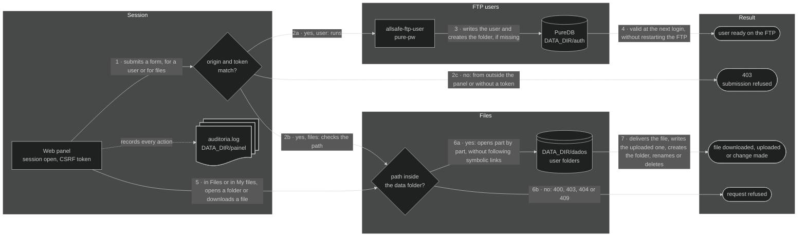

# 🖥️ Web panel — allsafe-ftp-stack

🌐 **English** · [Português (Brasil)](../pt-BR/painel.md)

↩ [Project README](../../README.md) · [Documentation index](README.md)

## 💡 In a few words

The panel is a page, opened in the browser **from inside the internal network**, to create users, change their passwords and remove them from the FTP, choose the folder of each one, create folders and download the backups received, without using the command line. Each administrator signs in with their own user name and password, over HTTPS only. The owner of the files signs in too: each FTP user uses the FTP name and password and reaches only their own folder, where they do what their [profile](#perfis) allows. The browser is served by nginx, the front door: it stops whoever is outside the internal network and only then passes the request on to the panel. What is done in the panel takes effect on the FTP right away, without restarting anything.

<!-- diagrama: diagrams/panel-diagram.mmd -->
```mermaid
%%{init: {"theme": "dark"}}%%
flowchart LR
    usuario@{ shape: person, label: "User<br>browser on the internal network" }
    nginx@{ shape: rect, label: "nginx<br>allsafe-ftp-nginx, HTTPS" }
    painel@{ shape: rect, label: "Web panel<br>allsafe-ftp-painel" }
    cmd@{ shape: rect, label: "allsafe-ftp-user<br>creates, changes the password, removes" }
    puredb@{ shape: cyl, label: "PureDB<br>virtual users" }
    fim@{ shape: stadium, label: "user ready on the FTP" }

    usuario --> nginx --> painel --> cmd --> puredb --> fim
```

<sub>Level 1 · Diagram · [source](diagrams/)</sub>

**Sequence:** User (browser on the internal network) ➜ nginx (`allsafe-ftp-nginx`, HTTPS) ➜ Web panel (`allsafe-ftp-painel`) ➜ `allsafe-ftp-user` ➜ PureDB ➜ user ready on the FTP

> 🧱 **For use on a private network only, behind a firewall.** The panel manages the accounts that hold the configuration of your network. By default, it listens **only on a private IP**, refuses clients from outside the internal networks and must not be published on the internet nor receive a port forward from the edge. Whoever needs to reach it from outside comes in by VPN to the internal network. See [private network and firewall](security.md#rede-privada); a public address only with the option described in [public IP](security.md#ip-publico).

---

<details>
<summary>Contents — click to expand</summary>

[Open the panel](#abrir) · [What is in each tab](#abas) · [Language of the screens](#idioma) · [Users through the panel](#usuarios) · [Profiles](#perfis) · [Files and download](#arquivos) · [FTP user in the panel](#usuario-ftp) · [Destinations: S3 and Telegram bot](#destinos) · [Server: containers and resources](#servidor) · [Panel administrators](#administradores) · [Recover access](#senha) · [Panel certificate](#certificado) · [Open to the internal network](#rede-interna) · [Panel brand](#marca) · [How the panel decides](#como-decide) · [Audit log](#auditoria) · [What protects the panel](#protecoes)

</details>

---

<a name="abrir"></a>

## 🚪 Open the panel

`./deploy.sh` starts the panel together with the FTP and shows the address at the end:

```text
Painel: https://127.0.0.1:8443  (pelo nginx; certificado autoassinado; rede privada, atrás de firewall)
```

1. Open the address in the browser. In the default installation, only the server itself reaches it (`127.0.0.1`).
2. The browser warns that the certificate is self-signed: check the fingerprint (command below) before accepting.
3. Type the administrator user name and password. In the first installation, the user is the one in `PAINEL_ADMIN_USER` (`admin`, if you did not change it in the `.env`) and the password is in `.secrets/painel-admin-inicial-senha.txt`:

```bash
cat .secrets/painel-admin-inicial-senha.txt
```

**Expected result:** the **Overview** screen, with the FTP `Up` and, in the menu, the name of the administrator who signed in.

Fingerprint of the panel certificate, to compare with the one the browser shows:

```bash
docker compose exec painel openssl x509 -in /painel/tls/painel-cert.pem -noout -fingerprint -sha256
```

> ⚠️ Change the initial password after the first access: [Panel administrators](#administradores). Never paste the password into a document, screenshot or message.

---

<a name="abas"></a>

## 🗂️ What is in each tab

| Tab | What it shows | What can be done |
|---|---|---|
| Overview | FTP up or down, number of users, space used and free, last upload, validity of the FTP certificate, the TLS mode of the FTP, the **Server and containers** band (processor and memory of the server and of the stack containers, each with the use against what exists or what was allocated), the files received per day in the last 14 days, the last upload of each user, the space of each folder, the data to configure the device (server, control port, passive ports, protocol) and the latest activity records | View only; each card ends with the shortcut to the tab with the detail |
| Users | All the accounts in one list, each with the **profile** under the name. First the panel administrators, with the **you** mark on the account of whoever is using the panel and how many sessions each one has open; then the FTP users, one per row: folder, with the **shared** mark when another user also reaches it, and the name, with the **blocked** mark when the FTP is refusing it because of too many wrong passwords, space used, number of files and last upload; the **TLS** column says whether the user is required to use TLS | Create, choosing the profile (Administrator, Full, Upload, Upload only or Read only), the folder and, for a device without TLS support, already exempt from TLS; edit, to change the profile, the folder and the limits and to lift a block; change the password; remove, with their folder or without it; open the user's folder in the Files tab; exempt a user from TLS and require it again; change the password and the name of an administrator and remove them |
| Files | The folders of the FTP users and what is in each one: name, size and date of each file | Enter the folders, by the name or by the **Open** button, download a file through the browser, upload a file to the open folder, create a folder, change the name of and delete files and folders, send a file right away to a saved [destination](#destinos), and open the user form already with the open folder |
| Destinations | The two outside places to which the panel sends by itself the files of a folder, an S3 storage and a Telegram bot: whether each one is on, the folder, the interval, the last run and the total sent, without showing the secrets | **Configure**, **Test**, **Send now**, **Change** and **Remove** each destination; with the destination saved, the Files tab gets the button to send a file right away: see [Destinations](#destinos) |
| Server | The three containers of the stack (FTP server, panel and web front end), each with what it uses of processor, memory and processes against what was allocated to it, and, separately, the resources of the server the stack runs on: processor, memory, disk and FTP network, with the state, the current measurement and the history of the last minutes | View only; **Auto-refresh** redoes the reading every 10 s, without counting as use of the session: see [Server](#servidor) |
| Security | Check of the installation, with the summary of how many items are in order, need attention or are checked on the server: whether a public address is accepted, whether the panel is published through a proxy or tunnel, addresses of the FTP and of the panel, TLS mode, with the per-user exception and who is exempt, the sign-in of the FTP users, the web front end (nginx), validity and fingerprint of the two certificates, networks that can open the panel, session rules, the cost of the FTP passwords, with the users that still have the previous cost, the security contact published at `/.well-known/security.txt`, container isolation and the firewall reminder | View only |
| Blocks | The addresses and the prefixes, IPv4 and IPv6, with [blocking by address](security.md#bloqueio-por-endereco): the rule in force, the total and, per block, who blocked it (the FTP, the panel or the administrator), with how many errors, since when and until when. Below, when there are any, the users with blocking by attempts on the FTP | **Block address**, to block an address or a prefix by hand, search for an address, **Change period**, to block for longer or shorten it, and **Unblock**; open the user that has blocking by attempts |
| Log | The last 300 records of the panel: sign-ins, refusals, downloads, uploads, folders created, blocks and changes to users and administrators, with date, source address and who did it, administrator or FTP user | View only |

The menu stays on the left on a screen 1280 px wide or more: the symbol and the name, the tabs in two groups (**Operation**, with Overview, Users, Files and Destinations, and **System**, with Server, Security, Blocks and Log), the tab in use marked and, at the bottom, the [language](#idioma) button (**PT** and **EN**), the name and the role of whoever signed in and the **Sign out** button, which ends the session right away. On a narrower screen, the menu becomes a strip at the top, with the tabs in a row that scrolls sideways. With the installation published (public address accepted or panel through a proxy or tunnel), the administrator sees a warning sign next to **Security**, in whatever tab they are in. The charts are drawn by the panel itself, without script, and every number in the drawing is also written next to it. The footer of every screen carries the version and the authorship: see [Panel brand](#marca).

Each tab opens with a band in the blue of the brand, the same as the menu and the sign-in screen, in the light and dark themes: the icon of the tab, the title, a line that says what the screen shows and, on the right, the main action. On a screen more than 900 px wide, the band also carries the scene of the backup path, the one from the sign-in screen, in miniature: the packets cross once, when the screen is reached, and stop. With **Auto-refresh** on in the Server tab, or with the system asking for less motion, nothing moves. A form screen (new user, edit, change password, rename, delete) carries the thin band, with the title only.

The lists adjust to the width of the screen, without sideways scrolling of the page:

| List | Up to 640 px wide | Medium screen | Wide screen |
|---|---|---|---|
| Users | One block per account, with the label of each piece of data and the actions below | From 641 to 1095 px, one block per account: name and profile at the top, the data side by side and the actions below | From 1096 px, a table, with the actions two per row; from 1600 px, in one row |
| Files and My files | One block per item, with the size, the date and the actions under the name | From 641 to 899 px, the name, the size and the date in one row and the actions in the row below | From 900 px, a table |
| Log | One block per record | From 641 to 959 px, the date, the address and the fact in one row and the detail below | From 960 px, a table |
| Blocks | One block per address, with the label of each piece of data and the actions below | From 641 to 1095 px, one block per address, with the data side by side and the actions below | From 1096 px, a table |
| Check in the Security tab | The mark and the item at the top and the situation below, in the full width | Table | Table |

A list with nothing to show (empty folder, Log without records) says what is missing and when it starts to appear. The long text of each screen, such as the explanation of the profiles and of the labels in the Users tab, stays collapsed in one line under the list and opens with a click.

Whoever signs in with the FTP account sees none of these tabs: they see a single screen, **My files**, described in [FTP user in the panel](#usuario-ftp).

The picture of each screen, with the explanation item by item, is in [Application screenshots](application/README.md).

> ⚠️ With `FTP_TLS_MODE` at `0` or `1`, the Overview and Security tabs open with an alert at the top of the screen: the FTP is accepting passwords and files in plain text. The alert only goes away when the variable goes back to `2` or `3`. See [Security](security.md#ftp-sem-tls).

> ⚠️ With at least one user exempt from TLS, the same tabs open with the alert of how many and which users sign in to the FTP without TLS. It goes away when the last one is required to use TLS again. See [Security](security.md#tls-por-usuario).

---

<a name="idioma"></a>

## 🌍 Language of the screens

The panel speaks **Portuguese**, which is the default, and **English**. The switch is the **PT** and **EN** button, each side with the flag of the language (Brazil's and that of the United States), which stays in the menu, next to the name of whoever signed in, and also on the sign-in screen. The language in use appears marked.

| Where the button is used | What changes | Where the choice is kept |
|---|---|---|
| On the sign-in screen | The sign-in screen of that browser | In the browser, for one year |
| After signing in | The screens of the account: all its open sessions and the next sign-ins, in any browser | On the server, one per account |

Each account chooses its own, administrator or FTP user: the choice of one does not change the screen of any other. The account that has never chosen signs in with the language the browser kept on the sign-in screen and, without that, in Portuguese. After the switch, the panel goes back to the screen where the button was used.

In English, all the screens, the notices, the form errors and the description of each record in the Log tab change; the date becomes `year-month-day` and the numbers use a decimal point and a thousands comma. The names of users, folders and files, the audit file, the FTP messages and those of the terminal scripts do not change.

<details>
<summary>Technical detail — how the language is kept and switched</summary>

- **Per account:** `DATA_DIR/painel/idiomas` (`/painel/idiomas` in the container), `0600`, owned by `root`, one line `admin:<nome>:<pt|en>` or `usuario:<nome>:<pt|en>` per account that has chosen. The file is written alongside and swapped at once. The line follows the administrator who changes name and goes away when the account is removed through the panel. That of a user removed through the terminal goes away at the next language switch, of any account; until then, a user created with the same name signs in with the language of the previous one.
- **In the browser:** `__Host-idioma` cookie, with `Secure`, `HttpOnly`, `SameSite=Lax` and a validity of one year, written at the switch and at every sign-in. Only `pt` and `en` are read: any other value is ignored. It is not a session and does not open any screen.
- **Switch:** `POST /idioma`, with the token of the other forms of the session; before signing in, with the token of the sign-in form. There is no switch by `GET`, and a language outside the list gets `400`. The return comes from the path of the source screen and only when it is a screen of the session's role: otherwise, the start of the panel.
- **Texts:** the Portuguese text is the one in the code, and the English catalogue is [`painel/idioma_en.py`](../../painel/idioma_en.py). A text without translation would come out in Portuguese; `./scripts/validate.sh` refuses code in which a translation is missing or left over.
- **Flags:** they are drawn inside the page itself, by [`painel/icones.py`](../../painel/icones.py), like the other icons: they are neither emoji nor image files, and nothing is fetched from outside the panel.
- **Audit log:** the language switch does not generate a record. Its refusals are those of any form: `recusa_csrf` and `recusa_origem`.

</details>

---

<a name="usuarios"></a>

## 👥 Users through the panel

| I want to | Where | What happens |
|---|---|---|
| Create a user | Users ➜ **New user** | Creates the account, with the profile selected, and its folder: `DATA_DIR/dados/<usuario>` with the **Folder** field blank, or the folder chosen. With the password blank, the panel generates a strong password and shows it **only once** |
| Choose what the user can do | Users ➜ **New user**, **Profile** field; afterwards, **Edit**, **Profile** card | The user gets the chosen profile at their next sign-in to the FTP: see [Profiles](#perfis) |
| Create a user for a device without TLS support | Users ➜ **New user**, with the **Device without TLS support** box | The user is created already exempt from TLS and the device signs in right after. Without ticking the box, the user only signs in with TLS |
| Change the password | Users ➜ **Change password** | The old password stops working at the next login |
| Change the folder | Users ➜ **Edit** | The user starts entering the new folder at the next sign-in. **The files of the previous folder stay in it**, without being moved or deleted |
| Limit a user | Users ➜ **Edit**, **Limits** card | Simultaneous sessions, download and upload rate, sign-in hours and simultaneous downloads through the panel, for that user only. Blank field: the stack limit applies. It takes effect at their next sign-in to the FTP |
| Remove a user | Users ➜ **Remove** | Asks for confirmation. The account goes away; **the files of the folder are preserved** |
| Remove a user and their folder | Users ➜ **Remove**, with the **Also delete the folder and everything in it** box | Also asks for your current password. The account goes away and the folder is deleted with everything inside it, **with no recycle bin**. The box only appears when the folder is theirs alone |
| Let a user sign in without TLS | Users ➜ **Exempt from TLS**, or the **Device without TLS support** box in **New user** | Asks for confirmation and takes effect in moments, without dropping whoever is connected; the others are still required to use TLS |
| Require TLS from a user again | Users ➜ **Require TLS**, or **Edit**, **TLS** card | Asks for confirmation and takes effect in moments, for their next sign-ins. Change their password, which travelled in plain text |

**Expected result:** the user created signs in by FTPS right after, without restarting the FTP.

The forms, the refusal messages and the screen of the generated password are in [Application screenshots](application/README.md#usuarios).

Rules, the same as those of [`manage-user.sh`](../../manage-user.sh):

- Name with lowercase letters, numbers, `_` and `-`, starting with a letter or `_`, up to 32 characters.
- Password with at least 12 characters.
- Folder: blank, it is the name of the user. Chosen, it always stays inside `DATA_DIR/dados`, with up to 4 levels separated by `/` (`clientes/olt-01`); each level has letters, numbers, `_`, `-` and dot, does not start with a dot and goes up to 64 characters. The folder is created if it does not exist, and the field suggests those that already exist at the first level.
- A folder that goes through a symbolic link, or through a name that already belongs to a file, is refused.
- The folder is chosen at creation and changed later in **Edit**, with the same rules. The change does not touch the password or the files: what was in the previous folder stays there, and the new folder is created if it does not exist.
- The **initial user** (`FTP_USER`) has the password and the folder changed and is removed like the others. It is created once, by the installation: once removed, it does not come back on the next startups of the FTP, and to have it again just create a user with the same name, which gets the password given. The password changed through the panel is valid until the file `.secrets/ftp-usuario-inicial-senha.txt` is changed: at the next startup of the FTP, the one in the file takes over. See [Secrets](secrets.md#trocar-a-senha).

<a name="perfis"></a>

Profile of each account, chosen in **New user** and changed in **Edit**, **Profile** card. The profile applies on the FTP and when the user signs in to the panel:

| Profile | On the FTP | In the panel |
|---|---|---|
| Administrator | Not an FTP account | All the tabs: see [Panel administrators](#administradores) |
| Full | Lists, downloads, uploads, creates folders, renames, deletes and overwrites | My files screen: browses, downloads, creates folders, changes names and deletes |
| Upload | Lists, downloads, uploads and creates folders. Does not delete, does not rename and does not overwrite what has already arrived | My files screen: browses, downloads and creates folders |
| Upload only | Uploads and creates folders. Does not list and does not download anything, not even what it uploaded itself | File upload screen: the data to upload by FTP and, with the administrator's permission, the upload through the panel |
| Read only | Only lists and downloads | My files screen: browses and downloads |

- A user created before `0.51.0`, or with no profile given, is **Full**: nothing changes for whoever already uses the stack.
- **Upload keeps what it received.** The file becomes the server's as soon as it finishes arriving: from then on the user does not delete it, does not rename it and does not overwrite it. A device that always uploads with the same file name needs the Full profile, or a name with the date.
- **Upload only does not see the backups.** The account signs in to an entry area of its own, outside the backup folder, and the server takes each file to the user's folder as soon as it finishes arriving. Whoever has the password of that device uploads, and nothing else: they do not list, download, delete or rename any file already received.
- **Read only writes nothing:** neither file nor folder, at any level of its folder.
- **Shared folder:** whoever has the same folder, or one inside the other, reaches the files of the other as far as their own profile allows. A Read only downloads what the Upload sent; an Upload does not delete what the Full wrote.
- **In the panel, the profile decides what exists:** the screen shows only the buttons of the profile, and the action it does not have answers `404` even when requested directly by the address. Uploading a file through the panel depends on a permission of its own, given by the administrator: see [Upload a file through the panel](#enviar-arquivo).
- **Profile change:** it takes effect at the user's next sign-in to the FTP and ends their session in the panel. The FTP session already open goes on with the previous profile until it leaves.
- **Administrator and FTP user are separate records**, with the password kept in different places: there is no switching from one to the other. Remove the account and create the other.

Three limits of the Upload profile, so as not to count on what it does not do:

- Between the end of the upload and the handover to the server there is an instant, of milliseconds, in which the file still belongs to the user.
- A folder created by the Upload itself stays theirs while it is empty: they remove or rename it until they write the first file in it.
- A folder created **by FTP** by a Full user only receives files from the Upload after the Full writes the first file in it. A folder created through the Files tab receives right away.

Five behaviours of the Upload only profile, to choose knowingly:

- **A repeated name does not replace:** the file that arrives with the name of one already in the folder gets the date and the time before the extension (`backup.rsc` becomes `backup-20261009-153000.rsc`), and the previous one stays as it was.
- **The client does not check the upload by the list:** the list of the account comes empty, and the size of the uploaded file is not given. A program that uploads with a temporary name and renames at the end, or that lists the folder to confirm, needs the Upload profile.
- **An interrupted upload is delivered as it arrived:** the piece received goes to the folder with the name of the file, and the new attempt gets the date and the time. Resuming the upload from where it stopped does not work in this profile.
- **Folders in the path:** the folder the client creates before uploading is born in the user's folder together with its first file. A folder created and left empty does not reach the user's folder.
- **Same folder for several:** an Upload only can share the folder with a Full, an Upload or a Read only. They see and download what the Upload only sent; it does not see what the others wrote.

<details>
<summary>Technical detail — how the profile is applied</summary>

- **User database:** the profile is the system identity of the account in the PureDB, and not a separate list: Full is `ftpdata:ftpdata` (`10000:10000`), Upload is `ftpenvio:ftpdata` (`10002:10000`), Read only is `ftpleitura:ftpleitura` (`10003:10003`) and Upload only is `ftpsoenvio:ftpsoenvio` (`10004:10004`). What refuses the deletion or the writing is the file system, for any FTP command.
- **Entry area of Upload only:** the folder of its session in the user database is `/data/.entrada/<usuário>`, `0700` owned by `ftpsoenvio`, inside `/data/.entrada`, `0700` owned by `root`. The destination folder is kept in the description field of the record. At each upload, the FTP watcher links the file into the destination folder without replacing what exists, checks that it is the same file, hands it to `ftpdata` and takes it out of the area. Both ends are opened level by level from `/data`, without following symbolic links; only a regular file goes in, with a single name and still owned by `ftpsoenvio`. The Files tab does not show the area nor open it by the address.
- **Folder mode:** calculated by who reaches it. Only Full: `0750`. With an Upload: `1770`, in which the group writes and each one only deletes what is theirs. With a Read only: plus reading for the others (`0755` or `1775`). The folders inside follow when the mode changes. `DATA_DIR/dados` stays `0700`, owned by `root`: no FTP account leaves its own folder.
- **Handover:** at each upload into a folder with Upload or Read only, the FTP watcher hands the file to `ftpdata`, and the folders in the path, to `ftpdata` with the mode of the user's folder. It only touches a regular file, with a single name and still owned by `ftpenvio`. What could not be handed over stays in the `ftp` log as `entrega nao feita`.
- **Start of `ftp`:** with Upload, Upload only or Read only in the user database, the startup redoes the mode of the folders and hands over what was left without handover, before accepting the first session. In the entry area, it deletes the folders left empty; what is not a regular file owned by `ftpsoenvio` stays where it is, with `AVISO: ficou arquivo sem entrega` in the `ftp` log.
- **Change and removal of Upload only:** when leaving the profile and when removing the user, what is still in the area is handed over and the area is deleted. The files of the destination folder stay.
- **Panel session:** the mark of the FTP user's session is the digest of their line in the user database; the profile change alters the line, and the session ends by itself, with `sessao_encerrada` and the reason `cadastro_alterado`.

</details>

<a name="limites"></a>

Per-user limits, in the **Limits** card of the **Edit** screen. They serve both the account of a device, which only uploads, and that of a person, who signs in, uploads and downloads:

| Limit | Where it applies | Value | Blank |
|---|---|---|---|
| Simultaneous sessions | FTP | From 1 to the stack's `FTP_MAX_CLIENTS` | Only the stack limits: `FTP_MAX_CLIENTS` in total and `FTP_MAX_CLIENTS_PER_IP` per address |
| Download rate | FTP and their downloads through the panel | From 1 to 10,000,000 KB per second | No ceiling |
| Upload rate | FTP and their uploads through the panel | From 1 to 10,000,000 KB per second | No ceiling |
| Sign-in hours | FTP and their sign-in to the panel | Start and end, in hours and minutes; it can go past midnight (`22:00` to `06:00`) | Signs in at any time |
| Simultaneous downloads | Panel | From 1 to 8 | 2 |
| Wrong FTP passwords before the block | FTP | From 1 to 100; `0`: this user is never blocked | The stack default, `FTP_BLOQUEIO_TENTATIVAS` (5) |
| Minutes of block | FTP | From 1 to 1440 | The stack default, `FTP_BLOQUEIO_MINUTOS` (15) |
| Upload through the panel | Panel | **Allow this user to upload files through the panel, to their folder** box, ticked or not; it applies to the Upload only, Upload and Full profiles | Unticked: the user only uploads by FTP |

**Expected result:** the list of users comes back with the notice `Limits saved` and the **limits** mark next to the name; hovering the mouse over it shows each limit the user has. To remove a limit, clear the field and save again. The permission to upload through the panel is given in the edit, after the user exists, and takes effect right away, without ending their session: see [Upload a file through the panel](#enviar-arquivo).

<a name="bloqueios"></a>

**Blocking by attempts.** The address that gets the password of a user wrong on the FTP too many times is blocked for that user, for the configured time: until then, not even the right password gets in from there. The other addresses, the other users and their sign-in to the panel stay as they were. To lift the block before the period ends:

1. In the Users tab, the name appears with the **blocked** mark; hovering the mouse over it shows the addresses.
2. Click **Edit**. The **Blocks** card lists each address, with the wrong passwords, the time of the block and until when it holds.
3. Fix the password on the device and click **Unblock**.

**Expected result:** the list of users comes back with the notice `Block removed. The user can sign in to FTP again.`, without the **blocked** mark, and the next sign-in of the device goes through. What counts and what does not count as a wrong password is in [Security](security.md#bloqueio-por-tentativa).

> ⚠️ **What changes for the user:** outside the hours, the FTP refuses the sign-in the way it refuses a wrong password, and with all their sessions taken, it answers that it accepts no more connections from the same user. In both cases they do not sign in to the panel either, because it is the FTP that checks the password.

> ⚠️ **Device with the wrong password stored:** it tries again by itself, reaches the limit and is blocked; if it keeps trying after the period, it is blocked again. Fix the password on the device before unblocking. Devices that reach the FTP from the same address, with the same user, are blocked together.

> ⚠️ **Upload rate and small files:** with the upload rate set, the server holds each uploaded file for about `256 ÷ rate` seconds, on top of the upload time. With 50 KB per second, a 1 KB file takes 5 seconds; with 1,000, a quarter of a second. For a device that sends many small files, use a high rate or leave it blank.

> ⚠️ **Shared folder:** two users with the same folder, or with one inside the other, read, write and delete each other's files. The panel accepts it, because it serves a query account on the folder above, and warns: the list marks the folder with **shared** and shows who else reaches it, and the removal screen repeats the warning. For a device not to reach the backup of another, give each one its own folder.

> ⚠️ **Deleting the folder along cannot be undone:** the panel has no recycle bin, and what leaves from there only comes back from the [backup](backup.md). The removal screen shows how many files the folder has before asking for confirmation. The box does not appear, and the request is refused, when another user uses the same folder, one inside it or one outside it: first remove the others or change their folder in **Edit**.

> ⚠️ **Exemption from TLS:** the exempt user sends passwords and files in plain text. Use it only for the old device that does not speak TLS, on an isolated internal network, with a user and a password of its own. The conditions and what the stack guarantees are in [Security](security.md#tls-por-usuario).

<a name="limpeza"></a>

**Automatic cleanup.** In the **Automatic cleanup** card of the **Edit** screen, the administrator chooses what the panel deletes on its own in the user's folder and in the folders inside it. It comes turned off: without a rule, nothing is deleted.

| Rule | What it does | Value | Blank |
|---|---|---|---|
| Keep only the most recent files | In **each folder**, the files with the newest modification date stay, in the chosen number; the older ones go | From 1 to 100,000 | Does not count the files |
| Delete after so many days | The file that has been on the server for more days than that goes | From 1 to 3,650 | Does not look at the age |

With both filled in, the file that exceeds either one goes. The count is per folder: with `30` in the folder of a user that keeps each device in a subfolder, the 30 most recent files of each device stay.

1. In the Users tab, click **Edit** on the user.
2. In the **Automatic cleanup** card, fill in one rule or both.
3. Type your password and click **Save cleanup**.

**Expected result:** the list of users comes back with the notice that the cleanup was saved and the **cleanup** mark next to the name; hovering the mouse over it shows the rule. The rule applies on the next run, which happens every `PAINEL_RETENCAO_MINUTOS` (60 minutes, by default). To turn it off, clear both fields and save again. The user sees the rule on the My files screen, in a notice above the list.

> ⚠️ **The cleanup cannot be undone:** the panel has no recycle bin, and what leaves from there only comes back from the [backup](backup.md). Before turning it on, see what would go with `--simular`, in the technical detail below.

> ⚠️ **Rule by days on device backups:** if the device stops uploading, the files it has already sent keep ageing and all go when the period ends. For device backups, prefer keeping the most recent ones, which always leaves the last ones in the folder.

> ⚠️ **Shared folder:** the rule reaches the user's folder and everything inside it, including the folder of another user that sits there. The card warns which users are reached.

<details>
<summary>Technical detail — the exemption from TLS in the panel</summary>

- The exemption is valid with `FTP_TLS_EXCECOES=sim`, which is the default, `FTP_TLS_MODE=2` and without `REDE_PERMITIR_IP_PUBLICO=sim`. Outside that it has no effect: the **TLS** column, the buttons and the box in **New user** disappear, the confirmation screen answers `404`, the **TLS** card in **Edit** and the Security tab state the reason, and the list of the exempt stays stored without applying.
- The box in **New user** sends `sem_tls=sim`. The user is created and then exempted: if the exemption fails, they remain required to use TLS and the notice tells you to repeat it in **Edit**. With the exemption without effect, the field is ignored.
- With nobody exempt, the FTP refuses the session without TLS before the password is sent. With the first exempt user, and again when the last one is required once more, the FTP changes the sign-in mode in about one second, without restarting the container and without dropping the sessions in progress.
- `GET /usuarios/tls?usuario=<nome>` shows the confirmation, opened from the list or from the **TLS** card in **Edit**; `POST /usuarios/tls` saves, with the session's CSRF token and the `acao` field at `dispensar` or `exigir`. A user that does not exist and a name outside the rule answer `404`; a different `acao` goes back to the confirmation without changing anything.
- The one that writes is `allsafe-ftp-user`, the same script as `manage-user.sh`, in the `sem-tls.lista` of `DATA_DIR/auth`. The panel only reads the list to build the screens.
- Removing the user takes their name off the list: a new user with the same name does not inherit the exemption.
- Each change stays in the audit log, with the administrator and the user: `tls_dispensado` and `tls_exigido`.

</details>

<details>
<summary>Technical detail — the per-user limits</summary>

- `POST /usuarios/limites` saves all of them at once, with the session's CSRF token and the fields `usuario`, `sessoes`, `download`, `envio`, `inicio`, `fim`, `baixar`, `tentativas` and `minutos`. A blank field removes the limit. A value outside the rule, a start without an end or a start equal to the end answer `400`, with the screen back and what was typed; a user that does not exist and a name outside the rule, `404`. Nothing is saved halfway.
- **Who keeps and who applies:** sessions, rates and hours stay in the user's line in `/auth/pureftpd.passwd`, written with `pure-pw usermod`, and the one that applies them is `pure-ftpd`, at each sign-in. The limit of downloads through the panel stays in `/auth/limites.lista` (`0600`), and the one that applies it is the panel. The two fields of blocking by attempts stay in the same list, and the one that applies them is the watcher of the `ftp` service: [Scripts](scripts.md#vigia). All are written by `allsafe-ftp-user limites`, the same command as [`manage-user.sh`](../../manage-user.sh).
- **Hours:** they apply in the time zone of the container, that of the `TZ` variable. `pure-pw` keeps the hours without the leading zeros (`08:00` to `18:00` becomes `800-1800`); the panel and `manage-user.sh` always show four digits.
- **Download rate in the panel:** the downloads the user makes on the My files screen go out at their rate. Those the administrator makes in the Files tab do not.
- **User session in the panel:** changing a limit that stays in the FTP user database alters their line, and their sessions in the panel are ended at the next request. Changing only the limit of downloads through the panel ends nothing and applies at the next download.
- **Sign-in refused by the limit:** outside the hours, the FTP answers `530`, and the panel, `401`, as for a wrong password: it counts as a sign-in error. With the sessions taken, the FTP answers `421` after checking the password, and the panel, `401`, with `entrada_falha conferencia=ftp_indisponivel` in the audit log.
- **Initial user:** its limits stay from one startup to the next; the `ftp` service only reapplies the password.
- **Block:** changing `tentativas` or `minutos` lifts the blocks the user has; saving the other limits does not. Changing their password and removing them also lift them. `POST /usuarios/desbloquear`, with the session's CSRF token and the `usuario` field, lifts all the blocks of the user at once and writes `bloqueio_removido` to the audit log, with the administrator, the user and the number of addresses; a user that does not exist and a name outside the rule answer `404`. The panel only reads `/auth/bloqueios` to build the screens: the one that writes the block is the watcher, and the one that lifts it is `allsafe-ftp-user desbloquear`, the same command as `manage-user.sh`. To lift the block of a single address, use the terminal: [Operation](operation.md#usuarios).
- Removing the user takes their name off `limites.lista`: a new user with the same name does not inherit the limit.
- Each save stays in the audit log as `limites_alterados`, with the administrator, the user and the value of each limit (`-` for what was left blank).

</details>

<details>
<summary>Technical detail — the automatic cleanup</summary>

- `POST /usuarios/limpeza` saves the rule, with the session's CSRF token and the fields `usuario`, `ultimos`, `dias` and `senha_atual`, the password of whoever is in the session. A wrong or blank password gets `403`, and nothing is saved; turning the rule off asks for the password in the same way. Only an administrator has this route.
- **Who keeps it:** the rule stays in the user's line in `/auth/limites.lista`, in the keys `ultimos=` and `dias=`, written by `allsafe-ftp-user` (action `retencao`), the same command as `manage-user.sh`. A user without a folder inside `DATA_DIR/dados` does not have the card.
- **Who applies it:** [`limpeza.py`](../../painel/limpeza.py), in a thread of the panel itself: the first run goes 2 minutes after the startup, and the next ones, every `PAINEL_RETENCAO_MINUTOS`. With `0`, no run happens and the screen says so.
- **What goes:** only regular files. Symbolic links, everything whose name starts with a dot (file or folder), the entry area of the Upload only profile and what is on another file system mounted inside the folder stay as they are.
- **Which date counts:** keeping the most recent ones sorts by the modification date of the file. Deleting by days looks at the newer date between the modification one and the change one on the server: the file that arrived today with an old date does not go on the same day.
- **Subfolders:** the rule goes down the folders inside, up to 64 levels and 10,000 subfolders per folder in each run. The subfolder the cleanup emptied goes along; the one that was already empty does not. The user's folder never goes.
- **Path:** the folder is opened level by level, without following symbolic links, and walked through its descriptor, as in the Files tab. The files go in batches of 1,000, with a pause between one batch and the next, so that the disk and the panel requests keep being served.
- **Two users in the same folder with the same rule:** the folder is walked once per run.
- **Changing the user's folder turns their rule off:** it was turned on looking at the previous folder. The list of users comes back with the notice, and the rule needs to be saved again. Removing the user takes their name off `limites.lista`.
- **Through the terminal:** `docker compose exec painel python3 /opt/painel/servidor.py --retencao --simular` shows, per user, how many files and bytes would go now, without deleting anything; without `--simular`, it does the run right away. `./manage-user.sh retencao <usuario>` shows and saves the rule: see [Operation](operation.md#usuarios).
- **Audit log:** `retencao_alterada`, with the administrator, the user and the rule; `retencao_aplicada`, at each run in which something went or failed, with the user, the folder, the files, the folders, the bytes, the errors and the rule; `retencao_falhou`, when a run does not finish. The last two have no address: the one that did it was the panel.

</details>

<details>
<summary>Technical detail — the removal with the folder</summary>

- `POST /usuarios/remover` with the field `apagar_pasta=sim` also asks for the field `senha_atual`, the password of whoever is in the session. A wrong or blank password gets `403`, writes `admin_senha_atual_recusada` and counts as a sign-in error: five block the address for 15 minutes (`429`). Nothing is removed.
- A user without a folder inside `DATA_DIR/dados`, or with the folder reached by another user (the same one, one inside it or one outside it), gets `409` and nothing is removed.
- The order is fixed: first the account leaves the user database, through `allsafe-ftp-user`, then the folder is deleted. If the account does not leave, the folder is not touched.
- The folder is deleted as in the Files tab, with the same limits per request: see [Files and download](#arquivos). A folder too large for one request is partly deleted, with the account already removed, and the screen points to the Files tab to finish.
- The audit log writes `usuario_removido`, with `pasta=<pasta>`, and `item_apagado`, with the number of items and the `usuario=` that was the owner.

</details>

The command line still applies: panel and `manage-user.sh` change the same accounts. See [Operation](operation.md#usuarios).

---

<a name="arquivos"></a>

## 📁 Files and download

The Files tab shows the folders of `DATA_DIR/dados`, delivers through the browser any file a device uploaded, receives files into the open folder, creates folders, changes the name of and deletes files and folders. The everyday upload, that of the device, is still by FTP; that of the panel serves the one-off file, sent from the browser: see [Upload a file through the panel](#enviar-arquivo).

1. Open the **Files** tab. The first level has the folders of the users and those created through the panel. In the Users tab, the address in the **Folder** column opens the folder of that user directly.
2. Click the name of a folder to enter. The path at the top of the list shows where you are and goes back to any level.
3. Click **Download** on the row of the file. The browser saves the file with the original name.
4. To create a folder, enter the folder where it will stay, write the name in **New folder** and click **Create folder**.
5. To upload a file, enter the folder where it will stay, choose the file in the **Upload file** card and click **Upload file**. To save it with another name, fill in **Save as**.
6. To tie a user to a folder, enter it and click **New user in this folder**: the form opens with the **Folder** field filled in.
7. To change the name of a file or a folder, click **Rename** on its row, write the new name, type your current password and click **Change name**. The item stays in the same folder.
8. To delete a file or a folder, click **Delete** on its row, tick the confirmation box, type your current password and click **Delete for good**.
9. To send a file to the Telegram bot or to S3 right away, click **Telegram** or **S3** on its row. The buttons appear after the destination is saved: see [Destinations](#destinos).

**Expected result:** the saved file is identical to the one the device uploaded, and the Log tab gets the line `File downloaded`, with the administrator, the path and the size. The folder created appears in the list with the notice `Folder created.`, empty, already with the owner and the permission the FTP uses, and stays in the Log tab as `Folder created`. The uploaded file appears in the list with the notice `File uploaded.`, with the owner and the permission of the files that arrive by FTP, and stays in the Log tab as `File uploaded through the panel`. The renamed item appears with the new name and the notice `Name changed.`, with the same content, owner and permission; the deleted one disappears from the list with the notice `Deleted.`. Both stay in the Log tab, as `File or folder renamed` and `File or folder deleted`.

> ⚠️ **Deleting cannot be undone.** The panel has no recycle bin: the folder goes with everything inside it, and what was deleted only comes back from the [backup](backup.md). The confirmation screen shows the path and, for a folder, how many files it has.

| In the list | What appears | What can be done |
|---|---|---|
| Folder | Name and date of the last change; inside it, the line `Folder of the FTP user` says whose it is | Enter, by the name or by the **Open** button, rename and delete |
| File | Name, size and date of the last change | Download, rename and delete; with a saved destination, send to the Telegram bot or to S3 |
| Item marked `symbolic link` or `special file` | Name and date | Rename and delete; the panel neither opens nor downloads it, and shows **does not open here** in place of the button. Deleting a symbolic link deletes only the link, never what it points to |

Limits:

- The name of the new folder has letters, numbers, `_`, `-` and dot, does not start with a dot and goes up to 64 characters. One folder at a time: to create `clientes/olt-01`, create `clientes`, enter it and create `olt-01`.
- The new name of a renamed item follows the same rule. Renaming does not move the item to another folder and does not replace another: a name that already exists in the folder is refused. The change asks for the current password of whoever is in the session, like the deletion.
- **A folder of an FTP user is not renamed or deleted through the Files tab**, nor the folder that has that of a user inside: the user database would stop pointing to a folder that exists. What is inside it can be renamed and deleted. To take the whole folder out, remove the user with the **Also delete the folder** box, in [Users through the panel](#usuarios); to change the name, create the new folder and change the user's in **Edit**.
- A delete request removes up to **50,000 items** or works for up to **20 seconds**. A folder larger than that is partly deleted: the `Partly deleted` screen says how many items went and brings the button to repeat, with the confirmation and the password again.
- **One deletion at a time** in the whole panel. The second, requested while the first is working, gets the `Nothing was deleted` screen (`503`), with the notice that the panel is already deleting another folder: wait and repeat.
- Up to **8 downloads at the same time**, adding administrators and FTP users. The ninth gets the `Too many downloads at the same time` screen (`503`): wait for one to finish and repeat.
- The list shows up to **2000 items** per folder, with a notice when there are more. A folder larger than that is consulted by FTP.
- The download **is not resumed**: if the connection drops, it starts again.
- A connection that receives less than about 4 KiB per second is cut, and the download appears in the Log tab as `Download interrupted`.

<a name="enviar-arquivo"></a>

**Upload a file through the panel.** The **Upload file** card stays under the list and writes into the folder that is open. The administrator always uploads, through the Files tab. The FTP user uploads through their screen, and only with the **Allow this user to upload files through the panel** box ticked in their [limits](#limites); the permission serves the Upload only, Upload and Full profiles, and the Read only profile does not upload.

| Rule | How it works |
|---|---|
| Size | Up to `PAINEL_ENVIO_MAX_MB` per file, 1024 MB by default; the card shows the ceiling in force. A larger file goes by FTP. See [Configuration](configuration.md#painel) |
| Name | That of the chosen file or that of the **Save as** field: letters, numbers, `_`, `-` and dot, does not start with a dot, up to 64 characters |
| Name that already exists | It is never replaced: the upload is refused. In the Upload only profile, which does not see the folder, the new file is stored with the date and the time in the name (`-AAAAMMDD-HHMMSS` before the extension) and the screen says so |
| Owner and permission | The same as those of the files that arrive by FTP: the file uploaded through the panel is read, downloaded and deleted like any other |
| Rate | The user's upload rate applies here too; the administrator uploads with no ceiling |
| At the same time | One file at a time per FTP user and up to 4 in the whole panel |
| Upload that drops midway | Nothing stays in the folder: the file only gets a name after arriving whole. The upload is not resumed: repeat |

| The screen answers | Reason | What to do |
|---|---|---|
| `Upload not allowed` (`403`) | The FTP account does not have the permission to upload through the panel | An administrator ticks the box in Users ➜ **Edit** ➜ **Limits** |
| `No file chosen` (`400`) | The form was sent without a file | Choose the file and send again |
| `Name not accepted` (`400`) | The name of the file is outside the rule | Change the name of the file or fill in **Save as** |
| `Name already in use` (`409`) | There is already a folder or a file with the name, and nothing was replaced | Upload with another name, or delete or rename what is there |
| `File too large` (`413`) | The file exceeds the ceiling | Upload by FTP, or raise `PAINEL_ENVIO_MAX_MB` and run `deploy.sh` |
| `Too many uploads at the same time` (`503`) | The account is already uploading a file, or the panel is already receiving 4 | Wait for it to finish and repeat |
| `No space left` (`507`) | The server has no free space for the file | Free space in `DATA_DIR/dados` and repeat |
| `File not saved` (`500`) | The system refused the writing | Check the Log tab and the panel log: see [Troubleshooting](troubleshooting.md) |

**Expected result:** the folder comes back with the notice `File uploaded.` and the file in the list; in the Upload only profile, the screen comes back with `File uploaded.` or, when the name already existed, with `File uploaded. There was already one with this name: the new one was stored with the date and time in its name.`.

<details>
<summary>Technical detail — how the panel opens, delivers and receives the file, creates the folder, renames and deletes</summary>

- **Routes:** `GET /arquivos?pasta=<caminho>` lists and `GET /arquivos/baixar?arquivo=<caminho>` delivers. `POST /arquivos/pasta` creates a folder, with the fields `pasta` (where) and `nome` and the CSRF token. `GET /arquivos/renomear?item=<caminho>` and `GET /arquivos/apagar?item=<caminho>` show the screen of each action; `POST /arquivos/renomear` takes the fields `item`, `nome` and `senha_atual`, and `POST /arquivos/apagar`, the fields `item`, `confirmar=sim` and `senha_atual`, both with the CSRF token. `POST /arquivos/enviar` receives a file. All require an administrator session; without a session, the request goes to the sign-in screen.
- **Path:** always relative to `DATA_DIR/dados` (`/data` in the container). A path with a `..`, `.` or empty part, with a null byte, with a part of more than 255 bytes or with more than 4096 characters gets `400` and the event `recusa_caminho`.
- **Opening:** the panel opens the data folder and then each part of the path relative to the previous one, read-only and without following symbolic links (`O_RDONLY`, `O_NOFOLLOW`). What was checked is the same that stays open: swapping a folder for a link in the middle of the request does not change what is read. A symbolic link at any level, even pointing inside the folder itself, gets `403` and the event `recusa_caminho`.
- **New folder:** the destination folder is opened the same way as in the listing, and the new one is created relative to it (`mkdir` through the descriptor of the open folder), with owner `ftpdata` and mode `0750`, the same as those of the folders created by the FTP. A name outside the rule, with `/`, `..` or a null byte, gets `400` and the event `recusa_caminho`; a destination that goes through a symbolic link, `403`; a destination that does not exist, `404`; a name already used by a folder, file or link, `409`.
- **Upload:** `POST /arquivos/enviar`, in `multipart/form-data`, with the fields `csrf`, `pasta` and `nome` first and the file last. Only this form is accepted: another gets `400` (`Malformed submission.`), and a request that is not `multipart/form-data`, `415`. The origin, the session and the token are checked before the file is read, and its size comes from the `Content-Length`. The file is written without a name in the destination folder itself (`O_TMPFILE`), in blocks, without staying whole in memory nor going through a temporary file; it gets the owner `ftpdata` and the mode `0644`, goes to the disk (`fsync`) and only then gets the name, by `link()`. A name that already exists makes the `link()` fail, and the answer is `409`; a cut upload leaves no remains in the folder, answers `400` and writes `envio_interrompido`. Before receiving, the panel compares the size with the free space of the folder (`507`). Up to 4 uploads at the same time; the next one gets `503` with `Retry-After: 30`.
- **Upload in nginx:** only `/arquivos/enviar` and `/meus-arquivos/enviar` accept a large body, of up to `PAINEL_ENVIO_MAX_MB` plus 1 MB; in the other routes the limit is that of the forms. nginx passes the body on to the panel while it arrives, without writing to disk (`proxy_request_buffering off`), and waits up to 300 seconds for data. A body above the ceiling is refused by nginx with `413` and a short text, before reaching the panel; an upload with no declared size, in chunks, gets `411`.
- **Rename:** the folder where the item is gets opened the same way as in the listing, and the change is made relative to it, by a single call (`renameat2` with `RENAME_NOREPLACE`): if the new name already exists, the system refuses, and there is no interval in which another process could put something in its place. A file system that does not accept this option falls back to the check followed by the change. A new name outside the rule gets `400` and the event `recusa_caminho`; a name equal to the current one or already in use, `409`; a path through a symbolic link, `403`; an item that does not exist, `404`. The current password of whoever is in the session is checked after the name and before the change, the same way as in the deletion: wrong or blank, `403`, the event `admin_senha_atual_recusada` and one more sign-in error for the address.
- **Delete:** it asks for the `confirmar=sim` box (`400` without it) and the current password of whoever is in the session: a wrong or blank password gets `403`, writes `admin_senha_atual_recusada` and counts as a sign-in error, and five errors block the address for 15 minutes (`429`). The folder is emptied from the inside out, always through the descriptor of the open folder and without following symbolic links (`O_NOFOLLOW`): a link inside it is deleted as a link, and what is on the other side of it is not touched, whether inside or outside `DATA_DIR/dados`. The panel goes down up to 64 folders one inside the other.
- **Limits of the deletion:** 50,000 items or 20 seconds per request, below the 30 seconds nginx waits for the panel. On hitting one of them, the panel stops, answers `200` with the `Partly deleted` screen and writes `item_apagado` with `completo=nao`. One deletion at a time: the second gets `503` with `Retry-After: 30`. An item that could not be removed (permission, disk error) stops the request with the `Nothing was deleted` screen (`500`) or `Partly deleted`.
- **User folder:** before renaming or deleting, the panel rereads the FTP user database. If the item is the folder of a user, or has the folder of a user inside, the screen and the `POST` answer `409`, with the names of the users.
- **`item` field:** it goes to the screen percent-encoded and comes back the same way, so that a name with a byte outside UTF-8 reaches the panel whole.
- **Only regular files in the download:** FIFO, socket and device appear in the list as `special file`, without the download button, and the direct download request gets `404`.
- **Delivery:** `Content-Type: application/octet-stream` and `Content-Disposition: attachment`, with the name in two forms (RFC 6266 and RFC 8187): reduced to ASCII and whole, in UTF-8. With the `nosniff` and the `Content-Security-Policy` of every response, the browser saves the file and never opens it, even if it is an HTML page.
- **Memory and disk:** the file goes out in blocks of 64 KiB, without being loaded into memory. nginx passes it on at the pace of the browser, without writing a temporary file (`proxy_max_temp_file_size 0`), so the size of the file is not limited by the `/tmp` of the container.
- **No resuming:** the response carries `Accept-Ranges: none` and the panel ignores the `Range` header.
- **Headers only (`HEAD`):** the `HEAD` request of the same address returns the size and the name of the file, without the content. It does not take a download slot nor go into the audit log.
- **Minimum pace:** each block has 15 seconds to go out; after that, the panel closes the connection and frees the download slot.
- **Name outside UTF-8:** it appears in the list with the replacement sign in place of the invalid byte, and is downloaded the same way.
- **Audit log:** `pasta_criada` records the administrator and the path; `arquivo_enviado`, who uploaded, the path and the bytes; `envio_interrompido`, the upload that stopped before the end; `item_renomeado`, the administrator, the type (`arquivo`, `pasta`, `link` or `especial`) and the paths before and after; `item_apagado`, the administrator, the type, the path and the number of items removed; `arquivo_baixado` and `arquivo_interrompido` record who downloaded, the path and the bytes delivered; the content of the file is never recorded.

</details>

---

<a name="usuario-ftp"></a>

## 📥 FTP user in the panel

The owner of the files gets their own backups through the browser, without depending on whoever administers: they sign in at the same address as the panel, with **the FTP name and password**, and see a single screen, **My files**, with their folder and what their [profile](#perfis) allows. There is no new account to create nor new password to keep.

1. Open the address of the panel, from a network that is in `PAINEL_REDES_PERMITIDAS`.
2. Type the FTP user name and password, the same ones the device uses. The sign-in takes a few seconds: the one that checks the password is the FTP server itself.
3. On the **My files** screen, click the name of a folder, or **Open**, to enter; the path at the top of the list goes back to any level, starting from **Home**.
4. Click **Download** on the row of the file. The browser saves the file with the original name.
5. With the Upload or Full profile, the **New folder** card, below the list, creates an empty folder inside the one that is open.
6. With the permission to upload through the panel, given by the administrator, the **Upload file** card writes a file into the folder that is open: see [Upload a file through the panel](#enviar-arquivo).
7. With the Full profile, each row has **Rename** and **Delete**. Both ask for the FTP password of the account itself; deleting also asks for the confirmation box, and there is no recycle bin.
8. Click **Sign out** when done.

**Expected result:** the saved file is identical to the one the device uploaded, and the Log tab, which only the administrator sees, gets the lines `Sign-in` and `File downloaded`, with the name of the FTP user, the path and the size. Folder created, file uploaded, name changed and item deleted get their line, with the same user.

| The FTP user | In the panel |
|---|---|
| Sees | Only the folder of their record and what is inside it: name, size and date. The path of the folder on the server does not appear |
| Does | Read only: browses and downloads. Upload: also creates folders. Full: also changes names and deletes, the way of the [Files tab](#arquivos) and only inside their folder. Upload only: sees no file at all; its screen, **File upload**, shows the address, the port and the mode to upload by FTP. Uploading a file is by FTP, as far as the [profile](#perfis) allows, and also through the panel when the administrator gives the account the [upload permission](#enviar-arquivo): in the Upload and Full profiles, into the open folder; in Upload only, through its screen, without seeing what is already stored |
| Does not reach | Any administration tab: Users, everyone's Files, Server, Security, Blocks and Log answer `404` to them. The action the profile does not have answers `404` too |
| Shares with another user | Only what they already share on the FTP: whoever has the same folder, or one folder inside the other, sees through the panel the same files they see by FTP |

Rules:

- Every user of the FTP user database signs in, including the initial user (`FTP_USER`), with the password valid on the FTP at that moment.
- The session follows the user database: changing the password, the folder, the profile or an FTP limit of the user, or removing them, through the panel or through `manage-user.sh`, ends their sessions at the next request. Giving or taking away the permission to upload through the panel and saving the automatic cleanup do not end the session.
- A name equal to that of an administrator signs in **only** as administrator, with the administrator password. If an administrator is created with the name of an FTP user, the session of that user is ended and they stop signing in to the panel; by FTP, nothing changes.
- **Deleting and renaming ask for the FTP password** of whoever is in the session, checked by the FTP server as at sign-in: a wrong or blank password gets `403`, writes `usuario_senha_atual_recusada` and counts as a sign-in error. The limits of the deletion are those of the [Files tab](#arquivos).
- **Uploading through the panel depends on the permission of the account**, read at each upload: the administrator gives or takes it away, and it applies right away. Without it, the **Upload file** card does not appear and the direct request gets `403` and the event `recusa_envio`. The rules of the upload are those of [Upload a file through the panel](#enviar-arquivo): one file at a time per account, at its upload rate.
- **A folder of another user** inside theirs is not renamed nor deleted by them (`409`); the screen does not say whose the folder is. What is inside it they change item by item, as they already do by FTP.
- Up to **3 sessions** per FTP user: the fourth sign-in ends the oldest. Up to **2 downloads at the same time** per user, or the number the administrator saved in their [limits](#limites); the next one gets the `Too many downloads at the same time` screen (`503`).
- The [limits](#limites) of the user apply here too: the downloads go out at their download rate, and outside their hours, or with all their FTP sessions taken, the sign-in is refused.
- Five user or password errors in 15 minutes block the address, the same way as in the administrator sign-in.
- With the FTP server stopped, whoever is already in keeps browsing, downloading, uploading and creating folders; renaming and deleting answer `503`, because the password cannot be checked, and nobody new signs in with an FTP account. The administrator signs in normally.

For the panel to accept **administrators only**, change the variable in the `.env` and run `deploy.sh`:

```bash
PAINEL_ACESSO_USUARIOS_FTP=nao
```

**Expected result:** the sign-in screen goes back to the text `Administration panel of the stack.`, the FTP account gets `Could not sign in.` and the Security tab shows the sign-in of the FTP users as off. The FTP keeps accepting the same users.

> ⚠️ With `FTP_TLS_MODE=0` the FTP server has no TLS, and the password check goes in plain text from the panel to it. That stretch does not leave the internal network of the stack, inside the server itself, and the Security tab shows the warning. From the browser to the panel it is still HTTPS.

<details>
<summary>Technical detail — how the FTP account signs in and what it reaches</summary>

- **Order of the sign-in:** first the administrator account, by the `scrypt` hash. If it is not an administrator with that password, and the sign-in of the users is on, the panel checks on the FTP server. The check is made for every valid name, whether it exists or not and whether it is an administrator's or not; the result is only used when the name is not an administrator's.
- **Who checks the password:** `pure-ftpd`. The panel opens a connection to `ftp:2121`, on the Compose network, logs in and leaves; it does not read the hash from the user database nor redo its calculation. In TLS modes `1`, `2` and `3`, the connection is TLS 1.2 or higher and the certificate received is compared, byte by byte, with the public part the `ftp` service writes to `/auth/ftp-cert.pem`; if it is another, the password is not sent and the sign-in is refused.
- **Time of the sign-in:** the hash in the user database is `argon2id`, and the FTP server takes less than 1 second to check a password stored with the cost of the profile and 3 to 6 seconds more, drawn at random, to refuse. The panel passes this time on. As only the name that exists has the password checked, it takes a little longer to be refused than the name that does not exist, the same difference measured directly on the FTP port ([Security](security.md#custo-das-senhas)); the screen and the response code are the same in both cases.
- **Limits of the check:** two checks at a time, with up to 5 seconds of waiting for the turn and 15 seconds per step of the conversation. With no answer in that time, server down, full or with another certificate, the sign-in is refused with `401`, counts as an error and stays in the audit log as `entrada_falha conferencia=ftp_indisponivel`.
- **Session:** it keeps the name, the folder of the record, the profile and the SHA-256 digest of the user's whole line in `/auth/pureftpd.passwd`, read before and after the check, which have to be equal. At each request, the panel rereads the line: if it changed, if it is gone, if the name became an administrator's or if the sign-in was turned off, the session is ended, the cookie is deleted and the event `sessao_encerrada` records the user and the reason (`cadastro_alterado`, `nome_de_administrador` or `acesso_desligado`).
- **Routes:** each profile has its own route table, chosen by the profile kept in the session. Read only: `GET /` (leads to `/meus-arquivos`), `GET /meus-arquivos?pasta=<caminho>`, `GET /meus-arquivos/baixar?arquivo=<caminho>` and `POST /sair`. Upload: plus `POST /meus-arquivos/pasta` and `POST /meus-arquivos/enviar`. Full: plus `GET` and `POST` on `/meus-arquivos/renomear` and on `/meus-arquivos/apagar`. Upload only: `GET /`, `GET /meus-arquivos`, which shows the File upload screen without reading any folder, `POST /meus-arquivos/enviar` and `POST /sair`. The upload route exists for the profile, and the permission of the account is checked at each request. Any other route answers `404`; when it is an administration route or one of another profile, the event `recusa_papel` stays, with the user, the path and the profile. For the administrator, `/meus-arquivos` does not exist.
- **Actions:** they are the same functions as the Files tab, with the folder of the record as the root: form token, `Origin` check, new name validated, without moving the item to another folder nor replacing another, and deletion from the inside out without following symbolic links.
- **Password at the confirmation:** the FTP server checks the password, and the panel only accepts it if the line in the user database is the same with which the session was opened. With no answer from the FTP server, it answers `503`, writes `falha_comando` with `acao=confirmar_senha` and nothing is deleted or renamed.
- **Path:** always relative to the folder of the record, which is its root. It goes through the same checks as the [Files tab](#arquivos): part by part, without `..`, without following symbolic links, regular files only, delivery as an attachment, in blocks and without resuming. In the audit log, the path goes whole, from the data folder.
- **Folder not created yet:** the folder of a new user is born at the first login by FTP; before that, the screen shows the empty list.
- **Sessions full:** when the panel reaches the ceiling of 50 sessions, the least used session of an FTP user goes first; the sign-in of a user does not drop that of an administrator.

</details>

---

<a name="destinos"></a>

## ☁️ Destinations: S3 and Telegram bot

In the **Destinations** tab, the administrator connects a folder of the data to two places outside the server, and the panel starts sending by itself whatever arrives in it: an **S3 storage**, to hold the second copy or to keep the files elsewhere and free the disk, and a **Telegram bot**, which delivers each new file to a person, a group or a channel. Each destination has a single connection, one does not depend on the other, and both come with no settings: until the administrator saves one, nothing leaves the server. Only an administrator opens the tab.

| Destination | What it sends | When | What stays on the server |
|---|---|---|---|
| S3 storage | Every file in the chosen folder and in the folders inside it, including the ones already there when the destination was turned on | At each saved interval, 5 to 1440 minutes | With **Copy**, everything; with **Keep in S3**, the file leaves after the destination confirms it was stored |
| Telegram bot | Only the files that arrive after the destination is turned on, one per message, with the path, the size and the date | Within a few seconds, when the file arrives whole by FTP or through the panel; what shows up in the folder any other way, at each saved interval, 5 to 1440 minutes | Everything: the bot never deletes |

**S3 storage.** Any service that speaks the S3 protocol works, in the cloud or on the internal network. Before you start, create the bucket at the service and a key that can only write to it.

1. In the Destinations tab, click **Configure** on the **S3 storage** card.
2. Fill in the **Service address** (`https://name` or `https://name:port`, without the bucket), the **Region**, the **Bucket** and, if you want, the **Prefix**, which is the folder inside the bucket.
3. Under **Bucket address**, choose **In the path** (`https://name/bucket/file`) or **In the name** (`https://bucket.name/file`), as the service requires.
4. Type the **Access key** and the **Secret key**.
5. Fill in the **Folder sent** (blank is the whole data folder) and the **Interval between runs**.
6. Under **After sending**, choose **Copy** or **Keep in S3**.
7. Type your password and click **Save**.
8. Back in the tab, click **Test**.

**Expected result:** the tab comes back with the notice **Destination saved**, and the card shows the **on** tag, the address, the bucket, the folder and that the keys are saved, without showing them. **Test** writes a small object, `allsafe-ftp-stack-teste.txt`, under the chosen prefix and answers **Test finished: the destination received it**. The first run starts within a minute and sends everything already in the folder; the **Last run** line says how many files went.

> ⚠️ **Keep in S3 leaves a single copy:** the file leaves the server once it is stored at the destination, and the panel has no recycle bin and does not download it back. The first run sends everything already in the folder and, with Keep in S3, all of that leaves the server. Start with **Copy**, check the objects in the bucket and only then switch: the switch applies to what is sent from then on.

> ⚠️ **Changing the address, the bucket, the prefix, the form of the address or the folder starts from scratch:** everything in the folder is sent again, to the new place.

**Telegram bot.** Before you start, create the bot with the Telegram bot creator and keep the token it hands over. Add the bot to the group or the channel that will receive; for a person, they must have started the chat with the bot.

1. In the Destinations tab, click **Configure** on the **Telegram bot** card.
2. Type the **Bot token** and the **Receiving chat**: the number of the person or of the group (a group one starts with `-`) or the `@name` of the channel.
3. Fill in the **Folder sent** and the **Interval between runs**, and choose the **Message language**.
4. Type your password and click **Save**.
5. Back in the tab, click **Test**.

**Expected result:** the chat receives the test message from the panel, and the tab answers **Test finished: the destination received it**. From then on, each file that arrives in the folder by FTP or through the panel goes to the chat within a few seconds, as a document, with the path, the size and the date in the caption.

The bot **only sends**. The panel uses the file sending and the message sending of the bot API, and nothing else: it does not read the chat, does not register a return address and accepts no command.

The largest file the bot sends at once is the one in [`PAINEL_TELEGRAM_MAX_MB`](configuration.md#painel), 50 MB by default, which is the ceiling of the public API. A larger file is not sent: the chat receives a notice with the path, the size and the date, and the file stays on the server. An empty file is not sent, because the API does not accept it.

**Both on the same folder.** In each run, the bot delivers first. With S3 in **Keep in S3**, the file only leaves the server after it is stored in S3 and delivered by the bot; while the bot has not delivered, the S3 card shows the **Waiting for the bot** line.

**The buttons on each card:**

| Button | What it does | Asks for the password |
|---|---|---|
| Test | Writes the test object to S3 or sends the test message through the bot, with what is saved. It works with the destination turned off | No |
| Send now | Requests a run out of schedule. The panel starts in a moment, and the page does not wait for it: refresh to follow | No |
| Change | Opens the form with what is saved. A blank secret field keeps the saved one | Yes, to save |
| Remove | Deletes the settings, the progress and the secrets of the destination. What was already sent stays there, and no file on the server is deleted | Yes |

**Send one file right away.** Once a destination is saved, each file in the [Files](#arquivos) tab gets a button with its name, **Telegram** or **S3**, next to **Download**. The button sends that file to the destination at that moment, with what is saved.

1. Open the **Files** tab and enter the folder of the file.
2. On the line of the file, click **Telegram** or **S3**.

**Expected result:** the page comes back to the same folder with the notice **Telegram bot: file sent** or **S3 storage: file sent**. When the send takes more than 20 seconds, the notice says it continues in the background, and the result appears in the Log tab. When it does not work, the notice gives the reason in one sentence.

- The button works for any file of the data, inside or outside the folder of the destination, and works with the destination turned off.
- The file is never deleted by this send, not even with S3 in **Keep in S3**, and what the runs send does not change: a file that has not gone yet keeps its turn.
- Through the bot, an empty file and one above the limit do not go, and the notice says why. Sending again a file that already went delivers another message to the chat; in S3, it writes over the same object.
- One send requested by the button at a time: while one has not finished, the next is refused with the notice to try again.
- Only the administrator has the button, and it only appears for the destination that is saved with its secrets.

**What enters a run:**

- Regular files only. Symbolic links and everything whose name starts with a dot, file or folder, stay out.
- A file enters after two minutes without changing, so that what is still arriving does not leave half done. The **Send now** button respects this wait, and the card shows in the **Still arriving** line how many files were left for a later run.
- The bot does not wait the two minutes for a file the FTP server announced as finished, nor for one sent through the panel: that one goes within a few seconds. S3 always waits.
- A file renamed or moved by FTP, and one copied straight onto the server, has no arrival notice: it waits the two minutes and, while it waits, holds the ones that arrived after it, so the order is not lost.
- The order is the order of arrival at the server. A failure at the destination ends the run, and the next one resumes from the same file: nothing is skipped or sent twice.
- In S3, the object name is the prefix plus the path of the file inside the data: `backups/router/config.rsc`, with the prefix `copies`, becomes `copies/backups/router/config.rsc`.
- A file that is renamed is sent again, under the new name. A folder that is renamed does not resend the files inside it.

When the last run stops before the end, the card shows the reason in one sentence. What each reason means and what to do is in [Troubleshooting](troubleshooting.md#destinos).

**Where the secrets are kept.** The S3 keys, the bot token and the chat stay on the server, one per file, in the `destinos` folder of `SECRETS_DIR`, and never go back to the screen, to the Log or to the audit log. Like the other secrets of the installation, they are not part of the [backup](backup.md): after restoring a backup, the card shows the **secrets missing** tag and nothing is sent until they are saved again, in **Change**.

**S3 on the internal network with its own authority.** The panel only speaks HTTPS and checks the certificate of the service. If the certificate of your S3 was issued by an authority of the network itself, hand its certificate to the panel, in PEM:

```bash
docker compose exec -T painel sh -c 'cat > /painel/destinos/ca.pem' < network-authority.pem
```

**Expected result:** the command returns with no message, and the next **Test** already accepts the certificate, with nothing restarted.

**Turn everything off.** With [`PAINEL_DESTINOS=nao`](configuration.md#painel) in the `.env` and a `./deploy.sh`, the tab leaves the menu, no run happens and the panel opens no connection to the outside. What was saved is kept and takes effect again with `sim`.

<details>
<summary>Technical detail — the outside destinations</summary>

- **Routes:** `GET /destinos` shows the two cards; `GET` and `POST /destinos/s3` and `/destinos/telegram` show and save the form; `POST /destinos/testar` and `POST /destinos/agora` take the `destino` field (`s3` or `telegram`); `POST /destinos/arquivo` takes `destino` and `arquivo`, the path inside the data; `GET` and `POST /destinos/remover` confirm and remove. Every `POST` carries the CSRF token of the session. Saving and removing also ask for `senha_atual`, the password of whoever is in the session: wrong or blank gets `403`, writes `admin_senha_atual_recusada` and counts as a sign-in error. Only an administrator has these routes: for the FTP user, they answer `404`.
- **Form:** a field outside the rule answers `400`, with the page back and what was typed, except the secrets, which are never returned. The folder must exist inside the data. A destination other than `s3` and `telegram` answers `404`.
- **Who stores it:** the settings are in `DATA_DIR/painel/destinos/<destino>.conf` and the progress, in `<destino>.estado`; both are part of the backup. The secrets are in `SECRETS_DIR/destinos`, with mode `0600`: `s3-chave-de-acesso.txt`, `s3-chave-secreta.txt`, `telegram-token.txt` and `telegram-conversa.txt`. It is the only secrets folder the panel writes to. Deleting one of these files on the server turns off the sending to that destination on the next run.
- **Who applies it:** [`destinos.py`](../../painel/destinos.py), in a thread of the panel itself, which collects the arrival notices every 2 s and checks every minute which destination is due. One run at a time: the bot's comes before the S3 one.
- **Announced arrival:** the [watcher](scripts.md#vigia) of the FTP server writes a notice in `/auth/chegadas`, a `0700` folder owned by root, for each upload Pure-FTPd logs as finished, and an upload through the panel announces directly. [`chegadas.py`](../../painel/chegadas.py) collects and deletes the notices, and 3 s after a new one the panel does a run of the bot. The notice does not choose what is sent: it only waives the wait of a file the run would find anyway, inside the folder of the destination. It is valid for 4 minutes in the panel, and the watcher deletes what nobody collected in 5. With the FTP user file in use at that instant, or with 2000 notices waiting, the watcher writes no notice, and the file goes after the two-minute wait. When the run of the bot leaves a file waiting, the panel comes back by itself about two minutes later. A run requested from the terminal does not use the notices.
- **One file only:** `POST /destinos/arquivo` opens the file with the same checks as the Files tab (`400`, `403` or `404` for a path outside the rule, a symbolic link, a folder or a file that does not exist) and sends it in a thread of its own. The page waits up to 20 s; after that, the send goes on by itself. It neither reads nor writes the progress of the runs. A file that changes during the send answers with the reason, to be repeated.
- **Panel way out:** [`saida.py`](../../painel/saida.py) is the only door through which the panel talks to anyone outside the stack. HTTPS only, with TLS 1.2 or newer and the certificate checked against the authorities of the image and against the one in `ca.pem`, when it exists. The name is resolved once, and the connection goes to the address that was checked. The panel does not go out to its own container, to a link-local, multicast or reserved address, and does not follow redirects. Each network operation has a 30 s deadline.
- **S3:** [`s3.py`](../../painel/s3.py) signs each request with signature version 4, with the SHA-256 of the body inside it. A file of up to 32 MiB goes in one request; above that, in parts of 16 MiB or more, and the multipart upload is aborted at the destination when it fails. The panel only writes: it does not read, list or delete anything in the bucket, and the key only needs `s3:PutObject` and `s3:AbortMultipartUpload`. A file larger than 5 TiB counts as skipped.
- **Keep in S3:** the file is only deleted after the destination confirms it was stored, and only if it has not changed since it was sent. With the bot stopped, the files already stored in S3 wait for it in a queue of up to 20,000; once full, S3 stops sending until the bot is back.
- **Telegram:** [`telegram.py`](../../painel/telegram.py) only calls `sendDocument` and `sendMessage`, always by `POST`, at the address in `PAINEL_TELEGRAM_API`. Between one send and the next there is a 3 s pause. When the API asks to slow down, the panel waits the requested time, up to 30 s, and repeats the send once. A file the API refuses for its size, even below `PAINEL_TELEGRAM_MAX_MB`, becomes a notice.
- **File the destination refuses:** a `4xx` answer that is not about permission, timeout (`408`) or rate (`429`), on the third consecutive run with the same file, leaves that file behind, so the following ones can go, and writes `destino_pulado`.
- **Series:** changing the address, the bucket, the prefix, the form of the address or the folder of S3, or the folder of the bot, starts a new series, and the previous progress is forgotten. The same happens when the bot is turned off and on again: it then sends only what arrives from that point on. Changing the interval, the mode, the language or the secrets keeps the progress.
- **From the terminal:** `docker compose exec painel python3 /opt/painel/servidor.py --destinos` shows the state of each destination and the last run, with no secret; `--destinos enviar <s3|telegram>` does the run right away and exits with `1` when it stops before the end; with `--sem-espera`, it does not wait for the two minutes of a file without changes. The output of these commands is in Portuguese.
- **Audit log:** `destino_gravado`, with the administrator, the destination, the state, the folder, the interval, the S3 mode and whether the secrets were replaced or kept; `destino_teste`, with the result; `destino_pedido`; `destino_removido`; `destino_arquivo`, with the administrator, the destination, the file, the bytes and the result of the send requested by the button; `destino_enviado`, at each run that sent, deleted, warned about the limit or had a file refused, with the files, the bytes, the deleted ones, the ones above the bot limit, the skipped ones and the refused ones; `destino_falhou`, with the reason, when it changes; `destino_pulado`, with the file and the reason. The last three have no address: the panel did it. None carries a secret or text coming from the outside service.

</details>

---

<a name="servidor"></a>

## 📈 Server: containers and resources

The **Server** tab has two separate parts: the containers of this stack, each with what it uses against what was allocated to it, and the server it runs on. Only an administrator opens it. The cards arrange themselves by the width of the screen: each has at least 236 px and as many fit per row as the screen holds, from one on a phone to six on a 1920 px screen; those of the two parts have the same width. From 2080 px wide, which is also what you see when zooming out in the browser, the two parts stay side by side, in a single row of seven cards.

**Stack containers.** A line at the top adds up what was allocated to the three containers and what they use now, next to what the server has. Below, one card per container:

| In the card | What it shows | When it needs attention |
|---|---|---|
| State | Up or down, the name of the service in `compose.yaml` and how long the container has been up | Down |
| CPU | Cores in use against those allocated (`*_CPU_LIMIT`), with the share in % and the bar | Bar in another colour from 80% and from 95% |
| Memory | Memory in use against the allocated (`*_MEMORY_LIMIT`) | **Attention** from 80%; **Memory at the limit** from 95% |
| Processes | Processes now against the ceiling (`*_PIDS_LIMIT`) | Bar in another colour from 80% and from 95% |
| History | The CPU use in the last minutes, in % of what was allocated, with the peak written below | Informs only |
| CPU limit reached | How many times the limit held the container back since it started | Informs only: it happens in every short burst |
| Killed for lack of memory | How many times the system killed a process of the container for lack of memory | **Attention** when it is not `never` |
| Own line | In the FTP server, the sign-in blocks in force; in the panel, the administrator sessions open; in the web front end, the validity of the certificate | Block in force or certificate near the end |

**Server resources.** The whole machine, and not only what the stack uses of it:

| Card | What it shows | When it needs attention |
|---|---|---|
| CPU | Use now, cores in use against those the server has, average of the last minute, load average (1, 5 and 15 minutes), how long the server has been on and the model | Average of the last minute at 80% or more; problem at 95% or more |
| Memory | In use against the total, available, cached and swap | Less than 15% available; problem with less than 5% |
| Disk | In use against the total of the disk where the data folder is, with the share of the FTP folders, the other data and the free space | Less than 15% free; problem with less than 5% |
| FTP network | Speed now, receiving and sending, the peak of the period, the total since the FTP service started and the errors and drops | Informs only |

- The network is only that of the FTP service: it is through it that the backups of the devices arrive. In the drawing, the solid line is what arrives and the dashed one, what leaves.
- The history covers up to the last 10 minutes, with one reading every 5 s. It stays in the memory of the panel and starts over when the panel restarts. Each drawing goes from zero to a little above the peak of the period, so that the line has shape even with low use; the peak is written below.
- The containers have no swap: the memory limit of each one is the real ceiling. The memory in use does not count the file cache the system releases when it needs to, as in `docker stats`.
- **Auto-refresh** redoes the reading every 10 s; **Stop refreshing** goes back to normal. The automatic refresh does not count as use of the panel: the session ends after the time of `PAINEL_SESSAO_MINUTOS` without action from whoever is on the screen.
- The **Overview** brings the summary in four measurements (CPU and memory of the server and of the containers), with the shortcut to this tab.

<details>
<summary>Technical detail — where the numbers come from</summary>

- **Server:** the panel reads `/proc/stat`, `/proc/meminfo`, `/proc/loadavg`, `/proc/uptime` and `/proc/cpuinfo`, which its container already sees. The disk is that of the `/data` folder.
- **Containers:** each container reads its own control group (`/sys/fs/cgroup`), every 5 s. The panel reads its own directly. The watcher of the ftp service publishes to `/auth/recursos.estado` (`0600`, owned by `root`) and nginx, to `/estado/recursos.estado` (`0600`, owned by its user), which is the only folder nginx writes to (`DATA_DIR/nginx/estado`, `0700`).
- **The published line:** twelve numbers: instant, instant at which the container started, milliseconds of the interval, microseconds of CPU spent in it, quota and period of the CPU limit, memory in use and limit, processes and limit, times the CPU limit held the container back and times memory ran out. Limit `0` means no limit.
- **When it publishes:** on the first two readings, and then when the use changes (1% of a core, 1 MiB of memory, processes or counters) or every minute. The writing is by rename. A reading more than 90 s old is not valid: the card shows **no reading**.
- **Network:** the one that reads the FTP's is the watcher of the ftp service, every 5 s, in `/proc/net/dev` of its container, and it publishes a line of seven numbers to `/auth/rede.estado` (`0600`): instant, interval, bytes received and sent in total and in the interval, and errors and drops. It writes with the lock of the user database, only when the counters change and once more when the traffic stops. A reading more than 12 s old means network stopped.
- **Reading without trust:** the panel opens each file without following symbolic links, does not wait for a file that is not regular, reads only the beginning and only accepts the right number of numbers. Anything else becomes **no reading** in the card, and nothing of the file goes to the screen.
- **What was not used:** no Docker socket, no extra server folder mounted and no script. The refresh is the `Refresh` header, which only goes out on `GET /servidor?auto=1`.
- **Session:** `GET /servidor?auto=1` does not renew the use time of the session. Without a session, the route sends to the sign-in; with the session of an FTP user, it answers `404` and writes `recusa_papel`.
- The version of the system kernel does not appear on the screen.

</details>

---

<a name="administradores"></a>

## 🛡️ Panel administrators

Each person who administers the panel has their **own user name and password**. All have the same access, and what each one does stays in the Log tab with the name of who did it. The first administrator is born at installation, with the name in `PAINEL_ADMIN_USER`; the others are created in the Users tab, with the **Administrator** profile. The administrators stay at the top of the list of that tab, with the actions on the row of each one.

| I want to | Where | What happens |
|---|---|---|
| Create an administrator | Users ➜ **New user**, with the **Administrator** profile | Creates the account. The folder and TLS fields leave the screen, and that of your current password comes in. With the password blank, the panel generates a strong password and shows it **only once** |
| Change the password, mine or another's | Users ➜ **Change password**, on the row of the administrator | The old password stops working right away and the other sessions of that administrator are ended |
| Change the name, mine or another's | Users ➜ **Change name**, on the row of the administrator | The sign-in becomes by the new name; the password stays the same |
| Remove an administrator | Users ➜ **Remove**, on the row of the administrator | The account goes away and its sessions are ended |

**Expected result:** the list comes back with the notice of the change (`Administrator created.`, `Password changed.`, `Name changed.` or `Administrator removed.`, with the notice of the sessions closed) and the new administrator signs in right after, without restarting anything.

Rules:

- **Every change asks for your current password**, that of whoever is using the panel, in the **Your current password** field. A browser left open is not enough to create an administrator nor to change the password of another.
- Name with lowercase letters, numbers, `_` and `-`, starting with a letter or `_`, up to 32 characters. Password with at least 12 characters.
- **Nobody removes their own account:** the Remove button only appears on the accounts of the others. That way there is always one administrator left.
- Up to 20 administrators.
- Changing the name of the first administrator through the panel does not touch the `.env`: `PAINEL_ADMIN_USER` is only used while no administrator exists.

<details>
<summary>Technical detail — where the administrators are kept</summary>

- **File:** `DATA_DIR/painel/administradores` (`/painel/administradores` in the container), `0600`, owned by `root`, one line `nome:hash` per administrator. Only the `scrypt` hash is written; the password in text stays nowhere.
- **First startup:** with no administrator in the file, the panel creates the one in `PAINEL_ADMIN_USER` with the hash of the secret `painel_admin_inicial_senha_hash` and records `admin_inicial_criado`. After that, the file rules.
- **Installation earlier than `0.22.0`:** at the first startup after the update, the panel creates the administrator `admin` (or the name in `PAINEL_ADMIN_USER`) with the same password that was already valid.
- **Writing:** the panel writes a file alongside and swaps it at once, one change at a time: a crash in the middle does not leave the panel without an administrator.
- **Current password refused:** it answers `403`, records `admin_senha_atual_recusada` and counts in the same limit as the sign-in screen: five refusals in 15 minutes block the address (`429`).
- **Sessions:** the password change, the name change and the removal end the sessions of the administrator changed. When the change is on one's own account, the session in use goes on and the others drop.
- **Backup copy:** the file goes into the copy of `scripts/backup.sh`, together with the rest of `painel/`, and comes back in the restore: see [Backup and restore](backup.md#restaurar).

</details>

---

<a name="senha"></a>

## 🔑 Recover access

Lost the password and there is no other administrator to change it through the panel? Whoever has access to the server sets a new one, from the host. There is no recovery through the browser.

| I want to | Command |
|---|---|
| New password for the first administrator (`PAINEL_ADMIN_USER`) | `./scripts/painel-senha.sh --gerar` (shows it only once) |
| Choose the password, instead of generating | `./scripts/painel-senha.sh` (asks twice) |
| New password for another administrator | `./scripts/painel-senha.sh --usuario NOME --gerar` |
| Create an administrator from the host | the same command, with a `NOME` that does not exist yet |

**Expected result:**

```text
Administrador admin com a senha trocada; painel reiniciado e sessões abertas encerradas.
```

After that, the old password is refused and whoever was inside the panel goes back to the sign-in screen. When the administrator is the one in `PAINEL_ADMIN_USER`, the file `.secrets/painel-admin-inicial-senha.txt` (the initial password in text) is deleted. Detail in [Scripts](scripts.md#painel-senha) and [Secrets](secrets.md#senha-do-painel).

> ⚠️ The script restarts the panel, and nginx with it: the panel stays a few seconds down and all the administrators sign in again.

---

<a name="certificado"></a>

## 🔏 Panel certificate

At the first startup the panel generates a **self-signed** certificate, valid for `localhost`, `127.0.0.1`, the `PAINEL_BIND_IP` and the `PAINEL_CERT_CN`. It is redone by itself when these addresses change or when fewer than 30 days are left before it expires.

To use a certificate from your internal certificate authority:

```bash
install -m 0644 certificado.pem "$DATA_DIR/painel/tls/painel-cert.pem"
install -m 0600 chave.pem       "$DATA_DIR/painel/tls/painel-key.pem"
rm "$DATA_DIR/painel/tls/painel-san.txt"      # sem este arquivo, a stack não refaz o certificado
docker compose restart painel
```

**Expected result:** the browser opens the panel without a warning and the Security tab shows the validity and the fingerprint of the new certificate. The restart of the panel takes the certificate to nginx and restarts nginx with it: the panel stays a few seconds down.

`DATA_DIR/painel` belongs to `root`: run the commands with `sudo`, replacing `$DATA_DIR` with the value in your `.env`.

---

<a name="rede-interna"></a>

## 🌐 Open to the internal network

By default the panel only answers on the server itself. To open it through the management network, adjust the `.env` and run `deploy.sh` again:

| Variable | Change to |
|---|---|
| `PAINEL_BIND_IP` | the **private** IP of the server on the management network (`0.0.0.0` is always refused; a public IP, only with its [own option](security.md#ip-publico)) |
| `PAINEL_REDES_PERMITIDAS` | only the internal networks from which the panel is administered, for example `10.10.0.0/24` |
| `PAINEL_CERT_CN` | the internal name by which the panel is opened, if there is one (the `PAINEL_BIND_IP` already goes into the certificate) |

Then, **open the panel port in the host firewall only to the management network**: [private network and firewall](security.md#rede-privada).

**Expected result:** from a machine on the management network, `https://<PAINEL_BIND_IP>:8443` opens the sign-in screen; from any other network, the port does not answer.

All the variables in [Configuration](configuration.md#painel).

<details>
<summary>Technical detail — the address the panel sees</summary>

nginx sits behind the Docker NAT. A client from the internal network arrives with its own IP; an access made **from the server itself** arrives with the IP of the gateway of the Compose network (`172.29.1.1` in the default subnet `172.29.1.0/29`). Both cases are covered by the default list of `PAINEL_REDES_PERMITIDAS`. When restricting the list to a single network, include the Compose subnet (`FTP_SUBNET`) if you want to keep opening the panel from inside the server.

nginx hands the address it saw to the panel in the `X-Real-IP` header, always overwritten by it: whatever the client sends in that header, or in `X-Forwarded-For`, is discarded. It is this address that counts for the session, for the block by wrong password and for the audit log.

The list is applied twice: by nginx, before the request reaches the panel, and by the panel, before any screen. In front of both is the host firewall, which the stack neither sees nor changes.

</details>

---

<a name="marca"></a>

## 🎨 Panel brand

The panel shows the ALL-SAFE logo in four places and the authorship in one:

| Where | What appears | File |
|---|---|---|
| Browser tab and bookmarks | Icon | `favicon.ico`, `icone-32.png` and `icone-192.png` |
| Shortcut on the phone's home screen | Icon | `apple-touch-icon.png` |
| Menu of every screen | Symbol, next to the name | `simbolo-64.png` |
| Sign-in screen | Full logo | `logo-320.png` |
| Footer of every screen | `Developed by allsafe.inf.br`, with the address of the site and that of GitHub | text of the panel |

The six files are in [`web/marca/`](../../web/marca/) and are served by nginx.

> ⚠️ **Contract or sale to third parties:** whoever uses the stack for themselves may keep the logo and the icon. Whoever delivers it under a contract or sells it to third parties removes or replaces both. It is the only request from ALL-SAFE, explained in [ALL-SAFE trademark](../../TRADEMARK.md).

**Replace the logo and the icon:**

1. Replace the two artworks in [`web/marca/fonte/`](../../web/marca/fonte/), keeping the names: `allsafe-logo-2048.png` (full logo) and `allsafe-simbolo-512.png` (symbol only). Use a square PNG, preferably with a transparent background.
2. Generate the six files:

   ```bash
   ./scripts/gerar-marca.sh
   ```

3. Reapply the stack:

   ```bash
   ./deploy.sh
   ```

**Expected result:** the script lists the six files, with the size of each one, and ends with `Marca gerada em web/marca/. Rode ./deploy.sh para o painel passar a usar.` After `deploy.sh`, the sign-in screen shows the new logo. If the browser tab keeps the old icon, see [Troubleshooting](troubleshooting.md#painel).

The line `Developed by allsafe.inf.br` stays in the footer of every screen, with any logo: it is kept in every copy, for own use or sold.

<details>
<summary>Technical detail — how the brand is served</summary>

- **Without ImageMagick:** `gerar-marca.sh` needs it only on the computer of whoever replaces the logo. Replacing the six files of `web/marca/` directly, with the same names and sizes, also works: the table is in [Scripts](scripts.md#gerar-marca).
- **Light plate:** the artwork is dark and the panel has a dark background; the script puts the artwork on a light plate with rounded corners, without changing its colours. `MARCA_PLACA='#rrggbb'` changes the colour of the plate.
- **Only the six names exist:** nginx serves `/favicon.ico` and the five PNGs of `/marca/`, read-only, with the security headers of [`nginx/cabecalhos.conf`](../../nginx/cabecalhos.conf) and `Cache-Control: no-cache`. Any other name, the listing of the folder and the source artworks are not served, and the source artworks do not even go into the image.
- **No outside content:** the panel keeps `img-src 'self'`: it only loads images from its own address. The two links in the footer open in another tab with `rel="noopener noreferrer"`, and `Referrer-Policy: same-origin` does not pass the address of the panel on to the destination site.
- **Check:** `./scripts/validate.sh` refuses the folder without one of the six files, or with a file that is neither PNG nor ICO.

</details>

---

<a name="como-decide"></a>

## 🔄 How the panel decides

Each request goes through three checks before changing anything: the source network (nginx), the user and the password, and the origin and the token of the form (panel). The download of a file goes through the first two and through the check of the requested path. The administrator's password is checked by the panel; that of the FTP user, by the FTP server. The first flowchart goes from opening the page to the session; the second shows what happens with each request of the session.

<details>
<summary>Flowcharts of the panel, with the written sequence — click to expand</summary>

<!-- diagrama: diagrams/panel-flowchart.mmd -->
```mermaid
%%{init: {"theme": "dark"}}%%
flowchart LR
    subgraph QUEM["Who uses it"]
        usuario@{ shape: person, label: "User<br>browser on the internal network" }
    end
    subgraph FRENTE["Web front end"]
        nginx@{ shape: rect, label: "nginx<br>allsafe-ftp-nginx, HTTPS" }
        rede@{ shape: diam, label: "allowed network<br>and within the limit?" }
    end
    subgraph ENTRADA["Sign-in"]
        painel@{ shape: rect, label: "Web panel<br>allsafe-ftp-painel, Unix socket" }
        senha@{ shape: diam, label: "user and password<br>match?" }
        hash@{ shape: doc, label: "administradores<br>name and password hash" }
        ftp@{ shape: rect, label: "Pure-FTPd<br>allsafe-ftp, internal network" }
    end
    subgraph SESSAO["Session"]
        sessao@{ shape: rect, label: "4 h session<br>cookie and CSRF token" }
        pedidos@{ shape: subproc, label: "session requests<br>requests flowchart" }
    end
    subgraph RESULTADO["Result"]
        atendido@{ shape: stadium, label: "request served" }
        recusa@{ shape: stadium, label: "request refused" }
    end

    usuario -- "1 · opens https, TCP 8443" --> nginx
    nginx -- "2 · checks the source and the request rate" --> rede
    rede -- "3a · yes: forwards through the Unix socket" --> painel
    rede -- "3b · no: 403 or 429" --> recusa
    painel -- "4 · asks for user and password and checks" --> senha
    senha -- "5a · yes: opens the session of the administrator or of the FTP user" --> sessao
    senha -- "5b · no: 5 errors block the address" --> recusa
    sessao -- "6 · every request goes through the checks" --> pedidos
    pedidos -- "7a · accepted" --> atendido
    pedidos -- "7b · refused" --> recusa
    painel -. "administrator: compares with the hash" .-> hash
    painel -. "any other name: the FTP server checks the password" .-> ftp
```

<sub>Level 2 · Flowchart · [source](diagrams/)</sub>

| No. | From ➜ To | What happens |
|---|---|---|
| 1 | User ➜ nginx | The browser opens `https://<address>:8443`; HTTPS only, with TLS 1.2 or 1.3, in HTTP/2 when the browser accepts it |
| 2 | nginx ➜ allowed network and within the limit? | The source address is compared with `PAINEL_REDES_PERMITIDAS`, and the request, with the limits of rate, connections and size |
| 3a | allowed network and within the limit? ➜ Web panel | Yes: nginx forwards the request through the Unix socket, with the address of the client |
| 3b | allowed network and within the limit? ➜ request refused | No: `403` for an outside network, `429` for too many requests; the panel does not even receive the request |
| 4 | Web panel ➜ user and password match? | The panel checks the network and the host name again, shows the sign-in screen, which asks for user and password, and checks what was typed |
| 5a | user and password match? ➜ 4 h session | Yes: it opens the session, with cookie and CSRF token. The administrator's reaches all the tabs; the FTP user's, only the My files screen |
| 5b | user and password match? ➜ request refused | No: `401`, without saying which of the two was wrong; five errors in 15 minutes block the address (`429`) |
| 6 | 4 h session ➜ session requests | Each request made with the session open goes through the checks of the requests flowchart, right below |
| 7a | session requests ➜ request served | Accepted: the user is ready on the FTP, the file is downloaded or the change is made |
| 7b | session requests ➜ request refused | Refused: nothing changes, and the refusal stays in the audit log |

**Support**

| Who | Uses | How |
|---|---|---|
| Web panel | administradores (`DATA_DIR/painel/administradores`) | compares the password typed with the administrator's `scrypt` hash, at each sign-in; a name that does not exist goes through the same calculation |
| Web panel | Pure-FTPd (`allsafe-ftp`, internal network of the stack) | it is not an administrator with that password and the sign-in of the FTP users is on: it signs in to the FTP server with the name and the password and leaves right after, in TLS with the certificate checked; the one that says whether the password is valid is the server |

**Session requests**

What the panel does with each request after the sign-in: the form that creates, edits or removes a user, and the folder or the file requested in the Files tab or on the My files screen.

<!-- diagrama: diagrams/panel-requests-flowchart.mmd -->


<sub>Level 2 · Flowchart · [source](diagrams/)</sub>

| No. | From ➜ To | What happens |
|---|---|---|
| 1 | Web panel ➜ origin and token match? | Every form submitted is checked twice: the origin has to be the panel itself and the CSRF token has to be that of the session. The user form, only the administrator has; those for files, the administrator and the FTP user, the latter according to their profile |
| 2a | origin and token match? ➜ `allsafe-ftp-user` | Yes, user form: the panel calls the command, with the password through standard input |
| 2b | origin and token match? ➜ path inside the data folder? | Yes, files form, from the Files tab or from the My files screen (upload a file, create a folder, rename or delete): it goes on to the path check |
| 2c | origin and token match? ➜ 403 | No: `403`, without changing anything, for the submission that did not come from the panel or that came without the session token |
| 3 | `allsafe-ftp-user` ➜ PureDB | The account is written in `DATA_DIR/auth`, with a lock for one change at a time, and the folder of the new user is created in `DATA_DIR/dados`, if it does not exist yet; the exemption from TLS of a user stays in `sem-tls.lista`, in the same folder as the database |
| 4 | PureDB ➜ user ready on the FTP | The FTP reads the database at each login: it is valid right away, without restarting |
| 5 | Web panel ➜ path inside the data folder? | In the Files tab, the administrator opens a folder or downloads a file; on the My files screen, the FTP user does the same, only in their folder. These requests carry no form, and the path is checked in the same way |
| 6a | path inside the data folder? ➜ `DATA_DIR/dados` | Yes: the panel opens each part of the path without following symbolic links, starting from the data folder, for the administrator, and from the folder of the record, for the FTP user |
| 6b | path inside the data folder? ➜ request refused | No: `400` for a path or a name that tries to leave the folder, `403` for a symbolic link, `404` for what does not exist, `409` for a name already in use |
| 7 | `DATA_DIR/dados` ➜ file downloaded, uploaded or change made | The file goes out as an attachment, in blocks; the uploaded file only gets a name in the folder after arriving whole, without replacing what exists; the new folder is born empty, owned by the user `ftpdata`; the file or the folder chosen is renamed or deleted |

**Support**

| Who | Uses | How |
|---|---|---|
| Web panel | `auditoria.log` (`DATA_DIR/painel`) | records every sign-in, refusal, download and change |

</details>

---

<a name="auditoria"></a>

## 📜 Audit log

Everything the panel does stays in `DATA_DIR/painel/auditoria.log` (`0600`, owned by `root`) and appears in the Log tab.

```text
2026-10-04T08:33:49-0300 ip=172.29.1.1 evento=usuario_criado admin=admin usuario=equip01 credencial=informada pasta=equip01
2026-10-04T08:33:47-0300 ip=172.29.1.1 evento=entrada_ok admin=admin
2026-10-04T08:33:46-0300 ip=172.29.1.1 evento=entrada_falha
```

| Event | When it happens |
|---|---|
| `painel_iniciado` | The panel started |
| `entrada_ok` · `entrada_falha` · `entrada_bloqueada` | Sign-in accepted, with the administrator (`admin=`) or the FTP user (`usuario=`) · wrong user or password, without the name typed, and with `conferencia=ftp_indisponivel` when the FTP server could not check the password · address blocked for too many errors |
| `saida` | Someone clicked **Sign out**, administrator or FTP user |
| `sessao_encerrada` | The session of an FTP user ended before its time, with the user and the reason: `cadastro_alterado` (password or folder changed, user removed), `nome_de_administrador` or `acesso_desligado` |
| `recusa_papel` | An FTP user asked for an administration screen or form, or for an action their profile does not have; with the user, the path requested and the profile |
| `usuario_criado` · `senha_trocada` · `pasta_trocada` · `usuario_removido` | Change of an FTP user, with the administrator who made it; the creation also carries the folder and the profile of the user, the change of folder, the new one and the previous one, and the removal, the folder, when it was deleted along with the user |
| `perfil_trocado` | Profile of an FTP user changed, with the administrator, the user, the new profile and the previous one |
| `limites_alterados` | Limits of an FTP user saved, with the administrator, the user and the value of each limit; `-` in what was left blank |
| `retencao_alterada` | Automatic cleanup of an FTP user saved or turned off, with the administrator, the user and the rule; `-` in what was left blank |
| `retencao_aplicada` · `retencao_falhou` | The automatic cleanup deleted old files, with the user, the folder, the files, the empty folders and the bytes that left, the errors and the rule · a run did not finish, with the reason. Without an address: the one who did it was the panel |
| `bloqueio_removido` | An administrator removed the block by attempts of a user on the FTP, with the administrator, the user and the number of addresses unblocked |
| `endereco_bloqueado` | The panel blocked the address that went over the limit of user and password errors, with the number of errors and the days |
| `endereco_bloqueado_manual` | An administrator blocked an address or a prefix by hand, through the Blocks tab, with the administrator, the address or the prefix and the days |
| `endereco_prazo` · `endereco_desbloqueado` | An administrator changed the period of the block of an address or of a prefix · released the block; with the administrator, the address or the prefix and, in the change, the days |
| `recusa_endereco` | Request from a blocked address, refused with `403` before any route |
| `tls_dispensado` · `tls_exigido` | An administrator exempted a user from TLS · required it again; with the administrator and the user |
| `pasta_criada` | Folder created through the Files tab or the My files screen, with who created it (administrator or FTP user) and the path |
| `item_renomeado` · `item_apagado` | File or folder renamed · deleted, through the Files tab, the My files screen or along with the user; with who did it (administrator or FTP user), the type and the path. The renamed one carries the path before and the path after; the deleted one, the number of items removed, `completo=nao` when the request stopped at the limit and `usuario=` when the folder left along with its owner |
| `arquivo_baixado` · `arquivo_interrompido` | Download through the Files tab or the My files screen, complete · cut before the end; with who downloaded, the path and the bytes delivered |
| `arquivo_enviado` · `envio_interrompido` | File uploaded through the panel, through the Files tab or the screen of the FTP user · upload that stopped before the end, with nothing written; with who uploaded, the path and the bytes |
| `recusa_envio` | FTP user who asked for the upload through the panel without having the permission, with the user and the profile |
| `destino_gravado` · `destino_removido` | An administrator saved the settings of a [destination](#destinos), S3 or Telegram bot · removed the destination; with the administrator and the destination, and, when saving, the state, the folder, the interval, the S3 mode and whether the secrets were replaced or kept |
| `destino_teste` · `destino_pedido` | An administrator clicked **Test**, with the result · **Send now**; with the administrator and the destination |
| `destino_arquivo` | An administrator sent a file to the destination with the button of the Files tab, with the administrator, the destination, the file, the bytes and the result |
| `destino_enviado` · `destino_falhou` · `destino_pulado` | A run sent, deleted, warned about the limit or had a file refused, with the destination and the counts · stopped before the end, with the reason, when it changes · left behind a file the destination refuses, with the file and the reason. No address: the panel did it |
| `admin_inicial_criado` | First start: the panel created the administrator of `PAINEL_ADMIN_USER` |
| `admin_criado` · `admin_senha_trocada` · `admin_renomeado` · `admin_removido` | Change of an administrator through the panel, with who made it and who was changed |
| `admin_senha_atual_recusada` | Change of an administrator or deletion refused: the current password of whoever asked did not match; with the administrator and the path requested |
| `usuario_senha_atual_recusada` | Deletion refused on the My files screen: the FTP password of whoever asked did not match; with the user and the path requested |
| `admin_definido_no_host` | `scripts/painel-senha.sh` created an administrator or changed their password |
| `falha_comando` | `allsafe-ftp-user` returned an error, or the system refused to write, rename or delete an item |
| `recusa_csrf` · `recusa_origem` · `recusa_host` · `recusa_rede` | Request refused: without a token, from another origin, with an invalid host name or from a network that is not allowed |
| `recusa_caminho` | Files and Users tabs and My files screen: path or folder name that tries to leave the data folder or that goes through a symbolic link |

Whoever is outside the allowed networks is stopped earlier, by nginx: that refusal stays in its log (`docker compose logs nginx`), not here. `recusa_rede` only appears if such a request reaches the panel.

Password, token and cookie are **never** written. Neither is the name typed in a refused sign-in: it is common for the password to end up in that field by mistake. Neither is the content of the downloaded files. The transfers of the devices do not stay here: they are in the FTP log, in [Operation](operation.md#logs).

---

<a name="protecoes"></a>

## 🛡️ What protects the panel

| Layer | Protection |
|---|---|
| Web front end | nginx is the only published port of the panel; the panel answers only through a Unix socket and does not listen on a network port |
| Network | By default, bind only on a private IP and `PAINEL_REDES_PERMITIDAS` only with private networks, applied by nginx and checked again by the panel; `deploy.sh` and the two containers refuse the rest. With `REDE_PERMITIR_IP_PUBLICO=sim`, the panel shows the alert only to the administrator: in the menu, in the Security tab and in the footer |
| Transport | HTTPS only, TLS 1.2 or 1.3, in HTTP/2 or HTTP/1.1; plain HTTP gets `400` |
| Volume of requests | In nginx, per address: 20 requests per second (burst of 40), 16 connections, 16 KiB per request and 5 KiB per address or header, in HTTP/2 and in HTTP/1.1; what goes over that gets `429`, `413`, `414` or `400`, or has the HTTP/2 connection closed |
| Sign-in | User and password per administrator; password of at least 12 characters, kept only as a `scrypt` hash; the refusal does not say whether the error was in the user or in the password; five errors block the address for 15 minutes |
| FTP user | Signs in with the FTP name and password, checked by the FTP server itself, and reaches only the My files screen, in the folder of the record, for what their profile allows; the administration screens answer `404`; the session ends when their record changes; `PAINEL_ACESSO_USUARIOS_FTP=nao` turns this sign-in off |
| Profiles | What each FTP user does is limited by their profile, applied by the file system of the server and not by the screen: Read only does not write, Upload neither deletes nor changes what has already arrived, Upload only neither lists nor downloads; the change of profile ends their session in the panel |
| Administrators | Every change of an administrator asks for the current password of whoever is making it; the administrator changed has their sessions ended; nobody removes their own account |
| Delete | Every deletion, of a file, of a folder or of the folder along with the user, asks for the confirmation box and the current password of whoever is deleting: a browser forgotten open does not delete a backup |
| Session | Cookie `__Host-sessao` with `Secure`, `HttpOnly` and `SameSite=Strict`, tied to the source address; it ends after 4 hours without use (`PAINEL_SESSAO_MINUTOS`) and, in any case, in 12 hours |
| Files | The Files tab reads, receives files, creates an empty folder, renames and deletes, and only inside `DATA_DIR/dados`: a path that tries to leave the folder is refused, a symbolic link is not followed, renaming does not move the item to another folder nor replace another one and asks for the password of whoever is in the session, like deleting, the folder of an FTP user only leaves along with the user, the file always goes out as an attachment and at most 8 downloads run at the same time, 2 per FTP user; a file uploaded through the panel never replaces another one, only gets a name after arriving whole, has a size ceiling and, for the FTP user, depends on the permission given by the administrator; the FTP user only does, inside their folder, what their profile allows |
| User folders | Each FTP user is confined (`chroot`) to the folder of the record; the folder chosen does not leave `DATA_DIR/dados` nor go through a symbolic link; a folder reached by more than one user appears marked as **shared** |
| Forms | CSRF token per session and check of `Origin`: the submission has to start from the panel itself; body limited to 8 KiB, except in the file upload, which has its own two routes and the ceiling of `PAINEL_ENVIO_MAX_MB` |
| Language | The change is a form like the others, with token and `Origin`; the language cookie only carries `pt` or `en` and is not valid as a session; the return after the change only leads to a screen of the panel itself |
| Outside destinations | Only the administrator configures them, with the current password, and only the administrator sends a file with the button of the Files tab; the panel goes out by HTTPS only, with the certificate checked, and does not go to its own container nor to a reserved address; the S3 keys, the bot token and the chat stay in `0600` files and never go back to the screen or to the audit log; the bot only sends: the panel does not read the chat nor accept a command; `PAINEL_DESTINOS=nao` turns everything off |
| Browser | `Content-Security-Policy` without script, `X-Frame-Options: DENY`, `nosniff`, `Referrer-Policy: same-origin`, HSTS and `no-store`; the page loads nothing from outside |
| Containers | Read-only root, `cap_drop: ALL`, `no-new-privileges`, no Docker socket, limits of CPU, memory and processes; nginx runs without root and without any capability |

<details>
<summary>Technical detail — implementation</summary>

- **Code:** the modules of [`painel/`](../../painel/), only with the standard library of the Python 3.13 of Debian 13, listed [right below](#modulos); the appearance is in [`web/estilo.css`](../../web/estilo.css) and the logo and the icon in [`web/marca/`](../../web/marca/), which nginx delivers directly, without going through the panel, like [`web/robots.txt`](../../web/robots.txt). Each page points to the style with the mark of its content (`/estilo.css?v=` and the first 12 digits of the SHA-256 of the file, written when the panel image is built): a new style is a new address, and neither the browser nor a proxy on the way delivers the old one after an update. `/.well-known/security.txt` is put together by the panel, at each request, with the e-mail of `SEGURANCA_CONTATO_EMAIL`: [Configuration](configuration.md#contato-de-seguranca). There is no JavaScript, font or external image.
- **Image:** target `painel` of the [`Dockerfile`](../../Dockerfile), on the same base as the FTP (it brings `pure-pw` and `allsafe-ftp-user`). Image `PAINEL_IMAGE`, container `PAINEL_CONTAINER_NAME`.
- **Container entrypoint:** [`painel/entrypoint.sh`](../../painel/entrypoint.sh) refuses a password in a variable, checks `PAINEL_ADMIN_USER`, the private IP and networks, adjusts owner and mode of `/painel` and of the administrators file, generates the certificate, copies it to the nginx folder and runs the server.
- **Web front end:** target `nginx` of the [`Dockerfile`](../../Dockerfile), nginx 1.26 of Debian 13, configured by [`nginx/nginx.conf.modelo`](../../nginx/nginx.conf.modelo). With the browser, nginx speaks HTTP/2, or HTTP/1.1 if the browser does not ask for it, and keeps an idle connection for 60 seconds; with the panel, HTTP/1.1, one connection per request. `estilo.css` goes compressed to whoever accepts gzip, from the copy made when the image is built; a page of the panel is never compressed. In HTTP/2, the download of a large file uses more processor per byte: 300 MiB took 0.69 s, against 0.45 s in HTTP/1.1, measured with nginx at the limit of half a processor, both above what a 1 Gbit/s network delivers. The panel listens on the socket `/nginx/painel.sock` (`0660`, group `10001`) and only accepts a request with exactly one valid `X-Real-IP`; without it, it answers `400`. Detail in [Security](security.md#painel).
- **Password hash:** `scrypt` with `N=2^15`, `r=8`, `p=1` and a 16-byte salt, in the format `scrypt$15$8$1$<sal>$<resumo>`. Each administrator has their own, in `/painel/administradores`; the file is read at each sign-in and the comparison is in constant time. A user that does not exist goes through the same calculation and gets the same answer. The secret `/run/secrets/painel_admin_inicial_senha_hash` is only used in the start in which no administrator exists yet.
- **Session:** the token of the cookie has 256 random bits and the server keeps only its SHA-256 digest, in memory, with the name of the administrator or of the FTP user who signed in. Restarting the panel ends all the sessions and resets the count of sign-in errors.
- **Sign-in screen:** the form carries a signed token (HMAC) with a short validity, so that the sign-in does not accept a request forged by another site either.
- **Origin of the submission:** every `POST` has to bring `Origin` equal to the address of the panel (`https://` plus the `Host`). The policy `Referrer-Policy: same-origin` makes the browser send the real origin in the submission that starts from the panel itself and `Origin: null` in the one that starts from another address; `null` and an outside origin get `403` and the event `recusa_origem`.
- **Host name:** the `Host` header has to be a private IP, `localhost` or the `PAINEL_CERT_CN`; another name gets `400`. With `REDE_PERMITIR_IP_PUBLICO=sim`, any IPv4 address is accepted in place of the name.
- **Address of whoever accesses:** it is that of the connection that reaches nginx. `X-Forwarded-For` is ignored, except with `PAINEL_PROXY_CONFIAVEL`: then the last address of the header counts, only in a connection coming from the chosen proxy, and the panel shows the warning only to the administrator: in the menu, in the Security tab and in the footer. See [Only the panel published](security.md#painel-por-proxy).
- **FTP users:** the panel mounts the same folders `DATA_DIR/auth` and `DATA_DIR/dados` of the `ftp` service and calls the same `allsafe-ftp-user`, with `flock` on `/auth/.lock`. That is why it does not need the Docker socket.
- **Files:** the Files tab reads the same folder `DATA_DIR/dados`, always opened read-only; the writes are the empty folder of `POST /arquivos/pasta`, the change of name and the deletion, the three relative to the open folder and none with content coming from the browser. Detail in [Files and download](#arquivos).
- **FTP user in the panel:** the password is checked by a login on the `ftp` service, through the Compose network, and their session only has the routes of `/meus-arquivos` and the sign-out. Detail in [FTP user in the panel](#usuario-ftp).
- **Capabilities given back:** `CHOWN`, `DAC_OVERRIDE` and `FOWNER`, to create the folders with the owner `ftpdata` and write in `/auth`. None of network.
- **Health:** `python3 -I -S /opt/painel/saude.py` requests `/saude` through the Unix socket, without loading the modules of the panel, to fit in the processor quota of the container; `servidor.py --saude` makes the same request. The nginx healthcheck makes the same request over TLS, on `127.0.0.1:8443`, and checks the whole path.
- **Limits:** `PAINEL_MEMORY_LIMIT`, `PAINEL_CPU_LIMIT` and `PAINEL_PIDS_LIMIT`, in [Configuration](configuration.md#painel).

</details>

<a name="modulos"></a>

<details>
<summary>Technical detail — code modules</summary>

The code is in [`painel/`](../../painel/), one subject per file, and goes whole to `/opt/painel` in the image. The entry point is `servidor.py`; the others are imported by it.

| Module | What it has |
|---|---|
| [`servidor.py`](../../painel/servidor.py) | Entry point: starts the server, creates the first administrator and serves the modes `--hash`, `--saude`, `--administrador`, `--retencao` and `--destinos` |
| [`saude.py`](../../painel/saude.py) | Health check of the container: the `/saude` request through the Unix socket, with the socket library only |
| [`config.py`](../../painel/config.py) | Paths, limits and the reading of the container variables, with the refusals of network and of session |
| [`senha.py`](../../painel/senha.py) | `scrypt` hash of the administrators' passwords and the check in constant time |
| [`administradores.py`](../../painel/administradores.py) | Reading and writing of the administrators file, one change at a time |
| [`sessao.py`](../../painel/sessao.py) | Sessions in memory, of administrator and of FTP user, limit of attempts and token of the sign-in form |
| [`auditoria.py`](../../painel/auditoria.py) | Writing and reading of `auditoria.log` |
| [`estado.py`](../../painel/estado.py) | Reading of the state of the stack (users, use of the folders, FTP up, certificates, who signs in without TLS) and the call of `allsafe-ftp-user` |
| [`confirmacao.py`](../../painel/confirmacao.py) | Confirmation by the current password of whoever is in the session, asked in the changes of administrator, in the change of name of a file or folder and in everything that deletes a file or folder |
| [`pagina.py`](../../painel/pagina.py) | Frame of the screens, with the menu, the symbol and the authorship in the footer, and the texts that more than one tab uses |
| [`idioma.py`](../../painel/idioma.py) | Language of the screens: the text of each request in Portuguese or in English, the format of the date and of the numbers, the cookie of the sign-in screen and the saved choice of each account |
| [`idioma_en.py`](../../painel/idioma_en.py) | English catalogue: each text of the screens in Portuguese and its translation, and the error messages of `allsafe-ftp-user` that the panel shows |
| [`icones.py`](../../painel/icones.py) | The icons of the panel, drawn inline: they go inside the HTML of each screen, without an image file |
| [`graficos.py`](../../painel/graficos.py) | The charts (columns per day, split band, bars and timeline), in SVG put together on the server, without script and without style inside the HTML; the numbers are also in text |
| [`cena.py`](../../painel/cena.py) | The three-dimensional scene of the sign-in screen and its miniature in the band that opens each tab, only with HTML and CSS |
| [`atendimento.py`](../../painel/atendimento.py) | Unix socket, security headers, checks of every request (address of the client, network, `Host`, origin, session and CSRF), routing by role (administrator or FTP user) and the delivery of a file in blocks |
| [`rotas.py`](../../painel/rotas.py) | Tables of method and path to the function that answers: one for the administrator and one for each profile of FTP user |
| [`entrada.py`](../../painel/entrada.py) | Sign-in screen, sign-in with user and password, of the administrator and of the FTP user, and sign-out |
| [`conta_ftp.py`](../../painel/conta_ftp.py) | Account of the FTP user in the panel: reading of their record, check of the password on the FTP server and the reasons that end the session |
| [`aba_visao_geral.py`](../../painel/aba_visao_geral.py) | Overview tab |
| [`limites.py`](../../painel/limites.py) | Own limits of each FTP user: reading of the record and of `limites.lista`, check of the form and the summary of the list |
| [`retencao.py`](../../painel/retencao.py) | Automatic cleanup: the rule of each FTP user, read from `limites.lista`, the check of the form and the summary of the list |
| [`limpeza.py`](../../painel/limpeza.py) | Automatic cleanup: the run that applies the rule of each user in their folder, by the thread of the panel or from the terminal (`servidor.py --retencao`) |
| [`aba_usuarios.py`](../../painel/aba_usuarios.py) | Users tab: single list of administrators and FTP users, creation with the profile and the folder chosen, editing (profile, folder, limits and blocks), change of password, removal and the exemption from TLS per user |
| [`aba_arquivos.py`](../../painel/aba_arquivos.py) | Files tab: navigation through the user folders, download, file upload, creation of an empty folder, change of name and deletion of a file and of a folder, and the buttons that send a file to a saved destination |
| [`envio.py`](../../painel/envio.py) | File upload through the browser: reading of the `multipart/form-data` body as a stream, from the socket to the disk, without keeping the file in memory |
| [`aba_meus_arquivos.py`](../../painel/aba_meus_arquivos.py) | My files screen, of the FTP user: navigation, download and the actions of the profile inside their folder; for the Upload only profile, the File upload screen |
| [`destinos.py`](../../painel/destinos.py) | Outside destinations: the settings, the secrets and the progress of each one, the run that sends what arrived, by the thread of the panel or from the terminal (`servidor.py --destinos`), the test and the send of a single file |
| [`chegadas.py`](../../painel/chegadas.py) | Arrival notices: the files the FTP server and the upload through the panel report as whole, for the Telegram bot to send without waiting |
| [`saida.py`](../../painel/saida.py) | Way out of the panel to outside the stack: HTTPS with the certificate checked, the refusal of the addresses the panel does not reach and the failure reasons |
| [`s3.py`](../../painel/s3.py) | S3 storage: the version 4 signature of the requests, the upload in one request or in parts and the check of the form fields |
| [`telegram.py`](../../painel/telegram.py) | Telegram bot: the sending of a document and of a message, and the check of the token and of the chat |
| [`aba_destinos.py`](../../painel/aba_destinos.py) | Destinations tab: the two cards, the forms, the test, the request of a run, the removal and the send of a file with the button of the Files tab |
| [`recursos.py`](../../painel/recursos.py) | Resources of the server and of each container of the stack: reading of the processor, of the memory and of the FTP network, of the control group of the panel and of what the ftp and the nginx publish, and the history of the last 10 minutes, kept in memory |
| [`aba_servidor.py`](../../painel/aba_servidor.py) | Server tab: the containers of the stack, with the use against the allocated, the cards of CPU, memory, disk and network of the server, and the summary band of the Overview |
| [`aba_administradores.py`](../../painel/aba_administradores.py) | Panel administrators: creation through the New user form, change of password, change of name and removal; the list is that of the Users tab |
| [`aba_seguranca.py`](../../painel/aba_seguranca.py) | Security tab |
| [`enderecos.py`](../../painel/enderecos.py) | Blocking by address: the single spelling of the address, IPv4 or IPv6, the reading of the blocks of address and of prefix in force, the count of the user and password errors of each address, reset at the right sign-in, and the request for a block to `allsafe-ftp-user` |
| [`aba_bloqueios.py`](../../painel/aba_bloqueios.py) | Blocks tab: list of the addresses and of the prefixes blocked, search, block by hand of an address or of a prefix, change of period and unblock (`GET /bloqueios`, `GET` and `POST /bloqueios/novo`, `GET /bloqueios/endereco?ip=<endereço>`, `POST /bloqueios/prazo` and `POST /bloqueios/liberar`) |
| [`aba_atividade.py`](../../painel/aba_atividade.py) | Log tab |

The modules write nothing in the image: the root of the container is read-only and Python runs without generating `.pyc`. `./scripts/validate.sh` checks the syntax of all of them, that none uses a name it did not define or import and that each text of the screens has a translation in the English catalogue.

</details>

---

⬅️ [Backup and restore](backup.md) · 🏠 [Documentation](README.md) · ➡️ [Application screenshots](application/README.md)
