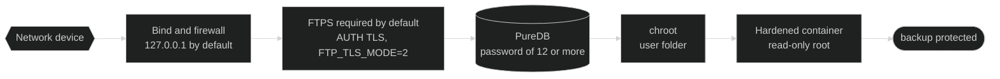
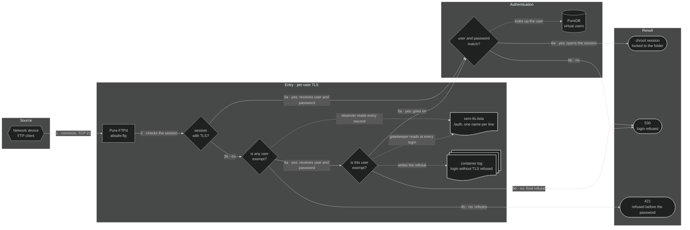
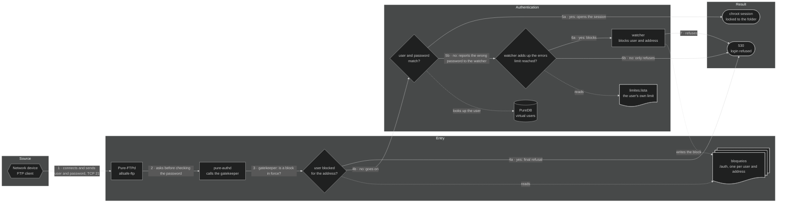

# 🔐 Security — allsafe-ftp-stack

[](security.md)
[-6e7781?style=for-the-badge)](../pt-BR/seguranca.md)
[](../es/seguridad.md)

↩ [Project README](../../README.md) · [Documentation index](README.md)

## 💡 In a few words

The backup of a network device carries passwords and the whole configuration of the network, so the path to the server is protected in layers: the port only listens on the chosen IP, the connection has to be encrypted (the exception, for old devices, is turned on by hand and stays flagged), the address that gets the password of a user wrong too many times is blocked for that user, each user is confined to their own folder and the container runs with the minimum of permissions. If one layer fails, the others still hold. The web panel follows the same idea: it stays behind an nginx, HTTPS only, internal network only, user and password for each administrator and a short session.

<!-- diagrama: diagrams/security-diagram.mmd -->


<sub>Level 1 · Diagram · [source](diagrams/)</sub>

**Sequence:** Network device ➜ Bind and firewall ➜ FTPS required by default (`FTP_TLS_MODE=2`) ➜ PureDB (password of 12 or more) ➜ chroot ➜ Hardened container ➜ backup protected

---

<details>
<summary>Contents — click to expand</summary>

[Private network only](#rede-privada) · [Public IP](#ip-publico) · [Panel through proxy or tunnel](#painel-por-proxy) · [FTP without TLS](#ftp-sem-tls) · [Per-user TLS](#tls-por-usuario) · [Blocking by attempts](#bloqueio-por-tentativa) · [Blocking by address](#bloqueio-por-endereco) · [User profiles](#perfis) · [Best practices before production](#boas-praticas) · [Threat model](#modelo-de-ameaca) · [Exposed surface](#superficie-exposta) · [Protections of the panel](#painel) · [Tests run](#testes-executados) · [No password, random password, exhaustion and direct access to the user database](#sem-senha-e-exaustao) · [Cost of the FTP passwords](#custo-das-senhas) · [Security contact and search robots](#contato-de-seguranca) · [RFC conformance](#conformidade-rfc) · [Hardening of `compose.yaml`](#hardening-do-compose-yaml-linha-a-linha) · [Secrets management](#gestao-de-segredos)

</details>

---

<a name="rede-privada"></a>

## 🧱 Private network only, behind a firewall

> ⚠️ **Out of the box, this stack does not go to the internet.** FTP is an old protocol, what goes through it here are whole network configurations, and the web panel manages the users. The intended use is **on an internal network**, with a private IP, behind a firewall. Publishing is optional and is the choice of whoever installs, by two independent paths, each with its own alert: accepting a [public IP](#ip-publico) on the FTP and on the panel, or publishing [only the panel through proxy or tunnel](#painel-por-proxy), without exposing the FTP.

| Rule | What to do |
|---|---|
| Private IP | `FTP_BIND_IP`, `FTP_PASSIVE_IP` and `PAINEL_BIND_IP` only in `10.0.0.0/8`, `172.16.0.0/12`, `192.168.0.0/16` or `127.0.0.1`. `0.0.0.0` is always refused; a public IP, only with its [own option](#ip-publico). With [IPv6 turned on](configuration.md#ipv6), `FTP_BIND_IPV6` and `PAINEL_BIND_IPV6` only on `::1` or in the unique local range (`fc00::/7`), and `::` is always refused |
| Host firewall | Open the control port and the passive range **only** to the internal networks that send backups, and the panel port **only** to the machines of whoever administers; the rest is dropped |
| Panel networks | `PAINEL_REDES_PERMITIDAS` reduced to the administration network; by default, the list only accepts private networks |
| Edge firewall | No port forwarding from the internet to this host |
| Access from outside | If someone from outside needs to get in, it is by VPN to the internal network, not by opening the port |

<details>
<summary>Technical detail — firewall with Docker</summary>

Docker publishes the ports through its own NAT rules, **before** the `INPUT` chains of the host: an ordinary `ufw` or `INPUT` rule does not block a port published by a container. The right chain is `DOCKER-USER`, and the destination port has to be checked by the original connection, because there the destination has already been changed to the port of the container.

Example with `iptables`, allowing only the management network `10.10.0.0/24` on the interface `eth0` (replace with the real values):

```bash
iptables -I DOCKER-USER -i eth0 -p tcp -m conntrack --ctdir ORIGINAL --ctorigdstport 21 ! -s 10.10.0.0/24 -j DROP
iptables -I DOCKER-USER -i eth0 -p tcp -m conntrack --ctdir ORIGINAL --ctorigdstport 30000:30049 ! -s 10.10.0.0/24 -j DROP
iptables -I DOCKER-USER -i eth0 -p tcp -m conntrack --ctdir ORIGINAL --ctorigdstport 8443 ! -s 10.10.0.0/24 -j DROP
```

With `REDE_IPV6=sim`, the same ports are published on IPv6 too, and `iptables` does not see that traffic: repeat the rules with `ip6tables`, in the same chain, with the management network in IPv6 (in the example, `fd00:10:10::/64`):

```bash
ip6tables -I DOCKER-USER -i eth0 -p tcp -m conntrack --ctdir ORIGINAL --ctorigdstport 21 ! -s fd00:10:10::/64 -j DROP
ip6tables -I DOCKER-USER -i eth0 -p tcp -m conntrack --ctdir ORIGINAL --ctorigdstport 30000:30049 ! -s fd00:10:10::/64 -j DROP
ip6tables -I DOCKER-USER -i eth0 -p tcp -m conntrack --ctdir ORIGINAL --ctorigdstport 8443 ! -s fd00:10:10::/64 -j DROP
```

**Expected result:** from a machine outside `10.10.0.0/24`, the ports `21/tcp` and `8443/tcp` do not answer; from inside, the FTPS login and the panel work.

> The example **was neither applied nor tested in this project**: the host firewall belongs to whoever operates the server. Test it in a maintenance window and make the rule persistent with the tool of your distribution.

Besides the firewall, `deploy.sh` and the containers **refuse by code**, by default, a bind, an announced IP and an allowed network outside private IPs: see [Network and ports](configuration.md#rede-e-portas) and [Web panel](configuration.md#painel).

</details>

---

<a name="ip-publico"></a>

## 🌐 Public IP: optional, by choice of whoever installs, with a firewall

> ⚠️ **Alert: turning this option on puts the FTP and the panel on the internet.** An exposed server is scanned and receives password attempts all the time, and whole network configurations go through this stack. The default, `REDE_PERMITIR_IP_PUBLICO=nao`, refuses any public address. Turning it on is optional: the decision belongs to whoever installs the service, and the stack does not prevent it, it only warns. The recommendation is to turn it on only when there is no way to get in through an internal network or a VPN, and **only with a firewall on the server**. The choice and the risk belong to whoever turned the option on. To publish only the panel, without the FTP, use the [proxy or tunnel](#painel-por-proxy).

The option exists for the server that only has a public address, such as a VPS, and for the device that arrives from an address outside the private ranges, such as that of CGNAT (`100.64.0.0/10`).

**Before turning it on, in this order:**

1. **Firewall on the server**, in the `DOCKER-USER` chain, opening the control port, the passive range and the panel port **only** to the addresses of the devices and of whoever administers. The example is in [private network](#rede-privada): replace the management network with the real addresses.
2. **Required TLS:** `FTP_TLS_MODE` at `2` or `3`. With the option on, `0` and `1` are refused.
3. **Generated passwords**, never chosen ones: those that `deploy.sh` creates and those that the panel generates.
4. **`PAINEL_REDES_PERMITIDAS` reduced** to the networks of whoever administers, one by one.
5. In the `.env`, `REDE_PERMITIR_IP_PUBLICO=sim` and the addresses; then check and apply:

```bash
./deploy.sh --check-only
./deploy.sh
```

**Expected result:** `--check-only` ends with `OK: perfil '<perfil>', endereço público aceito, recursos do servidor e compose validados; nada foi alterado.`, followed by `ALERTA: REDE_PERMITIR_IP_PUBLICO=sim: a stack aceita endereço público, por opção de quem instalou.` `deploy.sh` starts the three containers and closes with the same `ALERTA`, which also stays in the log of each container and in the panel, for the administrator only: in the sign next to **Security** in the menu, at the beginning of the Security tab and in the footer, besides the line **Public address** of the same tab. The sign-in screen does not say how the installation was published.

| With the option on | What happens |
|---|---|
| Public IP in `FTP_BIND_IP`, `FTP_PASSIVE_IP`, `PAINEL_BIND_IP` and `PAINEL_CERT_CN` | Accepted, if it is a server IPv4 (first octet from `1` to `223`) |
| Public network in `PAINEL_REDES_PERMITIDAS` | Accepted, with a prefix from `/8` to `/32` |
| `0.0.0.0`, multicast and reserved addresses | Refused: the address is always chosen, never "all" |
| Public IPv6 in `FTP_BIND_IPV6`, `PAINEL_BIND_IPV6` and `PAINEL_CERT_CN`, with `REDE_IPV6=sim` | Accepted, if it is a global address (`2000::/3`). `::`, link-local (`fe80::/10`), multicast and IPv4 written as IPv6 are refused |
| Public IPv6 network in `PAINEL_REDES_PERMITIDAS` | Accepted, with a prefix from `/16` to `/128` |
| Network wider than `/8`, such as `0.0.0.0/0` | Refused |
| `FTP_TLS_MODE` at `0` or `1` | Refused |
| Value other than `nao` and `sim` | Refused before any other check |

<details>
<summary>Technical detail — where the option is checked</summary>

- The variable reaches the three containers through [`compose.yaml`](../../compose.yaml) and is read by the same functions of [`scripts/rede-privada.sh`](../../scripts/rede-privada.sh) in [`deploy.sh`](../../deploy.sh) and in the three entrypoints: `conferir_opcao_ip_publico`, `exigir_ip`, `exigir_rede` and `aviso_ip_publico`. The panel checks it again in [`painel/config.py`](../../painel/config.py).
- A value other than `nao` and `sim` stops everything with `FALHA: REDE_PERMITIR_IP_PUBLICO deve ser 'nao' ou 'sim'`: no value is treated as `sim` by approximation.
- With the option on, the panel accepts being opened by any IPv4 address typed in place of the name and, with `REDE_IPV6=sim`, by a global IPv6 address between brackets; by name, only `localhost` and the `PAINEL_CERT_CN` are still valid.
- The limit of password attempts, the short session and the request limits of nginx still apply, but they do not replace the firewall: they reduce the speed of the attack, not the exposure.
- The refusals and the alert are checked by the [test suite](scripts.md#testar); the messages are in [Troubleshooting](troubleshooting.md#o-container-nao-sobe).

</details>

---

<a name="painel-por-proxy"></a>

## 🔌 Only the panel published, through proxy or tunnel

> ⚠️ **Alert: filling in `PAINEL_PROXY_CONFIAVEL` puts the sign-in screen of the panel within reach of whoever reaches the proxy or the tunnel.** It is optional and is the choice of whoever installs. Who can reach the screen is then decided there: restrict the access on the proxy or on the tunnel. The FTP does not go through it and stays only on the addresses of the stack. With the panel published, keep the [second factor](panel.md#segundo-fator) required, which is the default: the password alone does not open the session.

It serves whoever wants to open the panel from outside without exposing the FTP: an edge nginx, a tunnel (such as Cloudflare's) or another HTTPS proxy receives the access and forwards it to the panel, which stays on a private IP. `REDE_PERMITIR_IP_PUBLICO` stays at `nao`.

Without the option, a proxy in front already works, but every access arrives with the address of the proxy: the block for a wrong password starts to apply to everyone at once, and the session, the audit log and the request limits stop telling one person from another. The option solves that: the nginx of the stack starts using the address that the proxy reports in `X-Forwarded-For`, and **only** when the connection comes from an address in the list.

**Step by step:**

1. Start the proxy or the tunnel pointing to the panel (`https://<PAINEL_BIND_IP>:<PAINEL_PORT>`), forwarding the `Host` as the browser sent it and appending the address of whoever accesses to `X-Forwarded-For`.
2. Find out with which address it reaches the nginx of the stack: make an access through it and read the first field of the last line of the log.

```bash
docker compose logs --tail 5 nginx
```

**Expected result:** a line like `172.29.1.1 GET /entrar 200`. A proxy or tunnel on the **same server** arrives with the first address of `FTP_SUBNET` (`172.29.1.1`, by default); on another server, with its private IP.

3. In the `.env`, put that address in `PAINEL_PROXY_CONFIAVEL` and the public name in `PAINEL_CERT_CN`; then check and apply:

```bash
./deploy.sh --check-only
./deploy.sh
```

**Expected result:** both commands close with `ALERTA: PAINEL_PROXY_CONFIAVEL=<endereço>: o painel está publicado por proxy ou túnel, por opção de quem instalou.` The same alert stays in the log of the panel and nginx containers and in the panel, for the administrator only: in the sign next to **Security** in the menu, at the beginning of the Security tab and in the footer, besides the line **Panel behind a proxy or tunnel** of the same tab. Whoever opens the sign-in screen through the public address does not read how the panel was published.

The warning on the screen can be hidden by whoever installs, with `PAINEL_AVISO_EXPOSICAO=nao` in the `.env` and a `./deploy.sh`: the sign in the menu, the warning at the beginning of the Security tab and the text in the footer disappear. The lines of the Security tab and the alert of `deploy.sh` remain.

4. Open the panel by the public name, sign in and check in the Log tab that the column **From** shows your address, and not that of the proxy.

| With the option filled in | What happens |
|---|---|
| Connection coming from an address in the list | The **last** address of `X-Forwarded-For` counts, the one the proxy appended; what the client wrote before is discarded |
| Connection coming from any other address | The header is ignored: the address of the connection counts |
| Header missing or with a value that is not an address | The address of the connection counts, which is that of the proxy |
| `PAINEL_REDES_PERMITIDAS` | Keeps checking who **opened the connection**: the proxy has to be in it, and whoever accesses through it does not |
| Limit of password attempts, session, audit log and request limits | Start counting by the address of whoever accesses |
| Whole network (`10.0.0.0/8`), `0.0.0.0`, more than 8 addresses, address outside `PAINEL_REDES_PERMITIDAS` | Refused: the proxy is always a chosen address |
| Public address in the list | Refused, except with `REDE_PERMITIR_IP_PUBLICO=sim` |

**Cautions for whoever publishes:**

- **Restrict on the proxy or on the tunnel** who reaches the sign-in screen: list of addresses, authentication at the edge or both. The limit of attempts and the short session of the panel reduce the speed of the attack, not the exposure.
- **Check the certificate of the panel on the proxy**, instead of turning the check off: the panel uses a self-signed certificate, valid for the `PAINEL_CERT_CN`, and its public part is in `DATA_DIR/painel/tls/painel-cert.pem`.
- **With the proxy on the same server**, every access made from inside the server arrives from the same address and starts being treated as coming from the proxy. Whoever has a terminal on the server is already inside the trust boundary of the stack.
- **Reduce `PAINEL_REDES_PERMITIDAS`** to the network of the proxy and to that of whoever administers from inside.
- **Fill in the security contact** (`SEGURANCA_CONTATO_EMAIL`): see [Security contact](#contato-de-seguranca).

<details>
<summary>Technical detail — edge examples and where the option is checked</summary>

Example of an edge nginx, on the same server, with the name `painel.exemplo.com.br` (replace with the real values):

```nginx
server {
    listen 443 ssl;
    server_name painel.exemplo.com.br;
    ssl_certificate     /etc/ssl/painel.exemplo.com.br/certificado.pem;
    ssl_certificate_key /etc/ssl/painel.exemplo.com.br/chave.pem;

    allow 203.0.113.10;          # quem pode chegar à tela de entrada
    deny  all;

    location / {
        proxy_pass https://127.0.0.1:8443;
        proxy_set_header Host $http_host;                               # o nome e a porta que o navegador usou
        proxy_set_header X-Forwarded-For $proxy_add_x_forwarded_for;    # acrescenta o endereço de quem acessa
        proxy_ssl_trusted_certificate /etc/ssl/painel-cert.pem;         # cópia de DATA_DIR/painel/tls/painel-cert.pem
        proxy_ssl_verify on;
        proxy_ssl_name painel.exemplo.com.br;
        proxy_ssl_server_name on;
    }
}
```

**Expected result:** with `PAINEL_CERT_CN=painel.exemplo.com.br` and `PAINEL_PROXY_CONFIAVEL=172.29.1.1`, the panel opens by the public name, the sign-in works and the audit log records the address of whoever accessed.

> The example was exercised in this project with an edge nginx on the same server, on a high port and with a test name: the sign-in, the session and the address in the audit log were checked, and an `X-Forwarded-For` written by the client was discarded. With `Host $host`, which removes the port, the sign-in through a port other than `443` is refused with `403`, because the origin of the submission stops matching; that is why the example uses `$http_host`.

Tunnel: point the service of the tunnel to `https://127.0.0.1:8443`, with the name of the origin server equal to the `PAINEL_CERT_CN` and the copy of `painel-cert.pem` as the accepted authority, without turning the TLS check off. In the Cloudflare tunnel, that corresponds to `originServerName` and `caPool` in `originRequest`, and the restriction of who accesses is made in the access policy of Cloudflare itself.

> The option **was not tested with a real tunnel** in this project: what is proven is the behaviour of the nginx of the stack and of the panel in front of a proxy that forwards `Host` and `X-Forwarded-For`. The Cloudflare proxy **without** a tunnel arrives from whole public ranges and stays outside this option, which only accepts a chosen address.

Where the option is checked:

- The variable reaches the panel and nginx containers through [`compose.yaml`](../../compose.yaml). The function `exigir_proxies`, of [`scripts/rede-privada.sh`](../../scripts/rede-privada.sh), is called by [`deploy.sh`](../../deploy.sh) and by the two entrypoints; the panel checks it again in [`painel/config.py`](../../painel/config.py).
- In [`nginx/nginx.conf.modelo`](../../nginx/nginx.conf.modelo), the list becomes a `geo` block, and the address of whoever accesses (`$cliente`) is the last one of `X-Forwarded-For` only when the connection comes from the list. The `realip` module is left out on purpose: with it, `allow` and `deny` would start applying to the reported address, and not to who opened the connection.
- nginx sends the panel the address of the connection (`X-Real-IP`) and that of whoever accesses (`X-Cliente-IP`), always rewritten by it. The panel only uses the second when the first is in the list ([`painel/atendimento.py`](../../painel/atendimento.py)); the two written by the client do not reach the panel.
- The reported address can be IPv4 or IPv6. The addresses of the list are IPv4 or IPv6.
- The refusals, the alert and the forged address are checked by the [test suite](scripts.md#testar).

</details>

---

<a name="ftp-sem-tls"></a>

## ⚠️ FTP without TLS: only for old devices

> ⚠️ **The default of this stack is required TLS (`FTP_TLS_MODE=2`). The modes `0` and `1` turn that protection off.** They exist only because there are old network devices that do not speak TLS and, without that, could not send the backup. With them, user, password and file go in **plain text**: whoever is on the network path reads everything.

| Mode | What happens | What is exposed |
|---|---|---|
| `FTP_TLS_MODE=0` | The server **does not offer TLS**. Every client signs in in plain text; whoever requires TLS cannot connect | User, password and content of **all** the backups, of all the devices |
| `FTP_TLS_MODE=1` | TLS is **optional**. Whoever asks for TLS uses it; whoever does not signs in in plain text | User, password and backup of whoever signs in without TLS. Nothing forces the others to use TLS: a badly configured device starts sending in plain text without anyone noticing |

The backup of a network device usually carries passwords, SNMP communities and keys. With the FTP password captured, the attacker also reads and overwrites the backups of that user.

**Use it only if all the conditions below are true:**

1. The device really does not speak TLS: confirm it in the manual or with the test of [Troubleshooting](troubleshooting.md#ftp-sem-tls).
2. The traffic stays on an **isolated internal network** (management network), without going through a user network, Wi-Fi, the internet or a third-party link without VPN.
3. The **firewall** opens the control port and the passive range **only to the IPs of those devices**: [private network](#rede-privada).
4. Each old device has **a user and a password of its own**, not used anywhere else. The `chroot` limits the damage to the folder of that user.
5. There is a date to go back to `2`: when the device is replaced or updated, the mode goes back and the passwords that went in plain text are changed.

There are four paths for the device that does not speak TLS. Prefer from top to bottom:

| Path | Who signs in without TLS | What the others risk |
|---|---|---|
| Second instance only for the old devices, with the main one at `2`: [Configuration](configuration.md#pastas-e-nomes) | Only the users of the second instance | Nothing: the main one refuses the session without TLS before the password is sent |
| Per-user exemption, through the panel: [Per-user TLS](#tls-por-usuario) | Only the users that an administrator exempts | While someone is exempt, a device of a user who is not exempt, configured without TLS by mistake, sends the password in plain text before being refused; the refusal stays in the log |
| `FTP_TLS_MODE=1` | Any user whose device does not ask for TLS | Nothing forces anyone to use TLS |
| `FTP_TLS_MODE=0` | Everyone | There is no TLS for anyone |

The per-user exemption is the simplest path when there are few old devices: everything stays in a single installation, with a single panel, and it asks for no change in the `.env`.

To turn on mode `1` or `0`, edit `FTP_TLS_MODE` in the `.env` and reapply:

```bash
./deploy.sh
```

**Expected result:** the summary brings `FTP:    127.0.0.1:21, SEM TLS (texto puro), modo passivo 30000-30049` (or `TLS explícito opcional (aceita texto puro)` in mode `1`) and ends with the warning:

```text
AVISO: FTP_TLS_MODE=0: o FTP está SEM criptografia. Senhas e arquivos passam em texto puro e podem ser
       lidos por quem estiver na mesma rede. Use só para equipamento antigo sem suporte a TLS, em rede interna
       isolada, com o firewall liberando só esses equipamentos, e volte para FTP_TLS_MODE=2 assim que puder.
```

The stack does not let the mode go unnoticed. While it is on, the alert appears in:

| Where | What appears |
|---|---|
| End of `./deploy.sh` and of `./deploy.sh --check-only` | The three-line `AVISO` above |
| Summary of `./deploy.sh` | `SEM TLS (texto puro)` or `TLS explícito opcional (aceita texto puro)` on the FTP line |
| Container log (`docker compose logs ftp`) | At each startup: `AVISO: FTP_TLS_MODE=0, FTP sem TLS: senhas e arquivos trafegam em texto puro. Só para equipamento sem suporte a TLS, em rede interna isolada.` |
| Panel, Overview and Security screens | Alert band at the beginning of the screen and the item `FTP TLS` marked with the attention sign |

The warning informs, it does not block: the decision belongs to whoever operates the server. The web panel is **not** affected by this variable and stays on HTTPS only.

<details>
<summary>Technical detail — what changes in Pure-FTPd</summary>

`FTP_TLS_MODE` is passed on to the `-Y` option of `pure-ftpd`. With `-Y 0`, the server does not announce `AUTH TLS` and the command is refused; with `-Y 1`, it accepts both forms; with `-Y 2`, it refuses the plain-text session with `421-Sorry, cleartext sessions and weak ciphers are not accepted on this server.`; with `-Y 3`, it also requires `PROT P` on the data channel.

The FTP certificate is generated in any mode, and the other layers still hold: bind on a private IP, virtual users, `chroot`, session limits and hardened container. What is lost is the secrecy and the integrity of what travels.

A value outside `0` to `3` is refused twice: by [`deploy.sh`](../../deploy.sh), before any change, and by [`ftp/entrypoint.sh`](../../ftp/entrypoint.sh), with `FALHA: FTP_TLS_MODE deve ser 0, 1, 2 ou 3`.

</details>

---

<a name="tls-por-usuario"></a>

## 🔓 Per-user TLS

The server requires TLS from everyone, except from the users that an administrator exempts, one by one, in the panel. It serves the server on which one or two old devices do not speak TLS and the others do. The option comes on (`FTP_TLS_EXCECOES=sim`) and, with no user exempt, changes nothing: the session without TLS is refused before the password is sent.

> ⚠️ **The exempt user sends password and file in plain text**, as in the modes `0` and `1`. The five conditions of [FTP without TLS](#ftp-sem-tls) apply to them: a device that does not speak TLS, an isolated internal network, a firewall opening only it, a user and a password of its own and a date to end.

1. New user: in the panel, open Users ➜ **New user** and tick **Device without TLS support** before creating.
2. User that already exists: Users ➜ **Exempt from TLS** on their line, or the **TLS** card of the Edit screen, and confirm. From the terminal, the same:

   ```bash
   ./manage-user.sh tls-dispensar <usuario>
   ```

**Expected result:** the **TLS** column of the Users tab shows `no TLS` on the line of the user; in moments they sign in without TLS, without restarting the container and without dropping whoever is connected; the others, without TLS, get `530` and keep signing in with TLS.

To require TLS from a user again: Users ➜ **Require TLS**, or `./manage-user.sh tls-exigir <usuario>`, and change their password, which went in plain text. To take the option out of the panel: `FTP_TLS_EXCECOES=nao` in the `.env` and `./deploy.sh`.

The exemption only applies with `FTP_TLS_MODE=2` and without `REDE_PERMITIR_IP_PUBLICO=sim`. Outside that, the installation starts normally, the option stays **without effect** and nobody is exempt: `./deploy.sh` and the panel say the reason.

| Situation | What happens |
|---|---|
| Exempt user, without TLS | Signs in, confined to their folder, like any other |
| Exempt user, with TLS | Signs in: the exemption allows the sign-in without TLS, it does not forbid TLS |
| No user exempt, session without TLS | `421` in the answer to the user name: the server ends the session before the password is sent |
| User not exempt, without TLS, with another user exempt | `530`, with the right or the wrong password, and the refusal goes to the container log |
| User removed and created again with the same name | Does not inherit the exemption: is required to use TLS again |
| The process that looks up the list stops answering | The FTP container exits and Docker starts it again; meanwhile, nobody signs in |
| Session without TLS already open of whoever was required again | Goes on until it ends; their next sign-in without TLS is refused |
| `FTP_TLS_EXCECOES=nao`, `FTP_TLS_MODE` other than `2` or `REDE_PERMITIR_IP_PUBLICO=sim` | Nobody is exempt; the list is kept and applies again when the option has effect again |

> ⚠️ **Limit:** while at least one user is exempt, the server only knows who the user is after receiving the name, so it accepts the beginning of the conversation without TLS from anyone. A device of a user who is **not exempt** and is configured without TLS sends the password in plain text before receiving the `530`. The sign-in is refused and the log brings the user and the source: change that password and fix the device. With nobody exempt, the session without TLS is again refused before the password is sent.

Where the exemption appears:

| Where | What appears |
|---|---|
| End of `./deploy.sh` | With someone exempt: `AVISO: TLS por usuário: <n> usuário(s) dispensado(s) na aba Usuários do painel entram SEM TLS, com senha e` and the following lines. Without effect: `TLS por usuário sem efeito: <motivo>. Ninguém é dispensado do TLS.`, also in `./deploy.sh --check-only` |
| Summary of `./deploy.sh` | `equipamento sem suporte a TLS: o administrador dispensa o usuário dele na aba Usuários do painel`, below the FTP line |
| Container log (`docker compose logs ftp`) | On the line `FTP pronto`: `TLS por usuário: nenhum dispensado, sessão sem TLS recusada antes da senha` or `com exceção por usuário (<n> dispensado(s) do TLS)`, the latter with the plain-text `AVISO`; at each change of side of the list, `TLS por usuário: a lista dos dispensados mudou`; at each refusal, `porteiro: entrada sem TLS recusada: usuario=<nome> origem=<ip> (a senha enviada passou em texto puro: troque-a)` |
| Panel, Users tab | The **TLS** column, with `required` or `no TLS` on each line |
| Panel, Overview and Security tabs | With at least one user exempt, the alert band at the beginning of the screen, with the number and the names; in the Security tab, the item `FTP TLS` |
| Panel, Log tab | `User exempted from TLS` and `User requires TLS again`, with the administrator who did it |

<details>
<summary>Flowchart of the sign-in with per-user TLS, with the written sequence — click to expand</summary>

<!-- diagrama: diagrams/per-user-tls-flowchart.mmd -->


<sub>Level 2 · Map · [source](diagrams/)</sub>

| No. | From ➜ To | What happens |
|---|---|---|
| 1 | Network device ➜ Pure-FTPd | The device connects on port `21/tcp`, with or without TLS |
| 2 | Pure-FTPd ➜ session with TLS? | The server checks whether the session is encrypted |
| 3a | session with TLS? ➜ user and password match? | Yes: it receives user and password and goes on to the check, whatever the user |
| 3b | session with TLS? ➜ is any user exempt? | No: what happens depends on whether some user is exempt |
| 4a | is any user exempt? ➜ is this user exempt? | Yes: the server receives user and password without TLS, and the gatekeeper (`allsafe-ftp-porteiro`) looks for the name in the list |
| 4b | is any user exempt? ➜ 421 | No: refusal in the answer to the name, before the password is sent |
| 5a | is this user exempt? ➜ user and password match? | Yes: it goes on to the password check |
| 5b | is this user exempt? ➜ 530 | No: final refusal, with the right or the wrong password |
| 6a | user and password match? ➜ chroot session | Yes: the session opens, locked to the folder of the user |
| 6b | user and password match? ➜ 530 | No: `530 Login authentication failed` |

**Support**

| Who | Uses | How |
|---|---|---|
| is any user exempt? | `sem-tls.lista` (`DATA_DIR/auth`) | the observer of the FTP startup reads it every second |
| is this user exempt? | `sem-tls.lista` (`DATA_DIR/auth`) | the gatekeeper reads it at every login |
| is this user exempt? | container log | writes the refusal, with the user and the source, without the password |
| user and password match? | PureDB | looks up the user |

</details>

<details>
<summary>Technical detail — how the exemption is applied</summary>

- **Always up:** [`ftp/entrypoint.sh`](../../ftp/entrypoint.sh) starts `pure-authd -s /run/pure-authd.sock -r /usr/local/sbin/allsafe-ftp-porteiro` and `pure-ftpd` with `-l extauth:/run/pure-authd.sock -l puredb:/auth/pureftpd.pdb`, with or without the exemption, because the same gatekeeper applies the [blocking by attempts](#bloqueio-por-tentativa). With the option in effect, the mark `/run/allsafe/tls-por-usuario` turns on the TLS rule in the gatekeeper.
- **Two sign-in modes, according to the list:** with nobody exempt, `pure-ftpd` starts with `-Y 2` and refuses the session without TLS itself, before the password. With at least one, it starts with `-Y 1`, which accepts sessions with and without TLS, and the one that decides is the gatekeeper. An observer in the entrypoint rereads the list every second; when it goes from empty to filled, or the opposite, only the `pure-ftpd` process that listens on the port is ended and another one starts with the new mode. The container does not restart, and each session in progress is a process of its own, which goes on until it ends.
- **Costs of the switch:** the port stays closed for the instant between one process and the other; the new process restarts the count of simultaneous sessions (`FTP_MAX_CLIENTS` and `FTP_MAX_CLIENTS_PER_IP`), without counting those that were already open; and the session without TLS already open of whoever was required again goes on until it ends.
- **The gatekeeper does not check the password:** [`ftp/porteiro.pl`](../../ftp/porteiro.pl) answers `auth_ok:0` ("not mine") when the session has TLS or when the name is in the list, and `pure-ftpd` goes on to PureDB, which checks the password as always. In the other cases it answers `auth_ok:-1`, the final refusal. The password reaches it in an environment variable and is not read, written or logged.
- **The list:** `/auth/sem-tls.lista` (`DATA_DIR/auth` on the host), `0600`, owned by `root`, one name per line. Only `allsafe-ftp-user` writes it, with the same lock as the user database and by renaming the file, so that the gatekeeper never reads half a list. The gatekeeper reads it at every login, and the observer, every second: the change applies in moments, without restarting the container.
- **Fail closed:** without `pure-authd`, `pure-ftpd` would fall straight to PureDB and accept everyone without TLS. That is why the entrypoint watches the processes: if one exits, it writes `FALHA: o pure-authd saiu: o container encerra para ninguém entrar sem a conferência do porteiro` (or `o vigia saiu`, `o pure-ftpd saiu`, `o observador da lista do TLS saiu`), exits with code `1`, and `restart: unless-stopped` starts the container again, with all of them. The healthcheck only answers healthy with the `pure-authd` socket open.
- **The refusal for TLS does not count as a wrong password:** the gatekeeper leaves a mark in `/run/allsafe/recusa/`, and the watcher of the blocking by attempts ignores the failure that comes right after it. A device configured without TLS does not block its own user.
- **When the option stays without effect:** with `FTP_TLS_MODE` other than `2` or with `REDE_PERMITIR_IP_PUBLICO=sim`. The installation starts, nobody is exempt, and [`deploy.sh`](../../deploy.sh), the container log and the panel say the reason. Only the value other than `nao` and `sim` is refused, by `deploy.sh` and by the FTP and panel containers.
- **Who changes the list:** only an administrator, through the panel, with CSRF token and origin checked, or whoever has access to the Docker of the server, through `manage-user.sh`. For the FTP user who signs in to the panel, the screen answers `404`. With the option off or without effect, the screen also answers `404`.
- The panel checks the password of the FTP user in TLS, through the internal network of the stack, with or without exemption: it does not change [their sign-in to the panel](panel.md#usuario-ftp).
- The refusals, the switch of the sign-in mode with open sessions, the fall of `pure-authd` and the cases without effect are checked by the [test suite](scripts.md#testar).

</details>

---

<a name="bloqueio-por-tentativa"></a>

## 🚫 Blocking by attempts on FTP

When the same address gets the password of a user wrong too many times, the FTP starts refusing that user for that address, even with the right password, until the period ends. The stack leaves the installation with the block on: 5 wrong passwords, 15 minutes. The limit of each user is adjusted by the administrator in the panel, both for the account of a device and for that of a person.

| What to adjust | Where | Value | Default |
|---|---|---|---|
| Wrong passwords before the block, for everyone | `FTP_BLOQUEIO_TENTATIVAS`, in the `.env` | `0` to `100`; `0` turns it off | `5` |
| Minutes of block, for everyone | `FTP_BLOQUEIO_MINUTOS`, in the `.env` | `1` to `1440` | `15` |
| Wrong passwords before the block, of one user | Panel, Users ➜ **Edit**, **Limits** card | `0` to `100`; `0`: the user is never blocked | Blank: that of the stack |
| Minutes of block, of one user | Panel, Users ➜ **Edit**, **Limits** card | `1` to `1440` | Blank: that of the stack |

1. To change the default of everyone, edit the two variables in the `.env` and reapply:

   ```bash
   ./deploy.sh
   ```

2. For one user, open Users ➜ **Edit**, fill in **Wrong FTP passwords before the block** and **Minutes of block** and save. From the terminal, the same:

   ```bash
   ./manage-user.sh limites <usuario> tentativas=3 minutos=30
   ```

3. To see who is blocked, open the Users tab, which marks the line with **blocked**, or run:

   ```bash
   ./manage-user.sh bloqueios
   ```

4. To unblock before the period ends, fix the password on the device and click **Unblock**, in the **Blocks** card of the **Edit** screen. From the terminal, the same, for all the addresses of the user or for a single one:

   ```bash
   ./manage-user.sh desbloquear <usuario>
   ./manage-user.sh desbloquear <usuario> <origem>
   ```

**Expected result:** `manage-user.sh bloqueios` answers one line per block, `usuario=<nome> origem=<ip> senhas_erradas=<n> desde=<data hora> ate=<data hora>`, or `Nenhum bloqueio em vigor.`; `desbloquear` answers `Usuario <nome> desbloqueado (<n> endereco(s)): vale na proxima entrada no FTP.`; the change of the limit and the unblock apply at the next sign-in, without restarting anything.

| Situation | What happens |
|---|---|
| Wrong password, below the limit | `530`, and the attempt is added to the others from the same address for that user |
| Wrong password that completes the limit | `530`, and the user is blocked for that address: the right password also gets `530` until the end of the period |
| Right sign-in before the limit | Signs in, and the count of that address for that user goes back to zero |
| The same user, from another address | Signs in: the block applies only to the address that got it wrong |
| Another user, from the same address | Signs in: the block applies only to the user that had the wrong password |
| The user blocked on the FTP signs in to the panel | Signs in: the panel has its own limit of attempts, per address |
| End of the period | The block goes away on its own, and the count starts again from zero |
| Password of the user changed | Their blocks go away |
| Own limit of the user changed | Their blocks go away; saving the same values changes nothing |
| User removed and created again with the same name | Inherits neither the block nor the limit |
| The FTP container restarts or is recreated | The block still holds until the period; the count that had not yet reached the limit starts again |
| Sign-in outside the [hours of the user](panel.md#limites) | Counts as a wrong password: the server answers in the same way in both cases |
| Session without TLS refused, name that is not in the user database, attempt made during the block | Do not count here. The name that is not in the user database counts in the [blocking by address](#bloqueio-por-endereco) |
| Password of the FTP user wrong on the panel screen | Does not count here: it counts in the limit of attempts of the panel |

> ⚠️ **Same address, same user:** devices that use the same user and reach the server from the same address, behind a router that changes the source address, are blocked together. Give each device its own user: the error of one does not hold the other.

> ⚠️ **Limit:** the block counts the wrong passwords of one address for one user. Whoever tries few passwords on many users, below the limit of each one, is not blocked by this rule: the one that holds them is the [blocking by address](#bloqueio-por-endereco), which adds up the errors of the address with any name. The wait of 3 to 6 seconds of each refusal, the limit of sessions per address and the host firewall, which should open port `21/tcp` only to the backup sources, also apply. The block slows the guessing down; the one that authenticates is still the password.

While there is a block, it appears in:

| Where | What appears |
|---|---|
| Container log (`docker compose logs ftp`) | At each startup, `vigia: pronto:` with the limit of the stack; at each wrong password, `vigia: entrada recusada: usuario=<nome> origem=<ip> senhas_erradas=<n> de <limite>`; at the block, `vigia: entrada bloqueada: usuario=<nome> origem=<ip> senhas_erradas=<n> minutos=<m>`; at each attempt during the block, `vigia: entrada recusada pelo bloqueio`; at each file uploaded, downloaded, renamed or deleted through the FTP, `vigia: envio:`, `vigia: download:`, `vigia: renomeado:` and `vigia: apagado:`, with the user, the address and the file |
| Panel, Users tab | The **blocked** mark on the line of the user, with the addresses on mouse-over; the **limits** mark shows the own limit |
| Panel, Edit screen | The **Blocks** card, with the source, the wrong passwords, the beginning and the end of each block, and the **Unblock** button |
| Panel, Security tab | The item `Blocking by attempts on FTP`, with the limit of the stack and the users blocked now |
| Panel, Log tab | `FTP block of the user removed` and `User limits changed`, with the administrator who did it |

<details>
<summary>Flowchart of the sign-in with the blocking by attempts, with the written sequence — click to expand</summary>

<!-- diagrama: diagrams/blocking-by-attempts-flowchart.mmd -->


<sub>Level 2 · Map · [source](diagrams/)</sub>

| No. | From ➜ To | What happens |
|---|---|---|
| 1 | Network device ➜ Pure-FTPd | The device connects on port `21/tcp` and sends user and password |
| 2 | Pure-FTPd ➜ pure-authd | Before checking the password, the server asks `pure-authd` whether the sign-in can go on |
| 3 | pure-authd ➜ user blocked for the address? | `pure-authd` calls the gatekeeper (`allsafe-ftp-porteiro`), which looks for a block of that user for that address, still within the period |
| 4a | user blocked for the address? ➜ 530 | Yes: final refusal, with the right or the wrong password |
| 4b | user blocked for the address? ➜ user and password match? | No: it goes on to the password check |
| 5a | user and password match? ➜ chroot session | Yes: the session opens, locked to the folder of the user, and the count of that address goes back to zero |
| 5b | user and password match? ➜ watcher adds up the errors: limit reached? | No: the server logs the wrong password, and the watcher (`allsafe-ftp-vigia`) receives the notice, with the user and the address, adds up the wrong passwords of that address for that user, within the period, and compares with the limit |
| 6a | watcher adds up the errors: limit reached? ➜ watcher | Yes: the watcher writes the block of the user for that address, which applies from the next attempt |
| 6b | watcher adds up the errors: limit reached? ➜ 530 | No: the sign-in is refused with `530 Login authentication failed`, and the count is kept |
| 7 | watcher ➜ 530 | The sign-in that reached the limit is also refused |

**Support**

| Who | Uses | How |
|---|---|---|
| user blocked for the address? | bloqueios (`DATA_DIR/auth/bloqueios`) | reads at every login |
| user and password match? | PureDB | looks up the user |
| watcher adds up the errors: limit reached? | `limites.lista` (`DATA_DIR/auth`) | reads the user's own limit; without it, that of the stack applies |
| watcher | bloqueios (`DATA_DIR/auth/bloqueios`) | writes the block, with the period |

</details>

<details>
<summary>Technical detail — how the block is applied</summary>

- **Two roles:** the watcher counts and writes; the gatekeeper reads and refuses. [`ftp/vigia.pl`](../../ftp/vigia.pl), installed as `/usr/local/sbin/allsafe-ftp-vigia`, listens on `/dev/log` to what `pure-ftpd` logs, because the server only reports the wrong password there. [`ftp/porteiro.pl`](../../ftp/porteiro.pl) is called by `pure-authd` at every login, before the password check. Neither of the two receives the password to check: the notice brings only the name and the address, and the gatekeeper does not read the variable in which it arrives.
- **The block is a file:** `/auth/bloqueios/<usuario>@<endereco>` (`DATA_DIR/auth/bloqueios` on the host), `0600`, owned by `root`, in a `0700` folder, with one line: until when it holds, since when and how many wrong passwords, in seconds since 1970. It is the only memory of the block: that is why it survives the restart, and deleting the file unblocks at the next sign-in. The watcher writes by renaming the file, so that the gatekeeper never reads half of it.
- **An invalid file does not block:** only the regular file whose first line starts with a number of up to 12 digits greater than the current time counts. Expired, empty, with text or a symbolic link, it does not block, and the watcher deletes it in the cleanup made every minute.
- **Counting window:** the wrong passwords add up while the oldest one is younger than the minutes of block of the user. The count stays in the memory of the watcher, up to 10,000 pairs of user and address; the written blocks go up to 4,096. Above those ceilings the watcher logs `AVISO` and goes on.
- **Own limit:** `tentativas` and `minutos` stay on the line of the user in `/auth/limites.lista` (`0600`), written by `allsafe-ftp-user limites`, the same command of the panel and of [`manage-user.sh`](../../manage-user.sh). The watcher rereads the user database and the list when the file changes.
- **What does not count:** the attempt coming from the internal network of the stack, which is the password check made by the panel and has its own limit of attempts; the refusal of the gatekeeper for lack of TLS, which it marks in `/run/allsafe/recusa/`; the attempt made during the block; the name that is not in the user database and the name outside the rule, which become neither file nor count.
- **Internal network:** these are the networks connected directly to the container, read from `/proc/net/route` at startup, minus the outgoing address, through which the clients of the server itself arrive, and plus `127.0.0.0/8`.
- **Fail closed:** the entrypoint watches `pure-ftpd`, `pure-authd` and the watcher. If one exits, it writes `FALHA: o <processo> saiu: o container encerra para ninguém entrar sem a conferência do porteiro`, exits with code `1`, and `restart: unless-stopped` starts the container again. The healthcheck only answers healthy with the `pure-authd` socket and `/dev/log` open.
- **Who unblocks and who changes the limit:** only an administrator, through the panel (`POST /usuarios/desbloquear` and `POST /usuarios/limites`), with CSRF token and origin checked, or whoever has access to the Docker of the server, through `manage-user.sh`. For the FTP user who signs in to the panel, the two screens answer `404`. The unblock stays in the audit log as `bloqueio_removido`, with the administrator, the user and the number of addresses.
- **No new package:** the watcher uses only `perl-base`, which already comes in the base image, and the container stays with `read_only` and `cap_drop: ALL`.
- The block, the unblock, the expiry, the restart and the attempts to get around it are checked by the [test suite](scripts.md#testar), in [`tests/etapas/24-bloqueio.sh`](../../tests/etapas/24-bloqueio.sh).

</details>

---

<a name="bloqueio-por-endereco"></a>

## ⛔ Blocking by address

The address that gets user and password wrong too many times can no longer sign in to the FTP and to the panel, with any account and even with the right password, until the period ends or an administrator unblocks it. The stack leaves the installation with the block on: the address that goes over 5 errors in 24 hours stays blocked for 120 days. The errors add up with any user name, registered or not, on the FTP with TLS or without it, in passive or active mode, and on the sign-in screen of the panel. It applies to IPv4 and IPv6 addresses. On its own, the stack always blocks one address at a time; a whole network (prefix) is only blocked by decision of the administrator.

| What to adjust | Where | Value | Default |
|---|---|---|---|
| User and password errors that an address may have | `BLOQUEIO_ENDERECO_ERROS`, in the `.env` | `0` to `100`; `0` turns it off | `5` |
| Hours in which the errors of the address add up | `BLOQUEIO_ENDERECO_HORAS`, in the `.env` | `1` to `720` | `24` |
| Days of block | `BLOQUEIO_ENDERECO_DIAS`, in the `.env` | `1` to `3650` | `120` |
| Period of an address already blocked | Panel, Blocks ➜ **Change period** | `1` to `3650` days, counted from now | That of the stack |
| Address or prefix blocked by the administrator | Panel, Blocks ➜ **Block address** | `1` to `3650` days, counted from now | That of the stack |

1. To change the rule of everyone, edit the three variables in the `.env` and reapply:

   ```bash
   ./deploy.sh
   ```

2. To follow it, open the **Blocks** tab of the panel: each blocked address appears with who blocked it (the FTP, the panel or the administrator), how many errors, since when and until when. From the terminal, the same:

   ```bash
   ./manage-user.sh enderecos
   ```

3. To unblock an address before the period ends, fix the password on the device and click **Unblock**, on its line. From the terminal:

   ```bash
   ./manage-user.sh endereco-liberar <endereco ou prefixo>
   ```

4. To block for longer, or to shorten the block, click **Change period** and enter the days, counted from now. From the terminal:

   ```bash
   ./manage-user.sh endereco-bloquear <endereco ou prefixo> <dias>
   ```

5. To block an address that has not made an error yet, or a whole network, click **Block address**, in the Blocks tab, and enter the address or the prefix (`203.0.113.7`, `2001:db8::7`, `203.0.113.0/24` or `2001:db8:1::/48`) and the days. From the terminal, the same command; without the days, the period of the stack applies:

   ```bash
   ./manage-user.sh endereco-bloquear <endereco ou prefixo>
   ```

**Expected result:** `enderecos` answers one line per address, `origem=<ip> por=<ftp|painel|manual> erros=<n> desde=<data hora> ate=<data hora>`, or `Nenhum endereco bloqueado.`; `endereco-bloquear` answers `Endereco <ip> bloqueado: <n> dia(s) a partir de agora, no FTP e no painel.`, or `Prazo do endereco <ip> alterado: <n> dia(s) a partir de agora, no FTP e no painel.` when it was already blocked; `endereco-liberar` answers `Endereco <ip> liberado: vale no proximo pedido.` For a prefix, the three answers start with `Prefixo <rede>/<tamanho>` and the list brings `origem=<rede>/<tamanho>`. Everything applies at the next request, without restarting anything; in the Blocks tab, what was done in the terminal appears within 5 seconds.

| Situation | What happens |
|---|---|
| User and password error, up to the limit | `530` on the FTP, or the refusal of the sign-in screen on the panel, and the error is added to the others from the same address, with any user name |
| Error that goes over the limit: the sixth, by default | The address stays blocked for 120 days, on the FTP and on the panel |
| The blocked address tries the FTP | `530` with any account, with the right or the wrong password, with TLS or without it, in passive or active mode |
| The blocked address opens the panel | `403` on every request, with the text `address blocked for too many user name and password errors`, even with a session open |
| Right sign-in before the limit | Signs in, and the count of that address goes back to zero in the service it signed in to. On the panel, the [limit of attempts](panel.md#protecoes), of 5 failures in 15 minutes, is not reset by it |
| Address inside a blocked prefix | Refused in the same way, on the FTP and on the panel, until the period of the prefix ends or the administrator unblocks it |
| Errors on the FTP and errors on the panel, from the same address | Each service counts its own; the block made by one applies on the other |
| Another address | Signs in: the block applies only to the address that got it wrong |
| End of the period | The block goes away on its own |
| The administrator unblocks | The address signs in again at the next request, and its count starts again |
| The administrator changes the period | The new period replaces the previous one; who blocked and with how many errors stay recorded |
| The FTP or the panel container restarts | The block still holds; the count that had not yet gone over the limit starts again |
| Session without TLS refused before the password, password that the FTP could not check, attempt made during a block | Do not count |
| Sign-in to the panel, with the default of 5 errors | The [limit of attempts of the panel](panel.md#protecoes) comes first: at the fifth failure, the address waits 15 minutes. It is only blocked for 120 days if it gets it wrong again after the wait, within the 24 hours |

> ⚠️ **Never blocked on their own:** the server itself, the internal network of the stack, the outgoing address of the container, through which the clients of the server itself arrive, and the proxies of `PAINEL_PROXY_CONFIAVEL`, behind which all the visitors are. For them the [blocking by attempts](#bloqueio-por-tentativa) of the FTP and the limit of attempts of the panel apply.

> ⚠️ **A prefix blocks every address of the network:** whoever is in it is refused with any account, even without ever having made an error. Only the administrator blocks a prefix, through the Blocks tab or the terminal: IPv4 from `/8` to `/31` and IPv6 from `/16` to `/127`, up to 1000 prefixes. The panel refuses the block that would catch the address from which the administrator is using the panel, the internal network of the stack or a proxy of `PAINEL_PROXY_CONFIAVEL`; the terminal of the server accepts it.

> ⚠️ **Several devices behind the same address:** devices that go out through a router that changes the source address reach the server with a single address and are blocked together. One of them with the wrong password, trying every hour, blocks all of them for 120 days. In that scenario, raise `BLOQUEIO_ENDERECO_ERROS` or lower `BLOQUEIO_ENDERECO_HORAS`, and follow the Blocks tab.

> ⚠️ **Administrator with their own address blocked:** the panel answers `403` to them as well. The way out is another administrator, from another address, or the terminal of the server: `./manage-user.sh endereco-liberar <endereco>`.

> ⚠️ **Limit:** the block applies to the address that the server sees. Where Docker does not preserve the source of the connection, every FTP client arrives with the outgoing address of the container, which is never blocked: check in the log (`docker compose logs ftp`) whether the `origem=` of the sign-ins is the real address of each device. Whoever changes address at each attempt also escapes the count: the host firewall is still the first barrier, opening port `21/tcp` only to the backup sources.

While there is a block, it appears in:

| Where | What appears |
|---|---|
| Panel, Blocks tab | The rule in effect, the total, the **Block address** button and one line per address or prefix, with **Change period** and **Unblock**; with more than ten, the search by part of the address |
| Panel, Security tab | The item `Blocking by address`, with the rule and how many addresses are blocked now |
| Panel, Log tab | `Address blocked for user name and password errors`, `Address or prefix blocked by the administrator`, `Address block period changed` and `Address unblocked`, with the administrator who did it, and `Request from a blocked address`, at each request refused |
| Container log (`docker compose logs ftp`) | At each startup, `vigia: pronto: endereço com mais de 5 erros de usuário e senha em 24 h fica bloqueado por 120 dias, no FTP e no painel`; at the block, `vigia: endereço bloqueado: origem=<ip> erros=<n> dias=<d>`; at each attempt during the block, `vigia: entrada recusada pelo bloqueio do endereço: origem=<ip>` |
| Terminal of the server | `./manage-user.sh enderecos` |

<details>
<summary>Flowchart of the sign-in with the blocking by address, with the written sequence — click to expand</summary>

<!-- diagrama: diagrams/blocking-by-address-flowchart.mmd -->
```mermaid
%%{init: {"theme": "dark"}}%%
flowchart LR
    subgraph ORIGEM["Source"]
        origem@{ shape: hex, label: "Source address<br>device or browser" }
    end
    subgraph ENTRADA["Entry"]
        servico@{ shape: rect, label: "FTP or panel<br>allsafe-ftp, allsafe-ftp-painel" }
        preso@{ shape: diam, label: "address<br>blocked?" }
        enderecos@{ shape: docs, label: "enderecos and prefixos<br>/auth, one file per block" }
    end
    subgraph AUTH["Authentication"]
        login@{ shape: diam, label: "user and password<br>match?" }
        passou@{ shape: diam, label: "adds up the address errors<br>over the limit?" }
        bloqueia@{ shape: rect, label: "watcher or panel<br>blocks the address" }
    end
    subgraph GESTAO["Management"]
        admin@{ shape: person, label: "User<br>administrator" }
        aba@{ shape: rect, label: "Blocks tab<br>or manage-user.sh" }
    end
    subgraph RESULTADO["Result"]
        entra@{ shape: stadium, label: "signed in<br>session open" }
        recusa@{ shape: stadium, label: "refused<br>530 on the FTP, 403 on the panel" }
    end

    origem -- "1 · sends user and password" --> servico
    servico -- "2 · before checking the password" --> preso
    preso -- "3a · yes: refuses with any account" --> recusa
    preso -- "3b · no: goes on" --> login
    login -- "4a · yes: signs in and resets the count" --> entra
    login -- "4b · no: adds one error to the address" --> passou
    passou -- "5a · yes: blocks" --> bloqueia
    passou -- "5b · no: only refuses" --> recusa
    bloqueia -- "6 · refuses" --> recusa
    admin -- "7 · follows, blocks, unblocks or changes the period" --> aba
    preso -. "reads" .-> enderecos
    bloqueia -. "writes the block" .-> enderecos
    aba -. "reads, writes, deletes or rewrites" .-> enderecos
```

<sub>Level 2 · Map · [source](diagrams/)</sub>

| No. | From ➜ To | What happens |
|---|---|---|
| 1 | Source address ➜ FTP or panel | The device sends user and password to the FTP, on port `21/tcp`, or the browser sends them to the sign-in screen of the panel |
| 2 | FTP or panel ➜ address blocked? | Before checking the password, the gatekeeper of the FTP and the request handling of the panel look for a block of that address, or of a prefix that covers it, still within the period |
| 3a | address blocked? ➜ refused | Yes: `530` on the FTP and `403` on the panel, with any account and with the right or the wrong password |
| 3b | address blocked? ➜ user and password match? | No: it goes on to the password check |
| 4a | user and password match? ➜ signed in | Yes: the session opens, and the count of that address goes back to zero |
| 4b | user and password match? ➜ adds up the address errors: over the limit? | No: the watcher, on the FTP, or the panel adds one error to that address, with any user name, within the hours configured |
| 5a | adds up the address errors: over the limit? ➜ watcher or panel | Yes: the service that counted writes the block of the address, with the period in days |
| 5b | adds up the address errors: over the limit? ➜ refused | No: the sign-in is refused and the count is kept |
| 6 | watcher or panel ➜ refused | The sign-in that went over the limit is also refused |
| 7 | User ➜ Blocks tab or manage-user.sh | The administrator follows the list, blocks an address or a prefix, unblocks or changes the period |

**Support**

| Who | Uses | How |
|---|---|---|
| address blocked? | enderecos and prefixos (`DATA_DIR/auth/enderecos` and `DATA_DIR/auth/prefixos`) | reads at each sign-in to the FTP and at each request to the panel |
| watcher or panel | enderecos (`DATA_DIR/auth/enderecos`) | writes the block, with the period |
| Blocks tab or manage-user.sh | enderecos and prefixos (`DATA_DIR/auth/enderecos` and `DATA_DIR/auth/prefixos`) | reads the list, writes the new block, deletes the file of what was unblocked and rewrites the period |

</details>

<details>
<summary>Technical detail — how the blocking by address is applied</summary>

- **The block is a file:** `/auth/enderecos/<endereco>` (`DATA_DIR/auth/enderecos` on the host), `0600`, owned by `root`, in a `0700` folder, with one line: until when it holds, since when, how many errors and who blocked (`ftp`, `painel` or `manual`). The prefix stays in `/auth/prefixos/<rede>_<tamanho>`, with the same line and the same mode. It is the only memory of the block: that is why it survives the restart and applies in both services, and deleting the file unblocks the address at the next request. The writing is done by renaming the file, so that nobody reads half of it.
- **Who counts:** on the FTP, [`ftp/vigia.pl`](../../ftp/vigia.pl), from what `pure-ftpd` logs at each user and password failure; on the panel, [`painel/enderecos.py`](../../painel/enderecos.py), at each sign-in refused after the password is checked and at each confirmation by password refused. Each one keeps the count in its own memory, per address, only of the errors newer than the hours configured: up to 10,000 addresses in the watcher and 5,000 in the panel. The right sign-in erases the count of that address in the service in which it happened.
- **Single spelling of the address:** the name of the file is the address written in one way only, the same on the FTP ([`ftp/endereco.pl`](../../ftp/endereco.pl)) and on the panel: IPv4 without leading zeros; IPv6 in lower case, with the longest run of zeros compressed; the IPv4 written inside an IPv6 (`::ffff:a.b.c.d`) counts as IPv4; an address with a zone (`%eth0`) is refused. The prefix is written with the network already without the bits after the length. Without that, the same IPv6 written in two ways would escape the block.
- **Who applies it:** on the FTP, [`ftp/porteiro.pl`](../../ftp/porteiro.pl), called by `pure-authd` before the password check, and it is the first of its three rules; on the panel, the request handling ([`painel/atendimento.py`](../../painel/atendimento.py)), before any route, including the health one.
- **Over the limit:** the error that blocks is the one after the limit. With `5`, five errors do not block and the sixth does.
- **An invalid file does not block:** only the regular file counts, with the name of an address or of a prefix in the single spelling, whose first line starts with a number of up to 12 digits greater than the current time. Expired, empty, with text or a symbolic link, it does not block; the watcher deletes the expired ones every minute. `127.0.0.0/8`, `0.0.0.0/8` and `::/16`, which belong to the server itself, are never read as blocked.
- **Ceiling:** 10,000 addresses and 1,000 prefixes blocked. Above that, the watcher logs `AVISO` and the command answers `Teto de 10000 enderecos bloqueados: libere algum antes` or `Teto de 1000 prefixos bloqueados: libere algum antes`.
- **What is never blocked on its own, on the FTP:** the internal network of the stack, which is the password check made by the panel, and the outgoing address of the container. **On the panel:** the loopback, the proxies of `PAINEL_PROXY_CONFIAVEL` and the networks connected directly to the container, read from `/proc/net/route`.
- **Block from the terminal:** `endereco-bloquear` accepts any address or prefix outside `127.0.0.0/8`, `0.0.0.0/8` and `::/16`, including those that are never blocked on their own: it is the decision of whoever has the terminal of the server.
- **Block from the panel:** `GET` and `POST /bloqueios/novo`, with the fields `alvo` and `dias`. It refuses with `400`, without writing anything, the text that is neither an address nor a prefix, the prefix outside the range, the days outside `1` to `3650`, the address of the server itself and the block that would catch the address of whoever is asking, the networks connected directly to the container or a trusted proxy. On what is already blocked, only the period changes.
- **Who unblocks and who changes the period:** only an administrator, through the panel (`POST /bloqueios/novo`, `POST /bloqueios/liberar` and `POST /bloqueios/prazo`), with CSRF token and origin checked, or whoever has access to the Docker of the server, through `manage-user.sh`. For the FTP user who signs in to the panel, the screens of the blocks answer `404`. `endereco_bloqueado`, `endereco_bloqueado_manual`, `endereco_prazo`, `endereco_desbloqueado` and `recusa_endereco` stay in the audit log.
- **Turned off:** with `BLOQUEIO_ENDERECO_ERROS=0`, nothing is blocked on its own; the block made from the terminal still applies in both services.
- The block on the FTP with and without TLS, in passive and active mode, on the panel, from one service to the other, in IPv4, in IPv6 and by prefix, the right sign-in that resets the count, the single spelling of the address, the tab, the terminal, what is never blocked and the refusals are checked by the [test suite](scripts.md#testar), in [`tests/etapas/30-bloqueio-por-endereco.sh`](../../tests/etapas/30-bloqueio-por-endereco.sh).

</details>

---

<a name="perfis"></a>

## 🧑‍💼 User profiles: the minimum each account needs

Each FTP user has a profile, chosen by the administrator. Give each account the smallest one that does the job: the device that only uploads backups does not need to delete or download, and whoever only looks things up does not need to write.

| Profile | For whom | What the account cannot do |
|---|---|---|
| Full | Whoever manages their own folder | Leave their folder |
| Upload | Device that uploads backups and checks what it uploaded | Delete, rename and write over what has already arrived |
| Upload only | Device that only uploads backups | List, download, delete, rename and write over: it does not see the folder of the backups |
| Read only | Whoever only looks things up and downloads | Write, create a folder, rename and delete |

**The gain:** the leaked password of a device is of no use to delete the backup history (Upload), nor to read the configuration of the devices that is in the backups (Upload only), nor to write a file in the folder (Read only). How to choose and change: [Web panel](panel.md#perfis).

> ⚠️ **Limit of the Upload profile:** between the end of the upload and the handover of the file to the server there is an instant, of milliseconds, in which the file still belongs to the user. The folder that the Upload account itself created is still theirs while it is empty. The profile protects what has already been received; it does not replace the [backup copy](backup.md).

> ⚠️ **Limit of the Upload only profile:** whoever has the password of the account still uploads files and takes up disk space. Between the end of the upload and the handover there is an instant in which the file is in the entry area of the account, where the account reaches it. The interrupted upload is handed over as it arrived.

<details>
<summary>Technical detail — what enforces the profile</summary>

- **The file system, and not a list of commands:** the profile is the uid and the gid with which `pure-ftpd` serves the session, after the `chroot`: `ftpdata` (Full), `ftpenvio`, of the same group (Upload), `ftpsoenvio`, with a group of its own (Upload only), and `ftpleitura`, of another group (Read only). `DELE`, `RNFR`, `RNTO`, `STOR`, `APPE`, `MKD` and `RMD` fall under the same check of the kernel; there is no forgotten command.
- **Mode of the folder by who reaches it:** `0750` with Full only; with an Upload account, the group writes and the folder gets the sticky bit (`1770`), so that each one only renames and deletes what is theirs; with a Read only account, the others read (`0755` or `1775`). The files are created `0644`: the group does not write to them.
- **Handover:** the FTP watcher hands over to `ftpdata` each file received in a folder with Upload or Read only. The folder is opened level by level from `/data`, without following symbolic links, and the owner is changed on what was opened, not on the name; only a regular file gets in, with a single name and still owned by `ftpenvio`. After the handover, the file belongs to `ftpdata`, and the sticky bit keeps the Upload account from deleting or renaming it.
- **Entry area of Upload only:** the `chroot` of the session is `/data/.entrada/<usuário>` (`0700`, owned by `ftpsoenvio`), and not the folder of the backups; `/data/.entrada` is `0700`, owned by `root`. The session has no name through which to reach the destination folder: `CWD`, `RETR`, `SIZE`, `LIST` and `MDTM` on it have nothing to answer. At each upload, the watcher opens the source and the destination level by level from `/data`, without following symbolic links, links the file at the destination with `link()`, which does not replace what exists, checks by the file number that what reached the destination is what was opened, hands it over to `ftpdata` and only then takes it out of the area. Only a regular file gets in, with a single name and still owned by `ftpsoenvio`. The panel does not show the area in the Files tab, does not open it by the address and does not accept a folder or a user with a name starting with a dot.
- **`/data` closed:** `DATA_DIR/dados` is `0700`, owned by `root`, inside the container. The read permission for the others on a folder only applies to whoever the `chroot` has already locked inside it.
- **Startup:** with Upload, Upload only or Read only in the user database, the entrypoint of `ftp` redoes the modes and hands over what was left without handover before accepting sessions; if it cannot, the container does not start.
- **Change of profile:** only an administrator, through the panel (`POST /usuarios/perfil`), with CSRF token and origin checked, or whoever has access to the Docker of the server, through `manage-user.sh`. It stays in the audit log as `perfil_trocado`, and the session of the user in the panel is ended.
- **No new capability:** the `ftp` container already had `CHOWN` and `FOWNER`; no package was added to the image.
- The profiles, the limits and the attempts to get around them are checked by the [test suite](scripts.md#testar), in [`tests/etapas/29-perfis.sh`](../../tests/etapas/29-perfis.sh).

</details>

---

<a name="boas-praticas"></a>
<a name="o-que-endurecer-antes-de-producao"></a>

## 🏭 Best practices before production

The installation is born closed: FTP and panel on `127.0.0.1`, TLS required, generated passwords and encrypted backup copy. What is left for whoever installs are four decisions, and their order is that of the flowchart: where the FTP listens, what to do with the device that does not speak TLS, from where the panel is opened and where the copy goes. Each answer has the safest path and the option for whoever needs another one, always with a warning in `./deploy.sh`, in the container log and in the panel.

| Decision | Recommended | When it is not possible |
|---|---|---|
| Where the FTP listens | Dedicated private IP, with the host firewall opening only the networks that send backups: [private network](#rede-privada) | Public address by choice, with TLS required for everyone: [public IP](#ip-publico) |
| Device without TLS | None: `FTP_TLS_MODE` at `2`, or at `3` to encrypt the file as well | Exempt only the user of that device: [per-user TLS](#tls-por-usuario) |
| From where the panel is opened | Only from the administration network, in `PAINEL_REDES_PERMITIDAS` | Only the panel published, through a proxy or tunnel, with the FTP closed: [panel through proxy or tunnel](#painel-por-proxy) |
| Where the copy goes | Encrypted, off the server, with the private key kept away from it: [Backup and restore](backup.md#chave) | There is no alternative: a copy without encryption is not generated |

<details>
<summary>Flowchart of the best practices, with the written sequence — click to expand</summary>

<!-- diagrama: diagrams/best-practices-flowchart.mmd -->
```mermaid
%%{init: {"theme": "dark"}}%%
flowchart LR
    subgraph INSTALA["Who installs"]
        instalador@{ shape: person, label: "User<br>who installs" }
    end
    subgraph REDE["FTP network"]
        rede@{ shape: diam, label: "FTP only on<br>a private network?" }
        publico@{ shape: rect, label: "public IP by choice<br>REDE_PERMITIR_IP_PUBLICO=sim" }
        tls@{ shape: diam, label: "does every device<br>speak TLS?" }
        dispensa@{ shape: rect, label: "per-user TLS<br>exempts only the old one" }
    end
    subgraph PAINEL["Panel"]
        painel@{ shape: diam, label: "panel open<br>outside the network?" }
        proxy@{ shape: rect, label: "proxy or tunnel<br>PAINEL_PROXY_CONFIAVEL" }
    end
    subgraph GUARDA["Secrets and copy"]
        copia@{ shape: rect, label: "backup.sh<br>encrypted copy" }
        segredos@{ shape: folder, label: ".secrets<br>passwords and keys, 0600" }
        confere@{ shape: diam, label: "validate.sh<br>running, all OK?" }
    end
    subgraph RESULTADO["Result"]
        pronto@{ shape: stadium, label: "installation protected<br>ready for use" }
        corrige@{ shape: stadium, label: "fix<br>before using" }
    end

    instalador -- "1 · chooses FTP_BIND_IP" --> rede
    rede -- "2a · yes: private IP and firewall" --> tls
    rede -- "2b · no: choice of who installs" --> publico
    tls -- "3a · yes: FTP_TLS_MODE 2 or 3" --> painel
    tls -- "3b · no" --> dispensa
    dispensa -- "4 · the others keep using TLS" --> painel
    publico -- "5 · TLS required for everyone" --> painel
    painel -- "6a · no: only the administration network" --> copia
    painel -- "6b · yes" --> proxy
    proxy -- "7 · FTP stays closed" --> copia
    copia -- "8 · copy taken off the server" --> confere
    confere -- "9a · yes" --> pronto
    confere -- "9b · no" --> corrige
    copia -. "encrypts with the public key" .-> segredos
```

<sub>Level 2 · Map · [source](diagrams/)</sub>

| No. | From ➜ To | What happens |
|---|---|---|
| 1 | User ➜ FTP only on a private network? | Whoever installs chooses the address on which the FTP listens, in `FTP_BIND_IP`; without a choice, it stays on `127.0.0.1` |
| 2a | FTP only on a private network? ➜ does every device speak TLS? | Yes: dedicated private IP and a rule in the host firewall opening only the networks that send backups |
| 2b | FTP only on a private network? ➜ public IP by choice | No: the public address is only accepted with `REDE_PERMITIR_IP_PUBLICO=sim`, a choice of whoever installs |
| 3a | does every device speak TLS? ➜ panel open outside the network? | Yes: `FTP_TLS_MODE` at `2`, which protects the password, or at `3`, which protects the file as well |
| 3b | does every device speak TLS? ➜ per-user TLS | No: the administrator exempts from TLS only the user of the old device, through the panel |
| 4 | per-user TLS ➜ panel open outside the network? | The other users are still required to use TLS, and the session without TLS of whoever was not exempted is refused |
| 5 | public IP by choice ➜ panel open outside the network? | With a public address TLS is required for everyone: `FTP_TLS_MODE` at `0` or `1` is refused and the per-user exemption is without effect. The firewall of the server is up to whoever installs |
| 6a | panel open outside the network? ➜ backup.sh | No: the panel stays on a private IP and only serves the networks of `PAINEL_REDES_PERMITIDAS`, reduced to the administration network |
| 6b | panel open outside the network? ➜ proxy or tunnel | Yes: only the panel is published, through a proxy or tunnel that runs on the server itself and is declared in `PAINEL_PROXY_CONFIAVEL` |
| 7 | proxy or tunnel ➜ backup.sh | The FTP stays on a private network, and the panel starts counting the wrong password and the session by the address of the client that the proxy reports |
| 8 | backup.sh ➜ validate.sh | The backup copy is taken off the server, and the private key that opens it is kept away from it. Finally, `./scripts/validate.sh --runtime` checks the running installation |
| 9a | validate.sh ➜ installation protected | Yes: the three services answer `running, healthy` and the installation can receive the devices |
| 9b | validate.sh ➜ fix before using | No: the message says what is missing; the path of each one is in [Troubleshooting](troubleshooting.md) |

**Support**

| Who | Uses | How |
|---|---|---|
| backup.sh | .secrets (`SECRETS_DIR`) | encrypts with the public key; nothing without encryption reaches the disk |

</details>

The step by step, in the order in which it is done:

1. **Real certificate** in place of the self-signed one: [Operation](operation.md#certificado-real-de-producao).
2. `FTP_BIND_IP` with the dedicated **private** IP and a **rule in the firewall** of the host opening only the backup sources: [private network](#rede-privada).
3. **Panel:** change the initial password ([Secrets](secrets.md#senha-do-painel)), reduce `PAINEL_REDES_PERMITIDAS` to the administration network and open the port of the panel in the firewall only to it. With `PAINEL_BIND_IP=127.0.0.1` the panel only opens on the server itself. Keep the [second factor](panel.md#segundo-fator) required, which is the default, and make the first sign-in of each account right after creating it, so that the setup of the app stays with its owner.
4. Review the [blocking by attempts](#bloqueio-por-tentativa) of the FTP: the default of the stack and the own limit of the users that need another one. Review the [blocking by address](#bloqueio-por-endereco) as well: the limit of errors, the hours in which they add up and the days of block.
5. Review `FTP_MAX_CLIENTS` and the passive range according to the real number of devices: [Profiles](profiles.md). After changing the size profile, or after updating an installation older than `0.29.0`, change the password of the users that the Security tab lists in `Cost of FTP passwords`: [Cost of the FTP passwords](#custo-das-senhas).
6. Backup copy scheduled and taken off the server, and the key that opens it kept in a vault, apart from the copies: [Backup and restore](backup.md#chave).
7. Check that `FTP_TLS_MODE` is at `2` or `3`. If an old device does not speak TLS, follow [FTP without TLS](#ftp-sem-tls) first and prefer to exempt only its user: [per-user TLS](#tls-por-usuario).
8. Evaluate `FTP_TLS_MODE=3`, which requires the encryption of the file as well: [Configuration](configuration.md#tls).
9. Consider SFTP (`allsafe-sftp-stack`) where the device supports it: single channel, without passive range.

**Expected result:** `./deploy.sh --size <perfil> --check-only` answers `OK` with the production values and, from outside the management network, ports `21/tcp` and that of the panel do not answer.

---

<a name="modelo-de-ameaca"></a>

## 🎯 Threat model

| No. | Threat | Mitigation in this stack |
|---|---|---|
| 1 | Capture of credentials in transit | FTPS **required** by default (`FTP_TLS_MODE=2`): without TLS there is no login, so user and password always travel encrypted. Modes `0` and `1` give up this protection for everyone, and the per-user exemption, only for the exempted users: [FTP without TLS](#ftp-sem-tls) |
| 2 | Accidental exposure on the internet | Bind on `127.0.0.1` by default; production uses **a dedicated private IP**, with a firewall on the host and without port forwarding at the edge |
| 3 | Escape from the directory of the user (_path traversal_) | `chroot` for everyone (`-A`); each user locked in the folder of the user database, `/data/<usuario>` or the folder chosen at creation |
| 4 | Use of system accounts to log in | **Virtual** users in PureDB and `-u 10000` (minimum UID). No anonymous access (`-E`) |
| 5 | Escalation from the container | `read_only`, `cap_drop: ALL`, `no-new-privileges`, `tmpfs` with `noexec` |
| 6 | Abuse of resources or local denial of service | `-c` and `-C` (session limits), `pids_limit`, `mem_limit` without swap, `cpus`, `ulimits` and the cost of the FTP password proportional to the size profile |
| 7 | Leak of a secret through Git or through the image | Password in `.secrets/*.txt` (ignored by Git) and `.dockerignore`; never in `ENV` of the image. See [Secrets](secrets.md) |
| 8 | Enumeration by reverse DNS or _fingerprint_ | `-H` (no reverse resolution) |
| 9 | Guessing of the user and the password of the panel | Initial password of 48 characters, kept only as a `scrypt` hash; the refusal is the same for a user that does not exist and for a wrong password; five errors in 15 minutes block the address (`429`); before that, nginx limits the requests per address |
| 10 | Forged action in the panel (CSRF, _clickjacking_) | CSRF token per session, check of the `Origin`, `SameSite=Strict` cookie, `frame-ancestors 'none'` and `X-Frame-Options: DENY` |
| 11 | Theft of the panel session | HTTPS only, terminated at nginx (TLS 1.2 or 1.3); `__Host-` cookie with `Secure` and `HttpOnly`; session tied to the address of the client, 4 hours without use and a ceiling of 12 hours; deleting, renaming and changing an administrator ask for the password again |
| 12 | Panel exposed outside the internal network | Bind only on a private IP; list of allowed networks applied by nginx and checked again by the panel; check of the `Host`; `deploy.sh` and the containers refuse a public value, unless with `REDE_PERMITIR_IP_PUBLICO=sim`. Publishing only the panel through a [proxy or tunnel](#painel-por-proxy) is a choice of whoever installs, with an alert |
| 13 | Compromised panel reaching the host | No Docker socket, read-only root, three capabilities, only the standard library of Python and no JavaScript |
| 14 | Flood of requests or malformed request to the panel | nginx receives first: 20 requests per second per address (burst of 40), 16 connections per address, request of up to 16 KiB, except on the two file upload routes, and timeouts of 15 s. What goes beyond that gets `429`, `413` or `400` without reaching the panel |
| 15 | Flaw in the exposed web server | The panel does not publish a port nor listen on the network: only nginx is exposed, and it runs without root, without any capability, with a read-only root, seeing only `DATA_DIR/nginx` for reading and writing only to its own state folder, which the panel reads without trusting, without the password and without the hash |
| 16 | Reading of a file outside the folders of the users through the Files tab (_path traversal_, symbolic link) | Path checked part by part and opened relative to the data folder, read-only and without following symbolic links; `..`, absolute path and null byte get `400`. The user database, the certificates and the file of administrators stay in other folders, out of reach of the tab |
| 17 | File sent by a device being executed in the browser of whoever administers | Every download goes out as `application/octet-stream` with `Content-Disposition: attachment`, `nosniff` and the `Content-Security-Policy` without script: the browser saves, it does not open |
| 18 | Folder of a user or new folder pointing outside the data folder | The folder has a closed rule (up to 4 levels, no `..`, no leading slash, no level starting with a dot), is checked level by level and refused if it goes through a symbolic link or through a file; the new folder is created relative to the folder already opened, without following links. The file upload, the renaming and the deletion through the panel go through the same check |
| 19 | A device reaching the backup of another through a shared folder | The default is one folder per user. The same folder, or one inside the other, only exists by choice of whoever administers, with an alert in the form, the **shared** mark in the list and the `Aviso:` line in `manage-user.sh` |
| 20 | FTP user reaching the administration of the panel, the files of another user or an action outside the profile | Their session has the route table of the profile, only with the My files screen, the download, the sign-out and the actions that the profile has: administration screen and form, and action of another profile, answer `404` and stay in the audit log (`recusa_papel`). Deleting asks for their FTP password. Their root is the folder of the user database, and the requested path goes through the same checks of the Files tab. The session ends when their password or folder changes, when they are removed and when an administrator comes to have the same name |
| 21 | Guessing of the password of an FTP user through the panel screen | The one that checks the password is the FTP server, which delays each refusal by 3 to 6 seconds; five errors in 15 minutes block the address (`429`); only whoever is in the allowed networks of the panel gets in; a name that also belongs to an administrator only works with the administrator password. `PAINEL_ACESSO_USUARIOS_FTP=nao` turns this sign-in off |
| 22 | Sign-in without TLS by whoever was not exempted | With no user exempted, the server refuses the session without TLS before the password. With some, the decision comes before the password check: without TLS only the name that is in the list written by the administrator goes on, and the others get `530` with the right or the wrong password, with the refusal in the log. If the process that looks up the list stops, the FTP container shuts down instead of accepting everyone. The exemption only applies over `FTP_TLS_MODE=2`, never with a public address accepted, and only an administrator changes the list: [per-user TLS](#tls-por-usuario) |
| 23 | Reading of the password records without going through the sign-in (through the web, through FTP, through another container, through the host) | The user database of the FTP and that of the administrators keep only hashes (`argon2id` and `scrypt`), in folders owned by `root` with mode `0750` and `0700`, outside the folders of the users and outside what nginx sees; no route of the panel delivers those files and no screen shows a hash; the `chroot` does not let the FTP user reach them: [what the suite tries](#sem-senha-e-exaustao) |
| 24 | Burst of wrong passwords on the FTP to hold back the sign-in of whoever has the password | Cost of the hash proportional to the size profile (`pure-pw -C FTP_MAX_CLIENTS`), limit of sessions per address and wait of 3 to 6 seconds on each refusal: [Cost of the FTP passwords](#custo-das-senhas) |
| 25 | Deleting or renaming, through the panel, what is outside the data folders, or deleting a backup with a forgotten browser left open or by a forged request | The path goes through the same checks of the reading (`400` for `..`, absolute path and null byte; `403` inside a symbolic link) and the action is done relative to the folder already opened. The deletion does not follow links: the link goes, the target stays. Renaming does not move the item to another folder nor replace another one. Deleting asks for the confirmation box and the current password of the administrator, besides the session, the form token and the `Origin`; the wrong password counts for the block of the address. The folder of an FTP user only goes together with them. The FTP user does not have those routes (`404`) |
| 26 | Guessing of the password of a user through FTP, or wrong passwords on purpose to take their sign-in away | [Blocking by attempts](#bloqueio-por-tentativa): 5 wrong passwords from the same address in 15 minutes block the user for that address, with an own limit per user in the panel. The block applies only to the address that got it wrong: the device that arrives from another address keeps signing in. A name that is not in the user database becomes neither count nor file, and the invalid or expired block does not block. If the process that counts or the one that refuses stops, the FTP container shuts down instead of going on without the block |
| 27 | Reading of a backup copy that left the server (lost media, another machine, network folder) | The copy is encrypted by `scripts/backup.sh` with the public key of `.secrets/`, and nothing without encryption reaches the disk; only the private key opens it. Each block is authenticated: an altered or truncated copy does not restore, and the refusal comes before any change in the stack: [Backup and restore](backup.md#chave) |
| 28 | Address of the client forged by header, to escape the blocking by attempts or take the session of another | `X-Forwarded-For` is ignored out of the box; with `PAINEL_PROXY_CONFIAVEL`, only the last address counts, and only on a connection coming from the chosen proxy. `X-Real-IP` and `X-Cliente-IP` are always rewritten by nginx |
| 29 | Guessing of passwords with many user names, on the FTP or on the panel, below the limit of each account | [Blocking by address](#bloqueio-por-endereco): the address that goes over 5 user name and password errors in 24 hours, with any name, stays 120 days without signing in to the FTP and to the panel. The block is one file per address, in a `0700` folder owned by `root`; only the administrator unblocks or changes the period, with session and form token. The server itself, the internal network and the accepted proxies are never blocked on their own |
| 30 | FTP user opening through the panel a folder that was not granted to them, or doing in a granted one what the permission does not give | Only the administrator grants, changes and takes away [other folders](panel.md#outras-pastas). At every request the panel reads the list again and looks for the folder only among those of the user of the session: the identifier that goes in the address is not an authorization. Without a grant, the answer is `404`, with the event `recusa_pasta`; an action the permission does not have, `404`, with `recusa_papel`. Taking away and changing the permission apply on the next request, with the session open. The path goes through the same checks of the Files tab, with the granted folder as the root, and the screen of the user does not say who else reaches it. By FTP, the account stays confined to the folder of the record |

> ⚠️ **Limit of threat No. 1:** in mode `2`, the content of the file is only encrypted if the client asks for protection of the data channel (`PROT P`). A device that negotiates TLS at login and sends the data without protection is accepted. Only mode `3` refuses that case. The change of the default is recorded in the plan of the project.

> ⚠️ **Limit of threat No. 22:** while there is an exempted user, the device of a non-exempted user that is configured without TLS sends the password in plain text before being refused. The stack refuses the sign-in and logs the user and the source; the password has to be changed.

> ⚠️ **Limit of threat No. 26:** the block is per user and per address. Few passwords on many users, below the limit of each one, are not blocked by this rule: the one that holds them is the [blocking by address](#bloqueio-por-endereco), and the host firewall should open port `21/tcp` only to the backup sources.

**Out of scope:** network protection (do the ACL on the host or at the edge) and content antivirus.

---

<a name="superficie-exposta"></a>

## 🌐 Exposed surface

| Port | Who should reach it |
|---|---|
| `FTP_PORT` (control) | Only the management subnets of the devices that do backups |
| Passive range (data): `30000-30049` in `small`, up to `31599` in `extended` | The same sources of the control port |
| `PAINEL_PORT` (panel, HTTPS, published by nginx) | Only the machines of whoever administers the stack |

With [`REDE_IPV6=sim`](configuration.md#ipv6), the same three ports are published on IPv6 too, on the addresses `FTP_BIND_IPV6` and `PAINEL_BIND_IPV6`, and ask for the same origin restrictions. Everything else stays internal to the containers. The panel does not publish a port: the one that answers on `PAINEL_PORT` is nginx. On `PAINEL_PORT`, what answers without user and password is only the sign-in screen, the stylesheet, the logo and the icon, `/saude`, `/robots.txt` and, when configured, `/.well-known/security.txt`: [Security contact and search robots](#contato-de-seguranca). The management of the users is through the [panel](panel.md) or by command line, with [`manage-user.sh`](../../manage-user.sh).

---

<a name="painel"></a>

## 🖥️ Protections of the panel

| Protection | How it works |
|---|---|
| nginx in front | Only nginx publishes the port of the panel. It terminates the HTTPS, checks the network and the rate of requests and passes on to the panel through an internal socket; the panel does not listen on a network port |
| Internal network only | nginx refuses the client outside `PAINEL_REDES_PERMITIDAS` with `403`, before reaching the panel; the panel checks again and refuses with `400` the request with a `Host` that is not a private IP, `localhost` or the `PAINEL_CERT_CN` (with `REDE_PERMITIR_IP_PUBLICO=sim`, any IPv4 address; with `REDE_IPV6=sim`, also IPv6 between brackets, by the same rule) |
| HTTPS only | TLS 1.2 or 1.3, in HTTP/2 for the browser that asks for it and in HTTP/1.1 for the others. Plain HTTP on the port of the panel gets `400` (`pedido não aceito`), without any screen, and HTTP/2 without TLS is not served |
| Limit of requests | 20 requests per second per address, with a burst of 40, and 16 connections per address; above that, `429`. A request larger than 16 KiB gets `413`; only the two file upload routes accept more, up to `PAINEL_ENVIO_MAX_MB`. An address or header larger than 5 KiB, or a set of headers larger than 20 KiB, is refused: in HTTP/1.1 with `414` or `400`; in HTTP/2, where the limit applies to the field still compressed, nginx closes the connection, and no field above 8192 bytes gets through. The limits of requests are the same in HTTP/2 and in HTTP/1.1: in HTTP/2, each open request counts as one connection, and one connection carries at most 16 requests at the same time |
| Page never compressed | nginx compresses a single file, `estilo.css`, which is fixed, the same for everyone and without secret. The pages of the panel always go out whole, even when the browser accepts compression: they carry the form token, and a compressed page with a secret lets the secret be guessed by the size of the answer (BREACH attack) |
| User and password per administrator | Each administrator signs in with their own name; the password is kept only as a `scrypt` hash, in `DATA_DIR/painel/administradores` (`0600`, owned by `root`); the container never sees the initial password in text |
| Sign-in that does not reveal names | A user that does not exist and a wrong password get the same answer, after the same computation; the name typed does not go to the audit log nor to the logs |
| Limit of attempts | Five errors in 15 minutes, adding up refused sign-in, of an administrator or of an FTP user, and refused current password, block the address of the client, even for the right password. The address is that of the connection; with the panel [through proxy or tunnel](#painel-por-proxy), the one that the chosen proxy reports |
| FTP user only in their folder | With `PAINEL_ACESSO_USUARIOS_FTP=sim`, the FTP user signs in with the FTP name and password, checked by the FTP server itself on the internal network of the stack, in TLS and with the certificate checked. They only reach the folder of the user database and, in it, what their profile allows: Read only browses and downloads, Upload also creates folders, Full also renames and deletes, with the FTP password, and Upload only does not see the folder. They gain nothing that they do not already have through FTP, except what the administrator gives: uploading a file through the panel depends on a permission of its own, and the [other folders](panel.md#outras-pastas), on a grant folder by folder, with the permission of each one checked at every request. With `FTP_TLS_MODE=0`, that check goes in plain text, without leaving the internal network of the stack |
| Change of administrator confirmed | Creating, changing the password, renaming and removing ask for the current password of whoever is in the session; the sessions of the changed administrator are ended; nobody removes their own account |
| Required second factor | By default (`PAINEL_SEGUNDO_FATOR_OBRIGATORIO=sim`), every account of the panel, administrator and FTP user, signs in with the password and the six-digit code of an authenticator app (TOTP, RFC 6238). Whoever has not set it up yet does it at sign-in, after the password, and only gets in with the first right code; an account that already has the factor gets no new setup through this path. Until the first setup, whoever knows the password of the account sets up the app: make the first sign-in right after creating the account. The right password does not open a session; the same code does not work twice; a wrong code counts towards the blocking of the address, five errors end the wait and ten codes refused for the account in 15 minutes pause its sign-in. The key stays in `.secrets/segundo-fator/`, `0600`, out of the copy; once set up, it does not come back to the screen, and it never goes to the audit log. Panel only: the FTP does not change |
| Session with a time limit | 4 hours without use (`PAINEL_SESSAO_MINUTOS`, from `1` to `720` minutes) and a ceiling of 12 hours; what deletes, renames or changes an administrator asks for the password again; the automatic refresh of the Server tab does not count as use; tied to the address of the client; ended on **Sign out** and when the panel restarts |
| Protected form | CSRF token per session and check of the `Origin` on every submission; `Referrer-Policy: same-origin` for the browser to report the origin only to the panel itself |
| Language without shortcut | The change of language only happens by `POST`, with the token of the session or, before the sign-in, that of the sign-in form; the `__Host-idioma` cookie only carries `pt`, `en` or `es`, is not valid as a session and a value outside that is ignored; after the change, the browser only goes back to a screen of the panel itself |
| Closed page | No JavaScript, no third-party content, not embedded in another page (`Content-Security-Policy`) |
| Contained files | The Files tab reads, receives files, creates folders, renames and deletes, only inside `DATA_DIR/dados`: a path that tries to leave the folder gets `400`, a symbolic link is not followed (`403`) and the file always goes out as an attachment, never opened in the browser. At most 8 downloads at the same time, 2 per FTP user or their own limit, for the screens to keep answering |
| Contained upload through the panel | The administrator always uploads; the FTP user, only with the permission given by the administrator, read at each upload (`403` without it), and never in the Read only profile. A name outside the rule gets `400`, and what already exists is never replaced (`409`). The file only gets a name in the folder after arriving whole: an interrupted upload leaves nothing behind. Up to `PAINEL_ENVIO_MAX_MB` per file, with the refusal at nginx and at the panel (`413`); one upload at a time per FTP user and 4 in the whole panel |
| Confirmed and contained deletion | Deleting a file, a folder or the folder together with the user asks for the confirmation box and the current password of whoever is in the session. The folder is emptied through its descriptor, without following symbolic links; one request deletes up to 50,000 items or works for 20 seconds, and only one deletion runs at a time, for the screens to keep answering. The folder of an FTP user, or with that of a user inside, is not renamed nor deleted through the Files tab (`409`); the removal of the user with the folder is refused when another user reaches it |
| Automatic cleanup only by the administrator | It comes turned off. Only the administrator saves the rule of a user, with session, form token and their current password (`403` without it). The run deletes only regular files, inside the folder of the user, opened level by level and without following symbolic links; links and names starting with a dot stay as they are. The saved rule and each run that deletes stay in the audit log |
| Outside destinations only by the administrator | They come with no settings: nothing leaves the server until the administrator saves a destination, with session, form token and their current password (`403` without it). The panel only goes out by HTTPS, with TLS 1.2 or newer and the certificate checked, to the address it checked, and does not go to its own container, to a link-local, multicast or reserved address, nor follow a redirect. The S3 keys, the bot token and the chat stay in `0600` files of `SECRETS_DIR/destinos` and do not go back to the screen, to the log or to the audit log. The rclone remote is the exception on the way out: it goes out through rclone, by HTTPS or by FTP with TLS, with the certificate checked, or, for SFTP, by SSH, with the server key checked against the one the panel stored in the test; without the stored key nothing is sent, and if it changes the sending stops. FTP without TLS does not go out, and, in Mega, where the rclone default is to transfer by HTTP, the panel fixes HTTPS. The remote comes from a closed list of 41 types and of the options of each one: a command to run, a local file, a proxy, a certificate without checking and a remote that wraps another are not in it. In the 14 types in which the administrator chooses the server, the name is resolved first and goes through the same address rule; in the others, the address is that of the service itself. Storj is the exception to both rules: it speaks the encrypted protocol of the service itself, and not HTTPS, and the address comes inside the access grant, without going through the check of the panel. The access of the remote stays in a `0600` file of the same folder, and the audit log records only its type; the rclone error text does not go to the screen or to the audit log. The bot only sends: the panel does not read the chat nor accept a command; in S3, the panel only writes; and from rclone the panel only calls the subcommand that writes one file, without listing, downloading, moving or deleting. Nothing is deleted at the destination: the code that makes the request only accepts writing and sending, and refuses the rest before it goes out, from the screen, from the routine or from the terminal. What the panel does not prevent is whoever holds the bucket key, or owns the chat, deleting from outside: give the panel a key with no permission to delete. Sending one file with the button of the Files tab is only for the administrator, with the form token. The system copy to S3 follows the same rules: only the administrator sets it up, with the current password, and requests it; it leaves encrypted with the public key of the copy, and the key that opens it does not reach the panel container, which sees the certificates folder read-only; the copies pile up in the bucket, with no rotation done by the panel. `PAINEL_DESTINOS=nao` turns everything off. See [Destinations](panel.md#destinos) |
| Audit log | Each sign-in, sign-out, file download and upload, renaming, deletion and change of user or of administrator goes to `DATA_DIR/painel/auditoria.log`, with who did it, administrator or FTP user, and without password |
| Initial user without automatic return | The `FTP_USER` is created once, at installation. Removed through the panel, the `ftp` service does not recreate it: a login that the administrator took out does not reappear with the password of the secret file |
| Contained change of folder | The new folder goes through the same rules of the creation: it stays inside `DATA_DIR/dados`, a symbolic link and a file in the path are refused (`400`), and no file is moved nor deleted. Only the administrator changes it, with session and form token |
| Limits per user | Sessions on the FTP, download rate, upload rate, hours, downloads through the panel and blocking by attempts on the FTP, per user, in the **Edit** screen. Only the administrator saves, with session and form token; a value outside the rule is refused with `400` and nothing is saved; the panel and the command check each value, and the command writes as `root`, in `0600` files. The one that applies the FTP limits is `pure-ftpd` itself, and that of the block, the watcher of the `ftp` service. An FTP limit changed ends the session of the user in the panel |
| Unblock only by the administrator | Removing the [blocking by attempts](#bloqueio-por-tentativa) of a user asks for an administrator session and form token; it stays in the audit log, with who did it. The FTP user neither sees nor removes their own block (`404`) |
| Blocking by address | The address with a [blocking by address](#bloqueio-por-endereco) in effect gets `403` on every request, before any route and even with an open session. The refused sign-in and the refused confirmation by password count as an error of the address. The Blocks tab, the change of period and the unblock ask for an administrator session and form token, stay in the audit log with who did it, and answer `404` to the FTP user |

What each protection means in practice and the flowchart of the decision: [Web panel](panel.md#protecoes).

> Everything above was checked at the validation gates of versions `0.5.0` (panel), `0.7.0` (nginx in front), `0.22.0` (administrators), `0.23.0` (Files tab), `0.24.0` (folders), `0.25.0` (sign-in of the FTP user), `0.26.0` (per-user TLS), `0.27.0` (logo and icon delivered by nginx), `0.28.0` (`robots.txt` and `security.txt`), `0.29.0` (no password, random password, exhaustion and direct access to the user database), `0.38.0` (user editing), `0.39.0` (renaming and deleting through the panel), `0.40.0` (limits per user), `0.41.0` (blocking by attempts on FTP), `0.42.0` (HTTP/2 and compression of the stylesheet), `0.45.0` (per-user TLS through the panel), `0.51.0` (profiles, blocking by address and language of the screens), `0.52.0` (upload through the panel, blocking of IPv6 and of prefix and automatic cleanup), `1.1.0` (outside destinations: S3 and Telegram bot), `1.5.0` (rclone remote) and `1.7.0` (second factor), in a test instance. The host firewall is still up to whoever operates the server.

---

<a name="testes-executados"></a>

## 🔬 Tests run

No version is published without the whole suite approved. It runs on a clean clone of the code, starts a separate test instance, on `127.0.0.2`, with passwords generated on the spot, and removes it when it finishes: the installation in use is not touched. A deviation in any case fails the version.

| Suite | Cases | What it answers |
|---|---|---|
| Functional | 111 | The installation does what it promises: install in one command, upload and download, users from the terminal and from the panel, restart without loss, copy and restore |
| Security | 161 | What should be refused is refused: each case tries something that cannot happen and checks the refusal |
| Network | 19 | Only what was configured stays open: ports, listening address, passive mode, subnet and networks accepted by the panel, with IPv6 turned off and on |

**What the security suite tries**, by target. The number is that of the case, the same that appears in the output of `./tests/testar.sh`:

| Target | What is tried | Cases |
|---|---|---|
| Sign-in to the FTP | Signing in without TLS, as anonymous, with a wrong, empty or random password, sending a command before the login, taking `pure-authd` down to see whether the sign-in opens | 1, 2, 5, 7, 64 to 66, 70, 71, 89 |
| Confinement on the FTP | Leaving the folder through the `chroot`, reading the folder of another user, changing permission by `SITE CHMOD`, escaping from the chosen folder | 3, 4, 6, 59 |
| Blocking by attempts | Getting around the block, unblocking or changing the limit without session, without token or with a value outside the rule | 85, 86 |
| Blocking by address | Keeping on signing in to the FTP after the sixth error, with TLS and without, in passive and active mode, and with the right password; signing in to the panel with the address blocked by the FTP and to the FTP with the one blocked by the panel; blocking the outgoing address of the container, the internal network and the accepted proxy; opening the tab, changing the period and unblocking without session, without token, with the session of an FTP user and with a value outside the rule; starting with the variables out of range; repeating the block with IPv6, on the FTP and on the panel; adding up errors from before a right sign-in; blocking through the tab the own address, the network of the stack, the server and what is outside the rule | 106 to 112, 115 to 118 |
| User profiles | Deleting, renaming and writing over with the Upload profile; writing, creating a folder and deleting with the Read only profile; checking the mode of the folders after changing the profile, changing the folder and removing the user; changing the profile without session, without token, with the session of an FTP user and with a value outside the list; through the panel, creating a folder with the Read only profile, renaming and deleting with the Read only and Upload profiles, deleting with the wrong password and leaving the own folder with the Full profile; with the Upload only profile, listing, downloading, asking for the size, deleting and renaming, reaching the destination folder by the whole path and by `..`, leaving in the entry area a file of another owner and a symbolic link, and, through the panel, opening a folder, downloading, creating a folder, renaming and deleting with its session, opening the entry area through the Files tab and creating a folder or a user pointing to it | 99 to 105 |
| Network and exposure | Starting with the FTP on all the interfaces or on a public IP, announcing a public IP, opening the panel to a public network, turning on the public IP option with an invalid value, without TLS or on "all" | 16 to 21, 40 to 45 |
| IPv6 | Opening the panel by an IPv6 address outside the rule, with a zone, without brackets or as IPv4 written as IPv6; continuing to sign in to the FTP from an outside IPv6 address after the sixth error; blocking the IPv6 outgoing address of the stack; opening the panel from an IPv6 network outside the allowed ones; forging the address of the client over IPv6, with a declared proxy | 152 to 155 |
| Other folders | Opening a folder without a grant, through the screen and by address; uploading, creating a folder, renaming and deleting by forged request, with a permission that does not give the action; leaving the granted folder through `..`, through a symbolic link and through the folder above; continuing to use the folder after it was taken away or the permission changed, with the session open; granting a folder with the session of an FTP user; reading on the screen of the user who else reaches the folder; granting a folder outside the rule and going over twenty per user | 156 to 161 |
| Panel through proxy or tunnel | Forging the address of the client by header, with and without a declared proxy; counting the wrong password and the session by the address of who is not the client; reading on the sign-in screen how the panel was published; hiding the exposure warning | 93 to 96 |
| Server tab | Opening without session or with the session of an FTP user; replacing the file of the network and that of the resources of nginx by text with markup and by a link to the user database of the FTP; keeping the session open only with the automatic refresh | 97, 98 |
| Service tab | Opening it without a session or with the session of an FTP user, by `GET` and by `POST`; looking on the screen for the secrets of the destinations, the address, the bucket and the chat; looking for an action form; checking whether opening the screen calls any destination or changes their settings | 162 |
| Sign-in and session of the panel | Opening a route without session or with an invented cookie, wrong and random password until the block, finding out whether an administrator exists, changing an account without the current password, using a session already ended, removing the own account | 22 to 24, 28, 37, 46 to 49, 51, 69, 72 |
| Forged request | Submitting without CSRF token, with an `Origin` from outside, with `Origin: null` and with an unexpected `Host` | 25 to 27, 38 |
| Language of the screens | Changing the language without token, with an invented token or one of another session, from another origin, by `GET` and to a language that does not exist; changing the language of another account; using the language cookie as a session or with markup in the value; making the return of the change lead to another site or to a screen of another role | 113, 114 |
| Transport | Speaking HTTP without TLS, negotiating old TLS, checking the security headers, repeating the limits in HTTP/2 and with compression | 29 to 31, 87 |
| Malicious input | User name with an embedded command, weak password, body too large, malformed request, limit outside the rule | 32 to 34, 75, 84 |
| Files through the panel | Leaving the data folder through the path, through a symbolic link and through the name of the folder; downloading, creating, changing, renaming and deleting without session, without token and without password; opening a file in the browser instead of downloading | 52 to 55, 57, 58, 81 to 83 |
| Upload through the panel | Uploading without token, with a wrong token, from another origin, with a name outside the rule and with a malformed body; leaving the folder of whoever uploads through a symbolic link; going over one upload per account and four in the panel; leaving something behind in the folder with the interrupted upload; going over the maximum size, at the panel and at nginx | 119 to 122 |
| Automatic cleanup | Saving the rule without session, without token, from another origin, without the password of the administrator, with a value outside the rule and with the session of an FTP user; making the cleanup leave the folder of the user or follow a symbolic link | 123, 124 |
| Outside destinations | Saving, testing, requesting a run, removing and sending one file without session, without token, from another origin, without the password of the administrator and with the session of an FTP user; finding a key, token or chat on the screens, in the log, in the audit log and in the state; pointing the destination to HTTP without TLS, an untrusted certificate, its own container, a reserved address and a redirect; making the panel ask the service for any operation other than writing and sending, including by calling the outgoing code directly to delete, read or change the bucket; using the destinations with `PAINEL_DESTINOS=nao`; finding the send button before the destination is saved; with several destinations, asking for a name outside the rule, of another type or with no settings, opening the choice page without being the administrator and finding on the screens the secret copied from one destination to another | 125 to 132 |
| System copy to S3 | Opening the form, saving and requesting the copy with the session of an FTP user, without a session, without the token, from another origin and without the password of the administrator; using the routes with `PAINEL_DESTINOS=nao`; finding the private key of the copy in the panel container; writing to the certificates folder through the panel; finding the S3 keys inside the copy; making the panel delete, read or list in the bucket during the copy | 133 |
| rclone remote | Saving the remote without session, without token, without the password of the administrator and with the session of an FTP user; putting in the file of the remote a field the panel does not know; sending to an SFTP server without the stored key or that presents another key; making the panel call an rclone subcommand that lists, downloads, moves or deletes; finding a password, passphrase, key or server on the screens, in the audit log, in the logs and in the process list; changing the file of the remote from outside; sending the long form through another route or above the ceiling; pointing the remote to an untrusted certificate and to its own container; finding the rclone error text on the screen; saving a type or an option from outside the closed list, a remote file changed to take out what the panel fixes and an FTP without TLS; finding in the list of the panel a type or an option that the rclone of the image does not have, or one that runs a command, reads a local file or diverts the connection; finding the secrets of the new types on the screens and in the logs, and the key that rclone puts in the URL of the error; pointing the server of a new type to an internal address | 134 to 140 and 149 to 151 |
| Second factor | Opening a session with only the right password of an account with the factor on; signing in with a wrong code and with a code already used; using the wait of another address or an expired one; going over the ceiling of waits and of refused codes of the account; keeping on trying after five wrong codes; reaching the screens and the routes of the second factor with the session of an FTP user; finding the key, the wait code, the cookie or the token in the audit log, in the log of the panel and in the data of the panel; with the required factor, opening the panel with the wait of the setup, setting up without the token, from another origin or with a wrong code, changing the key of an account that already has the factor, reaching the factor of another account with the session of an FTP user, seeing the key on the screen where the administrator resets the factor and turning a line outside the rule into an account | 141 to 148 |
| FTP user in the panel | Reaching the administration, leaving the own folder, opening a breach through the sign-in, going over the own limits | 60 to 63 |
| Exhaustion | Burst of requests and of connections, slow or stalled connection, downloads at the same time beyond the limit | 56, 73, 74, 76 |
| Secrets and user database | Finding a password in the image, in Git, in the `.env`, in an environment variable or in the audit log; reading the secret of another service; reading the user database through the web, through FTP, through another container and through the host; checking permissions, hash and cost of the passwords | 9 to 15, 36, 39, 50, 77 to 80 |
| Containers | Checking the hardening of each one and the absence of the Docker socket | 8, 35 |
| Files open without password | Asking for anything beyond the six files of the brand, the `robots.txt` and the `security.txt`; reaching the personal folder | 67, 68, 88 |
| Backup copy | Finding unencrypted data in the copy, opening with the wrong key or a tampered copy, checking the keys | 90 to 92 |

Besides the suite, each version goes through:

- **Check without starting anything:** `./scripts/validate.sh` checks the syntax of the scripts, the modules of the panel, the Compose of each size profile and the files of license, trademark and security policy.
- **Review of the code by class of flaw:** injection, path traversal, forged request, session, secret in the wrong place, exhaustion and network exposure, one by one, with what changed in the version. The report stays in the plan of the project.
- **Panel through proxy, with a real proxy:** the publication of the panel only was checked with an edge nginx and with an outbound tunnel on the same server: the public name opens the sign-in screen, the submission from another origin is refused and the address forged in a header is ignored.

**To repeat:**

```bash
./tests/testar.sh
```

**Expected result:** one line per case and, at the end, `Bateria aprovada: nenhum desvio.`, with 112 functional cases, 162 of security and 19 of network. The suite takes about 1 hour and 40 minutes; the options and what is written are in [Scripts](scripts.md#testar).

> ⚠️ **Limit — what the suite does not reach:** it runs on the server itself, against the test instance. The host firewall, the proxy or the tunnel at the edge and the device that sends the backup are up to whoever installs and are not part of it: check them by the [production step by step](#boas-praticas).

---

<a name="sem-senha-e-exaustao"></a>

## 🧪 No password, random password, exhaustion and direct access to the user database

Four questions that the security suite answers at each version, in a test instance:

| Question | What the suite tries | What happens |
|---|---|---|
| Does anything open without a password? | All the routes of the panel, without cookie and with an invented session cookie, and the FTP commands before the login, with and without TLS, with an empty password and without password | The panel answers `303` to the sign-in screen, with an empty body, and nothing is created. The FTP answers `530` to every command. Without a password only the sign-in screen, the stylesheet, the logo and the icon, `/saude`, `/robots.txt` and, when configured, `/.well-known/security.txt` answer |
| Does it open with a random password? | Random passwords on the FTP and on the panel, with the name of an administrator, of an FTP user and a name that does not exist | None gets in. On the panel, the fifth error in 15 minutes blocks the address (`429`), including for the right password, and the blocked refusal does not spend a password check. On the FTP, each refusal costs 3 to 6 seconds of wait and one of the sessions that the address can open, and the fifth wrong password from the same address in 15 minutes [blocks the user](#bloqueio-por-tentativa) for it |
| Can it be taken down by exhaustion? | Wrong passwords at the same time up to the limit of sessions of the address, 300 requests in a burst, 300 stalled connections, connections that send half of the request, 60 FTP connections at once, large and malformed requests | The three containers stay `healthy`, without restart. nginx refuses the excess with `429`, closes the stalled connection in 15 seconds and returns `413`, `414`, `400`, `431`, `405` or `501` to the request outside the rule. The FTP accepts the sessions of the limit per address and refuses the others with `421`. Whoever has the right password keeps signing in during the burst |
| Can the password records be read without going through the sign-in? | The files of the user database, of the secrets, of the `.env`, of Git and of the TLS key requested through the web, without session and with an administrator session; the same files requested through FTP by a user with the right password; the reading by the other containers and by a regular user of the host | Through the web, `303`, `404` or `400`, and no screen shows a hash. Through FTP, `550`: the user does not leave their folder. nginx does not see the user database, the panel does not publish a port, and the folders of the user database are owned by `root`, closed to the other users of the host |

**Expected result:** `./tests/testar.sh` ends with `Bateria aprovada`, and the result of the security suite brings cases 69 to 80 approved, with what was measured in each one. The cases are in [`tests/etapas/18-seguranca-ampliada.sh`](../../tests/etapas/18-seguranca-ampliada.sh); those of the blocking by attempts, 85 and 86, in [`tests/etapas/24-bloqueio.sh`](../../tests/etapas/24-bloqueio.sh).

<a name="custo-das-senhas"></a>

### Cost of the FTP passwords

The password of each FTP user is stored as an `argon2id` hash. The more expensive the hash, the longer it takes to test passwords for whoever gets a copy of the user database, and the more CPU the server spends at each sign-in. `pure-pw` divides the memory of the computation by the number of sessions that the server accepts at the same time, and the stack passes to it the `FTP_MAX_CLIENTS` of the size profile:

| Size profile | `FTP_MAX_CLIENTS` | Memory per password check |
|---|---|---|
| `small` | `50` | 1310 KiB |
| `medium` | `120` | 546 KiB |
| `large` | `300` | 218 KiB |
| `xlarge` | `600` | 109 KiB |
| `extended` | `1200` | 54 KiB |

The password already stored does not change its cost on its own: the cost of the size profile applies when it is changed. The Security tab of the panel brings the item `Cost of FTP passwords`, with the users that still have a cost higher than the current one. To fix it, change the password of each one in the Users tab or with `./manage-user.sh passwd`. The reference is the cost of the current size profile, calculated from `FTP_MAX_CLIENTS`.

**Expected result:** in the Security tab, the item `Cost of FTP passwords` with `All passwords are stored with the cost of the current sizing`.

<details>
<summary>Technical detail — the computation and what was measured</summary>

- **Computation:** `pure-pw useradd` and `pure-pw passwd` receive `-C FTP_MAX_CLIENTS`. The memory of `argon2id` stays at `65536 / FTP_MAX_CLIENTS` KiB, and the number of passes is chosen by `pure-pw` at each write, by the time the hash takes at that moment: that is why it varies from one user to another. On the test machine, the check stayed between half a second and one second in all the size profiles.
- **Without the option**, `pure-pw` assumes 8 sessions: 8192 KiB and about 3 seconds of CPU per check. It was like that until `0.28.0`. On the test machine, 7 wrong passwords at the same time, from a single address, held back for about 50 seconds the sign-in of whoever had the right password; with the cost of the `small` size profile, about 8 seconds.
- **Where it is applied:** in [`ftp/entrypoint.sh`](../../ftp/entrypoint.sh), for the initial user, and in [`ftp/usuario.sh`](../../ftp/usuario.sh), for the users created or changed through the panel and through `manage-user.sh`. The `painel` service receives the same `FTP_MAX_CLIENTS` of the `ftp` service and passes it on to the command that writes the password.
- **Warning of the panel:** the Security tab reads only the memory parameter of each line of the user database and compares it with that of the size profile, `65536 / FTP_MAX_CLIENTS` KiB, with the minimum of 8; the hash does not leave the file nor appear on the screen.

</details>

> ⚠️ **Limit — less memory in the larger size profiles:** the more sessions the server accepts, the less memory each hash uses, and the cheaper it gets to test passwords for whoever has a copy of the user database. What protects is the user database out of reach (`0600`, owned by `root`) and the generated password, of 12 characters or more.

> ⚠️ **Limit — the name that exists takes longer to be refused:** `pure-ftpd` only checks the password when the name is in the user database. The random wait before the refusal, of 3 to 6 seconds, covers a good part of the difference, but whoever repeats the measurement many times may come to know whether a name exists. The [blocking by address](#bloqueio-por-endereco) limits how many times an address repeats the measurement; even so, open the port, in the host firewall, only to the addresses of the devices.

---

<a name="contato-de-seguranca"></a>

## 📮 Security contact and search robots

Two addresses of the panel follow web conventions and answer without user and password, only to the networks of `PAINEL_REDES_PERMITIDAS`:

| Address | What it delivers | Who delivers | Standard |
|---|---|---|---|
| `/robots.txt` | `User-agent: *` and `Disallow: /`: nothing of the panel is to be indexed | nginx, file [`web/robots.txt`](../../web/robots.txt) | RFC 9309 |
| `/.well-known/security.txt` | The e-mail of `SEGURANCA_CONTATO_EMAIL`, the expiry and the language; `404` with the variable empty | panel, at each request | RFC 9116 and RFC 8615 |

The `robots.txt` is a request, not a barrier: what protects the panel is the allowed network, the password and the session. It exists so that the search engine that reaches the address, in an installation with a public IP, does not keep the sign-in screen; the screens also go out with `noindex, nofollow`.

The `security.txt` says whom to warn about a flaw. How to fill it in: [Configuration](configuration.md#contato-de-seguranca). Whom to warn, what to send and which versions receive fixes: [Security policy](../../SECURITY.md).

> ⚠️ **With `REDE_PERMITIR_IP_PUBLICO=sim`, fill in the contact.** A server on the internet is scanned by researchers and by automatic tools; without the file, whoever finds a flaw has nowhere to write to. The Security tab of the panel shows the item in alert while the variable is empty.

<details>
<summary>Technical detail — what the two addresses do not deliver</summary>

- **Only the two names:** the listing of `/.well-known/`, another name inside it, `/security.txt` at the root, the name in upper case, with a suffix or with `..` do not deliver a file: without session, the answer is the redirect to `/entrar` or `400`.
- **Read only:** `POST`, `PUT` and `DELETE` on the two addresses are refused, and the submission refused to the `security.txt` stays in the audit log as a refused origin.
- **The same checks as always:** a client outside the allowed networks gets `403` from nginx, and a `Host` that the panel does not accept gets `400`, before any content.
- **Nothing beyond the contact:** the `security.txt` has three lines, without version, name of the stack nor path; the value of the variable is checked at installation and at startup, and line break, `%`, `<` and `>` are refused.
- **No cookie and no stored cache:** the `robots.txt` goes out with the security headers of nginx and `Cache-Control: no-cache`; the `security.txt`, with those of the panel and `Cache-Control: no-store`.
- **Outside the audit log:** the reading of the two does not go into `auditoria.log`; the `robots.txt` does not even reach the panel.

</details>

---

<a name="conformidade-rfc"></a>

## 📚 RFC conformance

The RFCs are the public standards of the internet protocols. The table says what the stack does about each one. In the Status column, `Complies` is the behavior measured in the test instance or fixed in the code and `Partial` is the standard followed with a known limit.

| Standard | Subject | What the stack does | Status |
|---|---|---|---|
| RFC 959 | FTP | Pure-FTPd with virtual users; anonymous sign-in turned off (`-E`) | Complies |
| RFC 2228 and RFC 4217 | FTP over TLS | `AUTH TLS`, `PBSZ` and `PROT` on the control channel and on the data channel; with `FTP_TLS_MODE=2`, the default, the sign-in without TLS is refused | Complies |
| RFC 2389 | Feature list of the FTP | `FEAT` returns the features of the server | Complies |
| RFC 2428 | Extended passive and active modes | `EPSV` and `EPRT`, besides `PASV` | Complies |
| RFC 3659 | FTP extensions | `MDTM`, `SIZE`, `REST STREAM`, `MLST`, `MLSD` and `TVFS` | Complies |
| RFC 2640 | File names in UTF-8 on the FTP | `UTF8` announced in `FEAT` | Complies |
| RFC 8446 and RFC 5246 | TLS 1.3 and TLS 1.2 | The FTP and the panel accept only those two versions | Complies |
| RFC 8996 | TLS 1.0 and 1.1 out of use | The two versions are refused by the FTP and by the panel | Complies |
| RFC 5280 | X.509 certificate | Self-signed certificates with alternative name (`subjectAltName`), SHA-256 and 825 days: RSA of 3072 bits on the FTP, P-256 curve on the panel | Complies |
| RFC 9110 | HTTP semantics | `GET`, `HEAD` and `POST` served; `303` after each form submitted; `411` for a submission without size; `405` or `501` for the other methods | Complies |
| RFC 9110, section 9.1 | Methods that every server serves | The standard asks for `GET` and `HEAD`: the two are served on all the addresses, and `HEAD` brings the code and the headers of `GET`, without the body | Complies |
| RFC 9112 | HTTP/1.1 | nginx speaks HTTP/1.1 with the panel and with the browser that does not ask for HTTP/2; every answer of the panel goes out with `Content-Length` and `Connection: close` | Complies |
| RFC 9113 and RFC 7301 | HTTP/2 and choice of the protocol in TLS (ALPN) | nginx speaks HTTP/2 with the browser that offers `h2` in the TLS handshake, with up to 16 open requests per connection; whoever offers only `http/1.1` stays in HTTP/1.1, and HTTP/2 without TLS is not served | Complies |
| RFC 6585 | Code `429` | Answer for whoever goes over the limit of requests or of sign-in attempts | Complies |
| RFC 6797 | HTTPS required (HSTS) | `Strict-Transport-Security: max-age=31536000` on every answer; there is no HTTP port, and plain HTTP on the port of the panel gets `400` | Complies |
| RFC 6265 | Cookie | Two cookies, that of the session (`__Host-sessao`) and that of the language (`__Host-idioma`), with `Secure`, `HttpOnly`, `Path=/` and without `Domain`; the `SameSite` (`Strict` on the session, `Lax` on the language) and the `__Host-` prefix come from the revision of the standard, still a draft | Complies |
| RFC 6454 | Origin of the request | The `Origin` of every submission has to be the address of the panel itself; without `Origin`, the `Referer` applies | Complies |
| RFC 7034 | Page embedded in another | `X-Frame-Options: DENY` | Complies |
| RFC 6266 and RFC 8187 | Name of the file in the download | `Content-Disposition: attachment`, with the name in ASCII and in UTF-8 | Complies |
| RFC 9116 and RFC 8615 | Security contact | `/.well-known/security.txt` with `Contact`, `Expires` and `Preferred-Languages` | Complies |
| RFC 9309 | Search robots | `/robots.txt` with `User-agent: *` and `Disallow: /` | Complies |
| RFC 9106 | Argon2 password hash | FTP password in `argon2id`, with the memory of the size profile, below the one the standard recommends | Partial |
| RFC 7914 | scrypt password hash | Administrator password in `scrypt`, with `N=32768`, `r=8`, `p=1`, 32 MiB per check and salt of 16 bytes | Complies |
| RFC 1918 | Private addresses | The stack only publishes on `10.0.0.0/8`, `172.16.0.0/12`, `192.168.0.0/16` and `127.0.0.0/8`, except with `REDE_PERMITIR_IP_PUBLICO=sim` | Complies |
| RFC 5737 | Documentation addresses | The public IP tests use only the ranges reserved for examples, which belong to nobody | Complies |

Where each point is explained: [FTP without TLS](#ftp-sem-tls), [Protections of the panel](#painel), [Cost of the FTP passwords](#custo-das-senhas), [Security contact and search robots](#contato-de-seguranca) and [Private network only](#rede-privada).

> ⚠️ **Self-signed certificate:** the two certificates are created at installation and do not come from a certificate authority. The FTP client and the browser warn at the first connection: check the fingerprint, shown in the Security tab of the panel, before accepting. The browser only starts obeying HSTS after the certificate is accepted as trusted.

<details>
<summary>Technical detail — what was measured and what stays outside the RFCs</summary>

Measured on 2026-10-05, in a test instance, at version `0.32.0`; the methods, at `0.33.0`:

- **`FEAT` of the FTP, after `AUTH TLS`:** `UTF8`, `EPRT`, `IDLE`, `MDTM`, `SIZE`, `MFMT`, `REST STREAM`, `MLST`, `MLSD`, `PRET`, `AUTH TLS`, `PBSZ`, `PROT`, `TVFS`, `ESTA`, `PASV` and `EPSV`. The greeting brings `[privsep] [TLS]` and `No anonymous login`.
- **TLS versions:** `openssl s_client` with TLS 1.0 and with TLS 1.1 does not complete the connection, on the FTP nor on the panel. With TLS 1.2, the panel completed with `ECDHE-ECDSA-AES256-GCM-SHA384` and the FTP with `ECDHE-RSA-CHACHA20-POLY1305`; with TLS 1.3, both with `TLS_AES_256_GCM_SHA384`.
- **Methods:** on the screens of the panel and on the `security.txt`, `GET` and `HEAD` answer `200`, `HEAD` with the `Content-Length` of `GET` and no body, and `OPTIONS`, `PUT`, `DELETE` and `PATCH` answer `501`. On the `robots.txt` and on `estilo.css`, delivered by nginx, `GET` and `HEAD` answer `200` and the others, `405`. `TRACE` answers `405` on all of them. The `HEAD` of a file, in the Files tab and on the My files screen, brings the size and the name and does not count as a download.
- **`security.txt` and `robots.txt`:** the two answer `200` without session; the first goes out as `text/plain; charset=utf-8`, with three lines.
- **Argon2:** RFC 9106 recommends 64 MiB or more of memory per hash. `pure-pw` uses from 54 KiB to 1310 KiB, according to the size profile, for the server to withstand many sign-ins at the same time: the computation is in [Cost of the FTP passwords](#custo-das-senhas).

Security headers that do not come from an RFC, but from the browser standards (W3C and WHATWG): `Content-Security-Policy`, `Permissions-Policy`, `Cross-Origin-Opener-Policy`, `Cross-Origin-Resource-Policy`, `Referrer-Policy` and `X-Content-Type-Options`. All of them go out on every answer of the panel: [Protections of the panel](#painel).

</details>

---

<a name="hardening-do-compose-yaml-linha-a-linha"></a>

## 🧱 Hardening of `compose.yaml`

The three containers start without `privileged`, without `docker.sock` and without `network_mode: host`. The detail of each line of [`compose.yaml`](../../compose.yaml) is below.

<details>
<summary>Technical detail — each directive and the reason</summary>

| Directive | Why |
|---|---|
| `read_only: true` | Immutable root; only the volumes and `tmpfs` are writable |
| `tmpfs: /run, /tmp` with `noexec,nosuid,nodev` | Temporary areas without execution of binaries nor `setuid` |
| `cap_drop: [ALL]` | Zeroes the privileges and gives back only the minimum (next table) |
| `security_opt: [no-new-privileges:true]` | Prevents privilege gain by `setuid` or `setgid` after the start |
| `pids_limit` | Barrier against _fork bomb_ |
| `mem_limit` and `cpus` | Contains the consumption; avoids affecting neighbors on the host |
| `memswap_limit` equal to `mem_limit` | No swap: the memory limit is the real ceiling. Without it, the container could use twice as much, in swap |
| `ulimits.nofile` | Ceiling of file descriptors |
| `init: true` | `tini` as process 1: reaps zombie processes and forwards the signals |
| `stop_grace_period: 20s` | Lets transfers in progress finish on `down` |
| `logging: local` (10 MB × 3) | Rotated log, without filling the disk |
| `restart: unless-stopped` | Comes back after the host restarts, respects a manual `stop` |

</details>

<details>
<summary>Technical detail — <code>cap_add</code>: why each one</summary>

`pure-ftpd` starts as `root`, applies `chroot` and **switches** to an unprivileged user per session. That requires:

| Capability | Use |
|---|---|
| `SYS_CHROOT` | `chroot()` of each session |
| `SETUID` and `SETGID` | Dropping to the uid and gid of the virtual user, which are those of their [profile](#perfis) |
| `CHOWN` and `FOWNER` | Adjusting owner and permission of the directories created (`-j`) and, with the Upload, Upload only or Read only [profile](#perfis), of the folders of the users and of the files received |
| `DAC_OVERRIDE` and `DAC_READ_SEARCH` | Reading and writing in the directories of the users regardless of the permission bit |
| `NET_BIND_SERVICE` | Required by `pure-ftpd` at startup, even with the service on `2121` (unprivileged port): without it the server exits and the container does not start |
| `SYS_NICE` | I/O priority of the transfers |
| `AUDIT_WRITE` | Login record (PAM and utmp) without error |

None of them allows mounting a file system, loading a module, using `ptrace` or accessing `/dev`.

</details>

<details>
<summary>Technical detail — the <code>painel</code> service</summary>

The panel uses the same directives of `ftp` (`read_only`, `tmpfs`, `cap_drop: [ALL]`, `no-new-privileges`, `init`, `logging`), with smaller limits: `192M` of memory, `0.5` CPU and `64` processes. It only starts after `ftp` becomes `healthy`.

| Capability | Use |
|---|---|
| `CHOWN` | Handing over to `ftpdata` the folder of the user created and adjusting the owner of `/painel` |
| `FOWNER` | Adjusting the permission of the folder of the user after handed over to `ftpdata` |
| `DAC_OVERRIDE` | Reading the size of the folders of the users and the files of the Files tab, which belong to `ftpdata` with mode `0750` or what the [profiles](#perfis) ask for, and writing the uploaded file, renaming and deleting inside them |

The panel does **not** have `SYS_CHROOT`, `SETUID`, `SETGID` nor `NET_BIND_SERVICE`, and **does not listen on a network port**: it serves through a Unix socket, `/nginx/painel.sock`, which only the root of the container and the group of nginx open (`0660`, owner `0:10001`). The address of the client comes from nginx, in `X-Real-IP`; a request that reaches the socket without that header, with two or with a value that is not an IP gets `400`. It mounts `DATA_DIR/dados` with write access, because it is the one that creates the folder of each new user and, through the Files tab and the My files screen, creates folders, receives files, renames and deletes; the listing and the download open everything read-only. It does not mount `DATA_DIR/certs`: the private key of the FTP stays out of its reach. To show the fingerprint, it reads `ftp-cert.pem`, the copy **without the key** that the entrypoint of the FTP writes to `DATA_DIR/auth`.

</details>

<details>
<summary>Technical detail — the <code>nginx</code> service</summary>

nginx is the only container that publishes the port of the panel, and that is why it is the most closed of the three. It only starts after `painel` becomes `healthy`.

| Directive | Value | Why |
|---|---|---|
| `user` | `10001:10001` | The process is never root: the entrypoint stops with `FALHA: o nginx desta stack não roda como root` if it is |
| `cap_drop` | `ALL`, without `cap_add` | No capability. The internal port is `8443`, unprivileged |
| `read_only` and `tmpfs` | immutable root; `/run/nginx` and `/tmp/nginx` in memory | The configuration is generated at each startup in `/run/nginx`, from [`nginx/nginx.conf.modelo`](../../nginx/nginx.conf.modelo) |
| Volume | `DATA_DIR/nginx` on `/nginx`, **read-only** | It is all that it sees: the socket of the panel and the copy of the certificate |
| State folder | `DATA_DIR/nginx/estado` on `/estado`, `0700`, owned by its user | The only folder in which it writes: one line of numbers with the resources of the container, for the Server tab. The panel reads it without following links and only accepts twelve numbers |
| Limits | `64M` of memory, `0.5` CPU, `32` processes | A small web server does not need more |
| Environment | only `TZ` and `PAINEL_REDES_PERMITIDAS` | It receives no password, hash nor secret from Compose |

What the configuration fixes: TLS 1.2 and 1.3 with ECDHE ciphers; HTTP/2 for whoever asks for it, with up to 16 open requests per connection, and HTTP/1.1 for the others; only the networks of `PAINEL_REDES_PERMITIDAS`, then `deny all`; 20 requests per second per address, with a burst of 40; 16 connections per address; request of up to 16 KiB, except on the two file upload routes, with the ceiling of `PAINEL_ENVIO_MAX_MB`; address and each header of up to 5 KiB, 20 KiB for the set (`large_client_header_buffers 4 5k`); timeouts of 15 s; idle connection kept for 60 s; compression only of `estilo.css`, with the copy ready in the image; `server_tokens off`. The address of the client goes on to the panel in `X-Real-IP`, always overwritten by nginx; `X-Forwarded-For` and `Forwarded` coming from the client are removed.

nginx logs only what it refuses itself, in the format `ip método caminho código`, without the query of the URL and without header: no cookie and no password reach the log.

</details>

---

<a name="gestao-de-segredos"></a>

## 🔑 Secrets management

- Password of the initial user: `.secrets/ftp-usuario-inicial-senha.txt`, `chmod 600`, delivered **only** to the `ftp` service as the secret `/run/secrets/ftp_usuario_inicial_senha`, read-only. The `.env` does not keep a password. See [Secrets](secrets.md).
- Passwords of the panel: only the `scrypt` hash of each administrator, in `DATA_DIR/painel/administradores` (`0600`, owned by `root`). The hash of the initial password, in `.secrets/painel-admin-inicial-senha-hash.txt`, is delivered **only** to the `painel` service as `/run/secrets/painel_admin_inicial_senha_hash` and is used to create the first administrator. The initial password in text (`painel-admin-inicial-senha.txt`) stays on the host, is never mounted in a container and should be deleted after the change.
- Key of the backup copy: `.secrets/backup-chave-privada.txt` opens and `.secrets/backup-chave-publica.txt` encrypts, both `0600`. They are not mounted in the services: only the disposable containers of the copy and of the restore use them. Whoever reads the private one on the server opens the copies made with it: to take that off the server, keep it in the vault and delete it from the server. See [Backup and restore](backup.md#chave).
- Key of the certificate of the panel: generated in `DATA_DIR/painel/tls` and copied at each startup to `DATA_DIR/nginx/tls`, which nginx mounts read-only (key `0640`, group `10001`; folder `0750`). See [Secrets](secrets.md).
- [`.gitignore`](../../.gitignore): `.env` and `.secrets/*.txt` (keeps only `.secrets/.gitkeep`, for the folder to exist in the clone).
- [`.dockerignore`](../../.dockerignore): `.env`, `.env.example`, `.git`, `.gitignore`, `.secrets`, `doc`, `profiles`, `README.md`, `README.pt-BR.md`, `README.es.md`, `deploy.sh` and `manage-user.sh`. `*.pdf` also stays out. What reaches the build is the `Dockerfile`, the `compose.yaml`, the `CHANGELOG.md`, the `VERSION` and the folders `scripts/`, `painel/` and `nginx/`, and the `Dockerfile` copies only the scripts, the panel, the configuration of nginx and the `VERSION`; no secret gets into the image.
- [`ftp/entrypoint.sh`](../../ftp/entrypoint.sh) refuses a password in an environment variable and does `unset` of the internal variable of the password before the `exec`. [`painel/entrypoint.sh`](../../painel/entrypoint.sh) refuses `PAINEL_PASSWORD` and `PAINEL_PASSWORD_HASH`.

---

⬅️ [Architecture](architecture.md) · 🏠 [Documentation](README.md) · ➡️ [Secrets](secrets.md)
