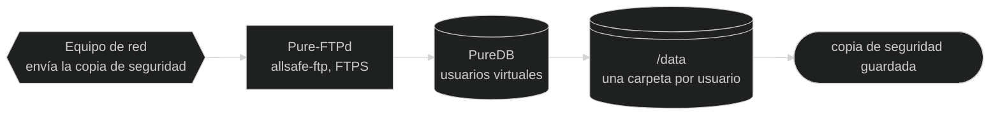

# 📚 Documentación — allsafe-ftp-stack

[-6e7781?style=for-the-badge)](../pt-BR/README.md)

↩ [README del proyecto](../../README.es.md)

## 💡 En pocas palabras

Esta carpeta explica la stack **como es hoy**: cómo instalar, configurar, operar y reparar el servidor FTP que recibe la copia de seguridad de los equipos de red, el panel web que administra sus usuarios y el nginx, que queda delante del panel. Cada guía comienza con un resumen para quien nunca vio el proyecto y guarda el detalle técnico en menús plegados. Lo que todavía va a cambiar queda en el plan, no aquí.

<!-- diagrama: diagramas/vision-general-diagrama.mmd -->

Nivel 1 · Diagrama · [fuente](diagramas/)

**Secuencia:** Equipo de red ➜ Pure-FTPd (`allsafe-ftp`) ➜ PureDB ➜ `/data` ➜ copia de seguridad guardada

> 🧱 **Uso solo en red privada:** por defecto, IP privada, detrás de firewall, fuera de internet. Dirección pública solo por una opción explícita, con alerta. Vea [Seguridad](seguridad.md#rede-privada).

---

Índice — haga clic para expandir

[Guías](#guias) · [Por dónde empezar](#por-onde-comecar) · [Dónde quedan los datos](#onde-ficam-os-dados) · [Diagramas](#diagramas) · [Imágenes](#imagens) · [Plan](#plano)

---

## 📖 Guías

| N.º | Guía | Tema |
|---|---|---|
| 1 | [Instalación](instalacion.md) | Requisitos previos, paso a paso comentado, primera validación y cómo deshacer |
| 2 | [Configuración](configuracion.md) | Todas las variables del `.env`: nombre, para qué sirve, valores válidos y valor por defecto |
| 3 | [Perfiles](perfiles.md) | Perfiles `small`, `medium`, `large`, `xlarge` y `extended`: dimensionamiento por porte, lo que el servidor debe tener y el impacto en el rango pasivo |
| 4 | [Arquitectura](arquitectura.md) | Contenedores, imágenes, entrypoints, volúmenes, red y las opciones del `pure-ftpd` |
| 5 | [Seguridad](seguridad.md) | Red privada y firewall, la opción de IP pública y su alerta, solo el panel publicado por proxy o túnel, el modo sin TLS para equipo antiguo, las buenas prácticas antes de producción en flujograma, las pruebas ejecutadas en cada versión, modelo de amenaza, superficie expuesta, protecciones del panel y del nginx, conformidad con las RFC y el endurecimiento del Compose línea por línea |
| 6 | [Secretos](secretos.md) | Lo que queda en `.secrets/`, quién genera cada archivo y cómo cambiar las contraseñas del FTP y del panel |
| 7 | [Scripts](scripts.md) | Qué hace cada script, parámetros y salida esperada |
| 8 | [Operación](operacion.md) | Usuarios, certificado real, logs y actualización de la imagen |
| 9 | [Copia de seguridad y restauración](backup.md) | Copia de seguridad en un comando, restauración verificada y reversible, qué guardar aparte, otro servidor, copia programada y copia en S3, desde el panel |
| 10 | [Panel web](panel.md) | Abrir el panel, qué hay en cada pestaña, usuarios desde el navegador, descarga de los archivos, contraseña, certificado, auditoría y protecciones |
| 11 | [Fotos de la aplicación](aplicacion/README.md) | Todas las pantallas del panel, menú por menú: la foto, para qué sirve, cómo llegar y qué hay en cada una |
| 12 | [Solución de problemas](solucion-de-problemas.md) | Síntoma, causa, cómo verificar y corrección |

---

## 🧭 Por dónde empezar

| Situación | Lea, en este orden |
|---|---|
| Primera vez | [Instalación](instalacion.md) ➜ [Panel web](panel.md) ➜ [Configuración](configuracion.md) ➜ [Perfiles](perfiles.md) |
| Crear la cuenta de un equipo | [Panel web](panel.md#usuarios) u [Operación](operacion.md#usuarios) |
| Descargar una copia de seguridad que envió un equipo | [Archivos y descarga](panel.md#arquivos) |
| Descargar los propios archivos con la cuenta del FTP | [Usuario del FTP en el panel](panel.md#usuario-ftp) |
| Crear una carpeta o elegir la carpeta de un usuario | [Usuarios desde el panel](panel.md#usuarios) ➜ [Archivos y descarga](panel.md#arquivos) |
| Ver las pantallas del panel antes de instalar | [Fotos de la aplicación](aplicacion/README.md) |
| Antes de producción | [Red privada y firewall](seguridad.md#rede-privada) ➜ [Buenas prácticas antes de producción](seguridad.md#boas-praticas) ➜ [Operación](operacion.md#certificado-real-de-producao) ➜ [Copia de seguridad y restauración](backup.md#automatica) |
| Equipo antiguo que no habla TLS | [Equipo sin TLS](seguridad.md#ftp-sem-tls) ➜ [Configuración](configuracion.md#tls) ➜ [Solución de problemas](solucion-de-problemas.md#ftp-sem-tls) |
| Cambiar el logo, entregar por contrato o vender | [Marca del panel](panel.md#marca) ➜ [Marca ALL-SAFE](../../MARCA.es.md) |
| Avisar de una falla de seguridad | [Política de seguridad](../../SECURITY.es.md) ➜ [Contacto de seguridad](configuracion.md#contato-de-seguranca) |
| Guardar o recuperar los datos | [Copia de seguridad y restauración](backup.md) |
| Algo se rompió | [Solución de problemas](solucion-de-problemas.md) |

---

## 💽 Dónde quedan los datos

| Qué | Dónde queda en el host | Dentro del contenedor |
|---|---|---|
| Archivos enviados por los equipos | `DATA_DIR/dados` | `/data` |
| Usuarios virtuales (PureDB) | `DATA_DIR/auth` | `/auth` |
| Clave y certificado TLS del FTP | `DATA_DIR/certs` | `/etc/ssl/private` en el FTP; `/certs` en el panel, solo lectura |
| Certificado, administradores y auditoría del panel | `DATA_DIR/painel` | `/painel` |
| Socket del panel y copia del certificado, para el nginx (rehechos en cada arranque) | `DATA_DIR/nginx` | `/nginx` |
| Contraseña del usuario inicial | `.secrets/ftp-usuario-inicial-senha.txt`, en la carpeta del proyecto | `/run/secrets/ftp_usuario_inicial_senha` (solo lectura) |
| Contraseña inicial del panel, solo el hash | `.secrets/painel-admin-inicial-senha-hash.txt`, en la carpeta del proyecto | `/run/secrets/painel_admin_inicial_senha_hash` (solo lectura) |
| Clave pública de la copia del sistema | `.secrets/backup-chave-publica.txt`, en la carpeta del proyecto | `/run/secrets/backup_chave_publica` (solo lectura), en el panel |
| Configuración | `.env`, en la carpeta del proyecto | variables de entorno |
| Logs | driver `local` de Docker, 10 MB × 3 | `stdout` |

`DATA_DIR` es una carpeta del host definida en el `.env` (por defecto `/srv/allsafe-ftp-stack/data`). Las copias de seguridad van cifradas a `BACKUP_DIR` ([Copia de seguridad y restauración](backup.md)) y los temporales a `TEMP_DIR`: vea [Configuración](configuracion.md#pastas-e-nomes). La stack no crea volumen con nombre.

---

## 📐 Diagramas

Todo diagrama aparece en las guías directo de la fuente `.mmd`, con fondo oscuro y con los **controles de acercar y mover** en la esquina del propio diagrama. En la carpeta [`diagramas/`](diagramas/) queda la fuente de cada uno y el [`visualizador.html`](diagramas/visualizador.html). Las imágenes SVG (oscura, `<nome>.svg`, y de fondo blanco, `<nome>-claro.svg`) **no van al repositorio**: se generan en la computadora, quedan solo en la carpeta local y el visualizador abre cualquiera de ellas, también con zoom y movimiento. Quien solo lee no las necesita: el bloque del diagrama en cada guía ya viene de la fuente.

| Diagrama | Nivel | Dónde aparece |
|---|---|---|
| [vision-general-diagrama.mmd](diagramas/vision-general-diagrama.mmd) | 1 | [README del proyecto](../../README.es.md) y este índice |
| [funcionamiento-flujograma.mmd](diagramas/funcionamiento-flujograma.mmd) | 2 | [README del proyecto](../../README.es.md#como-funciona) |
| [arquitectura-mapa.mmd](diagramas/arquitectura-mapa.mmd) | 2 | [README del proyecto](../../README.es.md#arquitetura) y [Arquitectura](arquitectura.md) |
| [arranque-modelo.mmd](diagramas/arranque-modelo.mmd) | 3 | [Arquitectura](arquitectura.md#subida) |
| [instalacion-diagrama.mmd](diagramas/instalacion-diagrama.mmd) | 1 | [Instalación](instalacion.md) |
| [configuracion-diagrama.mmd](diagramas/configuracion-diagrama.mmd) | 1 | [Configuración](configuracion.md) y [Perfiles](perfiles.md) |
| [seguridad-diagrama.mmd](diagramas/seguridad-diagrama.mmd) | 1 | [Seguridad](seguridad.md) |
| [tls-por-usuario-flujograma.mmd](diagramas/tls-por-usuario-flujograma.mmd) | 2 | [Seguridad](seguridad.md#tls-por-usuario) |
| [bloqueo-por-intentos-flujograma.mmd](diagramas/bloqueo-por-intentos-flujograma.mmd) | 2 | [Seguridad](seguridad.md#bloqueio-por-tentativa) |
| [bloqueo-por-direccion-flujograma.mmd](diagramas/bloqueo-por-direccion-flujograma.mmd) | 2 | [Seguridad](seguridad.md#bloqueio-por-endereco) |
| [buenas-practicas-flujograma.mmd](diagramas/buenas-practicas-flujograma.mmd) | 2 | [Seguridad](seguridad.md#boas-praticas) |
| [secretos-diagrama.mmd](diagramas/secretos-diagrama.mmd) | 1 | [Secretos](secretos.md) |
| [scripts-diagrama.mmd](diagramas/scripts-diagrama.mmd) | 1 | [Scripts](scripts.md) |
| [usuarios-diagrama.mmd](diagramas/usuarios-diagrama.mmd) | 1 | [Operación](operacion.md) |
| [backup-diagrama.mmd](diagramas/backup-diagrama.mmd) | 1 | [Copia de seguridad y restauración](backup.md) |
| [backup-s3-diagrama.mmd](diagramas/backup-s3-diagrama.mmd) | 1 | [Copia en S3, desde el panel](backup.md#no-s3) |
| [panel-diagrama.mmd](diagramas/panel-diagrama.mmd) | 1 | [Panel web](panel.md) |
| [panel-flujograma.mmd](diagramas/panel-flujograma.mmd) | 2 | [README del proyecto](../../README.es.md#como-funciona) y [Panel web](panel.md#como-decide) |
| [panel-solicitudes-flujograma.mmd](diagramas/panel-solicitudes-flujograma.mmd) | 2 | [README del proyecto](../../README.es.md#como-funciona) y [Panel web](panel.md#como-decide) |
| [diagnostico-diagrama.mmd](diagramas/diagnostico-diagrama.mmd) | 1 | [Solución de problemas](solucion-de-problemas.md) |

---

## 📸 Imágenes

Las fotos son capturas reales del panel, en tema oscuro. En el Markdown, toda foto es clicable y abre el propio archivo en tamaño real; cada carpeta tiene un `visualizador.html` para abrir, acercar y mover las imágenes fuera de GitHub.

| Carpeta | Qué guarda | Dónde aparece | Visualizador |
|---|---|---|---|
| [`imagenes/`](imagenes/) | La imagen principal y una imagen de cada pestaña del panel | [README del proyecto](../../README.es.md#imagens) | [`visualizador.html`](imagenes/visualizador.html) |
| [`aplicacion/imagenes/`](aplicacion/imagenes/) | Las fotos de cada menú, formulario, rechazo y confirmación | [Fotos de la aplicación](aplicacion/README.md) | [`visualizador.html`](aplicacion/imagenes/visualizador.html) |

---

## 🗺️ Plan

El plan de creación y cambio de la stack (fases, pruebas, evidencias y progreso) **no se publica en este repositorio**: queda en la carpeta local `doc/planos/` y en un repositorio privado propio, solo del plan.

---

⬅️ [README del proyecto](../../README.es.md) · 🏠 [Documentación](README.md) · ➡️ [Instalación](instalacion.md)
