# 📸 Fotos de la aplicación — allsafe-ftp-stack

[-6e7781?style=for-the-badge)](../../pt-BR/aplicacao/README.md)

↩ [README del proyecto](../../../README.es.md) · [Índice de la documentación](../README.md)

## 💡 En pocas palabras

Todas las pantallas del panel web, menú por menú, con la foto de cada una y la explicación de lo que se puede hacer en ella. Las fotos son capturas reales de la versión **1.8.0**, en tema oscuro y en español, con usuarios de ejemplo, como `olt-centro`, `switch-core` y `roteador-borda`. El panel acompaña el tema claro u oscuro del sistema y también se abre en portugués y en inglés: vea [Idioma](#idioma). Haga clic en cualquier foto para abrirla en tamaño real.

El panel tiene una pantalla de entrada, ocho pestañas para quien administra (Visión general, Usuarios, Archivos, Destinos, Servidor, Seguridad, Bloqueos y Log) y una pantalla para el usuario del FTP, que cambia con el perfil de la cuenta: Mis archivos o Envío de archivos. Los administradores están en la pestaña Usuarios, junto con las cuentas del FTP. Cómo abrirlo, crear administradores y qué protege el panel está en [Panel web](../panel.md).

> 🧱 **Uso solo en red privada:** por defecto, el panel se abre solo en IP privada, detrás de un firewall, fuera de internet. Vea [Seguridad](../seguridad.md#rede-privada).

Índice — haga clic para expandir

[Entrar](#entrar) · [Visión general](#visao-geral) · [Usuarios](#usuarios) · [Administradores](#administradores) · [Archivos](#arquivos) · [Mis archivos](#meus-arquivos) · [Destinos](#destinos) · [Servidor](#servidor) · [Seguridad](#seguranca) · [Bloqueos](#bloqueios) · [Log](#atividade) · [Idioma](#idioma) · [Cómo se hicieron las fotos](#como-foram-feitas)

---

## 🚪 Entrar

<a href="imagenes/entrar.png">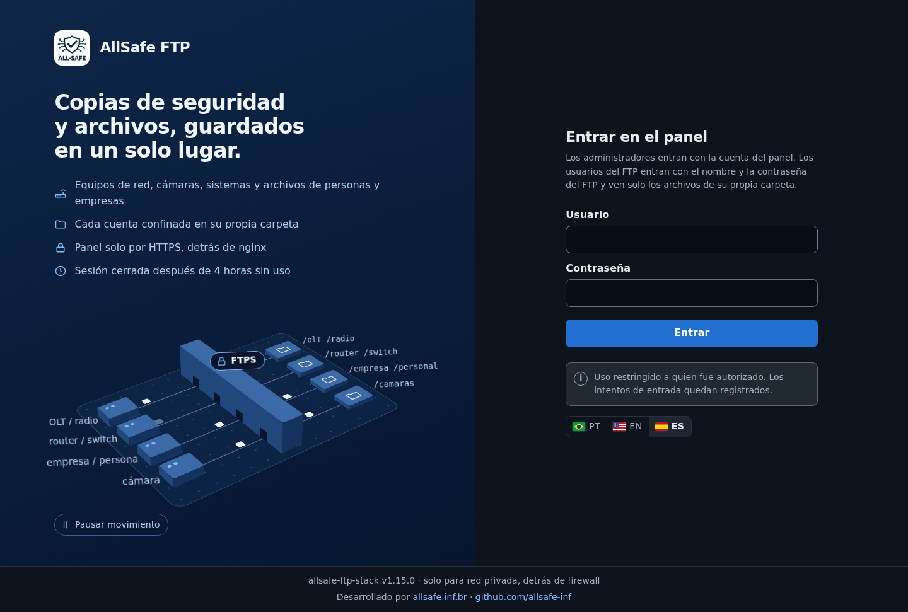</a>

<b>v1.9.0</b> · pantalla de entrada · captura del 2026-10-12

**Para qué sirve:** verificar el usuario y la contraseña antes de mostrar cualquier dato de la stack. Es la misma pantalla para quien administra y para el usuario del FTP.

**Cómo llegar:** abra `https://<endereço do painel>:8443` en el navegador. Sin sesión, cualquier dirección del panel lleva a esta pantalla.

| Elemento de la pantalla | Qué hace |
|---|---|
| **Usuario** | Recibe el nombre del administrador o el nombre del usuario del FTP. En la primera instalación, el administrador es el de `PAINEL_ADMIN_USER` (`admin`, si no se cambió) |
| **Contraseña** | Recibe la contraseña de la cuenta. La del primer administrador está en `.secrets/painel-admin-inicial-senha.txt`; la del usuario del FTP es la misma que usa el equipo |
| **Entrar** | Verifica la cuenta: el administrador va a la pestaña Visión general y el usuario del FTP, a la pantalla Mis archivos. La cuenta que ya tiene el segundo factor pasa antes por la pantalla [Código de verificación](#entrar); la que todavía no lo tiene, con el segundo factor obligatorio, por la pantalla [Registre el segundo factor](#entrar) |
| Texto debajo del título | Dice quién entra por esta pantalla. Con `PAINEL_ACESSO_USUARIOS_FTP=nao`, pasa a ser `Panel de administración de la stack.` |
| Nota debajo del botón | Recuerda que el uso está restringido a quien fue autorizado y que los intentos de entrada quedan registrados. La pantalla de entrada no dice cómo está publicada la instalación: eso solo lo lee el administrador, después de entrar |
| **PT** · **EN** · **ES** | Cambian el idioma de la pantalla antes de la entrada; la elección queda guardada en el navegador: vea [Idioma](#idioma) |
| Lado izquierdo | Presenta la stack: el lema, tres puntos (cada equipo confinado en su propia carpeta, panel solo por HTTPS y el tiempo de sesión sin uso) y la escena en la que router, switch, OLT y radio envían la copia de seguridad por FTPS a las carpetas. En pantalla estrecha, quedan solo el logo y el lema |
| **Pausar movimiento** | Detiene la animación de la escena y la reanuda; con el sistema configurado para reducir el movimiento, la escena ya se abre detenida |

Entrar ➜ Entrada rechazada — haga clic para expandir

### Entrar ➜ Entrada rechazada

<a href="imagenes/entrar-recusada.png">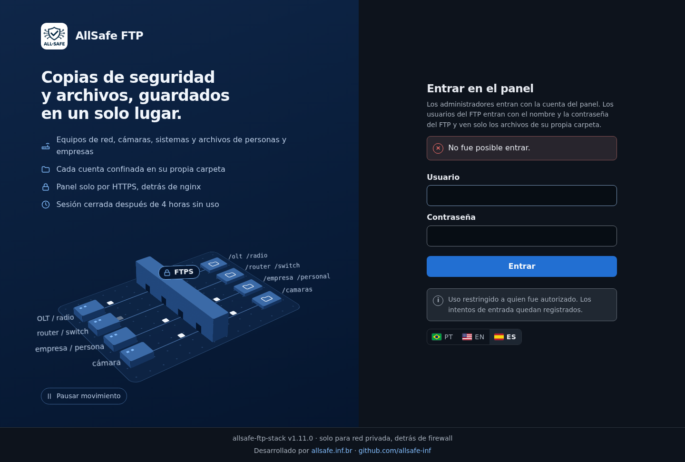</a>

<b>v1.9.0</b> · pantalla de entrada, entrada rechazada · captura del 2026-10-12

| Mensaje | Cuándo aparece | Qué hacer |
|---|---|---|
| No fue posible entrar. | El usuario o la contraseña son incorrectos; la pantalla no dice cuál de los dos | Verificar los dos campos e intentarlo de nuevo |
| Demasiados intentos. Espere unos minutos e inténtelo de nuevo. | Cinco entradas incorrectas desde la misma dirección en 15 minutos | Esperar a que pase el bloqueo; la cuenta correcta también es rechazada mientras dura |
| La página expiró. Inténtelo de nuevo. | La pantalla quedó abierta demasiado tiempo antes del envío | Enviar de nuevo |
| dirección bloqueada por exceso de errores de usuario y contraseña | La dirección está en la lista de la pestaña Bloqueos: por defecto, pasó de 5 errores de usuario y contraseña en 24 horas, en el FTP o en el panel. Es un texto plano, sin la pantalla de entrada, en cualquier dirección del panel | Pedir el desbloqueo a un administrador: vea [Bloqueos](#bloqueios) |

Entrar ➜ Registre el segundo factor — haga clic para expandir

### Entrar ➜ Registre el segundo factor

<a href="imagenes/entrar-cadastro.png">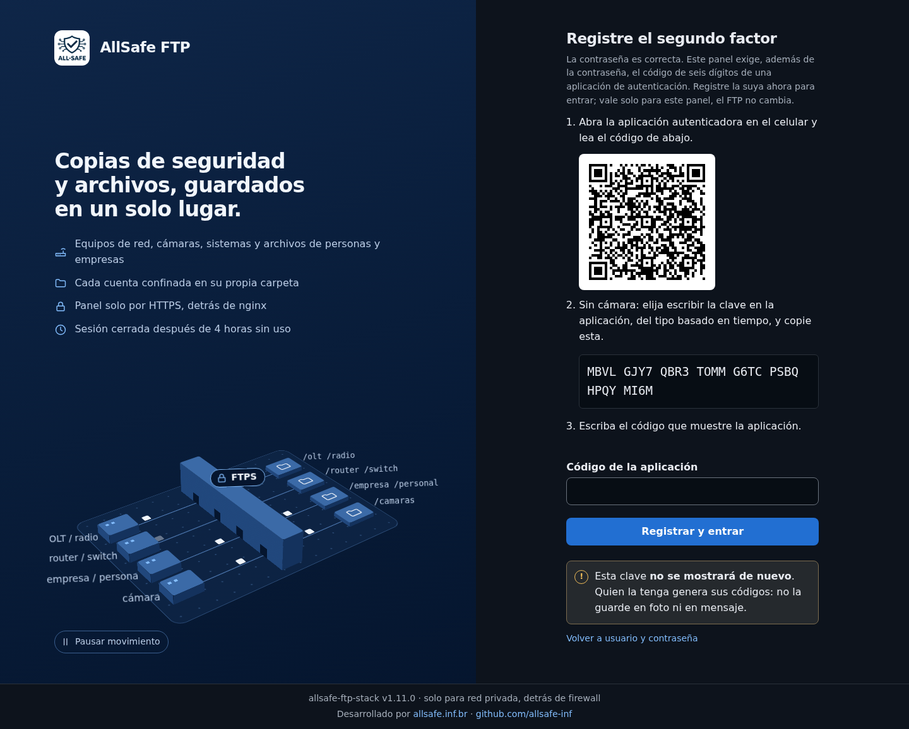</a>

<b>v1.9.0</b> · pantalla de entrada, registro del segundo factor, con una clave de ejemplo que no se guardó · captura del 2026-10-12

Con `PAINEL_SEGUNDO_FATOR_OBRIGATORIO=sim`, que es el valor por defecto, aparece justo después de la contraseña para toda cuenta que todavía no registró una aplicación autenticadora, administrador o usuario del FTP: la contraseña correcta no abre el panel, lleva a esta pantalla. Sirve cualquier aplicación de código por tiempo (TOTP). Vale solo para la entrada en este panel: el FTP no cambia.

| Elemento de la pantalla | Qué hace |
|---|---|
| Código QR | Es la clave, para que la aplicación la lea por la cámara. La cuenta aparece en él como `AllSafe FTP:<conta>@<endereço do painel>` |
| Clave en grupos | La misma clave, para escribirla en la aplicación cuando no hay cámara, eligiendo el tipo basado en tiempo |
| **Código de la aplicación** | Recibe los seis dígitos que la aplicación pasó a mostrar: es la prueba de que leyó la clave |
| **Registrar y entrar** | Guarda la clave, cierra las otras sesiones de la cuenta y abre el panel: la pestaña Visión general para el administrador, la pantalla Mis archivos para el usuario del FTP |
| **Volver a usuario y contraseña** | Vuelve a la pantalla de entrada sin registrar nada |

**Resultado esperado:** el panel se abre, y las próximas entradas de la cuenta pasan por la pantalla Código de verificación, abajo.

| Mensaje | Cuándo aparece | Qué hacer |
|---|---|---|
| El código no coincide con la clave de esta pantalla. Revise la hora del celular, espere el próximo código e inténtelo de nuevo. | El código escrito no es el de la clave mostrada. No se guarda nada, la pantalla vuelve con la misma clave y el error no cuenta como error de usuario y contraseña | Esperar el próximo código. Si continúa, verificar la hora del celular |
| La página expiró. Inténtelo de nuevo. | La pantalla quedó abierta demasiado tiempo antes del envío | Enviar de nuevo |
| Demasiados intentos. Espere unos minutos e inténtelo de nuevo. | Cinco entradas incorrectas desde la misma dirección en 15 minutos, sumando contraseñas y códigos | Esperar |

Después de 10 minutos sin el primer código, la pantalla de entrada vuelve, sin mensaje, y la clave mostrada se descarta: la entrada siguiente muestra otra.

> ⚠️ **La clave aparece solo en esta pantalla, hasta ser confirmada.** Quien la tenga genera los códigos de la cuenta: no la guarde en una foto ni en un mensaje. Hasta que la cuenta registre su aplicación, quien sepa la contraseña hace el registro: vea [Panel web](../panel.md#segundo-fator).

Entrar ➜ Código de verificación — haga clic para expandir

### Entrar ➜ Código de verificación

<a href="imagenes/entrar-codigo.png">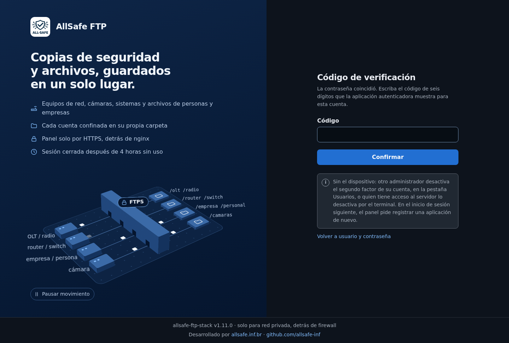</a>

<b>v1.9.0</b> · pantalla de entrada, código del segundo factor · captura del 2026-10-12

Aparece para toda cuenta que ya tiene el [segundo factor](#segundo-fator), administrador o usuario del FTP: la contraseña correcta no abre el panel, lleva a esta pantalla. La cuenta que todavía no lo tiene, con el segundo factor obligatorio, pasa por la pantalla Registre el segundo factor, arriba; con `PAINEL_SEGUNDO_FATOR_OBRIGATORIO=nao`, entra solo con la contraseña.

| Elemento de la pantalla | Qué hace |
|---|---|
| **Código** | Recibe los seis dígitos que la aplicación autenticadora muestra para esta cuenta ahora |
| **Confirmar** | Verifica el código y abre el panel: la pestaña Visión general para el administrador, la pantalla Mis archivos para el usuario del FTP |
| Nota debajo del botón | Dice la salida de quien está sin el dispositivo: para el administrador, otro administrador desactiva el segundo factor de la cuenta, en la pestaña Usuarios, o quien tiene acceso al servidor lo desactiva por la terminal; para el usuario del FTP, lo desactiva el administrador. Con el segundo factor obligatorio, recuerda que la entrada siguiente pide registrar una aplicación de nuevo |
| **Volver a usuario y contraseña** | Vuelve a la pantalla de entrada sin abrir el panel |

| Mensaje | Cuándo aparece | Qué hacer |
|---|---|---|
| El código no coincide. Espere a que la aplicación muestre el próximo e inténtelo de nuevo. | El código es incorrecto, ya venció o ya se usó una vez | Esperar el próximo código. Si continúa, verificar la hora del celular |
| No fue posible entrar. | Cinco códigos incorrectos seguidos: la espera del código termina y la pantalla de entrada vuelve. Después de cinco minutos sin el código, la pantalla de entrada también vuelve, sin mensaje | Entrar de nuevo con usuario y contraseña, pasado el bloqueo de la dirección |
| Demasiados intentos. Espere unos minutos e inténtelo de nuevo. | Cinco entradas incorrectas desde la misma dirección en 15 minutos, sumando contraseñas y códigos, o diez códigos rechazados para la misma cuenta en 15 minutos, desde cualquier dirección | Esperar, o pedir a un administrador que desactive el segundo factor de la cuenta |
| El segundo factor de esta cuenta está activado, pero su secreto no está en el servidor. Un administrador o quien tiene acceso al servidor necesita desactivarlo. | La clave de la cuenta no está en `.secrets/segundo-fator/`: es el caso del servidor restaurado de una copia de seguridad | Desactivar el segundo factor de la cuenta y registrarlo de nuevo: vea [Panel web](../panel.md#segundo-fator) |

El código incorrecto cuenta como error de usuario y contraseña de la dirección, igual que la contraseña incorrecta.

Detalle técnico — entrada y sesión

- La ruta `GET /entrar` muestra el formulario; `POST /entrar` verifica primero la cuenta de administrador, por el hash `scrypt` de `DATA_DIR/painel/administradores`, y después, si la entrada de los usuarios del FTP está activada, la cuenta del FTP, por un inicio de sesión en el propio servidor FTP.
- Respuesta `401` para usuario o contraseña incorrectos, `429` para dirección bloqueada y `400` para formulario expirado. Cada caso escribe `entrada_falha` o `entrada_bloqueada` en la [auditoría](../panel.md#auditoria), sin el nombre escrito.
- Con el segundo factor activado, el `POST /entrar` con la contraseña correcta no crea sesión: escribe `entrada_senha_ok` y lleva a `GET /entrar/codigo`, con la cookie `__Host-etapa` (`Secure`, `HttpOnly`, `SameSite=Strict`), que vale 5 minutos y solo desde la misma dirección. El `POST /entrar/codigo` responde `401` para el código incorrecto (`entrada_codigo_recusado`), `429` para la cuenta en pausa y `503` para la cuenta activada sin la clave en el servidor (`entrada_fator_sem_segredo`); la sesión solo nace con el código aceptado.
- Con `PAINEL_SEGUNDO_FATOR_OBRIGATORIO=sim`, la cuenta que todavía no tiene el segundo factor tampoco obtiene sesión con la contraseña correcta: el `POST /entrar` escribe `entrada_senha_ok` y lleva a `GET /entrar/cadastro`, con la misma cookie `__Host-etapa`, que aquí vale 10 minutos. La clave mostrada queda solo en la memoria de esa espera y se guarda en el `POST /entrar/cadastro` que trae el primer código correcto; este escribe `fator_cadastrado_na_entrada`, cierra las otras sesiones y esperas de la cuenta y abre la sesión. El código incorrecto recibe `400`, sin evento y sin contar para el bloqueo de la dirección. La espera de un camino no sirve al otro: la del registro no verifica código y la del código no registra; fuera de su camino, la espera se cierra y la respuesta vuelve a `/entrar`.
- La dirección de la lista de bloqueos recibe `403` en texto plano en toda ruta, incluso con la sesión abierta, con el evento `recusa_endereco`: vea [Bloqueo por dirección](../seguridad.md#bloqueio-por-endereco).
- La entrada con la cuenta del FTP tarda algunos segundos: es el tiempo que el servidor FTP gasta en verificar la contraseña. Vea [Usuario del FTP en el panel](../panel.md#usuario-ftp).
- La sesión queda en la cookie `__Host-sessao` (`Secure`, `HttpOnly`, `SameSite=Strict`) y se cierra con 4 horas sin uso o en 12 horas, lo que ocurra antes.
- El envío solo se acepta cuando parte del propio panel: el encabezado `Origin` tiene que ser la dirección del panel. Detalles en [Panel web](../panel.md#protecoes).

---

## 📊 Visión general

<b>v1.9.0</b> · menú Visión general · captura del 2026-10-12

**Para qué sirve:** ver de una vez si el FTP está en marcha y qué datos escribir en el equipo que va a enviar la copia de seguridad.

**Cómo llegar:** es la primera pantalla del administrador después de la entrada; menú ➜ **Visión general**.

| Elemento de la pantalla | Qué muestra |
|---|---|
| **Servidor FTP** | `En servicio` o `Fuera de servicio`, y el modo de TLS en uso, con atajo a la pestaña Seguridad |
| **Usuarios** | Cantidad de usuarios del FTP, con atajo a la pestaña Usuarios |
| **Espacio usado** | Suma de las carpetas de los usuarios y el espacio libre en el disco, con atajo a las carpetas, en la pestaña Archivos |
| **Último envío** | Fecha del archivo más nuevo entre todas las carpetas, con atajo a la pestaña Archivos |
| **Certificado del FTP** | La fecha en que vence el certificado y cuántos días faltan, con atajo a la huella digital, en la pestaña Seguridad |
| **Servidor y contenedores** | Procesador y memoria del servidor entero y de los tres contenedores de la stack, en uso y asignados, con atajo a la pestaña Servidor |
| **Archivos recibidos por día** | Una columna por día de los últimos 14 días, con el total del período encima. Cuenta lo que está en las carpetas ahora, por la fecha de cada archivo: lo que se borró o se sustituyó no entra |
| **Último envío por usuario** | Los usuarios divididos por la fecha del archivo más nuevo de la carpeta de cada uno: en las últimas 24 horas, entre 1 y 7 días, hace más de 7 días y sin archivo en la carpeta. Debajo, la lista de quienes llevan más de 7 días sin enviar, con atajo a la pestaña Usuarios |
| **Espacio por carpeta** | Las carpetas que más ocupan, de la mayor a la menor, cada una con la barra, el tamaño y la cantidad de archivos, y el atajo a la carpeta en la pestaña Archivos |
| **Actividad reciente** | Los seis últimos registros del panel, con la hora y la dirección de quien lo hizo, y el atajo a la pestaña Log |
| **Datos para configurar el equipo** | Servidor, puerto de control, puertos pasivos, protocolo y de dónde viene el usuario: lo que hay que rellenar en el equipo |
| Menú de todas las pantallas | A la izquierda, en pantalla de 1280 px de ancho o más: el símbolo y el nombre, las ocho pestañas en dos grupos (**Operación** y **Sistema**), cada una con su ícono y la pestaña en uso marcada, y, debajo, los botones de idioma **PT**, **EN** y **ES**, el nombre y el papel de quien entró y el botón **Salir**. En pantalla más estrecha, el menú se convierte en una franja arriba, con las pestañas en una línea que se desplaza hacia el lado. Con la instalación publicada, una señal de alerta queda al lado de **Seguridad** |
| Título de cada pestaña | El nombre de la pestaña y una frase que dice para qué sirve |
| Pie de página de todas las pantallas | La versión de la stack, el recordatorio de red privada (o, solo para el administrador, cómo está publicada la instalación), la autoría y la dirección del repositorio oficial |

Nada se modifica desde esta pestaña.

Visión general ➜ Alerta de usuario sin TLS — haga clic para expandir

### Visión general ➜ Alerta de usuario sin TLS

<a href="imagenes/visao-geral-alerta-tls.png">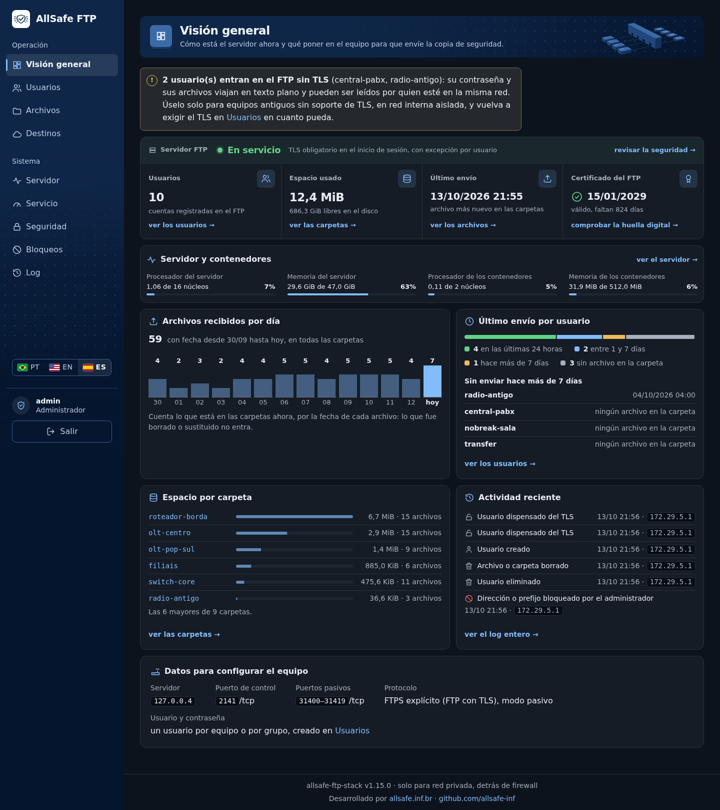</a>

<b>v1.9.0</b> · menú Visión general, alerta de usuario sin TLS · captura del 2026-10-12

| Alerta al comienzo de la pantalla | Cuándo aparece | Cómo desaparece |
|---|---|---|
| Cuántos y cuáles usuarios entran en el FTP sin TLS | Con al menos un usuario dispensado del TLS | Cuando el último vuelve a estar obligado a usar TLS, en [Usuarios ➜ Exigir TLS](#usuarios) |
| El FTP acepta contraseña y archivo en texto plano | Con `FTP_TLS_MODE` en `0` o `1` | Cuando la variable vuelve a `2` o `3` |

La misma alerta abre la pestaña Seguridad. Las condiciones para dispensar a un usuario están en [TLS por usuario](../seguridad.md#tls-por-usuario) y las del FTP sin TLS, en [Equipo sin TLS](../seguridad.md#ftp-sem-tls).

Detalle técnico — de dónde viene cada número

- Ruta `GET /`.
- `En servicio` es la respuesta del puerto de control del servicio `ftp`, por la red interna de la stack (`ftp:2121`).
- Los usuarios vienen del registro del FTP (`DATA_DIR/auth`); el espacio, la cantidad de archivos y el último envío se leen de `DATA_DIR/dados`.
- La tarjeta **Servidor y contenedores** muestra las mismas lecturas de la [pestaña Servidor](#servidor).
- Servidor, puerto y rango pasivo son los valores de `FTP_PASSIVE_IP`, `FTP_PORT` y `FTP_PASSIVE_PORT_*` del `.env`: vea [Configuración](../configuracion.md#rede-e-portas).

---

## 👥 Usuarios

<b>v1.9.0</b> · menú Usuarios · captura del 2026-10-12

**Para qué sirve:** crear la cuenta de cada equipo o persona, elegir su perfil, elegir y cambiar la carpeta en la que queda confinada, cambiar la contraseña, dar límites propios, permitir el envío de archivos por el panel, activar la limpieza automática de los archivos antiguos, quitar el bloqueo por contraseña incorrecta y eliminar la cuenta, con o sin la carpeta, sin línea de comandos. Es también donde están los administradores del panel.

**Cómo llegar:** menú ➜ **Usuarios**.

| Elemento de la pantalla | Qué hace |
|---|---|
| **Nuevo usuario** | Abre el formulario de registro, de usuario del FTP o de administrador |
| Usuario y perfil | Nombre de la cuenta y, debajo, su perfil: Administrador, Completo, Envío, Solo envío o Lectura. La etiqueta `inicial` marca al usuario creado en la instalación (`FTP_USER`) |
| Filas de administrador | Quedan al comienzo de la lista, sin carpeta ni TLS, con la etiqueta `usted` en la cuenta en uso: vea [Administradores](#administradores) |
| Carpeta | Dónde quedan los archivos de ese usuario en el servidor. La dirección abre la carpeta en la pestaña Archivos |
| Etiqueta `compartida` | La carpeta es alcanzada por más de un usuario: cada uno toca los archivos del otro hasta donde su perfil lo permite |
| Etiqueta `límites` | El usuario tiene un límite propio, guardado en **Editar**; al pasar el mouse, aparece cada uno |
| Etiqueta `limpieza` | La limpieza automática está activada para el usuario, en **Editar**: el panel borra por sí solo los archivos antiguos de su carpeta; al pasar el mouse, aparece la regla |
| Etiqueta `bloqueado` | El FTP está rechazando al usuario por demasiadas contraseñas incorrectas venidas de una dirección; sale por sí sola al final del plazo, o en **Editar** |
| Uso · Archivos · Último envío | Espacio ocupado, cantidad de archivos y fecha del envío más reciente |
| Columna TLS · **Dispensar del TLS** · **Exigir TLS** | Cómo entra el usuario en el FTP y el camino para cambiarlo: vea [Usuarios ➜ TLS por usuario](#usuarios) |
| **Editar** | Abre la pantalla del usuario, con el cambio del perfil y de la carpeta, los límites propios, la limpieza automática y los bloqueos |
| **Cambiar contraseña** | Abre el formulario de cambio de contraseña de ese usuario |
| **Segundo factor** | Solo aparece en la fila del usuario que ya registró el segundo factor en la entrada del panel: abre la pantalla que desactiva el suyo. Vea [Segundo factor del usuario del FTP](#segundo-fator) |
| **Eliminar** | Abre la confirmación de eliminación de ese usuario, incluso el inicial |
| **Cómo funcionan los perfiles y las etiquetas** | Plegado debajo de la lista: explica cada perfil, dice en qué carpeta del servidor quedan confinados los usuarios y qué quieren decir las etiquetas `compartida`, `límites`, `limpieza`, `bloqueado` y `sin TLS` |

El usuario inicial tiene la contraseña y la carpeta cambiadas y se elimina como los demás. Eliminado, no vuelve en los próximos arranques del FTP; para tenerlo de nuevo, cree un usuario con el mismo nombre. La contraseña cambiada aquí vale hasta que se modifique el archivo `.secrets/ftp-usuario-inicial-senha.txt`. Vea [Secretos](../secretos.md#trocar-a-senha).

El perfil decide qué hace la cuenta, en el FTP y en el panel:

| Perfil | En el FTP | En el panel |
|---|---|---|
| Administrador | No es cuenta del FTP | Todas las pestañas: vea [Administradores](#administradores) |
| Completo | Lista, descarga, envía, crea carpetas, cambia el nombre, borra y sobrescribe | Pantalla Mis archivos: navega, descarga, crea carpetas, cambia el nombre y borra; con el permiso, envía archivos |
| Envío | Lista, descarga, envía y crea carpetas. No borra, no cambia el nombre y no sobrescribe lo que ya llegó | Pantalla Mis archivos: navega, descarga y crea carpetas; con el permiso, envía archivos |
| Solo envío | Envía y crea carpetas. No lista ni descarga nada, ni siquiera lo que él mismo envió | Pantalla Envío de archivos: los datos para enviar por FTP; con el permiso, envía archivos por ella |
| Lectura | Solo lista y descarga | Pantalla Mis archivos: navega y descarga; no envía |

El permiso de enviar archivos por el panel se da usuario por usuario, en la tarjeta **Límites** de la pantalla **Editar**: vea [Usuarios ➜ Límites](#usuarios). Sin él, la cuenta solo envía por FTP.

La pantalla de cada perfil está en [Mis archivos](#meus-arquivos); las reglas, la carpeta compartida y lo que cambia en el cambio, en [Panel web](../panel.md#perfis).

Usuarios ➜ Nuevo usuario — haga clic para expandir

### Usuarios ➜ Nuevo usuario

<a href="imagenes/usuarios-novo.png">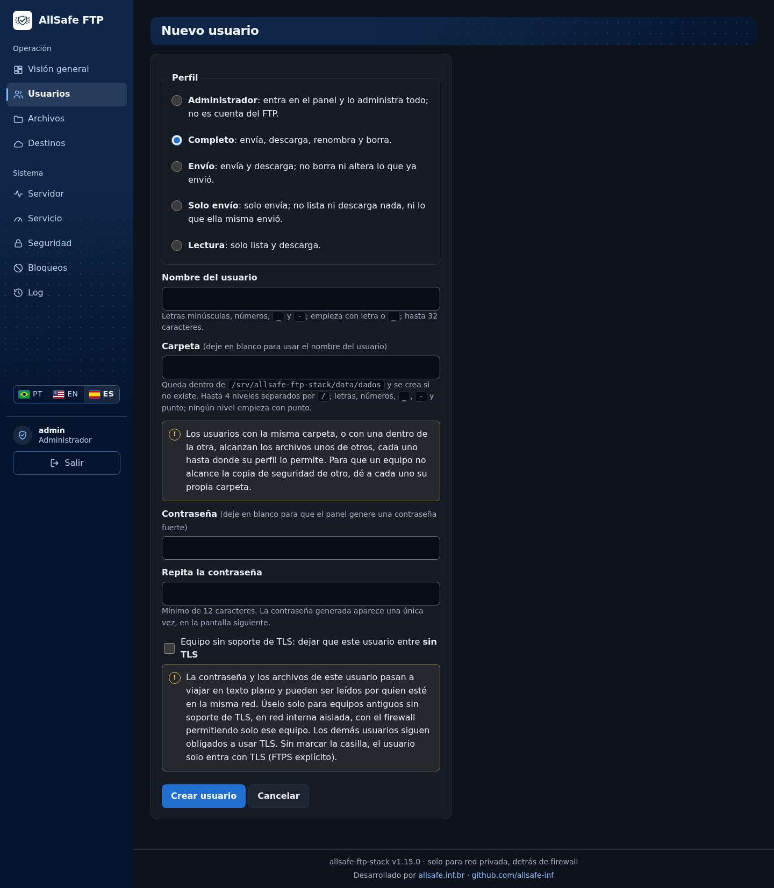</a>

<b>v1.9.0</b> · menú Usuarios, formulario Nuevo usuario · captura del 2026-10-12

| Campo | Obligatorio | Qué rellenar |
|---|---|---|
| Perfil | Sí | Completo, Envío, Solo envío o Lectura, para la cuenta del FTP. Administrador registra a quien administra el panel: vea [Administradores ➜ Nuevo administrador](#administradores) |
| Nombre del usuario | Sí | Letras minúsculas, números, `_` y `-`; empieza con letra o `_`; hasta 32 caracteres |
| Carpeta | No | En blanco, es el nombre del usuario. Elegida, queda dentro de `DATA_DIR/dados`, con hasta 4 niveles separados por `/`, y se crea si no existe. El campo sugiere las carpetas que ya existen |
| Contraseña | No | 12 caracteres o más. En blanco, el panel genera una contraseña fuerte |
| Repita la contraseña | Solo con la contraseña rellenada | La misma contraseña |
| Casilla **Equipo sin soporte de TLS** | No | Marque solo para el equipo antiguo que no habla TLS: el usuario ya nace dispensado. Sin marcar, solo entra con TLS |

**Resultado esperado:** la lista vuelve con el mensaje `Usuario creado.` y el usuario ya entra por FTPS, sin reiniciar el FTP, confinado en la carpeta elegida y con el perfil elegido.

> ⚠️ **Carpeta compartida:** dos usuarios con la misma carpeta, o con una dentro de la otra, alcanzan los archivos uno del otro, cada uno hasta donde su perfil lo permite. En la lista de usuarios del comienzo de esta sección, `filiais/olt-norte` queda dentro de `filiais`, la carpeta de una cuenta de consulta, de perfil Lectura, y las dos llevan la etiqueta `compartida`: la cuenta de consulta descarga lo que la OLT envió y no escribe ni borra nada. Para que un equipo no alcance la copia de seguridad de otro, dé a cada uno su propia carpeta.

Usuarios ➜ Nuevo usuario rechazado — haga clic para expandir

### Usuarios ➜ Nuevo usuario rechazado

<a href="imagenes/usuarios-novo-recusado.png">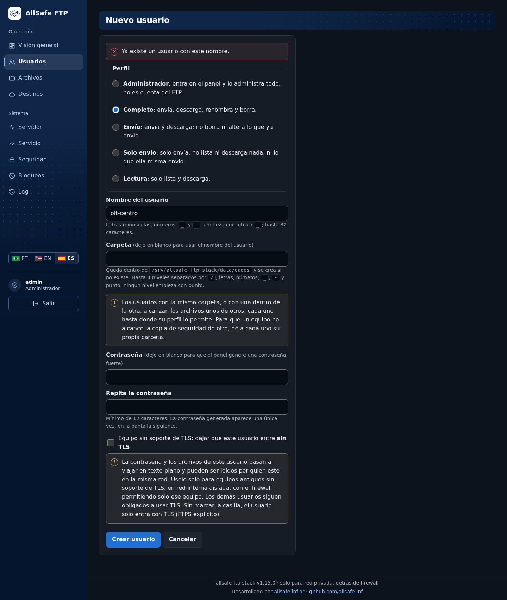</a>

<b>v1.9.0</b> · menú Usuarios, registro rechazado · captura del 2026-10-12

El panel devuelve el formulario con el motivo en la parte superior y no se crea nada.

| Mensaje | Motivo |
|---|---|
| Nombre no válido. Vea la regla debajo del campo. | El nombre se sale de la regla de letras, números, `_` y `-` |
| Ya existe un usuario con este nombre. | El nombre ya está en uso |
| Carpeta no válida. Vea la regla debajo del campo. | La carpeta se sale de la regla, tiene más de 4 niveles o un nivel empieza con punto |
| Las dos contraseñas no son iguales. | Los dos campos de contraseña difieren |
| La contraseña debe tener de 12 a 128 caracteres. | Contraseña demasiado corta o demasiado larga |

Una carpeta que pasa por un enlace simbólico, o por un nombre que ya es de un archivo, también se rechaza, con el motivo en la misma franja.

Usuarios ➜ Contraseña generada por el panel — haga clic para expandir

### Usuarios ➜ Contraseña generada por el panel

<a href="imagenes/usuarios-senha-gerada.png">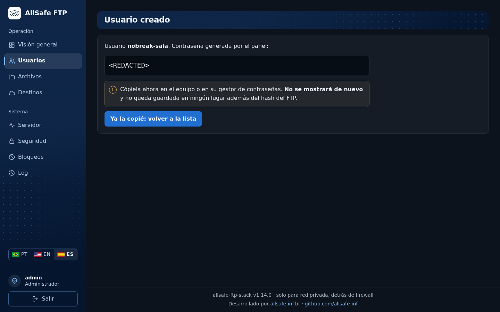</a>

<b>v1.9.0</b> · menú Usuarios, contraseña generada · captura del 2026-10-12

Aparece cuando los dos campos de contraseña quedan en blanco, en el registro o en el cambio de contraseña. La contraseña se muestra **una única vez**: cópiela al equipo o al gestor de contraseñas antes de salir de la pantalla. En la foto, el valor fue cambiado por `<REDACTED>`.

Usuarios ➜ Editar — haga clic para expandir

### Usuarios ➜ Editar

<b>v1.9.0</b> · menú Usuarios, pantalla Editar usuario · captura del 2026-10-12

Reúne lo que cambia en un usuario sin crearlo de nuevo. El nombre no cambia: es con él que el equipo entra en el FTP.

| Tarjeta | Qué hace |
|---|---|
| Parte superior | Muestra el usuario, lleva a **Cambiar contraseña** y vuelve a la lista |
| **Bloqueos** | Solo aparece cuando el FTP está rechazando al usuario por demasiadas contraseñas incorrectas: vea [Usuarios ➜ Bloqueos](#usuarios) |
| **Perfil** | Muestra el perfil de la cuenta y lo cambia por otro de los cuatro del FTP |
| **Carpeta** | Muestra la carpeta actual, con la cantidad de archivos y el espacio ocupado, y cambia la carpeta del usuario |
| **TLS** | Dice si el usuario entra con o sin TLS y lleva a la confirmación del cambio: vea [Usuarios ➜ TLS por usuario](#usuarios) |
| **Límites** | Guarda los límites propios del usuario y el permiso de enviar archivos por el panel: vea [Usuarios ➜ Límites](#usuarios) |
| **Limpieza automática** | Activa, cambia y desactiva la regla que borra por sí sola los archivos antiguos de la carpeta del usuario: vea [Usuarios ➜ Limpieza automática](#usuarios) |

**Cambio de perfil:** marque el perfil y haga clic en **Guardar perfil**. La lista vuelve con el mensaje `Perfil cambiado. Vale en la próxima entrada del usuario en el FTP.` El cambio cierra la sesión del usuario en el panel; la sesión de FTP que ya está abierta sigue con el perfil anterior hasta salir. La tarjeta recuerda dos cuidados:

- **Envío:** el archivo pasa a ser del servidor en cuanto termina de llegar, y de ahí en adelante el usuario no lo borra, no le cambia el nombre y no lo sobrescribe. Un equipo que envía siempre con el mismo nombre de archivo necesita el perfil Completo.
- **Solo envío:** un nombre repetido no sustituye al anterior, y el nuevo se guarda con la fecha y la hora en el nombre. Un equipo que envía con un nombre temporal y lo cambia al final, o que verifica el envío listando la carpeta, necesita otro perfil.

Administrador no está entre las opciones: administrador y usuario del FTP son registros separados, y pasar de uno a otro es eliminar la cuenta y crear la otra.

| Campo de la tarjeta Carpeta | Obligatorio | Qué rellenar |
|---|---|---|
| Carpeta nueva | Sí | La misma regla del registro: dentro de `DATA_DIR/dados`, con hasta 4 niveles separados por `/`; se crea si no existe |

**Resultado esperado:** después de **Cambiar carpeta**, la lista vuelve con el mensaje `Carpeta cambiada. Los archivos de la carpeta anterior siguen en ella.` El usuario entra en la carpeta nueva en el próximo inicio de sesión en el FTP, y su sesión en el panel se cierra. Con la limpieza automática activada, el cambio desactiva la regla, que era de la carpeta anterior, y el mensaje termina con `La limpieza automática se desactivó: la regla era de la carpeta anterior.`

| Mensaje | Motivo |
|---|---|
| Esta ya es la carpeta del usuario. | La carpeta nueva es igual a la actual |
| Carpeta no válida. Vea la regla debajo del campo. | La carpeta se sale de la regla, tiene más de 4 niveles o un nivel empieza con punto |

> ⚠️ **Los archivos no acompañan el cambio:** lo que estaba en la carpeta anterior sigue en ella, sin moverse ni borrarse, y el usuario deja de alcanzarlo.

Usuarios ➜ Límites — haga clic para expandir

### Usuarios ➜ Límites

<a href="imagenes/usuarios-limites-gravados.png">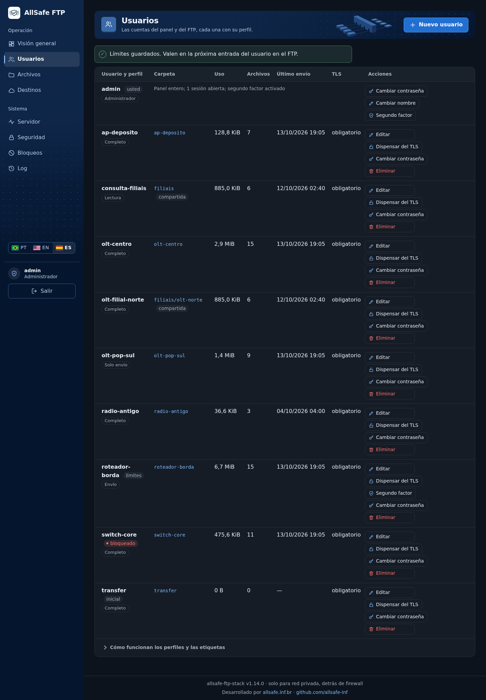</a>

<b>v1.9.0</b> · menú Usuarios, límites guardados · captura del 2026-10-12

La tarjeta **Límites** de la pantalla **Editar** vale solo para ese usuario, sea la cuenta de un equipo, que solo envía, sea la de una persona, que entra, envía y descarga. Campo en blanco quiere decir sin límite propio: vale el de la stack.

| Campo | Dónde vale | Qué rellenar |
|---|---|---|
| Sesiones al mismo tiempo en el FTP | FTP | De 1 al `FTP_MAX_CLIENTS` de la stack |
| Tasa de descarga, en KB por segundo | FTP y sus descargas por el panel | De 1 a 10.000.000 |
| Tasa de envío, en KB por segundo | FTP y sus envíos por el panel | De 1 a 10.000.000 |
| Horario en que el FTP acepta la entrada: desde las · hasta las | FTP y su entrada en el panel | Inicio y fin, en horas y minutos; puede pasar de la medianoche, como de `22:00` a `06:00` |
| Descargas al mismo tiempo por el panel | Panel | De 1 a 8; en blanco, 2 |
| Contraseñas incorrectas en el FTP hasta el bloqueo | FTP | De 1 a 100; `0`: este usuario nunca se bloquea; en blanco, el valor por defecto de la stack |
| Minutos de bloqueo | FTP | De 1 a 1440; en blanco, el valor por defecto de la stack |
| Casilla **Permitir que este usuario envíe archivos por el panel**, a su carpeta | Panel | Marcada, la cuenta envía archivos por su pantalla, además del FTP. Vale para los perfiles Completo, Envío y Solo envío; el perfil Lectura no envía. Sin marcar, el usuario solo envía por FTP |

**Resultado esperado:** después de **Guardar límites**, la lista vuelve con el mensaje `Límites guardados. Valen en la próxima entrada del usuario en el FTP.` y la etiqueta `límites` al lado del nombre; al pasar el mouse sobre ella, aparece cada límite del usuario. Para quitar un límite, borre el campo y guarde de nuevo.

El permiso de envío vale en el acto. El archivo enviado por el panel tiene hasta el tamaño de `PAINEL_ENVIO_MAX_MB` (1024 MB, por defecto), sigue la tasa de envío del usuario y nunca sustituye un archivo que ya existe: vea [Mis archivos ➜ Enviar archivo](#meus-arquivos).

En la foto de la pantalla **Editar**, `roteador-borda` está con 2 sesiones, 2048 KB por segundo de descarga, 1024 de envío, entrada de `22:00` a `06:00`, 1 descarga por vez por el panel y bloqueo de 30 minutos en la tercera contraseña incorrecta.

> ⚠️ **Tasa de envío y archivo pequeño:** con la tasa de envío definida, el servidor retiene cada archivo enviado durante unos `256 ÷ taxa` segundos. Para un equipo que manda muchos archivos pequeños, use una tasa alta o deje en blanco. Los valores y lo que cada límite cambia para el usuario están en [Panel web](../panel.md#limites).

Usuarios ➜ Limpieza automática — haga clic para expandir

### Usuarios ➜ Limpieza automática

<a href="imagenes/usuarios-editar-limpeza.png">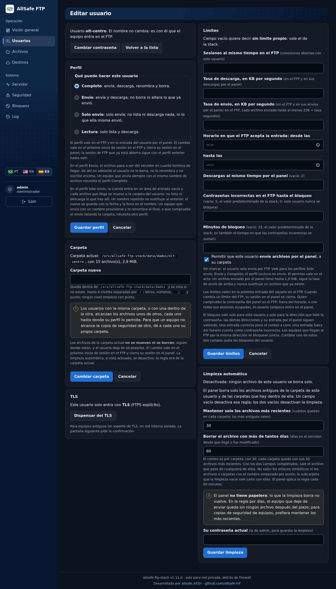</a>

<b>v1.9.0</b> · menú Usuarios, tarjeta Limpieza automática · captura del 2026-10-12

La tarjeta **Limpieza automática** de la pantalla **Editar** hace que el panel borre por sí solo los archivos antiguos de la carpeta de ese usuario y de las carpetas de dentro de ella. Nace desactivada: sin regla guardada, ningún archivo se borra solo.

| Campo | Obligatorio | Qué rellenar |
|---|---|---|
| Mantener solo los archivos más recientes | No | Cuántos archivos quedan en cada carpeta, de 1 a 100.000; los más antiguos salen. El conteo es por carpeta: con `30`, cada carpeta queda con sus 30 archivos más recientes |
| Borrar el archivo con más de tantos días | No | Días en el servidor, de 1 a 3.650, contados desde que el archivo llegó o fue modificado |
| Su contraseña actual | Sí | La contraseña de quien está usando el panel, para confirmar |

Campo en blanco desactiva esa regla, y los dos en blanco desactivan la limpieza. Con los dos rellenados, sale el archivo que pase de cualquiera de ellos.

<a href="imagenes/usuarios-limpeza-gravada.png">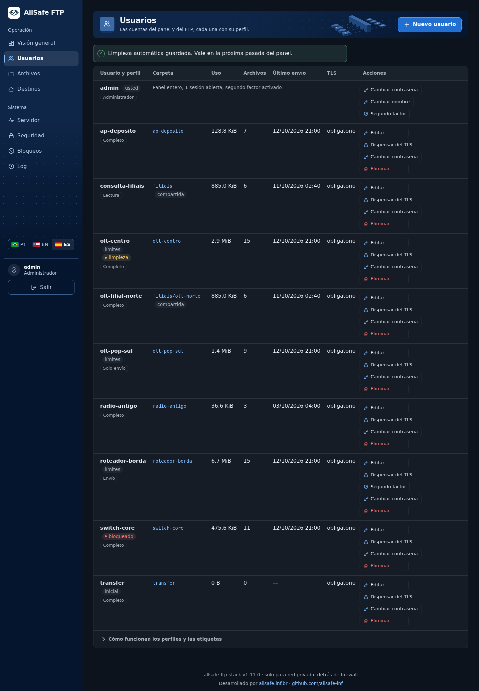</a>

<b>v1.9.0</b> · menú Usuarios, limpieza automática guardada · captura del 2026-10-12

**Resultado esperado:** después de **Guardar limpieza**, la lista vuelve con el mensaje `Limpieza automática guardada. Vale en la próxima pasada del panel.` y la etiqueta `limpieza` al lado del nombre; al pasar el mouse sobre ella, aparece la regla. Guardada con los dos campos en blanco, el mensaje es `Limpieza automática desactivada. Ningún archivo de este usuario se borra solo.`

En la foto, `olt-centro` queda con los 30 archivos más recientes de cada carpeta y sin archivo con más de 60 días.

| Qué hace la limpieza | Cómo |
|---|---|
| Cuándo se ejecuta | Sola, cada `PAINEL_RETENCAO_MINUTOS` minutos (60, por defecto); con `0`, la regla queda guardada y no se aplica, y la tarjeta lo avisa |
| Lo que nunca sale | Enlace simbólico y archivo o carpeta con el nombre empezado por punto |
| Subcarpeta | La que la limpieza vacíe sale junto; la carpeta del usuario queda |
| Carpeta compartida | La regla borra los archivos antiguos de todos los usuarios que alcanzan la carpeta, y la tarjeta dice quiénes son |
| Cambio de carpeta | Desactiva la regla, que era de la carpeta anterior |
| Registro | Cada pasada que borra algo queda en la pestaña Log, con el usuario y la cantidad |

> ⚠️ **La limpieza no tiene vuelta:** el panel no tiene papelera, y lo que la limpieza borra solo vuelve de una copia de seguridad. En la regla por días, el equipo que deje de enviar queda sin ningún archivo después del plazo: para copias de seguridad de equipos, prefiera mantener los más recientes. Las reglas completas están en [Panel web](../panel.md#limpeza).

Usuarios ➜ Bloqueos — haga clic para expandir

### Usuarios ➜ Bloqueos

<a href="imagenes/usuarios-editar-bloqueios.png">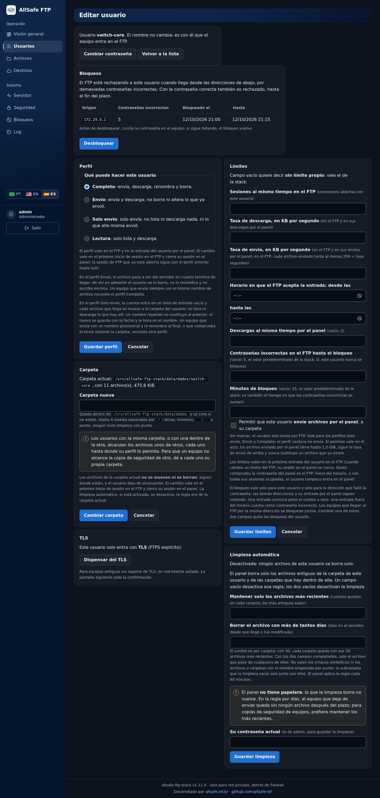</a>

<b>v1.9.0</b> · menú Usuarios, tarjeta Bloqueos · captura del 2026-10-12

La dirección que falla la contraseña de un usuario en el FTP demasiadas veces queda bloqueada para ese usuario, por el tiempo configurado: hasta entonces, ni la contraseña correcta entra desde allí. En la lista, el nombre gana la etiqueta `bloqueado`; al pasar el mouse sobre ella, aparecen las direcciones.

| Elemento de la tarjeta | Qué muestra |
|---|---|
| Origen | La dirección de donde vinieron las contraseñas incorrectas |
| Contraseñas incorrectas | Cuántas se contaron hasta el bloqueo |
| Bloqueado el · Hasta | La hora del bloqueo y la hora en que sale por sí solo |
| **Desbloquear** | Quita todos los bloqueos del usuario en el acto |

1. Corrija la contraseña en el equipo: si sigue fallando, el bloqueo vuelve.
2. Haga clic en **Desbloquear**.

<b>v1.9.0</b> · menú Usuarios, después del desbloqueo · captura del 2026-10-12

**Resultado esperado:** la lista vuelve con el mensaje `Bloqueo eliminado. El usuario vuelve a poder entrar en el FTP.`, sin la etiqueta `bloqueado`, y la entrada siguiente del equipo pasa.

En la foto, el origen es la dirección del host en la red interna de la stack fotografiada, porque las contraseñas incorrectas partieron del propio servidor. Lo que cuenta como contraseña incorrecta está en [Seguridad](../seguridad.md#bloqueio-por-tentativa).

Este es el bloqueo corto, de un usuario para una dirección. La dirección que falla demasiado, con cualquier cuenta, se bloquea entera, en el FTP y en el panel: vea [Bloqueos](#bloqueios).

Usuarios ➜ Cambiar contraseña — haga clic para expandir

### Usuarios ➜ Cambiar contraseña

<a href="imagenes/usuarios-trocar-senha.png">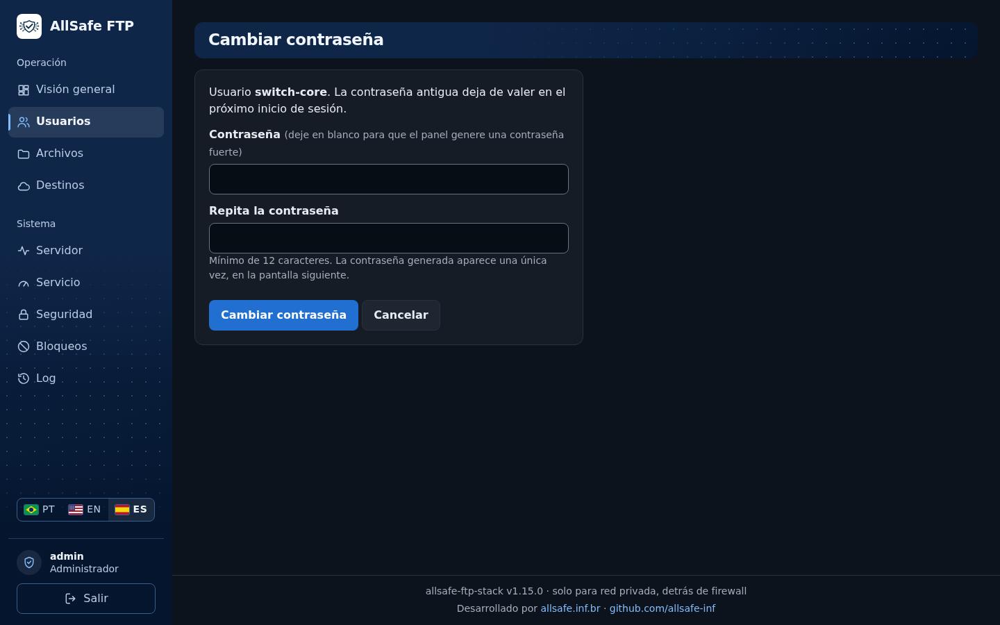</a>

<b>v1.9.0</b> · menú Usuarios, formulario Cambiar contraseña · captura del 2026-10-12

| Campo | Obligatorio | Qué rellenar |
|---|---|---|
| Contraseña | No | 12 caracteres o más. En blanco, el panel genera una contraseña fuerte |
| Repita la contraseña | Solo con la contraseña rellenada | La misma contraseña |

**Resultado esperado:** la lista vuelve con el mensaje `Contraseña cambiada.`, la contraseña antigua deja de valer en el próximo inicio de sesión del equipo y la sesión de ese usuario en el panel, si la hay, se cierra.

Usuarios ➜ Eliminar — haga clic para expandir

### Usuarios ➜ Eliminar

<a href="imagenes/usuarios-remover.png">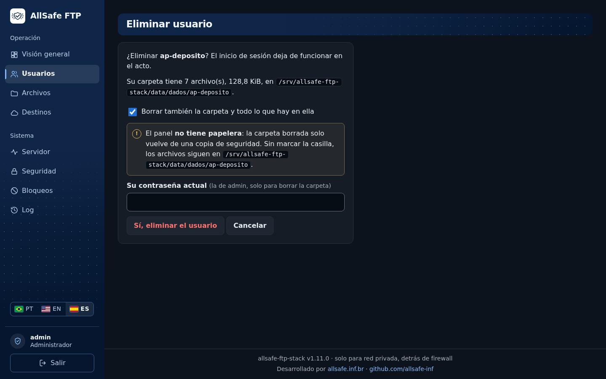</a>

<b>v1.9.0</b> · menú Usuarios, confirmación de eliminación · captura del 2026-10-12

| Elemento de la pantalla | Qué hace |
|---|---|
| Aviso de los archivos | Muestra cuántos archivos tiene el usuario, cuánto ocupan y en qué carpeta siguen; en carpeta compartida, dice quién más la alcanza |
| Casilla **Borrar también la carpeta y todo lo que hay en ella** | Solo aparece cuando la carpeta es solo de este usuario. Marcada, la carpeta sale junto con la cuenta, con todo lo que tiene dentro y sin papelera |
| **Su contraseña actual** | Se pide solo cuando la casilla está marcada: es la contraseña de quien está usando el panel |
| **Sí, eliminar el usuario** | Borra la cuenta: el inicio de sesión deja de funcionar en el acto |
| **Cancelar** | Vuelve a la lista sin modificar nada |

<b>v1.9.0</b> · menú Usuarios, después de la eliminación · captura del 2026-10-12

**Resultado esperado:** con la casilla marcada y la contraseña correcta, como en la foto, la lista vuelve con el mensaje `Usuario eliminado y carpeta borrada.` y la carpeta desaparece. Sin la casilla, el mensaje es `Usuario eliminado. Los archivos siguen en la carpeta.`: la carpeta queda en `DATA_DIR/dados` y sigue visible en la pestaña Archivos, donde puede borrarse después.

<a href="imagenes/usuarios-remover-inicial.png">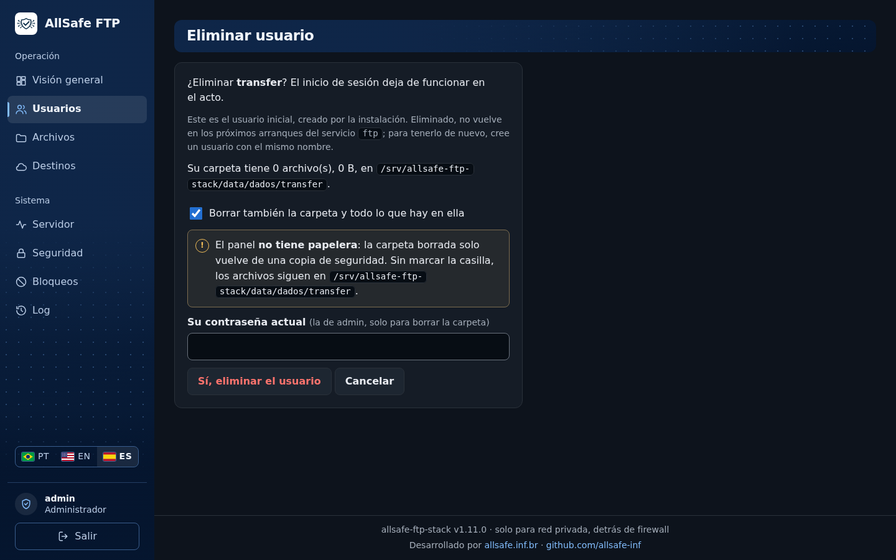</a>

<b>v1.9.0</b> · menú Usuarios, eliminación del usuario inicial · captura del 2026-10-12

El usuario inicial, el `FTP_USER` de la instalación (`transfer`, en el ejemplo), se elimina del mismo modo, con o sin la carpeta. La pantalla avisa de que no vuelve en los próximos arranques del servicio `ftp`: para tenerlo de nuevo, cree un usuario con el mismo nombre.

Usuarios ➜ TLS por usuario — haga clic para expandir

### Usuarios ➜ TLS por usuario

<b>v1.9.0</b> · menú Usuarios, columna TLS · captura del 2026-10-12

La columna y los dos botones sirven para el equipo antiguo que no habla TLS: solo él queda dispensado, y los demás siguen obligados. Lo mismo se hace en la creación, con la casilla **Equipo sin soporte de TLS** de **Nuevo usuario**, y en la tarjeta **TLS** de la pantalla **Editar**.

| Elemento de la pantalla | Qué hace |
|---|---|
| Columna TLS | `obligatorio` para quien solo entra con TLS y `sin TLS` para quien fue dispensado |
| **Dispensar del TLS** | Abre la confirmación para dejar que ese usuario entre sin TLS |
| **Exigir TLS** | Abre la confirmación para volver a exigir el TLS a quien está dispensado |
| Casilla **Equipo sin soporte de TLS**, en **Nuevo usuario** | Crea el usuario ya dispensado del TLS; sin marcar, solo entra con TLS |
| Tarjeta **TLS**, en **Editar** | Dice cómo entra ese usuario y lleva a la misma confirmación |

<b>v1.9.0</b> · menú Usuarios, usuario nuevo sin TLS · captura del 2026-10-12

En la creación, la casilla marcada guarda el usuario ya dispensado, y la lista vuelve con el mensaje `Usuario creado y dispensado del TLS: su contraseña y sus archivos pasan en texto plano.`

<a href="imagenes/usuarios-editar-tls.png">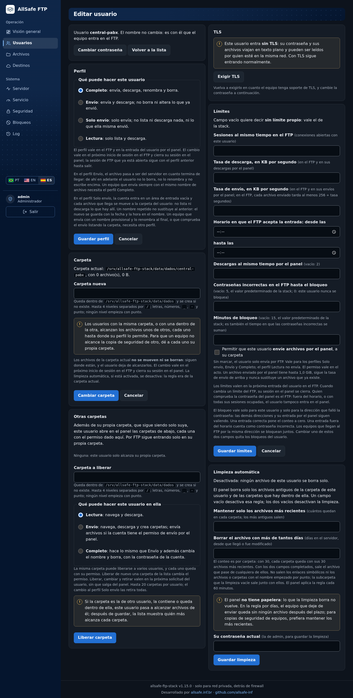</a>

<b>v1.9.0</b> · menú Usuarios, tarjeta TLS de la pantalla Editar · captura del 2026-10-12

En la pantalla **Editar**, la tarjeta **TLS** dice cómo entra el usuario y trae el botón para cambiarlo: **Dispensar del TLS** para quien está obligado, **Exigir TLS** para quien está dispensado. Para el usuario que ya existe, el botón abre la confirmación:

<a href="imagenes/usuarios-tls-dispensar.png">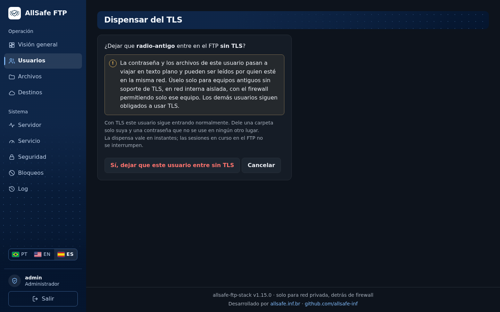</a>

<b>v1.9.0</b> · menú Usuarios, confirmación de la dispensa del TLS · captura del 2026-10-12

**Resultado esperado:** la lista vuelve con el mensaje `Usuario dispensado del TLS: su contraseña y sus archivos pasan en texto plano.`, su fila muestra `sin TLS` y las pestañas Visión general y Seguridad abren con la alerta. La dispensa vale en instantes, sin derribar a quien está conectado. Al volver a exigir, el mensaje es `El usuario vuelve a estar obligado a usar TLS.`

> ⚠️ **Dispensa del TLS:** el usuario dispensado manda contraseña y archivo en texto plano. Úsela solo para el equipo antiguo que no habla TLS, en red interna aislada, con carpeta y contraseña solo suyas, y cambie la contraseña cuando vuelva a exigir. Las condiciones están en [TLS por usuario](../seguridad.md#tls-por-usuario).

Detalle técnico — rutas y comando usado

- Rutas: `GET /usuarios`, `/usuarios/novo`, `/usuarios/editar?usuario=<nome>`, `/usuarios/senha?usuario=<nome>`, `/usuarios/remover?usuario=<nome>` y `/usuarios/tls?usuario=<nome>`; el envío de cada formulario es un `POST` en la misma ruta, con el token CSRF de la sesión. La excepción es la pantalla Editar, que envía el perfil a `POST /usuarios/perfil`, la carpeta a `POST /usuarios/pasta`, los límites a `POST /usuarios/limites`, la limpieza automática a `POST /usuarios/limpeza` y el desbloqueo a `POST /usuarios/desbloquear`.
- La dispensa del TLS vale con `FTP_TLS_EXCECOES=sim`, que es el valor por defecto, `FTP_TLS_MODE=2` y sin `REDE_PERMITIR_IP_PUBLICO=sim`. Fuera de eso, la columna, los botones y la casilla desaparecen, la ruta `/usuarios/tls` responde `404` y la lista de los dispensados queda guardada, sin valer.
- El panel llama al mismo `allsafe-ftp-user` del [`manage-user.sh`](../../../manage-user.sh): panel y línea de comandos modifican las mismas cuentas. Vea [Operación](../operacion.md#usuarios).
- Cada cambio escribe `usuario_criado`, `senha_trocada`, `pasta_trocada`, `perfil_trocado`, `limites_alterados`, `retencao_alterada`, `bloqueio_removido`, `usuario_removido`, `tls_dispensado` o `tls_exigido` en la [auditoría](../panel.md#auditoria), con el administrador que lo hizo y sin la contraseña.
- La contraseña generada tiene 32 caracteres aleatorios y no queda guardada: solo el hash va al registro del FTP.
- Sesiones, tasas y horario quedan en el registro del FTP, y es el `pure-ftpd` el que los aplica en cada entrada; las descargas por el panel y el bloqueo por intento quedan en archivos propios de la stack: [Límites por usuario](../panel.md#limites).
- La regla de la limpieza automática queda en un archivo propio de la stack, y quien la aplica es el panel, que escribe `retencao_aplicada` en cada pasada que borra algo y `retencao_falhou` cuando no concluye: [Limpieza automática](../panel.md#limpeza).
- Cambiar las contraseñas incorrectas hasta el bloqueo o los minutos de bloqueo quita los bloqueos del usuario; cambiarle la contraseña y eliminarlo también.
- En el formulario **Nuevo usuario**, los campos de cada tipo de cuenta aparecen según el perfil marcado, sin JavaScript; el envío es siempre `POST /usuarios/novo`.
- Las reglas de la carpeta y lo que verifica la marca `compartida` están en [Usuarios desde el panel](../panel.md#usuarios); cómo se aplica el perfil en el FTP, en [Perfiles](../panel.md#perfis).

---

## 🛡️ Administradores

<b>v1.9.0</b> · menú Usuarios, administradores en la lista · captura del 2026-10-12

**Para qué sirve:** dar a cada persona que administra el panel su propio usuario y su propia contraseña, y cambiar el usuario y la contraseña del primer administrador después de la instalación.

**Cómo llegar:** menú ➜ **Usuarios**. No hay pestaña propia: los administradores quedan al comienzo de la lista, antes de los usuarios del FTP.

| Elemento de la pantalla | Qué hace |
|---|---|
| **Nuevo usuario** | Abre el registro; con el perfil **Administrador** marcado, la cuenta creada es de administrador |
| Usuario y perfil | Nombre de la cuenta, con `Administrador` debajo. La etiqueta `usted` marca la cuenta de quien está usando el panel |
| Carpeta | En lugar de la carpeta, `Panel entero`, cuántos navegadores están con esa cuenta dentro del panel ahora y la situación del segundo factor: `segundo factor activado`, `sin segundo factor` o, con el segundo factor obligatorio, `registra el segundo factor en el próximo inicio de sesión` |
| **Cambiar contraseña** | Abre el cambio de contraseña, la propia o la de otro |
| **Cambiar nombre** | Abre el cambio del nombre de entrada, el propio o el de otro |
| **Segundo factor** | En la cuenta que tiene el segundo factor, la propia o la de otro administrador, abre la pantalla de desactivar. En la propia cuenta sin segundo factor, abre la pantalla de activar: es el camino del segundo factor opcional y de quien desactivó el suyo y quiere registrarlo de nuevo sin salir del panel |
| **Eliminar** | Abre la confirmación de eliminación. No aparece en la propia cuenta: así siempre queda un administrador |

Todos tienen el mismo acceso, y lo que cada uno hace queda en la pestaña Log con el nombre de quien lo hizo. El panel acepta hasta 20 administradores. Administrador y usuario del FTP son registros separados: no hay cambio de uno a otro, solo eliminar la cuenta y crear la otra.

Administradores ➜ Nuevo administrador — haga clic para expandir

### Administradores ➜ Nuevo administrador

<a href="imagenes/administradores-novo.png">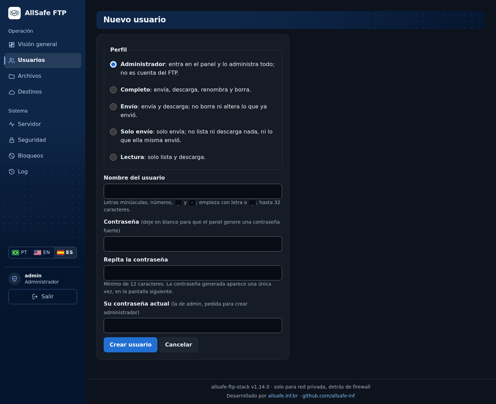</a>

<b>v1.9.0</b> · menú Usuarios, formulario Nuevo usuario con el perfil Administrador · captura del 2026-10-12

Haga clic en **Nuevo usuario** y marque el perfil **Administrador**: los campos de la carpeta y del TLS dan lugar a su contraseña actual.

| Campo | Obligatorio | Qué rellenar |
|---|---|---|
| Perfil | Sí | Administrador |
| Nombre del usuario | Sí | Letras minúsculas, números, `_` y `-`; empieza con letra o `_`; hasta 32 caracteres |
| Contraseña | No | 12 caracteres o más. En blanco, el panel genera una contraseña fuerte y la muestra una única vez |
| Repita la contraseña | Solo con la contraseña rellenada | La misma contraseña |
| Su contraseña actual | Sí | La contraseña de quien está usando el panel, para confirmar |

**Resultado esperado:** la lista vuelve con el mensaje `Administrador creado.` y el administrador nuevo entra enseguida, sin reiniciar nada.

Administradores ➜ Cambiar contraseña — haga clic para expandir

### Administradores ➜ Cambiar contraseña

<a href="imagenes/administradores-trocar-senha.png">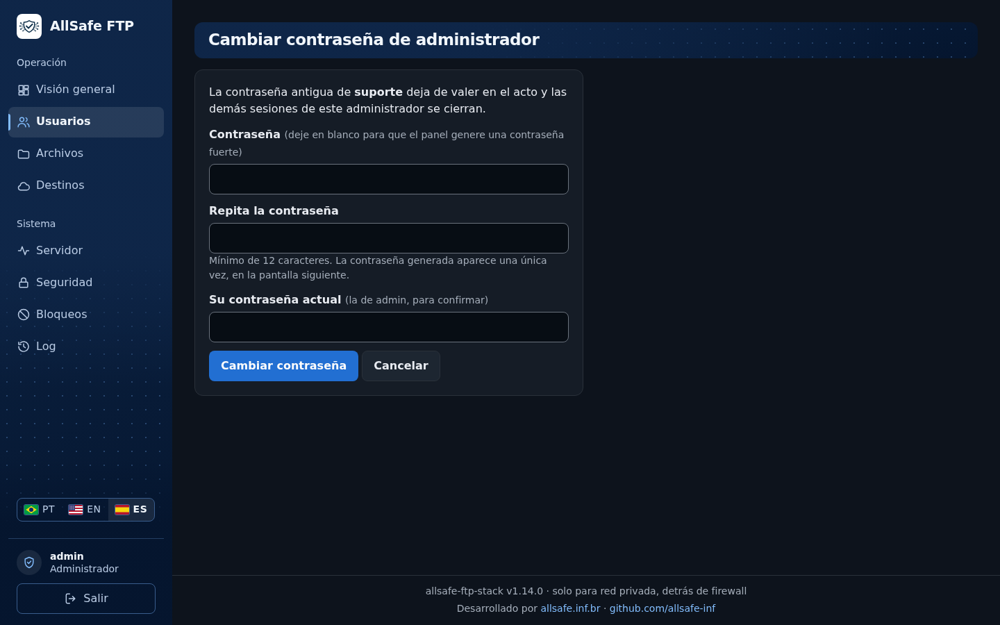</a>

<b>v1.9.0</b> · menú Usuarios, formulario Cambiar contraseña de administrador · captura del 2026-10-12

| Campo | Obligatorio | Qué rellenar |
|---|---|---|
| Contraseña | No | La contraseña nueva, con 12 caracteres o más. En blanco, el panel genera una |
| Repita la contraseña | Solo con la contraseña rellenada | La misma contraseña |
| Su contraseña actual | Sí | La contraseña de quien está usando el panel, para confirmar |

**Resultado esperado:** la lista vuelve con el mensaje `Contraseña cambiada. Las demás sesiones de ese administrador se cerraron.` y la contraseña antigua deja de valer en el acto.

Es por aquí que la contraseña inicial de la instalación se cambia después del primer acceso. Sin ningún administrador que consiga entrar, la contraseña se redefine desde el servidor: [Recuperar el acceso](../panel.md#senha).

Administradores ➜ Cambiar nombre — haga clic para expandir

### Administradores ➜ Cambiar nombre

<a href="imagenes/administradores-trocar-nome.png">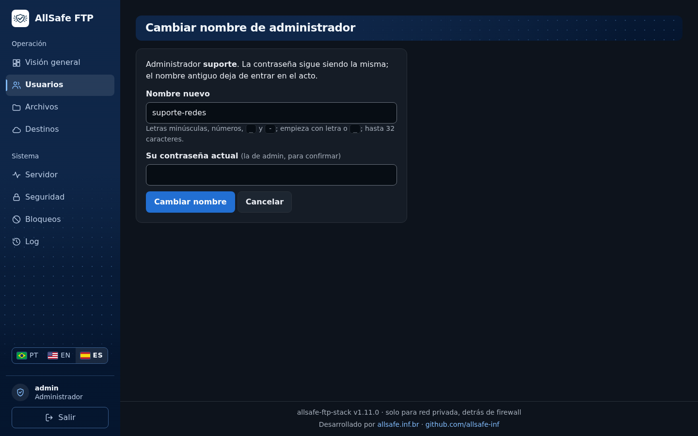</a>

<b>v1.9.0</b> · menú Usuarios, formulario Cambiar nombre de administrador · captura del 2026-10-12

| Campo | Obligatorio | Qué rellenar |
|---|---|---|
| Nombre nuevo | Sí | La misma regla del nombre del usuario; diferente del actual y de todos los demás administradores |
| Su contraseña actual | Sí | La contraseña de quien está usando el panel, para confirmar |

**Resultado esperado:** la lista vuelve con el mensaje `Nombre cambiado. Las demás sesiones de ese administrador se cerraron.` La entrada pasa a ser con el nombre nuevo, con la misma contraseña.

Cambiar el nombre del primer administrador desde el panel no toca el `.env`: el `PAINEL_ADMIN_USER` solo se usa mientras no existe ningún administrador.

Administradores ➜ Eliminar — haga clic para expandir

### Administradores ➜ Eliminar

<a href="imagenes/administradores-remover.png">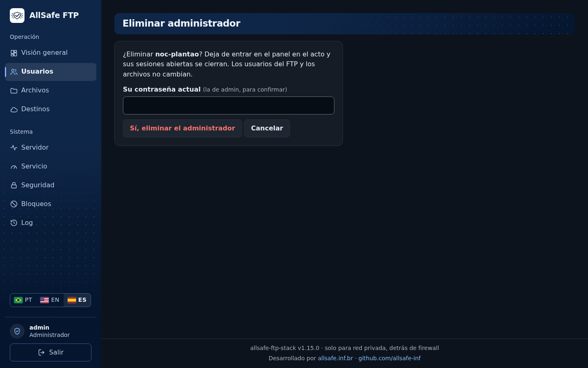</a>

<b>v1.9.0</b> · menú Usuarios, confirmación de eliminación de administrador · captura del 2026-10-12

| Elemento de la pantalla | Qué hace |
|---|---|
| Su contraseña actual | Confirma que quien pide la eliminación es el dueño de la sesión |
| **Sí, eliminar el administrador** | Borra la cuenta: deja de entrar en el acto y sus sesiones abiertas se cierran |
| **Cancelar** | Vuelve a la lista sin modificar nada |

**Resultado esperado:** la lista vuelve con el mensaje `Administrador eliminado. Sus sesiones se cerraron.` Los usuarios del FTP y los archivos no cambian.

Administradores ➜ Segundo factor — haga clic para expandir

### Administradores ➜ Segundo factor

<a href="imagenes/administradores-segundo-fator.png">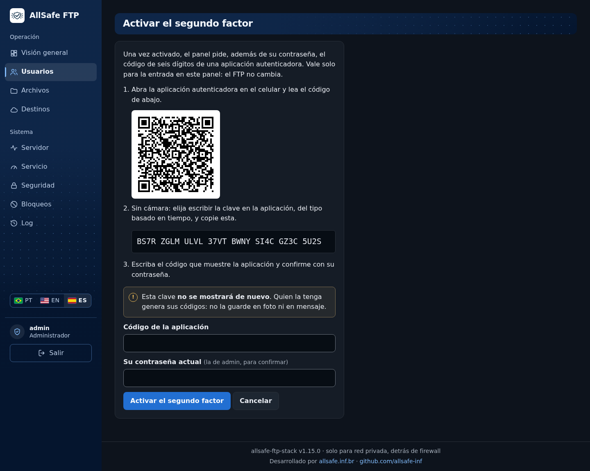</a>

<b>v1.9.0</b> · menú Usuarios, pantalla Activar el segundo factor, con el segundo factor opcional y una clave de ejemplo que no fue guardada · captura del 2026-10-12

Con el segundo factor obligatorio, que es el valor por defecto, cada cuenta registra el suyo en la entrada: vea [Entrar ➜ Registre el segundo factor](#entrar). Esta pantalla es la del segundo factor opcional (`PAINEL_SEGUNDO_FATOR_OBRIGATORIO=nao`) y la de quien desactivó el suyo y quiere registrarlo de nuevo sin salir del panel: haga clic en **Segundo factor** en la fila de la propia cuenta. Cada administrador activa el suyo, con cualquier aplicación autenticadora de código por tiempo (TOTP).

| Elemento de la pantalla | Qué hace |
|---|---|
| Código QR | Es la clave, para que la aplicación la lea con la cámara. La cuenta aparece en él como `AllSafe FTP:<administrador>@<endereço do painel>` |
| Clave en grupos | La misma clave, para escribirla en la aplicación cuando no hay cámara, eligiendo el tipo basado en tiempo |
| **Código de la aplicación** | Recibe los seis dígitos que la aplicación pasó a mostrar: es la prueba de que leyó la clave |
| Su contraseña actual | Confirma que quien lo activa es el dueño de la sesión |
| **Activar el segundo factor** | Guarda la clave y cierra las demás sesiones de la cuenta |
| **Cancelar** | Vuelve a la lista sin activar nada |

**Resultado esperado:** la lista vuelve con el mensaje `Segundo factor activado. La próxima entrada de esta cuenta pide el código de la aplicación; sus otras sesiones se cerraron.` y la fila de la cuenta pasa a decir `segundo factor activado`.

> ⚠️ **La clave aparece solo en esta pantalla, hasta ser confirmada.** Quien la tenga genera los códigos de la cuenta: no la guarde en foto ni en mensaje. Mientras el primer código no llega, la pantalla abierta de nuevo muestra la misma clave, por hasta 10 minutos; después de eso, una nueva.

### Administradores ➜ Desactivar el segundo factor

<b>v1.9.0</b> · menú Usuarios, pantalla Desactivar el segundo factor, de la cuenta de otro administrador · captura del 2026-10-12

Con el segundo factor activado, el mismo botón **Segundo factor** abre esta pantalla, en la propia fila o en la de otro administrador: es el camino de quien perdió el dispositivo. Con el segundo factor obligatorio, desactivar es mandar a la cuenta a registrarse de nuevo: en la entrada siguiente, pasa por la pantalla Registre el segundo factor, con una clave nueva.

| Elemento de la pantalla | Qué hace |
|---|---|
| Su contraseña actual | Confirma que quien lo desactiva es el dueño de la sesión; no es la contraseña de la cuenta modificada |
| **Sí, desactivar el segundo factor** | Borra la clave guardada: los códigos de la aplicación dejan de valer. Con el segundo factor obligatorio, la cuenta registra una aplicación de nuevo en la entrada siguiente; con el opcional, vuelve a entrar solo con usuario y contraseña |
| **Cancelar** | Vuelve a la lista sin modificar nada |

**Resultado esperado:** la lista vuelve con el mensaje `Segundo factor desactivado. En el próximo inicio de sesión, la cuenta registra una aplicación de nuevo.` o, con el segundo factor opcional, `Segundo factor desactivado. La cuenta vuelve a entrar solo con usuario y contraseña.`; en este caso, para activarlo de nuevo, el dueño de la cuenta repite el paso de arriba, con una clave nueva.

> ⚠️ **Dispositivo perdido o robado: cambie también la contraseña de la cuenta.** Con el segundo factor obligatorio, hasta el registro nuevo, quien sepa la contraseña registra la aplicación.

### Usuarios ➜ Segundo factor del usuario del FTP

<a href="imagenes/usuarios-segundo-fator.png">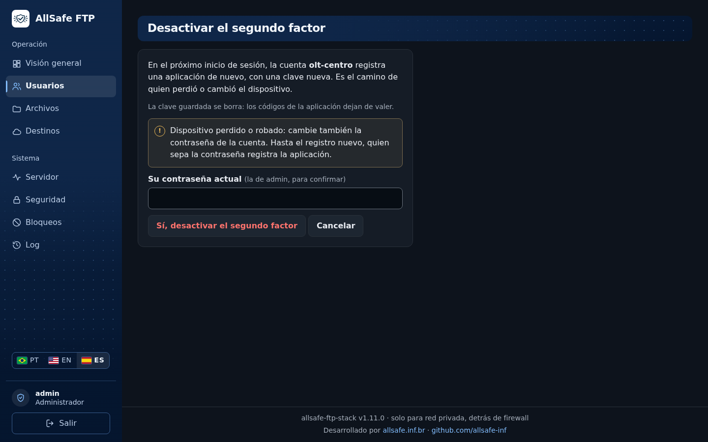</a>

<b>v1.9.0</b> · menú Usuarios, pantalla Desactivar el segundo factor, de un usuario del FTP · captura del 2026-10-12

El usuario del FTP registra su segundo factor en la entrada del panel, y solo allí. Después de eso, su fila en la pestaña Usuarios gana el botón **Segundo factor**, que abre esta pantalla: el administrador solo lo desactiva, no ve la clave y no lo registra por él. Vale solo para el panel: en el FTP, la cuenta sigue entrando con la contraseña.

| Elemento de la pantalla | Qué hace |
|---|---|
| Su contraseña actual | Confirma que quien lo desactiva es el dueño de la sesión; no es la contraseña del usuario |
| **Sí, desactivar el segundo factor** | Borra la clave guardada del usuario. Con el segundo factor obligatorio, registra una aplicación de nuevo en la entrada siguiente; con el opcional, vuelve a entrar en el panel solo con usuario y contraseña |
| **Cancelar** | Vuelve a la lista sin modificar nada |

**Resultado esperado:** la lista vuelve con el mismo mensaje de la desactivación de un administrador, y el botón **Segundo factor** sale de la fila del usuario. Eliminar el usuario desde el panel también borra su segundo factor.

Detalle técnico — mensajes de rechazo, rutas y archivo

| Mensaje | Motivo |
|---|---|
| Su contraseña actual no coincide. No se modificó nada. | El campo Su contraseña actual está equivocado; cinco rechazos en 15 minutos bloquean la dirección |
| Ya existe un administrador con este nombre. | El nombre ya está en uso |
| El nombre nuevo es igual al actual. | El cambio de nombre no cambió nada |
| Límite de 20 administradores alcanzado: elimine uno antes de crear otro. | El panel ya tiene 20 administradores |
| El código no coincide con la clave de esta pantalla. Revise la hora del celular, espere el próximo código e inténtelo de nuevo. | El código escrito en la pantalla Activar el segundo factor no es el de la clave mostrada |
| La clave mostrada venció. Lea la nueva en la aplicación e inténtelo de nuevo. | La pantalla Activar el segundo factor quedó más de 10 minutos sin el primer código; la pantalla vuelve con otra clave |
| El segundo factor de (nombre) está desactivado. Solo el propio administrador activa el suyo, porque la clave queda en el dispositivo de quien entra. | La dirección de la pantalla fue abierta para la cuenta de otro administrador que está sin segundo factor |

- El registro es el `POST /usuarios/novo`, con el perfil `administrador`. Las direcciones antiguas siguen valiendo: `GET /administradores` lleva a la pestaña Usuarios y `GET /administradores/novo`, al formulario con el perfil Administrador marcado.
- Rutas de las otras pantallas: `GET /administradores/senha?admin=<nome>`, `/administradores/nome?admin=<nome>` y `/administradores/remover?admin=<nome>`; el envío de cada formulario es un `POST` en la misma ruta, con el token CSRF de la sesión.
- Segundo factor: `GET /administradores/fator?admin=<nome>` muestra la pantalla de activar o la de desactivar; el envío es un `POST` en `/administradores/fator/ligar` o `/administradores/fator/desligar`. Escribe `admin_fator_ligado` o `admin_fator_desligado`. La lista de quien lo activó queda en `DATA_DIR/painel/segundo-fator` y la clave de cada uno, en `.secrets/segundo-fator/<nome>.txt`. El usuario del FTP recibe `404` en esas rutas.
- Segundo factor del usuario del FTP: `GET /usuarios/fator?usuario=<nome>` muestra la pantalla de desactivar y el envío es un `POST` en `/usuarios/fator/desligar`, que escribe `usuario_fator_desligado`. Su cuenta en la lista es `ftp.<nome>` y la clave queda en `.secrets/segundo-fator/ftp.<nome>.txt`. El usuario del FTP también recibe `404` en esas rutas.
- Los administradores quedan en `DATA_DIR/painel/administradores` (`0600`, del `root`), una línea `nome:hash` por cuenta. Solo se guarda el hash `scrypt`.
- Cada cambio escribe `admin_criado`, `admin_senha_trocada`, `admin_renomeado` o `admin_removido` en la [auditoría](../panel.md#auditoria), con quien lo hizo y quien fue modificado; la contraseña actual incorrecta escribe `admin_senha_atual_recusada`.
- Las reglas completas están en [Administradores del panel](../panel.md#administradores).

---

## 📁 Archivos

<b>v1.9.0</b> · menú Archivos · captura del 2026-10-12

**Para qué sirve:** ver lo que cada equipo envió, descargar una copia de seguridad por el navegador, enviar un archivo a cualquier carpeta, crear la carpeta de un usuario nuevo, cambiar el nombre y borrar archivos y carpetas, sin cliente de FTP.

**Cómo llegar:** menú ➜ **Archivos**. En la pestaña Usuarios, la dirección de la columna **Carpeta** abre directamente la carpeta de ese usuario.

| Elemento de la pantalla | Qué hace |
|---|---|
| Ruta en lo alto de la lista | Muestra la carpeta abierta y vuelve a cualquier nivel |
| Nombre de una carpeta | Entra en la carpeta |
| Tamaño · Modificado | Tamaño del archivo y fecha del último cambio |
| **Descargar** | Entrega el archivo al navegador, con el nombre original |
| **Telegram** · **rclone** · **S3** | Con el destino guardado en la pestaña Destinos, envía ese archivo al destino en el acto |
| **Renombrar** | Abre la pantalla que cambia el nombre del archivo o de la carpeta, dentro de la misma carpeta, y pide su contraseña actual; un nombre que ya existe se rechaza |
| **Borrar** | Abre la pantalla de confirmación: muestra lo que va a salir, pide la casilla marcada y su contraseña actual y borra definitivamente, sin papelera |
| **Nueva carpeta** | Crea una carpeta vacía dentro de la que está abierta |
| **Enviar archivo** | Recibe un archivo del navegador y lo guarda en la carpeta que está abierta; un nombre que ya existe se rechaza |
| **Nuevo usuario en esta carpeta** | Dentro de una carpeta, abre el registro de usuario con el campo Carpeta rellenado |

El panel navega, descarga, envía, crea carpetas, cambia el nombre y borra. Los equipos siguen enviando por FTP: el envío por aquí sirve para el archivo suelto, de quien está en el navegador. La carpeta de un usuario del FTP no se renombra ni se borra por aquí: sale junto con el usuario, en [Usuarios ➜ Eliminar](#usuarios). Las reglas y los límites están en [Panel web](../panel.md#arquivos).

Archivos ➜ Carpeta de un usuario y descarga — haga clic para expandir

### Archivos ➜ Carpeta de un usuario y descarga

<a href="imagenes/arquivos-pasta.png">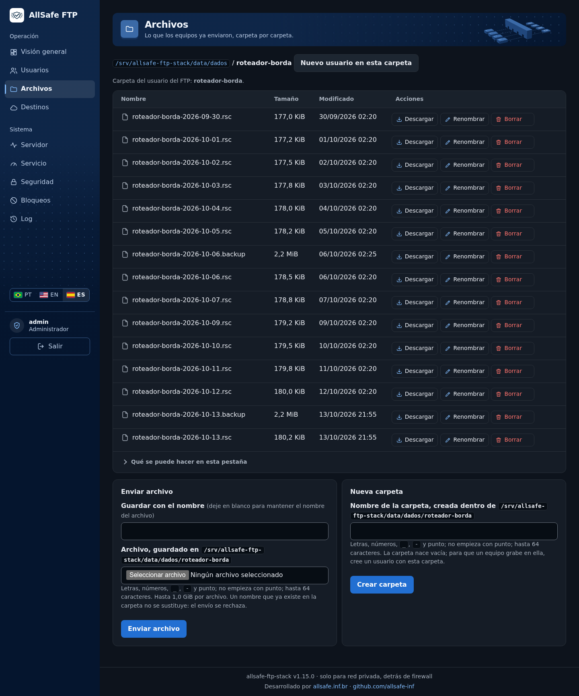</a>

<b>v1.9.0</b> · menú Archivos, carpeta de un usuario · captura del 2026-10-12

1. Haga clic en el nombre de la carpeta para entrar.
2. Verifique, en la línea `Carpeta del usuario del FTP`, de quién es la carpeta.
3. Haga clic en **Descargar** en la fila del archivo.

**Resultado esperado:** el navegador guarda el archivo con el nombre original, idéntico al que envió el equipo, y la pestaña Log gana la línea `Archivo descargado`, con el administrador, la ruta y el tamaño.

| Límite | Valor |
|---|---|
| Descargas al mismo tiempo | 8, sumando administradores y usuarios del FTP; el siguiente recibe la pantalla `Demasiadas descargas al mismo tiempo` |
| Elementos mostrados por carpeta | 2000, con un aviso cuando hay más |
| Reanudación | No hay: si la conexión se cae, la descarga empieza de nuevo |

Archivos ➜ Nueva carpeta — haga clic para expandir

### Archivos ➜ Nueva carpeta

<a href="imagenes/arquivos-pasta-criada.png">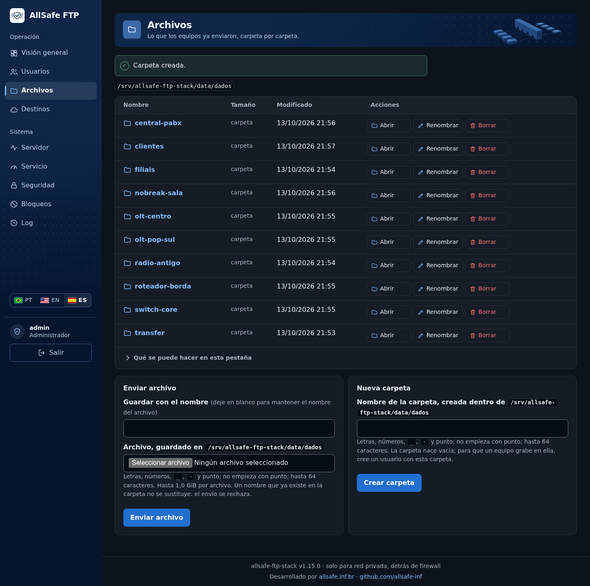</a>

<b>v1.9.0</b> · menú Archivos, carpeta creada · captura del 2026-10-12

| Campo | Obligatorio | Qué rellenar |
|---|---|---|
| Nombre de la carpeta | Sí | Letras, números, `_`, `-` y punto; no empieza con punto; hasta 64 caracteres. Una carpeta por vez: para crear `clientes/olt-01`, cree `clientes`, entre en ella y cree `olt-01` |

**Resultado esperado:** la lista vuelve con el mensaje `Carpeta creada.` y la carpeta nueva, vacía, ya con el dueño y el permiso que usa el FTP. Para que un equipo escriba en ella, entre en la carpeta y haga clic en **Nuevo usuario en esta carpeta**.

| Mensaje | Motivo |
|---|---|
| Ruta no aceptada. | El nombre se sale de la regla o intenta salir de la carpeta de los datos |
| Ya existe una carpeta o un archivo con este nombre. | El nombre ya está en uso en esa carpeta |
| El panel no sigue enlaces simbólicos. | El destino pasa por un enlace simbólico |
| Carpeta o archivo no encontrado. | La carpeta de destino dejó de existir |

Archivos ➜ Enviar archivo — haga clic para expandir

### Archivos ➜ Enviar archivo

<a href="imagenes/arquivos-enviado.png">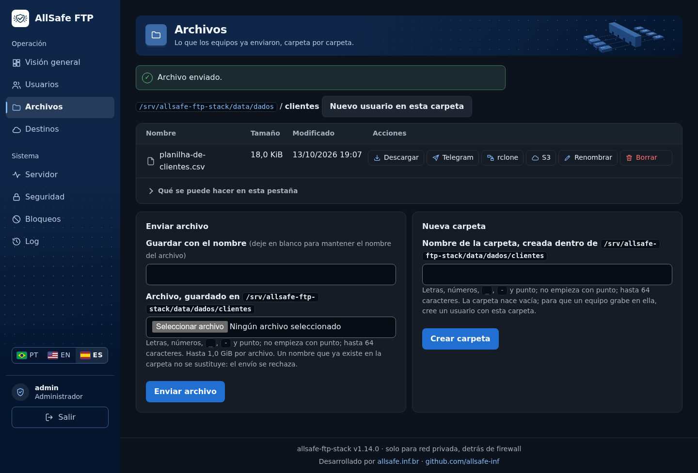</a>

<b>v1.9.0</b> · menú Archivos, después del envío · captura del 2026-10-12

1. Entre en la carpeta en la que debe quedar el archivo.
2. En la tarjeta **Enviar archivo**, elija el archivo.
3. Haga clic en **Enviar archivo**.

| Campo | Obligatorio | Qué rellenar |
|---|---|---|
| Guardar con el nombre | No | El nombre con el que el archivo queda en el servidor: letras, números, `_`, `-` y punto; no empieza con punto; hasta 64 caracteres. En blanco, queda el nombre del archivo elegido |
| Archivo | Sí | El archivo a enviar, uno por vez; la etiqueta del campo dice en qué carpeta se guardará |

**Resultado esperado:** la carpeta vuelve con el mensaje `Archivo enviado.` y el archivo en la lista, ya con el dueño y el permiso que usa el FTP, y la pestaña Log gana la línea `Archivo enviado por el panel`, con el administrador, la ruta y el tamaño.

| Límite | Valor |
|---|---|
| Tamaño de cada archivo | El de `PAINEL_ENVIO_MAX_MB`: 1024 MB, por defecto |
| Envíos al mismo tiempo | 4, sumando administradores y usuarios del FTP; el siguiente recibe la pantalla `Demasiados envíos al mismo tiempo` |
| Nombre que ya existe en la carpeta | No se reemplaza: el envío es rechazado |
| Reanudación | No hay: si la conexión se cae, lo que llegó se descarta y el envío empieza de nuevo |

| Mensaje o pantalla | Motivo |
|---|---|
| Pantalla `Ningún archivo elegido` | El formulario se envió sin archivo |
| Pantalla `Nombre no aceptado` | El nombre del archivo, o el del campo **Guardar con el nombre**, se sale de la regla |
| Pantalla `Nombre ya usado` | Ya existe una carpeta o un archivo con este nombre en esa carpeta; no se reemplaza nada |
| Archivo demasiado grande: el panel recibe hasta 1,0 GiB por archivo. | El archivo pasa del tamaño de `PAINEL_ENVIO_MAX_MB`; el valor del mensaje acompaña a la variable |
| Pantalla `Sin espacio` | El servidor no tiene espacio libre para el archivo |

Archivos ➜ Enviar a un destino — haga clic para expandir

### Archivos ➜ Enviar a un destino

<a href="imagenes/arquivos-enviado-ao-destino.png">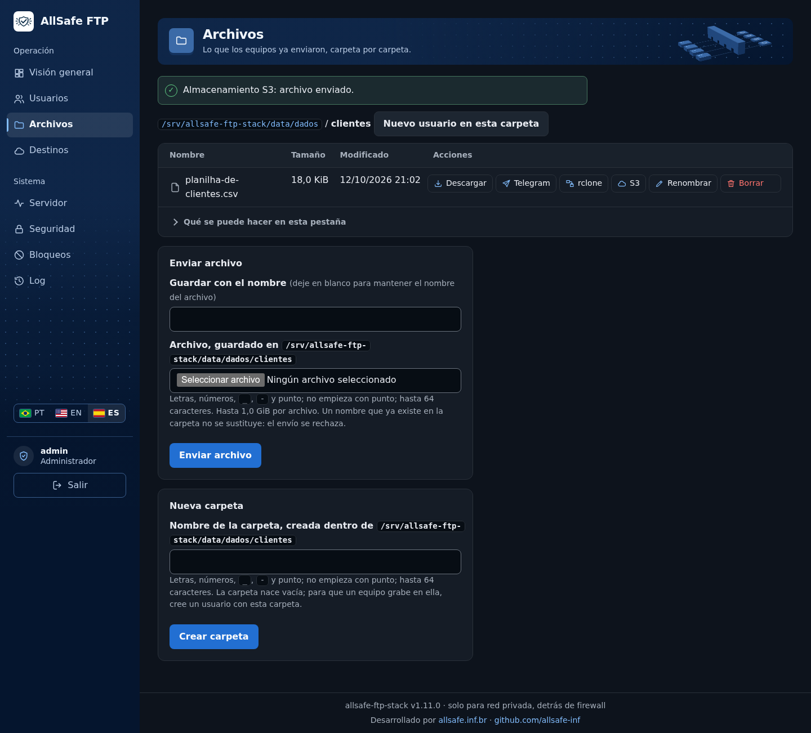</a>

<b>v1.9.0</b> · menú Archivos, después del envío a un destino · captura del 2026-10-12

Después de que un destino se guarda en la pestaña [Destinos](#destinos), cada archivo gana un botón con su nombre, **Telegram**, **rclone** o **S3**, al lado de **Descargar**. El botón envía ese archivo al destino en el acto, sin esperar la pasada.

1. Entre en la carpeta del archivo.
2. En la fila del archivo, haga clic en **Telegram**, en **rclone** o en **S3**.
3. Con más de un destino listo de ese tipo, elija el **Destino que recibe** y haga clic en **Enviar**.

<a href="imagenes/arquivos-escolher-destino.png">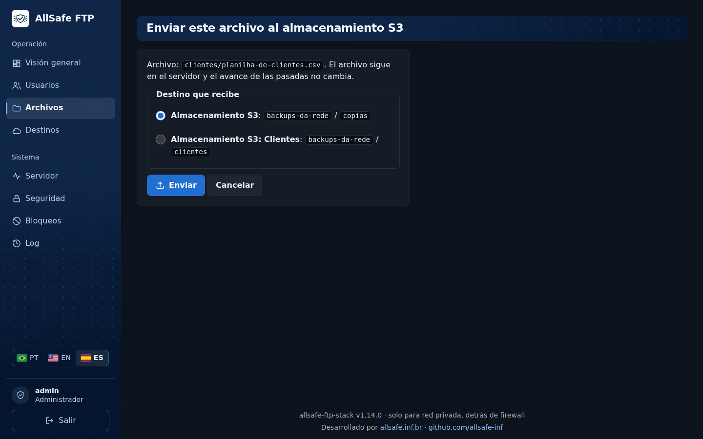</a>

<b>v1.9.0</b> · menú Archivos, elección del destino · captura del 2026-10-12

**Resultado esperado:** la pantalla vuelve a la misma carpeta con el mensaje `Almacenamiento S3: archivo enviado.`, `Remoto del rclone: archivo enviado.` o `Bot de Telegram: archivo enviado.`, con el nombre del destino cuando tiene uno, y la pestaña Log gana la línea `Archivo enviado al destino a pedido`, con el administrador, el destino y el archivo.

| Elemento | Cómo funciona |
|---|---|
| Cuándo aparecen los botones | Solo para el tipo que tiene un destino guardado con los secretos; sin destino, la lista queda como antes |
| Quién tiene los botones | Solo el administrador: la pantalla Mis archivos, del usuario del FTP, no los muestra |
| Archivo de otra carpeta | El botón sirve para cualquier archivo de los datos, dentro o fuera de la carpeta del destino, y funciona con el destino desactivado |
| El archivo en el servidor | Nunca se borra por ese envío, ni con el S3 en **Conservar en S3** |
| Enviar de nuevo | Por el bot, la conversación recibe otro mensaje; en el S3 y en el rclone, el mismo nombre se sobrescribe |
| Ruta en el remoto del rclone | La misma que el archivo tiene dentro de los datos, a partir de la carpeta en el remoto |
| Remoto SFTP que todavía no pasó por **Probar** | El envío no sale, y el mensaje dice que el panel todavía no guardó la clave del servidor |
| Envío demorado | Pasando de 20 segundos, el mensaje dice que el envío continúa en segundo plano, y el resultado aparece en la pestaña Log |
| Envío que no sale bien | El mensaje trae el motivo en una frase, como el archivo vacío o mayor que el límite del bot |

Archivos ➜ Renombrar — haga clic para expandir

### Archivos ➜ Renombrar

<a href="imagenes/arquivos-renomear.png">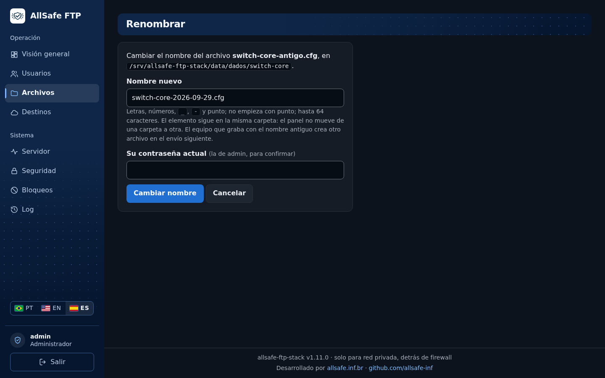</a>

<b>v1.9.0</b> · menú Archivos, pantalla Renombrar · captura del 2026-10-12

| Campo | Obligatorio | Qué rellenar |
|---|---|---|
| Nombre nuevo | Sí | Letras, números, `_`, `-` y punto; no empieza con punto; hasta 64 caracteres |
| Su contraseña actual | Sí | La contraseña de quien está usando el panel, para confirmar |

<a href="imagenes/arquivos-renomeado.png">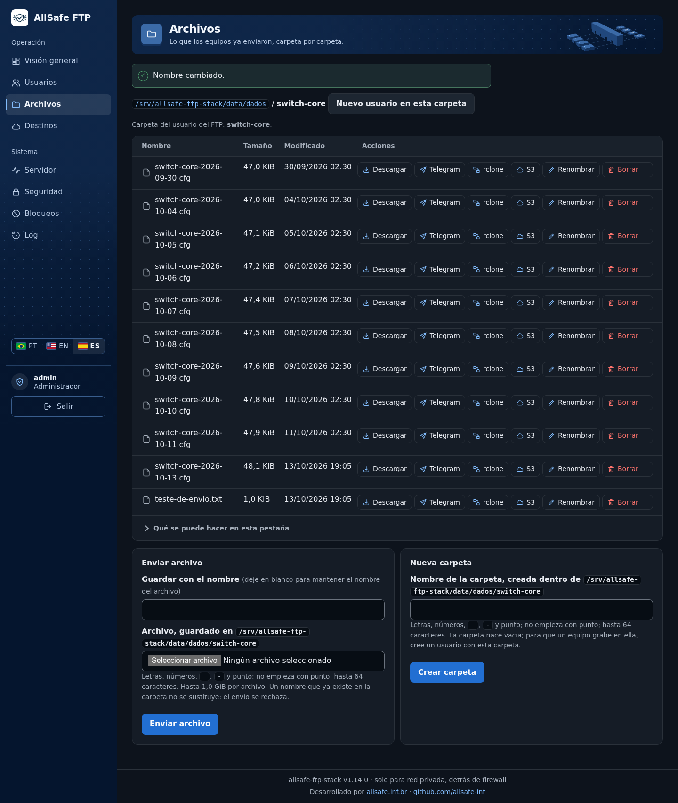</a>

<b>v1.9.0</b> · menú Archivos, después del cambio de nombre · captura del 2026-10-12

**Resultado esperado:** la carpeta vuelve con el mensaje `Nombre cambiado.` y el elemento con el nombre nuevo, en el mismo lugar. El panel no mueve de una carpeta a otra, y el equipo que escribe con el nombre antiguo crea otro archivo en el envío siguiente.

| Mensaje | Motivo |
|---|---|
| Nombre no aceptado. Vea la regla debajo del campo. | El nombre se sale de la regla |
| El elemento ya tiene este nombre. | El nombre nuevo es igual al actual |
| Ya existe una carpeta o un archivo con este nombre. | El nombre ya está en uso en esa carpeta; no se reemplaza nada |
| Su contraseña actual no coincide. No se modificó nada. | El campo Su contraseña actual está incorrecto; cinco rechazos en 15 minutos bloquean la dirección |

Archivos ➜ Borrar — haga clic para expandir

### Archivos ➜ Borrar

<a href="imagenes/arquivos-apagar.png">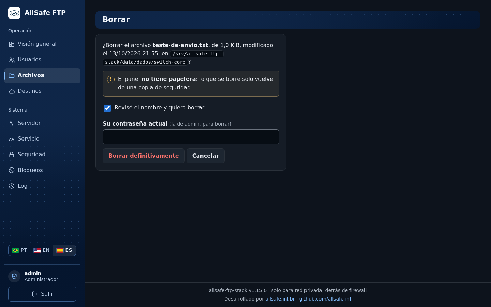</a>

<b>v1.9.0</b> · menú Archivos, confirmación de borrar · captura del 2026-10-12

| Elemento de la pantalla | Qué hace |
|---|---|
| Primera línea | Dice lo que va a salir: el archivo, con el tamaño y la fecha, o la carpeta, con la cantidad de archivos y el espacio de todo lo que hay dentro de ella |
| Casilla **Revisé el nombre y quiero borrar** | Obligatoria: sin ella no se borra nada |
| **Su contraseña actual** | La contraseña de quien está usando el panel, para confirmar |
| **Borrar definitivamente** | Borra el archivo, o la carpeta con todo lo que tiene dentro |
| **Cancelar** | Vuelve a la carpeta sin modificar nada |

<a href="imagenes/arquivos-apagado.png">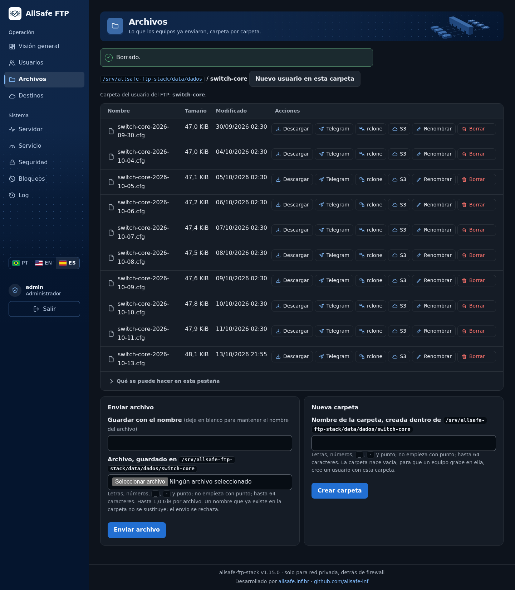</a>

<b>v1.9.0</b> · menú Archivos, después de borrar · captura del 2026-10-12

**Resultado esperado:** la carpeta vuelve con el mensaje `Borrado.` y sin el elemento, y la pestaña Log gana la línea `Archivo o carpeta borrado`.

> ⚠️ **Borrar no tiene vuelta:** el panel no tiene papelera, y lo que se borró solo vuelve de una copia de seguridad. Vea [Copia de seguridad](../backup.md).

| Mensaje o pantalla | Motivo |
|---|---|
| Marque la casilla de confirmación. No se borró nada. | La casilla quedó desmarcada |
| Su contraseña actual no coincide. No se borró nada. | El campo Su contraseña actual está incorrecto; cinco rechazos en 15 minutos bloquean la dirección |
| Pantalla `Borrado en parte` | La carpeta tiene más de lo que el panel borra en una solicitud: repita para continuar |
| Pantalla `No se borró nada` | El panel ya está borrando otra carpeta, o un elemento no pudo eliminarse |

<a href="imagenes/arquivos-pasta-de-usuario.png">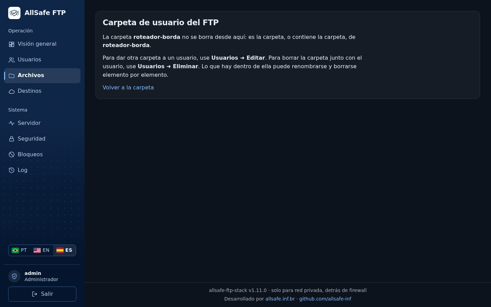</a>

<b>v1.9.0</b> · menú Archivos, carpeta de usuario rechazada · captura del 2026-10-12

La carpeta de un usuario del FTP, y la carpeta que tiene dentro la de un usuario, no se renombra ni se borra desde la pestaña Archivos: el registro quedaría apuntando a una carpeta que no existe. Para dar otra carpeta al usuario, use **Usuarios ➜ Editar**; para borrar la carpeta junto con él, **Usuarios ➜ Eliminar**. Lo que está dentro de ella se renombra y se borra elemento por elemento.

Detalle técnico — rutas y protecciones

- Rutas: `GET /arquivos?pasta=<caminho>` lista, `GET /arquivos/baixar?arquivo=<caminho>` entrega y `POST /arquivos/pasta` crea la carpeta, con el token CSRF. `GET /arquivos/renomear?item=<caminho>` y `GET /arquivos/apagar?item=<caminho>` muestran la pantalla de cada acción, y el envío es un `POST` en la misma ruta. `POST /arquivos/enviar` recibe el archivo, en `multipart/form-data`, con el token CSRF.
- La ruta es siempre relativa a `DATA_DIR/dados`, abierta parte por parte y sin seguir enlaces simbólicos. Una ruta con `..` recibe `400` y un enlace simbólico, `403`, los dos con el evento `recusa_caminho`.
- El archivo sale como adjunto (`Content-Disposition: attachment`, RFC 6266 y RFC 8187), en bloques de 64 KiB, sin cargarse en la memoria: el navegador lo guarda y nunca lo abre.
- La carpeta nueva nace con el dueño `ftpdata` y el modo `0750`, los mismos de las carpetas creadas por el FTP.
- El archivo enviado se escribe directo en el disco, sin cargarse en la memoria y sin nombre, en la propia carpeta de destino, y solo gana nombre cuando llega entero, por `link()`, que no reemplaza lo que existe. El envío cortado no deja restos en la carpeta, y el panel no abre ni interpreta el contenido.
- El nombre se cambia con una sola llamada al sistema, que rechaza el nombre que ya existe; la carpeta se vacía de adentro hacia afuera, y un enlace simbólico dentro de ella se borra como enlace, sin tocar el destino.
- Una solicitud de borrar elimina hasta 50.000 elementos o trabaja por hasta 20 segundos, y el panel hace un borrado por vez.
- La carpeta de un usuario del FTP, o la que tiene una dentro, responde `409` en la pantalla y en el envío.
- Los eventos `arquivo_baixado`, `arquivo_interrompido`, `arquivo_enviado`, `envio_interrompido`, `pasta_criada`, `item_renomeado` e `item_apagado` quedan en la [auditoría](../panel.md#auditoria); el contenido del archivo nunca se registra.
- El funcionamiento completo está en [Archivos y descarga](../panel.md#arquivos) y en [Enviar archivo](../panel.md#enviar-arquivo).

---

## 📥 Mis archivos

<b>v1.9.0</b> · pantalla Mis archivos, del usuario del FTP de perfil Completo · captura del 2026-10-12

**Para qué sirve:** el dueño de los archivos navega por su propia carpeta y descarga las copias de seguridad por el navegador, sin depender de quien administra y sin cuenta nueva. Lo demás que hace depende del perfil de la cuenta y, en el envío de archivos, del permiso que da el administrador.

**Cómo llegar:** abra la dirección del panel y entre con **el nombre y la contraseña del FTP**, los mismos que usa el equipo. Es la única pantalla que ve el usuario del FTP.

| Elemento de la pantalla | Qué hace | Perfiles que lo tienen |
|---|---|---|
| Ruta en lo alto de la lista | Muestra la carpeta abierta, a partir de **Inicio**, y vuelve a cualquier nivel | Completo, Envío y Lectura |
| Nombre de una carpeta · **Abrir** | Entra en la carpeta | Completo, Envío y Lectura |
| Tamaño · Modificado | Tamaño del archivo y fecha de la última modificación | Completo, Envío y Lectura |
| **Descargar** | Entrega el archivo al navegador, con el nombre original | Completo, Envío y Lectura |
| **Nueva carpeta** | Crea una carpeta vacía dentro de la que está abierta | Completo y Envío |
| **Enviar archivo** | Recibe un archivo del navegador y lo guarda en la carpeta que está abierta | Completo, Envío y Solo envío, con el permiso de envío por el panel |
| **Renombrar** | Abre la pantalla que cambia el nombre del archivo o de la carpeta, dentro de la misma carpeta, y pide la contraseña del FTP de la cuenta | Completo |
| **Borrar** | Abre la confirmación, que pide la contraseña del FTP de la cuenta; borra definitivamente, sin papelera | Completo |
| Aviso de limpieza automática | Encima de la lista, cuando el administrador activó la limpieza de la carpeta: dice la regla y recuerda que lo que sale no vuelve | Completo, Envío y Lectura |
| **Qué puede hacer esta cuenta** | Plegado debajo de la lista: dice lo que permite el perfil de la cuenta y si envía archivos por aquí | Completo, Envío y Lectura |
| **PT** · **EN** · **ES** | Cambian el idioma de la cuenta: vea [Idioma](#idioma) | Todos |
| **Salir** | Cierra la sesión en el acto | Todos |

El usuario ve solo la carpeta de su registro y lo que hay dentro de ella. La ruta de la carpeta en el servidor no aparece, y el menú trae solo la pantalla de la cuenta, sin las pestañas de administración, con el nombre del usuario y el rol **Usuario del FTP**. El botón que el perfil no tiene no aparece, y la acción pedida directamente por la dirección responde `404`. Enviar archivos por aquí depende de un permiso que el administrador da a cada cuenta: sin él, la tarjeta **Enviar archivo** no aparece y el envío es solo por FTP. La cuenta de perfil Solo envío tiene otra pantalla: vea [Mis archivos ➜ Perfil Solo envío](#meus-arquivos).

Mis archivos ➜ Dentro de una carpeta — haga clic para expandir

### Mis archivos ➜ Dentro de una carpeta

<a href="imagenes/meus-arquivos-pasta.png">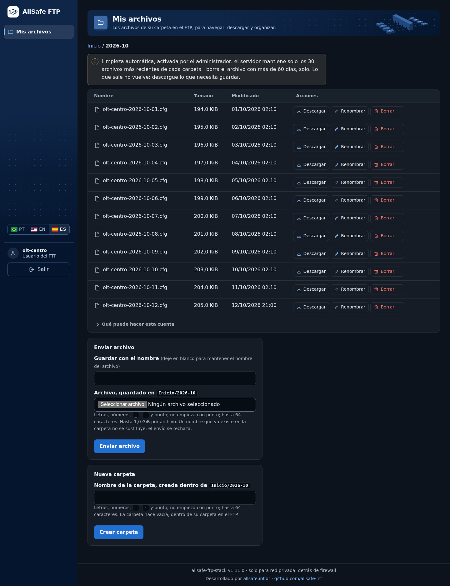</a>

<b>v1.9.0</b> · pantalla Mis archivos, dentro de una carpeta · captura del 2026-10-12

1. Haga clic en el nombre de la carpeta para entrar.
2. Haga clic en **Descargar** en la fila del archivo.
3. Haga clic en **Inicio**, en la ruta de lo alto, para volver a la carpeta del usuario.

**Resultado esperado:** el archivo guardado es idéntico al que envió el equipo, y la pestaña Log, que solo ve el administrador, gana la línea `Archivo descargado`, con el nombre del usuario del FTP, la ruta y el tamaño.

| Límite | Valor |
|---|---|
| Sesiones por usuario del FTP | 3; la cuarta entrada cierra la más antigua |
| Descargas al mismo tiempo por usuario | 2, o el número guardado en sus límites; el siguiente recibe la pantalla `Demasiadas descargas al mismo tiempo` |
| Después de cambiar la contraseña, la carpeta o el perfil, o de eliminar el usuario | Su sesión se cierra en la solicitud siguiente |

Mis archivos ➜ Enviar archivo — haga clic para expandir

### Mis archivos ➜ Enviar archivo

<a href="imagenes/meus-arquivos-enviado.png">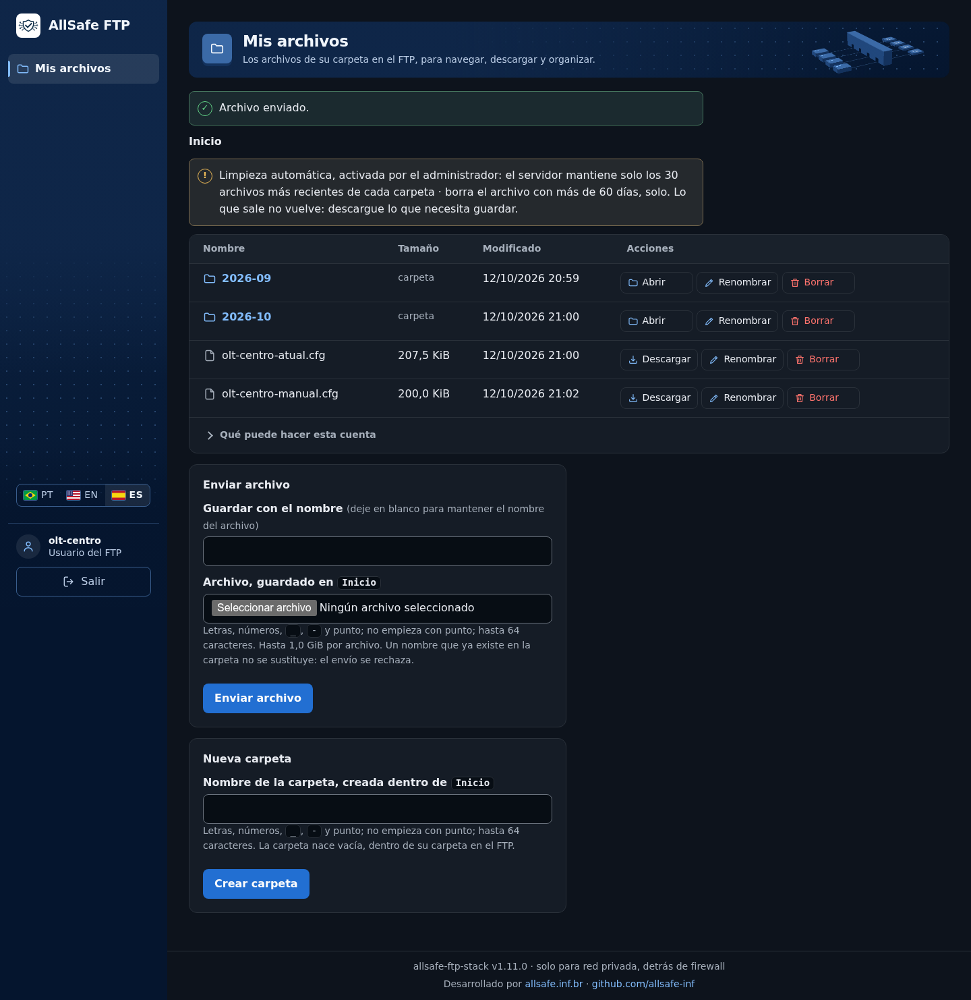</a>

<b>v1.9.0</b> · pantalla Mis archivos, después del envío · captura del 2026-10-12

La tarjeta **Enviar archivo** aparece para la cuenta que tiene el permiso **Permitir que este usuario envíe archivos por el panel**, marcado por el administrador en [Usuarios ➜ Límites](#usuarios). El perfil Lectura no envía, con o sin el permiso.

1. Entre en la carpeta en la que debe quedar el archivo.
2. En la tarjeta **Enviar archivo**, elija el archivo.
3. Haga clic en **Enviar archivo**.

| Campo | Obligatorio | Qué rellenar |
|---|---|---|
| Guardar con el nombre | No | El nombre con el que el archivo queda en el servidor; en blanco, queda el nombre del archivo elegido |
| Archivo | Sí | El archivo a enviar, uno por vez |

**Resultado esperado:** la carpeta vuelve con el mensaje `Archivo enviado.` y el archivo en la lista, y la pestaña Log, que solo ve el administrador, gana la línea `Archivo enviado por el panel`, con el nombre del usuario del FTP, la ruta y el tamaño.

| Regla | Cómo vale |
|---|---|
| Tamaño de cada archivo | El de `PAINEL_ENVIO_MAX_MB`: 1024 MB, por defecto |
| Envíos al mismo tiempo | Uno por cuenta; el siguiente recibe la pantalla `Demasiados envíos al mismo tiempo` |
| Tasa | La tasa de envío guardada en los límites del usuario, si la hay |
| Nombre que ya existe | En los perfiles Completo y Envío, el envío es rechazado y no se reemplaza nada. En el perfil Solo envío, el archivo nuevo se guarda con la fecha y la hora en el nombre |
| Sin el permiso | El envío pedido directamente por la dirección recibe la pantalla `Envío no permitido` y queda registrado |

Mis archivos ➜ Perfil Envío — haga clic para expandir

### Mis archivos ➜ Perfil Envío

<a href="imagenes/meus-arquivos-envio.png">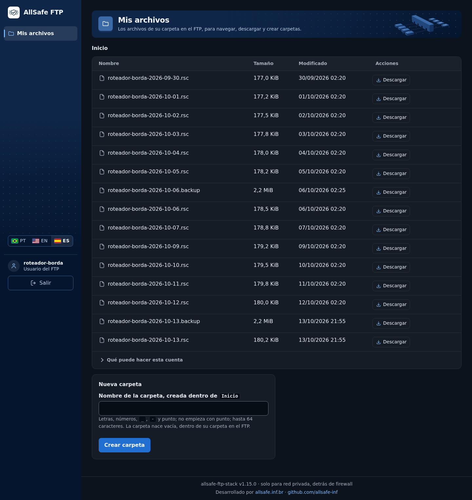</a>

<b>v1.9.0</b> · pantalla Mis archivos, perfil Envío · captura del 2026-10-12

La cuenta de perfil Envío navega, descarga y crea carpetas. No hay **Renombrar** ni **Borrar**: lo que ya llegó al servidor queda como llegó, en el FTP y en el panel. En la foto, `roteador-borda` no tiene el permiso de envío por el panel, y la tarjeta **Enviar archivo** no aparece.

Mis archivos ➜ Perfil Lectura — haga clic para expandir

### Mis archivos ➜ Perfil Lectura

<a href="imagenes/meus-arquivos-leitura.png">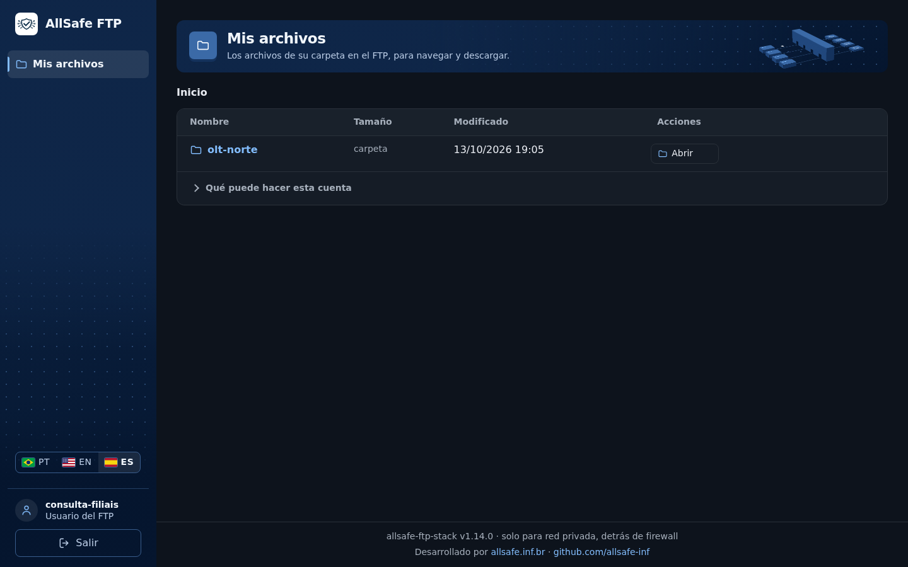</a>

<b>v1.9.0</b> · pantalla Mis archivos, perfil Lectura · captura del 2026-10-12

La cuenta de perfil Lectura solo navega y descarga, y no envía por ningún camino. En la foto, la carpeta de `consulta-filiais` es `filiais`, que tiene dentro la carpeta de `olt-filial-norte`: la cuenta de consulta descarga lo que la OLT envió y no escribe nada.

Mis archivos ➜ Perfil Solo envío — haga clic para expandir

### Mis archivos ➜ Perfil Solo envío

<a href="imagenes/meus-arquivos-so-envio.png">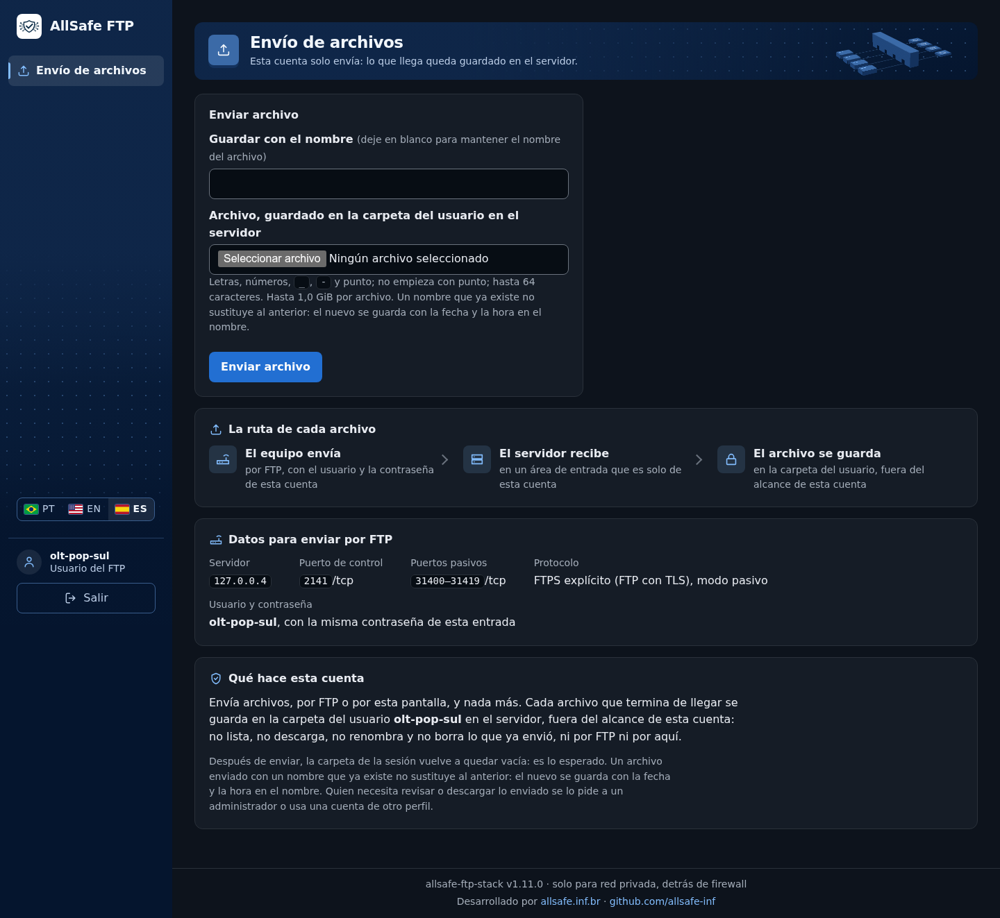</a>

<b>v1.9.0</b> · pantalla Envío de archivos, perfil Solo envío · captura del 2026-10-12

La cuenta de perfil Solo envío no ve las copias de seguridad, ni las que ella misma envió. En lugar de Mis archivos, abre la pantalla **Envío de archivos**, que explica la ruta del archivo y trae los datos para configurar el equipo.

| Tarjeta | Qué muestra |
|---|---|
| **Enviar archivo** | Solo con el permiso de envío por el panel: recibe un archivo del navegador y lo guarda en la carpeta del usuario, sin mostrar lo que hay en ella |
| **La ruta de cada archivo** | Tres pasos: el equipo envía por FTP, el servidor recibe en un área de entrada que es solo de esa cuenta y el archivo se guarda en la carpeta del usuario, fuera de su alcance |
| **Datos para enviar por FTP** | Servidor, puerto de control, puertos pasivos, protocolo y el usuario: lo que hay que rellenar en el equipo |
| **Qué hace esta cuenta** | Que solo envía, que la carpeta de la sesión vuelve a quedar vacía después de cada envío y que el archivo de nombre repetido se guarda con la fecha y la hora en el nombre, sin reemplazar el anterior |

Con el permiso, la cuenta envía por FTP o por esta pantalla, y nada más: el mensaje `Archivo enviado.` confirma la llegada, y el archivo de nombre repetido vuelve con `Archivo enviado. Ya había uno con este nombre: el nuevo se guardó con la fecha y la hora en el nombre.`

Quien necesita verificar o descargar lo que se envió se lo pide a un administrador o usa una cuenta de otro perfil. Las reglas de este perfil están en [Panel web](../panel.md#perfis).

Detalle técnico — lo que alcanza la cuenta del FTP

- Rutas de la sesión del usuario del FTP, por perfil. Solo envío: `GET /` (lleva a `/meus-arquivos`), `GET /meus-arquivos`, `POST /idioma` y `POST /sair`. Lectura añade `GET /meus-arquivos?pasta=<caminho>` y `GET /meus-arquivos/baixar?arquivo=<caminho>`. Envío añade `POST /meus-arquivos/pasta`. Con el permiso de envío por el panel, Solo envío, Envío y Completo ganan `POST /meus-arquivos/enviar`; sin él, la ruta responde `403`, con el evento `recusa_envio`. Completo añade `GET` y `POST` en `/meus-arquivos/renomear?item=<caminho>` y `/meus-arquivos/apagar?item=<caminho>`.
- Cualquier otra ruta responde `404`. Cuando es una ruta de administración, o una acción que el perfil de la cuenta no tiene, queda el evento `recusa_papel`, con el usuario, la ruta y el perfil.
- Renombrar y borrar verifican la contraseña del FTP de la cuenta; la contraseña incorrecta escribe `usuario_senha_atual_recusada`.
- Quien verifica la contraseña es el `pure-ftpd`, por un inicio de sesión en la red interna de la stack; el panel no lee el hash del registro.
- La ruta es siempre relativa a la carpeta del registro, que es su raíz, con las mismas verificaciones de la [pestaña Archivos](#arquivos).
- `PAINEL_ACESSO_USUARIOS_FTP=nao` desactiva esta entrada: el panel pasa a aceptar solo administradores.
- El funcionamiento completo está en [Usuario del FTP en el panel](../panel.md#usuario-ftp).

---

## ☁️ Destinos

<b>v1.9.0</b> · menú Destinos · captura del 2026-10-12

**Para qué sirve:** mandar por sí solo, fuera del servidor, los archivos que llegan a una carpeta. Son tres tipos de destino, con hasta 20 de cada uno: el almacenamiento S3, que guarda la segunda copia o se queda con los archivos y libera el disco, el remoto del rclone, que lleva la carpeta a un servidor de archivos, a una nube de archivos, al almacenamiento de un proveedor de nube o a un servicio de transferencia de archivos, en 41 tipos, y el bot de Telegram, que entrega cada archivo nuevo a una persona, a un grupo o a un canal.

**Cómo llegar:** menú ➜ **Destinos**. Solo el administrador tiene la pestaña.

| Elemento de la pantalla | Qué muestra o hace |
|---|---|
| Etiqueta al lado del nombre | `no configurado`, `activado`, `desactivado` o `faltan los secretos`; en el remoto SFTP del rclone que todavía no pasó por **Probar**, `falta probar` |
| Dirección · Bucket y prefijo · Región | Adónde envía el S3, tal como se guardó |
| Tipo del remoto · Carpeta en el remoto | En el rclone, el tipo elegido y la carpeta del remoto en la que se guardan los archivos |
| Carpeta enviada | La carpeta de los datos que el destino acompaña, con las carpetas de dentro de ella |
| Pasadas | Cada cuánto tiempo el panel revisa la carpeta |
| Después del envío | En el S3, **Copiar** o **Conservar en S3**; en el rclone, siempre **Copiar** |
| Mayor archivo que el bot envía · Idioma de los mensajes | El límite de cada envío por el bot y la lengua de la leyenda y de los avisos |
| Clave de acceso y clave secreta · Acceso del remoto · Token del bot y conversación | Solo dicen que los secretos están guardados: el valor no aparece en la pantalla |
| Clave del servidor | En el remoto SFTP, después de **Probar**: el tipo y la huella digital de la clave que el panel guardó, para compararla con la del servidor |
| Última pasada | Cuándo fue y cuántos archivos salieron, con el tamaño sumado; cuando se detiene antes del final, el motivo en una frase |
| Enviado desde que se activó | El total de archivos y de tamaño que el destino ya recibió |
| Tarjeta **Copia del sistema** | En lo alto de la pestaña, plegada: el título y la marca quedan a la vista, y un clic en el título abre la tarjeta. Ya viene abierta cuando hay una copia en curso, una copia que no se concluyó o secretos faltantes. La marca es `no configurada`, `rutina activada`, `solo por el botón`, `en curso` o `faltan los secretos`; el destino, el bucket y la carpeta, la rutina y la última copia, con la fecha, el tamaño, los archivos y el nombre del objeto |
| Copiar y enviar ahora · Modificar | Pide la copia del sistema en el acto, en segundo plano · abre el formulario de la copia: el S3 que recibe, la carpeta en el bucket, los días y la hora de la rutina |
| Todavía llegando | Archivos que cambiaron hace menos de dos minutos: salen en una próxima pasada |
| A la espera de otro destino | En el S3 en **Conservar en S3**, archivos ya guardados en él que solo salen del servidor cuando los otros destinos de la carpeta los entreguen |
| **Probar** | Guarda un objeto pequeño en el S3 o un archivo pequeño en el remoto del rclone, o envía el mensaje de prueba por el bot, con lo que está guardado |
| **Enviar ahora** | Pide una pasada fuera de hora; actualice la pantalla para seguirla |
| **Modificar** | Abre el formulario con lo que está guardado; un secreto en blanco mantiene el guardado |
| **Nuevo con el mismo acceso** | Abre el formulario de un destino nuevo del mismo tipo, con los secretos de este |
| **Eliminar** | Abre la confirmación que borra la configuración, el avance y los secretos de ese destino, y solo de él |
| **Nuevo S3** · **Nuevo remoto** · **Nuevo bot** | En lo alto de la pantalla, después del primer destino del tipo: abren el formulario en blanco de uno más |
| **Cómo envía el panel** | En lo alto de la pantalla, plegado: se abre con un clic y trae el resumen de las reglas: por dónde sale el panel del servidor, solo archivo común y dónde quedan los secretos |

Cada destino tiene su carpeta, su intervalo y sus secretos, y uno no depende del otro. El S3 y el remoto del rclone envían todo lo que está en la carpeta, incluso lo que ya estaba allí cuando se activaron, en cada intervalo. El bot envía solo lo que llega después de activado: en pocos segundos cuando el archivo llega entero por FTP o por el panel, y en cada intervalo lo que apareció en la carpeta de otro modo. Las reglas completas están en [Panel web](../panel.md#destinos).

Destinos ➜ Antes de configurar — haga clic para expandir

### Destinos ➜ Antes de configurar

<a href="imagenes/destinos-sem-destino.png">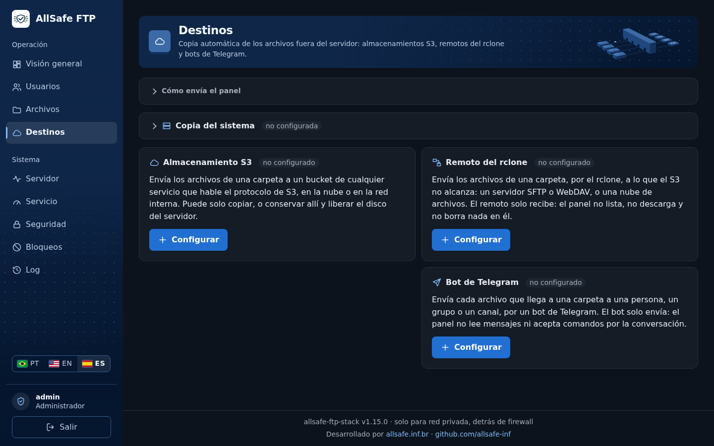</a>

<b>v1.9.0</b> · menú Destinos, sin destino guardado · captura del 2026-10-12

La instalación nace sin destino: mientras el administrador no guarde uno, nada sale del servidor y el panel no abre conexión hacia afuera. Cada tarjeta dice lo que hace el destino y lleva a su formulario, por el botón **Configurar**.

Destinos ➜ Almacenamiento S3 — haga clic para expandir

### Destinos ➜ Almacenamiento S3

<a href="imagenes/destinos-s3.png">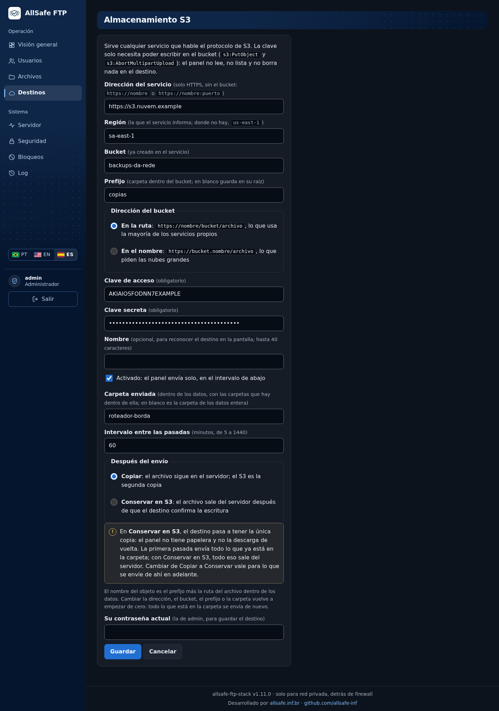</a>

<b>v1.9.0</b> · menú Destinos, formulario del S3 · captura del 2026-10-12

Sirve cualquier servicio que hable el protocolo del S3, en la nube o en la red interna. Antes de empezar, cree el bucket en el servicio y una clave que solo pueda escribir en él.

1. En la pestaña Destinos, haga clic en **Configurar** en la tarjeta **Almacenamiento S3**.
2. Rellene la dirección, la región, el bucket y las dos claves.
3. Elija la carpeta enviada, el intervalo y lo que ocurre después del envío.
4. Escriba su contraseña y haga clic en **Guardar**.

| Campo | Obligatorio | Qué rellenar |
|---|---|---|
| Dirección del servicio | Sí | `https://nome` o `https://nome:porta`, solo HTTPS y sin el bucket |
| Región | Sí | La que informa el servicio; donde no hay, `us-east-1` |
| Bucket | Sí | El nombre del bucket, ya creado en el servicio |
| Prefijo | No | La carpeta dentro del bucket; en blanco, guarda en su raíz |
| Dirección del bucket | Sí | **En la ruta** (`https://nome/bucket/arquivo`) o **En el nombre** (`https://bucket.nome/arquivo`), como pide el servicio |
| Clave de acceso | Sí | La clave que puede escribir en el bucket. En **Modificar**, en blanco mantiene la guardada |
| Clave secreta | Sí | La otra mitad de la clave. En **Modificar**, en blanco mantiene la guardada |
| Nombre | No | Hasta 40 caracteres, para reconocer el destino en la pantalla cuando hay más de uno del tipo |
| Activado | No | Marcada, el panel envía por sí solo; desmarcada, la configuración queda guardada y nada sale |
| Carpeta enviada | No | La carpeta dentro de los datos, que tiene que existir; en blanco es la carpeta de los datos entera |
| Intervalo entre las pasadas | Sí | Minutos, de 5 a 1440 |
| Después del envío | Sí | **Copiar**: el archivo sigue en el servidor. **Conservar en S3**: el archivo sale del servidor después de que el destino confirma la escritura |
| Su contraseña actual | Sí | La contraseña de quien está en la sesión, para guardar el destino |

<a href="imagenes/destinos-gravado.png">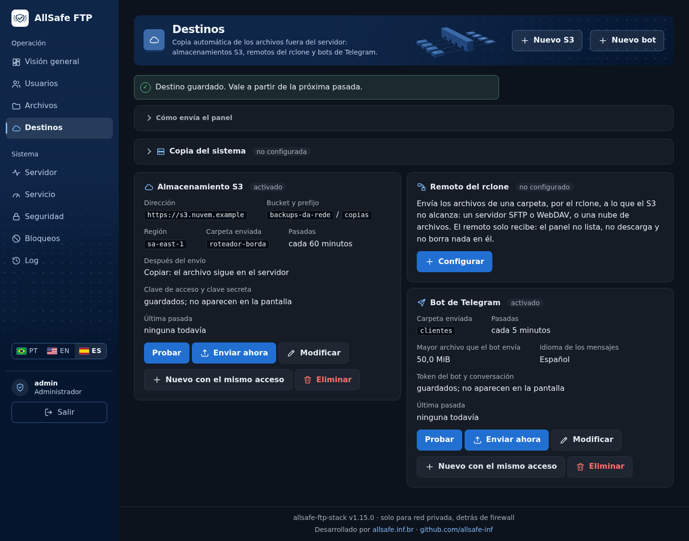</a>

<b>v1.9.0</b> · menú Destinos, después de guardar · captura del 2026-10-12

**Resultado esperado:** la pestaña vuelve con el aviso `Destino guardado. Vale a partir de la próxima pasada.`, y la tarjeta muestra la etiqueta `activado`, la dirección, el bucket, la carpeta y que las claves están guardadas, sin mostrarlas. La primera pasada empieza en hasta un minuto y envía todo lo que ya está en la carpeta.

> ⚠️ **Conservar en S3 deja una sola copia:** el archivo sale del servidor después de guardado en el destino, y el panel no tiene papelera ni lo descarga de vuelta. Empiece con **Copiar**, verifique los objetos en el bucket y solo entonces cambie.

| Mensaje | Motivo |
|---|---|
| Dirección no válida: use https://nombre o https://nombre:puerto, en minúsculas y sin ruta. | La dirección no es HTTPS, tiene mayúscula o trae el bucket o una ruta |
| Bucket no válido: de 3 a 63 caracteres, con letras minúsculas, números, punto y guion. | El nombre del bucket se sale de la regla |
| La carpeta no existe dentro de los datos. Créela en Archivos o revise el nombre. | La carpeta enviada no se encontró |
| Complete los dos secretos del destino: ninguno de ellos está guardado todavía. | En la primera escritura, una de las claves quedó en blanco |
| Intervalo no válido: de 5 a 1440 minutos. | El intervalo está fuera del rango |

Destinos ➜ Remoto del rclone — haga clic para expandir

### Destinos ➜ Remoto del rclone

<a href="imagenes/destinos-rclone-tipo.png">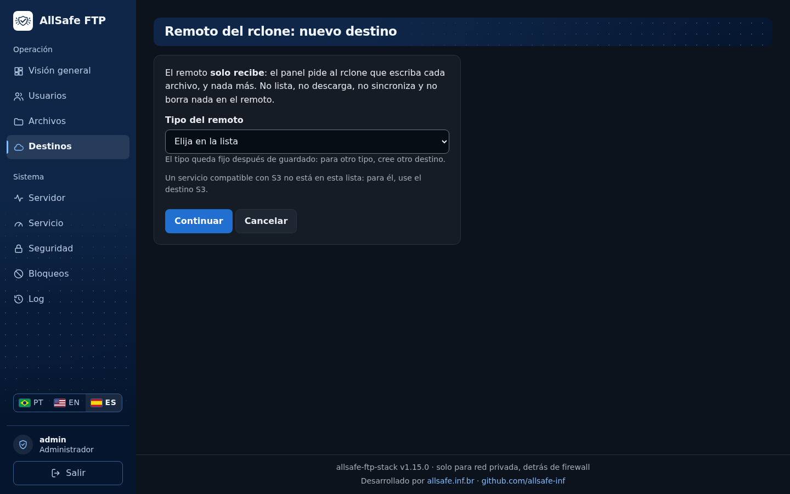</a>

<b>v1.10.0</b> · menú Destinos, elección del tipo del remoto · captura del 2026-10-12

El rclone es el programa de envío de archivos que viene dentro de la imagen del panel. Por él, la carpeta va a lo que el S3 no alcanza, en 41 tipos de remoto: servidores de archivos (SFTP, WebDAV, FTP con TLS y Seafile), nubes de archivos (Google Drive, OneDrive, Dropbox, pCloud, Box, Mega y otras), almacenamiento de proveedores de nube y servicios de transferencia de archivos para empresas. El remoto solo recibe: el panel no lista, no descarga, no sincroniza y no borra nada en él.

1. En la pestaña Destinos, haga clic en **Configurar** en la tarjeta **Remoto del rclone**.
2. Elija el **Tipo del remoto** en la lista, separada en cuatro grupos, y haga clic en **Continuar**.

<b>v1.9.0</b> · menú Destinos, formulario del remoto SFTP · captura del 2026-10-12

3. Rellene la **Carpeta en el remoto**, la **Carpeta enviada** y el **Intervalo entre las pasadas**.
4. En **Acceso del remoto**, rellene los campos del tipo elegido.
5. Escriba su contraseña y haga clic en **Guardar**.

| Campo | Obligatorio | Qué rellenar |
|---|---|---|
| Carpeta en el remoto | No | Dónde se guardan los archivos, con hasta 16 niveles separados por barra; en blanco es la carpeta en la que entra el remoto |
| Nombre | No | Hasta 40 caracteres, para reconocer el destino en la pantalla cuando hay más de uno del tipo |
| Activado | No | Marcada, el panel envía por sí solo; desmarcada, la configuración queda guardada y nada sale |
| Carpeta enviada | No | La carpeta dentro de los datos, que tiene que existir; en blanco es la carpeta de los datos entera |
| Intervalo entre las pasadas | Sí | Minutos, de 5 a 1440 |
| Servidor | Sí | En el SFTP, el nombre o la dirección IP, sin el puerto |
| Puerto | No | En blanco es el 22 |
| Usuario | Sí | La cuenta del servidor que recibe los archivos |
| Contraseña | Una de las dos | La contraseña de la cuenta, cuando el acceso no es por clave |
| Clave privada | Una de las dos | El archivo entero, de la línea BEGIN a la línea END, en lugar de la contraseña |
| Frase de la clave privada | No | Solo cuando la clave está cifrada |
| Clave pública del servidor | No | Una por línea, como en el archivo de servidores conocidos del SSH; en blanco, **Probar** guarda la que el servidor presente |
| Su contraseña actual | Sí | La contraseña de quien está en la sesión, para guardar el destino |

Los campos del acceso cambian con el tipo. Los de los otros 40 tipos están en [Panel web](../panel.md#destinos). El formulario de cada tipo trae solo sus campos y, cuando la cuenta tiene alguna condición, el aviso correspondiente. El del Mega, por ejemplo, pide el usuario y la contraseña:

<a href="imagenes/destinos-rclone-mega.png">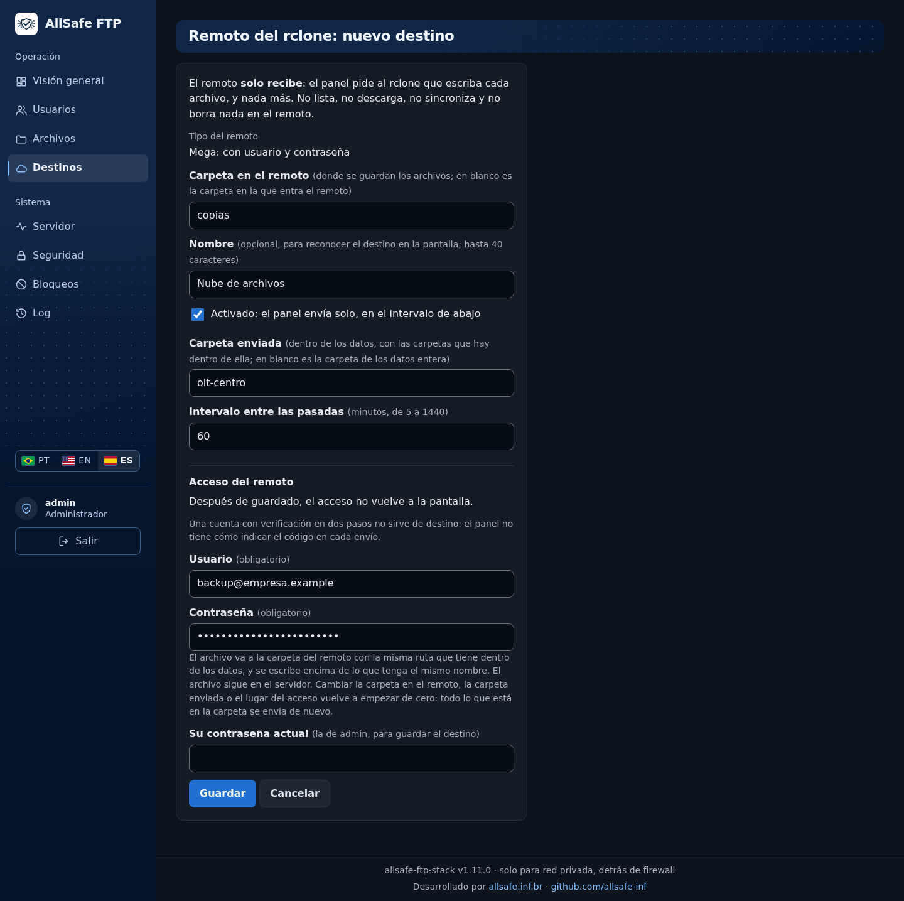</a>

<b>v1.10.0</b> · menú Destinos, formulario del remoto Mega, con una cuenta de ejemplo que no se guardó · captura del 2026-10-12

<b>v1.9.0</b> · menú Destinos, remoto guardado y todavía sin la prueba · captura del 2026-10-12

6. De vuelta en la pestaña, haga clic en **Probar** en la tarjeta del remoto.

<b>v1.9.0</b> · menú Destinos, remoto después de la prueba · captura del 2026-10-12

**Resultado esperado:** al guardar, la pestaña vuelve con el aviso `Destino guardado. Vale a partir de la próxima pasada.` y la tarjeta del remoto, con el tipo, la carpeta en el remoto, la carpeta enviada y el acceso guardado, sin mostrarlo. En el SFTP, la tarjeta queda con la etiqueta `falta probar`. La prueba guarda el archivo `allsafe-ftp-stack-teste.txt` en la carpeta del remoto y responde `Prueba concluida: el destino recibió.`; la tarjeta pasa a `activado` y gana la línea **Clave del servidor**, con la huella digital para compararla con la del servidor. La primera pasada empieza en hasta un minuto y envía todo lo que ya está en la carpeta.

| Situación | Qué ocurre |
|---|---|
| Remoto SFTP sin **Probar** | No se envía nada: el panel todavía no guardó la clave del servidor |
| Clave del servidor distinta de la guardada | El envío se detiene, y la tarjeta dice el motivo; si el cambio fue del propio servidor, guarde el acceso de nuevo y pruebe |
| Tipo que pide el **Token de la cuenta**, como Google Drive, OneDrive, Dropbox, pCloud y Box | El token se obtiene fuera del panel, con el comando `rclone authorize` que muestra la pantalla, en una computadora con navegador, y se pega en el campo **Token de la cuenta** |
| Remoto FTP | Solo envía con TLS, explícito o implícito, y con el certificado del servidor verificado |
| Mega y Proton Drive con verificación en dos pasos | La cuenta no sirve de destino: el panel no tiene cómo informar el código en cada envío |
| Tipo de bucket, como Backblaze B2 y Azure Blob Storage | La **Carpeta en el remoto** es obligatoria y empieza por el nombre del bucket o del contenedor, que ya tiene que existir |
| **Modificar** | El acceso guardado no vuelve a la pantalla: en blanco, sigue el guardado; para cambiar cualquier parte de él, rellene el acceso entero de nuevo |
| Tipo del remoto | Queda fijo después de guardado: para otro tipo, cree otro destino |
| Ruta en el remoto | La misma que el archivo tiene dentro de los datos, a partir de la carpeta en el remoto; sobrescribe lo que tenga el mismo nombre |
| El archivo en el servidor | Sigue en él: el remoto recibe una copia, y el panel no borra nada en el remoto |

| Mensaje | Motivo |
|---|---|
| Elija el tipo del remoto. | Se hizo clic en **Continuar** sin un tipo marcado |
| Carpeta en el remoto no válida: hasta 16 niveles separados por barra, con letras, números, espacio, _, - y punto. | La carpeta en el remoto se sale de la regla |
| Acceso incompleto: indique la contraseña, la clave privada, el token o la credencial con que se abre el remoto. El acceso entero cabe en 16 KiB. | Faltó el secreto del acceso, o pasa del tamaño |
| La frase vale solo para clave privada cifrada: la clave cifrada pide la frase, y la clave sin cifrar no lleva frase. | La frase se rellenó sin clave cifrada, o la clave cifrada vino sin la frase |
| Complete el acceso del remoto: no hay ninguno guardado para mantener. | En la primera escritura, los campos del acceso quedaron en blanco |

Destinos ➜ Bot de Telegram — haga clic para expandir

### Destinos ➜ Bot de Telegram

<a href="imagenes/destinos-telegram.png">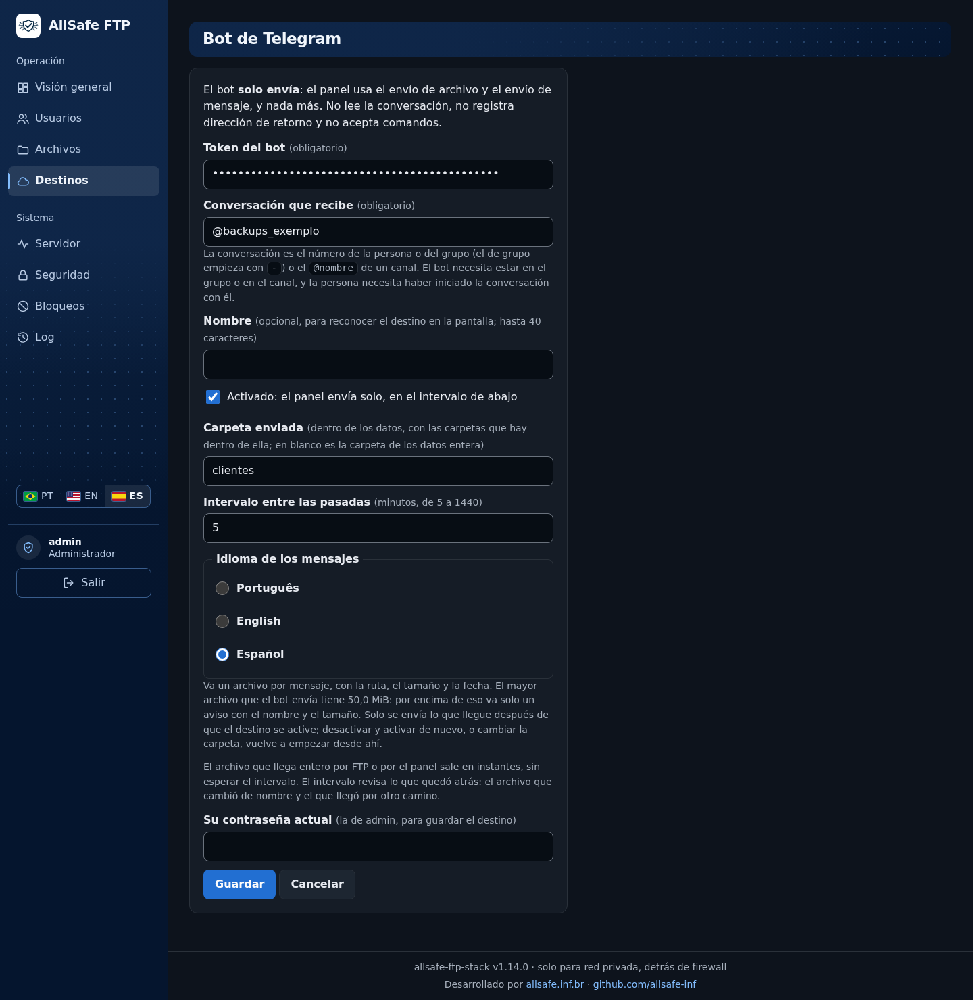</a>

<b>v1.9.0</b> · menú Destinos, formulario del bot · captura del 2026-10-12

Antes de empezar, cree el bot en el creador de bots de Telegram y guarde el token que entrega. Ponga el bot en el grupo o en el canal que va a recibir; para una persona, ella tiene que haber iniciado la conversación con el bot.

1. En la pestaña Destinos, haga clic en **Configurar** en la tarjeta **Bot de Telegram**.
2. Rellene el token del bot y la conversación que recibe.
3. Elija la carpeta enviada, el intervalo y el idioma de los mensajes.
4. Escriba su contraseña y haga clic en **Guardar**.

| Campo | Obligatorio | Qué rellenar |
|---|---|---|
| Token del bot | Sí | El texto entero que entrega el creador de bots. En **Modificar**, en blanco mantiene el guardado |
| Conversación que recibe | Sí | El número de la persona o del grupo (el de grupo empieza con `-`) o el `@nome` del canal. En **Modificar**, en blanco mantiene la guardada |
| Nombre | No | Hasta 40 caracteres, para reconocer el destino en la pantalla cuando hay más de uno del tipo |
| Activado | No | Marcada, el panel envía por sí solo; desmarcada, la configuración queda guardada y nada sale |
| Carpeta enviada | No | La carpeta dentro de los datos, que tiene que existir; en blanco es la carpeta de los datos entera |
| Intervalo entre las pasadas | Sí | Minutos, de 5 a 1440: es la revisión de lo que no salió en el acto |
| Idioma de los mensajes | Sí | Português, English o Español, para la leyenda de cada archivo y los avisos |
| Su contraseña actual | Sí | La contraseña de quien está en la sesión, para guardar el destino |

**Resultado esperado:** la pestaña vuelve con el aviso `Destino guardado. Vale a partir de la próxima pasada.` y la tarjeta con la etiqueta `activado`. De ahí en adelante, cada archivo que llega entero a la carpeta, por FTP o por el panel, va a la conversación en pocos segundos, como documento, con la ruta, el tamaño y la fecha en la leyenda.

| Situación | Qué hace el bot |
|---|---|
| Archivo que ya estaba en la carpeta cuando se activó el destino | No envía: solo va lo que llegue después |
| Archivo mayor que el límite, de 50 MiB por defecto | No envía el archivo: la conversación recibe un aviso con la ruta, el tamaño y la fecha |
| Archivo vacío | No envía |
| Mensaje escrito en la conversación | Nada: el bot solo envía, no lee la conversación y no acepta comandos |

Destinos ➜ Varios destinos del mismo tipo — haga clic para expandir

### Destinos ➜ Varios destinos del mismo tipo

<b>v1.9.0</b> · menú Destinos, destino nuevo con el acceso de otro · captura del 2026-10-12

Cada tipo acepta hasta 20 destinos. El destino nuevo puede usar el acceso de uno que ya funciona: sirve para mandar otra carpeta al mismo bucket, la misma carpeta a otro bucket, otra carpeta al mismo servidor por el rclone u otra carpeta a otro grupo por el mismo bot.

1. En la tarjeta del destino que ya funciona, haga clic en **Nuevo con el mismo acceso**.
2. Dé un **Nombre** al destino y cambie la **Carpeta enviada** o el lugar: el prefijo o el bucket, en el S3; la carpeta en el remoto, en el rclone; la conversación, en el bot.
3. Deje los secretos en blanco, escriba su contraseña y haga clic en **Guardar**. En el rclone, el acceso es uno solo: en blanco vale el del destino de origen entero.

<a href="imagenes/destinos-varios.png">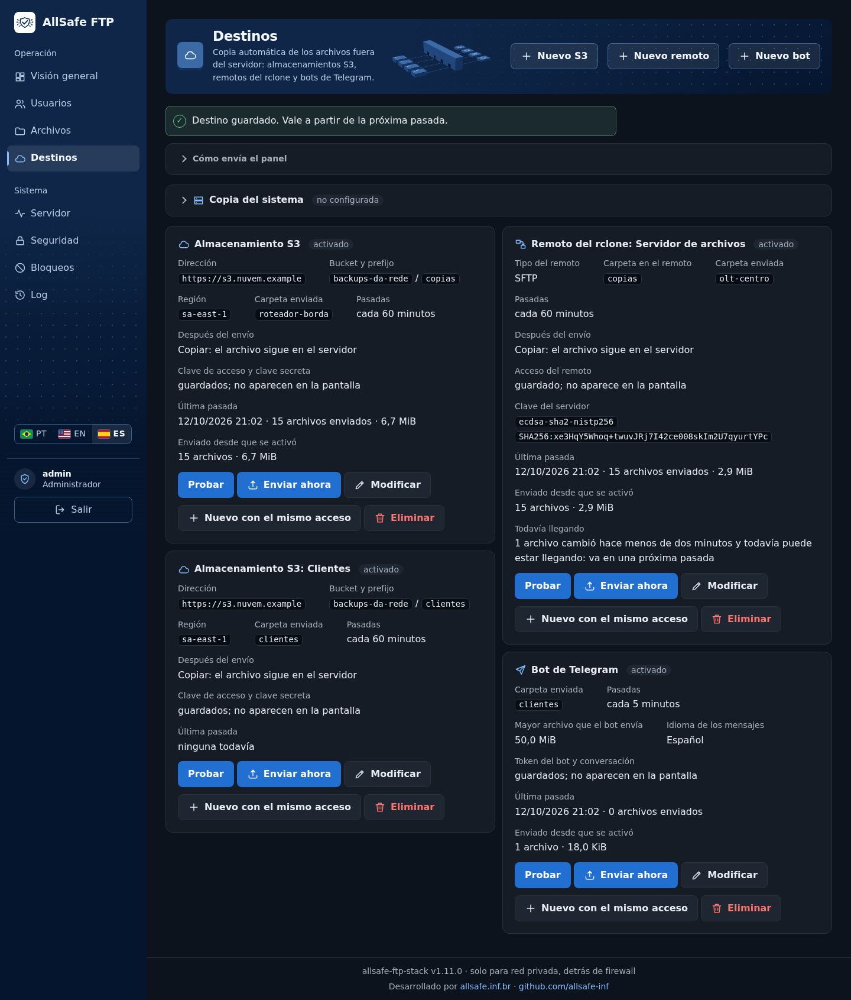</a>

<b>v1.9.0</b> · menú Destinos, con dos destinos S3 · captura del 2026-10-12

**Resultado esperado:** la pestaña vuelve con el aviso `Destino guardado. Vale a partir de la próxima pasada.` y una tarjeta más, con el tipo y el nombre dado. El secreto dejado en blanco se copió del otro destino dentro del servidor, sin pasar por el navegador.

| Elemento | Cómo funciona |
|---|---|
| **Nuevo S3** · **Nuevo remoto** · **Nuevo bot** | Abren el formulario en blanco, para un destino con otras claves, con otro acceso o con otro bot |
| Misma carpeta en el mismo lugar | Rechazado, con `Este destino ya existe`: cambie la carpeta o el lugar |
| Límite | 20 destinos por tipo; con los 20 guardados, los botones de destino nuevo desaparecen hasta que se elimine uno |
| Avance | Cada destino tiene el suyo: modificar, probar o eliminar uno no toca los otros |
| Varios destinos en la misma carpeta | Los bots entregan primero, después los remotos del rclone, los S3 que copian y, por último, los que conservan; el que conserva solo borra del servidor después de que todos los otros entregaron |

Destinos ➜ Probar y Enviar ahora — haga clic para expandir

### Destinos ➜ Probar y Enviar ahora

<a href="imagenes/destinos-teste.png">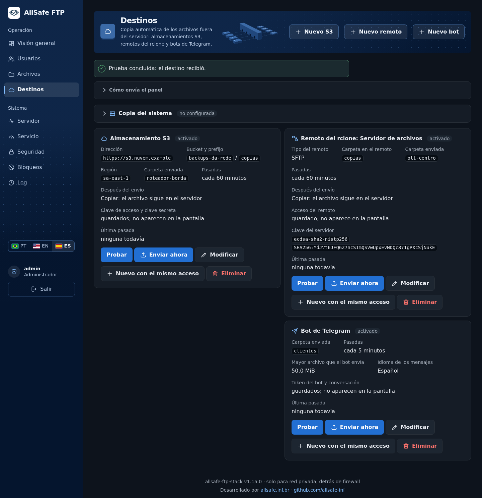</a>

<b>v1.9.0</b> · menú Destinos, después de la prueba · captura del 2026-10-12

1. En la tarjeta del destino, haga clic en **Probar**.
2. Para no esperar el intervalo, haga clic en **Enviar ahora** y actualice la pantalla enseguida.

**Resultado esperado:** la prueba responde `Prueba concluida: el destino recibió.`: en el S3, quedó guardado el objeto `allsafe-ftp-stack-teste.txt` en el prefijo elegido; en el remoto del rclone, el archivo con el mismo nombre en la carpeta del remoto, y, en el SFTP, el panel guardó la clave del servidor; por el bot, la conversación recibió el mensaje de prueba del panel. **Enviar ahora** responde `Pasada solicitada: el panel empieza en instantes. Actualice la pantalla para seguirla.`, y la línea **Última pasada** pasa a mostrar cuántos archivos salieron.

| Elemento | Cómo funciona |
|---|---|
| **Probar** con el destino desactivado | Funciona: la prueba usa lo que está guardado y no envía ningún archivo |
| Prueba que no sale bien | El aviso trae el nombre del destino y el motivo en una frase, como `el servicio rechazó la credencial o el permiso` |
| **Enviar ahora** en el S3 y en el rclone | Respeta la espera de dos minutos del archivo sin cambiar; lo que todavía está llegando queda en la línea **Todavía llegando** |
| Contraseña | Ninguno de los dos botones pide la contraseña: no cambian la configuración |

Qué quiere decir cada motivo y qué hacer está en [Solución de problemas](../solucion-de-problemas.md#destinos).

Destinos ➜ Copia del sistema — haga clic para expandir

### Destinos ➜ Copia del sistema

<a href="imagenes/destinos-copia.png">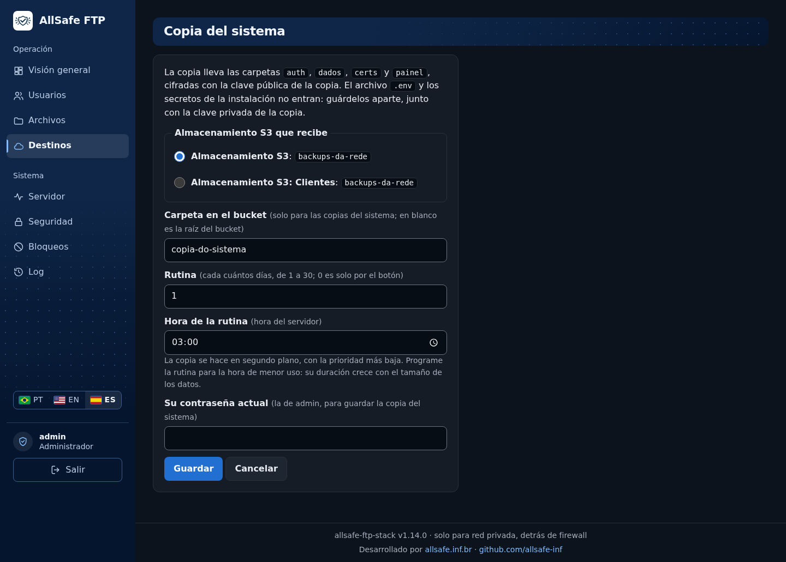</a>

<b>v1.9.0</b> · menú Destinos, formulario de la copia del sistema · captura del 2026-10-12

La tarjeta **Copia del sistema**, en lo alto de la pestaña, envía el sistema entero, cifrado, a uno de los almacenamientos S3 guardados. Queda plegada: un clic en el título la abre. Abierta, ofrece el **Configurar** después de que existe un S3 con los secretos.

1. Haga clic en el título de la tarjeta **Copia del sistema**, para abrirla, y haga clic en **Configurar**.
2. Elija el **Almacenamiento S3 que recibe** y la **Carpeta en el bucket**.
3. En **Rutina**, escriba cada cuántos días se hace la copia, y la **Hora de la rutina**; con `0`, solo por el botón.
4. Escriba su contraseña y haga clic en **Guardar**.
5. De vuelta en la pestaña, abra la tarjeta de nuevo, haga clic en **Copiar y enviar ahora** y actualice la pantalla enseguida.

<a href="imagenes/destinos-copia-feita.png">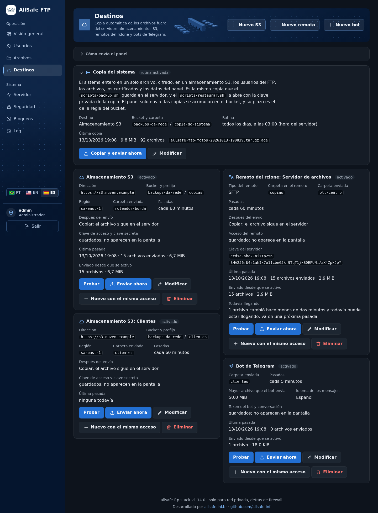</a>

<b>v1.9.0</b> · menú Destinos, después de la copia del sistema · captura del 2026-10-12

**Resultado esperado:** al guardar, el aviso es `Copia del sistema guardada. La rutina vale a partir de ahora.`; después del botón, `Copia del sistema solicitada: se hace en segundo plano. Actualice la pantalla para seguirla.` Al final, la línea **Última copia** trae la fecha, el tamaño, la cantidad de archivos y el nombre del objeto guardado en el bucket.

| Elemento | Cómo funciona |
|---|---|
| Qué va | Las carpetas `auth`, `dados`, `certs` y `painel`, en un solo archivo, cifrado con la clave pública de la copia, más su `.sha256` |
| Qué no va | El `.env` y los secretos de la instalación y de los destinos: quedan guardados aparte, con la clave privada de la copia |
| Copias antiguas | El panel solo envía: ninguna se borra, y su plazo es el de la regla del bucket |
| Una a la vez | Con una copia en curso, la tarjeta tiene la marca `en curso` y el botón desaparece |
| Copia que no termina | Ningún objeto queda en el destino, y la tarjeta dice el motivo en una frase |
| Restaurar | Descargue los dos objetos y use el `scripts/restaurar.sh`: vea [Copia en S3, desde el panel](../backup.md#no-s3) |

El funcionamiento completo está en [Copia del sistema a S3](../panel.md#copia-do-sistema).

Destinos ➜ Eliminar — haga clic para expandir

### Destinos ➜ Eliminar

<a href="imagenes/destinos-remover.png">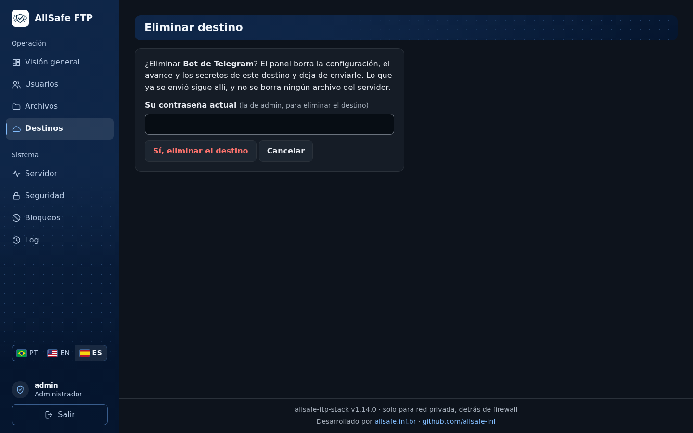</a>

<b>v1.9.0</b> · menú Destinos, confirmación de eliminación · captura del 2026-10-12

1. En la tarjeta del destino, haga clic en **Eliminar**.
2. Escriba su contraseña y haga clic en **Sí, eliminar el destino**.

**Resultado esperado:** la pestaña vuelve con el aviso `Destino eliminado: su configuración y sus secretos fueron borrados.` y la tarjeta como `no configurado`. Lo que ya se envió sigue en el destino, y ningún archivo del servidor se borra.

Detalle técnico — rutas, secretos y eventos

- Rutas `GET /destinos`, `GET` y `POST /destinos/s3`, `/destinos/rclone` y `/destinos/telegram`, `POST /destinos/testar`, `POST /destinos/agora`, `GET` y `POST /destinos/arquivo`, `GET` y `POST /destinos/remover`, `GET` y `POST /destinos/copia` y `POST /destinos/copia/agora`. Todo `POST` lleva el token de la sesión; guardar y eliminar piden también la contraseña actual. Para el usuario del FTP, todas responden `404`.
- La configuración queda en `DATA_DIR/painel/destinos/<destino>.conf` y el avance, en `<destino>.estado`. Los secretos quedan en `SECRETS_DIR/destinos`, uno por archivo, con modo `0600`, y no vuelven a la pantalla, a la pestaña Log ni a la auditoría.
- El panel solo sale del servidor por HTTPS, con el certificado verificado, y no sigue redirecciones. Por el remoto del rclone, sale también por FTP con TLS, con el certificado verificado, y, en el SFTP, por SSH, con la clave del servidor verificada.
- Los eventos `destino_gravado`, `destino_teste`, `destino_pedido`, `destino_arquivo`, `destino_enviado`, `destino_falhou`, `destino_pulado` y `destino_removido`, y los de la copia del sistema, `copia_gravada`, `copia_pedida`, `copia_enviada`, `copia_falhou` y `copia_sem_destino`, quedan en la [auditoría](../panel.md#auditoria).
- Con `PAINEL_DESTINOS=nao` en el `.env`, la pestaña sale del menú y ninguna pasada ocurre: vea [Configuración](../configuracion.md#painel).
- El funcionamiento completo está en [Destinos: S3, rclone y bot de Telegram](../panel.md#destinos), y el de la copia del sistema, en [Copia del sistema a S3](../panel.md#copia-do-sistema).

---

## 🖥️ Servidor

<a href="imagenes/servidor.png">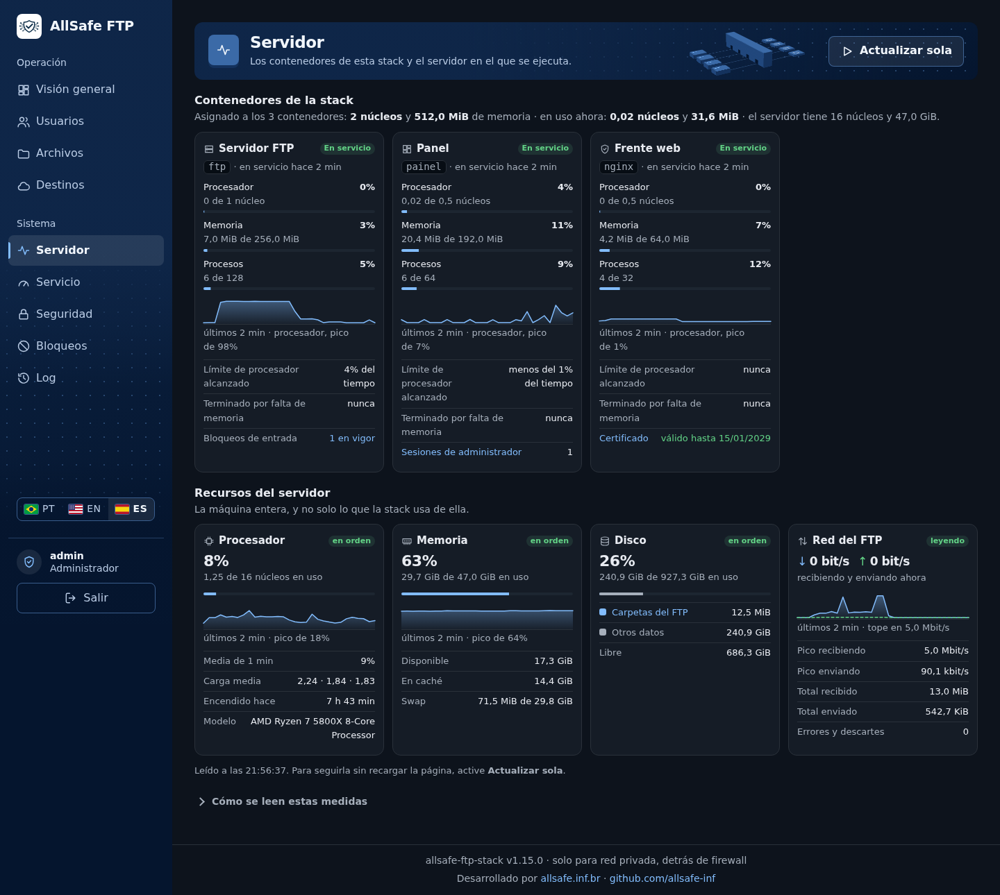</a>

<b>v1.9.0</b> · menú Servidor · captura del 2026-10-12

**Para qué sirve:** seguir cuánto usa cada contenedor de la stack de lo que se le asignó y cuánto sobra en la máquina en que corre la stack.

**Cómo llegar:** menú ➜ **Servidor**; en la Visión general, el atajo `ver el servidor` de la tarjeta **Servidor y contenedores**.

| Elemento de la pantalla | Qué muestra |
|---|---|
| **Actualizar sola** | Recarga la pestaña cada 10 segundos; activada, pasa a ser **Detener la actualización**. La recarga automática no renueva la sesión: sin uso de quien está frente a la pantalla, se cierra en el plazo de siempre |
| Línea de resumen | Cuántos núcleos y cuánta memoria se asignaron a los tres contenedores, cuánto está en uso ahora y el tamaño del servidor |
| **Servidor FTP** · **Panel** · **Frente web** | Un cuadro por contenedor (`ftp`, `painel` y `nginx`): `En servicio` y desde hace cuánto tiempo, procesador, memoria y procesos, cada uno con el uso y el límite asignado, y el gráfico del procesador en el último minuto, con el pico |
| Límite de procesador alcanzado · Terminado por falta de memoria | En qué parte del período del gráfico se acabó la cuota de procesador del contenedor y cuántas veces fue terminado por falta de memoria desde que arrancó |
| Última línea de cada cuadro | Lo que es propio del servicio: bloqueos de entrada en vigor, en el FTP; sesiones de administrador, en el panel; validez del certificado, en el frente web |
| **Recursos del servidor** ➜ Procesador | Uso de la máquina entera, con el promedio de 1 minuto, la carga media, desde hace cuánto tiempo está encendida y el modelo del procesador |
| **Recursos del servidor** ➜ Memoria | En uso, disponible, en caché y swap |
| **Recursos del servidor** ➜ Disco | Uso del disco de la carpeta de los datos, separado en carpetas del FTP, otros datos y libre |
| **Recursos del servidor** ➜ Red del FTP | Cuánto recibe y envía el FTP ahora, los picos, los totales desde que el servicio inició y los errores y descartes |
| Línea `Leído a las` | La hora de la lectura que está en la pantalla |
| **Cómo se leen estas medidas** | Plegado al final de la pestaña: de dónde viene cada número y cuánto tiempo guarda el historial |

Esta pestaña no modifica nada, y solo el administrador la ve. Los límites de cada contenedor son los de `*_CPU_LIMIT`, `*_MEMORY_LIMIT` y `*_PIDS_LIMIT` del `.env`: vea [Configuración](../configuracion.md#limites-de-recurso-do-container).

Detalle técnico — de dónde vienen las medidas

- Ruta `GET /servidor`; con `?auto=1`, la respuesta lleva el encabezado `Refresh` de 10 segundos. La página no usa JavaScript.
- Cada contenedor lee su propio uso y los límites que recibió en el `compose.yaml`; ninguno de ellos accede al Docker del host.
- El historial guarda los últimos 10 minutos, con una lectura cada 5 segundos, y vuelve a empezar cuando el panel reinicia.
- La memoria en uso no cuenta la caché de archivos que el sistema suelta cuando la necesita.
- El funcionamiento completo está en [Panel web](../panel.md#servidor).

---

## 🔐 Seguridad

<b>v1.9.0</b> · menú Seguridad · captura del 2026-10-12

**Para qué sirve:** verificar, en una pantalla, si la instalación está dentro de lo que la stack exige: red privada, TLS, certificados válidos, panel aislado y contacto de seguridad publicado.

**Cómo llegar:** menú ➜ **Seguridad**.

| Elemento de la pantalla | Qué muestra |
|---|---|
| Resumen en lo alto | Cuántos elementos se verificaron, cuántos están en orden, cuántos piden atención, cuántos tienen problema y cuántos el panel no verifica o no se aplican |
| Dirección pública | Si la stack rechaza dirección pública (el valor por defecto) o si fue aceptada con `REDE_PERMITIR_IP_PUBLICO=sim`; con `PAINEL_AVISO_EXPOSICAO=nao`, es aquí donde queda dicho que el aviso del menú, del comienzo de la pestaña y del pie de página está oculto |
| Panel por proxy o túnel | Si el panel acepta la dirección del cliente informada por un proxy o túnel (`PAINEL_PROXY_CONFIAVEL`) y de qué direcciones la acepta; en blanco, que es el valor por defecto, la línea dice que el panel no está publicado por ese camino |
| Dirección del FTP · IP anunciada en el modo pasivo | Dónde escucha el FTP y la IP que informa al cliente, con la indicación de privada o pública |
| TLS del FTP | El modo en uso (`FTP_TLS_MODE`), si la excepción por usuario está activada y quién está dispensado |
| Certificado del FTP · Certificado del panel | Validez y huella digital SHA-256, para comparar con la que muestran el cliente FTP y el navegador |
| Dirección del panel · Frente web | Dónde publica el nginx el panel y cómo reenvía las solicitudes |
| Quién puede abrir el panel | Las redes de `PAINEL_REDES_PERMITIDAS`; una red pública en la lista aparece destacada |
| Sesión | Tiempo sin uso, tiempo máximo y bloqueo por entrada incorrecta |
| Segundo factor | Con el segundo factor obligatorio, dice que toda cuenta del panel, administrador o usuario del FTP, pasa por la contraseña y por el código de la aplicación, y lista los administradores que todavía no lo registraron. Con el opcional, el elemento se llama `Segundo factor de los administradores` y dice si todos entran con la contraseña y el código, o quién entra solo con la contraseña; pide atención cuando el panel se alcanza desde fuera de la red privada y alguien está sin él. En los dos casos, pide atención cuando una cuenta está activada sin la clave en el servidor |
| Entrada de los usuarios del FTP | Si los usuarios del FTP entran en el panel (`PAINEL_ACESSO_USUARIOS_FTP`) y cómo se verifica su contraseña |
| Bloqueo por intento en el FTP | Cuántas contraseñas incorrectas desde la misma dirección bloquean a un usuario y por cuánto tiempo (`FTP_BLOQUEIO_TENTATIVAS` y `FTP_BLOQUEIO_MINUTOS`), y quién está bloqueado ahora |
| Bloqueo por dirección | Cuántos errores de usuario y contraseña, en cuántas horas, bloquean una dirección en el FTP y en el panel, por cuántos días (`BLOQUEIO_ENDERECO_ERROS`, `BLOQUEIO_ENDERECO_HORAS` y `BLOQUEIO_ENDERECO_DIAS`), y cuántas están bloqueadas ahora, con el atajo a la pestaña Bloqueos |
| Costo de las contraseñas del FTP | Si todas las contraseñas están guardadas con el costo del porte actual, o qué usuarios siguen con el anterior |
| Contacto de seguridad | El correo publicado en `/.well-known/security.txt` (`SEGURANCA_CONTATO_EMAIL`), o el aviso de que no hay contacto |
| Contenedor del panel | Raíz de solo lectura y sin acceso al Docker del host |
| Firewall del host | Recordatorio: el panel no ve el firewall; la verificación es de quien administra el servidor |

Esta pestaña no modifica nada. Las reglas de firewall de ejemplo están en [Seguridad](../seguridad.md#rede-privada).

Seguridad ➜ Alerta de usuario sin TLS — haga clic para expandir

### Seguridad ➜ Alerta de usuario sin TLS

<b>v1.9.0</b> · menú Seguridad, alerta de usuario sin TLS · captura del 2026-10-12

Con al menos un usuario dispensado del TLS, la pestaña se abre con la alerta y la línea **TLS del FTP** cambia la marca de verificado por la de atención, con la cantidad y los nombres de quienes entran sin TLS.

**Resultado esperado:** después de **Usuarios ➜ Exigir TLS** en el último usuario dispensado, la alerta desaparece y la línea vuelve a decir que todos entran con TLS.

Detalle técnico — qué lee cada línea

- Ruta `GET /seguranca`.
- Las huellas digitales se calculan de los archivos `DATA_DIR/certs` (FTP) y `DATA_DIR/painel/tls` (panel), los mismos que usan los servicios.
- Las líneas con dirección y red vienen del `.env`. Por defecto la stack no arranca con un valor que no sea privado; con `REDE_PERMITIR_IP_PUBLICO=sim`, la dirección y la red públicas aparecen con la marca de atención: [Seguridad](../seguridad.md#ip-publico).
- El costo de las contraseñas compara la memoria guardada en la contraseña de cada usuario con la del porte actual, calculada de `FTP_MAX_CLIENTS`; el hash no sale del registro: [Costo de las contraseñas](../seguridad.md#custo-das-senhas).
- El contacto es el valor de `SEGURANCA_CONTATO_EMAIL`; el archivo `/.well-known/security.txt` sigue la RFC 9116: [Contacto de seguridad](../seguridad.md#contato-de-seguranca).
- La última línea no tiene marca de verificado a propósito: ningún contenedor de la stack lee las reglas de firewall del host.

---

## 🚫 Bloqueos

<b>v1.9.0</b> · menú Bloqueos · captura del 2026-10-12

**Para qué sirve:** seguir las direcciones que fallaron usuario y contraseña demasiadas veces, liberar una de ellas, bloquear por más o por menos tiempo y bloquear una dirección nueva, o una red entera, antes de que falle.

**Cómo llegar:** menú ➜ **Bloqueos**; en la pestaña Seguridad, la línea **Bloqueo por dirección** dice cuántas están bloqueadas.

| Elemento de la pantalla | Qué muestra o hace |
|---|---|
| Frase debajo del título | La regla en uso (cuántos errores, en cuántas horas y por cuántos días) y cuántas direcciones están bloqueadas ahora |
| **Bloquear dirección** | Abre la pantalla que bloquea una dirección nueva o un prefijo: vea [Bloqueos ➜ Bloquear dirección](#bloqueios) |
| Dirección o prefijo | La dirección, IPv4 o IPv6, o la red entera que está sin entrar en el FTP y en el panel |
| Bloqueado por | Cuántos errores se contaron y dónde, `en el FTP` o `en el panel`; `Administrador` en el bloqueo hecho por quien administra |
| Desde · Hasta | Cuándo empezó el bloqueo y cuándo sale por sí solo, con el plazo en días |
| **Cambiar plazo** | Abre la pantalla de la dirección, en la tarjeta **Plazo** |
| **Desbloquear** | Abre la misma pantalla, en la tarjeta **Desbloquear** |
| **Buscar dirección** | Campo de búsqueda, que aparece cuando la lista pasa de 10 direcciones |
| **Cómo funciona el bloqueo por dirección** | Plegado debajo de la lista: qué rechaza el bloqueo, qué pone a cero el conteo de los errores y qué nunca se bloquea por sí solo |
| **Usuarios bloqueados en el FTP** | El bloqueo corto, de un usuario para una dirección, con el atajo **Abrir el usuario**: vea [Usuarios ➜ Bloqueos](#usuarios) |

La dirección bloqueada es rechazada con cualquier cuenta, incluso con la contraseña correcta, en el FTP (con y sin TLS, en modo activo o pasivo) y en el panel. Por defecto, el bloqueo llega en el sexto error de usuario y contraseña en 24 horas y dura 120 días: son los valores de `BLOQUEIO_ENDERECO_ERROS`, `BLOQUEIO_ENDERECO_HORAS` y `BLOQUEIO_ENDERECO_DIAS`, y con `BLOQUEIO_ENDERECO_ERROS=0` el bloqueo automático queda desactivado. Vale para IPv4 y para IPv6. Por sí solo, el bloqueo es siempre de una dirección, y la entrada con usuario y contraseña correctos pone a cero el conteo de sus errores; prefijo, solo lo bloquea el administrador. Nunca se bloquean por sí solos el propio servidor, la red interna de la stack y los proxies de `PAINEL_PROXY_CONFIAVEL`. Las reglas están en [Seguridad](../seguridad.md#bloqueio-por-endereco).

> ⚠️ **Dirección compartida:** los equipos que salen hacia el servidor por la misma dirección, detrás de NAT, se bloquean juntos. Antes de desbloquear, averigüe cuál de ellos tiene la contraseña incorrecta.

Bloqueos ➜ Bloquear dirección — haga clic para expandir

### Bloqueos ➜ Bloquear dirección

<b>v1.9.0</b> · menú Bloqueos, pantalla Bloquear dirección o prefijo · captura del 2026-10-12

| Campo | Obligatorio | Qué rellenar |
|---|---|---|
| Dirección o prefijo | Sí | Una dirección, IPv4 o IPv6, como `203.0.113.7` o `2001:db8::7`, o una red entera, como `203.0.113.0/24`. El prefijo de IPv4 va de `/8` a `/31` y el de IPv6, de `/16` a `/127` |
| Mantener bloqueado por | Sí | Días contados desde ahora, de 1 a 3650; viene rellenado con el plazo del bloqueo automático |

<b>v1.9.0</b> · menú Bloqueos, después del bloqueo · captura del 2026-10-12

**Resultado esperado:** después de **Bloquear**, la lista vuelve con el mensaje `Bloqueo guardado: vale en el FTP y en el panel a partir de la próxima solicitud.` y la fila nueva, con `Administrador` en la columna **Bloqueado por**. Lo que se bloqueó ya no entra en el FTP ni en el panel, con ninguna cuenta, hasta que venza el plazo o alguien lo desbloquee. La dirección que ya estaba en la lista solo tiene el plazo cambiado, con el mensaje `Plazo del bloqueo modificado.`

| Mensaje | Motivo |
|---|---|
| Dirección o prefijo no válido: use un IPv4, un IPv6 o un prefijo, como 203.0.113.7, 2001:db8::7 o 203.0.113.0/24. | Lo que se escribió no es dirección ni prefijo, o el prefijo es demasiado amplio |
| Esta dirección es del propio servidor: no puede bloquearse. | El objetivo es el propio servidor |
| Plazo no válido: de 1 a 3650 días. | El plazo está fuera del rango |
| Este bloqueo alcanzaría la dirección desde la que usted está usando el panel | El objetivo es, o contiene, la dirección de quien está pidiendo el bloqueo; el mensaje dice cuál es y termina con `No se bloqueó nada.` |
| Este bloqueo alcanzaría la red interna de la stack o un proxy de confianza | El objetivo es, o contiene, la red interna de la stack o un proxy de `PAINEL_PROXY_CONFIAVEL`, por donde llegan los visitantes |

> ⚠️ **El prefijo bloquea a todos los que están dentro de él:** una red entera bloqueada se lleva consigo los equipos que están en ella, incluso los que entran con la contraseña correcta. Revise el prefijo antes de guardar y prefiera la dirección sola cuando basta.

Bloqueos ➜ Cambiar plazo — haga clic para expandir

### Bloqueos ➜ Cambiar plazo

<b>v1.9.0</b> · menú Bloqueos, pantalla de la dirección · captura del 2026-10-12

| Campo | Obligatorio | Qué rellenar |
|---|---|---|
| Mantener bloqueado por | Sí | Días contados desde ahora, de 1 a 3650. El plazo nuevo reemplaza al actual: sirve para bloquear por más tiempo o para acortar el bloqueo |

<b>v1.9.0</b> · menú Bloqueos, después del cambio del plazo · captura del 2026-10-12

**Resultado esperado:** después de **Guardar plazo**, la lista vuelve con el mensaje `Plazo del bloqueo modificado.` y la columna **Hasta** muestra la fecha nueva. Un número fuera del rango devuelve la pantalla con `Plazo no válido: de 1 a 3650 días.`

Bloqueos ➜ Desbloquear — haga clic para expandir

### Bloqueos ➜ Desbloquear

1. Corrija la contraseña en el equipo: si sigue fallando, el bloqueo vuelve.
2. Haga clic en **Desbloquear** en la fila de la dirección.
3. En la pantalla de la dirección, haga clic en **Desbloquear**.

<b>v1.9.0</b> · menú Bloqueos, después del desbloqueo · captura del 2026-10-12

**Resultado esperado:** la lista vuelve con el mensaje `Bloqueo deshecho: quien estaba en él vuelve a entrar en el FTP y en el panel.`, la dirección vuelve a entrar en la próxima solicitud y el conteo de sus errores vuelve a empezar. En el prefijo, vuelven a entrar todas sus direcciones. Si el bloqueo ya había salido, el mensaje es `Este bloqueo ya no está en vigor.`

El administrador que quedó con su propia dirección bloqueada no abre el panel: la liberación es por el servidor, con `./manage-user.sh endereco-liberar <endereço>`.

Detalle técnico — rutas y eventos

- Rutas: `GET /bloqueios` lista, con `?q=<trecho>` en la búsqueda; `GET /bloqueios/novo` muestra la pantalla de bloquear y `POST /bloqueios/novo` guarda el bloqueo; `GET /bloqueios/endereco?ip=<endereço ou prefixo>` muestra la pantalla de la dirección; `POST /bloqueios/prazo` guarda el plazo y `POST /bloqueios/liberar` desbloquea. Todo `POST` lleva el token CSRF de la sesión.
- La lista es una sola para el FTP y para el panel; por la terminal, es la de `./manage-user.sh enderecos`, y el bloqueo manual es `./manage-user.sh endereco-bloquear <endereço ou prefixo> [dias]`.
- Quedan en la [auditoría](../panel.md#auditoria) los eventos `endereco_bloqueado`, `endereco_bloqueado_manual`, `endereco_prazo`, `endereco_desbloqueado` y, en cada solicitud rechazada en el panel, `recusa_endereco`.
- El funcionamiento completo está en [Bloqueos](../panel.md#bloqueios).

---

## 📜 Log

<b>v1.9.0</b> · menú Log · captura del 2026-10-12

**Para qué sirve:** saber quién entró en el panel, desde dónde, qué se modificó y quién descargó cada archivo.

**Cómo llegar:** menú ➜ **Log**.

| Columna | Qué muestra |
|---|---|
| Cuándo | Fecha y hora del registro, del más nuevo al más antiguo |
| Desde dónde | Dirección de quien hizo la solicitud, siempre entera y en una sola línea, sea IPv4 o IPv6; `en el servidor` en lo que el propio panel registra, como el arranque del servicio |
| Qué ocurrió | El evento, en una frase y con un ícono: la tabla de abajo lista los principales. Rechazo y bloqueo salen en rojo; modificación no concluida y descarga interrumpida, en amarillo |
| Detalle | Quién lo hizo (`administrador` o `usuario`), quién o qué fue modificado, la ruta y el tamaño del archivo. Contraseña y token nunca aparecen |

| Qué ocurrió | Cuándo aparece |
|---|---|
| Panel iniciado · Administrador inicial creado | El servicio del panel arrancó, con la versión, y la cuenta del primer administrador fue creada en la instalación |
| Entrada · Entrada rechazada · Entrada bloqueada por el límite de intentos · Salida | Alguien entró, falló el usuario o la contraseña, tuvo la dirección bloqueada o salió |
| Contraseña aceptada, a la espera del segundo factor · Código del segundo factor rechazado · Entrada rechazada: segundo factor activado sin el secreto en el servidor | Entrada de cuenta que tiene, o está obligada a tener, el segundo factor: la contraseña coincidió, el código de la aplicación fue rechazado, o la clave de la cuenta no está en el servidor |
| Usuario creado · Contraseña cambiada · Carpeta del usuario cambiada · Perfil del usuario cambiado · Usuario eliminado | Modificación de usuario del FTP, con el administrador que la hizo |
| Límites del usuario modificados · Bloqueo del usuario en el FTP eliminado | Límites guardados, con el valor de cada uno, y bloqueo por contraseña incorrecta quitado en **Editar** |
| Limpieza automática del usuario modificada · Limpieza automática: archivos antiguos borrados · Limpieza automática no concluida | La regla guardada o desactivada en **Editar**, con el administrador que lo hizo; cada pasada que borró algo, con el usuario y la cantidad; y la pasada que no terminó |
| Dirección bloqueada por errores de usuario y contraseña · Dirección o prefijo bloqueado por el administrador · Plazo del bloqueo de dirección modificado · Dirección desbloqueada · Solicitud desde una dirección bloqueada | El panel bloqueó una dirección, un administrador bloqueó, cambió el plazo o liberó en la pestaña Bloqueos, y cada solicitud rechazada de una dirección bloqueada |
| Usuario dispensado del TLS · El usuario vuelve a exigir TLS | Modificación del TLS de un usuario |
| Archivo descargado · Descarga interrumpida | Descarga por la pestaña Archivos o por la pantalla Mis archivos, completa o cortada antes del final |
| Archivo enviado por el panel · Envío interrumpido · Envío por el panel sin el permiso | Envío por la pestaña Archivos, por la pantalla Mis archivos o por la pantalla Envío de archivos, completo o cortado antes del final, y el envío solicitado por una cuenta que no tiene el permiso |
| Destino de envío guardado · Prueba de destino de envío · Envío al destino solicitado fuera de hora · Destino de envío eliminado | Modificación, prueba y pasada solicitada en la pestaña Destinos, con el administrador que lo hizo y el destino; no se registra ningún secreto |
| Archivos enviados al destino · Archivo enviado al destino a pedido · Envío al destino no concluido · Archivo rechazado por el destino dejado atrás | Cada pasada que envió algo, con la cantidad y el tamaño; el envío solicitado por el botón de un archivo; la pasada que se detuvo antes del final, con el motivo; y el archivo que el destino rechazó tres veces |
| Carpeta creada · Archivo o carpeta renombrado · Archivo o carpeta borrado | Modificación por la pestaña Archivos o por la pantalla Mis archivos, con la ruta; el borrado aparece también cuando la carpeta sale junto con el usuario |
| Administrador creado · Contraseña de administrador cambiada · Administrador renombrado · Administrador eliminado | Modificación de administrador, con quién la hizo y quién fue modificado |
| Segundo factor registrado en el inicio de sesión · Segundo factor activado · Segundo factor desactivado · Segundo factor de un usuario del FTP desactivado · Segundo factor desactivado por el terminal | La cuenta registró el suyo en la entrada; el administrador activó el suyo por la pestaña Usuarios; un administrador desactivó el propio, el de otro administrador o el de un usuario del FTP, con quién lo hizo y de quién era; y la desactivación hecha en el servidor |
| Contraseña actual rechazada | Modificación de administrador rechazada por la contraseña de confirmación |
| Contraseña del FTP rechazada en la confirmación | El usuario del FTP falló su propia contraseña al confirmar un cambio de nombre o un borrado en la pantalla Mis archivos |
| Pantalla fuera del rol o del perfil solicitada por usuario del FTP | Un usuario del FTP pidió una pestaña de administración, o una acción que su perfil no tiene, y recibió `404` |
| Sesión de usuario del FTP cerrada | La contraseña, la carpeta o el perfil del usuario cambió, o fue eliminado |
| Ruta de archivo rechazada | Solicitud que intenta salir de la carpeta de los datos o que pasa por un enlace simbólico |

La pestaña muestra los últimos 300 registros, y el plegado **Qué queda registrado**, debajo de la lista, resume lo que entra en ellos. Las transferencias de los equipos por FTP no quedan aquí: están en el log del FTP, en [Operación](../operacion.md#logs).

Detalle técnico — archivo y eventos

- Ruta `GET /atividade`.
- Los registros vienen de `DATA_DIR/painel/auditoria.log` (`0600`, del `root`). La lista completa de eventos, con el nombre de cada uno en el archivo, está en [Panel web](../panel.md#auditoria).
- El nombre escrito en una entrada rechazada no se guarda: es común que la contraseña caiga en ese campo por error.
- En la foto, `172.29.5.1` es la dirección del host vista por la red interna de la stack fotografiada: el acceso partió del propio servidor.

---

## 🌐 Idioma

<b>v1.9.0</b> · pantalla de entrada, en portugués · captura del 2026-10-12

**Para qué sirve:** usar el panel en portugués, en inglés o en español. Cada cuenta elige el suyo, y la elección de una no cambia la pantalla de las otras.

**Cómo llegar:** botones **PT**, **EN** y **ES**, debajo del menú de todas las pantallas y debajo de la nota de la pantalla de entrada.

| Elemento | Cómo funciona |
|---|---|
| **PT** · **EN** · **ES** | Cambian el idioma en el acto, en la misma pantalla. El portugués es el idioma por defecto |
| En la pantalla de entrada | La elección queda guardada en el navegador, por un año |
| Después de la entrada | La elección queda guardada en el servidor, una por cuenta, de administrador o de usuario del FTP: vale en cualquier navegador en que la cuenta entre |
| Cuenta que nunca eligió | Entra en el idioma que el navegador guardó y, sin eso, en portugués |
| En inglés | La fecha pasa a `año-mes-día` y los números usan punto decimal |
| En español | La fecha y los números quedan como en portugués |
| Lo que no cambia | Nombres de usuario, de carpeta y de archivo, el archivo de auditoría y los mensajes del FTP y de los scripts |

<b>v1.9.0</b> · menú Visión general, en portugués · captura del 2026-10-12

<b>v1.9.0</b> · menú Usuarios, en portugués · captura del 2026-10-12

<b>v1.9.0</b> · pantalla de entrada, en inglés · captura del 2026-10-12

<b>v1.9.0</b> · menú Visión general, en inglés · captura del 2026-10-12

Detalle técnico — dónde queda la elección

- El cambio es un `POST /idioma`, con el token de la sesión o, en la pantalla de entrada, el del formulario; por `GET` no hay cambio.
- En la pantalla de entrada, la elección va en la cookie `__Host-idioma` (`Secure`, `HttpOnly`, `SameSite=Lax`), que solo acepta `pt`, `en` o `es`.
- Después de la entrada, queda en `DATA_DIR/painel/idiomas` (`0600`), una línea por cuenta.
- El cambio de idioma no genera registro de auditoría.
- El funcionamiento completo está en [Idioma](../panel.md#idioma).

---

## 🎞️ Cómo se hicieron las fotos

Capturas reales del panel en marcha, hechas con Playwright en Google Chrome, en 1440×900, tema oscuro y español; tres pantallas se repitieron en portugués y dos en inglés, para la sección [Idioma](#idioma). Las guías en inglés y en portugués tienen las mismas pantallas, fotografiadas con el panel en cada idioma. La stack fotografiada fue una instalación de demostración, separada de la instalación en uso: arrancó en `127.0.0.4`, con nombres de contenedor, red, carpeta de datos y secretos propios, y recibió usuarios y archivos de ejemplo por FTPS; los envíos por el panel usaron archivos de ejemplo, creados para la foto. Donde el panel dice la carpeta del servidor, como en la leyenda de la pestaña Usuarios y en la pantalla **Editar**, la demostración muestra la carpeta por defecto del `.env.example`, en lugar de la carpeta temporal en que de hecho arrancó.

Los destinos de las fotos son servicios de ejemplo, que arrancaron junto con la demostración y solo existen en su red interna: los nombres terminan en `.example`, la clave de acceso es un identificador de ejemplo, y ningún archivo salió de la máquina. El bot de ejemplo solo recibe lo que el panel envía, y el servidor SFTP de ejemplo del remoto del rclone es un contenedor de la propia demostración.

Ninguna contraseña aparece en las imágenes: los campos de contraseña, de clave secreta y de token son enmascarados por el navegador y la contraseña generada fue cambiada por `<REDACTED>` antes de la captura. La demostración corrió con el segundo factor obligatorio, y las cuentas de ejemplo registraron el suyo en la entrada; las claves del segundo factor que aparecen, en la pantalla de registro y en la de activar, son de ejemplo y no fueron guardadas, y la pantalla de activar fue fotografiada con el segundo factor opcional. Las huellas digitales son de los certificados autofirmados de la instalación fotografiada; cada instalación genera los suyos. El correo del contacto de seguridad es una dirección de ejemplo.

Las direcciones de la pestaña Bloqueos son de documentación (RFC 5737 y `2001:db8::/32`, de la RFC 3849) y entraron en la lista por el mismo comando que el FTP y el panel usan para bloquear. `172.29.5.1` es el host visto por la red interna de la demostración: el acceso y las contraseñas incorrectas partieron del propio servidor. En la pestaña Servidor y en la tarjeta **Servidor y contenedores**, los recursos del servidor son los de la máquina en que corrió la demostración.

Para abrir las imágenes fuera de GitHub, con acercar y mover: [`imagenes/visualizador.html`](imagenes/visualizador.html).

---

⬅️ [Panel web](../panel.md) · 🏠 [Documentación](../README.md) · ➡️ [Solución de problemas](../solucion-de-problemas.md)
