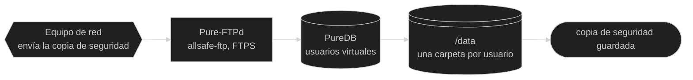

# 🏗️ Arquitectura — allsafe-ftp-stack

[](../en/architecture.md)
[-6e7781?style=for-the-badge)](../pt-BR/arquitetura.md)
[](arquitectura.md)

↩ [README del proyecto](../../README.es.md) · [Índice de la documentación](README.md)

## 💡 En pocas palabras

La stack tiene tres contenedores: el servidor FTP, el panel web que administra sus usuarios y el nginx, la puerta de entrada del panel. Cuatro "cajones" sobreviven a los reinicios: uno para los archivos enviados, uno para la lista de usuarios, uno para el certificado del FTP y uno para el certificado y el historial del panel. Una quinta carpeta, rehecha en cada arranque, une el nginx al panel. El usuario opera desde el panel o desde el host, con scripts; los equipos de red conectan por el puerto del FTP y envían la copia de seguridad.

<!-- diagrama: diagramas/vision-general-diagrama.mmd -->


<sub>Nivel 1 · Diagrama · [fuente](diagramas/)</sub>

**Secuencia:** Equipo de red ➜ Pure-FTPd (`allsafe-ftp`) ➜ PureDB ➜ `/data` ➜ copia de seguridad guardada

---

<details>
<summary>Índice — haga clic para expandir</summary>

[Mapa de la arquitectura](#mapa) · [Componentes](#componentes) · [Volúmenes](#volumes) · [Red](#rede) · [Modelo del arranque](#subida) · [Opciones del `pure-ftpd`](#flags-do-pure-ftpd) · [Healthcheck](#healthcheck) · [Endurecimiento](#endurecimento-resumo)

</details>

---

<a name="mapa"></a>

## 🗺️ Mapa de la arquitectura

Los tres contenedores, las carpetas del host y quién habla con quién, en el orden en que ocurren las cosas.

<details>
<summary>Mapa de la arquitectura, con la secuencia escrita — haga clic para expandir</summary>

<!-- diagrama: diagramas/arquitectura-mapa.mmd -->
```mermaid
%%{init: {"theme": "dark"}}%%
flowchart LR
    subgraph USO["Quién usa"]
        operador@{ shape: person, label: "Usuario<br>opera la stack" }
        equip@{ shape: hex, label: "Equipo de red<br>cliente FTP" }
    end
    subgraph HOST["Host"]
        scripts@{ shape: console, label: "deploy.sh<br>manage-user.sh" }
    end
    subgraph CONTAINERS["Contenedores · red allsafe-ftp-network"]
        nginx@{ shape: rect, label: "nginx<br>allsafe-ftp-nginx, 8443/tcp" }
        painel@{ shape: rect, label: "Panel web<br>allsafe-ftp-painel, socket Unix" }
        ftp@{ shape: rect, label: "Pure-FTPd<br>allsafe-ftp, 2121/tcp" }
    end
    subgraph VOLUMES["Volúmenes"]
        vnginx@{ shape: lin-cyl, label: "DATA_DIR/nginx<br>socket y copia del certificado" }
        vpainel@{ shape: lin-cyl, label: "DATA_DIR/painel<br>administradores y auditoría" }
        vauth@{ shape: cyl, label: "DATA_DIR/auth<br>PureDB" }
        vdata@{ shape: lin-cyl, label: "DATA_DIR/dados<br>archivos enviados" }
        vcerts@{ shape: lin-cyl, label: "DATA_DIR/certs<br>certificado del FTP" }
    end
    subgraph RESULTADO["Resultado"]
        fim@{ shape: stadium, label: "copia de seguridad guardada" }
    end

    operador -- "1 · ./deploy.sh" --> scripts
    scripts -- "2 · docker compose build y up -d --wait" --> nginx
    operador -- "3 · HTTPS, TCP 8443" --> nginx
    nginx -- "4 · reenvía por el socket Unix" --> painel
    painel -- "5 · crea, edita o elimina el usuario" --> vauth
    equip -- "6 · FTPS, TCP 21 a 2121" --> ftp
    ftp -- "7 · guarda el archivo" --> vdata
    vdata -- "8 · archivo en el volumen" --> fim
    nginx -. "lee, solo lectura" .-> vnginx
    painel -. "crea el socket" .-> vnginx
    painel -. "escribe" .-> vpainel
    painel -. "administra y lee" .-> vdata
    painel -. "verifica la contraseña del FTP" ..-> ftp
    ftp -. "consulta" .-> vauth
    ftp -. "lee el certificado" .-> vcerts
    painel -. "lee para la copia del sistema" .-> vcerts
```

<sub>Nivel 2 · Mapa · [fuente](diagramas/)</sub>

| Nº | De ➜ A | Qué ocurre |
|---|---|---|
| 1 | Usuario ➜ `deploy.sh` | El usuario ejecuta `./deploy.sh` en el host |
| 2 | `deploy.sh` ➜ nginx | El script valida la configuración, construye las imágenes (`docker compose build`) y levanta los tres contenedores (`up -d --wait`), en el orden `ftp`, `painel` y `nginx`: cada uno espera a que el anterior quede `healthy`, y el nginx, la puerta de entrada del panel, es el último |
| 3 | Usuario ➜ nginx | El usuario abre el panel por HTTPS en `8443/tcp`: quien atiende es el nginx, que verifica la red de origen y la tasa de solicitudes |
| 4 | nginx ➜ Panel web | La solicitud aceptada se reenvía al panel por el socket Unix, con la dirección del cliente |
| 5 | Panel web ➜ `DATA_DIR/auth` | El panel crea, edita o elimina el usuario en el PureDB |
| 6 | Equipo de red ➜ Pure-FTPd | El cliente conecta por FTPS en `21/tcp`, mapeada a `2121/tcp` |
| 7 | Pure-FTPd ➜ `DATA_DIR/dados` | El archivo se escribe por el canal pasivo, en el rango del perfil (`30000-30099/tcp` en el `small`) |
| 8 | `DATA_DIR/dados` ➜ copia de seguridad guardada | El archivo queda en la carpeta del usuario, en el host |

**Apoyo**

| Quién | Usa | Cómo |
|---|---|---|
| nginx | `DATA_DIR/nginx` | lee el socket y el certificado, solo lectura |
| nginx | `DATA_DIR/nginx/estado` | escribe los recursos de su contenedor, la única carpeta en la que escribe |
| Panel web | `DATA_DIR/nginx` | crea el socket, copia el certificado y prepara la carpeta `estado` del nginx, en cada arranque |
| Panel web | `DATA_DIR/painel` | guarda el certificado, los administradores y la auditoría |
| Panel web | `DATA_DIR/dados` | crea carpeta, renombra, borra y lee los archivos para la descarga |
| Panel web | Pure-FTPd | verifica la contraseña del usuario del FTP que entra en el panel, por la red interna de la stack |
| Pure-FTPd | `DATA_DIR/auth` (PureDB) | consulta los usuarios |
| Pure-FTPd | `DATA_DIR/certs` | lee el certificado |
| Panel web | `DATA_DIR/certs` | lee, solo lectura, para la [copia del sistema](panel.md#copia-do-sistema) enviada a S3 |

**Configuración, secretos y registro**

El mapa muestra las piezas y los volúmenes. La configuración, los secretos y el registro quedan en esta tabla:

| Quién | Usa | Cómo |
|---|---|---|
| `deploy.sh` y `manage-user.sh` | `.env` | crea, lee y guarda el perfil |
| Pure-FTPd | `.secrets` (`ftp-usuario-inicial-senha.txt`) | lee la contraseña en el arranque, solo lectura |
| Panel web | `.secrets` (`painel-admin-inicial-senha-hash.txt`) | lee el hash inicial en el arranque, solo lectura |
| Pure-FTPd | registro del contenedor | registra cada entrada y cada transferencia, con el usuario y la dirección |

</details>

---

<a name="componentes"></a>

## 🧩 Componentes

| Pieza | Dónde | Papel |
|---|---|---|
| Servicio `ftp` | [`compose.yaml`](../../compose.yaml) | Contenedor del servidor FTP (`allsafe-ftp`) |
| Servicio `painel` | [`compose.yaml`](../../compose.yaml) | Contenedor del panel web (`allsafe-ftp-painel`); solo se inicia después de que el `ftp` queda `healthy` y no publica puerto |
| Servicio `nginx` | [`compose.yaml`](../../compose.yaml) | Contenedor del frente web (`allsafe-ftp-nginx`), el único puerto publicado del panel; solo se inicia después de que el `painel` queda `healthy` y se reinicia junto con él |
| Imágenes | [`Dockerfile`](../../Dockerfile) | Tres objetivos sobre el mismo `debian:trixie-slim` (Debian 13), fijado por digest. Objetivo `ftp`: `pure-ftpd`, `pure-ftpd-common`, `openssl` y el entrypoint del FTP. Objetivo `painel`: los mismos paquetes, `python3`, el panel y el binario del `rclone`, en la versión fijada en el archivo y con la suma verificada en la construcción. Objetivo `nginx`: solo `nginx` y `openssl`, sin nada del FTP. Los tres llevan el [`LICENSE`](../../LICENSE) y el [`NOTICE`](../../NOTICE) del proyecto en `/usr/share/doc/allsafe-ftp-stack/` |
| Usuarios del proceso de datos | [`Dockerfile`](../../Dockerfile) | Uno por [perfil de usuario](panel.md#perfis), todos con shell `nologin` y sin home: `ftpdata`, uid y gid **10000** (Completo, y dueño de todo lo que queda guardado); `ftpenvio`, uid **10002**, en el grupo del `ftpdata` (Envío); `ftpleitura`, uid y gid **10003** (Lectura); `ftpsoenvio`, uid y gid **10004** (Solo envío), encerrado en `/data/.entrada/<usuário>`, fuera de la carpeta de las copias de seguridad. `/data` es `0700` del `root`: la cuenta solo alcanza la carpeta en la que el `chroot` la encerró |
| Entrypoint | [`ftp/entrypoint.sh`](../../ftp/entrypoint.sh), instalado como `/usr/local/sbin/allsafe-ftp-entrypoint` | Provisiona usuario y certificado, levanta el vigía, el `pure-authd` y el `pure-ftpd` y cierra el contenedor si uno de ellos sale |
| Gestión de usuarios | [`ftp/usuario.sh`](../../ftp/usuario.sh), instalado en las imágenes del FTP y del panel como `/usr/local/sbin/allsafe-ftp-user` | `add`, `passwd`, `pasta`, `perfil`, `limites`, `del` y `list` en el PureDB, los bloqueos por intento (`bloqueios`, `desbloquear`), los bloqueos por dirección (`enderecos`, `endereco-bloquear`, `endereco-liberar`) y la lista de quién entra sin TLS (`tls-dispensar`, `tls-exigir`, `tls-lista`), llamado desde fuera por [`manage-user.sh`](../../manage-user.sh) y, dentro del panel, por el servidor web |
| Portero | [`ftp/porteiro.pl`](../../ftp/porteiro.pl), instalado en la imagen del FTP como `/usr/local/sbin/allsafe-ftp-porteiro` | Lo llama el `pure-authd` en cada entrada, antes de la verificación de la contraseña: rechaza la dirección, IPv4 o IPv6, con [bloqueo por dirección](seguridad.md#bloqueio-por-endereco) o dentro de un prefijo bloqueado, al usuario bloqueado por contraseñas incorrectas y, con el [TLS por usuario](seguridad.md#tls-por-usuario) en vigor, la sesión sin TLS de quien no fue dispensado por el administrador |
| Vigía | [`ftp/vigia.pl`](../../ftp/vigia.pl), instalado en la imagen del FTP como `/usr/local/sbin/allsafe-ftp-vigia` | Lee en `/dev/log` lo que el `pure-ftpd` registra, cuenta las contraseñas incorrectas de cada dirección para cada usuario, guarda el [bloqueo por intento](seguridad.md#bloqueio-por-tentativa) en `/auth/bloqueios`, suma los errores de cada dirección, IPv4 o IPv6, con cualquier nombre y guarda el [bloqueo por dirección](seguridad.md#bloqueio-por-endereco) en `/auth/enderecos`, pone en cero los dos conteos cuando la entrada sale bien, escribe en el registro del contenedor cada entrada y cada transferencia, avisa al panel, en `/auth/chegadas`, de cada archivo que acaba de llegar entero, para que el [bot de Telegram](panel.md#destinos) envíe sin esperar, pasa al `ftpdata` el archivo recibido en una carpeta con perfil Envío o Lectura, lleva del área de entrada a la carpeta del usuario el archivo recibido de un perfil Solo envío, con el [`ftp/entrada.pl`](../../ftp/entrada.pl), y publica en `/auth/rede.estado` los contadores de red del contenedor y en `/auth/recursos.estado` el procesador, la memoria y los procesos que usa y los límites que recibió, que la pestaña Servidor del panel muestra. En Perl, solo con el `perl-base` de la imagen base |
| Dirección de origen | [`ftp/endereco.pl`](../../ftp/endereco.pl), instalado en la imagen del FTP como `/usr/local/lib/allsafe/endereco.pl` | Lee la dirección de origen, IPv4 o IPv6, y el prefijo, y devuelve la escritura única de cada uno, que es el nombre del archivo del bloqueo. Lo cargan el portero y el vigía y lo llama el `allsafe-ftp-user`; el panel hace la misma cuenta en el [`painel/enderecos.py`](../../painel/enderecos.py) |
| Panel web | Módulos Python de [`painel/`](../../painel/), en `/opt/painel`; el punto de entrada es el [`painel/servidor.py`](../../painel/servidor.py) | Servidor en Python, solo con la biblioteca estándar y sin JavaScript: pantallas del administrador, pantalla del usuario del FTP, sesión, auditoría, descarga y envío de archivo, un tema por módulo ([lista](panel.md#modulos)). Atiende solo al nginx, por socket Unix |
| Entrypoint del panel | [`painel/entrypoint.sh`](../../painel/entrypoint.sh), instalado como `/usr/local/sbin/allsafe-painel-entrypoint` | Verifica la red privada, genera el certificado, entrega su copia al nginx y hace `exec` del servidor |
| Frente web | [`nginx/nginx.conf.modelo`](../../nginx/nginx.conf.modelo), [`nginx/cabecalhos.conf`](../../nginx/cabecalhos.conf) y las páginas de error de [`nginx/erro/`](../../nginx/erro/) | nginx sin root: cierra el HTTPS, habla HTTP/2 con el navegador, rechaza a quien está fuera de las redes permitidas, limita tasa de solicitudes, conexiones y tamaño de la solicitud, entrega los archivos estáticos y reenvía el resto al panel. La descarga de archivo pasa por él al ritmo del navegador, sin archivo temporal, y el envío de archivo por el panel se reenvía mientras llega, también sin archivo temporal, solo en las dos rutas de envío |
| Archivos estáticos | [`web/estilo.css`](../../web/estilo.css), [`web/robots.txt`](../../web/robots.txt) y los seis archivos de [`web/marca/`](../../web/marca/), en la imagen del nginx en `/usr/share/allsafe-nginx/web` | Apariencia, aviso a los robots de búsqueda, logo e ícono del panel. El nginx los entrega directo, con los encabezados de seguridad de `cabecalhos.conf`, sin ocupar al panel; el estilo tiene también una copia comprimida, hecha en la construcción de la imagen, para el navegador que acepta gzip, y su dirección en cada página lleva la marca del contenido (`?v=` y el comienzo del SHA-256 del archivo), que la imagen del panel recibe en la construcción sin llevar el archivo. El `/.well-known/security.txt` no es un archivo: el panel lo arma en cada solicitud, con el correo de `SEGURANCA_CONTATO_EMAIL` |
| Entrypoint del nginx | [`nginx/entrypoint.sh`](../../nginx/entrypoint.sh), instalado como `/usr/local/sbin/allsafe-nginx-entrypoint` | Verifica la red privada, genera la configuración a partir del modelo y hace `exec` del `nginx` |

Qué hace cada script, con parámetros y salida: [Scripts](scripts.md). Uso y protecciones del panel: [Panel web](panel.md).

---

<a name="volumes"></a>

## 💽 Volúmenes

| Carpeta en el host | Se monta en | Quién monta | Guarda |
|---|---|---|---|
| `DATA_DIR/dados` | `/data` | `ftp` y `painel` | Archivos de los usuarios: cada usuario encerrado (`chroot`) en la carpeta del registro, `/data/<usuario>` o la carpeta elegida en la creación. El usuario de perfil Solo envío queda encerrado en `/data/.entrada/<usuario>`, de donde el vigía lleva cada archivo a su carpeta. El `ftp` escribe; el `painel` crea la carpeta de cada usuario y, en la pestaña Archivos, lee, crea carpeta vacía, renombra y borra |
| `DATA_DIR/auth` | `/auth` | `ftp` y `painel` | Base **PureDB**: `pureftpd.passwd` (texto, con el hash de las contraseñas) y `pureftpd.pdb` (compilada), ambos `0600`; `ftp-cert.pem`, copia del certificado del FTP **sin la clave**; `sem-tls.lista` (`0600`), los usuarios dispensados del TLS, cuando los hay; `limites.lista` (`0600`), los límites propios de cada usuario que no quedan en el registro, cuando los hay; `pastas.lista` (`0600`), las otras carpetas liberadas a cada usuario en el panel, cuando las hay; `bloqueios/` (`0700`), un archivo por bloqueo por intento en vigor; `enderecos/` (`0700`), un archivo por dirección bloqueada en el FTP y en el panel; `prefixos/` (`0700`), un archivo por prefijo bloqueado por el administrador; `chegadas/` (`0700`), los avisos de archivo recién llegado por el FTP, que el panel lee y borra en segundos; `rede.estado` y `recursos.estado` (`0600`), los contadores de red y los recursos del contenedor del servicio ftp, para la pestaña Servidor del panel; `.lock`, el bloqueo de las modificaciones |
| `DATA_DIR/certs` | `/etc/ssl/private` en el `ftp`; `/certs` en el `painel`, solo lectura | `ftp` y `painel` | `pure-ftpd.pem`: clave y certificado concatenados, `0600`. El `painel` solo lee la carpeta, para llevarla en la copia del sistema |
| `DATA_DIR/painel` | `/painel` | solo `painel` | `tls/painel-cert.pem`, `tls/painel-key.pem` (`0600`), `administradores` (`0600`, el nombre y el hash `scrypt` de la contraseña de cada administrador), `auditoria.log` (`0600`), `idiomas` (`0600`, el idioma de las pantallas que eligió cada cuenta) y `destinos/` (`0700`), con la configuración y el avance del S3, del remoto del rclone y del bot de Telegram, sin sus secretos; carpeta `0700` |
| `DATA_DIR/nginx` | `/nginx` | `painel` (escribe) y `nginx` (solo lectura) | `painel.sock`, el socket Unix del panel, y `tls/`, la copia del certificado y de la clave (`0640`) para el nginx; carpeta `0750`, del grupo `10001`. Rehecha en cada arranque. Dentro de ella, `estado/` (`0700`, del usuario del nginx), montada aparte en el nginx como `/estado`, con escritura: es donde publica `recursos.estado`, los recursos de su contenedor |
| secreto `ftp_usuario_inicial_senha` (`SECRETS_DIR/ftp-usuario-inicial-senha.txt`) | `/run/secrets/ftp_usuario_inicial_senha` (solo lectura) | solo `ftp` | Contraseña del usuario inicial |
| secreto `painel_admin_inicial_senha_hash` (`SECRETS_DIR/painel-admin-inicial-senha-hash.txt`) | `/run/secrets/painel_admin_inicial_senha_hash` (solo lectura) | solo `painel` | Hash `scrypt` de la contraseña inicial del primer administrador del panel, usado solo mientras no existe ninguno |
| secreto `backup_chave_publica` (`SECRETS_DIR/backup-chave-publica.txt`) | `/run/secrets/backup_chave_publica` (solo lectura) | solo `painel` | Clave pública que cifra la copia del sistema enviada a S3. No abre nada: la clave privada no se monta en ningún contenedor |
| `SECRETS_DIR/destinos` | `/segredos` | solo `painel` | Claves de cada S3, acceso de cada remoto del rclone, token de cada bot de Telegram y conversación que recibe, un archivo `0600` por secreto, con el nombre del destino adelante, guardados por el panel en la pestaña [Destinos](panel.md#destinos); carpeta `0700`, vacía hasta que el administrador guarda un destino. Es la única carpeta de secretos en la que un contenedor escribe |

De los archivos de `.secrets/`, el `ftp` ve uno, el `painel` ve dos, el hash de la contraseña inicial y la clave pública de la copia, y el `nginx` no ve ninguno; el `painel` ve además la carpeta `destinos`, con los secretos que él mismo guarda. Además, el `ftp` y el `painel` tienen dos `tmpfs`, `/run` (8 MiB) y `/tmp` (16 MiB), y el `nginx` tiene `/run/nginx` (1 MiB) y `/tmp/nginx` (16 MiB), del usuario `10001`. Todos `noexec,nosuid,nodev`.

---

<a name="rede"></a>

## 🌐 Red

- Red bridge dedicada `allsafe-ftp-network`, subred `172.29.1.0/29` (variable `FTP_SUBNET`), con los tres contenedores.
- Publicaciones en el host (vea [Configuración](configuracion.md#rede-e-portas) y [Panel web](configuracion.md#painel)):

| Publicación | Para qué |
|---|---|
| `FTP_BIND_IP:FTP_PORT` ➜ `2121/tcp` | canal de control |
| `FTP_BIND_IP:<faixa passiva>` ➜ el mismo rango en el contenedor | canal de datos, modo pasivo, 1:1 (`30000-30099/tcp` en el `small`, hasta `30000-32399/tcp` en el `extended`) |
| `PAINEL_BIND_IP:PAINEL_PORT` ➜ `8443/tcp` del `nginx` | panel web, HTTPS |

- El panel no publica ni escucha puerto: el nginx lo alcanza por el socket Unix de la carpeta `DATA_DIR/nginx`, sin pasar por la red.
- El panel habla con el FTP por la red en dos casos, siempre en `ftp:2121`, dentro de esta red: para ver si está en marcha, por el saludo del puerto, y para verificar la contraseña del usuario del FTP que entra en el panel, con un login en TLS. El registro y los archivos, los dos los comparten por las carpetas `auth` y `dados`.
- Quien abre el panel desde el propio servidor, en `127.0.0.1`, llega al nginx con la dirección del gateway de esta red (`172.29.1.1`), que ya está dentro de las redes permitidas por defecto.
- IPv6 es opcional y viene desactivado. Con `REDE_IPV6=sim`, el `deploy.sh` añade el archivo [`compose.ipv6.yaml`](../../compose.ipv6.yaml): la red recibe la subred `FTP_SUBNET_IPV6` (`fd29:1::/64`) y las tres publicaciones de arriba se repiten en `FTP_BIND_IPV6` y `PAINEL_BIND_IPV6`, en los mismos puertos. El `pure-ftpd` y el nginx pasan a escuchar en las dos familias, y el cliente IPv6 llega a los dos con su dirección real. Quien abre el panel desde el propio servidor, en `::1`, llega al nginx con el gateway IPv6 de la red (`fd29:1::1`). Vea [IPv6](configuracion.md#ipv6).
- Sin DNS inverso (`-H`): el `pure-ftpd` nunca resuelve la IP del cliente.

---

<a name="subida"></a>

## 🔄 Modelo del arranque

Lo que ocurre entre el `./deploy.sh` y el contenedor `healthy`.

<details>
<summary>Modelo del arranque, con la secuencia escrita — haga clic para expandir</summary>

<!-- diagrama: diagramas/arranque-modelo.mmd -->
```mermaid
%%{init: {"theme": "dark"}}%%
flowchart LR
    subgraph OPERACAO["Operación"]
        operador@{ shape: person, label: "Usuario" }
        deploy@{ shape: console, label: "deploy.sh<br>instala en un comando" }
    end
    subgraph HOST["Host"]
        env@{ shape: doc, label: ".env<br>configuración y límites" }
        segredo@{ shape: doc, label: ".secrets<br>ftp-usuario-inicial-senha.txt" }
        compose@{ shape: rect, label: "Docker Compose<br>compose.yaml" }
    end
    subgraph CONTAINER["Contenedor allsafe-ftp · raíz de solo lectura"]
        entry@{ shape: rect, label: "entrypoint<br>allsafe-ftp-entrypoint" }
        valida@{ shape: diam, label: "¿variables<br>válidas?" }
        pw@{ shape: rect, label: "pure-pw<br>crea o actualiza el usuario" }
        puredb@{ shape: cyl, label: "PureDB<br>/auth/pureftpd.pdb" }
        dados@{ shape: lin-cyl, label: "/data<br>carpeta del usuario" }
        certq@{ shape: diam, label: "¿existe el<br>certificado?" }
        gera@{ shape: rect, label: "openssl<br>autofirmado, 825 días" }
        cert@{ shape: doc, label: "pure-ftpd.pem<br>/etc/ssl/private" }
        pure@{ shape: rect, label: "pure-ftpd<br>0.0.0.0, 2121" }
        authd@{ shape: rect, label: "vigía y pure-authd<br>bloqueo y portero, listas en /auth" }
        saude@{ shape: rect, label: "healthcheck<br>saludo en el puerto 2121" }
    end
    subgraph RESULTADO["Resultado"]
        pronto@{ shape: stadium, label: "FTP listo<br>healthy" }
        falha@{ shape: stadium, label: "FALHA en el log<br>el contenedor no arranca" }
    end

    operador -- "1 · ejecuta" --> deploy
    deploy -- "2 · docker compose build y up -d --wait" --> compose
    compose -- "3 · inicia el contenedor" --> entry
    entry -- "4 · verifica usuario, contraseña, rango y TLS" --> valida
    valida -- "5a · sí" --> pw
    valida -- "5b · no" --> falha
    pw -- "6 · base compilada" --> certq
    certq -- "7a · sí: reutiliza" --> cert
    certq -- "7b · no: genera" --> gera
    gera -- "8 · guarda el certificado" --> cert
    cert -- "9 · leído en el arranque" --> pure
    pure -- "10 · verificado cada 20 s" --> saude
    saude -- "11 · el servidor atiende" ---> pronto
    deploy -. "genera la contraseña si está vacío, 0600" .-> segredo
    compose -. "lee" .-> env
    entry -. "lee, solo lectura" .-> segredo
    entry -. "crea la carpeta" .-> dados
    pw -. "escribe" .-> puredb
    pure -. "consulta" .-> puredb
    pure -. "pregunta en cada entrada y avisa la contraseña incorrecta" .-> authd
```

<sub>Nivel 3 · Modelo · [fuente](diagramas/)</sub>

| Nº | De ➜ A | Qué ocurre | Protocolo y puerto | Regla |
|---|---|---|---|---|
| 1 | Usuario ➜ `deploy.sh` | Ejecuta `./deploy.sh` | — | Sin `.env`, el script crea uno a partir del ejemplo y sigue; antes de actuar verifica Docker, Compose y puertos libres |
| 2 | `deploy.sh` ➜ Docker Compose | Ejecuta `docker compose build` y `up -d --wait` con el `.env` | — | Antes ejecuta `config --quiet`; una configuración inválida no arranca |
| 3 | Docker Compose ➜ entrypoint | Inicia el contenedor `allsafe-ftp` | — | Raíz de solo lectura, `tini` como proceso 1 |
| 4 | entrypoint ➜ ¿variables válidas? | Verifica usuario, contraseña, rango pasivo y modo TLS | — | Nombre `^[a-z_][a-z0-9_-]{0,31}$`, contraseña de 12 o más, rango entre `1024` y `65535`, TLS de `0` a `3` |
| 5a | ¿variables válidas? ➜ `pure-pw` | Sí: en el primer arranque crea el usuario inicial (`useradd`); en los siguientes reescribe su contraseña (`passwd`), salvo si fue cambiada desde el panel y el secreto no cambió, y no lo recrea si fue eliminado | — | Usuario virtual con uid y gid `ftpdata`, home `/data/<usuario>` |
| 5b | ¿variables válidas? ➜ FALHA en el log | No: el entrypoint sale con `FALHA: <motivo>` | — | El contenedor se reinicia en bucle hasta la corrección |
| 6 | `pure-pw` ➜ ¿existe el certificado? | Compila la base con `pure-pw mkdb` y sigue | — | `pureftpd.passwd` y `pureftpd.pdb` quedan `0600` |
| 7a | ¿existe el certificado? ➜ `pure-ftpd.pem` | Sí: reutiliza el certificado que ya está en el volumen | — | El certificado existente nunca se sobrescribe |
| 7b | ¿existe el certificado? ➜ `openssl` | No: genera uno autofirmado | — | RSA 3072, SHA-256, 825 días, SAN `IP:` o `DNS:` según `FTP_CERT_CN` |
| 8 | `openssl` ➜ `pure-ftpd.pem` | Guarda el certificado nuevo, `0600` | — | En `/etc/ssl/private`, en el volumen `DATA_DIR/certs` |
| 9 | `pure-ftpd.pem` ➜ `pure-ftpd` | El servidor lee el certificado al iniciar | — | Las variables de contraseña se borran (`unset`) antes de que los procesos arranquen; el vigía y el `pure-authd` arrancan antes del `pure-ftpd` |
| 10 | `pure-ftpd` ➜ healthcheck | Puerto de control verificado cada 20 s | TCP `2121` | `start_period` de 20 s, 5 intentos |
| 11 | healthcheck ➜ FTP listo | Saludo recibido: contenedor `healthy` | — | Verifica que el servidor atiende, sin hacer login |

**Apoyo**

| Quién | Usa | Cómo |
|---|---|---|
| `deploy.sh` | `.secrets/ftp-usuario-inicial-senha.txt` | genera la contraseña si el archivo está vacío, `0600` |
| Docker Compose | `.env` | lee |
| entrypoint | `.secrets/ftp-usuario-inicial-senha.txt` | lee, solo lectura |
| entrypoint | `/data` | crea la carpeta del usuario |
| `pure-pw` | PureDB (`/auth/pureftpd.pdb`) | escribe |
| `pure-ftpd` | PureDB | consulta |
| `pure-ftpd` | vigía y `pure-authd` | pregunta al `pure-authd` en cada entrada, antes de verificar la contraseña, y avisa al vigía de cada contraseña incorrecta; en `/auth`, el portero lee los bloqueos, por intento y por dirección, y la `sem-tls.lista`, de quién entra sin TLS, y el vigía guarda los bloqueos |

</details>

En los arranques siguientes la contraseña del usuario inicial se **reescribe** a partir del secreto (`pure-pw passwd`), a no ser que haya sido cambiada desde el panel y el secreto siga igual, y el certificado existente se **mantiene**. El usuario inicial eliminado desde el panel **no se recrea**: la marca `/auth/usuario-inicial.criado` dice que ya fue creado una vez. Con el FTP `healthy`, el Compose inicia el panel y, con el panel `healthy`, el nginx: lo que verifica cada entrypoint está en [Scripts](scripts.md#painel-entrypoint), en las secciones del panel y del [nginx](scripts.md#nginx-entrypoint). En los modos `0` y `1` de `FTP_TLS_MODE`, y cuando hay un usuario dispensado del TLS, el entrypoint del FTP escribe un `AVISO` en el log antes de arrancar: [Seguridad](seguridad.md#ftp-sem-tls).

<details>
<summary>Detalle técnico — quién es el proceso 1</summary>

Con `init: true` en el [`compose.yaml`](../../compose.yaml), el proceso 1 del contenedor es el `tini` (`docker-init`), que reenvía las señales y recoge procesos huérfanos. Él inicia el entrypoint, que sigue vivo y levanta tres hijos, en este orden: el vigía (`allsafe-ftp-vigia`), el `pure-authd` y el `pure-ftpd`. Si uno de los tres sale, el entrypoint cierra los otros y termina con código `1`, y Docker levanta el contenedor de nuevo: sin el vigía nadie sería bloqueado, y sin el `pure-authd` el `pure-ftpd` aceptaría la entrada sin la verificación del portero.

Con el [TLS por usuario](seguridad.md#tls-por-usuario) en vigor, hay un cuarto hijo: el observador de la lista de los dispensados, una función del propio entrypoint que relee `/auth/sem-tls.lista` cada segundo. Cuando la lista deja de estar vacía o vuelve a quedar vacía, el entrypoint cambia solo el proceso del `pure-ftpd` que escucha el puerto, con el `-Y` nuevo: el contenedor no se reinicia y las sesiones en curso, que son procesos aparte, siguen hasta terminar.

Al terminar el arranque, el entrypoint escribe en el log: `FTP pronto em 2121/tcp; TLS=<modo>; passivo=<inicio>-<fim>`. Con el TLS por usuario en vigor, la línea dice también cómo está la entrada sin TLS: `TLS=2; TLS por usuário: nenhum dispensado, sessão sem TLS recusada antes da senha` o `TLS=2 com exceção por usuário (<n> dispensado(s) do TLS)`. La línea se repite en cada cambio de modo, después de `TLS por usuário: a lista dos dispensados mudou; o FTP troca o modo de entrada sem derrubar as sessões em andamento.` El motivo de cada proceso está en [Seguridad](seguridad.md#bloqueio-por-tentativa), en las secciones del bloqueo por intento y del [TLS por usuario](seguridad.md#tls-por-usuario).

</details>

---

<a name="flags-do-pure-ftpd"></a>

## 🚩 Opciones del `pure-ftpd`

Línea final del [`ftp/entrypoint.sh`](../../ftp/entrypoint.sh):

| Opción | Efecto |
|---|---|
| `-A` | `chroot` de **todos** los usuarios en el propio directorio |
| `-E` | Prohíbe el login anónimo |
| `-H` | No resuelve el DNS inverso del cliente |
| `-j` | Crea el directorio home del usuario si no existe |
| `-R` | Prohíbe `chmod` por el cliente |
| `-c <n>` | Máximo de clientes simultáneos (`FTP_MAX_CLIENTS`) |
| `-C <n>` | Máximo de clientes por IP (`FTP_MAX_CLIENTS_PER_IP`) |
| `-I 15` | Tiempo máximo de inactividad: 15 minutos |
| `-L 10000:8` | Límite de `ls`: 10000 archivos, profundidad 8 |
| `-u 10000` | UID mínimo autorizado a entrar (bloquea cuentas de sistema) |
| `-U 133:022` | `umask`: 133 para archivos, 022 para directorios |
| `-l extauth:/run/pure-authd.sock` | Antes del PureDB: el `pure-authd` llama al portero, que decide si la entrada puede seguir a la verificación de la contraseña ([bloqueo por intento](seguridad.md#bloqueio-por-tentativa) y [TLS por usuario](seguridad.md#tls-por-usuario)) |
| `-l puredb:/auth/pureftpd.pdb` | Backend de autenticación |
| `-p INICIO:FIM` | Rango de puertos pasivos |
| `-P <ip>` | IP anunciada en el `PASV` (`FTP_PASSIVE_IP`) |
| `-S 0.0.0.0,2121` | Escucha en el puerto 2121 (no privilegiado), solo en IPv4. Con `REDE_IPV6=sim` va `-S 2121`, que escucha en IPv4 e IPv6 |
| `-Y <modo>` | Política TLS (`FTP_TLS_MODE`): vea [Configuración](configuracion.md#tls). Con el TLS por usuario en vigor y al menos un usuario dispensado, va `-Y 1`, y la exigencia del TLS pasa a hacerse usuario por usuario por el portero; sin ningún dispensado, va el `-Y 2`: [Seguridad](seguridad.md#tls-por-usuario) |

---

<a name="healthcheck"></a>

## 🩺 Healthcheck

```yaml
test: ["CMD", "/usr/local/sbin/allsafe-ftp-saude"]
interval: 20s   timeout: 6s   retries: 5   start_period: 20s
```

Abre el puerto de control (`2121`), desde dentro del contenedor, y espera el saludo del servidor: un `pure-ftpd` vivo que no atiende deja de contar como saludable, y el contenedor pasa a `unhealthy` después de cinco verificaciones seguidas sin respuesta. Un servidor en el límite de conexiones (`421`) cuenta como atendiendo. Antes de abrir el puerto, la prueba exige el socket del `pure-authd` y el `/dev/log` del vigía. La prueba no hace login: vea [`ftp/saude.sh`](scripts.md#ftp-saude). Para verificar también el usuario en el PureDB, use `./scripts/validate.sh --runtime`: vea [Scripts](scripts.md#validate).

El panel tiene el suyo, que pide `/saude` por el socket Unix, del modo en que lo hace el nginx. Es un archivo aparte, que no carga los módulos del panel: la verificación gasta alrededor de 10 ms de procesador y cabe en la cuota del contenedor, sin sumar en el contador de límite alcanzado de la pestaña Servidor.

```yaml
test: ["CMD", "python3", "-I", "-S", "/opt/painel/saude.py"]
interval: 20s   timeout: 8s   retries: 5   start_period: 20s
```

Y el nginx, que abre una conexión TLS de verdad en el propio puerto y pide `/saude`: solo queda `healthy` si el camino entero (nginx, socket y panel) responde.

```yaml
test: ["CMD", "/usr/local/sbin/allsafe-nginx-saude"]
interval: 20s   timeout: 8s   retries: 5   start_period: 20s
```

---

<a name="endurecimento-resumo"></a>

## 🧱 Endurecimiento

| Medida | Dónde |
|---|---|
| Raíz de solo lectura | `read_only: true` |
| Sin privilegios más allá de lo necesario | `cap_drop: ALL`; el `ftp` recibe solo las capabilities que el `pure-ftpd` usa (chroot, cambio de uid y gid, `nice`), el `painel`, solo tres (`CHOWN`, `DAC_OVERRIDE`, `FOWNER`), y el `nginx`, ninguna |
| Frente web sin root | el `nginx` se ejecuta como uid y gid `10001` (`user: "10001:10001"`) y escucha en puerto alto |
| Un solo puerto para el panel | solo el `nginx` publica puerto; el `painel` atiende por socket Unix |
| Sin control de Docker | ningún contenedor monta el socket de Docker |
| Sin ganancia de privilegio | `no-new-privileges: true` |
| Límites de recurso | `pids_limit`, `mem_limit`, `memswap_limit` igual al de memoria (sin swap), `cpus` (en el panel, `cpu_period` y `cpu_quota`), `ulimits.nofile` |
| Log con rotación | `logging: local`, 10 MB × 3 |

Justificación de cada directiva y de cada `cap_add`: [Seguridad](seguridad.md#hardening-do-compose-yaml-linha-a-linha).

---

⬅️ [Perfiles](perfiles.md) · 🏠 [Documentación](README.md) · ➡️ [Seguridad](seguridad.md)
