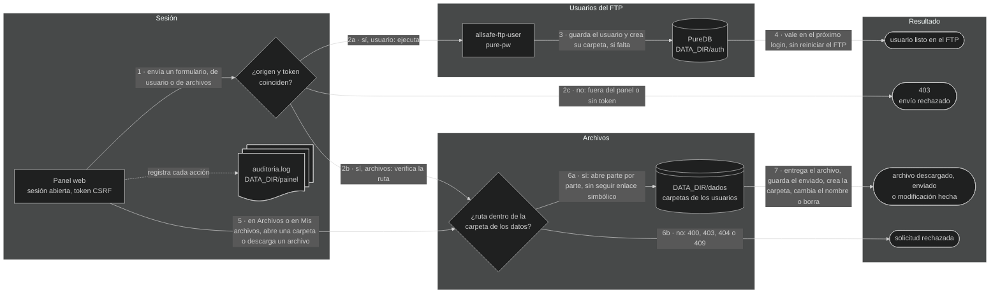

# 🖥️ Panel web — allsafe-ftp-stack

[](../en/panel.md)
[-6e7781?style=for-the-badge)](../pt-BR/painel.md)
[](panel.md)

↩ [README del proyecto](../../README.es.md) · [Índice de la documentación](README.md)

## 💡 En pocas palabras

El panel es una página, abierta por el navegador **desde dentro de la red interna**, para crear, cambiar la contraseña y eliminar los usuarios del FTP, elegir la carpeta de cada uno, crear carpetas y descargar las copias de seguridad recibidas, sin usar la línea de comandos. Cada administrador entra con su propio usuario y su propia contraseña, solo por HTTPS. El dueño de los archivos también entra: cada usuario del FTP usa el nombre y la contraseña del FTP y alcanza solo su propia carpeta, donde hace lo que su [perfil](#perfis) le permite. Quien atiende al navegador es el nginx, la puerta de entrada: detiene a quien está fuera de la red interna y solo entonces pasa la solicitud al panel. Lo que se hace en el panel vale en el FTP en el acto, sin reiniciar nada.

<!-- diagrama: diagramas/panel-diagrama.mmd -->
```mermaid
%%{init: {"theme": "dark"}}%%
flowchart LR
    usuario@{ shape: person, label: "Usuario<br>navegador en la red interna" }
    nginx@{ shape: rect, label: "nginx<br>allsafe-ftp-nginx, HTTPS" }
    painel@{ shape: rect, label: "Panel web<br>allsafe-ftp-painel" }
    cmd@{ shape: rect, label: "allsafe-ftp-user<br>crea, cambia la contraseña, elimina" }
    puredb@{ shape: cyl, label: "PureDB<br>usuarios virtuales" }
    fim@{ shape: stadium, label: "usuario listo en el FTP" }

    usuario --> nginx --> painel --> cmd --> puredb --> fim
```

<sub>Nivel 1 · Diagrama · [fuente](diagramas/)</sub>

**Secuencia:** Usuario (navegador en la red interna) ➜ nginx (`allsafe-ftp-nginx`, HTTPS) ➜ Panel web (`allsafe-ftp-painel`) ➜ `allsafe-ftp-user` ➜ PureDB ➜ usuario listo en el FTP

> 🧱 **Uso solo en red privada, detrás de firewall.** El panel administra las cuentas que guardan la configuración de su red. Por defecto, escucha **solo en IP privada**, rechaza al cliente de fuera de las redes internas y no debe publicarse en internet ni recibir redirección de puerto del borde. Quien necesita llegar desde fuera entra por VPN hasta la red interna. Vea [red privada y firewall](seguridad.md#rede-privada); dirección pública solo con la opción descrita en [IP pública](seguridad.md#ip-publico).

---

<details>
<summary>Índice — haga clic para expandir</summary>

[Abrir el panel](#abrir) · [Qué hay en cada pestaña](#abas) · [Idioma de las pantallas](#idioma) · [Usuarios desde el panel](#usuarios) · [Perfiles](#perfis) · [Archivos y descarga](#arquivos) · [Usuario del FTP en el panel](#usuario-ftp) · [Destinos: S3, rclone y bot de Telegram](#destinos) · [Servidor: contenedores y recursos](#servidor) · [Administradores del panel](#administradores) · [Segundo factor en la entrada](#segundo-fator) · [Recuperar el acceso](#senha) · [Certificado del panel](#certificado) · [Abrir a la red interna](#rede-interna) · [Marca del panel](#marca) · [Cómo decide el panel](#como-decide) · [Auditoría](#auditoria) · [Qué protege el panel](#protecoes)

</details>

---

<a name="abrir"></a>

## 🚪 Abrir el panel

El `./deploy.sh` levanta el panel junto con el FTP y muestra la dirección al final:

```text
Painel: https://127.0.0.1:8443  (pelo nginx; certificado autoassinado; rede privada, atrás de firewall)
```

1. Abra la dirección en el navegador. En la instalación por defecto, solo el propio servidor la alcanza (`127.0.0.1`).
2. El navegador avisa que el certificado es autofirmado: verifique la huella digital (comando de abajo) antes de aceptar.
3. Escriba el usuario y la contraseña de administrador. En la primera instalación, el usuario es el de `PAINEL_ADMIN_USER` (`admin`, si usted no lo cambió en el `.env`) y la contraseña está en `.secrets/painel-admin-inicial-senha.txt`:

```bash
cat .secrets/painel-admin-inicial-senha.txt
```

**Resultado esperado:** la pantalla **Visión general**, con el FTP `En servicio` y, en el menú, el nombre del administrador que entró. Antes de ella viene el [segundo factor](#segundo-fator): en la primera entrada, la pantalla que registra la aplicación autenticadora; en las siguientes, la que pide su código.

Huella digital del certificado del panel, para comparar con la que el navegador muestra:

```bash
docker compose exec painel openssl x509 -in /painel/tls/painel-cert.pem -noout -fingerprint -sha256
```

> ⚠️ Cambie la contraseña inicial después del primer acceso: [Administradores del panel](#administradores). Nunca pegue la contraseña en documento, captura de pantalla o mensaje.

---

<a name="abas"></a>

## 🗂️ Qué hay en cada pestaña

| Pestaña | Qué muestra | Qué se puede hacer |
|---|---|---|
| Visión general | FTP en servicio o fuera, cantidad de usuarios, espacio usado y libre, último envío, validez del certificado del FTP, el modo de TLS del FTP, la franja **Servidor y contenedores** (procesador y memoria del servidor y de los contenedores de la stack, cada uno con el uso frente a lo que hay o a lo que fue asignado), los archivos recibidos por día en los últimos 14 días, el último envío de cada usuario, el espacio de cada carpeta, los datos para configurar el equipo (servidor, puerto de control, puertos pasivos, protocolo) y los últimos registros de la actividad | Solo consultar; cada tarjeta termina en el atajo a la pestaña del detalle |
| Usuarios | Todas las cuentas en una lista, cada una con el **perfil** debajo del nombre. Primero los administradores del panel, con la etiqueta **usted** en la cuenta de quien está usando el panel y cuántas sesiones tiene abiertas cada uno; después los usuarios del FTP, uno por fila: carpeta, con la etiqueta **compartida** cuando otro usuario también la alcanza, y el nombre, con la etiqueta **bloqueado** cuando el FTP lo está rechazando por demasiadas contraseñas incorrectas, espacio usado, cantidad de archivos y último envío; la columna **TLS** dice si el usuario está obligado a usar TLS | Crear, eligiendo el perfil (Administrador, Completo, Envío, Solo envío o Lectura), la carpeta y, para equipo sin soporte de TLS, ya dispensado del TLS; editar, para cambiar el perfil, la carpeta y los límites y quitar un bloqueo; cambiar la contraseña; eliminar, con su carpeta o sin ella; abrir la carpeta del usuario en la pestaña Archivos; dispensar a un usuario del TLS y volver a exigirlo; cambiar la contraseña y el nombre de un administrador y eliminarlo |
| Archivos | Las carpetas de los usuarios del FTP y lo que hay en cada una: nombre, tamaño y fecha de cada archivo | Entrar en las carpetas, por el nombre o por el botón **Abrir**, descargar un archivo por el navegador, enviar un archivo a la carpeta abierta, crear una carpeta, cambiar el nombre y borrar archivo y carpeta, mandar un archivo en el acto a un [destino](#destinos) guardado, y abrir el registro de usuario ya con la carpeta abierta |
| Destinos | Los lugares de fuera a donde el panel envía por sí solo los archivos de las carpetas, almacenamientos S3, remotos del rclone y bots de Telegram: si cada uno está activado, la carpeta, el intervalo, la última pasada y el total enviado, sin mostrar los secretos | **Configurar**, **Probar**, **Enviar ahora**, **Modificar** y **Eliminar** cada destino; con el destino guardado, la pestaña Archivos gana el botón de enviar un archivo en el acto: vea [Destinos](#destinos) |
| Servidor | Los tres contenedores de la stack (servidor FTP, panel y frente web), cada uno con lo que usa de procesador, memoria y procesos frente a lo que le fue asignado, y, separados, los recursos del servidor en que la stack corre: procesador, memoria, disco y red del FTP, con el estado, la medida de ahora y el historial de los últimos minutos | Solo consultar; **Actualizar sola** rehace la lectura cada 10 s, sin contar como uso de la sesión: vea [Servidor](#servidor) |
| Seguridad | Verificación de la instalación, con el resumen de cuántos elementos están en orden, piden atención o se verifican en el servidor: si se acepta dirección pública, si el panel está publicado por proxy o túnel, direcciones del FTP y del panel, modo TLS, con la excepción por usuario y quién está dispensado, la entrada de los usuarios del FTP, el frente web (nginx), validez y huella digital de los dos certificados, redes que pueden abrir el panel, reglas de la sesión, el costo de las contraseñas del FTP, con los usuarios que aún están con el costo anterior, el contacto de seguridad publicado en `/.well-known/security.txt`, aislamiento del contenedor y el recordatorio del firewall | Solo consultar |
| Bloqueos | Las direcciones y los prefijos, IPv4 e IPv6, con [bloqueo por dirección](seguridad.md#bloqueio-por-endereco): la regla en vigor, el total y, por bloqueo, quién bloqueó (el FTP, el panel o el administrador), con cuántos errores, desde cuándo y hasta cuándo. Debajo, cuando hay, los usuarios con bloqueo por intento en el FTP | **Bloquear dirección**, para bloquear a mano una dirección o un prefijo, buscar una dirección, **Cambiar plazo**, para bloquear por más tiempo o acortar, y **Desbloquear**; abrir el usuario que está con bloqueo por intento |
| Log | Los últimos 300 registros del panel: entradas, rechazos, descargas, envíos, carpetas creadas, bloqueos y modificaciones de usuario y de administrador, con fecha, dirección de origen y quién lo hizo, administrador o usuario del FTP | Solo consultar |

El menú queda a la izquierda en pantalla de 1280 px de ancho o más: el símbolo y el nombre, las pestañas en dos grupos (**Operación**, con Visión general, Usuarios, Archivos y Destinos, y **Sistema**, con Servidor, Seguridad, Bloqueos y Log), la pestaña en uso marcada y, debajo, el botón de [idioma](#idioma) (**PT**, **EN** y **ES**), el nombre y el rol de quien entró y el botón **Salir**, que cierra la sesión en el acto. En pantalla más estrecha, el menú se vuelve una franja arriba, con las pestañas en una línea que se desplaza hacia el lado. Con la instalación publicada (dirección pública aceptada o panel por proxy o túnel), el administrador ve una señal de alerta al lado de **Seguridad**, en cualquier pestaña en que esté. Los gráficos son dibujados por el propio panel, sin script, y todo número del dibujo está también escrito a su lado. En el pie de página de todas las pantallas quedan la versión y la autoría: vea [Marca del panel](#marca).

Cada pestaña abre con una franja en el azul de la marca, el mismo del menú y de la pantalla de entrada, en los temas claro y oscuro: el ícono de la pestaña, el título, una línea que dice qué muestra la pantalla y, a la derecha, la acción principal. En pantalla con más de 900 px de ancho, la franja lleva también la escena del camino de la copia de seguridad, la de la pantalla de entrada, en miniatura: los paquetes atraviesan una vez, al llegar a la pantalla, y se detienen. Con **Actualizar sola** activada en la pestaña Servidor, o con el sistema pidiendo menos movimiento, nada se mueve. La pantalla de formulario (nuevo usuario, editar, cambiar contraseña, renombrar, borrar) lleva la franja fina, solo con el título.

Las listas se ajustan al ancho de la pantalla, sin desplazamiento lateral de la página:

| Lista | Hasta 640 px de ancho | Pantalla media | Pantalla ancha |
|---|---|---|---|
| Usuarios | Un bloque por cuenta, con el rótulo de cada dato y las acciones debajo | De 641 a 1095 px, un bloque por cuenta: nombre y perfil arriba, los datos lado a lado y las acciones debajo | A partir de 1096 px, tabla, con las acciones dos por línea; a partir de 1600 px, en una línea |
| Archivos y Mis archivos | Un bloque por elemento, con el tamaño, la fecha y las acciones debajo del nombre | De 641 a 899 px, el nombre, el tamaño y la fecha en una línea y las acciones en la línea de abajo | A partir de 900 px, tabla |
| Log | Un bloque por registro | De 641 a 959 px, la fecha, la dirección y el hecho en una línea y el detalle debajo | A partir de 960 px, tabla |
| Bloqueos | Un bloque por dirección, con el rótulo de cada dato y las acciones debajo | De 641 a 1095 px, un bloque por dirección, con los datos lado a lado y las acciones debajo | A partir de 1096 px, tabla |
| Verificación de la pestaña Seguridad | La marca y el elemento arriba y la situación debajo, en el ancho entero | Tabla | Tabla |

Una lista sin nada que mostrar (carpeta vacía, Log sin registro) dice qué falta y cuándo pasa a aparecer. El texto largo de cada pantalla, como la explicación de los perfiles y de las etiquetas de la pestaña Usuarios, queda plegado en una línea debajo de la lista y se abre con un clic.

Las pantallas de formulario siguen la misma regla. En la pantalla **Editar** del usuario y en la pestaña Destinos, las tarjetas se distribuyen en columnas de al menos 440 px, de una a cinco, según el ancho de la ventana y el zoom del navegador; las listas de dentro de esas tarjetas, la de las otras carpetas y la de los bloqueos del usuario, quedan siempre en bloques. En las pantallas de archivos, los formularios **Enviar archivo** y **Nueva carpeta** quedan lado a lado a partir de 748 px de ancho y uno debajo del otro en pantalla más estrecha.

Quien entra con la cuenta del FTP no ve ninguna de esas pestañas: ve una sola pantalla, **Mis archivos**, descrita en [Usuario del FTP en el panel](#usuario-ftp).

La foto de cada pantalla, con la explicación elemento por elemento, está en [Fotos de la aplicación](aplicacion/README.md).

> ⚠️ Con `FTP_TLS_MODE` en `0` o `1`, las pestañas Visión general y Seguridad abren con una alerta al comienzo de la pantalla: el FTP está aceptando contraseña y archivo en texto plano. La alerta solo desaparece cuando la variable vuelve a `2` o `3`. Vea [Seguridad](seguridad.md#ftp-sem-tls).

> ⚠️ Con al menos un usuario dispensado del TLS, las mismas pestañas abren con la alerta de cuántos y cuáles usuarios entran en el FTP sin TLS. Desaparece cuando el último vuelve a estar obligado a usar TLS. Vea [Seguridad](seguridad.md#tls-por-usuario).

---

<a name="idioma"></a>

## 🌍 Idioma de las pantallas

El panel habla **portugués**, que es el idioma por defecto, **inglés** y **español**. El cambio es por el botón **PT**, **EN** y **ES**, cada parte con la bandera del idioma (la de Brasil, la de los Estados Unidos y la de España), que queda en el menú, junto al nombre de quien entró, y también en la pantalla de entrada. El idioma en uso aparece marcado.

| Dónde se usa el botón | Qué cambia | Dónde queda la elección |
|---|---|---|
| En la pantalla de entrada | La pantalla de entrada de ese navegador | En el navegador, por un año |
| Después de la entrada | Las pantallas de la cuenta: todas sus sesiones abiertas y las próximas entradas, en cualquier navegador | En el servidor, una por cuenta |

Cada cuenta elige el suyo, administrador o usuario del FTP: la elección de una no cambia la pantalla de ninguna otra. La cuenta que nunca eligió entra en el idioma que el navegador guardó en la pantalla de entrada y, sin eso, en portugués. Después del cambio, el panel vuelve a la pantalla en que se usó el botón.

En inglés y en español cambian todas las pantallas, los avisos, los errores de los formularios y la descripción de cada registro de la pestaña Log. En inglés, la fecha pasa a `año-mes-día` y los números usan punto decimal y coma de millar; en español, la fecha y los números quedan como en portugués. No cambian los nombres de usuario, de carpeta y de archivo, el archivo de auditoría, los mensajes del FTP ni los de los scripts del terminal.

<details>
<summary>Detalle técnico — cómo se guarda y se cambia el idioma</summary>

- **Por cuenta:** `DATA_DIR/painel/idiomas` (`/painel/idiomas` en el contenedor), `0600`, del `root`, una línea `admin:<nome>:<pt|en|es>` o `usuario:<nome>:<pt|en|es>` por cuenta que eligió. El archivo se escribe al lado y se cambia de una sola vez. La línea acompaña al administrador que cambia de nombre y sale cuando la cuenta es eliminada por el panel. La de un usuario eliminado por el terminal sale en el siguiente cambio de idioma, de cualquier cuenta; hasta entonces, un usuario creado con el mismo nombre entra en el idioma del anterior.
- **En el navegador:** cookie `__Host-idioma`, con `Secure`, `HttpOnly`, `SameSite=Lax` y validez de un año, guardada en el cambio y en toda entrada. Solo se leen `pt`, `en` y `es`: otro valor se ignora. No es sesión y no abre ninguna pantalla.
- **Cambio:** `POST /idioma`, con el token de los otros formularios de la sesión; antes de la entrada, con el token del formulario de entrada. Por `GET` no hay cambio, y un idioma fuera de la lista recibe `400`. El regreso sale de la ruta de la pantalla de origen y solo cuando es una pantalla del rol de la sesión: en los otros casos, el comienzo del panel.
- **Textos:** el texto en portugués es el que está en el código, y cada otro idioma tiene su catálogo: [`painel/idioma_en.py`](../../painel/idioma_en.py), del inglés, y [`painel/idioma_es.py`](../../painel/idioma_es.py), del español. Un texto sin traducción saldría en portugués; el `./scripts/validate.sh` rechaza el código en que falta o sobra traducción en cualquiera de los dos.
- **Banderas:** se dibujan dentro de la propia página, por el [`painel/icones.py`](../../painel/icones.py), como los otros íconos: no son emoji ni archivo de imagen, y nada se busca fuera del panel.
- **Auditoría:** el cambio de idioma no genera registro. Sus rechazos son los de cualquier formulario: `recusa_csrf` y `recusa_origem`.

</details>

---

<a name="usuarios"></a>

## 👥 Usuarios desde el panel

| Quiero | Dónde | Qué ocurre |
|---|---|---|
| Crear un usuario | Usuarios ➜ **Nuevo usuario** | Crea la cuenta, con el perfil marcado, y su carpeta: `DATA_DIR/dados/<usuario>` con el campo **Carpeta** en blanco, o la carpeta elegida. Con la contraseña en blanco, el panel genera una contraseña fuerte y la muestra **una única vez** |
| Elegir lo que el usuario puede hacer | Usuarios ➜ **Nuevo usuario**, campo **Perfil**; después, **Editar**, tarjeta **Perfil** | El usuario pasa a tener el perfil elegido en su siguiente entrada en el FTP: vea [Perfiles](#perfis) |
| Crear un usuario para equipo sin soporte de TLS | Usuarios ➜ **Nuevo usuario**, con la casilla **Equipo sin soporte de TLS** | El usuario ya nace dispensado del TLS y el equipo entra enseguida. Sin marcar la casilla, el usuario solo entra con TLS |
| Cambiar la contraseña | Usuarios ➜ **Cambiar contraseña** | La contraseña antigua deja de valer en el próximo inicio de sesión |
| Cambiar la carpeta | Usuarios ➜ **Editar** | El usuario pasa a entrar en la carpeta nueva en la siguiente entrada. **Los archivos de la carpeta anterior siguen en ella**, sin ser movidos ni borrados |
| Limitar a un usuario | Usuarios ➜ **Editar**, tarjeta **Límites** | Sesiones al mismo tiempo, tasa de descarga y de envío, horario de entrada y descargas al mismo tiempo por el panel, solo para ese usuario. Campo en blanco: vale el límite de la stack. Vale en su siguiente entrada en el FTP |
| Liberar otra carpeta a un usuario | Usuarios ➜ **Editar**, tarjeta **Otras carpetas** | El usuario pasa a abrir esa carpeta en el panel, con el permiso elegido solo para ella: Lectura, Envío o Completo. La carpeta del registro sigue siendo solo suya, y por FTP nada cambia: vea [Otras carpetas](#outras-pastas) |
| Eliminar a un usuario | Usuarios ➜ **Eliminar** | Pide confirmación. La cuenta desaparece; **los archivos de la carpeta se conservan** |
| Eliminar a un usuario y su carpeta | Usuarios ➜ **Eliminar**, con la casilla **Borrar también la carpeta y todo lo que hay en ella** | Pide también su contraseña actual. La cuenta desaparece y la carpeta se borra con todo lo que tiene dentro, **sin papelera**. La casilla solo aparece cuando la carpeta es solo de él |
| Dejar que un usuario entre sin TLS | Usuarios ➜ **Dispensar del TLS**, o la casilla **Equipo sin soporte de TLS** en **Nuevo usuario** | Pide confirmación y vale en instantes, sin derribar a quien está conectado; los demás siguen obligados a usar TLS |
| Volver a exigir el TLS de un usuario | Usuarios ➜ **Exigir TLS**, o **Editar**, tarjeta **TLS** | Pide confirmación y vale en instantes, para sus siguientes entradas. Cambie su contraseña, que pasó en texto plano |

**Resultado esperado:** el usuario creado entra por FTPS enseguida, sin reiniciar el FTP.

Los formularios, los mensajes de rechazo y la pantalla de la contraseña generada están en [Fotos de la aplicación](aplicacion/README.md#usuarios).

Reglas, las mismas del [`manage-user.sh`](../../manage-user.sh):

- Nombre con letras minúsculas, números, `_` y `-`, comenzando por letra o `_`, hasta 32 caracteres.
- Contraseña con un mínimo de 12 caracteres.
- Carpeta: en blanco, es el nombre del usuario. Elegida, queda siempre dentro de `DATA_DIR/dados`, con hasta 4 niveles separados por `/` (`clientes/olt-01`); cada nivel tiene letras, números, `_`, `-` y punto, no comienza con punto y llega hasta 64 caracteres. La carpeta se crea si no existe, y el campo sugiere las que ya existen en el primer nivel.
- La carpeta que pasa por un enlace simbólico, o por un nombre que ya es de un archivo, se rechaza.
- La carpeta se elige en la creación y se cambia después en **Editar**, con las mismas reglas. El cambio no toca la contraseña ni los archivos: lo que estaba en la carpeta anterior sigue allí, y la carpeta nueva se crea si no existe.
- El **usuario inicial** (`FTP_USER`) tiene la contraseña y la carpeta cambiadas y se elimina como los demás. Se crea una vez, por la instalación: eliminado, no vuelve en los siguientes arranques del FTP, y para tenerlo de nuevo basta crear un usuario con el mismo nombre, que queda con la contraseña informada. La contraseña cambiada por el panel vale hasta que el archivo `.secrets/ftp-usuario-inicial-senha.txt` sea modificado: en el siguiente arranque del FTP, pasa a valer la del archivo. Vea [Secretos](secretos.md#trocar-a-senha).

<a name="perfis"></a>

Perfil de cada cuenta, elegido en **Nuevo usuario** y cambiado en **Editar**, tarjeta **Perfil**. El perfil vale en el FTP y en la entrada del usuario por el panel:

| Perfil | En el FTP | En el panel |
|---|---|---|
| Administrador | No es cuenta del FTP | Todas las pestañas: vea [Administradores del panel](#administradores) |
| Completo | Lista, descarga, envía, crea carpeta, renombra, borra y sobrescribe | Pantalla Mis archivos: navega, descarga, crea carpeta, cambia el nombre y borra |
| Envío | Lista, descarga, envía y crea carpeta. No borra, no renombra y no sobrescribe lo que ya llegó | Pantalla Mis archivos: navega, descarga y crea carpeta |
| Solo envío | Envía y crea carpeta. No lista y no descarga nada, ni lo que él mismo envió | Pantalla Envío de archivos: los datos para enviar por FTP y, con el permiso del administrador, el envío por el panel |
| Lectura | Solo lista y descarga | Pantalla Mis archivos: navega y descarga |

- El usuario creado antes de la `0.51.0`, o sin perfil informado, es **Completo**: nada cambia para quien ya usa la stack.
- **Envío guarda lo que recibió.** El archivo pasa a ser del servidor en cuanto termina de llegar: de ahí en adelante el usuario no lo borra, no lo renombra y no lo sobrescribe. El equipo que envía siempre con el mismo nombre de archivo necesita el perfil Completo, o un nombre con fecha.
- **Solo envío no ve las copias de seguridad.** La cuenta entra en un área de entrada solo suya, fuera de la carpeta de las copias, y el servidor lleva cada archivo a la carpeta del usuario en cuanto termina de llegar. Quien tiene la contraseña de ese equipo envía, y nada más: no lista, no descarga, no borra y no cambia el nombre de ningún archivo ya recibido.
- **Lectura no escribe nada:** ni archivo, ni carpeta, en ningún nivel de su carpeta.
- **Carpeta compartida:** quien tiene la misma carpeta, o una dentro de la otra, alcanza los archivos del otro hasta donde su propio perfil lo permite. Un Lectura descarga lo que el Envío mandó; un Envío no borra lo que el Completo guardó.
- **En el panel, el perfil decide lo que existe:** la pantalla muestra solo los botones del perfil, y la acción que no tiene responde `404` aunque se pida directamente por la dirección. Enviar archivo por el panel depende de un permiso propio, dado por el administrador: vea [Enviar archivo por el panel](#enviar-arquivo).
- **Cambio de perfil:** vale en la siguiente entrada del usuario en el FTP y cierra su sesión en el panel. La sesión de FTP que ya está abierta sigue con el perfil anterior hasta salir.
- **Administrador y usuario del FTP son registros separados**, con la contraseña guardada en lugares diferentes: no hay cambio de uno al otro. Elimine la cuenta y cree la otra.

Tres límites del perfil Envío, para no contar con lo que no hace:

- Entre el fin del envío y la entrega al servidor pasa un instante, de milisegundos, en que el archivo aún es del usuario.
- La carpeta creada por el propio Envío sigue siendo suya mientras está vacía: la elimina o renombra hasta guardar el primer archivo en ella.
- La carpeta creada **por FTP** por un usuario Completo solo recibe archivo del Envío después de que el Completo guarda el primer archivo en ella. La carpeta creada por la pestaña Archivos recibe en el acto.

Cinco comportamientos del perfil Solo envío, para elegir sabiendo:

- **El nombre repetido no sustituye:** el archivo que llega con el nombre de uno que ya está en la carpeta gana la fecha y la hora antes de la extensión (`backup.rsc` se vuelve `backup-20261009-153000.rsc`), y el anterior queda como estaba.
- **El cliente no verifica el envío por la lista:** la lista de la cuenta viene vacía, y el tamaño del archivo enviado no se informa. El programa que envía con un nombre temporal y cambia el nombre al final, o que lista la carpeta para confirmar, necesita el perfil Envío.
- **El envío interrumpido se entrega como llegó:** el pedazo recibido va a la carpeta con el nombre del archivo, y el nuevo intento gana la fecha y la hora. Continuar el envío desde donde se detuvo no funciona en este perfil.
- **Carpetas de la ruta:** la carpeta que el cliente crea antes de enviar nace en la carpeta del usuario junto con su primer archivo. La carpeta creada y dejada vacía no llega a la carpeta del usuario.
- **Misma carpeta para varios:** un Solo envío puede compartir la carpeta con un Completo, un Envío o un Lectura. Ellos ven y descargan lo que el Solo envío mandó; él no ve lo que los otros guardaron.

<details>
<summary>Detalle técnico — cómo se aplica el perfil</summary>

- **Registro:** el perfil es la identidad de sistema de la cuenta en el PureDB, y no una lista aparte: Completo es `ftpdata:ftpdata` (`10000:10000`), Envío es `ftpenvio:ftpdata` (`10002:10000`), Lectura es `ftpleitura:ftpleitura` (`10003:10003`) y Solo envío es `ftpsoenvio:ftpsoenvio` (`10004:10004`). Quien rechaza el borrado o la escritura es el sistema de archivos, para cualquier comando del FTP.
- **Área de entrada del Solo envío:** la carpeta de su sesión en el registro es `/data/.entrada/<usuário>`, `0700` del `ftpsoenvio`, dentro de `/data/.entrada`, `0700` del `root`. La carpeta de destino queda guardada en el campo de descripción del registro. En cada envío, el vigía del FTP enlaza el archivo en la carpeta de destino sin sustituir lo que existe, verifica que es el mismo archivo, lo pasa al `ftpdata` y lo saca del área. Las dos puntas se abren nivel por nivel a partir de `/data`, sin seguir enlace simbólico; solo entra archivo común, con un solo nombre y aún del `ftpsoenvio`. La pestaña Archivos no muestra el área ni la abre por la dirección.
- **Modo de la carpeta:** calculado por quien la alcanza. Solo Completo: `0750`. Con un Envío: `1770`, en que el grupo escribe y cada uno solo borra lo que es suyo. Con un Lectura: más lectura para los otros (`0755` o `1775`). Las carpetas de dentro acompañan cuando el modo cambia. `DATA_DIR/dados` queda `0700`, del `root`: ninguna cuenta del FTP sale de su propia carpeta.
- **Entrega:** en cada envío en carpeta con Envío o Lectura, el vigía del FTP pasa el archivo al `ftpdata`, y las carpetas de la ruta, al `ftpdata` con el modo de la carpeta del usuario. Solo toca archivo común, con un solo nombre y aún del `ftpenvio`. Lo que no pudo entregarse queda en el registro del `ftp` como `entrega nao feita`.
- **Partida del `ftp`:** con Envío, Solo envío o Lectura en el registro, el arranque rehace el modo de las carpetas y entrega lo que quedó sin entrega, antes de aceptar la primera sesión. En el área de entrada, borra las carpetas que quedaron vacías; lo que no es archivo común del `ftpsoenvio` queda donde está, con `AVISO: ficou arquivo sem entrega` en el registro del `ftp`.
- **Cambio y eliminación del Solo envío:** al salir del perfil y al eliminar al usuario, lo que aún está en el área se entrega y el área se borra. Los archivos de la carpeta de destino quedan.
- **Sesión del panel:** la marca de la sesión del usuario del FTP es el resumen de su línea en el registro; el cambio de perfil cambia la línea, y la sesión acaba sola, con `sessao_encerrada` y el motivo `cadastro_alterado`.

</details>

<a name="outras-pastas"></a>

**Otras carpetas.** En la tarjeta **Otras carpetas** de la pantalla **Editar**, el administrador libera a un usuario carpetas además de la del registro, cada una con su permiso. Sirve para la carpeta común a varios usuarios y para la cuenta que consulta la carpeta de otra sin poder modificarla. La carpeta del registro sigue siendo privada: solo su dueño y el administrador la ven.

| Permiso en la carpeta | Lo que el usuario hace en ella, por el panel |
|---|---|
| Lectura | Navega y descarga |
| Envío | Navega, descarga y crea carpeta; envía archivo si la cuenta tiene el [permiso de envío por el panel](#enviar-arquivo) |
| Completo | Lo mismo del Envío, y además cambia el nombre y borra, con la contraseña del FTP de la cuenta |

1. En la pestaña Usuarios, haga clic en **Editar** en la fila del usuario.
2. En la tarjeta **Otras carpetas**, escriba la carpeta en **Carpeta a liberar**, con la misma regla de la carpeta del usuario. El campo sugiere las que ya existen en el primer nivel.
3. Marque el permiso y haga clic en **Liberar carpeta**.
4. Para cambiar el permiso, libere de nuevo la misma carpeta, con el otro permiso marcado. Para quitarla, haga clic en **Retirar** en la fila de la carpeta.

**Resultado esperado:** la tarjeta vuelve con el aviso `Carpeta liberada. Vale en la próxima solicitud del usuario en el panel.` y la carpeta entra en la lista, con el permiso y quién más la alcanza. En el panel del usuario, el menú gana el grupo **Carpetas liberadas**, con una entrada por carpeta; cada una abre la pantalla **Carpeta liberada**, que funciona como Mis archivos.

- **Solo el administrador** libera, cambia y retira; para el usuario del FTP, la solicitud responde `404`.
- **Vale solo en el panel.** Por FTP, la cuenta sigue entrando solo en la carpeta del registro.
- **El permiso es de la carpeta, y no del perfil:** una cuenta de perfil Lectura puede ser Completo en una carpeta liberada, y una Completo, solo Lectura en otra. El perfil sigue valiendo en la carpeta del registro y en el FTP.
- **Vale en la solicitud siguiente**, con la sesión abierta: liberar, cambiar y retirar no cierran la sesión del usuario.
- **La misma carpeta para varios usuarios**, cada uno con su permiso. La pantalla del usuario dice que otras cuentas pueden tener acceso a ella, sin decir cuáles; los nombres aparecen solo para el administrador.
- Hasta **20** otras carpetas por usuario. La carpeta del propio registro no entra: él ya la alcanza.
- **El perfil Solo envío no recibe** otras carpetas, y el cambio de un usuario a ese perfil retira todas las que tenía.
- La carpeta que no existe se crea vacía. Retirar no borra nada: los archivos siguen en la carpeta.
- Eliminar al usuario retira sus carpetas. Cambiar la carpeta del registro a una que estaba liberada a él retira esa liberación.
- La carpeta liberada a alguien **no cambia de nombre ni se borra** por el panel, ni la que tiene una liberada dentro: retire antes la liberación. Lo que está dentro de ella se modifica elemento por elemento.

> ⚠️ **Carpeta de otro usuario:** liberar la carpeta de un usuario, una que la contiene o una de dentro de ella da a quien la recibe acceso a archivos de él. El panel lo acepta, porque sirve para la cuenta de consulta, y avisa: la tarjeta dice de quién es la carpeta, y la columna **Quién más la alcanza** lista las cuentas de cada fila.

<details>
<summary>Detalle técnico — las otras carpetas</summary>

- `POST /usuarios/outras` libera, cambia y retira, con el token CSRF de la sesión y los campos `usuario`, `pasta` y `permissao`: `leitura`, `envio`, `completo` o `nenhuma`, que retira. Hecho, vuelve a **Editar** (`303`). La carpeta fuera de la regla o por enlace simbólico y el permiso desconocido responden `400`; la carpeta del propio registro, el mismo permiso de nuevo, la 21.ª carpeta, el perfil Solo envío y la retirada de lo que él no tiene, `409`; el usuario que no existe, `404`. En el rechazo, nada se guarda.
- **Quién guarda:** `/auth/pastas.lista` (`0600`, del `root`), con una línea por usuario y los pares `pasta=permissao`, escrita por el `allsafe-ftp-user` (acción `outras`), el mismo comando del `manage-user.sh`, que repite las verificaciones. El panel solo lee.
- **Quién aplica:** el panel, en cada solicitud. La pantalla de cada carpeta queda en `/pastas/<identificador>`, y el identificador son los 16 primeros dígitos del SHA-256 de la ruta de la carpeta. No es secreto ni autorización: en cada solicitud el panel relee la lista y busca, solo entre las carpetas del usuario de la sesión, la que tiene ese identificador. Sin liberación, la respuesta es `404`, con el evento `recusa_pasta`; la acción que el permiso no tiene, `404`, con `recusa_papel`.
- **Rutas:** las de `/meus-arquivos`, bajo `/pastas/<identificador>`: la lista, `/baixar`, `/pasta`, `/enviar`, `/renomear` y `/apagar`, por la tabla del permiso dado en esa carpeta. Las acciones son las mismas funciones, con la carpeta liberada como raíz y las mismas verificaciones de ruta: parte por parte, sin `..` y sin seguir enlace simbólico.
- **Lectura de la lista:** el panel ignora la línea de usuario que no existe o es del perfil Solo envío, la carpeta fuera del formato, la que es igual a la del registro y lo que pasa de 20 por usuario.
- **Envío en el nginx:** `/pastas/<identificador>/enviar` acepta cuerpo grande, como las otras rutas de envío; el resto de `/pastas/` queda en el límite de los formularios.
- **Auditoría:** `pasta_liberada`, con el administrador, el usuario, la carpeta, el permiso y el anterior; `pasta_retirada`, con el permiso que él tenía; `recusa_pasta`, con el usuario y la ruta pedida.

</details>

<a name="limites"></a>

Límites por usuario, en la tarjeta **Límites** de la pantalla **Editar**. Sirven tanto para la cuenta de un equipo, que solo envía, como para la de una persona, que entra, envía y descarga:

| Límite | Dónde vale | Valor | En blanco |
|---|---|---|---|
| Sesiones al mismo tiempo | FTP | De 1 al `FTP_MAX_CLIENTS` de la stack | Solo los límites de la stack: `FTP_MAX_CLIENTS` en total y `FTP_MAX_CLIENTS_PER_IP` por dirección |
| Tasa de descarga | FTP y sus descargas por el panel | De 1 a 10.000.000 KB por segundo | Sin tope |
| Tasa de envío | FTP y sus envíos por el panel | De 1 a 10.000.000 KB por segundo | Sin tope |
| Horario de entrada | FTP y su entrada en el panel | Inicio y fin, en horas y minutos; puede pasar de la medianoche (`22:00` a las `06:00`) | Entra a cualquier hora |
| Descargas al mismo tiempo | Panel | De 1 a 8 | 2 |
| Contraseñas incorrectas en el FTP hasta el bloqueo | FTP | De 1 a 100; `0`: este usuario nunca es bloqueado | El valor por defecto de la stack, `FTP_BLOQUEIO_TENTATIVAS` (5) |
| Minutos de bloqueo | FTP | De 1 a 1440 | El valor por defecto de la stack, `FTP_BLOQUEIO_MINUTOS` (15) |
| Envío por el panel | Panel | Casilla **Permitir que este usuario envíe archivos por el panel, a su carpeta**, marcada o no; vale en los perfiles Solo envío, Envío y Completo | Sin marcar: el usuario solo envía por FTP |

**Resultado esperado:** la lista de usuarios vuelve con el aviso `Límites guardados` y la etiqueta **límites** al lado del nombre; pasando el ratón sobre ella, aparece cada límite que el usuario tiene. Para quitar un límite, borre el campo y guarde de nuevo. El permiso de envío por el panel se da en la edición, después de que el usuario existe, y vale en el acto, sin cerrar su sesión: vea [Enviar archivo por el panel](#enviar-arquivo).

<a name="bloqueios"></a>

**Bloqueo por intento.** La dirección que falla la contraseña de un usuario en el FTP demasiadas veces queda bloqueada para ese usuario, por el tiempo configurado: hasta entonces, ni la contraseña correcta entra desde allí. Las otras direcciones, los otros usuarios y su entrada en el panel siguen como estaban. Para quitar el bloqueo antes del plazo:

1. En la pestaña Usuarios, el nombre aparece con la etiqueta **bloqueado**; pasando el ratón sobre ella, aparecen las direcciones.
2. Haga clic en **Editar**. La tarjeta **Bloqueos** lista cada dirección, con las contraseñas incorrectas, la hora del bloqueo y hasta cuándo vale.
3. Corrija la contraseña en el equipo y haga clic en **Desbloquear**.

**Resultado esperado:** la lista de usuarios vuelve con el aviso `Bloqueo eliminado. El usuario vuelve a poder entrar en el FTP.`, sin la etiqueta **bloqueado**, y la siguiente entrada del equipo pasa. Lo que cuenta y lo que no cuenta como contraseña incorrecta está en [Seguridad](seguridad.md#bloqueio-por-tentativa).

> ⚠️ **Qué cambia para el usuario:** fuera del horario, el FTP rechaza la entrada como rechaza una contraseña incorrecta, y con todas sus sesiones ocupadas, responde que no acepta más conexiones del mismo usuario. En los dos casos tampoco entra en el panel, porque es el FTP el que verifica la contraseña.

> ⚠️ **Equipo con la contraseña incorrecta guardada:** intenta de nuevo por sí solo, llega al límite y queda bloqueado; si sigue intentando después del plazo, es bloqueado otra vez. Corrija la contraseña en el equipo antes de desbloquear. Los equipos que llegan al FTP por la misma dirección, con el mismo usuario, son bloqueados juntos.

> ⚠️ **Tasa de envío y archivo pequeño:** con la tasa de envío definida, el servidor retiene cada archivo enviado por cerca de `256 ÷ taxa` segundos, además del tiempo del envío. Con 50 KB por segundo, un archivo de 1 KB lleva 5 segundos; con 1.000, un cuarto de segundo. Para un equipo que manda muchos archivos pequeños, use una tasa alta o deje en blanco.

> ⚠️ **Carpeta compartida:** dos usuarios con la misma carpeta, o con una dentro de la otra, leen, escriben y borran los archivos el uno del otro. El panel lo acepta, porque sirve para una cuenta de consulta en la carpeta de arriba, y avisa: la lista marca la carpeta con **compartida** y muestra quién más la alcanza, y la pantalla de eliminación repite el aviso. Para que un equipo no alcance la copia de seguridad de otro, dé a cada uno su propia carpeta.

> ⚠️ **Borrar la carpeta junto no tiene vuelta atrás:** el panel no tiene papelera, y lo que sale de allí solo vuelve de la [copia de seguridad](backup.md). La pantalla de eliminación muestra cuántos archivos tiene la carpeta antes de pedir la confirmación. La casilla no aparece, y la solicitud es rechazada, cuando otro usuario usa la misma carpeta, una de dentro o una de fuera de ella, o la alcanza por una [carpeta liberada](#outras-pastas): elimine antes a los otros, cambie su carpeta o retire la liberación, en **Editar**.

> ⚠️ **Dispensa del TLS:** el usuario dispensado manda contraseña y archivo en texto plano. Use solo para el equipo antiguo que no habla TLS, en red interna aislada, con usuario y contraseña solo suyos. Las condiciones y lo que la stack garantiza están en [Seguridad](seguridad.md#tls-por-usuario).

<a name="limpeza"></a>

**Limpieza automática.** En la tarjeta **Limpieza automática** de la pantalla **Editar**, el administrador elige lo que el panel borra por sí solo en la carpeta del usuario y en las carpetas de dentro de ella. Viene desactivada: sin regla, nada se borra.

| Regla | Qué hace | Valor | En blanco |
|---|---|---|---|
| Mantener solo los archivos más recientes | En **cada carpeta**, quedan los archivos de fecha de modificación más nueva, en la cantidad elegida; los más antiguos salen | De 1 a 100.000 | No cuenta los archivos |
| Borrar después de tantos días | Sale el archivo que lleva más días que eso en el servidor | De 1 a 3.650 | No mira la edad |

Con las dos rellenadas, sale el archivo que pase de cualquiera de ellas. El conteo es por carpeta: con `30` en la carpeta de un usuario que guarda cada equipo en una subcarpeta, quedan los 30 archivos más recientes de cada equipo.

1. En la pestaña Usuarios, haga clic en **Editar** en el usuario.
2. En la tarjeta **Limpieza automática**, rellene una regla o las dos.
3. Escriba su contraseña y haga clic en **Guardar limpieza**.

**Resultado esperado:** la lista de usuarios vuelve con el aviso de que la limpieza fue guardada y la etiqueta **limpieza** al lado del nombre; pasando el ratón sobre ella, aparece la regla. La regla vale en la siguiente pasada, que ocurre cada `PAINEL_RETENCAO_MINUTOS` (60 minutos, por defecto). Para desactivarla, borre los dos campos y guarde de nuevo. El usuario ve la regla en la pantalla Mis archivos, en un aviso encima de la lista.

> ⚠️ **La limpieza no tiene vuelta atrás:** el panel no tiene papelera, y lo que sale de allí solo vuelve de la [copia de seguridad](backup.md). Antes de activarla, vea lo que saldría con `--simular`, en el detalle técnico de abajo.

> ⚠️ **Regla por días en copia de seguridad de equipo:** si el equipo deja de enviar, los archivos que ya mandó siguen envejeciendo y salen todos en el plazo. Para copia de seguridad de equipo, prefiera mantener los más recientes, que siempre deja los últimos en la carpeta.

> ⚠️ **Carpeta compartida:** la regla alcanza la carpeta del usuario y todo lo que está dentro de ella, incluso la carpeta de otro usuario que quede allí. La tarjeta avisa qué usuarios son alcanzados, por el registro o por [carpeta liberada](#outras-pastas).

<details>
<summary>Detalle técnico — la dispensa del TLS en el panel</summary>

- La dispensa vale con `FTP_TLS_EXCECOES=sim`, que es el valor por defecto, `FTP_TLS_MODE=2` y sin `REDE_PERMITIR_IP_PUBLICO=sim`. Fuera de eso queda sin efecto: la columna **TLS**, los botones y la casilla del **Nuevo usuario** desaparecen, la pantalla de confirmación responde `404`, la tarjeta **TLS** de **Editar** y la pestaña Seguridad dicen el motivo, y la lista de los dispensados queda guardada sin valer.
- La casilla del **Nuevo usuario** manda `sem_tls=sim`. El usuario se crea y después se dispensa: si la dispensa falla, queda obligado a usar TLS y el aviso manda repetir en **Editar**. Con la dispensa sin efecto, el campo se ignora.
- Sin ningún dispensado, el FTP rechaza la sesión sin TLS antes de que la contraseña sea enviada. Con el primer dispensado, y de nuevo cuando el último vuelve a estar obligado, el FTP cambia el modo de entrada en cerca de un segundo, sin reiniciar el contenedor y sin derribar las sesiones en curso.
- `GET /usuarios/tls?usuario=<nome>` muestra la confirmación, abierta por la lista o por la tarjeta **TLS** de **Editar**; `POST /usuarios/tls` guarda, con el token CSRF de la sesión y el campo `acao` en `dispensar` o `exigir`. Usuario que no existe y nombre fuera de la regla responden `404`; `acao` diferente vuelve a la confirmación sin modificar nada.
- Quien escribe es el `allsafe-ftp-user`, el mismo script del `manage-user.sh`, en la `sem-tls.lista` de `DATA_DIR/auth`. El panel solo lee la lista para montar las pantallas.
- Eliminar al usuario quita su nombre de la lista: un usuario nuevo con el mismo nombre no hereda la dispensa.
- Cada modificación queda en la auditoría, con el administrador y el usuario: `tls_dispensado` y `tls_exigido`.

</details>

<details>
<summary>Detalle técnico — los límites por usuario</summary>

- `POST /usuarios/limites` guarda todos de una vez, con el token CSRF de la sesión y los campos `usuario`, `sessoes`, `download`, `envio`, `inicio`, `fim`, `baixar`, `tentativas` y `minutos`. Campo en blanco quita el límite. Valor fuera de la regla, inicio sin fin o inicio igual al fin responden `400`, con la pantalla de vuelta y lo que se escribió; usuario que no existe y nombre fuera de la regla, `404`. Nada se guarda a medias.
- **Quién guarda y quién aplica:** sesiones, tasas y horario quedan en la línea del usuario en `/auth/pureftpd.passwd`, escritos con `pure-pw usermod`, y quien los aplica es el `pure-ftpd`, en cada entrada. El límite de descargas por el panel queda en `/auth/limites.lista` (`0600`), y quien lo aplica es el panel. Los dos campos del bloqueo por intento quedan en la misma lista, y quien los aplica es el vigía del servicio `ftp`: [Scripts](scripts.md#vigia). Todos son escritos por el `allsafe-ftp-user limites`, el mismo comando del [`manage-user.sh`](../../manage-user.sh).
- **Horario:** vale en la zona horaria del contenedor, la de la variable `TZ`. El `pure-pw` guarda las horas sin los ceros de la izquierda (`08:00` a las `18:00` queda `800-1800`); el panel y el `manage-user.sh` muestran siempre con cuatro dígitos.
- **Tasa de descarga en el panel:** las descargas que el propio usuario hace en la pantalla Mis archivos salen a su tasa. Las que el administrador hace en la pestaña Archivos, no.
- **Sesión del usuario en el panel:** cambiar un límite que queda en el registro del FTP cambia su línea, y sus sesiones en el panel se cierran en la siguiente solicitud. Cambiar solo el límite de descargas por el panel no cierra nada y vale en la siguiente descarga.
- **Entrada rechazada por el límite:** fuera del horario, el FTP responde `530`, y el panel, `401`, como para contraseña incorrecta: cuenta como error de entrada. Con las sesiones ocupadas, el FTP responde `421` después de verificar la contraseña, y el panel, `401`, con `entrada_falha conferencia=ftp_indisponivel` en la auditoría.
- **Usuario inicial:** sus límites quedan de un arranque al otro; el servicio `ftp` solo reaplica la contraseña.
- **Bloqueo:** cambiar `tentativas` o `minutos` quita los bloqueos que el usuario tiene; guardar los otros límites, no. Cambiar su contraseña y eliminarlo también los quitan. `POST /usuarios/desbloquear`, con el token CSRF de la sesión y el campo `usuario`, quita todos los bloqueos del usuario de una vez y escribe `bloqueio_removido` en la auditoría, con el administrador, el usuario y la cantidad de direcciones; usuario que no existe y nombre fuera de la regla responden `404`. El panel solo lee `/auth/bloqueios` para montar las pantallas: quien escribe el bloqueo es el vigía, y quien lo quita es el `allsafe-ftp-user desbloquear`, el mismo comando del `manage-user.sh`. Para quitar el bloqueo de una sola dirección, use la terminal: [Operación](operacion.md#usuarios).
- Eliminar al usuario quita su nombre de la `limites.lista`: un usuario nuevo con el mismo nombre no hereda el límite.
- Cada escritura queda en la auditoría como `limites_alterados`, con el administrador, el usuario y el valor de cada límite (`-` en lo que quedó en blanco).

</details>

<details>
<summary>Detalle técnico — la limpieza automática</summary>

- `POST /usuarios/limpeza` guarda la regla, con el token CSRF de la sesión y los campos `usuario`, `ultimos`, `dias` y `senha_atual`, la contraseña de quien está en la sesión. Contraseña incorrecta o en blanco recibe `403`, y nada se guarda; desactivar la regla pide la contraseña del mismo modo. Solo el administrador tiene esa ruta.
- **Quién guarda:** la regla queda en la línea del usuario en `/auth/limites.lista`, en las claves `ultimos=` y `dias=`, escrita por el `allsafe-ftp-user` (acción `retencao`), el mismo comando del `manage-user.sh`. El usuario sin carpeta dentro de `DATA_DIR/dados` no tiene la tarjeta.
- **Quién aplica:** el [`limpeza.py`](../../painel/limpeza.py), en un hilo de ejecución del propio panel: la primera pasada sale 2 minutos después del arranque, y las siguientes, cada `PAINEL_RETENCAO_MINUTOS`. Con `0`, ninguna pasada ocurre y la pantalla avisa.
- **Qué sale:** solo archivo común. Quedan como están el enlace simbólico, todo lo que tiene el nombre comenzado por punto (archivo o carpeta), el área de entrada del perfil Solo envío y lo que está en otro sistema de archivos montado dentro de la carpeta.
- **Qué fecha cuenta:** mantener los más recientes ordena por la fecha de modificación del archivo. Borrar por días mira la fecha más nueva entre la de modificación y la de cambio en el servidor: el archivo que llegó hoy con fecha antigua no sale el mismo día.
- **Subcarpetas:** la regla baja por las carpetas de dentro, hasta 64 niveles y 10.000 subcarpetas por carpeta en cada pasada. La subcarpeta que la limpieza vació sale junto; la que ya estaba vacía, no. La carpeta del usuario nunca sale.
- **Ruta:** la carpeta se abre nivel por nivel, sin seguir enlace simbólico, y se recorre por su descriptor, como en la pestaña Archivos. Los archivos salen en lotes de 1.000, con una pausa entre un lote y otro, para que el disco y las solicitudes del panel sigan atendidos.
- **Dos usuarios en la misma carpeta con la misma regla:** la carpeta se recorre una vez por pasada.
- **Cambiar la carpeta del usuario desactiva su regla:** fue activada mirando la carpeta anterior. La lista de usuarios vuelve con el aviso, y la regla necesita guardarse de nuevo. Eliminar al usuario quita su nombre de la `limites.lista`.
- **Por la terminal:** `docker compose exec painel python3 /opt/painel/servidor.py --retencao --simular` muestra, por usuario, cuántos archivos y bytes saldrían ahora, sin borrar nada; sin el `--simular`, hace la pasada en el acto. El `./manage-user.sh retencao <usuario>` muestra y guarda la regla: vea [Operación](operacion.md#usuarios).
- **Auditoría:** `retencao_alterada`, con el administrador, el usuario y la regla; `retencao_aplicada`, en cada pasada en que algo salió o falló, con el usuario, la carpeta, los archivos, las carpetas, los bytes, los errores y la regla; `retencao_falhou`, cuando una pasada no termina. Las dos últimas no tienen dirección: quien lo hizo fue el panel.

</details>

<details>
<summary>Detalle técnico — la eliminación con la carpeta</summary>

- `POST /usuarios/remover` con el campo `apagar_pasta=sim` pide también el campo `senha_atual`, la contraseña de quien está en la sesión. Contraseña incorrecta o en blanco recibe `403`, escribe `admin_senha_atual_recusada` y cuenta como error de entrada: cinco bloquean la dirección por 15 minutos (`429`). Nada se elimina.
- El usuario sin carpeta dentro de `DATA_DIR/dados`, o con la carpeta alcanzada por otro usuario (la misma, una de dentro o una de fuera, por el registro o por carpeta liberada en el panel), recibe `409` y nada se elimina.
- El orden es fijo: primero la cuenta sale del registro, por el `allsafe-ftp-user`, después la carpeta se borra. Si la cuenta no sale, la carpeta no se toca.
- La carpeta se borra como en la pestaña Archivos, con los mismos límites por solicitud: vea [Archivos y descarga](#arquivos). Una carpeta demasiado grande para una solicitud queda borrada en parte, con la cuenta ya eliminada, y la pantalla señala la pestaña Archivos para terminar.
- La auditoría escribe `usuario_removido`, con `pasta=<pasta>`, e `item_apagado`, con la cantidad de elementos y el `usuario=` que era el dueño.

</details>

La línea de comandos sigue valiendo: panel y `manage-user.sh` modifican las mismas cuentas. Vea [Operación](operacion.md#usuarios).

---

<a name="arquivos"></a>

## 📁 Archivos y descarga

La pestaña Archivos muestra las carpetas de `DATA_DIR/dados`, entrega por el navegador cualquier archivo que un equipo envió, recibe archivo para la carpeta abierta, crea carpeta, cambia el nombre y borra archivo y carpeta. El envío de todos los días, el del equipo, sigue siendo por FTP; el del panel sirve para el archivo suelto, mandado desde el navegador: vea [Enviar archivo por el panel](#enviar-arquivo).

1. Abra la pestaña **Archivos**. El primer nivel tiene las carpetas de los usuarios y las creadas por el panel. En la pestaña Usuarios, la dirección de la columna **Carpeta** abre directamente la carpeta de ese usuario.
2. Haga clic en el nombre de una carpeta para entrar. La ruta en lo alto de la lista muestra dónde está usted y vuelve a cualquier nivel.
3. Haga clic en **Descargar** en la fila del archivo. El navegador guarda el archivo con el nombre original.
4. Para crear una carpeta, entre en la carpeta donde va a quedar, escriba el nombre en **Nueva carpeta** y haga clic en **Crear carpeta**.
5. Para enviar un archivo, entre en la carpeta donde va a quedar, elija el archivo en la tarjeta **Enviar archivo** y haga clic en **Enviar archivo**. Para guardarlo con otro nombre, rellene **Guardar con el nombre**.
6. Para atar un usuario a una carpeta, entre en ella y haga clic en **Nuevo usuario en esta carpeta**: el registro abre con el campo **Carpeta** rellenado.
7. Para cambiar el nombre de un archivo o de una carpeta, haga clic en **Renombrar** en su fila, escriba el nombre nuevo, escriba su contraseña actual y haga clic en **Cambiar nombre**. El elemento sigue en la misma carpeta.
8. Para borrar un archivo o una carpeta, haga clic en **Borrar** en su fila, marque la casilla de confirmación, escriba su contraseña actual y haga clic en **Borrar definitivamente**.
9. Para mandar un archivo al bot de Telegram, al remoto del rclone o al S3 en el acto, haga clic en **Telegram**, en **rclone** o en **S3** en su fila. Los botones aparecen después de que el destino es guardado: vea [Destinos](#destinos).

**Resultado esperado:** el archivo guardado es idéntico al que el equipo envió, y la pestaña Log gana la línea `Archivo descargado`, con el administrador, la ruta y el tamaño. La carpeta creada aparece en la lista con el aviso `Carpeta creada.`, vacía, ya con el dueño y el permiso que el FTP usa, y queda en la pestaña Log como `Carpeta creada`. El archivo enviado aparece en la lista con el aviso `Archivo enviado.`, con el dueño y el permiso de los archivos que llegan por FTP, y queda en la pestaña Log como `Archivo enviado por el panel`. El elemento renombrado aparece con el nombre nuevo y el aviso `Nombre cambiado.`, con el mismo contenido, dueño y permiso; el borrado desaparece de la lista con el aviso `Borrado.`. Los dos quedan en la pestaña Log, como `Archivo o carpeta renombrado` y `Archivo o carpeta borrado`.

> ⚠️ **Borrar no tiene vuelta atrás.** El panel no tiene papelera: la carpeta sale con todo lo que tiene dentro, y lo que fue borrado solo vuelve de la [copia de seguridad](backup.md). La pantalla de confirmación muestra la ruta y, para carpeta, cuántos archivos tiene.

| En la lista | Qué aparece | Qué se puede hacer |
|---|---|---|
| Carpeta | Nombre y fecha de la última modificación; dentro de ella, la línea `Carpeta del usuario del FTP` dice de quién es | Entrar, por el nombre o por el botón **Abrir**, renombrar y borrar |
| Archivo | Nombre, tamaño y fecha de la última modificación | Descargar, renombrar y borrar; con un destino guardado, enviar al bot de Telegram, al remoto del rclone o al S3 |
| Elemento marcado `enlace simbólico` o `archivo especial` | Nombre y fecha | Renombrar y borrar; el panel no lo abre ni lo descarga, y muestra **no se abre aquí** en lugar del botón. Borrar un enlace simbólico borra solo el enlace, nunca aquello a lo que apunta |

Límites:

- El nombre de la carpeta nueva tiene letras, números, `_`, `-` y punto, no comienza con punto y llega hasta 64 caracteres. Una carpeta por vez: para crear `clientes/olt-01`, cree `clientes`, entre en ella y cree `olt-01`.
- El nombre nuevo de un elemento renombrado sigue la misma regla. Renombrar no cambia el elemento de carpeta y no sustituye a otro: un nombre que ya existe en la carpeta es rechazado. El cambio pide la contraseña actual de quien está en la sesión, como el borrado.
- **La carpeta de un usuario del FTP no se renombra ni se borra por la pestaña Archivos**, ni la carpeta que tiene la de un usuario dentro: el registro dejaría de apuntar a una carpeta que existe. Lo que está dentro de ella puede renombrarse y borrarse. Para quitar la carpeta entera, elimine al usuario con la casilla **Borrar también la carpeta**, en [Usuarios desde el panel](#usuarios); para cambiar el nombre, cree la carpeta nueva y cambie la del usuario en **Editar**.
- Una solicitud de borrar elimina hasta **50.000 elementos** o trabaja por hasta **20 segundos**. Una carpeta mayor que eso se borra en parte: la pantalla `Borrado en parte` dice cuántos elementos salieron y trae el botón para repetir, con la confirmación y la contraseña de nuevo.
- **Un borrado por vez** en todo el panel. El segundo, pedido mientras el primero trabaja, recibe la pantalla `No se borró nada` (`503`), con el aviso de que el panel ya está borrando otra carpeta: espere y repita.
- Hasta **8 descargas al mismo tiempo**, sumando administradores y usuarios del FTP. La novena recibe la pantalla `Demasiadas descargas al mismo tiempo` (`503`): espere a que una termine y repita.
- La lista muestra hasta **2000 elementos** por carpeta, con un aviso cuando hay más. Una carpeta mayor que eso se consulta por FTP.
- La descarga **no se reanuda**: si la conexión cae, comienza de nuevo.
- La conexión que recibe menos de cerca de 4 KiB por segundo se corta, y la descarga aparece en la pestaña Log como `Descarga interrumpida`.

<a name="enviar-arquivo"></a>

**Enviar archivo por el panel.** La tarjeta **Enviar archivo** queda debajo de la lista y guarda en la carpeta que está abierta. El administrador siempre envía, por la pestaña Archivos. El usuario del FTP envía por su pantalla, y solo con la casilla **Permitir que este usuario envíe archivos por el panel** marcada en sus [límites](#limites); el permiso sirve para los perfiles Solo envío, Envío y Completo, y el perfil Lectura no envía.

| Regla | Cómo funciona |
|---|---|
| Tamaño | Hasta `PAINEL_ENVIO_MAX_MB` por archivo, 1024 MB por defecto; la tarjeta muestra el tope en vigor. Un archivo mayor va por FTP. Vea [Configuración](configuracion.md#painel) |
| Nombre | El del archivo elegido o el del campo **Guardar con el nombre**: letras, números, `_`, `-` y punto, no comienza con punto, hasta 64 caracteres |
| Nombre que ya existe | Nunca se sustituye: el envío es rechazado. En el perfil Solo envío, que no ve la carpeta, el archivo nuevo se guarda con la fecha y la hora en el nombre (`-AAAAMMDD-HHMMSS` antes de la extensión) y la pantalla avisa |
| Dueño y permiso | Los mismos de los archivos que llegan por FTP: el archivo enviado por el panel se lee, se descarga y se borra como cualquier otro |
| Tasa | La tasa de envío del usuario vale también aquí; el administrador envía sin tope |
| Al mismo tiempo | Un archivo por vez por usuario del FTP y hasta 4 en todo el panel |
| Envío que cae a la mitad | Nada queda en la carpeta: el archivo solo gana nombre después de llegar entero. El envío no se reanuda: repita |

| La pantalla responde | Motivo | Qué hacer |
|---|---|---|
| `Envío no permitido` (`403`) | La cuenta del FTP no tiene el permiso de enviar por el panel | Un administrador marca la casilla en Usuarios ➜ **Editar** ➜ **Límites** |
| `Ningún archivo elegido` (`400`) | El formulario fue enviado sin archivo | Elija el archivo y envíe de nuevo |
| `Nombre no aceptado` (`400`) | El nombre del archivo está fuera de la regla | Cambie el nombre del archivo o rellene **Guardar con el nombre** |
| `Nombre ya usado` (`409`) | Ya existe carpeta o archivo con el nombre, y nada fue sustituido | Envíe con otro nombre, o borre o renombre lo que está allí |
| `Archivo demasiado grande` (`413`) | El archivo pasa del tope | Envíe por FTP, o aumente `PAINEL_ENVIO_MAX_MB` y ejecute el `deploy.sh` |
| `Demasiados envíos al mismo tiempo` (`503`) | La cuenta ya está enviando un archivo, o el panel ya recibe 4 | Espere a que termine y repita |
| `Sin espacio` (`507`) | El servidor no tiene espacio libre para el archivo | Libere espacio en `DATA_DIR/dados` y repita |
| `Archivo no guardado` (`500`) | El sistema rechazó la escritura | Revise la pestaña Log y el log del panel: vea [Solución de problemas](solucion-de-problemas.md) |

**Resultado esperado:** la carpeta vuelve con el aviso `Archivo enviado.` y el archivo en la lista; en el perfil Solo envío, la pantalla vuelve con `Archivo enviado.` o, cuando el nombre ya existía, con `Archivo enviado. Ya había uno con este nombre: el nuevo se guardó con la fecha y la hora en el nombre.`.

<details>
<summary>Detalle técnico — cómo el panel abre, entrega y recibe el archivo, crea la carpeta, renombra y borra</summary>

- **Rutas:** `GET /arquivos?pasta=<caminho>` lista y `GET /arquivos/baixar?arquivo=<caminho>` entrega. `POST /arquivos/pasta` crea una carpeta, con los campos `pasta` (dónde) y `nome` y el token CSRF. `GET /arquivos/renomear?item=<caminho>` y `GET /arquivos/apagar?item=<caminho>` muestran la pantalla de cada acción; `POST /arquivos/renomear` lleva los campos `item`, `nome` y `senha_atual`, y `POST /arquivos/apagar`, los campos `item`, `confirmar=sim` y `senha_atual`, los dos con el token CSRF. `POST /arquivos/enviar` recibe un archivo. Todas exigen sesión de administrador; sin sesión, la solicitud va a la pantalla de entrada.
- **Ruta:** siempre relativa a `DATA_DIR/dados` (`/data` en el contenedor). Una ruta con parte `..`, `.` o vacía, con byte nulo, con parte de más de 255 bytes o con más de 4096 caracteres recibe `400` y el evento `recusa_caminho`.
- **Apertura:** el panel abre la carpeta de los datos y después cada parte de la ruta en relación con la anterior, solo para lectura y sin seguir enlace simbólico (`O_RDONLY`, `O_NOFOLLOW`). Lo que fue verificado es lo mismo que queda abierto: cambiar una carpeta por un enlace en medio de la solicitud no cambia lo que se lee. Un enlace simbólico en cualquier nivel, incluso apuntando hacia dentro de la propia carpeta, recibe `403` y el evento `recusa_caminho`.
- **Carpeta nueva:** la carpeta de destino se abre del mismo modo que en el listado, y la nueva se crea en relación con ella (`mkdir` por el descriptor de la carpeta abierta), con dueño `ftpdata` y modo `0750`, los mismos de las carpetas creadas por el FTP. Nombre fuera de la regla, con `/`, `..` o byte nulo, recibe `400` y el evento `recusa_caminho`; destino que pasa por enlace simbólico, `403`; destino que no existe, `404`; nombre ya usado por carpeta, archivo o enlace, `409`.
- **Envío:** `POST /arquivos/enviar`, en `multipart/form-data`, con los campos `csrf`, `pasta` y `nome` antes y el archivo al final. Solo esa forma se acepta: otra recibe `400` (`Envío mal formado.`), y la solicitud que no es `multipart/form-data`, `415`. El origen, la sesión y el token se verifican antes de que el archivo sea leído, y su tamaño sale del `Content-Length`. El archivo se escribe sin nombre en la propia carpeta de destino (`O_TMPFILE`), en bloques, sin quedar entero en la memoria ni pasar por archivo temporal; recibe el dueño `ftpdata` y el modo `0644`, va al disco (`fsync`) y solo entonces gana el nombre, por `link()`. Un nombre que ya existe hace fallar el `link()`, y la respuesta es `409`; el envío cortado no deja resto en la carpeta, responde `400` y escribe `envio_interrompido`. Antes de recibir, el panel compara el tamaño con el espacio libre de la carpeta (`507`). Hasta 4 envíos al mismo tiempo; el siguiente recibe `503` con `Retry-After: 30`.
- **Envío en el nginx:** solo `/arquivos/enviar`, `/meus-arquivos/enviar` y `/pastas/<identificador>/enviar` aceptan cuerpo grande, de hasta `PAINEL_ENVIO_MAX_MB` más 1 MB; en las otras rutas el límite es el de los formularios. El nginx reenvía el cuerpo al panel mientras llega, sin escribir en disco (`proxy_request_buffering off`), y espera hasta 300 segundos por dato. El cuerpo por encima del tope es rechazado por el nginx con `413` y un texto corto, antes de llegar al panel; el envío sin tamaño declarado, en pedazos, recibe `411`.
- **Renombrar:** la carpeta donde está el elemento se abre del mismo modo que en el listado, y el cambio se hace en relación con ella, por una sola llamada (`renameat2` con `RENAME_NOREPLACE`): si el nombre nuevo ya existe, el sistema rechaza, y no hay intervalo en que otro proceso pueda colocar algo en su lugar. El sistema de archivos que no acepta esa opción cae en la verificación seguida del cambio. Nombre nuevo fuera de la regla recibe `400` y el evento `recusa_caminho`; nombre igual al actual o ya usado, `409`; ruta por dentro de enlace simbólico, `403`; elemento que no existe, `404`. La contraseña actual de quien está en la sesión se verifica después del nombre y antes del cambio, del mismo modo que en el borrado: incorrecta o en blanco, `403`, el evento `admin_senha_atual_recusada` y un error de entrada más para la dirección.
- **Borrar:** pide la casilla `confirmar=sim` (`400` sin ella) y la contraseña actual de quien está en la sesión: contraseña incorrecta o en blanco recibe `403`, escribe `admin_senha_atual_recusada` y cuenta como error de entrada, y cinco errores bloquean la dirección por 15 minutos (`429`). La carpeta se vacía de dentro hacia fuera, siempre por el descriptor de la carpeta abierta y sin seguir enlace simbólico (`O_NOFOLLOW`): un enlace dentro de ella se borra como enlace, y lo que está del otro lado no se toca, esté dentro o fuera de `DATA_DIR/dados`. El panel baja hasta 64 carpetas una dentro de la otra.
- **Límites del borrado:** 50.000 elementos o 20 segundos por solicitud, por debajo de los 30 segundos que el nginx espera por el panel. Al llegar a uno de ellos, el panel se detiene, responde `200` con la pantalla `Borrado en parte` y escribe `item_apagado` con `completo=nao`. Un borrado por vez: el segundo recibe `503` con `Retry-After: 30`. El elemento que no pudo eliminarse (permiso, error de disco) detiene la solicitud con la pantalla `No se borró nada` (`500`) o `Borrado en parte`.
- **Carpeta de usuario:** antes de renombrar o borrar, el panel relee el registro del FTP. Si el elemento es la carpeta de un usuario, o tiene la carpeta de un usuario dentro, la pantalla y el `POST` responden `409`, con los nombres de los usuarios. Lo mismo vale para la carpeta liberada a un usuario en [Otras carpetas](#outras-pastas) y para la que tiene una liberada dentro.
- **Campo `item`:** va en la pantalla codificado en porcentaje y vuelve del mismo modo, para que el nombre con byte fuera del UTF-8 llegue entero al panel.
- **Solo archivo común en la descarga:** FIFO, socket y dispositivo aparecen en la lista como `archivo especial`, sin el botón de descargar, y la solicitud directa de descarga recibe `404`.
- **Entrega:** `Content-Type: application/octet-stream` y `Content-Disposition: attachment`, con el nombre en dos formas (RFC 6266 y RFC 8187): reducido a ASCII y entero, en UTF-8. Con el `nosniff` y la `Content-Security-Policy` de toda respuesta, el navegador guarda el archivo y nunca lo abre, aunque sea una página HTML.
- **Memoria y disco:** el archivo sale en bloques de 64 KiB, sin ser cargado en la memoria. El nginx reenvía al ritmo del navegador, sin escribir archivo temporal (`proxy_max_temp_file_size 0`), así que el tamaño del archivo no está limitado por el `/tmp` del contenedor.
- **Sin reanudación:** la respuesta lleva `Accept-Ranges: none` y el panel ignora el encabezado `Range`.
- **Solo los encabezados (`HEAD`):** la solicitud `HEAD` de la misma dirección devuelve el tamaño y el nombre del archivo, sin el contenido. No ocupa lugar de descarga ni entra en la auditoría.
- **Ritmo mínimo:** cada bloque tiene 15 segundos para salir; pasado eso, el panel cierra la conexión y libera el lugar de la descarga.
- **Nombre fuera del UTF-8:** aparece en la lista con el signo de sustitución en lugar del byte no válido, y se descarga del mismo modo.
- **Auditoría:** `pasta_criada` registra el administrador y la ruta; `arquivo_enviado`, quién envió, la ruta y los bytes; `envio_interrompido`, el envío que se detuvo antes del final; `item_renomeado`, el administrador, el tipo (`arquivo`, `pasta`, `link` o `especial`) y las rutas de antes y de después; `item_apagado`, el administrador, el tipo, la ruta y la cantidad de elementos eliminados; `arquivo_baixado` y `arquivo_interrompido` registran quién descargó, la ruta y los bytes entregados; el contenido del archivo nunca se registra.

</details>

---

<a name="usuario-ftp"></a>

## 📥 Usuario del FTP en el panel

El dueño de los archivos obtiene sus propias copias de seguridad por el navegador, sin depender de quien administra: entra en la misma dirección del panel, con **el nombre y la contraseña del FTP**, y ve una sola pantalla, **Mis archivos**, con su carpeta y lo que su [perfil](#perfis) le permite hacer. Las [otras carpetas](#outras-pastas) que el administrador le liberó aparecen en el menú, en **Carpetas liberadas**. No hay cuenta nueva que crear ni contraseña nueva que guardar.

1. Abra la dirección del panel, desde una red que esté en `PAINEL_REDES_PERMITIDAS`.
2. Escriba el usuario y la contraseña del FTP, los mismos que el equipo usa. La entrada lleva algunos segundos: quien verifica la contraseña es el propio servidor FTP.
3. En la pantalla **Mis archivos**, haga clic en el nombre de una carpeta, o en **Abrir**, para entrar; la ruta en lo alto de la lista vuelve a cualquier nivel, a partir de **Inicio**.
4. Haga clic en **Descargar** en la fila del archivo. El navegador guarda el archivo con el nombre original.
5. Con el perfil Envío o Completo, la tarjeta **Nueva carpeta**, debajo de la lista, crea una carpeta vacía dentro de la que está abierta.
6. Con el permiso de envío por el panel, dado por el administrador, la tarjeta **Enviar archivo** guarda un archivo en la carpeta que está abierta: vea [Enviar archivo por el panel](#enviar-arquivo).
7. Con el perfil Completo, cada fila tiene **Renombrar** y **Borrar**. Los dos piden la contraseña del FTP de la propia cuenta; borrar pide también la casilla de confirmación, y no tiene papelera.
8. Haga clic en **Salir** al terminar.

**Resultado esperado:** el archivo guardado es idéntico al que el equipo envió, y la pestaña Log, que solo el administrador ve, gana las líneas `Entrada` y `Archivo descargado`, con el nombre del usuario del FTP, la ruta y el tamaño. Carpeta creada, archivo enviado, nombre cambiado y elemento borrado ganan su línea, con el mismo usuario.

| El usuario del FTP | En el panel |
|---|---|
| Ve | Solo la carpeta de su registro y lo que hay dentro de ella: nombre, tamaño y fecha. La ruta de la carpeta en el servidor no aparece. Las carpetas que el administrador le liberó quedan aparte, en el menú, cada una con su permiso |
| Hace | Lectura: navega y descarga. Envío: también crea carpeta. Completo: también cambia el nombre y borra, al modo de la [pestaña Archivos](#arquivos) y solo dentro de su carpeta. Solo envío: no ve ningún archivo; su pantalla, **Envío de archivos**, muestra la dirección, el puerto y el modo para enviar por FTP. Enviar archivo es por FTP, hasta donde el [perfil](#perfis) lo permite, y también por el panel cuando el administrador da a la cuenta el [permiso de envío](#enviar-arquivo): en los perfiles Envío y Completo, a la carpeta abierta; en el Solo envío, por su pantalla, sin ver lo que ya está guardado |
| No alcanza | Ninguna pestaña de administración: Usuarios, Archivos de todos, Servidor, Seguridad, Bloqueos y Log responden `404` para él. La acción que el perfil no tiene responde `404` también, y la carpeta que no le fue liberada, pedida directamente por la dirección, del mismo modo |
| Comparte con otro usuario | Solo lo que ya comparte en el FTP: quien tiene la misma carpeta, o una carpeta dentro de la otra, ve por el panel los mismos archivos que ve por FTP. Fuera de eso, solo la carpeta que el administrador liberó a más de una cuenta |

Reglas:

- Entra todo usuario del registro del FTP, incluso el usuario inicial (`FTP_USER`), con la contraseña que vale en el FTP en ese momento.
- La sesión acompaña al registro: cambiar la contraseña, la carpeta, el perfil o un límite del FTP del usuario, o eliminarlo, por el panel o por el `manage-user.sh`, cierra sus sesiones en la solicitud siguiente. Dar o quitar el permiso de envío por el panel y guardar la limpieza automática no cierran la sesión.
- Un nombre igual al de un administrador entra **solo** como administrador, con la contraseña de administrador. Si se crea un administrador con el nombre de un usuario del FTP, la sesión de ese usuario se cierra y él deja de entrar en el panel; por FTP, nada cambia.
- **Borrar y cambiar el nombre piden la contraseña del FTP** de quien está en la sesión, verificada por el servidor FTP como en la entrada: contraseña incorrecta o en blanco recibe `403`, escribe `usuario_senha_atual_recusada` y cuenta como error de entrada. Los límites del borrado son los de la [pestaña Archivos](#arquivos).
- **Enviar por el panel depende del permiso de la cuenta**, leído en cada envío: el administrador lo da o lo quita, y vale en el acto. Sin él, la tarjeta **Enviar archivo** no aparece y la solicitud directa recibe `403` y el evento `recusa_envio`. Las reglas del envío son las de [Enviar archivo por el panel](#enviar-arquivo): un archivo por vez por cuenta, a su tasa de envío.
- **La carpeta de otro usuario** dentro de la suya no cambia de nombre ni es borrada por él (`409`); la pantalla no dice de quién es la carpeta. Lo mismo vale para la carpeta liberada a otra cuenta. Lo que está dentro de ella lo modifica elemento por elemento, como ya hace por FTP.
- Hasta **3 sesiones** por usuario del FTP: la cuarta entrada cierra la más antigua. Hasta **2 descargas al mismo tiempo** por usuario, o el número que el administrador guardó en sus [límites](#limites); la siguiente recibe la pantalla `Demasiadas descargas al mismo tiempo` (`503`).
- Los [límites](#limites) del usuario valen aquí también: las descargas salen a su tasa de descarga, y fuera de su horario, o con todas sus sesiones en el FTP ocupadas, la entrada es rechazada.
- Cinco errores de usuario o contraseña en 15 minutos bloquean la dirección, del mismo modo que en la entrada del administrador.
- Con el servidor FTP detenido, quien ya entró sigue navegando, descargando, enviando y creando carpeta; cambiar nombre y borrar responden `503`, porque la contraseña no puede verificarse, y nadie nuevo entra con cuenta del FTP. El administrador entra normalmente.

Para que el panel acepte **solo administradores**, cambie la variable en el `.env` y ejecute el `deploy.sh`:

```bash
PAINEL_ACESSO_USUARIOS_FTP=nao
```

**Resultado esperado:** la pantalla de entrada vuelve al texto `Panel de administración de la stack.`, la cuenta del FTP recibe `No fue posible entrar.` y la pestaña Seguridad muestra la entrada de los usuarios del FTP como desactivada. El FTP sigue aceptando a los mismos usuarios.

> ⚠️ Con `FTP_TLS_MODE=0` el servidor FTP no tiene TLS, y la verificación de la contraseña va en texto plano desde el panel hasta él. Ese tramo no sale de la red interna de la stack, dentro del propio servidor, y la pestaña Seguridad muestra el aviso. Del navegador hasta el panel sigue siendo HTTPS.

<details>
<summary>Detalle técnico — cómo entra la cuenta del FTP y qué alcanza</summary>

- **Orden de la entrada:** primero la cuenta de administrador, por el hash `scrypt`. Si no es administrador con esa contraseña, y la entrada de los usuarios está activada, el panel verifica en el servidor FTP. La verificación se hace para todo nombre válido, exista o no y sea o no de administrador; el resultado solo se aprovecha cuando el nombre no es de administrador.
- **Quién verifica la contraseña:** el `pure-ftpd`. El panel abre una conexión en `ftp:2121`, en la red del Compose, hace el inicio de sesión y sale; no lee el hash del registro ni rehace su cuenta. En los modos de TLS `1`, `2` y `3`, la conexión es TLS 1.2 o superior y el certificado recibido se compara, byte a byte, con la parte pública que el servicio `ftp` escribe en `/auth/ftp-cert.pem`; si es otro, la contraseña no se envía y la entrada es rechazada.
- **Tiempo de la entrada:** el hash del registro es `argon2id`, y el servidor FTP tarda menos de 1 segundo en verificar una contraseña guardada con el costo del tamaño y de 3 a 6 segundos más, sorteados, en rechazar. El panel traslada ese tiempo. Como solo el nombre que existe tiene la contraseña verificada, tarda un poco más en ser rechazado que el nombre que no existe, la misma diferencia que se mide directo en el puerto del FTP ([Seguridad](seguridad.md#custo-das-senhas)); la pantalla y el código de la respuesta son los mismos en los dos casos.
- **Límites de la verificación:** dos verificaciones por vez, con hasta 5 segundos de espera por el turno y 15 segundos por etapa de la conversación. Sin respuesta en ese plazo, servidor caído, lleno o con otro certificado, la entrada es rechazada con `401`, cuenta como error y queda en la auditoría como `entrada_falha conferencia=ftp_indisponivel`.
- **Sesión:** guarda el nombre, la carpeta del registro, el perfil y el resumen SHA-256 de la línea entera del usuario en `/auth/pureftpd.passwd`, leídos antes y después de la verificación, que tienen que ser iguales. En cada solicitud, el panel relee la línea: si cambió, si desapareció, si el nombre pasó a ser de administrador o si la entrada fue desactivada, la sesión se cierra, la cookie se borra y el evento `sessao_encerrada` registra el usuario y el motivo (`cadastro_alterado`, `nome_de_administrador` o `acesso_desligado`).
- **Rutas:** cada perfil tiene su tabla de rutas, elegida por el perfil guardado en la sesión. Lectura: `GET /` (lleva a `/meus-arquivos`), `GET /meus-arquivos?pasta=<caminho>`, `GET /meus-arquivos/baixar?arquivo=<caminho>` y `POST /sair`. Envío: más `POST /meus-arquivos/pasta` y `POST /meus-arquivos/enviar`. Completo: más `GET` y `POST` en `/meus-arquivos/renomear` y en `/meus-arquivos/apagar`. Solo envío: `GET /`, `GET /meus-arquivos`, que muestra la pantalla Envío de archivos sin leer ninguna carpeta, `POST /meus-arquivos/enviar` y `POST /sair`. La ruta de envío existe para el perfil, y el permiso de la cuenta se verifica en cada solicitud. Cualquier otra ruta responde `404`; cuando es una ruta de administración o de otro perfil, queda el evento `recusa_papel`, con el usuario, la ruta y el perfil. En las [otras carpetas](#outras-pastas), las mismas rutas valen bajo `/pastas/<identificador>`, por el permiso dado en esa carpeta y no por el perfil. Para el administrador, `/meus-arquivos` y `/pastas/` no existen.
- **Acciones:** son las mismas funciones de la pestaña Archivos, con la carpeta del registro como raíz: token del formulario, verificación de `Origin`, nombre nuevo validado, sin cambiar el elemento de carpeta ni sustituir otro, y borrado de dentro hacia fuera sin seguir enlace simbólico.
- **Contraseña en la confirmación:** el servidor FTP verifica la contraseña, y el panel solo la acepta si la línea del registro es la misma con que se abrió la sesión. Sin respuesta del servidor FTP, responde `503`, escribe `falha_comando` con `acao=confirmar_senha` y nada se borra ni cambia de nombre.
- **Ruta:** siempre relativa a la carpeta del registro, que es su raíz. Pasa por las mismas verificaciones de la [pestaña Archivos](#arquivos): parte por parte, sin `..`, sin seguir enlace simbólico, solo archivo común, entrega como adjunto, en bloques y sin reanudación. En la auditoría, la ruta va entera, a partir de la carpeta de los datos.
- **Carpeta aún no creada:** la carpeta de un usuario nuevo nace en el primer inicio de sesión por FTP; antes de eso, la pantalla muestra la lista vacía.
- **Sesiones llenas:** cuando el panel llega al tope de 50 sesiones, sale primero la sesión menos usada de usuario del FTP; la entrada de un usuario no derriba la de un administrador.

</details>

---

<a name="destinos"></a>

## ☁️ Destinos: S3, rclone y bot de Telegram

En la pestaña **Destinos**, el administrador conecta carpetas de los datos a lugares fuera del servidor, y el panel pasa a enviar por sí solo lo que llega a ellas. Son tres tipos de destino: el **almacenamiento S3**, para tener la segunda copia o para conservar los archivos fuera y liberar el disco, el **remoto del rclone**, para lo que el S3 no alcanza (un servidor de archivos, una nube de archivos, el almacenamiento de un proveedor de nube o un servicio de transferencia de archivos, en 41 tipos), y el **bot de Telegram**, que entrega cada archivo nuevo a una persona, a un grupo o a un canal. Cada tipo acepta hasta 20 destinos, cada uno con su carpeta, su intervalo y sus secretos, y uno no depende del otro. La pestaña viene sin ninguno: mientras el administrador no guarde uno, nada sale del servidor. Solo el administrador abre la pestaña.

| Destino | Qué envía | Cuándo | Qué queda en el servidor |
|---|---|---|---|
| Almacenamiento S3 | Todos los archivos de la carpeta elegida y de las carpetas de dentro de ella, incluso los que ya estaban allí cuando el destino fue conectado | En cada intervalo guardado, de 5 a 1440 minutos | En **Copiar**, todo; en **Conservar en S3**, el archivo sale después de que el destino confirma la escritura |
| Remoto del rclone | Todos los archivos de la carpeta elegida y de las carpetas de dentro de ella, incluso los que ya estaban allí cuando el destino fue conectado | En cada intervalo guardado, de 5 a 1440 minutos | Todo: el remoto solo recibe |
| Bot de Telegram | Solo los archivos que lleguen después de que el destino sea conectado, uno por mensaje, con la ruta, el tamaño y la fecha | En pocos segundos, cuando el archivo llega entero por FTP o por el panel; lo que aparece en la carpeta de otro modo, en cada intervalo guardado, de 5 a 1440 minutos | Todo: el bot nunca borra |

<details>
<summary>Flujograma del envío a los destinos, con la secuencia escrita — haga clic para expandir</summary>

<!-- diagrama: diagramas/destinos-flujograma.mmd -->
```mermaid
%%{init: {"theme": "dark"}}%%
flowchart LR
    subgraph ORIGEM["Origen"]
        equip@{ shape: hex, label: "Equipo de red<br>cliente FTP" }
    end
    subgraph SERVIDOR["Servidor · contenedor painel"]
        pasta@{ shape: lin-cyl, label: "carpeta enviada<br>DATA_DIR/data" }
        passada@{ shape: rect, label: "pasada del destino<br>painel/destinos.py" }
        inteiro@{ shape: diam, label: "¿el archivo<br>llegó entero?" }
        https@{ shape: rect, label: "salida por HTTPS<br>painel/saida.py" }
        rclone@{ shape: rect, label: "rclone<br>painel/rclone.py" }
        andamento@{ shape: cyl, label: "avance del destino<br>DATA_DIR/painel/destinos" }
        segredos@{ shape: docs, label: "secretos del destino<br>SECRETS_DIR/destinos, 0600" }
    end
    subgraph FORA["Fuera del servidor"]
        bot@{ shape: cloud, label: "bot de Telegram<br>conversación que recibe" }
        s3@{ shape: bucket, label: "bucket S3<br>Copiar o Conservar en S3" }
        remoto@{ shape: cloud, label: "remoto del rclone<br>servidor, nube o servicio de archivos" }
    end
    subgraph RESULTADO["Resultado"]
        confirmou@{ shape: diam, label: "¿el destino<br>confirmó?" }
        enviado@{ shape: stadium, label: "archivo enviado<br>una sola vez" }
        parou@{ shape: stadium, label: "pasada terminada<br>motivo en la tarjeta" }
        depois@{ shape: stadium, label: "todavía llegando<br>queda para la próxima" }
    end

    equip -- "1 · envía el archivo, FTP" --> pasta
    pasta -- "2 · leída en cada intervalo" --> passada
    passada -- "3 · verifica cada archivo nuevo" --> inteiro
    inteiro -- "4a · no" -----> depois
    inteiro -- "4b · sí: bot y S3" --> https
    inteiro -- "4c · sí: remoto del rclone" --> rclone
    https -- "5a · envía el mensaje, HTTPS" ---> bot
    https -- "5b · guarda el objeto, HTTPS" ---> s3
    rclone -- "5c · guarda el archivo, HTTPS, SSH o FTP con TLS" ---> remoto
    bot -- "6a · responde" --> confirmou
    s3 -- "6b · responde" --> confirmou
    remoto -- "6c · responde" --> confirmou
    confirmou -- "7a · sí: anota y sigue" --> enviado
    confirmou -- "7b · no: se detiene" --> parou
    passada -. "lee la configuración y guarda el avance" .-> andamento
    https -. "lee las claves y el token" .-> segredos
    rclone -. "lee el acceso del remoto" .-> segredos
```

<sub>Nivel 2 · Mapa · [fuente](diagramas/)</sub>

| Nº | De ➜ A | Qué ocurre |
|---|---|---|
| 1 | Equipo de red ➜ carpeta enviada | El archivo llega por FTP, o por el envío del panel, a la carpeta que el destino envía |
| 2 | carpeta enviada ➜ pasada del destino | En cada intervalo guardado, o por el botón **Enviar ahora**, el panel lee la carpeta y las carpetas de dentro de ella |
| 3 | pasada del destino ➜ ¿el archivo llegó entero? | El panel verifica, en el orden de llegada, cada archivo que el destino aún no recibió |
| 4a | ¿el archivo llegó entero? ➜ todavía llegando | No: el archivo cambió hace menos de dos minutos y queda para una próxima pasada |
| 4b | ¿el archivo llegó entero? ➜ salida por HTTPS | Sí, con bot o S3: la solicitud sale por HTTPS, con el certificado y la dirección verificados. El bot no espera los dos minutos del archivo que el FTP o el panel avisó que terminó de llegar |
| 4c | ¿el archivo llegó entero? ➜ rclone | Sí, con remoto del rclone: el panel llama al rclone, un archivo por vez, solo para escribir |
| 5a | salida por HTTPS ➜ bot de Telegram | El bot entrega el archivo a la conversación, en un mensaje; por encima del límite del bot va solo el aviso |
| 5b | salida por HTTPS ➜ bucket S3 | El panel escribe el objeto en el bucket, en partes cuando es grande |
| 5c | rclone ➜ remoto del rclone | El rclone escribe el archivo en la carpeta del remoto: por HTTPS o por FTP con TLS, con el certificado verificado, o, en el SFTP, por SSH con la clave del servidor verificada |
| 6a | bot de Telegram ➜ ¿el destino confirmó? | El servicio del bot responde a la solicitud |
| 6b | bucket S3 ➜ ¿el destino confirmó? | El servicio del S3 responde a la solicitud |
| 6c | remoto del rclone ➜ ¿el destino confirmó? | El rclone termina y dice si escribió |
| 7a | ¿el destino confirmó? ➜ archivo enviado | Sí: el panel anota el archivo como enviado y sigue al próximo; con **Conservar en S3**, el archivo sale del servidor después de entregado por todos los destinos que lo llevan |
| 7b | ¿el destino confirmó? ➜ pasada terminada | No: la pasada se detiene, la tarjeta muestra el motivo y la siguiente recomienza desde el mismo archivo |

**Apoyo**

| Quién | Usa | Cómo |
|---|---|---|
| pasada del destino | avance del destino (`DATA_DIR/painel/destinos`) | lee la configuración y escribe hasta dónde llegó el envío |
| salida por HTTPS | secretos del destino (`SECRETS_DIR/destinos`) | lee las claves del S3, el token del bot y la conversación |
| rclone | secretos del destino (`SECRETS_DIR/destinos`) | lee el acceso del remoto y trabaja en una copia de él |

</details>

**Almacenamiento S3.** Sirve cualquier servicio que hable el protocolo del S3, en la nube o en la red interna. Antes de empezar, cree el bucket en el servicio y una clave que solo pueda escribir en él.

1. En la pestaña Destinos, haga clic en **Configurar** en la tarjeta **Almacenamiento S3**.
2. Rellene la **Dirección del servicio** (`https://nome` o `https://nome:porta`, sin el bucket), la **Región**, el **Bucket** y, si quiere, el **Prefijo**, que es la carpeta dentro del bucket.
3. En **Dirección del bucket**, elija **En la ruta** (`https://nome/bucket/arquivo`) o **En el nombre** (`https://bucket.nome/arquivo`), como lo pide el servicio.
4. Escriba la **Clave de acceso** y la **Clave secreta**.
5. Rellene la **Carpeta enviada** (en blanco es la carpeta de los datos entera) y el **Intervalo entre las pasadas**.
6. En **Después del envío**, elija **Copiar** o **Conservar en S3**.
7. Escriba su contraseña y haga clic en **Guardar**.
8. De vuelta en la pestaña, haga clic en **Probar**.

**Resultado esperado:** la pestaña vuelve con el aviso **Destino guardado**, y la tarjeta muestra la etiqueta **activado**, la dirección, el bucket, la carpeta y que las claves están guardadas, sin mostrarlas. El **Probar** escribe un objeto pequeño, `allsafe-ftp-stack-teste.txt`, en el prefijo elegido y responde **Prueba concluida: el destino recibió**. La primera pasada empieza en hasta un minuto y envía todo lo que ya está en la carpeta; la línea **Última pasada** dice cuántos archivos salieron.

> ⚠️ **Conservar en S3 deja una sola copia:** el archivo sale del servidor después de guardado en el destino, y el panel no tiene papelera ni lo descarga de vuelta. La primera pasada envía todo lo que ya está en la carpeta y, con Conservar en S3, todo eso sale del servidor. Empiece en **Copiar**, verifique los objetos en el bucket y solo entonces cambie: el cambio vale para lo que se envíe de ahí en adelante.

> ⚠️ **Cambiar la dirección, el bucket, el prefijo, la forma de la dirección o la carpeta recomienza desde cero:** todo lo que está en la carpeta se envía de nuevo, al lugar nuevo.

**Remoto del rclone.** El rclone es el programa de envío de archivos que viene dentro de la imagen del panel, en versión fija. Por él, la carpeta va a uno de **41 tipos de remoto**, en cuatro grupos: **servidores de archivos** (SFTP, WebDAV, FTP con TLS y Seafile), **nubes de archivos** (Google Drive, OneDrive, Dropbox, pCloud, Box, Mega y otras), **almacenamiento de proveedores de nube** (Azure, Backblaze B2, Google Cloud Storage y otros) y **transferencia de archivos para empresas**. Todo se rellena en la pantalla: el panel no pide nada en la terminal del servidor.

1. En la pestaña Destinos, haga clic en **Configurar** en la tarjeta **Remoto del rclone**.
2. Elija el **Tipo del remoto** en la lista, que viene separada en los cuatro grupos, y haga clic en **Continuar**.
3. Rellene la **Carpeta en el remoto**, que es donde se escriben los archivos (en blanco es la carpeta en la que entra el remoto), la **Carpeta enviada** y el **Intervalo entre las pasadas**.
4. En **Acceso del remoto**, rellene los campos del tipo elegido, como en las tablas de abajo.
5. Escriba su contraseña y haga clic en **Guardar**.
6. De vuelta en la pestaña, haga clic en **Probar**.

| Tipo del remoto | Qué pide el acceso | Opcional |
|---|---|---|
| SFTP | **Servidor**, **Usuario** y la **Contraseña** o la **Clave privada**, con la **Frase de la clave privada** cuando la clave está cifrada | **Puerto** (en blanco es el 22) y **Clave pública del servidor** (en blanco, el Probar guarda la que el servidor presente) |
| WebDAV | **Dirección**, solo HTTPS, y el **Usuario** con la **Contraseña**, o el **Token de acceso** | **Programa del servidor** |
| Google Drive | **Token de la cuenta**, o **Credencial de la cuenta de servicio** | **Alcance**, **Carpeta de partida**, **Drive compartido**, **Identificación de la aplicación** y **Secreto de la aplicación** |
| OneDrive | **Token de la cuenta**, **Identificación del drive** y **Tipo del drive** | **Región**, **Organización**, **Identificación de la aplicación** y **Secreto de la aplicación** |
| Dropbox | **Token de la cuenta** | **Identificación de la aplicación** y **Secreto de la aplicación** |
| pCloud | **Token de la cuenta** | **Región de la cuenta**, **Identificación de la aplicación** y **Secreto de la aplicación** |

<details>
<summary>Los otros 35 tipos de remoto — haga clic para expandir</summary>

El nombre es el que aparece en la lista de la pantalla, y el grupo es el de la lista.

| Tipo del remoto | Grupo | Qué pide el acceso | Opcional |
|---|---|---|---|
| FTP | Servidores de archivos | **Servidor**, **Usuario**, **Contraseña** y **Tipo de TLS** | **Puerto** |
| Seafile | Servidores de archivos | **Dirección**, **Usuario** y **Biblioteca**; **Contraseña**, o **Token de acceso**: una sola forma | **Contraseña de la biblioteca** |
| Box | Nubes de archivos | **Token de la cuenta** | **Identificación de la aplicación**, **Secreto de la aplicación** y **Tipo de la cuenta** |
| Mega | Nubes de archivos | **Usuario** y **Contraseña** | — |
| Proton Drive | Nubes de archivos | **Usuario** y **Contraseña** | **Contraseña del buzón** |
| Koofr | Nubes de archivos | **Servicio**, **Usuario** y **Contraseña** | **Dirección del servicio** |
| Yandex Disk | Nubes de archivos | **Token de la cuenta** | **Identificación de la aplicación** y **Secreto de la aplicación** |
| Mail.ru Cloud | Nubes de archivos | **Usuario** y **Contraseña** | — |
| HiDrive | Nubes de archivos | **Token de la cuenta** | **Identificación de la aplicación** y **Secreto de la aplicación** |
| Huawei Drive | Nubes de archivos | **Token de la cuenta** | **Identificación de la aplicación** y **Secreto de la aplicación** |
| Zoho WorkDrive | Nubes de archivos | **Token de la cuenta** y **Región de la cuenta** | **Identificación de la aplicación** y **Secreto de la aplicación** |
| put.io | Nubes de archivos | **Token de la cuenta** | **Identificación de la aplicación** y **Secreto de la aplicación** |
| premiumize.me | Nubes de archivos | **Clave de la API** | — |
| OpenDrive | Nubes de archivos | **Usuario** y **Contraseña** | — |
| Filen | Nubes de archivos | **Correo de la cuenta**, **Contraseña** y **Clave de la API** | — |
| 1Fichier | Nubes de archivos | **Clave de la API** | — |
| FileLu | Nubes de archivos | **Clave de rclone** | — |
| Gofile | Nubes de archivos | **Token de acceso** | — |
| Pixeldrain | Nubes de archivos | **Clave de la API** | **Carpeta de partida** |
| Drime | Nubes de archivos | **Token de acceso** | — |
| Linkbox | Nubes de archivos | **Token de acceso**, **Correo de la cuenta** y **Contraseña** | — |
| Uloz.to | Nubes de archivos | **Token de la aplicación**, **Usuario** y **Contraseña** | — |
| Shade FS | Nubes de archivos | **Identificación del drive** y **Clave de la API** | — |
| Azure Blob Storage | Almacenamiento de proveedores de nube | **Cuenta** y **Clave**, o **Dirección con firma (SAS)**: una sola forma | — |
| Azure Files | Almacenamiento de proveedores de nube | **Recurso compartido**; **Cuenta** y **Clave**, o **Dirección con firma (SAS)**: una sola forma | — |
| Backblaze B2 | Almacenamiento de proveedores de nube | **Identificación de la cuenta o de la clave** y **Clave de aplicación** | — |
| Google Cloud Storage | Almacenamiento de proveedores de nube | **Token de la cuenta**, o **Credencial de la cuenta de servicio**: una sola forma | **Identificación de la aplicación**, **Secreto de la aplicación** y **Bucket con acceso uniforme** |
| OpenStack Swift | Almacenamiento de proveedores de nube | **Dirección de autenticación**, **Usuario** y **Contraseña o clave** | **Versión de la autenticación**, **Dominio del usuario**, **Proyecto**, **Dominio del proyecto** y **Región** |
| QingStor | Almacenamiento de proveedores de nube | **Clave de acceso** y **Clave secreta** | **Zona** y **Dirección del servicio** |
| Storj | Almacenamiento de proveedores de nube | **Concesión de acceso** | — |
| Akamai NetStorage | Almacenamiento de proveedores de nube | **Servidor**, **Cuenta** y **Clave** | — |
| Files.com | Transferencia de archivos para empresas | **Sitio**; **Clave de la API**, o **Usuario** y **Contraseña**: una sola forma | — |
| Quatrix | Transferencia de archivos para empresas | **Servidor** y **Clave de la API** | — |
| Citrix ShareFile | Transferencia de archivos para empresas | **Token de la cuenta** y **Dirección del servicio** | **Identificación de la aplicación**, **Secreto de la aplicación** y **Carpeta de partida** |
| Enterprise File Fabric | Transferencia de archivos para empresas | **Dirección** y **Token permanente** | **Carpeta de partida** |

</details>

**Resultado esperado:** la pestaña vuelve con el aviso **Destino guardado**, y la tarjeta muestra la etiqueta **activado**, el tipo del remoto, la carpeta en el remoto, la carpeta enviada y que el acceso está guardado, sin mostrarlo. El **Probar** escribe un archivo pequeño, `allsafe-ftp-stack-teste.txt`, en la carpeta del remoto y responde **Prueba concluida: el destino recibió**. La primera pasada empieza en hasta un minuto y envía todo lo que ya está en la carpeta; la línea **Última pasada** dice cuántos archivos salieron.

- **El remoto solo recibe.** El panel pide al rclone que escriba cada archivo, y nada más: no lista, no descarga, no sincroniza y no borra nada en el remoto. El archivo sigue en el servidor.
- **SFTP pide el Probar antes del primer envío.** La tarjeta queda con la etiqueta **falta probar** hasta que la prueba guarde la clave que el servidor presente. Después de ella, la línea **Clave del servidor** muestra la huella digital de esa clave: verifíquela con la del servidor. Sin la clave guardada no se envía nada, y, si cambia después, el envío se detiene con el motivo en la pantalla.
- **El token de las nubes se obtiene fuera del panel**, en una computadora con navegador y con el rclone: el comando `rclone authorize` seguido del tipo abre la página de la cuenta e imprime el token, que se pega en el campo **Token de la cuenta**. Vale para los doce tipos que piden ese campo (`drive`, `onedrive`, `dropbox`, `pcloud`, `box`, `yandex`, `hidrive`, `huaweidrive`, `zoho`, `putio`, `gcs` y `sharefile`), y la pantalla de cada uno muestra el comando listo. El panel no abre esa página. Después de guardado, el panel guarda por sí solo el token que el servicio renueva.
- **El tipo queda fijo después de guardado.** Para otro tipo, cree otro destino.
- **El acceso no vuelve a la pantalla.** En **Modificar**, los campos del acceso en blanco mantienen lo guardado; para cambiar cualquier parte de él, rellene el acceso entero de nuevo. En el SFTP, el acceso guardado de nuevo sin la **Clave pública del servidor** pide otro **Probar**.
- **La ruta en el remoto es la misma de los datos.** `backups/roteador/config.rsc`, con la carpeta en el remoto `copias`, pasa a ser `copias/backups/roteador/config.rsc`, y sobrescribe lo que tenga el mismo nombre. El archivo de prueba queda en el remoto.
- **Certificado verificado.** En el WebDAV, en el Seafile y en los servicios de nube, el panel solo habla HTTPS con el certificado verificado; en el Mega, en que el valor por defecto del rclone es transferir por HTTP, el panel fija el HTTPS. Un servidor con autoridad de la propia red usa el mismo `ca.pem` del S3, descrito más abajo.
- **FTP solo con TLS.** El remoto FTP solo envía con TLS, **explícito** (el común, en el puerto 21) o **implícito** (en general en el puerto 990), y con el certificado del servidor verificado. Un servidor FTP sin TLS no sirve de destino.
- **Tipos de bucket: la carpeta en el remoto empieza por el bucket.** En el Azure Blob Storage, en el Backblaze B2, en el Google Cloud Storage, en el OpenStack Swift, en el QingStor y en el Storj, la **Carpeta en el remoto** es obligatoria y empieza por el nombre del bucket o del contenedor, que ya tiene que existir: `bucket/pasta`. El panel no crea bucket. En el Seafile, la **Biblioteca** también tiene que existir ya.
- **Cuenta con verificación en dos pasos.** En el Mega y en el Proton Drive, la cuenta que pide un código en cada entrada no sirve de destino: el panel no tiene cómo informar el código en cada envío. En el Seafile, entra solo con el **Token de acceso**. En el Koofr y en el Mail.ru Cloud, la contraseña es una contraseña de aplicación, creada en la cuenta para este uso.
- **Usuario y contraseña: una entrada por archivo.** En los tipos que entran con usuario y contraseña, cada archivo enviado es una entrada nueva en la cuenta. Una carpeta con muchos archivos pequeños puede chocar con el límite de entradas del servicio.
- **Storj: protocolo y dirección del propio servicio.** El Storj no habla HTTPS: usa su protocolo cifrado, y la dirección del servicio viene dentro de la **Clave de acceso**, sin pasar por la verificación de dirección del panel.
- **Lo que no entra.** El rclone de esta versión tiene 69 tipos, y 28 quedan fuera: los que envuelven otro remoto o escriben en el propio servidor, los que solo leen, el que solo guarda foto y video, los que publican lo que reciben, los que solo abren la cuenta con entrada interactiva o con archivo en el servidor, y el SMB, el HDFS y el Sia, que no tienen cómo verificar el servidor o cifrar la conexión del modo que el panel exige. El almacenamiento compatible con S3 usa el destino **Almacenamiento S3**.

> ⚠️ **Cambiar la carpeta en el remoto, la carpeta enviada o el lugar del acceso recomienza desde cero:** todo lo que está en la carpeta se envía de nuevo, al lugar nuevo. El lugar del acceso es el servidor, el puerto y el usuario, en el SFTP y en el FTP; la dirección y el usuario, en el WebDAV; y, en los otros tipos, lo que dice cuál es la cuenta y dónde guarda: el usuario, la dirección, la biblioteca, la carpeta de partida, el drive o la región de la cuenta.

**Bot de Telegram.** Antes de empezar, cree el bot en el creador de bots de Telegram y guarde el token que entrega. Ponga el bot en el grupo o en el canal que va a recibir; para una persona, ella tiene que haber iniciado la conversación con el bot.

1. En la pestaña Destinos, haga clic en **Configurar** en la tarjeta **Bot de Telegram**.
2. Escriba el **Token del bot** y la **Conversación que recibe**: el número de la persona o del grupo (el de grupo empieza con `-`) o el `@nome` del canal.
3. Rellene la **Carpeta enviada** y el **Intervalo entre las pasadas**, y elija el **Idioma de los mensajes**.
4. Escriba su contraseña y haga clic en **Guardar**.
5. De vuelta en la pestaña, haga clic en **Probar**.

**Resultado esperado:** la conversación recibe el mensaje de prueba del panel, y la pestaña responde **Prueba concluida: el destino recibió**. De ahí en adelante, cada archivo que llegue a la carpeta por FTP o por el panel va a la conversación en pocos segundos, como documento, con la ruta, el tamaño y la fecha en la leyenda.

El bot **solo envía**. El panel usa el envío de archivo y el envío de mensaje de la API de bot, y nada más: no lee la conversación, no registra dirección de retorno y no acepta comando.

El mayor archivo que el bot envía de una vez es el de [`PAINEL_TELEGRAM_MAX_MB`](configuracion.md#painel), 50 MB por defecto, que es el tope de la API pública. Un archivo mayor no se envía: la conversación recibe un aviso con la ruta, el tamaño y la fecha, y el archivo sigue en el servidor. Un archivo vacío no se envía, porque la API no lo acepta.

**Varios destinos del mismo tipo.** Después del primer destino de un tipo, la pestaña gana en lo alto el botón **Nuevo S3**, **Nuevo remoto** o **Nuevo bot**, y cada tarjeta gana el **Nuevo con el mismo acceso**. Sirve para mandar otra carpeta al mismo bucket, la misma carpeta a otro bucket, otra carpeta al mismo servidor por el rclone u otra carpeta a otro grupo por el mismo bot.

1. En la tarjeta del destino que ya funciona, haga clic en **Nuevo con el mismo acceso**.
2. Dé un **Nombre** al destino, para reconocerlo en la pantalla.
3. Cambie la **Carpeta enviada** o el lugar: el prefijo o el bucket, en el S3; la carpeta en el remoto, en el rclone; la conversación, en el bot.
4. Deje en blanco los secretos que son los mismos, escriba su contraseña y haga clic en **Guardar**. En el rclone, el acceso es uno solo: en blanco vale el del destino de origen entero y, para usar otro, se rellena entero.

**Resultado esperado:** la pestaña vuelve con el aviso **Destino guardado** y una tarjeta más, con el tipo y el nombre dado, como **Almacenamiento S3: Clientes**. El secreto dejado en blanco se copia del destino de origen dentro del servidor, sin pasar por el navegador, y el **Probar** de la tarjeta nueva confirma que vale. El remoto SFTP creado así lleva consigo la clave del servidor ya guardada, y no pide otra prueba.

- **Nuevo S3**, **Nuevo remoto** y **Nuevo bot** abren el formulario en blanco, para un destino con otras claves, con otro remoto o con otro bot.
- Dos destinos no llevan la misma carpeta, o una carpeta de dentro de ella, al mismo lugar: el panel rechaza con **Este destino ya existe**. El mismo lugar es la misma dirección, bucket y prefijo, en el S3; el mismo tipo de remoto, con el mismo lugar del acceso y la misma carpeta en el remoto, en el rclone (en el tipo que entra solo con clave o token, el tipo y la carpeta en el remoto); y el mismo bot con la misma conversación, en Telegram.
- Cada tipo acepta hasta 20 destinos. Con los 20 guardados, los botones de destino nuevo desaparecen hasta que se elimine uno.
- Cada destino tiene su avance: modificar, probar o eliminar uno no toca los otros.
- El bot nuevo envía solo lo que llegue después de guardado; el S3 nuevo y el remoto del rclone nuevo envían todo lo que ya está en la carpeta.

**Varios destinos en la misma carpeta.** En cada pasada, los bots entregan primero, después los remotos del rclone, los S3 que copian y, por último, los que conservan. Con un S3 en **Conservar en S3**, el archivo solo sale del servidor después de guardado en él y entregado por todos los otros destinos activados que llevan ese archivo, bots, remotos del rclone y otros S3; mientras alguno no entrega, la tarjeta de ese S3 muestra la línea **A la espera de otro destino**.

**Los botones de cada tarjeta:**

| Botón | Qué hace | Pide la contraseña |
|---|---|---|
| Probar | Escribe el objeto de prueba en el S3 o el archivo de prueba en el remoto del rclone, o envía el mensaje de prueba por el bot, con lo que está guardado. En el remoto SFTP, guarda también la clave del servidor. Funciona con el destino desactivado | No |
| Enviar ahora | Pide una pasada fuera de hora. El panel empieza en instantes, y la pantalla no espera por ella: actualice para seguirla | No |
| Modificar | Abre el formulario con lo que está guardado. Un campo de secreto en blanco mantiene lo guardado | Sí, para guardar |
| Nuevo con el mismo acceso | Abre el formulario de un destino nuevo del mismo tipo. Un campo de secreto en blanco copia el de este destino, en el servidor | Sí, para guardar |
| Eliminar | Borra la configuración, el avance y los secretos de este destino, y solo de él. Lo que ya fue enviado sigue allí, y ningún archivo del servidor se borra | Sí |

**Enviar un archivo en el acto.** Después de que un destino es guardado, cada archivo de la pestaña [Archivos](#arquivos) gana un botón con su nombre, **Telegram**, **rclone** o **S3**, al lado del **Descargar**. El botón envía ese archivo al destino en ese momento, con lo que está guardado.

1. Abra la pestaña **Archivos** y entre en la carpeta del archivo.
2. En la fila del archivo, haga clic en **Telegram**, en **rclone** o en **S3**.
3. Con más de un destino listo de ese tipo, elija en la pantalla siguiente el **Destino que recibe** y haga clic en **Enviar**.

**Resultado esperado:** la pantalla vuelve a la misma carpeta con el aviso **Bot de Telegram: archivo enviado**, **Remoto del rclone: archivo enviado** o **Almacenamiento S3: archivo enviado**, con el nombre del destino cuando tiene uno. Cuando el envío pasa de 20 segundos, el aviso dice que sigue en segundo plano, y el resultado aparece en la pestaña Log. Cuando no sale bien, el aviso trae el motivo en una frase.

- El botón sirve para cualquier archivo de los datos, dentro o fuera de la carpeta del destino, y funciona con el destino desactivado.
- El archivo nunca es borrado por ese envío, ni con el S3 en **Conservar en S3**, y lo que las pasadas envían no cambia: un archivo que aún no salió sigue en su turno.
- Por el bot, el archivo vacío y el que pasa del límite no salen, y el aviso dice el motivo. Enviar de nuevo un archivo que ya fue entrega otro mensaje en la conversación; en el S3 y en el rclone, sobrescribe el mismo nombre.
- Un envío pedido por el botón por vez: mientras uno no termina, el siguiente es rechazado con el aviso de intentar de nuevo.
- Por el rclone, el archivo va a la carpeta en el remoto con la misma ruta que tiene dentro de los datos. Para un remoto SFTP que aún no pasó por el **Probar**, el botón responde que falta la clave del servidor.
- Solo el administrador tiene el botón, y solo aparece para el tipo que tiene un destino guardado con los secretos.

**Qué entra en una pasada:**

- Solo archivo común. El enlace simbólico y todo lo que tiene el nombre empezado por punto, archivo o carpeta, quedan fuera.
- El archivo entra después de dos minutos sin cambiar, para que lo que aún está llegando no salga por la mitad. El botón **Enviar ahora** respeta esa espera, y la tarjeta muestra en la línea **Todavía llegando** cuántos archivos quedaron para una próxima pasada.
- El bot no espera los dos minutos del archivo que el servidor FTP avisó que terminó de llegar, ni del que fue enviado por el panel: ese sale en pocos segundos. El S3 y el remoto del rclone esperan siempre.
- El archivo que cambia de nombre o de carpeta por el FTP, y el que se copia directo en el servidor, no tiene aviso de llegada: espera los dos minutos y, mientras espera, retiene los que llegaron después de él, para que el orden no se pierda.
- El orden es el de llegada al servidor. Un fallo del destino termina la pasada, y la siguiente recomienza desde el mismo archivo: nada se salta ni se envía dos veces.
- En el S3, el nombre del objeto es el prefijo más la ruta del archivo dentro de los datos: `backups/roteador/config.rsc`, con el prefijo `copias`, pasa a ser `copias/backups/roteador/config.rsc`. En el rclone, la regla es la misma, con la carpeta en el remoto en lugar del prefijo.
- El archivo que cambia de nombre se envía de nuevo, con el nombre nuevo. La carpeta que cambia de nombre no reenvía los archivos de dentro.

Cuando la última pasada se detiene antes del final, la tarjeta muestra el motivo en una frase. Lo que cada motivo quiere decir y qué hacer está en [Solución de problemas](solucion-de-problemas.md#destinos).

<a name="copia-do-sistema"></a>

**Copia del sistema a S3.** En lo alto de la pestaña, la tarjeta **Copia del sistema** manda el sistema entero a uno de los almacenamientos S3 guardados: el panel junta las carpetas `auth`, `dados`, `certs` y `painel` en un solo archivo, cifrado con la clave pública de la copia. Es la misma copia que el [`scripts/backup.sh`](backup.md#fazer) escribe en `BACKUP_DIR`, y el `scripts/restaurar.sh` la abre con la clave privada: vea [Copia en S3, desde el panel](backup.md#no-s3). La tarjeta queda plegada, con el título y la etiqueta a la vista, y se abre con un clic en el título; ya viene abierta cuando hay copia en curso, copia que no se concluyó o secretos que faltan. Abierta, ofrece el **Configurar** después de que existe un S3 con los secretos guardados.

1. Haga clic en el título de la tarjeta **Copia del sistema**, para abrirla, y haga clic en **Configurar**.
2. Elija el **Almacenamiento S3 que recibe**.
3. Rellene la **Carpeta en el bucket**, que es solo de las copias del sistema: `copia-do-sistema` por defecto; en blanco es la raíz del bucket.
4. En **Rutina**, escriba cada cuántos días se hace la copia, de 1 a 30, y la **Hora de la rutina**, en la hora del servidor. Con `0`, la copia solo sale por el botón o por la terminal.
5. Escriba su contraseña y haga clic en **Guardar**.
6. De vuelta en la pestaña, abra la tarjeta de nuevo y haga clic en **Copiar y enviar ahora**.

**Resultado esperado:** la pestaña vuelve con el aviso **Copia del sistema guardada. La rutina vale a partir de ahora.**, y la tarjeta muestra el destino, el bucket y la carpeta, la rutina y la etiqueta **rutina activada** o **solo por el botón**. Después del botón, el aviso es **Copia del sistema solicitada: se hace en segundo plano. Actualice la pantalla para seguirla.** Mientras la copia corre, la tarjeta tiene la etiqueta **en curso** y la línea **Ahora**, con el tamaño y las partes ya enviadas; al final, la línea **Última copia** trae la fecha, el tamaño, la cantidad de archivos y el nombre del objeto.

- Cada copia son dos objetos en la carpeta elegida: `<STACK_NAME>-AAAAMMDD-HHMMSS.tar.gz.age` y su `.sha256`, con la suma que la restauración verifica.
- El panel solo envía. Ninguna copia antigua se borra: se acumulan en el bucket, y el plazo de cada una es el de la regla de expiración del propio bucket.
- La copia usa la dirección, el bucket y las claves del S3 elegido, y funciona con ese destino desactivado. Su carpeta es la del formulario de la copia, y no el prefijo del destino.
- El `.env` y los secretos de la instalación no entran, ni los de los destinos: guárdelos aparte, con la clave privada de la copia, como en [Guardar el `.env` y los secretos](backup.md#segredos).
- Una copia por vez: con una en curso, el botón desaparece de la tarjeta, y otra solicitud es rechazada con el motivo.
- La copia se hace en segundo plano, con la prioridad más baja, dentro del límite de procesador del panel. El tiempo crece con el tamaño de los datos: programe la rutina para la hora de menos uso.
- El archivo que cambia mientras se lee entra como fue leído, y la tarjeta dice cuántos cambiaron: es el de un envío en curso, que puede estar incompleto en la copia.
- Cuando la copia se detiene antes del final, ningún objeto queda en el destino, y la tarjeta muestra **La última copia, de (fecha), no se concluyó**, con el motivo en una frase. La rutina intenta de nuevo al día siguiente, a la misma hora.
- La copia hecha por el botón o por la terminal cuenta para la rutina: la siguiente sale cuando la última que salió bien completa los días guardados.
- Eliminar el S3 que recibe la copia deja la copia sin destino, y su rutina se detiene: la pantalla de eliminación avisa antes, y la tarjeta vuelve a **no configurada**.
- Solo el administrador tiene la tarjeta, el formulario y el botón.

Por la terminal, la situación de la copia y una copia en el acto, que solo vuelve cuando termina:

```bash
docker compose exec painel python3 /opt/painel/servidor.py --copia
docker compose exec painel python3 /opt/painel/servidor.py --copia enviar
```

**Resultado esperado:** el primero muestra `cópia do sistema: s3 (<bucket>/<pasta>); a cada 1 dia(s), às 03:00` y la línea `última cópia:`, o `nenhuma cópia ainda`. El segundo termina con `cópia do sistema: s3:<bucket>/<pasta>/<objeto>; <n> bytes em <n> parte(s); <n> arquivo(s), 0 mudaram durante a leitura, 0 de fora (soquete, fila ou dispositivo); sha256 <soma>` y sale con `0`. Cuando la copia no se concluye, la línea es `cópia do sistema: falhou: <motivo>; nenhum objeto ficou no destino`, y la salida es `1`.

**Dónde quedan los secretos.** Las claves de cada S3, el acceso de cada remoto del rclone y el token y la conversación de cada bot quedan en el servidor, uno por archivo, en la carpeta `destinos` de `SECRETS_DIR`, y nunca vuelven a la pantalla, al Log ni a la auditoría. Como los otros secretos de la instalación, no entran en la [copia de seguridad](backup.md): después de restaurar una copia, la tarjeta muestra la etiqueta **faltan los secretos** y nada se envía hasta que se guarden de nuevo, en **Modificar**.

**S3 o WebDAV en la red interna con autoridad propia.** El panel solo habla HTTPS y verifica el certificado del servicio. Si el certificado de su S3 o de su servidor WebDAV fue emitido por una autoridad de la propia red, entregue su certificado al panel, en PEM:

```bash
docker compose exec -T painel sh -c 'cat > /painel/destinos/ca.pem' < autoridade-da-rede.pem
```

**Resultado esperado:** el comando vuelve sin mensaje, y el **Probar** siguiente ya acepta el certificado, sin reiniciar nada.

**Desactivar todo.** Con [`PAINEL_DESTINOS=nao`](configuracion.md#painel) en el `.env` y un `./deploy.sh`, la pestaña sale del menú, no ocurre ninguna pasada y el panel no abre ninguna conexión hacia fuera. Lo que estaba guardado queda guardado y vuelve a valer con `sim`.

<details>
<summary>Detalle técnico — los destinos de fuera</summary>

- **Rutas:** `GET /destinos` muestra una tarjeta por destino; `GET` y `POST /destinos/s3`, `/destinos/rclone` y `/destinos/telegram` muestran y guardan el formulario del tipo, y el campo `id` dice de cuál destino: en blanco, el primero del tipo; `novo`, un destino nuevo; o el nombre de uno que existe. Con `id=novo`, el campo `copiar` lleva el nombre del destino de donde vienen los secretos dejados en blanco; `POST /destinos/testar` y `POST /destinos/agora` llevan el campo `destino`, con el nombre del destino; `GET /destinos/arquivo` lleva `tipo` y `arquivo` y muestra la elección del destino, cuando el tipo tiene más de uno listo; `POST /destinos/arquivo` lleva `destino` y `arquivo`, la ruta dentro de los datos; `GET` y `POST /destinos/remover` confirman y eliminan. Todo `POST` lleva el token CSRF de la sesión. Guardar y eliminar piden también `senha_atual`, la contraseña de quien está en la sesión: incorrecta o en blanco recibe `403`, escribe `admin_senha_atual_recusada` y cuenta como error de entrada. Solo el administrador tiene esas rutas: para el usuario del FTP, responden `404`.
- **Formulario:** un campo fuera de la regla responde `400`, con la pantalla de vuelta y lo que fue escrito, menos los secretos, que nunca se devuelven. La carpeta tiene que existir dentro de los datos. El formulario del rclone lleva el campo `remoto`, con el tipo, que solo vale en el destino nuevo, y los campos del acceso, con `r_` delante del nombre; por causa de la clave privada y de la credencial, es la única ruta que acepta cuerpo de hasta 32 KiB, y las otras siguen en 8 KiB. Un nombre de destino fuera de la regla, de otro tipo o sin configuración responde `404`; un destino repetido responde `400`, y un destino nuevo en un tipo que ya tiene los 20 vuelve a la lista (`303`) con el aviso, sin guardar nada.
- **Nombres:** el primer destino de cada tipo se llama `s3`, `rclone` o `telegram`; los siguientes, `s3-2` a `s3-20`, `rclone-2` a `rclone-20` y `telegram-2` a `telegram-20`. El destino nuevo recibe el menor nombre libre del tipo, y el nombre de un destino eliminado vuelve a quedar libre. El campo **Nombre** del formulario es solo lo que la pantalla muestra, con hasta 40 caracteres: los archivos, la auditoría y la terminal usan el nombre fijo.
- **Quién guarda:** la configuración queda en `DATA_DIR/painel/destinos/<destino>.conf` y el avance, en `<destino>.estado`; los dos entran en la copia de seguridad. Los secretos quedan en `SECRETS_DIR/destinos`, con el modo `0600` y el nombre del destino delante: `<destino>-chave-de-acesso.txt` y `<destino>-chave-secreta.txt`, en el S3; `<destino>-remoto.txt`, en el rclone; y `<destino>-token.txt` y `<destino>-conversa.txt`, en el bot. La copia de acceso entre dos destinos ocurre en esa carpeta, de archivo a archivo. Es la única carpeta de secretos en la que el panel escribe. Borrar uno de esos archivos en el servidor desactiva el envío de ese destino en la pasada siguiente.
- **Quién aplica:** el [`destinos.py`](../../painel/destinos.py), en un hilo de ejecución del propio panel, que recoge los avisos de llegada cada 2 s y verifica cada minuto qué destino está en hora. Una pasada por vez, en este orden: los bots, los remotos del rclone, los S3 que copian y, por último, los que conservan.
- **Llegada anunciada:** el [vigía](scripts.md#vigia) del servidor FTP escribe un aviso en `/auth/chegadas`, carpeta `0700` del root, para cada envío que el Pure-FTPd registra como concluido, y el envío por el panel avisa directo. El [`chegadas.py`](../../painel/chegadas.py) recoge y borra los avisos, y 3 s después de un aviso nuevo el panel hace una pasada del bot. El aviso no elige lo que se envía: solo dispensa la espera de un archivo que la pasada encontraría de cualquier modo, dentro de la carpeta del destino. Vale por 4 minutos en el panel, y el vigía borra lo que nadie recogió en 5. Con el registro del FTP en uso en ese instante, o con 2000 avisos a la espera, el vigía no escribe el aviso, y el archivo sale por la espera de dos minutos. Cuando la pasada del bot deja archivo a la espera, el panel vuelve por sí solo cerca de dos minutos después. La pasada pedida por la terminal no usa los avisos.
- **Un solo archivo:** el `POST /destinos/arquivo` abre el archivo con las mismas verificaciones de la pestaña Archivos (`400`, `403` o `404` para ruta fuera de la regla, enlace simbólico, carpeta o archivo que no existe) y envía en un hilo de ejecución propio. La pantalla espera hasta 20 s; después de eso, el envío sigue solo. No lee ni escribe el avance de las pasadas. Un archivo que cambia durante el envío responde con el motivo, para ser repetido.
- **Salida del panel:** el [`saida.py`](../../painel/saida.py) es la única puerta por donde el panel habla con alguien de fuera de la stack. Solo HTTPS, con TLS 1.2 o más nuevo y el certificado verificado contra las autoridades de la imagen y contra la de `ca.pem`, cuando existe. El nombre se resuelve una vez, y la conexión va a la dirección que fue verificada. El panel no sale hacia el propio contenedor, hacia dirección de enlace, de grupo o reservada, y no sigue redirección. Cada operación de red tiene 30 s de plazo.
- **S3:** el [`s3.py`](../../painel/s3.py) firma cada solicitud con la firma versión 4, con el SHA-256 del cuerpo dentro de ella. Un archivo de hasta 32 MiB va en una solicitud; por encima de eso, en partes de 16 MiB o más, y el envío en partes se abandona en el destino cuando falla. El panel solo escribe: no lee, no lista y no borra nada en el bucket, y la clave solo necesita `s3:PutObject` y `s3:AbortMultipartUpload`. La lista de lo que puede salir está en el propio `s3.py`: escribir un objeto, abrir, enviar y concluir un envío en partes, y deshacer un envío en partes que no terminó. Cualquier otra solicitud es rechazada antes de salir del panel, venga de la pantalla, de la rutina o de la terminal. Escribir de nuevo en la misma clave sustituye el objeto: para conservar lo que había antes, active las versiones en el bucket. Un archivo mayor que 5 TiB cuenta como ignorado.
- **rclone:** el [`rclone.py`](../../painel/rclone.py) llama al binario `/usr/local/bin/rclone` de la imagen, con versión y suma SHA-256 fijas en el `Dockerfile`; nada se descarga ni se actualiza en ejecución. Del rclone salen dos subcomandos, y ningún otro: `rcat`, que escribe en el remoto lo que recibe por la entrada estándar, y `obscure`, que cifra la contraseña para el archivo del remoto. Listar, descargar, mover, sincronizar y borrar no están en la lista y son rechazados antes de que exista un proceso, venga la solicitud de la pantalla, de la rutina o de la terminal. El archivo del remoto se monta a partir de una lista cerrada de 41 tipos, de los campos de cada uno y de la forma de cada valor: lo que el rclone tiene de peligroso para quien escribe la configuración (comando a ejecutar, archivo a leer, proxy, certificado sin verificación, remoto que envuelve otro, carpeta local) no está en la lista. En algunos tipos el panel escribe por cuenta propia lo que el administrador no elige: el TLS, en el FTP; el HTTPS en las transferencias, en el Mega; el tamaño y el número de pedazos del envío, donde se hace en pedazos, para caber en la memoria del panel; y, en el Azure Blob Storage y en el Google Cloud Storage, que el rclone no verifica ni crea el contenedor o el bucket. El archivo se verifica de nuevo en cada lectura, por la misma lista y con esos valores: modificado por fuera, el destino queda sin acceso y el rclone no es llamado. El rclone trabaja en una copia del archivo, en `/tmp/rclone`, con el modo `0600`, borrada después de cada ejecución; de ella el panel solo guarda el token renovado de las nubes y, en la prueba del SFTP, la clave del servidor. La contraseña entra por la entrada estándar del `obscure`, nunca por la línea de comando, y la lista de procesos muestra solo la ruta de la copia y la del archivo en el remoto. Un rclone por vez, con `GOMAXPROCS=2` y `GOMEMLIMIT=64MiB`, dentro de los límites del contenedor del panel. En los 14 tipos en que el administrador elige el servidor, el nombre se resuelve antes, y el panel no llama al rclone hacia el propio contenedor ni hacia dirección de enlace, de grupo o reservada; en los otros, la dirección es la del propio servicio, y, en el Storj, viene dentro de la clave de acceso. Cada operación de red tiene el plazo de 30 s, la prueba entera tiene 20 s, y una operación que falla se repite hasta tres veces dentro del mismo envío. El texto de error del rclone sirve solo para elegir el motivo, en una palabra: puede traer servidor, usuario y ruta, y no va a la pantalla, al Log ni a la auditoría. En el SFTP, el rclone no abre terminal en el servidor ni le pide la suma del archivo.
- **Conservar en S3:** el archivo solo se borra después de que el destino confirma la escritura, y solo si no cambió desde el envío. Cuando otro destino activado lleva el mismo archivo, bot, remoto del rclone o S3, el borrado espera por él. Con ese otro detenido, los archivos ya guardados esperan en una cola de hasta 20.000; llena, el S3 que conserva deja de enviar hasta que el otro vuelva.
- **Telegram:** el [`telegram.py`](../../painel/telegram.py) solo llama `sendDocument` y `sendMessage`, siempre por `POST`, en la dirección de `PAINEL_TELEGRAM_API`; cualquier otra operación de la API de bot, como la de borrar mensaje, es rechazada antes de salir del panel. Entre un envío y el siguiente hay una pausa de 3 s. Cuando la API pide ir más despacio, el panel espera el tiempo pedido, hasta 30 s, y repite el envío una vez. Un archivo que la API rechaza por el tamaño, incluso por debajo de `PAINEL_TELEGRAM_MAX_MB`, pasa a ser aviso.
- **Archivo que el destino rechaza:** una respuesta `4xx` que no es de permiso, de plazo (`408`) ni de prisa (`429`), en la tercera pasada seguida con el mismo archivo, deja ese archivo atrás, para que los siguientes salgan, y escribe `destino_pulado`.
- **Serie:** cambiar la dirección, el bucket, el prefijo, la forma de la dirección o la carpeta del S3, la carpeta del bot, o la carpeta en el remoto, la carpeta enviada o el lugar del acceso del remoto del rclone, empieza una serie nueva, y el avance anterior se olvida. Lo mismo ocurre con el bot desactivado y activado de nuevo, que pasa a enviar solo lo que llegue de ahí en adelante. Cambiar el intervalo, el modo, el idioma o los secretos mantiene el avance.
- **Copia del sistema:** `GET` y `POST /destinos/copia` muestran y guardan el formulario, con la contraseña actual, y `POST /destinos/copia/agora` es el botón. Quien hace la copia es el [`copia.py`](../../painel/copia.py), en un proceso aparte (`servidor.py --copia enviar`) y con la prioridad más baja: la pantalla, la rutina y la terminal disparan el mismo comando, y un bloqueo en archivo garantiza una copia por vez. El archivo `tar` de las cuatro carpetas pasa por el `gzip` y por el `age` en flujo y sale en un envío en partes: nada sin cifrar llega al disco, y cada parte, ya cifrada, se monta en `DATA_DIR/painel/destinos` antes de salir. La parte tiene 16 MiB o más y crece con el disco en uso, para que la copia quepa en el número de partes del protocolo; sin el tamaño de una parte más 64 MiB libres, la copia no empieza. El panel recibe solo la clave pública de la copia, como secreto montado, y la carpeta `certs` solo para lectura: la clave privada no llega al contenedor. La lista de usuarios se lee con el bloqueo de quien modifica usuario, con espera de hasta 30 segundos. El enlace simbólico entra como enlace; socket, cola y dispositivo quedan fuera y se cuentan. El objeto es `<pasta>/<STACK_NAME>-AAAAMMDD-HHMMSS.tar.gz.age`, y el `.sha256` se escribe después de él: solo entonces la copia cuenta como hecha. En el fallo, el envío en partes se deshace en el destino. La clave del bucket necesita los mismos dos permisos de los destinos, `s3:PutObject` y `s3:AbortMultipartUpload`. La configuración queda en `DATA_DIR/painel/destinos/copia.conf` y el avance, en `copia.estado`, que no entra en la copia enviada. La rutina verifica cada minuto y hace un intento por día, a la hora marcada. En la terminal, el motivo del fallo sale en código: `sem_destino`, `segredo`, `chave`, `cifra`, `cadastro`, `espaco`, `profundo`, `disco`, `interno`, `soma` o el de la solicitud al servicio, como `http_500`.
- **Auditoría de la copia del sistema:** `copia_gravada`, con el administrador, el destino, la carpeta en el bucket, los días y la hora; `copia_pedida`, con el administrador y el resultado del botón; `copia_enviada`, con el origen (`tela`, `rotina` o `terminal`), el destino, el objeto, los bytes, las partes, los archivos, los que cambiaron y los de fuera; `copia_falhou`, con el origen, el motivo y las partes enviadas hasta ahí; `copia_sem_destino`, cuando el S3 de la copia es eliminado. `copia_enviada` y `copia_falhou` no tienen dirección: quien lo hizo fue el panel.
- **Por la terminal:** `docker compose exec painel python3 /opt/painel/servidor.py --destinos` muestra la situación de cada destino y la última pasada, sin secreto; `--destinos enviar <destino>`, con el nombre que la lista muestra, hace la pasada en el acto y sale con `1` cuando se detiene antes del final; con `--sem-espera`, no aguarda los dos minutos de un archivo sin cambiar.
- **Auditoría:** `destino_gravado`, con el administrador, el destino, la situación, la carpeta, el intervalo, el modo del S3 o el tipo del remoto del rclone (`remoto=`, y nada más del remoto: ni servidor, ni usuario, ni carpeta) y si los secretos fueron cambiados, mantenidos o copiados, con el destino de origen; `destino_teste`, con el resultado; `destino_pedido`; `destino_removido`; `destino_arquivo`, con el administrador, el destino, el archivo, los bytes y el resultado del envío pedido por el botón; `destino_enviado`, en cada pasada que envió, borró, avisó del límite o tuvo archivo rechazado, con los archivos, los bytes, los borrados, los que pasaron del límite del bot, los ignorados y los rechazados; `destino_falhou`, con el motivo, cuando cambia; `destino_pulado`, con el archivo y el motivo. Las tres últimas no tienen dirección: quien lo hizo fue el panel. Ninguna lleva secreto ni texto venido del servicio de fuera.

</details>

---

<a name="servidor"></a>

## 📈 Servidor: contenedores y recursos

La pestaña **Servidor** tiene dos partes separadas: los contenedores de esta stack, cada uno con lo que usa contra lo que le fue asignado, y el servidor en que corre. Solo el administrador la abre. Las tarjetas se acomodan solas por el ancho de la pantalla: cada una tiene al menos 236 px y caben tantas por fila como la pantalla admite, de una en el celular a seis en una pantalla de 1920 px; las de las dos partes quedan del mismo ancho. A partir de 2080 px de ancho, que es también lo que se ve al reducir el zoom del navegador, las dos partes quedan lado a lado, en una sola fila de siete tarjetas.

**Contenedores de la stack.** Una línea en lo alto suma lo que fue asignado a los tres contenedores y lo que usan ahora, al lado de lo que el servidor tiene. Debajo, una tarjeta por contenedor:

| En la tarjeta | Qué muestra | Cuándo pide atención |
|---|---|---|
| Estado | En servicio o fuera de servicio, el nombre del servicio en el `compose.yaml` y hace cuánto tiempo el contenedor está en marcha | Fuera de servicio |
| Procesador | Núcleos en uso contra los asignados (`*_CPU_LIMIT`), con la parte en % y la barra | Barra en otro color a partir del 80% y del 95% |
| Memoria | Memoria en uso contra la asignada (`*_MEMORY_LIMIT`) | **Atención** a partir del 80%; **Memoria en el límite** a partir del 95% |
| Procesos | Procesos de ahora contra el tope (`*_PIDS_LIMIT`) | Barra en otro color a partir del 80% y del 95% |
| Historial | El uso del procesador en los últimos minutos, en % de lo que fue asignado, con el pico escrito debajo | Solo informa |
| Límite de procesador alcanzado | Parte del período del historial en que la cuota de procesador del contenedor se acabó: `nunca`, `menos del 1% del tiempo` o el porcentaje. El contador del grupo de control (`nr_throttled`) vale desde el arranque, suma cada período de 100 ms en que la cuota se acabó y nunca vuelve; la pantalla usa solo lo que avanzó entre las lecturas guardadas | Solo informa: el arranque del contenedor y toda solicitud más pesada usan la cuota entera por un instante. Falta procesador cuando el porcentaje es grande y no baja: aumente `*_CPU_LIMIT` |
| Terminado por falta de memoria | Cuántas veces el sistema terminó un proceso del contenedor por falta de memoria | **Atención** cuando no es `nunca` |
| Línea propia | En el servidor FTP, los bloqueos de entrada en vigor; en el panel, las sesiones de administrador abiertas; en la frente web, la validez del certificado | Bloqueo en vigor o certificado cerca del fin |

**Recursos del servidor.** La máquina entera, y no solo lo que la stack usa de ella:

| Tarjeta | Qué muestra | Cuándo pide atención |
|---|---|---|
| Procesador | Uso de ahora, núcleos en uso contra los que el servidor tiene, media del último minuto, carga media (1, 5 y 15 minutos), hace cuánto tiempo el servidor está encendido y el modelo | Media del último minuto en 80% o más; problema en 95% o más |
| Memoria | En uso contra el total, disponible, en caché y swap | Menos del 15% disponible; problema con menos del 5% |
| Disco | En uso contra el total del disco en que queda la carpeta de los datos, con la parte que es de las carpetas del FTP, los otros datos y lo libre | Menos del 15% libre; problema con menos del 5% |
| Red del FTP | Velocidad de ahora, recibiendo y enviando, el pico del período, el total desde que el servicio del FTP inició y los errores y descartes | Solo informa |

- La red es solo la del servicio del FTP: es por ella que llegan las copias de seguridad de los equipos. En el dibujo, la línea llena es lo que llega y la discontinua, lo que sale.
- El historial cubre hasta los últimos 10 minutos, con una lectura cada 5 s. Queda en la memoria del panel y recomienza cuando el panel reinicia. Cada dibujo va de cero hasta poco por encima del pico del período, para que la línea tenga forma incluso con uso bajo; el pico está escrito debajo.
- Los contenedores no tienen swap: el límite de memoria de cada uno es el tope de verdad. La memoria en uso no cuenta el caché de archivo que el sistema suelta cuando lo necesita, como en el `docker stats`.
- **Actualizar sola** rehace la lectura cada 10 s; **Detener la actualización** vuelve a lo normal. La actualización automática no cuenta como uso del panel: la sesión se cierra después del tiempo de `PAINEL_SESSAO_MINUTOS` sin acción de quien está en la pantalla.
- La **Visión general** trae el resumen en cuatro medidas (procesador y memoria del servidor y de los contenedores), con el atajo a esta pestaña.

<details>
<summary>Detalle técnico — de dónde vienen los números</summary>

- **Servidor:** el panel lee `/proc/stat`, `/proc/meminfo`, `/proc/loadavg`, `/proc/uptime` y `/proc/cpuinfo`, que su contenedor ya ve. El disco es el de la carpeta `/data`.
- **Contenedores:** cada contenedor lee el propio grupo de control (`/sys/fs/cgroup`), cada 5 s. El panel lee el suyo directo. El vigía del servicio ftp publica en `/auth/recursos.estado` (`0600`, del `root`) y el nginx, en `/estado/recursos.estado` (`0600`, de su usuario), que es la única carpeta en la que el nginx escribe (`DATA_DIR/nginx/estado`, `0700`).
- **La línea publicada:** doce números: instante, instante en que el contenedor inició, milisegundos del intervalo, microsegundos de procesador gastados en él, cuota y período del límite de procesador, memoria en uso y límite, procesos y límite, veces en que el límite de procesador retuvo al contenedor y veces en que faltó memoria. Límite `0` quiere decir sin límite.
- **Cuándo publica:** en las dos primeras lecturas, y después cuando el uso cambia (1% de un núcleo, 1 MiB de memoria, procesos o contadores) o cada minuto. La escritura es por cambio de nombre. Una lectura con más de 90 s no vale: la tarjeta queda **sin lectura**.
- **Red:** quien lee la del FTP es el vigía del servicio ftp, cada 5 s, en `/proc/net/dev` de su contenedor, y publica una línea de siete números en `/auth/rede.estado` (`0600`): instante, intervalo, bytes recibidos y enviados en el total y en el intervalo, y errores y descartes. Escribe con el bloqueo del registro, solo cuando los contadores cambian y una vez más cuando el tráfico se detiene. Una lectura con más de 12 s quiere decir red detenida.
- **Lectura sin confianza:** el panel abre cada archivo sin seguir enlace simbólico, no espera por archivo que no sea común, lee solo el comienzo y solo acepta la cantidad correcta de números. Cualquier otra cosa pasa a ser **sin lectura** en la tarjeta, y nada del archivo va a la pantalla.
- **Lo que no se usó:** ningún socket del Docker, ninguna carpeta del servidor montada de más y ningún script. La actualización es el encabezado `Refresh`, que solo sale en `GET /servidor?auto=1`.
- **Sesión:** `GET /servidor?auto=1` no renueva el tiempo de uso de la sesión. Sin sesión, la ruta manda a la entrada; con la sesión de un usuario del FTP, responde `404` y escribe `recusa_papel`.
- La versión del núcleo del sistema no aparece en la pantalla.

</details>

---

<a name="administradores"></a>

## 🛡️ Administradores del panel

Cada persona que administra el panel tiene el **propio usuario y la propia contraseña**. Todos tienen el mismo acceso, y lo que cada uno hace queda en la pestaña Log con el nombre de quien lo hizo. El primer administrador nace en la instalación, con el nombre de `PAINEL_ADMIN_USER`; los otros se crean en la pestaña Usuarios, con el perfil **Administrador**. Los administradores quedan al comienzo de la lista de esa pestaña, con las acciones en la fila de cada uno.

| Quiero | Dónde | Qué ocurre |
|---|---|---|
| Crear un administrador | Usuarios ➜ **Nuevo usuario**, con el perfil **Administrador** | Crea la cuenta. Los campos de carpeta y de TLS salen de la pantalla, y entra el de su contraseña actual. Con la contraseña en blanco, el panel genera una contraseña fuerte y la muestra **una única vez** |
| Cambiar la contraseña, la mía o la de otro | Usuarios ➜ **Cambiar contraseña**, en la fila del administrador | La contraseña antigua deja de valer en el acto y las otras sesiones de ese administrador se cierran |
| Cambiar el nombre, el mío o el de otro | Usuarios ➜ **Cambiar nombre**, en la fila del administrador | La entrada pasa a ser por el nombre nuevo; la contraseña sigue siendo la misma |
| Eliminar un administrador | Usuarios ➜ **Eliminar**, en la fila del administrador | La cuenta desaparece y sus sesiones se cierran |

**Resultado esperado:** la lista vuelve con el aviso de la modificación (`Administrador creado.`, `Contraseña cambiada.`, `Nombre cambiado.` o `Administrador eliminado.`, con el aviso de las sesiones cerradas) y el administrador nuevo entra enseguida, sin reiniciar nada.

Reglas:

- **Toda modificación pide su contraseña actual**, la de quien está usando el panel, en el campo **Su contraseña actual**. Un navegador olvidado abierto no basta para crear un administrador ni para cambiar la contraseña de otro.
- Nombre con letras minúsculas, números, `_` y `-`, comenzando por letra o `_`, hasta 32 caracteres. Contraseña con al menos 12 caracteres.
- **Nadie elimina la propia cuenta:** el botón Eliminar solo aparece en las cuentas de los otros. Así siempre queda un administrador.
- Hasta 20 administradores.
- Cambiar el nombre del primer administrador por el panel no toca el `.env`: el `PAINEL_ADMIN_USER` solo se usa mientras no existe ningún administrador.

<details>
<summary>Detalle técnico — dónde quedan los administradores</summary>

- **Archivo:** `DATA_DIR/painel/administradores` (`/painel/administradores` en el contenedor), `0600`, del `root`, una línea `nome:hash` por administrador. Solo se guarda el hash `scrypt`; la contraseña en texto no queda en ningún lugar.
- **Primer arranque:** sin ningún administrador en el archivo, el panel crea el de `PAINEL_ADMIN_USER` con el hash del secreto `painel_admin_inicial_senha_hash` y escribe `admin_inicial_criado`. Después de eso, quien manda es el archivo.
- **Instalación anterior a la `0.22.0`:** en el primer arranque después de la actualización, el panel crea el administrador `admin` (o el nombre de `PAINEL_ADMIN_USER`) con la misma contraseña que ya valía.
- **Escritura:** el panel escribe un archivo al lado y lo cambia de una vez, una modificación por vez: una caída en el medio no deja el panel sin administrador.
- **Contraseña actual rechazada:** responde `403`, escribe `admin_senha_atual_recusada` y cuenta en el mismo límite de la pantalla de entrada: cinco rechazos en 15 minutos bloquean la dirección (`429`).
- **Sesiones:** el cambio de contraseña, el cambio de nombre y la eliminación cierran las sesiones del administrador modificado. Cuando la modificación es en la propia cuenta, la sesión en uso sigue y las otras caen.
- **Copia de seguridad:** el archivo entra en la copia del `scripts/backup.sh`, junto con el resto de `painel/`, y vuelve en la restauración: vea [Copia de seguridad y restauración](backup.md#restaurar).

</details>

---

<a name="segundo-fator"></a>

## 📱 Segundo factor en la entrada

Toda cuenta que entra en el panel pasa por la contraseña **y** por el código de seis dígitos que una aplicación autenticadora muestra en el celular. Quien descubre la contraseña no entra sin el aparato. Sirve cualquier aplicación de código basado en tiempo (TOTP), como Google Authenticator y Microsoft Authenticator.

- **Solo en el panel web.** El FTP no cambia: los equipos siguen entrando con usuario y contraseña.
- **Obligatorio para toda cuenta del panel**, administrador y usuario del FTP. Es el valor por defecto, definido en `PAINEL_SEGUNDO_FATOR_OBRIGATORIO`: vea [Configuración](configuracion.md).
- **Quien todavía no lo registró lo registra en la entrada**, justo después de la contraseña. El panel solo abre después del primer código correcto.
- **Cada cuenta tiene su clave**, que queda en el aparato de quien entra. El administrador desactiva el segundo factor de cualquier cuenta y no ve la clave de ninguna.

| Quiero | Dónde | Qué ocurre |
|---|---|---|
| Registrar el mío | Pantalla de entrada, después de usuario y contraseña | La pantalla **Registre el segundo factor** muestra el código QR y la clave. Léalo con la aplicación y escriba el código que ella muestre |
| Entrar después de registrado | Pantalla de entrada | Después de usuario y contraseña, la pantalla **Código de verificación** pide el código de la aplicación |
| Cambiar de aparato o de aplicación | Usuarios ➜ **Segundo factor**, en la fila de la cuenta | Pide la contraseña de quien está en el panel. La clave se borra y, en la próxima entrada, la cuenta registra de nuevo, con una clave nueva |
| Ver quién ya registró | Usuarios: en la fila del administrador, `segundo factor activado` o `registra el segundo factor en el próximo inicio de sesión`; en la del usuario del FTP, el botón **Segundo factor** aparece para quien registró | La pestaña Seguridad, elemento **Segundo factor**, lista los administradores que todavía no registraron |

**Registrar, paso a paso:**

1. En la pantalla de entrada, escriba usuario y contraseña. El panel abre la pantalla **Registre el segundo factor**.
2. En la aplicación autenticadora, agregue una cuenta y lea el código QR de la pantalla. Sin cámara, elija escribir la clave, del tipo basado en tiempo, y copie la que aparece debajo del código.
3. Escriba en **Código de la aplicación** los seis dígitos que la aplicación muestre.
4. Haga clic en **Registrar y entrar**.

**Resultado esperado:** el panel abre, en la Visión general para el administrador y en Mis archivos para el usuario del FTP. En la entrada siguiente, después de usuario y contraseña, el panel pide el código.

> ⚠️ La clave aparece solo en esa pantalla, hasta ser confirmada. Quien la tenga genera sus códigos: no la guarde en foto ni en mensaje. Sin el código correcto, no se guarda nada; quien vuelve a usuario y contraseña recibe una clave nueva.

**Entrar:** escriba usuario y contraseña como siempre. La pantalla siguiente pide el código; escriba el que la aplicación muestra en ese momento y haga clic en **Confirmar**. El panel solo abre después del código correcto.

**Perdí o cambié el aparato:** pida a un administrador que desactive el segundo factor de su cuenta, en Usuarios ➜ **Segundo factor**. En la entrada siguiente, el panel pide el registro de nuevo. Sin otro administrador, quien tiene acceso al servidor lo desactiva por la terminal:

```bash
docker compose exec painel python3 /opt/painel/servidor.py --segundo-fator desligar NOME
```

```text
NOME: segundo fator desligado
```

Para el usuario del FTP, el nombre lleva `ftp.` delante: `--segundo-fator desligar ftp.NOME`. El mismo comando, sin `desligar NOME`, muestra la situación de cada administrador y los usuarios del FTP que ya registraron.

> ⚠️ Aparato perdido o robado: cambie también la contraseña de la cuenta. Entre la desactivación y el registro nuevo, quien sepa la contraseña registra la aplicación en lugar del dueño.

**Sin la obligación (`PAINEL_SEGUNDO_FATOR_OBRIGATORIO=nao`):** el segundo factor pasa a ser elección de cada administrador, y el usuario del FTP entra solo con usuario y contraseña.

| Quiero | Dónde | Qué ocurre |
|---|---|---|
| Activar el mío | Usuarios ➜ **Segundo factor**, en mi fila | El panel muestra el código QR y la clave. Léalo con la aplicación y confirme con el código que ella muestre y su contraseña |
| Desactivar el mío o el de otro | Usuarios ➜ **Segundo factor**, en la fila de la cuenta | Pide su contraseña. La clave se borra y la cuenta vuelve a entrar solo con usuario y contraseña |
| Ver quién está sin él | Usuarios, en la fila de cada administrador, o pestaña Seguridad, elemento **Segundo factor de los administradores** | `segundo factor activado` o `sin segundo factor` |

Quien ya tenía el segundo factor sigue con él al cambiar el valor de la variable, en los dos sentidos: la clave guardada no cambia.

Reglas:

- **Registrar en la entrada pide la contraseña y el primer código**, que prueba que la aplicación leyó la clave. **Activar y desactivar por el panel piden la contraseña actual** de quien está usando el panel.
- **Cualquier administrador desactiva el segundo factor de cualquier cuenta**, de administrador o de usuario del FTP. Nadie registra por otra persona: la clave solo aparece para quien está entrando.
- **El usuario del FTP no alcanza ninguna pantalla de segundo factor de la administración**, ni la clave de otra cuenta.
- **Cada código vale una vez** y por cerca de 30 segundos. El panel acepta también el código anterior y el siguiente, para un reloj un poco desajustado.
- **Código incorrecto en la entrada cuenta como error de entrada:** cinco errores seguidos mandan de vuelta a usuario y contraseña, y los errores suman para el bloqueo de la dirección, como los de contraseña. Diez códigos rechazados para la misma cuenta en 15 minutos pausan su verificación, desde cualquier dirección.
- **Código incorrecto en el registro no cuenta como error de entrada:** la clave está en la pantalla de quien escribe y nada fue guardado todavía.
- **La contraseña correcta no basta para poner en cero el conteo** de errores de la dirección: eso solo ocurre después del código aceptado.
- **Cambiar el nombre** del administrador lleva el segundo factor consigo. **Eliminar** al administrador o al usuario del FTP borra su clave; un usuario creado después con el mismo nombre registra desde cero.
- **El reloj del servidor y el del celular tienen que estar en hora.** Con más de un minuto de diferencia, el código es rechazado.

<details>
<summary>Detalle técnico — cómo funciona el segundo factor</summary>

- **Estándar:** TOTP (RFC 6238) con SHA-1, seis dígitos y paso de 30 segundos, lo que las aplicaciones autenticadoras leen. La clave tiene 160 bits, sorteada por el panel. El código QR lo dibuja el propio panel, en SVG, sin biblioteca de fuera y sin JavaScript ([`qr.py`](../../painel/qr.py)).
- **Dónde queda:** la lista de quién está con el segundo factor activado queda en `DATA_DIR/painel/segundo-fator`, junto a los datos del panel. La clave de cada cuenta queda en `.secrets/segundo-fator/`, fuera del Git y de la imagen: `<nome>.txt` para el administrador y `ftp.<nome>.txt` para el usuario del FTP, los dos con modo `0600`. El punto no cabe en ningún nombre, y por eso las dos cuentas no se confunden, ni cuando tienen el mismo nombre. Vea [Secretos](secretos.md#o-que-fica).
- **Copia de seguridad:** la lista entra en la copia del `scripts/backup.sh`; las claves, no. Restaurada la copia en un servidor sin las claves, la cuenta con el segundo factor activado **no entra** (`503`, evento `entrada_fator_sem_segredo`) hasta que alguien desactive el suyo: la falta de la clave cierra la entrada, no la abre, y la cuenta no recibe registro nuevo mientras esté en la lista. Vea [Copia de seguridad y restauración](backup.md#segredos).
- **Entrada en dos pasos:** con la contraseña correcta, el panel no abre sesión. Guarda la espera en memoria, atada a la dirección de origen, y entrega la cookie `__Host-etapa` (`Secure`, `HttpOnly`, `SameSite=Strict`), que solo sirve para la pantalla del código o para la del registro, nunca para las dos. La espera del código dura 5 minutos; la del registro, 10. La sesión nace después del código aceptado.
- **Registro en la entrada:** la clave se sortea cuando la contraseña coincide y queda solo en la memoria de la espera; la pantalla abierta de nuevo muestra la misma. Solo se guarda con el primer código correcto, y solo para una cuenta que todavía no tiene segundo factor: con dos entradas abiertas de la misma cuenta, vale la que registre primero, y la otra vuelve a usuario y contraseña. Hecho el registro, las otras sesiones de la cuenta se cierran.
- **Rutas:** `GET` y `POST /entrar/codigo` para el código de la entrada y `GET` y `POST /entrar/cadastro` para el registro; `GET /administradores/fator?admin=<nome>` para la pantalla de activar o de desactivar, `POST /administradores/fator/ligar` y `POST /administradores/fator/desligar`; `GET /usuarios/fator?usuario=<nome>` y `POST /usuarios/fator/desligar` para el del usuario del FTP. Las de administración llevan el token CSRF de la sesión, y el usuario del FTP recibe `404` en todas ellas.
- **Pantalla de activar** (sin la obligación): la clave mostrada espera el primer código por 10 minutos, guardada solo en la memoria de la sesión; la pantalla abierta de nuevo muestra la misma. Pasado el plazo, el panel sortea otra.
- **Respuestas:** código rechazado en la entrada, `401`; verificación pausada o dirección con muchos intentos, `429`; código que no coincide en el registro o en la pantalla de activar, `400`; segundo factor desactivado de otro administrador, abierto para activar, `409`.
- **Reinicio del panel:** las esperas, el conteo de códigos rechazados y la marca del último código usado quedan en memoria y recomienzan. Quien estaba en la pantalla del código o en la del registro escribe usuario y contraseña de nuevo.
- **Auditoría:** `entrada_senha_ok` (con `admin=` o `usuario=`), `entrada_codigo_recusado`, `entrada_fator_sem_segredo`, `fator_cadastrado_na_entrada`, `admin_fator_ligado`, `admin_fator_desligado`, `usuario_fator_desligado` y `admin_fator_desligado_no_host`: vea [Auditoría](#auditoria). Ni la clave ni el código escrito se guardan.

</details>

---

<a name="senha"></a>

## 🔑 Recuperar el acceso

¿Perdió la contraseña y no hay otro administrador para cambiarla por el panel? Quien tiene acceso al servidor define una nueva, por el host. No existe recuperación por el navegador.

| Quiero | Comando |
|---|---|
| Contraseña nueva para el primer administrador (`PAINEL_ADMIN_USER`) | `./scripts/painel-senha.sh --gerar` (la muestra una única vez) |
| Elegir la contraseña, en vez de generarla | `./scripts/painel-senha.sh` (pregunta dos veces) |
| Contraseña nueva para otro administrador | `./scripts/painel-senha.sh --usuario NOME --gerar` |
| Crear un administrador por el host | el mismo comando, con un `NOME` que todavía no existe |
| Desactivar el segundo factor de quien perdió el aparato | `docker compose exec painel python3 /opt/painel/servidor.py --segundo-fator desligar NOME` (usuario del FTP: `ftp.NOME`) |

**Resultado esperado:**

```text
Administrador admin com a senha trocada; painel reiniciado e sessões abertas encerradas.
```

Después de eso, la contraseña antigua es rechazada y quien estaba dentro del panel vuelve a la pantalla de entrada. Cuando el administrador es el de `PAINEL_ADMIN_USER`, el archivo `.secrets/painel-admin-inicial-senha.txt` (la contraseña inicial en texto) se borra. Detalle en [Scripts](scripts.md#painel-senha) y [Secretos](secretos.md#senha-do-painel).

La contraseña nueva no desactiva el segundo factor: la cuenta que estaba con él sigue pidiendo el código. Sin el aparato, desactívelo con el comando de la última línea de la tabla, que no reinicia nada: vea [Segundo factor en la entrada](#segundo-fator).

> ⚠️ El script reinicia el panel, y el nginx junto: el panel queda algunos segundos fuera de servicio y todos los administradores entran de nuevo.

---

<a name="certificado"></a>

## 🔏 Certificado del panel

En el primer arranque el panel genera un certificado **autofirmado**, válido para `localhost`, `127.0.0.1`, el `PAINEL_BIND_IP` y el `PAINEL_CERT_CN`. Se rehace solo cuando esas direcciones cambian o cuando faltan menos de 30 días para vencer.

Para usar un certificado de su autoridad certificadora interna:

```bash
install -m 0644 certificado.pem "$DATA_DIR/painel/tls/painel-cert.pem"
install -m 0600 chave.pem       "$DATA_DIR/painel/tls/painel-key.pem"
rm "$DATA_DIR/painel/tls/painel-san.txt"      # sin este archivo, la stack no rehace el certificado
docker compose restart painel
```

**Resultado esperado:** el navegador abre el panel sin aviso y la pestaña Seguridad muestra la validez y la huella digital del certificado nuevo. El reinicio del panel lleva el certificado al nginx y reinicia el nginx junto: el panel queda algunos segundos fuera de servicio.

`DATA_DIR/painel` pertenece al `root`: ejecute los comandos con `sudo`, cambiando `$DATA_DIR` por el valor de su `.env`.

---

<a name="rede-interna"></a>

## 🌐 Abrir a la red interna

Por defecto el panel solo responde en el propio servidor. Para abrirlo por la red de gestión, ajuste el `.env` y ejecute el `deploy.sh` de nuevo:

| Variable | Cambie a |
|---|---|
| `PAINEL_BIND_IP` | la IP **privada** del servidor en la red de gestión (`0.0.0.0` siempre es rechazado; IP pública, solo con la [opción propia](seguridad.md#ip-publico)) |
| `PAINEL_REDES_PERMITIDAS` | solo las redes internas desde donde se administra el panel, por ejemplo `10.10.0.0/24` |
| `PAINEL_CERT_CN` | el nombre interno por el que se abre el panel, si lo hay (el `PAINEL_BIND_IP` ya entra en el certificado) |

Después, **libere el puerto del panel en el firewall del host solo para la red de gestión**: [red privada y firewall](seguridad.md#rede-privada).

**Resultado esperado:** desde una máquina de la red de gestión, `https://<PAINEL_BIND_IP>:8443` abre la pantalla de entrada; desde cualquier otra red, el puerto no responde.

Todas las variables en [Configuración](configuracion.md#painel).

<details>
<summary>Detalle técnico — la dirección que el panel ve</summary>

El nginx queda detrás del NAT del Docker. Un cliente de la red interna llega con la propia IP; en cambio, un acceso hecho **desde el propio servidor** llega con la IP del gateway de la red del Compose (`172.29.1.1` en la subred por defecto `172.29.1.0/29`). Los dos casos están cubiertos por la lista por defecto de `PAINEL_REDES_PERMITIDAS`. Al restringir la lista a una sola red, incluya la subred del Compose (`FTP_SUBNET`) si quiere seguir abriendo el panel desde dentro del servidor.

El nginx entrega la dirección que vio al panel en el encabezado `X-Real-IP`, siempre sobrescrito por él: lo que el cliente mande en ese encabezado, o en `X-Forwarded-For`, se descarta. Es esa dirección la que vale para la sesión, para el bloqueo por contraseña incorrecta y para la auditoría.

La lista se aplica dos veces: por el nginx, antes de que la solicitud llegue al panel, y por el panel, antes de cualquier pantalla. Delante de las dos está el firewall del host, que la stack no ve ni modifica.

</details>

---

<a name="marca"></a>

## 🎨 Marca del panel

El panel muestra el logo de ALL-SAFE en cuatro lugares y la autoría en uno:

| Dónde | Qué aparece | Archivo |
|---|---|---|
| Pestaña del navegador y favoritos | Ícono | `favicon.ico`, `icone-32.png` y `icone-192.png` |
| Atajo en la pantalla de inicio del celular | Ícono | `apple-touch-icon.png` |
| Menú de todas las pantallas | Símbolo, al lado del nombre | `simbolo-64.png` |
| Pantalla de entrada | Logo completo | `logo-320.png` |
| Pie de página de todas las pantallas | `Desarrollado por allsafe.inf.br`, con la dirección del sitio y la del GitHub | texto del panel |

Los seis archivos quedan en [`web/marca/`](../../web/marca/) y los entrega el nginx.

> ⚠️ **Contrato o venta a terceros:** quien usa la stack para sí puede mantener el logo y el ícono. Quien la entrega en contrato o la vende a terceros quita o cambia los dos. Es el único pedido de ALL-SAFE, explicado en [Marca ALL-SAFE](../../MARCA.es.md).

**Cambiar el logo y el ícono:**

1. Sustituya las dos artes de [`web/marca/fonte/`](../../web/marca/fonte/), manteniendo los nombres: `allsafe-logo-2048.png` (logo completo) y `allsafe-simbolo-512.png` (solo el símbolo). Use PNG cuadrado, de preferencia con fondo transparente.
2. Genere los seis archivos:

   ```bash
   ./scripts/gerar-marca.sh
   ```

3. Aplique la stack de nuevo:

   ```bash
   ./deploy.sh
   ```

**Resultado esperado:** el script lista los seis archivos, con el tamaño de cada uno, y termina con `Marca gerada em web/marca/. Rode ./deploy.sh para o painel passar a usar.` Después del `deploy.sh`, la pantalla de entrada muestra el logo nuevo. Si la pestaña del navegador sigue con el ícono antiguo, vea [Solución de problemas](solucion-de-problemas.md#painel).

La línea `Desarrollado por allsafe.inf.br` sigue en el pie de página de todas las pantallas, con cualquier logo: se mantiene en toda copia, de uso propio o vendida.

<details>
<summary>Detalle técnico — cómo se entrega la marca</summary>

- **Sin el ImageMagick:** el `gerar-marca.sh` lo necesita solo en la computadora de quien cambia el logo. También sirve sustituir directo los seis archivos de `web/marca/`, con los mismos nombres y tamaños: la tabla está en [Scripts](scripts.md#gerar-marca).
- **Placa clara:** el arte es oscuro y el panel tiene fondo oscuro; el script pone el arte sobre una placa clara de esquinas redondeadas, sin alterar sus colores. `MARCA_PLACA='#rrggbb'` cambia el color de la placa.
- **Solo existen los seis nombres:** el nginx entrega `/favicon.ico` y los cinco PNG de `/marca/`, solo para lectura, con los encabezados de seguridad de [`nginx/cabecalhos.conf`](../../nginx/cabecalhos.conf) y `Cache-Control: no-cache`. Otro nombre, la lista de la carpeta y las artes de origen no se entregan, y las artes de origen ni entran en la imagen.
- **Sin contenido de fuera:** el panel sigue con `img-src 'self'`: solo carga imagen de la propia dirección. Los dos enlaces del pie de página abren en otra pestaña con `rel="noopener noreferrer"`, y el `Referrer-Policy: same-origin` no traslada la dirección del panel al sitio de destino.
- **Verificación:** el `./scripts/validate.sh` rechaza la carpeta sin uno de los seis archivos, o con archivo que no es PNG ni ICO.

</details>

---

<a name="como-decide"></a>

## 🔄 Cómo decide el panel

Cada solicitud pasa por tres verificaciones antes de cambiar algo: la red de origen (nginx), el usuario y la contraseña, con el código de la aplicación autenticadora de la cuenta, y el origen y el token del formulario (panel). La descarga de un archivo pasa por las dos primeras y por la verificación de la ruta pedida. La contraseña del administrador la verifica el panel; la del usuario del FTP, el servidor FTP. El primer flujograma va de la apertura de la página hasta la sesión; el segundo muestra qué ocurre con cada solicitud de la sesión.

<details>
<summary>Flujogramas del panel, con la secuencia escrita — haga clic para expandir</summary>

<!-- diagrama: diagramas/panel-flujograma.mmd -->
```mermaid
%%{init: {"theme": "dark"}}%%
flowchart LR
    subgraph QUEM["Quién usa"]
        usuario@{ shape: person, label: "Usuario<br>navegador en la red interna" }
    end
    subgraph FRENTE["Frente web"]
        nginx@{ shape: rect, label: "nginx<br>allsafe-ftp-nginx, HTTPS" }
        rede@{ shape: diam, label: "¿red permitida<br>y dentro del límite?" }
    end
    subgraph ENTRADA["Entrada"]
        painel@{ shape: rect, label: "Panel web<br>allsafe-ftp-painel, socket Unix" }
        senha@{ shape: diam, label: "¿usuario y contraseña<br>coinciden?" }
        hash@{ shape: doc, label: "administradores<br>nombre y hash de la contraseña" }
        ftp@{ shape: rect, label: "Pure-FTPd<br>allsafe-ftp, red interna" }
        fator@{ shape: diam, label: "¿la cuenta ya tiene<br>segundo factor?" }
        cadastro@{ shape: rect, label: "registro del segundo factor<br>código QR y clave nueva" }
        codigo@{ shape: diam, label: "¿el código de la aplicación<br>coincide?" }
        chave@{ shape: doc, label: "segundo-fator<br>clave de cada cuenta" }
    end
    subgraph SESSAO["Sesión"]
        sessao@{ shape: rect, label: "sesión de 4 h<br>cookie y token CSRF" }
        pedidos@{ shape: subproc, label: "solicitudes de la sesión<br>flujograma de las solicitudes" }
    end
    subgraph RESULTADO["Resultado"]
        atendido@{ shape: stadium, label: "solicitud atendida" }
        recusa@{ shape: stadium, label: "solicitud rechazada" }
    end

    usuario -- "1 · abre https, TCP 8443" --> nginx
    nginx -- "2 · verifica el origen y la tasa de solicitudes" --> rede
    rede -- "3a · sí: reenvía por el socket Unix" --> painel
    rede -- "3b · no: 403 o 429" --> recusa
    painel -- "4 · pide usuario y contraseña y verifica" --> senha
    senha -- "5a · sí: ve si la cuenta ya tiene segundo factor" --> fator
    senha -- "5b · no: 5 errores bloquean la dirección" --> recusa
    fator -- "6a · sí: pide el código de seis dígitos" --> codigo
    fator -- "6b · no, y es obligatorio: muestra la clave" --> cadastro
    fator -- "6c · no, y no es obligatorio: abre la sesión" --> sessao
    cadastro -- "7 · pide el primer código de la aplicación" --> codigo
    codigo -- "8a · sí: abre la sesión" --> sessao
    codigo -- "8b · no: 5 errores terminan la espera" --> recusa
    sessao -- "9 · cada solicitud pasa por las verificaciones" --> pedidos
    pedidos -- "10a · aceptada" --> atendido
    pedidos -- "10b · rechazada" --> recusa
    painel -. "administrador: compara con el hash" .-> hash
    painel -. "otro nombre: el servidor FTP verifica la contraseña" .-> ftp
    painel -. "segundo factor: guarda la clave en el registro y calcula el código" .-> chave
```

<sub>Nivel 2 · Flujograma · [fuente](diagramas/)</sub>

| Nº | De ➜ A | Qué ocurre |
|---|---|---|
| 1 | Usuario ➜ nginx | El navegador abre `https://<dirección>:8443`; solo HTTPS, con TLS 1.2 o 1.3, en HTTP/2 cuando el navegador lo acepta |
| 2 | nginx ➜ ¿red permitida y dentro del límite? | La dirección de origen se compara con `PAINEL_REDES_PERMITIDAS`, y la solicitud, con los límites de tasa, de conexiones y de tamaño |
| 3a | ¿red permitida y dentro del límite? ➜ Panel web | Sí: el nginx reenvía la solicitud por el socket Unix, con la dirección del cliente |
| 3b | ¿red permitida y dentro del límite? ➜ solicitud rechazada | No: `403` para red de fuera, `429` para demasiadas solicitudes; el panel ni recibe la solicitud |
| 4 | Panel web ➜ ¿usuario y contraseña coinciden? | El panel verifica de nuevo la red y el nombre de host, muestra la pantalla de entrada, que pide usuario y contraseña, y verifica lo que se escribió |
| 5a | ¿usuario y contraseña coinciden? ➜ ¿la cuenta ya tiene segundo factor? | Sí: antes de abrir la sesión, el panel ve si la cuenta, de administrador o de usuario del FTP, ya tiene el [segundo factor](#segundo-fator) registrado |
| 5b | ¿usuario y contraseña coinciden? ➜ solicitud rechazada | No: `401`, sin decir cuál de los dos falló; cinco errores en 15 minutos bloquean la dirección (`429`) |
| 6a | ¿la cuenta ya tiene segundo factor? ➜ ¿el código de la aplicación coincide? | Sí: no se abre ninguna sesión. El panel guarda una espera de 5 minutos, atada a la dirección, y pide el código de seis dígitos de la aplicación autenticadora |
| 6b | ¿la cuenta ya tiene segundo factor? ➜ registro del segundo factor | No, y el segundo factor es obligatorio (`PAINEL_SEGUNDO_FATOR_OBRIGATORIO=sim`, el valor por defecto): no se abre ninguna sesión. El panel sortea una clave, guarda una espera de 10 minutos, atada a la dirección, y muestra el código QR y la clave |
| 6c | ¿la cuenta ya tiene segundo factor? ➜ sesión de 4 h | No, y el segundo factor no es obligatorio: abre la sesión solo con la contraseña, con cookie y token CSRF |
| 7 | registro del segundo factor ➜ ¿el código de la aplicación coincide? | La cuenta lee la clave con la aplicación autenticadora y escribe el primer código. La clave solo se guarda si coincide |
| 8a | ¿el código de la aplicación coincide? ➜ sesión de 4 h | Sí: abre la sesión, con cookie y token CSRF. La del administrador alcanza todas las pestañas; la del usuario del FTP, solo la pantalla Mis archivos. El mismo código no vale una segunda vez |
| 8b | ¿el código de la aplicación coincide? ➜ solicitud rechazada | No: en la entrada, `401`, y el error cuenta para el bloqueo de la dirección; cinco errores terminan la espera y la entrada vuelve a empezar por la contraseña. En el registro, `400`: no se guarda nada y vuelve la misma pantalla |
| 9 | sesión de 4 h ➜ solicitudes de la sesión | Cada solicitud hecha con la sesión abierta pasa por las verificaciones del flujograma de las solicitudes, justo abajo |
| 10a | solicitudes de la sesión ➜ solicitud atendida | Aceptada: el usuario queda listo en el FTP, el archivo se descarga o la modificación se hace |
| 10b | solicitudes de la sesión ➜ solicitud rechazada | Rechazada: nada cambia, y el rechazo queda en la auditoría |

**Apoyo**

| Quién | Usa | Cómo |
|---|---|---|
| Panel web | administradores (`DATA_DIR/painel/administradores`) | compara la contraseña escrita con el hash `scrypt` del administrador, en cada entrada; el nombre que no existe pasa por el mismo cálculo |
| Panel web | Pure-FTPd (`allsafe-ftp`, red interna de la stack) | no es administrador con esa contraseña y la entrada de los usuarios del FTP está activada: entra al servidor FTP con el nombre y la contraseña y sale enseguida, en TLS con el certificado verificado; quien dice si la contraseña vale es el servidor |
| Panel web | segundo-fator (`.secrets/segundo-fator/`) | registro: guarda la clave de la cuenta después del primer código correcto. Entrada: lee la clave y calcula el código del instante, con un paso de 30 segundos de margen hacia cada lado |

**Solicitudes de la sesión**

Lo que el panel hace con cada solicitud después de la entrada: el formulario que crea, edita o elimina un usuario, y la carpeta o el archivo pedido en la pestaña Archivos o en la pantalla Mis archivos.

<!-- diagrama: diagramas/panel-solicitudes-flujograma.mmd -->


<sub>Nivel 2 · Flujograma · [fuente](diagramas/)</sub>

| Nº | De ➜ A | Qué ocurre |
|---|---|---|
| 1 | Panel web ➜ ¿origen y token coinciden? | Todo formulario enviado se verifica dos veces: el origen tiene que ser el propio panel y el token CSRF tiene que ser el de la sesión. Formulario de usuario, solo lo tiene el administrador; los de archivos, el administrador y el usuario del FTP, este según su perfil |
| 2a | ¿origen y token coinciden? ➜ `allsafe-ftp-user` | Sí, formulario de usuario: el panel llama al comando, con la contraseña por la entrada estándar |
| 2b | ¿origen y token coinciden? ➜ ¿ruta dentro de la carpeta de los datos? | Sí, formulario de archivos, de la pestaña Archivos o de la pantalla Mis archivos (enviar archivo, crear carpeta, renombrar o borrar): sigue a la verificación de la ruta |
| 2c | ¿origen y token coinciden? ➜ 403 | No: `403`, sin modificar nada, para el envío que no partió del panel o que vino sin el token de la sesión |
| 3 | `allsafe-ftp-user` ➜ PureDB | La cuenta se guarda en `DATA_DIR/auth`, con bloqueo para una modificación a la vez, y la carpeta del usuario nuevo se crea en `DATA_DIR/dados`, si todavía no existe; la dispensa del TLS de un usuario queda en la `sem-tls.lista`, en la misma carpeta de la base |
| 4 | PureDB ➜ usuario listo en el FTP | El FTP lee la base en cada login: vale en el acto, sin reiniciar |
| 5 | Panel web ➜ ¿ruta dentro de la carpeta de los datos? | En la pestaña Archivos, el administrador abre una carpeta o descarga un archivo; en la pantalla Mis archivos, el usuario del FTP hace lo mismo, solo en su carpeta. Esas solicitudes no llevan formulario, y la ruta se verifica de la misma manera |
| 6a | ¿ruta dentro de la carpeta de los datos? ➜ `DATA_DIR/dados` | Sí: el panel abre cada parte de la ruta sin seguir enlaces simbólicos, a partir de la carpeta de los datos, para el administrador, y a partir de la carpeta del registro, para el usuario del FTP |
| 6b | ¿ruta dentro de la carpeta de los datos? ➜ solicitud rechazada | No: `400` para ruta o nombre que intenta salir de la carpeta, `403` para enlace simbólico, `404` para lo que no existe, `409` para nombre ya usado |
| 7 | `DATA_DIR/dados` ➜ archivo descargado, enviado o modificación hecha | El archivo sale como adjunto, en bloques; el archivo enviado solo recibe nombre en la carpeta después de llegar entero, sin sustituir lo que existe; la carpeta nueva nace vacía, del usuario `ftpdata`; el archivo o la carpeta elegida se renombra o se borra |

**Apoyo**

| Quién | Usa | Cómo |
|---|---|---|
| Panel web | `auditoria.log` (`DATA_DIR/painel`) | registra cada entrada, rechazo, descarga y modificación |

</details>

---

<a name="auditoria"></a>

## 📜 Auditoría

Todo lo que el panel hace queda en `DATA_DIR/painel/auditoria.log` (`0600`, del `root`) y aparece en la pestaña Log.

```text
2026-10-04T08:33:49-0300 ip=172.29.1.1 evento=usuario_criado admin=admin usuario=equip01 credencial=informada pasta=equip01
2026-10-04T08:33:47-0300 ip=172.29.1.1 evento=entrada_ok admin=admin
2026-10-04T08:33:46-0300 ip=172.29.1.1 evento=entrada_falha
```

| Evento | Cuándo ocurre |
|---|---|
| `painel_iniciado` | El panel arrancó |
| `entrada_ok` · `entrada_falha` · `entrada_bloqueada` | Entrada aceptada, con el administrador (`admin=`) o el usuario del FTP (`usuario=`) · usuario o contraseña incorrectos, sin el nombre escrito, y con `conferencia=ftp_indisponivel` cuando el servidor FTP no pudo verificar la contraseña · dirección bloqueada por exceso de errores |
| `entrada_senha_ok` · `entrada_codigo_recusado` · `entrada_fator_sem_segredo` | Entrada con el [segundo factor](#segundo-fator), con `admin=` o `usuario=`: contraseña aceptada, a la espera del código o del registro · código de la aplicación rechazado · cuenta activada sin la clave en el servidor, que no entra |
| `fator_cadastrado_na_entrada` | Segundo factor registrado en la entrada, por la propia cuenta (`admin=` o `usuario=`), después de la contraseña y del primer código correcto |
| `saida` | Alguien hizo clic en **Salir**, administrador o usuario del FTP |
| `sessao_encerrada` | La sesión de un usuario del FTP terminó antes de hora, con el usuario y el motivo: `cadastro_alterado` (contraseña o carpeta cambiada, usuario eliminado), `nome_de_administrador` o `acesso_desligado` |
| `recusa_papel` | Un usuario del FTP pidió una pantalla o un formulario de administración, o una acción que su perfil, o su permiso en la carpeta liberada, no tiene; con el usuario, la ruta pedida y el perfil o el permiso |
| `recusa_pasta` | Un usuario del FTP pidió por la dirección una carpeta que no le está liberada; con el usuario y la ruta pedida |
| `pasta_liberada` · `pasta_retirada` | Un administrador liberó [otra carpeta](#outras-pastas) a un usuario del FTP o cambió su permiso, con el administrador, el usuario, la carpeta, el permiso y el anterior (`-` cuando la carpeta es nueva para él) · retiró la carpeta, con el permiso que él tenía |
| `usuario_criado` · `senha_trocada` · `pasta_trocada` · `usuario_removido` | Modificación de usuario del FTP, con el administrador que la hizo; la creación lleva también la carpeta y el perfil del usuario, el cambio de carpeta, la nueva y la anterior, y la eliminación, la carpeta, cuando fue borrada junto |
| `perfil_trocado` | Perfil de un usuario del FTP cambiado, con el administrador, el usuario, el perfil nuevo y el anterior |
| `limites_alterados` | Límites de un usuario del FTP guardados, con el administrador, el usuario y el valor de cada límite; `-` en lo que quedó en blanco |
| `retencao_alterada` | Limpieza automática de un usuario del FTP guardada o desactivada, con el administrador, el usuario y la regla; `-` en lo que quedó en blanco |
| `retencao_aplicada` · `retencao_falhou` | La limpieza automática borró archivos antiguos, con el usuario, la carpeta, los archivos, las carpetas vacías y los bytes que salieron, los errores y la regla · una pasada no terminó, con el motivo. Sin dirección: quien lo hizo fue el panel |
| `bloqueio_removido` | Un administrador quitó el bloqueo por intento de un usuario en el FTP, con el administrador, el usuario y la cantidad de direcciones desbloqueadas |
| `endereco_bloqueado` | El panel bloqueó la dirección que pasó del límite de errores de usuario y contraseña, con la cantidad de errores y los días |
| `endereco_bloqueado_manual` | Un administrador bloqueó a mano una dirección o un prefijo, por la pestaña Bloqueos, con el administrador, la dirección o el prefijo y los días |
| `endereco_prazo` · `endereco_desbloqueado` | Un administrador cambió el plazo del bloqueo de una dirección o de un prefijo · liberó el bloqueo; con el administrador, la dirección o el prefijo y, en el cambio, los días |
| `recusa_endereco` | Solicitud de una dirección bloqueada, rechazada con `403` antes de cualquier ruta |
| `tls_dispensado` · `tls_exigido` | Un administrador dispensó a un usuario del TLS · volvió a exigirlo; con el administrador y el usuario |
| `pasta_criada` | Carpeta creada por la pestaña Archivos o por la pantalla Mis archivos, con quien la creó (administrador o usuario del FTP) y la ruta |
| `item_renomeado` · `item_apagado` | Archivo o carpeta con el nombre cambiado · borrado, por la pestaña Archivos, por la pantalla Mis archivos o junto con el usuario; con quien lo hizo (administrador o usuario del FTP), el tipo y la ruta. El renombrado lleva la ruta de antes y la de después; el borrado, la cantidad de elementos eliminados, `completo=nao` cuando la solicitud se detuvo en el límite y `usuario=` cuando la carpeta salió junto con el dueño |
| `arquivo_baixado` · `arquivo_interrompido` | Descarga por la pestaña Archivos o por la pantalla Mis archivos, completa · cortada antes del fin; con quien descargó, la ruta y los bytes entregados |
| `arquivo_enviado` · `envio_interrompido` | Archivo enviado por el panel, por la pestaña Archivos o por la pantalla del usuario del FTP · envío que se detuvo antes del fin, sin nada guardado; con quien envió, la ruta y los bytes |
| `recusa_envio` | Usuario del FTP que pidió el envío por el panel sin tener el permiso, con el usuario y el perfil |
| `destino_gravado` · `destino_removido` | Un administrador guardó la configuración de un [destino](#destinos), S3, remoto del rclone o bot de Telegram · eliminó el destino; con el administrador y el destino, y, al guardar, la situación, la carpeta, el intervalo, el modo del S3 o el tipo del remoto y si los secretos fueron cambiados o mantenidos |
| `destino_teste` · `destino_pedido` | Un administrador hizo clic en **Probar**, con el resultado · en **Enviar ahora**; con el administrador y el destino |
| `destino_arquivo` | Un administrador mandó un archivo al destino por el botón de la pestaña Archivos, con el administrador, el destino, el archivo, los bytes y el resultado |
| `destino_enviado` · `destino_falhou` · `destino_pulado` | Una pasada envió, borró, avisó del límite o tuvo archivo rechazado, con el destino y los conteos · se detuvo antes del fin, con el motivo, cuando cambia · dejó atrás un archivo que el destino rechaza, con el archivo y el motivo. Sin dirección: quien lo hizo fue el panel |
| `copia_gravada` · `copia_pedida` · `copia_sem_destino` | Un administrador guardó la [copia del sistema a S3](#copia-do-sistema), con el destino, la carpeta en el bucket, los días y la hora · hizo clic en **Copiar y enviar ahora**, con el resultado · eliminó el S3 que recibía la copia |
| `copia_enviada` · `copia_falhou` | La copia del sistema llegó al S3, con el origen (`tela`, `rotina` o `terminal`), el destino, el objeto, los bytes, las partes y los archivos · se detuvo antes del fin, con el origen y el motivo. Sin dirección: quien lo hizo fue el panel |
| `admin_inicial_criado` | Primer arranque: el panel creó el administrador de `PAINEL_ADMIN_USER` |
| `admin_criado` · `admin_senha_trocada` · `admin_renomeado` · `admin_removido` | Modificación de administrador por el panel, con quien la hizo y quien fue modificado |
| `admin_fator_ligado` · `admin_fator_desligado` · `admin_fator_desligado_no_host` | Segundo factor activado por el propio administrador · desactivado por el panel, con quien lo hizo (`admin=`) y de quién era (`alvo=`) · desactivado por la terminal del servidor |
| `usuario_fator_desligado` | Segundo factor de un usuario del FTP desactivado por el panel, con quien lo hizo (`admin=`) y de quién era (`usuario=`) |
| `admin_senha_atual_recusada` | Modificación de administrador o borrado rechazado: la contraseña actual de quien lo pidió no coincidió; con el administrador y la ruta pedida |
| `usuario_senha_atual_recusada` | Borrado rechazado en la pantalla Mis archivos: la contraseña del FTP de quien lo pidió no coincidió; con el usuario y la ruta pedida |
| `admin_definido_no_host` | El `scripts/painel-senha.sh` creó un administrador o le cambió la contraseña |
| `falha_comando` | El `allsafe-ftp-user` devolvió error, o el sistema rechazó guardar, renombrar o borrar un elemento |
| `recusa_csrf` · `recusa_origem` · `recusa_host` · `recusa_rede` | Solicitud rechazada: sin token, de otro origen, con nombre de host inválido o de red no permitida |
| `recusa_caminho` | Pestañas Archivos y Usuarios y pantalla Mis archivos: ruta o nombre de carpeta que intenta salir de la carpeta de los datos o que pasa por enlace simbólico |

Quien está fuera de las redes permitidas es detenido antes, por el nginx: ese rechazo queda en el registro de él (`docker compose logs nginx`), no aquí. El `recusa_rede` solo aparece si una solicitud así llega al panel.

Contraseña, token y cookie **nunca** se guardan. El nombre escrito en una entrada rechazada tampoco: es común que la contraseña caiga en ese campo por error. El contenido de los archivos descargados tampoco. Las transferencias de los equipos no quedan aquí: están en el registro del FTP, en [Operación](operacion.md#logs).

---

<a name="protecoes"></a>

## 🛡️ Qué protege el panel

| Capa | Protección |
|---|---|
| Frente web | El nginx es el único puerto publicado del panel; el panel atiende solo por socket Unix y no escucha en puerto de red |
| Red | Por defecto, bind solo en IP privada y `PAINEL_REDES_PERMITIDAS` solo con redes privadas, aplicada por el nginx y verificada de nuevo por el panel; `deploy.sh` y los dos contenedores rechazan el resto. Con `REDE_PERMITIR_IP_PUBLICO=sim`, el panel muestra la alerta solo al administrador: en el menú, en la pestaña Seguridad y en el pie de página |
| Transporte | Solo HTTPS, TLS 1.2 o 1.3, en HTTP/2 o HTTP/1.1; HTTP puro recibe `400` |
| Volumen de solicitudes | En el nginx, por dirección: 20 solicitudes por segundo (ráfaga de 40), 16 conexiones, 16 KiB por solicitud y 5 KiB por dirección o encabezado, en HTTP/2 y en HTTP/1.1; lo que pasa de eso recibe `429`, `413`, `414` o `400`, o tiene la conexión HTTP/2 cerrada |
| Entrada | Usuario y contraseña por administrador; contraseña de al menos 12 caracteres, guardada solo como hash `scrypt`; el rechazo no dice si el error fue en el usuario o en la contraseña; cinco errores bloquean la dirección por 15 minutos |
| Segundo factor | Obligatorio por defecto para toda cuenta del panel, administrador y usuario del FTP (`PAINEL_SEGUNDO_FATOR_OBRIGATORIO`): código de seis dígitos de una aplicación autenticadora (TOTP), pedido después de la contraseña y solo en el panel web. Quien todavía no lo registró lo registra en la entrada. La contraseña correcta no abre sesión; cada código vale una vez; código incorrecto cuenta como error de entrada; la clave queda en `.secrets/segundo-fator/`, fuera de la copia de seguridad, y su falta cierra la entrada. Vea [Segundo factor en la entrada](#segundo-fator) |
| Usuario del FTP | Entra con el nombre y la contraseña del FTP, verificados por el propio servidor FTP, y alcanza solo la pantalla Mis archivos, en la carpeta del registro, para lo que su perfil permite, y las carpetas que el administrador le liberó, cada una con su permiso, verificado en cada solicitud; las pantallas de administración responden `404`; la sesión termina cuando su registro cambia; `PAINEL_ACESSO_USUARIOS_FTP=nao` desactiva esta entrada |
| Perfiles | Lo que cada usuario del FTP hace está limitado por su perfil, aplicado por el sistema de archivos del servidor y no por la pantalla: Lectura no escribe, Envío no borra ni modifica lo que ya llegó, Solo envío no lista ni descarga; el cambio de perfil cierra su sesión en el panel |
| Administradores | Toda modificación de administrador pide la contraseña actual de quien está modificando; el administrador modificado tiene las sesiones cerradas; nadie elimina la propia cuenta |
| Borrar | Todo borrado, de archivo, de carpeta o de la carpeta junto con el usuario, pide la casilla de confirmación y la contraseña actual de quien está borrando: un navegador olvidado abierto no borra copias de seguridad |
| Sesión | Cookie `__Host-sessao` con `Secure`, `HttpOnly` y `SameSite=Strict`, atada a la dirección de origen; se cierra con 4 horas sin uso (`PAINEL_SESSAO_MINUTOS`) y, de cualquier forma, en 12 horas |
| Archivos | La pestaña Archivos lee, recibe archivo, crea carpeta vacía, renombra y borra, y solo dentro de `DATA_DIR/dados`: la ruta que intenta salir de la carpeta es rechazada, el enlace simbólico no se sigue, renombrar no cambia el elemento de carpeta ni sustituye otro y pide la contraseña de quien está en la sesión, como borrar, la carpeta de usuario del FTP solo sale junto con el usuario, el archivo sale siempre como adjunto y como máximo 8 descargas corren al mismo tiempo, 2 por usuario del FTP; el archivo enviado por el panel nunca sustituye otro, solo recibe nombre después de llegar entero, tiene tope de tamaño y, para el usuario del FTP, depende del permiso dado por el administrador; el usuario del FTP solo hace, dentro de su carpeta, lo que su perfil permite |
| Carpetas de los usuarios | Cada usuario del FTP queda encerrado (`chroot`) en la carpeta del registro; la carpeta elegida no sale de `DATA_DIR/dados` ni pasa por enlace simbólico; la carpeta alcanzada por más de un usuario aparece marcada como **compartida** |
| Formularios | Token CSRF por sesión y verificación de `Origin`: el envío tiene que partir del propio panel; cuerpo limitado a 8 KiB, menos en el envío de archivo, que tiene sus rutas y el tope de `PAINEL_ENVIO_MAX_MB` |
| Idioma | El cambio es un formulario como los otros, con token y `Origin`; la cookie del idioma solo lleva `pt`, `en` o `es` y no vale como sesión; la vuelta después del cambio solo lleva a una pantalla del propio panel |
| Destinos de fuera | Solo el administrador configura, con la contraseña actual, y solo él manda un archivo por el botón de la pestaña Archivos; el panel sale solo por HTTPS, con el certificado verificado, o, por el remoto del rclone, por FTP con TLS, también con el certificado verificado, por SSH con la clave del servidor verificada, en el SFTP, y por el protocolo cifrado del propio servicio, en el Storj, y no va al propio contenedor ni a dirección reservada; el rclone solo escribe: listar, descargar, mover, sincronizar y borrar son rechazados antes de que exista un proceso; las claves del S3, el acceso del remoto del rclone, el token del bot y la conversación quedan en archivos `0600` y nunca vuelven a la pantalla ni a la auditoría; el bot solo envía: el panel no lee la conversación ni acepta comando; la copia del sistema a S3 sale cifrada con la clave pública, y la clave que la abre no llega al panel; `PAINEL_DESTINOS=nao` desactiva todo |
| Navegador | `Content-Security-Policy` sin script, `X-Frame-Options: DENY`, `nosniff`, `Referrer-Policy: same-origin`, HSTS y `no-store`; la página no carga nada de fuera |
| Contenedores | Raíz de solo lectura, `cap_drop: ALL`, `no-new-privileges`, sin socket del Docker, límites de CPU, memoria y procesos; el nginx corre sin root y sin ninguna capability |

<details>
<summary>Detalle técnico — implementación</summary>

- **Código:** los módulos de [`painel/`](../../painel/), solo con la biblioteca estándar del Python 3.13 de Debian 13, listados [justo abajo](#modulos); la apariencia está en [`web/estilo.css`](../../web/estilo.css) y el logo y el ícono en [`web/marca/`](../../web/marca/), que el nginx entrega directo, sin pasar por el panel, como el [`web/robots.txt`](../../web/robots.txt). Cada página apunta al estilo con la marca de su contenido (`/estilo.css?v=` y los 12 primeros dígitos del SHA-256 del archivo, guardados en la construcción de la imagen del panel): estilo nuevo es dirección nueva, y ni el navegador ni un proxy en el camino entregan el antiguo después de una actualización. El `/.well-known/security.txt` lo monta el panel, en cada solicitud, con el correo de `SEGURANCA_CONTATO_EMAIL`: [Configuración](configuracion.md#contato-de-seguranca). No hay JavaScript, fuente ni imagen externa.
- **Imagen:** objetivo `painel` del [`Dockerfile`](../../Dockerfile), sobre la misma base del FTP (trae el `pure-pw` y el `allsafe-ftp-user`). Imagen `PAINEL_IMAGE`, contenedor `PAINEL_CONTAINER_NAME`.
- **Entrada del contenedor:** [`painel/entrypoint.sh`](../../painel/entrypoint.sh) rechaza contraseña en variable, verifica el `PAINEL_ADMIN_USER`, la IP y las redes privadas, ajusta dueño y modo de `/painel` y del archivo de administradores, genera el certificado, lo copia a la carpeta del nginx y ejecuta el servidor.
- **Frente web:** objetivo `nginx` del [`Dockerfile`](../../Dockerfile), nginx 1.26 de Debian 13, configurado por [`nginx/nginx.conf.modelo`](../../nginx/nginx.conf.modelo). Con el navegador, el nginx habla HTTP/2, o HTTP/1.1 si el navegador no lo pide, y mantiene la conexión inactiva por 60 segundos; con el panel, HTTP/1.1, una conexión por solicitud. El `estilo.css` va comprimido para quien acepta gzip, a partir de la copia hecha en la construcción de la imagen; la página del panel nunca se comprime. En HTTP/2, la descarga de archivo grande usa más procesador por byte: 300 MiB llevaron 0,69 s, contra 0,45 s en HTTP/1.1, medidos con el nginx en el límite de medio procesador, los dos por encima de lo que una red de 1 Gbit/s entrega. El panel escucha en el socket `/nginx/painel.sock` (`0660`, grupo `10001`) y solo acepta solicitud con exactamente un `X-Real-IP` válido; sin él, responde `400`. Detalle en [Seguridad](seguridad.md#painel).
- **Hash de la contraseña:** `scrypt` con `N=2^15`, `r=8`, `p=1` y sal de 16 bytes, en el formato `scrypt$15$8$1$<sal>$<resumo>`. Cada administrador tiene el suyo, en `/painel/administradores`; el archivo se lee en cada entrada y la comparación es en tiempo constante. El usuario que no existe pasa por el mismo cálculo y recibe la misma respuesta. El secreto `/run/secrets/painel_admin_inicial_senha_hash` solo se usa en el arranque en que todavía no existe ningún administrador.
- **Sesión:** el token de la cookie tiene 256 bits aleatorios y el servidor guarda solo su resumen SHA-256, en memoria, con el nombre del administrador o del usuario del FTP que entró. Reiniciar el panel cierra todas las sesiones y pone en cero el conteo de errores de entrada.
- **Pantalla de entrada:** el formulario lleva un token firmado (HMAC) con validez corta, para que la entrada tampoco acepte una solicitud forjada por otro sitio.
- **Origen del envío:** todo `POST` tiene que traer `Origin` igual a la dirección del panel (`https://` más el `Host`). La política `Referrer-Policy: same-origin` hace que el navegador mande el origen real en el envío que parte del propio panel y `Origin: null` en el que parte de otra dirección; `null` y origen de fuera reciben `403` y el evento `recusa_origem`.
- **Nombre de host:** el encabezado `Host` tiene que ser una IP privada, `localhost` o el `PAINEL_CERT_CN`; otro nombre recibe `400`. Con `REDE_PERMITIR_IP_PUBLICO=sim`, cualquier dirección IPv4 se acepta en lugar del nombre. Con `REDE_IPV6=sim`, vale también la dirección IPv6 entre corchetes y sin zona, como `[::1]`: privada, o global con la opción de IP pública.
- **Dirección de quien accede:** es la de la conexión que llega al nginx. `X-Forwarded-For` se ignora, a no ser con `PAINEL_PROXY_CONFIAVEL`: ahí vale la última dirección del encabezado, solo en conexión venida del proxy elegido, y el panel muestra el aviso solo al administrador: en el menú, en la pestaña Seguridad y en el pie de página. Vea [Solo el panel publicado](seguridad.md#painel-por-proxy).
- **Usuarios del FTP:** el panel monta las mismas carpetas `DATA_DIR/auth` y `DATA_DIR/dados` del servicio `ftp` y llama al mismo `allsafe-ftp-user`, con `flock` en `/auth/.lock`. Por eso no necesita el socket del Docker.
- **Archivos:** la pestaña Archivos lee la misma carpeta `DATA_DIR/dados`, siempre con apertura solo para lectura; las escrituras son la carpeta vacía de `POST /arquivos/pasta`, el cambio de nombre y el borrado, las tres en relación con la carpeta abierta y ninguna con contenido venido del navegador. Detalle en [Archivos y descarga](#arquivos).
- **Usuario del FTP en el panel:** la contraseña se verifica por un login en el servicio `ftp`, por la red del Compose, y su sesión solo tiene las rutas de `/meus-arquivos`, las de las carpetas liberadas a él y la salida. Detalle en [Usuario del FTP en el panel](#usuario-ftp).
- **Capabilities devueltas:** `CHOWN`, `DAC_OVERRIDE` y `FOWNER`, para crear las carpetas con el dueño `ftpdata` y escribir en `/auth`. Ninguna de red.
- **Salud:** `python3 -I -S /opt/painel/saude.py` pide `/saude` por el socket Unix, sin cargar los módulos del panel, para caber en la cuota de procesador del contenedor; `servidor.py --saude` hace la misma solicitud. El healthcheck del nginx hace la misma solicitud por TLS, en `127.0.0.1:8443`, y verifica el camino entero.
- **Límites:** `PAINEL_MEMORY_LIMIT`, `PAINEL_CPU_LIMIT` y `PAINEL_PIDS_LIMIT`, en [Configuración](configuracion.md#painel).

</details>

<a name="modulos"></a>

<details>
<summary>Detalle técnico — módulos del código</summary>

El código queda en [`painel/`](../../painel/), un tema por archivo, y va entero a `/opt/painel` en la imagen. El punto de entrada es el `servidor.py`; los otros son importados por él.

| Módulo | Qué tiene |
|---|---|
| [`servidor.py`](../../painel/servidor.py) | Punto de entrada: levanta el servidor, crea el primer administrador y atiende los modos `--hash`, `--saude`, `--administrador`, `--retencao`, `--destinos`, `--copia` y `--segundo-fator` |
| [`saude.py`](../../painel/saude.py) | Verificación de salud del contenedor: la solicitud de `/saude` por el socket Unix, solo con la biblioteca de socket |
| [`config.py`](../../painel/config.py) | Rutas, límites y la lectura de las variables del contenedor, con los rechazos de red y de sesión |
| [`senha.py`](../../painel/senha.py) | Hash `scrypt` de las contraseñas de los administradores y la verificación en tiempo constante |
| [`administradores.py`](../../painel/administradores.py) | Lectura y escritura del archivo de administradores, una modificación por vez |
| [`fator.py`](../../painel/fator.py) | Segundo factor: la clave de cada cuenta, el cálculo y la verificación del código (TOTP), el código que no entra dos veces y la pausa por códigos rechazados |
| [`qr.py`](../../painel/qr.py) | Código QR en SVG, dibujado por el panel, para que la aplicación autenticadora lea la clave |
| [`sessao.py`](../../painel/sessao.py) | Sesiones en memoria, de administrador y de usuario del FTP, límite de intentos y token del formulario de entrada |
| [`auditoria.py`](../../painel/auditoria.py) | Escritura y lectura del `auditoria.log` |
| [`estado.py`](../../painel/estado.py) | Lectura del estado de la stack (usuarios, uso de las carpetas, FTP en marcha, certificados, quién entra sin TLS) y la llamada del `allsafe-ftp-user` |
| [`confirmacao.py`](../../painel/confirmacao.py) | Confirmación por la contraseña actual de quien está en la sesión, pedida en las modificaciones de administrador, en el cambio de nombre de archivo o carpeta y en todo lo que borra archivo o carpeta |
| [`pagina.py`](../../painel/pagina.py) | Marco de las pantallas, con el menú, el símbolo y la autoría en el pie de página, y los textos que más de una pestaña usa |
| [`idioma.py`](../../painel/idioma.py) | Idioma de las pantallas: el texto de cada solicitud en portugués, en inglés o en español, el formato de la fecha y de los números, la cookie de la pantalla de entrada y la elección guardada de cada cuenta |
| [`idioma_en.py`](../../painel/idioma_en.py) | Catálogo del inglés: cada texto de las pantallas en portugués y su traducción, y los mensajes de error del `allsafe-ftp-user` que el panel muestra |
| [`idioma_es.py`](../../painel/idioma_es.py) | Catálogo del español: las mismas claves del catálogo del inglés, cada una con su traducción, y los mismos mensajes de error del `allsafe-ftp-user` |
| [`icones.py`](../../painel/icones.py) | Los íconos del panel, dibujados en línea: salen dentro del HTML de cada pantalla, sin archivo de imagen |
| [`graficos.py`](../../painel/graficos.py) | Los gráficos (columnas por día, franja dividida, barras y línea de tiempo), en SVG montado en el servidor, sin script y sin estilo dentro del HTML; los números quedan también en texto |
| [`cena.py`](../../painel/cena.py) | La escena en tres dimensiones de la pantalla de entrada y su miniatura en la franja que abre cada pestaña, solo con HTML y CSS |
| [`atendimento.py`](../../painel/atendimento.py) | Socket Unix, encabezados de seguridad, verificaciones de toda solicitud (dirección del cliente, red, `Host`, origen, sesión y CSRF), enrutamiento por rol (administrador o usuario del FTP) y la entrega de archivo en bloques |
| [`rotas.py`](../../painel/rotas.py) | Tablas de método y ruta hacia la función que responde: una para el administrador y una para cada perfil de usuario del FTP |
| [`entrada.py`](../../painel/entrada.py) | Pantalla de entrada, entrada con usuario y contraseña, del administrador y del usuario del FTP, y salida |
| [`conta_ftp.py`](../../painel/conta_ftp.py) | Cuenta del usuario del FTP en el panel: lectura de su registro, verificación de la contraseña en el servidor FTP y los motivos que cierran la sesión |
| [`aba_visao_geral.py`](../../painel/aba_visao_geral.py) | Pestaña Visión general |
| [`limites.py`](../../painel/limites.py) | Límites propios de cada usuario del FTP: lectura del registro y de la `limites.lista`, verificación del formulario y el resumen de la lista |
| [`retencao.py`](../../painel/retencao.py) | Limpieza automática: la regla de cada usuario del FTP, leída de la `limites.lista`, la verificación del formulario y el resumen de la lista |
| [`limpeza.py`](../../painel/limpeza.py) | Limpieza automática: la pasada que aplica la regla de cada usuario en su carpeta, por el hilo de ejecución del panel o por la terminal (`servidor.py --retencao`) |
| [`aba_usuarios.py`](../../painel/aba_usuarios.py) | Pestaña Usuarios: lista única de administradores y usuarios del FTP, creación con el perfil y la carpeta elegidos, edición (perfil, carpeta, otras carpetas, límites y bloqueos), cambio de contraseña, eliminación y la dispensa del TLS por usuario |
| [`aba_arquivos.py`](../../painel/aba_arquivos.py) | Pestaña Archivos: navegación por las carpetas de los usuarios, descarga, envío de archivo, creación de carpeta vacía, cambio de nombre y borrado de archivo y de carpeta, y los botones de enviar un archivo a un destino guardado |
| [`envio.py`](../../painel/envio.py) | Envío de archivo por el navegador: lectura del cuerpo `multipart/form-data` en flujo, del socket al disco, sin guardar el archivo en la memoria |
| [`aba_meus_arquivos.py`](../../painel/aba_meus_arquivos.py) | Pantalla Mis archivos, del usuario del FTP: navegación, descarga y las acciones del perfil dentro de su carpeta; para el perfil Solo envío, la pantalla Envío de archivos. La misma pantalla abre cada carpeta liberada a la cuenta |
| [`pastas.py`](../../painel/pastas.py) | Otras carpetas de cada usuario del FTP en el panel: la lectura de la `pastas.lista`, el identificador de la carpeta en la dirección y quién alcanza cada ruta por liberación |
| [`copia.py`](../../painel/copia.py) | Copia del sistema a S3: la configuración y el avance, el archivo de las cuatro carpetas cifrado en flujo y enviado en partes, la rutina y el disparo por la pantalla o por la terminal (`servidor.py --copia`) |
| [`destinos.py`](../../painel/destinos.py) | Destinos de fuera: la configuración, los secretos y el avance de cada uno, la pasada que envía lo que llegó, por el hilo de ejecución del panel o por la terminal (`servidor.py --destinos`), la prueba y el envío de un solo archivo |
| [`chegadas.py`](../../painel/chegadas.py) | Avisos de llegada: los archivos que el servidor FTP y el envío por el panel dan como enteros, para que el bot de Telegram envíe sin esperar |
| [`saida.py`](../../painel/saida.py) | Salida del panel hacia fuera de la stack: HTTPS con el certificado verificado, el rechazo de las direcciones que el panel no alcanza y los motivos de fallo |
| [`s3.py`](../../painel/s3.py) | Almacenamiento S3: la firma versión 4 de las solicitudes, el envío en una solicitud o en partes y la verificación de los campos del formulario |
| [`telegram.py`](../../painel/telegram.py) | Bot de Telegram: el envío de documento y de mensaje, y la verificación del token y de la conversación |
| [`rclone.py`](../../painel/rclone.py) | Remoto del rclone: la lista cerrada de tipos y de campos, el archivo del remoto y su verificación en cada lectura, la llamada del binario solo para escribir un archivo y para cifrar la contraseña, la clave del servidor SFTP y el motivo del fallo en una palabra |
| [`aba_destinos.py`](../../painel/aba_destinos.py) | Pestaña Destinos: una tarjeta por destino, los formularios, la elección del tipo del remoto del rclone, la elección del destino, la prueba, la solicitud de pasada, la eliminación y el envío de un archivo por el botón de la pestaña Archivos |
| [`recursos.py`](../../painel/recursos.py) | Recursos del servidor y de cada contenedor de la stack: lectura del procesador, de la memoria y de la red del FTP, del grupo de control del panel y de lo que el ftp y el nginx publican, y el historial de los últimos 10 minutos, guardado en la memoria |
| [`aba_servidor.py`](../../painel/aba_servidor.py) | Pestaña Servidor: los contenedores de la stack, con el uso contra lo asignado, las tarjetas de procesador, memoria, disco y red del servidor, y la franja de resumen de la Visión general |
| [`aba_administradores.py`](../../painel/aba_administradores.py) | Administradores del panel: creación por el formulario de Nuevo usuario, cambio de contraseña, cambio de nombre y eliminación; la lista es la de la pestaña Usuarios |
| [`aba_fator.py`](../../painel/aba_fator.py) | Segundo factor: los pasos del código QR y de la clave, la pantalla de activar y las de desactivar, del administrador y del usuario del FTP |
| [`aba_seguranca.py`](../../painel/aba_seguranca.py) | Pestaña Seguridad |
| [`enderecos.py`](../../painel/enderecos.py) | Bloqueo por dirección: la escritura única de la dirección, IPv4 o IPv6, la lectura de los bloqueos de dirección y de prefijo en vigor, el conteo de los errores de usuario y contraseña de cada dirección, puesto en cero en la entrada correcta, y la solicitud de bloqueo al `allsafe-ftp-user` |
| [`aba_bloqueios.py`](../../painel/aba_bloqueios.py) | Pestaña Bloqueos: lista de las direcciones y de los prefijos bloqueados, búsqueda, bloqueo a mano de dirección o de prefijo, cambio de plazo y desbloqueo (`GET /bloqueios`, `GET` y `POST /bloqueios/novo`, `GET /bloqueios/endereco?ip=<endereço>`, `POST /bloqueios/prazo` y `POST /bloqueios/liberar`) |
| [`aba_atividade.py`](../../painel/aba_atividade.py) | Pestaña Log |

Los módulos no escriben nada en la imagen: la raíz del contenedor es de solo lectura y el Python corre sin generar `.pyc`. El `./scripts/validate.sh` verifica la sintaxis de todos, que ninguno usa nombre que no definió ni importó y que cada texto de las pantallas tiene traducción en los catálogos del inglés y del español.

</details>

---

⬅️ [Copia de seguridad y restauración](backup.md) · 🏠 [Documentación](README.md) · ➡️ [Fotos de la aplicación](aplicacion/README.md)
