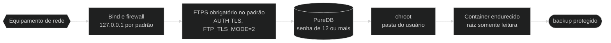
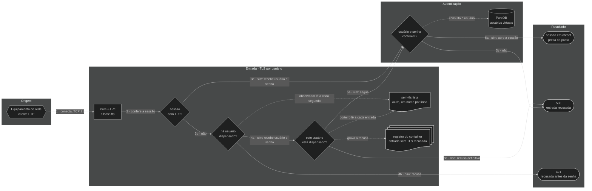
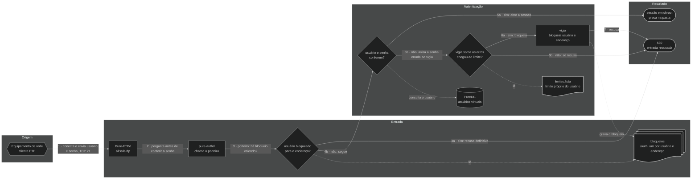

# 🔐 Seguridad — allsafe-ftp-stack

[](../en/security.md)
[-6e7781?style=for-the-badge)](../pt-BR/seguranca.md)
[](seguridad.md)

↩ [README del proyecto](../../README.es.md) · [Índice de la documentación](README.md)

## 💡 En pocas palabras

La copia de seguridad de un equipo de red trae contraseñas y la configuración entera de la red, así que el camino hasta el servidor se protege por capas: el puerto solo escucha en la IP elegida, la conexión tiene que ir cifrada (la excepción, para equipo antiguo, se activa a mano y queda avisada), la dirección que se equivoca demasiadas veces con la contraseña de un usuario queda bloqueada para él, cada usuario queda encerrado en su propia carpeta y el contenedor se ejecuta con el mínimo de permisos. Si una capa falla, las otras siguen en vigor. El panel web sigue la misma idea: queda detrás de un nginx, solo HTTPS, solo red interna, usuario y contraseña para cada administrador y sesión corta.

<!-- diagrama: diagramas/seguridad-diagrama.mmd -->


<sub>Nivel 1 · Diagrama · [fuente](diagramas/)</sub>

**Secuencia:** Equipo de red ➜ Bind y firewall ➜ FTPS obligatorio por defecto (`FTP_TLS_MODE=2`) ➜ PureDB (contraseña de 12 o más) ➜ chroot ➜ Contenedor endurecido ➜ copia de seguridad protegida

---

<details>
<summary>Índice — haga clic para expandir</summary>

[Solo en red privada](#rede-privada) · [IP pública](#ip-publico) · [Panel por proxy o túnel](#painel-por-proxy) · [FTP sin TLS](#ftp-sem-tls) · [TLS por usuario](#tls-por-usuario) · [Bloqueo por intento](#bloqueio-por-tentativa) · [Bloqueo por dirección](#bloqueio-por-endereco) · [Perfiles de usuario](#perfis) · [Buenas prácticas antes de producción](#boas-praticas) · [Modelo de amenaza](#modelo-de-ameaca) · [Superficie expuesta](#superficie-exposta) · [Protecciones del panel](#painel) · [Pruebas ejecutadas](#testes-executados) · [Sin contraseña, contraseña aleatoria, agotamiento y acceso directo al registro](#sem-senha-e-exaustao) · [Costo de las contraseñas del FTP](#custo-das-senhas) · [Contacto de seguridad y robots de búsqueda](#contato-de-seguranca) · [Conformidad con las RFC](#conformidade-rfc) · [Endurecimiento del `compose.yaml`](#hardening-do-compose-yaml-linha-a-linha) · [Gestión de secretos](#gestao-de-segredos)

</details>

---

<a name="rede-privada"></a>

## 🧱 Solo en red privada, detrás de firewall

> ⚠️ **De fábrica, esta stack no va a internet.** FTP es un protocolo antiguo, lo que pasa por él aquí son configuraciones enteras de red, y el panel web administra los usuarios. El uso previsto es **en red interna**, con IP privada, detrás de firewall. Publicar es opcional y es elección de quien instala, por dos caminos independientes, cada uno con su alerta: aceptar [IP pública](#ip-publico) en el FTP y en el panel, o publicar [solo el panel por proxy o túnel](#painel-por-proxy), sin exponer el FTP.

| Regla | Qué hacer |
|---|---|
| IP privada | `FTP_BIND_IP`, `FTP_PASSIVE_IP` y `PAINEL_BIND_IP` solo en `10.0.0.0/8`, `172.16.0.0/12`, `192.168.0.0/16` o `127.0.0.1`. `0.0.0.0` se rechaza siempre; IP pública, solo con la [opción propia](#ip-publico) |
| Firewall del host | Liberar el puerto de control y el rango pasivo **solo** para las redes internas que envían copias, y el puerto del panel **solo** para las máquinas de quien administra; el resto se descarta |
| Redes del panel | `PAINEL_REDES_PERMITIDAS` reducida a la red de administración; por defecto, la lista solo acepta red privada |
| Firewall de borde | Ninguna redirección de puerto de internet hacia este host |
| Acceso desde fuera | Si alguien de fuera necesita llegar, es por VPN hasta la red interna, no abriendo el puerto |

<details>
<summary>Detalle técnico — firewall con Docker</summary>

Docker publica los puertos por reglas propias de NAT, **antes** de las cadenas `INPUT` del host: una regla común de `ufw` o de `INPUT` no bloquea un puerto publicado por contenedor. La cadena correcta es la `DOCKER-USER`, y el puerto de destino tiene que verificarse por la conexión original, porque allí el destino ya fue cambiado por el puerto del contenedor.

Ejemplo con `iptables`, liberando solo la red de gestión `10.10.0.0/24` en la interfaz `eth0` (cambie por los valores reales):

```bash
iptables -I DOCKER-USER -i eth0 -p tcp -m conntrack --ctdir ORIGINAL --ctorigdstport 21 ! -s 10.10.0.0/24 -j DROP
iptables -I DOCKER-USER -i eth0 -p tcp -m conntrack --ctdir ORIGINAL --ctorigdstport 30000:30049 ! -s 10.10.0.0/24 -j DROP
iptables -I DOCKER-USER -i eth0 -p tcp -m conntrack --ctdir ORIGINAL --ctorigdstport 8443 ! -s 10.10.0.0/24 -j DROP
```

**Resultado esperado:** desde una máquina fuera de `10.10.0.0/24`, los puertos `21/tcp` y `8443/tcp` no responden; desde dentro, el login por FTPS y el panel funcionan.

> El ejemplo **no fue aplicado ni probado en este proyecto**: el firewall del host es de quien opera el servidor. Pruebe en ventana de mantenimiento y haga persistente la regla con la herramienta de su distribución.

Además del firewall, el `deploy.sh` y los contenedores **rechazan por código**, por defecto, bind, IP anunciada y red permitida fuera de IP privada: vea [Red y puertos](configuracion.md#rede-e-portas) y [Panel web](configuracion.md#painel).

</details>

---

<a name="ip-publico"></a>

## 🌐 IP pública: opcional, por elección de quien instala, con firewall

> ⚠️ **Alerta: activar esta opción pone el FTP y el panel en internet.** Un servidor expuesto es escaneado y recibe intentos de contraseña todo el tiempo, y por esta stack pasan configuraciones enteras de red. El valor por defecto, `REDE_PERMITIR_IP_PUBLICO=nao`, rechaza cualquier dirección pública. Activarla es opcional: la decisión es de quien instala el servicio, y la stack no lo impide, solo avisa. La recomendación es activarla solo cuando no haya cómo llegar por red interna o por VPN, y **solo con firewall en el servidor**. La elección y el riesgo son de quien activó la opción. Para publicar solo el panel, sin el FTP, use el [proxy o túnel](#painel-por-proxy).

La opción existe para el servidor que solo tiene dirección pública, como una VPS, y para el equipo que llega por una dirección fuera de los rangos privados, como la del CGNAT (`100.64.0.0/10`).

**Antes de activarla, en este orden:**

1. **Firewall en el servidor**, en la cadena `DOCKER-USER`, liberando el puerto de control, el rango pasivo y el puerto del panel **solo** para las direcciones de los equipos y de quien administra. El ejemplo está en [red privada](#rede-privada): cambie la red de gestión por las direcciones reales.
2. **TLS obligatorio:** `FTP_TLS_MODE` en `2` o `3`. Con la opción activada, `0` y `1` se rechazan.
3. **Contraseñas generadas**, nunca elegidas: las que crea el `deploy.sh` y las que genera el panel.
4. **`PAINEL_REDES_PERMITIDAS` reducida** a las redes de quien administra, una a una.
5. En el `.env`, `REDE_PERMITIR_IP_PUBLICO=sim` y las direcciones; después, verifique y aplique:

```bash
./deploy.sh --check-only
./deploy.sh
```

**Resultado esperado:** el `--check-only` termina con `OK: perfil '<perfil>', endereço público aceito, recursos do servidor e compose validados; nada foi alterado.`, seguido del `ALERTA: REDE_PERMITIR_IP_PUBLICO=sim: a stack aceita endereço público, por opção de quem instalou.` El `deploy.sh` levanta los tres contenedores y cierra con el mismo `ALERTA`, que también queda en el registro de cada contenedor y en el panel, solo para administrador: en la señal al lado de **Seguridad** en el menú, al comienzo de la pestaña Seguridad y en el pie de página, además de la línea **Dirección pública** de la misma pestaña. La pantalla de entrada no dice cómo fue publicada la instalación.

| Con la opción activada | Qué ocurre |
|---|---|
| IP pública en `FTP_BIND_IP`, `FTP_PASSIVE_IP`, `PAINEL_BIND_IP` y `PAINEL_CERT_CN` | Aceptada, si es IPv4 de servidor (primer octeto de `1` a `223`) |
| Red pública en `PAINEL_REDES_PERMITIDAS` | Aceptada, con prefijo de `/8` a `/32` |
| `0.0.0.0`, multicast y direcciones reservadas | Rechazados: la dirección siempre se elige, nunca "todas" |
| Red más ancha que `/8`, como `0.0.0.0/0` | Rechazada |
| `FTP_TLS_MODE` en `0` o `1` | Rechazado |
| Valor distinto de `nao` y de `sim` | Rechazado antes de cualquier otra verificación |

<details>
<summary>Detalle técnico — dónde se verifica la opción</summary>

- La variable llega a los tres contenedores por el [`compose.yaml`](../../compose.yaml) y la leen las mismas funciones de [`scripts/rede-privada.sh`](../../scripts/rede-privada.sh) en el [`deploy.sh`](../../deploy.sh) y en los tres entrypoints: `conferir_opcao_ip_publico`, `exigir_ip`, `exigir_rede` y `aviso_ip_publico`. El panel la verifica de nuevo en [`painel/config.py`](../../painel/config.py).
- Un valor fuera de `nao` y de `sim` detiene todo con `FALHA: REDE_PERMITIR_IP_PUBLICO deve ser 'nao' ou 'sim'`: ningún valor se trata como `sim` por aproximación.
- Con la opción activada, el panel acepta ser abierto por cualquier dirección IPv4 escrita en lugar del nombre; por nombre, sigue valiendo solo `localhost` y el `PAINEL_CERT_CN`.
- El límite de intentos de contraseña, la sesión corta y los límites de solicitudes de nginx siguen en vigor, pero no sustituyen al firewall: reducen la velocidad del ataque, no la exposición.
- Los rechazos y la alerta los verifica la [batería de pruebas](scripts.md#testar); los mensajes están en [Solución de problemas](solucion-de-problemas.md#o-container-nao-sobe).

</details>

---

<a name="painel-por-proxy"></a>

## 🔌 Solo el panel publicado, por proxy o túnel

> ⚠️ **Alerta: rellenar `PAINEL_PROXY_CONFIAVEL` pone la pantalla de entrada del panel al alcance de quien llega al proxy o al túnel.** Es opcional y es elección de quien instala. Quién puede llegar a la pantalla pasa a decidirse allí: restrinja el acceso en el proxy o en el túnel. El FTP no pasa por él y sigue solo en las direcciones de la stack. Con el panel publicado, mantenga el [segundo factor](panel.md#segundo-fator) obligatorio, que es el valor por defecto: la contraseña sola no abre la sesión.

Sirve para quien quiere abrir el panel desde fuera sin exponer el FTP: un nginx de borde, un túnel (como el de Cloudflare) u otro proxy HTTPS recibe el acceso y lo reenvía al panel, que sigue en IP privada. `REDE_PERMITIR_IP_PUBLICO` queda en `nao`.

Sin la opción, un proxy delante ya funciona, pero todo acceso llega con la dirección del proxy: el bloqueo por contraseña incorrecta pasa a valer para todos de una vez, y la sesión, la auditoría y los límites de solicitudes dejan de separar a una persona de otra. La opción resuelve eso: el nginx de la stack pasa a usar la dirección que el proxy informa en `X-Forwarded-For`, y **solo** cuando la conexión viene de una dirección de la lista.

**Paso a paso:**

1. Levante el proxy o el túnel apuntando al panel (`https://<PAINEL_BIND_IP>:<PAINEL_PORT>`), reenviando el `Host` como lo mandó el navegador y agregando la dirección de quien accede al `X-Forwarded-For`.
2. Descubra con qué dirección llega al nginx de la stack: haga un acceso por él y lea el primer campo de la última línea del registro.

```bash
docker compose logs --tail 5 nginx
```

**Resultado esperado:** una línea como `172.29.1.1 GET /entrar 200`. Proxy o túnel en el **mismo servidor** llega con la primera dirección de la `FTP_SUBNET` (`172.29.1.1`, por defecto); en otro servidor, con su IP privada.

3. En el `.env`, ponga esa dirección en `PAINEL_PROXY_CONFIAVEL` y el nombre público en `PAINEL_CERT_CN`; después, verifique y aplique:

```bash
./deploy.sh --check-only
./deploy.sh
```

**Resultado esperado:** los dos comandos cierran con `ALERTA: PAINEL_PROXY_CONFIAVEL=<endereço>: o painel está publicado por proxy ou túnel, por opção de quem instalou.` La misma alerta queda en el registro de los contenedores del panel y de nginx y en el panel, solo para administrador: en la señal al lado de **Seguridad** en el menú, al comienzo de la pestaña Seguridad y en el pie de página, además de la línea **Panel por proxy o túnel** de la misma pestaña. Quien abre la pantalla de entrada por la dirección pública no lee cómo fue publicado el panel.

El aviso de la pantalla puede ocultarlo quien instala, con `PAINEL_AVISO_EXPOSICAO=nao` en el `.env` y un `./deploy.sh`: la señal del menú, el aviso del comienzo de la pestaña Seguridad y el texto del pie de página desaparecen. Las líneas de la pestaña Seguridad y la alerta del `deploy.sh` siguen.

4. Abra el panel por el nombre público, entre y verifique en la pestaña Log que la columna **Desde dónde** muestra su dirección, y no la del proxy.

| Con la opción rellenada | Qué ocurre |
|---|---|
| Conexión venida de una dirección de la lista | Vale la **última** dirección del `X-Forwarded-For`, la que agregó el proxy; lo que el cliente escribió antes se descarta |
| Conexión venida de cualquier otra dirección | El encabezado se ignora: vale la dirección de la conexión |
| Encabezado ausente o con valor que no es dirección | Vale la dirección de la conexión, que es la del proxy |
| `PAINEL_REDES_PERMITIDAS` | Sigue verificando quién **abrió la conexión**: el proxy tiene que estar en ella, y quien accede por él no |
| Límite de intentos de contraseña, sesión, auditoría y límites de solicitudes | Pasan a contar por la dirección de quien accede |
| Red entera (`10.0.0.0/8`), `0.0.0.0`, más de 8 direcciones, dirección fuera de `PAINEL_REDES_PERMITIDAS` | Rechazados: el proxy es siempre una dirección elegida |
| Dirección pública en la lista | Rechazada, a no ser con `REDE_PERMITIR_IP_PUBLICO=sim` |

**Cuidados de quien publica:**

- **Restrinja en el proxy o en el túnel** quién llega a la pantalla de entrada: lista de direcciones, autenticación en el borde o los dos. El límite de intentos y la sesión corta del panel reducen la velocidad del ataque, no la exposición.
- **Verifique el certificado del panel en el proxy**, en vez de desactivar la verificación: el panel usa certificado autofirmado, válido para el `PAINEL_CERT_CN`, y su parte pública queda en `DATA_DIR/painel/tls/painel-cert.pem`.
- **Con el proxy en el mismo servidor**, todo acceso hecho desde dentro del servidor llega por la misma dirección y pasa a tratarse como venido del proxy. Quien tiene terminal en el servidor ya está dentro del límite de confianza de la stack.
- **Reduzca `PAINEL_REDES_PERMITIDAS`** a la red del proxy y a la de quien administra por dentro.
- **Rellene el contacto de seguridad** (`SEGURANCA_CONTATO_EMAIL`): vea [Contacto de seguridad](#contato-de-seguranca).

<details>
<summary>Detalle técnico — ejemplos de borde y dónde se verifica la opción</summary>

Ejemplo de nginx de borde, en el mismo servidor, con el nombre `painel.exemplo.com.br` (cambie por los valores reales):

```nginx
server {
    listen 443 ssl;
    server_name painel.exemplo.com.br;
    ssl_certificate     /etc/ssl/painel.exemplo.com.br/certificado.pem;
    ssl_certificate_key /etc/ssl/painel.exemplo.com.br/chave.pem;

    allow 203.0.113.10;          # quién puede llegar a la pantalla de entrada
    deny  all;

    location / {
        proxy_pass https://127.0.0.1:8443;
        proxy_set_header Host $http_host;                               # el nombre y el puerto que usó el navegador
        proxy_set_header X-Forwarded-For $proxy_add_x_forwarded_for;    # agrega la dirección de quien accede
        proxy_ssl_trusted_certificate /etc/ssl/painel-cert.pem;         # copia de DATA_DIR/painel/tls/painel-cert.pem
        proxy_ssl_verify on;
        proxy_ssl_name painel.exemplo.com.br;
        proxy_ssl_server_name on;
    }
}
```

**Resultado esperado:** con `PAINEL_CERT_CN=painel.exemplo.com.br` y `PAINEL_PROXY_CONFIAVEL=172.29.1.1`, el panel abre por el nombre público, la entrada funciona y la auditoría registra la dirección de quien accedió.

> El ejemplo fue ejercitado en este proyecto con un nginx de borde en el mismo servidor, en puerto alto y con nombre de prueba: la entrada, la sesión y la dirección en la auditoría fueron verificadas, y un `X-Forwarded-For` escrito por el cliente fue descartado. Con `Host $host`, que quita el puerto, la entrada por puerto distinto de `443` se rechaza con `403`, porque el origen del envío deja de coincidir; por eso el ejemplo usa `$http_host`.

Túnel: apunte el servicio del túnel a `https://127.0.0.1:8443`, con el nombre del servidor de origen igual al `PAINEL_CERT_CN` y la copia del `painel-cert.pem` como autoridad aceptada, sin desactivar la verificación de TLS. En el túnel de Cloudflare, eso corresponde a `originServerName` y `caPool` en `originRequest`, y la restricción de quién accede se hace en la política de acceso de la propia Cloudflare.

> La opción **no fue probada con un túnel real** en este proyecto: lo que está probado es el comportamiento del nginx de la stack y del panel ante un proxy que reenvía `Host` y `X-Forwarded-For`. El proxy de Cloudflare **sin** túnel llega por rangos públicos enteros y queda fuera de esta opción, que solo acepta dirección elegida.

Dónde se verifica la opción:

- La variable llega a los contenedores del panel y de nginx por el [`compose.yaml`](../../compose.yaml). La función `exigir_proxies`, de [`scripts/rede-privada.sh`](../../scripts/rede-privada.sh), la llaman el [`deploy.sh`](../../deploy.sh) y los dos entrypoints; el panel la verifica de nuevo en [`painel/config.py`](../../painel/config.py).
- En el [`nginx/nginx.conf.modelo`](../../nginx/nginx.conf.modelo), la lista se vuelve un bloque `geo`, y la dirección de quien accede (`$cliente`) es la última del `X-Forwarded-For` solo cuando la conexión viene de la lista. El módulo `realip` queda fuera a propósito: con él, el `allow` y el `deny` pasarían a valer sobre la dirección informada, y no sobre quién abrió la conexión.
- nginx manda al panel la dirección de la conexión (`X-Real-IP`) y la de quien accede (`X-Cliente-IP`), siempre reescritas por él. El panel solo usa la segunda cuando la primera está en la lista ([`painel/atendimento.py`](../../painel/atendimento.py)); las dos escritas por el cliente no llegan al panel.
- La dirección informada puede ser IPv4 o IPv6. Las direcciones de la lista son IPv4.
- Los rechazos, la alerta y la dirección falsificada los verifica la [batería de pruebas](scripts.md#testar).

</details>

---

<a name="ftp-sem-tls"></a>

## ⚠️ FTP sin TLS: solo para equipo antiguo

> ⚠️ **El valor por defecto de esta stack es TLS obligatorio (`FTP_TLS_MODE=2`). Los modos `0` y `1` desactivan esa protección.** Existen solo porque hay equipo de red antiguo que no habla TLS y, sin eso, no lograría enviar la copia. Con ellos, usuario, contraseña y archivo pasan en **texto plano**: quien esté en el camino de la red lo lee todo.

| Modo | Qué ocurre | Qué queda expuesto |
|---|---|---|
| `FTP_TLS_MODE=0` | El servidor **no ofrece TLS**. Todo cliente entra en texto plano; quien exige TLS no logra conectar | Usuario, contraseña y contenido de **todas** las copias, de todos los equipos |
| `FTP_TLS_MODE=1` | El TLS es **opcional**. Quien pide TLS lo usa; quien no lo pide entra en texto plano | Usuario, contraseña y copia de quien entra sin TLS. Nada obliga a los demás a usar TLS: un equipo mal configurado pasa a enviar en texto plano sin que nadie lo note |

La copia de seguridad de un equipo de red suele traer contraseñas, comunidades SNMP y claves. Con la contraseña del FTP capturada, el invasor también lee y sobrescribe las copias de ese usuario.

**Úselo solo si todas las condiciones de abajo son verdaderas:**

1. El equipo realmente no habla TLS: confírmelo en el manual o con la prueba de [Solución de problemas](solucion-de-problemas.md#ftp-sem-tls).
2. El tráfico queda en **red interna aislada** (red de gestión), sin pasar por red de usuario, Wi-Fi, internet o enlace de tercero sin VPN.
3. El **firewall** libera el puerto de control y el rango pasivo **solo para las IP de esos equipos**: [red privada](#rede-privada).
4. Cada equipo antiguo tiene **usuario y contraseña solo suyos**, no usados en ningún otro lugar. El `chroot` limita el daño a la carpeta de ese usuario.
5. Hay fecha para volver al `2`: cuando el equipo sea cambiado o actualizado, el modo vuelve y las contraseñas que pasaron en texto plano se cambian.

Hay cuatro caminos para el equipo que no habla TLS. Prefiera de arriba hacia abajo:

| Camino | Quién entra sin TLS | Qué arriesgan los demás |
|---|---|---|
| Segunda instancia solo para los equipos antiguos, con la principal en `2`: [Configuración](configuracion.md#pastas-e-nomes) | Solo los usuarios de la segunda instancia | Nada: la principal rechaza la sesión sin TLS antes de que se envíe la contraseña |
| Dispensa por usuario, por el panel: [TLS por usuario](#tls-por-usuario) | Solo los usuarios que un administrador dispense | Mientras haya alguien dispensado, un equipo de usuario no dispensado, configurado sin TLS por error, manda la contraseña en texto plano antes de ser rechazado; el rechazo queda en el registro |
| `FTP_TLS_MODE=1` | Cualquier usuario cuyo equipo no pida TLS | Nada obliga a nadie a usar TLS |
| `FTP_TLS_MODE=0` | Todos | No hay TLS para nadie |

La dispensa por usuario es el camino más simple cuando son pocos equipos antiguos: queda todo en una sola instalación, con un solo panel, y no pide modificación en el `.env`.

Para activar el modo `1` o el `0`, edite `FTP_TLS_MODE` en el `.env` y aplique de nuevo:

```bash
./deploy.sh
```

**Resultado esperado:** el resumen trae `FTP:    127.0.0.1:21, SEM TLS (texto puro), modo passivo 30000-30049` (o `TLS explícito opcional (aceita texto puro)` en el modo `1`) y termina con el aviso:

```text
AVISO: FTP_TLS_MODE=0: o FTP está SEM criptografia. Senhas e arquivos passam em texto puro e podem ser
       lidos por quem estiver na mesma rede. Use só para equipamento antigo sem suporte a TLS, em rede interna
       isolada, com o firewall liberando só esses equipamentos, e volte para FTP_TLS_MODE=2 assim que puder.
```

La stack no deja que el modo pase inadvertido. Mientras esté activado, la alerta aparece en:

| Dónde | Qué aparece |
|---|---|
| Fin del `./deploy.sh` y del `./deploy.sh --check-only` | El `AVISO` de tres líneas de arriba |
| Resumen del `./deploy.sh` | `SEM TLS (texto puro)` o `TLS explícito opcional (aceita texto puro)` en la línea del FTP |
| Registro del contenedor (`docker compose logs ftp`) | En cada arranque: `AVISO: FTP_TLS_MODE=0, FTP sem TLS: senhas e arquivos trafegam em texto puro. Só para equipamento sem suporte a TLS, em rede interna isolada.` |
| Panel, pantallas Visión general y Seguridad | Franja de alerta al comienzo de la pantalla y el elemento `TLS del FTP` marcado con la señal de atención |

El aviso informa, no bloquea: la decisión es de quien opera el servidor. El panel web **no** se ve afectado por esta variable y sigue solo en HTTPS.

<details>
<summary>Detalle técnico — qué cambia en Pure-FTPd</summary>

`FTP_TLS_MODE` se pasa a la opción `-Y` del `pure-ftpd`. Con `-Y 0`, el servidor no anuncia `AUTH TLS` y el comando se rechaza; con `-Y 1`, acepta las dos formas; con `-Y 2`, rechaza la sesión en texto plano con `421-Sorry, cleartext sessions and weak ciphers are not accepted on this server.`; con `-Y 3`, exige también `PROT P` en el canal de datos.

El certificado del FTP se genera en cualquier modo, y las demás capas siguen en vigor: bind en IP privada, usuarios virtuales, `chroot`, límites de sesión y contenedor endurecido. Lo que se pierde es el secreto y la integridad de lo que viaja.

Un valor fuera de `0` a `3` se rechaza dos veces: por el [`deploy.sh`](../../deploy.sh), antes de cualquier modificación, y por el [`ftp/entrypoint.sh`](../../ftp/entrypoint.sh), con `FALHA: FTP_TLS_MODE deve ser 0, 1, 2 ou 3`.

</details>

---

<a name="tls-por-usuario"></a>

## 🔓 TLS por usuario

El servidor exige TLS a todos, menos a los usuarios que un administrador dispense, uno a uno, en el panel. Sirve para el servidor en que uno o dos equipos antiguos no hablan TLS y los demás sí. La opción viene activada (`FTP_TLS_EXCECOES=sim`) y, sin ningún usuario dispensado, no cambia nada: la sesión sin TLS se rechaza antes de que se envíe la contraseña.

> ⚠️ **El usuario dispensado manda contraseña y archivo en texto plano**, como en los modos `0` y `1`. Valen para él las cinco condiciones de [FTP sin TLS](#ftp-sem-tls): equipo que no habla TLS, red interna aislada, firewall liberando solo a él, usuario y contraseña solo suyos y fecha para terminar.

1. Usuario nuevo: en el panel, abra Usuarios ➜ **Nuevo usuario** y marque **Equipo sin soporte de TLS** antes de crear.
2. Usuario que ya existe: Usuarios ➜ **Dispensar del TLS** en su fila, o la tarjeta **TLS** de la pantalla Editar, y confirme. Por la terminal, lo mismo:

   ```bash
   ./manage-user.sh tls-dispensar <usuario>
   ```

**Resultado esperado:** la columna **TLS** de la pestaña Usuarios muestra `sin TLS` en la fila del usuario; en instantes él entra sin TLS, sin reiniciar el contenedor y sin derribar a quien está conectado; los demás, sin TLS, reciben `530` y siguen entrando con TLS.

Para volver a exigir el TLS a un usuario: Usuarios ➜ **Exigir TLS**, o `./manage-user.sh tls-exigir <usuario>`, y cambie su contraseña, que pasó en texto plano. Para quitar la opción del panel: `FTP_TLS_EXCECOES=nao` en el `.env` y `./deploy.sh`.

La dispensa solo vale con `FTP_TLS_MODE=2` y sin `REDE_PERMITIR_IP_PUBLICO=sim`. Fuera de eso la instalación arranca normalmente, la opción queda **sin efecto** y nadie es dispensado: el `./deploy.sh` y el panel dicen el motivo.

| Situación | Qué ocurre |
|---|---|
| Usuario dispensado, sin TLS | Entra, encerrado en su carpeta, como cualquier otro |
| Usuario dispensado, con TLS | Entra: la dispensa permite la entrada sin TLS, no prohíbe el TLS |
| Ningún usuario dispensado, sesión sin TLS | `421` en la respuesta al nombre del usuario: el servidor cierra la sesión antes de que se envíe la contraseña |
| Usuario no dispensado, sin TLS, con otro usuario dispensado | `530`, con la contraseña correcta o incorrecta, y el rechazo va al registro del contenedor |
| Usuario eliminado y creado de nuevo con el mismo nombre | No hereda la dispensa: vuelve a estar obligado a usar TLS |
| El proceso que consulta la lista deja de responder | El contenedor del FTP termina y Docker lo levanta de nuevo; mientras tanto, nadie entra |
| Sesión sin TLS ya abierta de quien volvió a estar obligado | Sigue hasta terminar; su entrada siguiente sin TLS se rechaza |
| `FTP_TLS_EXCECOES=nao`, `FTP_TLS_MODE` distinto de `2` o `REDE_PERMITIR_IP_PUBLICO=sim` | Nadie es dispensado; la lista queda guardada y vuelve a valer cuando la opción vuelva a tener efecto |

> ⚠️ **Límite:** mientras haya al menos un usuario dispensado, el servidor solo sabe quién es el usuario después de recibir el nombre, así que acepta el comienzo de la conversación sin TLS de cualquiera. Un equipo de usuario **no dispensado** que esté configurado sin TLS manda la contraseña en texto plano antes de recibir el `530`. La entrada se rechaza y el registro trae el usuario y el origen: cambie esa contraseña y corrija el equipo. Sin ningún dispensado, la sesión sin TLS vuelve a rechazarse antes de que se envíe la contraseña.

Dónde aparece la dispensa:

| Dónde | Qué aparece |
|---|---|
| Fin del `./deploy.sh` | Con alguien dispensado: `AVISO: TLS por usuário: <n> usuário(s) dispensado(s) na aba Usuários do painel entram SEM TLS, com senha e` y las líneas siguientes. Sin efecto: `TLS por usuário sem efeito: <motivo>. Ninguém é dispensado do TLS.`, también en el `./deploy.sh --check-only` |
| Resumen del `./deploy.sh` | `equipamento sem suporte a TLS: o administrador dispensa o usuário dele na aba Usuários do painel`, debajo de la línea del FTP |
| Registro del contenedor (`docker compose logs ftp`) | En la línea `FTP pronto`: `TLS por usuário: nenhum dispensado, sessão sem TLS recusada antes da senha` o `com exceção por usuário (<n> dispensado(s) do TLS)`, esta con el `AVISO` de texto plano; en cada cambio de lado de la lista, `TLS por usuário: a lista dos dispensados mudou`; en cada rechazo, `porteiro: entrada sem TLS recusada: usuario=<nome> origem=<ip> (a senha enviada passou em texto puro: troque-a)` |
| Panel, pestaña Usuarios | La columna **TLS**, con `obligatorio` o `sin TLS` en cada fila |
| Panel, pestañas Visión general y Seguridad | Con al menos un usuario dispensado, la franja de alerta al comienzo de la pantalla, con la cantidad y los nombres; en la pestaña Seguridad, el elemento `TLS del FTP` |
| Panel, pestaña Log | `Usuario dispensado del TLS` y `El usuario vuelve a exigir TLS`, con el administrador que lo hizo |

<details>
<summary>Flujograma de la entrada con el TLS por usuario, con la secuencia escrita — haga clic para expandir</summary>

<!-- diagrama: diagramas/tls-por-usuario-flujograma.mmd -->


<sub>Nivel 2 · Mapa · [fuente](diagramas/)</sub>

| Nº | De ➜ A | Qué ocurre |
|---|---|---|
| 1 | Equipo de red ➜ Pure-FTPd | El equipo conecta en el puerto `21/tcp`, con o sin TLS |
| 2 | Pure-FTPd ➜ ¿sesión con TLS? | El servidor verifica si la sesión está cifrada |
| 3a | ¿sesión con TLS? ➜ ¿usuario y contraseña coinciden? | Sí: recibe usuario y contraseña y sigue a la verificación, sea cual sea el usuario |
| 3b | ¿sesión con TLS? ➜ ¿hay usuario dispensado? | No: lo que ocurre depende de que exista algún usuario dispensado |
| 4a | ¿hay usuario dispensado? ➜ ¿este usuario está dispensado? | Sí: el servidor recibe usuario y contraseña sin TLS, y el portero (`allsafe-ftp-porteiro`) busca el nombre en la lista |
| 4b | ¿hay usuario dispensado? ➜ 421 | No: rechazo en la respuesta al nombre, antes de que se envíe la contraseña |
| 5a | ¿este usuario está dispensado? ➜ ¿usuario y contraseña coinciden? | Sí: sigue a la verificación de la contraseña |
| 5b | ¿este usuario está dispensado? ➜ 530 | No: rechazo definitivo, con la contraseña correcta o incorrecta |
| 6a | ¿usuario y contraseña coinciden? ➜ sesión en chroot | Sí: la sesión abre, encerrada en la carpeta del usuario |
| 6b | ¿usuario y contraseña coinciden? ➜ 530 | No: `530 Login authentication failed` |

**Apoyo**

| Quién | Usa | Cómo |
|---|---|---|
| ¿hay usuario dispensado? | `sem-tls.lista` (`DATA_DIR/auth`) | el observador del inicio del FTP la lee cada segundo |
| ¿este usuario está dispensado? | `sem-tls.lista` (`DATA_DIR/auth`) | el portero la lee en cada entrada |
| ¿este usuario está dispensado? | registro del contenedor | escribe el rechazo, con el usuario y el origen, sin la contraseña |
| ¿usuario y contraseña coinciden? | PureDB | consulta el usuario |

</details>

<details>
<summary>Detalle técnico — cómo se aplica la dispensa</summary>

- **Siempre en marcha:** el [`ftp/entrypoint.sh`](../../ftp/entrypoint.sh) levanta el `pure-authd -s /run/pure-authd.sock -r /usr/local/sbin/allsafe-ftp-porteiro` y el `pure-ftpd` con `-l extauth:/run/pure-authd.sock -l puredb:/auth/pureftpd.pdb`, con o sin la dispensa, porque el mismo portero aplica el [bloqueo por intento](#bloqueio-por-tentativa). Con la opción en vigor, la marca `/run/allsafe/tls-por-usuario` activa la regla del TLS en el portero.
- **Dos modos de entrada, según la lista:** sin ningún dispensado, el `pure-ftpd` arranca con `-Y 2` y rechaza él mismo la sesión sin TLS, antes de la contraseña. Con al menos uno, arranca con `-Y 1`, que acepta sesión con y sin TLS, y quien decide es el portero. Un observador en el entrypoint relee la lista cada segundo; cuando pasa de vacía a rellenada, o al contrario, solo se termina el proceso del `pure-ftpd` que escucha el puerto y otro arranca con el modo nuevo. El contenedor no reinicia, y cada sesión en curso es un proceso propio, que sigue hasta terminar.
- **Costos del cambio:** el puerto queda cerrado por el instante entre un proceso y el otro; el proceso nuevo recomienza el conteo de sesiones simultáneas (`FTP_MAX_CLIENTS` y `FTP_MAX_CLIENTS_PER_IP`), sin contar las que ya estaban abiertas; y la sesión sin TLS ya abierta de quien volvió a estar obligado sigue hasta terminar.
- **El portero no verifica contraseña:** el [`ftp/porteiro.pl`](../../ftp/porteiro.pl) responde `auth_ok:0` ("no es conmigo") cuando la sesión tiene TLS o cuando el nombre está en la lista, y el `pure-ftpd` sigue a PureDB, que verifica la contraseña como siempre. En los otros casos responde `auth_ok:-1`, el rechazo definitivo. La contraseña le llega en variable de entorno y no se lee, guarda ni registra.
- **La lista:** `/auth/sem-tls.lista` (`DATA_DIR/auth` en el host), `0600`, del `root`, un nombre por línea. Solo el `allsafe-ftp-user` escribe, con el mismo bloqueo del registro de usuarios y por cambio de nombre del archivo, para que el portero nunca lea la lista por la mitad. El portero la lee en cada entrada, y el observador, cada segundo: el cambio vale en instantes, sin reiniciar el contenedor.
- **Falla cerrada:** sin el `pure-authd`, el `pure-ftpd` caería directo en PureDB y aceptaría a todos sin TLS. Por eso el entrypoint vigila los procesos: si uno sale, escribe `FALHA: o pure-authd saiu: o container encerra para ninguém entrar sem a conferência do porteiro` (o `o vigia saiu`, `o pure-ftpd saiu`, `o observador da lista do TLS saiu`), termina con código `1`, y el `restart: unless-stopped` levanta el contenedor de nuevo, con todos. El healthcheck solo responde saludable con el socket del `pure-authd` abierto.
- **El rechazo por TLS no cuenta como contraseña incorrecta:** el portero deja una marca en `/run/allsafe/recusa/`, y el vigía del bloqueo por intento ignora la falla que viene justo después de ella. Un equipo configurado sin TLS no bloquea a su propio usuario.
- **Cuándo la opción queda sin efecto:** con `FTP_TLS_MODE` distinto de `2` o con `REDE_PERMITIR_IP_PUBLICO=sim`. La instalación arranca, nadie es dispensado, y el [`deploy.sh`](../../deploy.sh), el registro del contenedor y el panel dicen el motivo. Solo el valor fuera de `nao` y de `sim` se rechaza, por el `deploy.sh` y por los contenedores del FTP y del panel.
- **Quién modifica la lista:** solo un administrador, por el panel, con token CSRF y origen verificados, o quien tiene acceso al Docker del servidor, por el `manage-user.sh`. Para el usuario del FTP que entra en el panel, la pantalla responde `404`. Con la opción desactivada o sin efecto, la pantalla también responde `404`.
- El panel verifica la contraseña del usuario del FTP en TLS, por la red interna de la stack, con o sin dispensa: esta no cambia [su entrada en el panel](panel.md#usuario-ftp).
- Los rechazos, el cambio del modo de entrada con sesiones abiertas, la caída del `pure-authd` y los casos sin efecto los verifica la [batería de pruebas](scripts.md#testar).

</details>

---

<a name="bloqueio-por-tentativa"></a>

## 🚫 Bloqueo por intento en el FTP

Cuando una misma dirección se equivoca demasiadas veces con la contraseña de un usuario, el FTP pasa a rechazar a ese usuario para esa dirección, incluso con la contraseña correcta, hasta que el plazo termine. La stack sale de la instalación con el bloqueo activado: 5 contraseñas incorrectas, 15 minutos. El límite de cada usuario lo ajusta el administrador en el panel, tanto para la cuenta de un equipo como para la de una persona.

| Qué ajustar | Dónde | Valor | Por defecto |
|---|---|---|---|
| Contraseñas incorrectas hasta el bloqueo, para todos | `FTP_BLOQUEIO_TENTATIVAS`, en el `.env` | `0` a `100`; `0` desactiva | `5` |
| Minutos de bloqueo, para todos | `FTP_BLOQUEIO_MINUTOS`, en el `.env` | `1` a `1440` | `15` |
| Contraseñas incorrectas hasta el bloqueo, de un usuario | Panel, Usuarios ➜ **Editar**, tarjeta **Límites** | `0` a `100`; `0`: el usuario nunca se bloquea | En blanco: el de la stack |
| Minutos de bloqueo, de un usuario | Panel, Usuarios ➜ **Editar**, tarjeta **Límites** | `1` a `1440` | En blanco: el de la stack |

1. Para cambiar el valor por defecto de todos, edite las dos variables en el `.env` y aplique de nuevo:

   ```bash
   ./deploy.sh
   ```

2. Para un usuario, abra Usuarios ➜ **Editar**, rellene **Contraseñas incorrectas en el FTP hasta el bloqueo** y **Minutos de bloqueo** y guarde. Por la terminal, lo mismo:

   ```bash
   ./manage-user.sh limites <usuario> tentativas=3 minutos=30
   ```

3. Para ver quién está bloqueado, abra la pestaña Usuarios, que marca la fila con **bloqueado**, o ejecute:

   ```bash
   ./manage-user.sh bloqueios
   ```

4. Para desbloquear antes del plazo, corrija la contraseña en el equipo y haga clic en **Desbloquear**, en la tarjeta **Bloqueos** de la pantalla **Editar**. Por la terminal, lo mismo, para todas las direcciones del usuario o para una sola:

   ```bash
   ./manage-user.sh desbloquear <usuario>
   ./manage-user.sh desbloquear <usuario> <origem>
   ```

**Resultado esperado:** el `manage-user.sh bloqueios` responde una línea por bloqueo, `usuario=<nome> origem=<ip> senhas_erradas=<n> desde=<data hora> ate=<data hora>`, o `Nenhum bloqueio em vigor.`; el `desbloquear` responde `Usuario <nome> desbloqueado (<n> endereco(s)): vale na proxima entrada no FTP.`; la modificación del límite y el desbloqueo valen en la entrada siguiente, sin reiniciar nada.

| Situación | Qué ocurre |
|---|---|
| Contraseña incorrecta, por debajo del límite | `530`, y el intento se suma a los otros de la misma dirección para ese usuario |
| Contraseña incorrecta que completa el límite | `530`, y el usuario queda bloqueado para esa dirección: la contraseña correcta también recibe `530` hasta el fin del plazo |
| Entrada correcta antes del límite | Entra, y el conteo de esa dirección para ese usuario vuelve a cero |
| El mismo usuario, desde otra dirección | Entra: el bloqueo vale solo para la dirección que se equivocó |
| Otro usuario, desde la misma dirección | Entra: el bloqueo vale solo para el usuario que tuvo la contraseña incorrecta |
| El usuario bloqueado en el FTP entra en el panel | Entra: el panel tiene su propio límite de intentos, por dirección |
| Fin del plazo | El bloqueo sale por sí solo, y el conteo recomienza desde cero |
| Contraseña del usuario cambiada | Sus bloqueos salen |
| Límite propio del usuario modificado | Sus bloqueos salen; guardar los mismos valores no cambia nada |
| Usuario eliminado y creado de nuevo con el mismo nombre | No hereda el bloqueo ni el límite |
| El contenedor del FTP reinicia o se crea de nuevo | El bloqueo sigue en vigor hasta el plazo; el conteo que todavía no había llegado al límite recomienza |
| Entrada fuera del [horario del usuario](panel.md#limites) | Cuenta como contraseña incorrecta: el servidor responde de la misma manera en los dos casos |
| Sesión sin TLS rechazada, nombre que no está en el registro, intento hecho durante el bloqueo | No cuentan aquí. El nombre que no está en el registro cuenta en el [bloqueo por dirección](#bloqueio-por-endereco) |
| Contraseña del usuario del FTP incorrecta en la pantalla del panel | No cuenta aquí: cuenta en el límite de intentos del panel |

> ⚠️ **Misma dirección, mismo usuario:** los equipos que usan el mismo usuario y llegan al servidor por la misma dirección, detrás de un router que cambia la dirección de origen, se bloquean juntos. Dé a cada equipo su propio usuario: el error de uno no retiene al otro.

> ⚠️ **Límite:** el bloqueo cuenta las contraseñas incorrectas de una dirección para un usuario. Quien intenta pocas contraseñas en muchos usuarios, por debajo del límite de cada uno, no es bloqueado por esta regla: quien lo retiene es el [bloqueo por dirección](#bloqueio-por-endereco), que suma los errores de la dirección con cualquier nombre. Valen también la espera de 3 a 6 segundos de cada rechazo, el límite de sesiones por dirección y el firewall del host, que debe liberar el puerto `21/tcp` solo para los orígenes de copia. El bloqueo frena la adivinación; quien autentica sigue siendo la contraseña.

Mientras haya bloqueo, aparece en:

| Dónde | Qué aparece |
|---|---|
| Registro del contenedor (`docker compose logs ftp`) | En cada arranque, `vigia: pronto:` con el límite de la stack; en cada contraseña incorrecta, `vigia: entrada recusada: usuario=<nome> origem=<ip> senhas_erradas=<n> de <limite>`; en el bloqueo, `vigia: entrada bloqueada: usuario=<nome> origem=<ip> senhas_erradas=<n> minutos=<m>`; en cada intento durante el bloqueo, `vigia: entrada recusada pelo bloqueio`; en cada archivo enviado, descargado, renombrado o borrado por el FTP, `vigia: envio:`, `vigia: download:`, `vigia: renomeado:` y `vigia: apagado:`, con el usuario, la dirección y el archivo |
| Panel, pestaña Usuarios | La marca **bloqueado** en la fila del usuario, con las direcciones al pasar el mouse; la marca **límites** muestra el límite propio |
| Panel, pantalla Editar | La tarjeta **Bloqueos**, con el origen, las contraseñas incorrectas, el inicio y el fin de cada bloqueo, y el botón **Desbloquear** |
| Panel, pestaña Seguridad | El elemento `Bloqueo por intento en el FTP`, con el límite de la stack y los usuarios bloqueados ahora |
| Panel, pestaña Log | `Bloqueo del usuario en el FTP eliminado` y `Límites del usuario modificados`, con el administrador que lo hizo |

<details>
<summary>Flujograma de la entrada con el bloqueo por intento, con la secuencia escrita — haga clic para expandir</summary>

<!-- diagrama: diagramas/bloqueo-por-intento-flujograma.mmd -->


<sub>Nivel 2 · Mapa · [fuente](diagramas/)</sub>

| Nº | De ➜ A | Qué ocurre |
|---|---|---|
| 1 | Equipo de red ➜ Pure-FTPd | El equipo conecta en el puerto `21/tcp` y envía usuario y contraseña |
| 2 | Pure-FTPd ➜ pure-authd | Antes de verificar la contraseña, el servidor pregunta al `pure-authd` si la entrada puede seguir |
| 3 | pure-authd ➜ ¿usuario bloqueado para la dirección? | El `pure-authd` llama al portero (`allsafe-ftp-porteiro`), que busca un bloqueo de ese usuario para esa dirección, todavía dentro del plazo |
| 4a | ¿usuario bloqueado para la dirección? ➜ 530 | Sí: rechazo definitivo, con la contraseña correcta o incorrecta |
| 4b | ¿usuario bloqueado para la dirección? ➜ ¿usuario y contraseña coinciden? | No: sigue a la verificación de la contraseña |
| 5a | ¿usuario y contraseña coinciden? ➜ sesión en chroot | Sí: la sesión abre, encerrada en la carpeta del usuario, y el conteo de esa dirección vuelve a cero |
| 5b | ¿usuario y contraseña coinciden? ➜ el vigía suma los errores: ¿llegó al límite? | No: el servidor registra la contraseña incorrecta, y el vigía (`allsafe-ftp-vigia`) recibe el aviso, con el usuario y la dirección, suma las contraseñas incorrectas de esa dirección para ese usuario, dentro del plazo, y compara con el límite |
| 6a | el vigía suma los errores: ¿llegó al límite? ➜ vigía | Sí: el vigía guarda el bloqueo del usuario para esa dirección, que vale a partir del intento siguiente |
| 6b | el vigía suma los errores: ¿llegó al límite? ➜ 530 | No: la entrada se rechaza con `530 Login authentication failed`, y el conteo queda guardado |
| 7 | vigía ➜ 530 | La entrada que alcanzó el límite también se rechaza |

**Apoyo**

| Quién | Usa | Cómo |
|---|---|---|
| ¿usuario bloqueado para la dirección? | bloqueos (`DATA_DIR/auth/bloqueios`) | lee en cada entrada |
| ¿usuario y contraseña coinciden? | PureDB | consulta el usuario |
| el vigía suma los errores: ¿llegó al límite? | `limites.lista` (`DATA_DIR/auth`) | lee el límite propio del usuario; sin él, vale el de la stack |
| vigía | bloqueos (`DATA_DIR/auth/bloqueios`) | guarda el bloqueo, con el plazo |

</details>

<details>
<summary>Detalle técnico — cómo se aplica el bloqueo</summary>

- **Dos papeles:** el vigía cuenta y guarda; el portero lee y rechaza. El [`ftp/vigia.pl`](../../ftp/vigia.pl), instalado como `/usr/local/sbin/allsafe-ftp-vigia`, escucha en `/dev/log` lo que el `pure-ftpd` registra, porque el servidor solo avisa de la contraseña incorrecta por ahí. El [`ftp/porteiro.pl`](../../ftp/porteiro.pl) lo llama el `pure-authd` en cada entrada, antes de la verificación de la contraseña. Ninguno de los dos recibe la contraseña para verificar: el aviso trae solo el nombre y la dirección, y el portero no lee la variable en que ella llega.
- **El bloqueo es un archivo:** `/auth/bloqueios/<usuario>@<endereco>` (`DATA_DIR/auth/bloqueios` en el host), `0600`, del `root`, en carpeta `0700`, con una línea: hasta cuándo vale, desde cuándo y cuántas contraseñas incorrectas, en segundos desde 1970. Es la única memoria del bloqueo: por eso atraviesa el reinicio, y borrar el archivo desbloquea en la entrada siguiente. El vigía guarda por cambio de nombre del archivo, para que el portero nunca lea por la mitad.
- **Archivo inválido no bloquea:** vale solo el archivo común cuya primera línea empieza por un número de hasta 12 dígitos mayor que la hora actual. Vencido, vacío, con texto o enlace simbólico, no bloquea, y el vigía lo borra en la limpieza de minuto en minuto.
- **Ventana de conteo:** las contraseñas incorrectas se suman mientras la más antigua tenga menos que los minutos de bloqueo del usuario. El conteo queda en la memoria del vigía, hasta 10.000 pares de usuario y dirección; los bloqueos guardados van hasta 4.096. Por encima de esos topes el vigía registra `AVISO` y sigue.
- **Límite propio:** `tentativas` y `minutos` quedan en la línea del usuario en `/auth/limites.lista` (`0600`), guardados por el `allsafe-ftp-user limites`, el mismo comando del panel y del [`manage-user.sh`](../../manage-user.sh). El vigía relee el registro y la lista cuando el archivo cambia.
- **Lo que no cuenta:** el intento venido de la red interna de la stack, que es la verificación de contraseña hecha por el panel y tiene su propio límite de intentos; el rechazo del portero por falta de TLS, que él marca en `/run/allsafe/recusa/`; el intento hecho durante el bloqueo; el nombre que no está en el registro y el nombre fuera de la regla, que no se vuelven archivo ni conteo.
- **Red interna:** son las redes conectadas directo al contenedor, leídas de `/proc/net/route` en el arranque, menos la dirección de salida, por donde llegan los clientes del propio servidor, y más `127.0.0.0/8`.
- **Falla cerrada:** el entrypoint vigila el `pure-ftpd`, el `pure-authd` y el vigía. Si uno sale, escribe `FALHA: o <processo> saiu: o container encerra para ninguém entrar sem a conferência do porteiro`, termina con código `1`, y el `restart: unless-stopped` levanta el contenedor de nuevo. El healthcheck solo responde saludable con el socket del `pure-authd` y el `/dev/log` abiertos.
- **Quién desbloquea y quién modifica el límite:** solo un administrador, por el panel (`POST /usuarios/desbloquear` y `POST /usuarios/limites`), con token CSRF y origen verificados, o quien tiene acceso al Docker del servidor, por el `manage-user.sh`. Para el usuario del FTP que entra en el panel, las dos pantallas responden `404`. El desbloqueo queda en la auditoría como `bloqueio_removido`, con el administrador, el usuario y la cantidad de direcciones.
- **Sin paquete nuevo:** el vigía usa solo el `perl-base`, que ya viene en la imagen base, y el contenedor sigue con `read_only` y `cap_drop: ALL`.
- El bloqueo, el desbloqueo, el vencimiento, el reinicio y los intentos de burlar los verifica la [batería de pruebas](scripts.md#testar), en [`tests/etapas/24-bloqueio.sh`](../../tests/etapas/24-bloqueio.sh).

</details>

---

<a name="bloqueio-por-endereco"></a>

## ⛔ Bloqueo por dirección

La dirección que se equivoca demasiadas veces con usuario y contraseña deja de entrar en el FTP y en el panel, con cualquier cuenta e incluso con la contraseña correcta, hasta que el plazo termine o un administrador la libere. La stack sale de la instalación con el bloqueo activado: la dirección que pasa de 5 errores en 24 horas queda 120 días bloqueada. Los errores se suman con cualquier nombre de usuario, registrado o no, en el FTP con TLS o sin él, en modo pasivo o activo, y en la pantalla de entrada del panel. Vale para dirección IPv4 e IPv6. Por sí sola, la stack bloquea siempre una dirección por vez; una red entera (prefijo) solo se bloquea por decisión del administrador.

| Qué ajustar | Dónde | Valor | Por defecto |
|---|---|---|---|
| Errores de usuario y contraseña que una dirección puede tener | `BLOQUEIO_ENDERECO_ERROS`, en el `.env` | `0` a `100`; `0` desactiva | `5` |
| Horas en que los errores de la dirección se suman | `BLOQUEIO_ENDERECO_HORAS`, en el `.env` | `1` a `720` | `24` |
| Días de bloqueo | `BLOQUEIO_ENDERECO_DIAS`, en el `.env` | `1` a `3650` | `120` |
| Plazo de una dirección ya bloqueada | Panel, Bloqueos ➜ **Cambiar plazo** | `1` a `3650` días, contados desde ahora | El de la stack |
| Dirección o prefijo bloqueado por el administrador | Panel, Bloqueos ➜ **Bloquear dirección** | `1` a `3650` días, contados desde ahora | El de la stack |

1. Para cambiar la regla de todos, edite las tres variables en el `.env` y aplique de nuevo:

   ```bash
   ./deploy.sh
   ```

2. Para acompañar, abra la pestaña **Bloqueos** del panel: cada dirección bloqueada aparece con quién bloqueó (el FTP, el panel o el administrador), cuántos errores, desde cuándo y hasta cuándo. Por la terminal, lo mismo:

   ```bash
   ./manage-user.sh enderecos
   ```

3. Para liberar una dirección antes del plazo, corrija la contraseña en el equipo y haga clic en **Desbloquear**, en su fila. Por la terminal:

   ```bash
   ./manage-user.sh endereco-liberar <endereco ou prefixo>
   ```

4. Para bloquear por más tiempo, o acortar el bloqueo, haga clic en **Cambiar plazo** e informe los días, contados desde ahora. Por la terminal:

   ```bash
   ./manage-user.sh endereco-bloquear <endereco ou prefixo> <dias>
   ```

5. Para bloquear una dirección que todavía no se equivocó, o una red entera, haga clic en **Bloquear dirección**, en la pestaña Bloqueos, e informe la dirección o el prefijo (`203.0.113.7`, `2001:db8::7`, `203.0.113.0/24` o `2001:db8:1::/48`) y los días. Por la terminal, el mismo comando; sin los días, vale el plazo de la stack:

   ```bash
   ./manage-user.sh endereco-bloquear <endereco ou prefixo>
   ```

**Resultado esperado:** el `enderecos` responde una línea por dirección, `origem=<ip> por=<ftp|painel|manual> erros=<n> desde=<data hora> ate=<data hora>`, o `Nenhum endereco bloqueado.`; el `endereco-bloquear` responde `Endereco <ip> bloqueado: <n> dia(s) a partir de agora, no FTP e no painel.`, o `Prazo do endereco <ip> alterado: <n> dia(s) a partir de agora, no FTP e no painel.` cuando ya estaba bloqueada; el `endereco-liberar` responde `Endereco <ip> liberado: vale no proximo pedido.` Para un prefijo, las tres respuestas empiezan por `Prefixo <rede>/<tamanho>` y la lista trae `origem=<rede>/<tamanho>`. Todo vale en la solicitud siguiente, sin reiniciar nada; en la pestaña Bloqueos, lo hecho en la terminal aparece en hasta 5 segundos.

| Situación | Qué ocurre |
|---|---|
| Error de usuario y contraseña, hasta el límite | `530` en el FTP, o el rechazo de la pantalla de entrada en el panel, y el error se suma a los otros de la misma dirección, con cualquier nombre de usuario |
| Error que pasa del límite: el sexto, por defecto | La dirección queda bloqueada por 120 días, en el FTP y en el panel |
| La dirección bloqueada intenta el FTP | `530` con cualquier cuenta, con la contraseña correcta o incorrecta, con TLS o sin él, en modo pasivo o activo |
| La dirección bloqueada abre el panel | `403` en toda solicitud, con el texto `dirección bloqueada por exceso de errores de usuario y contraseña`, incluso con sesión abierta |
| Entrada correcta antes del límite | Entra, y el conteo de esa dirección vuelve a cero en el servicio en que entró. En el panel, el [límite de intentos](panel.md#protecoes), de 5 fallas en 15 minutos, no se pone a cero por ella |
| Dirección dentro de un prefijo bloqueado | Rechazada de la misma manera, en el FTP y en el panel, hasta que el plazo del prefijo termine o el administrador la libere |
| Errores en el FTP y errores en el panel, de la misma dirección | Cada servicio cuenta los suyos; el bloqueo hecho por uno vale en el otro |
| Otra dirección | Entra: el bloqueo vale solo para la dirección que se equivocó |
| Fin del plazo | El bloqueo sale por sí solo |
| El administrador desbloquea | La dirección vuelve a entrar en la solicitud siguiente, y su conteo recomienza |
| El administrador cambia el plazo | El plazo nuevo sustituye al anterior; quién bloqueó y con cuántos errores siguen registrados |
| El contenedor del FTP o del panel reinicia | El bloqueo sigue en vigor; el conteo que todavía no había pasado del límite recomienza |
| Sesión sin TLS rechazada antes de la contraseña, contraseña que el FTP no pudo verificar, intento hecho durante un bloqueo | No cuentan |
| Entrada en el panel, con el valor por defecto de 5 errores | El [límite de intentos del panel](panel.md#protecoes) llega antes: en la quinta falla, la dirección espera 15 minutos. Solo queda bloqueada por 120 días si vuelve a equivocarse después de la espera, dentro de las 24 horas |

> ⚠️ **Nunca se bloquean por sí solos:** el propio servidor, la red interna de la stack, la dirección de salida del contenedor, por donde llegan los clientes del propio servidor, y los proxies de `PAINEL_PROXY_CONFIAVEL`, detrás de los cuales están todos los visitantes. Para ellos valen el [bloqueo por intento](#bloqueio-por-tentativa) del FTP y el límite de intentos del panel.

> ⚠️ **Un prefijo bloquea todas las direcciones de la red:** quien está en ella es rechazado con cualquier cuenta, incluso sin haberse equivocado nunca. Solo el administrador bloquea un prefijo, por la pestaña Bloqueos o por la terminal: IPv4 de `/8` a `/31` e IPv6 de `/16` a `/127`, hasta 1000 prefijos. El panel rechaza el bloqueo que alcanzaría la dirección desde donde el administrador está usando el panel, la red interna de la stack o un proxy de `PAINEL_PROXY_CONFIAVEL`; la terminal del servidor lo acepta.

> ⚠️ **Varios equipos detrás de la misma dirección:** los equipos que salen por un router que cambia la dirección de origen llegan al servidor con una sola dirección y se bloquean juntos. Uno de ellos con la contraseña incorrecta, intentando de hora en hora, bloquea a todos por 120 días. En ese escenario, aumente `BLOQUEIO_ENDERECO_ERROS` o disminuya `BLOQUEIO_ENDERECO_HORAS`, y acompañe la pestaña Bloqueos.

> ⚠️ **Administrador con la propia dirección bloqueada:** el panel responde `403` también para él. La salida es otro administrador, desde otra dirección, o la terminal del servidor: `./manage-user.sh endereco-liberar <endereco>`.

> ⚠️ **Límite:** el bloqueo vale para la dirección que el servidor ve. Donde Docker no preserva el origen de la conexión, todo cliente del FTP llega con la dirección de salida del contenedor, que nunca se bloquea: verifique en el registro (`docker compose logs ftp`) si el `origem=` de las entradas es la dirección real de cada equipo. Quien cambia de dirección en cada intento también escapa del conteo: el firewall del host sigue siendo la primera barrera, liberando el puerto `21/tcp` solo para los orígenes de copia.

Mientras haya bloqueo, aparece en:

| Dónde | Qué aparece |
|---|---|
| Panel, pestaña Bloqueos | La regla en vigor, el total, el botón **Bloquear dirección** y una fila por dirección o prefijo, con **Cambiar plazo** y **Desbloquear**; con más de diez, la búsqueda por parte de la dirección |
| Panel, pestaña Seguridad | El elemento `Bloqueo por dirección`, con la regla y cuántas direcciones están bloqueadas ahora |
| Panel, pestaña Log | `Dirección bloqueada por errores de usuario y contraseña`, `Dirección o prefijo bloqueado por el administrador`, `Plazo del bloqueo de dirección modificado` y `Dirección desbloqueada`, con el administrador que lo hizo, y `Solicitud desde una dirección bloqueada`, en cada solicitud rechazada |
| Registro del contenedor (`docker compose logs ftp`) | En cada arranque, `vigia: pronto: endereço com mais de 5 erros de usuário e senha em 24 h fica bloqueado por 120 dias, no FTP e no painel`; en el bloqueo, `vigia: endereço bloqueado: origem=<ip> erros=<n> dias=<d>`; en cada intento durante el bloqueo, `vigia: entrada recusada pelo bloqueio do endereço: origem=<ip>` |
| Terminal del servidor | `./manage-user.sh enderecos` |

<details>
<summary>Flujograma de la entrada con el bloqueo por dirección, con la secuencia escrita — haga clic para expandir</summary>

<!-- diagrama: diagramas/bloqueo-por-direccion-flujograma.mmd -->
```mermaid
%%{init: {"theme": "dark"}}%%
flowchart LR
    subgraph ORIGEM["Origem"]
        origem@{ shape: hex, label: "Endereço de origem<br>equipamento ou navegador" }
    end
    subgraph ENTRADA["Entrada"]
        servico@{ shape: rect, label: "FTP ou painel<br>allsafe-ftp, allsafe-ftp-painel" }
        preso@{ shape: diam, label: "endereço<br>bloqueado?" }
        enderecos@{ shape: docs, label: "enderecos e prefixos<br>/auth, um arquivo por bloqueio" }
    end
    subgraph AUTH["Autenticação"]
        login@{ shape: diam, label: "usuário e senha<br>conferem?" }
        passou@{ shape: diam, label: "soma os erros do endereço<br>passou do limite?" }
        bloqueia@{ shape: rect, label: "vigia ou painel<br>bloqueia o endereço" }
    end
    subgraph GESTAO["Gestão"]
        admin@{ shape: person, label: "Usuário<br>administrador" }
        aba@{ shape: rect, label: "aba Bloqueios<br>ou manage-user.sh" }
    end
    subgraph RESULTADO["Resultado"]
        entra@{ shape: stadium, label: "entra<br>sessão aberta" }
        recusa@{ shape: stadium, label: "recusado<br>530 no FTP, 403 no painel" }
    end

    origem -- "1 · envia usuário e senha" --> servico
    servico -- "2 · antes de conferir a senha" --> preso
    preso -- "3a · sim: recusa com qualquer conta" --> recusa
    preso -- "3b · não: segue" --> login
    login -- "4a · sim: entra e zera a contagem" --> entra
    login -- "4b · não: soma um erro do endereço" --> passou
    passou -- "5a · sim: bloqueia" --> bloqueia
    passou -- "5b · não: só recusa" --> recusa
    bloqueia -- "6 · recusa" --> recusa
    admin -- "7 · acompanha, bloqueia, libera ou muda o prazo" --> aba
    preso -. "lê" .-> enderecos
    bloqueia -. "grava o bloqueio" .-> enderecos
    aba -. "lê, grava, apaga ou regrava" .-> enderecos
```

<sub>Nivel 2 · Mapa · [fuente](diagramas/)</sub>

| Nº | De ➜ A | Qué ocurre |
|---|---|---|
| 1 | Dirección de origen ➜ FTP o panel | El equipo envía usuario y contraseña al FTP, en el puerto `21/tcp`, o el navegador los envía a la pantalla de entrada del panel |
| 2 | FTP o panel ➜ ¿dirección bloqueada? | Antes de verificar la contraseña, el portero del FTP y la atención del panel buscan un bloqueo de esa dirección, o de un prefijo que la cubre, todavía dentro del plazo |
| 3a | ¿dirección bloqueada? ➜ rechazado | Sí: `530` en el FTP y `403` en el panel, con cualquier cuenta y con la contraseña correcta o incorrecta |
| 3b | ¿dirección bloqueada? ➜ ¿usuario y contraseña coinciden? | No: sigue a la verificación de la contraseña |
| 4a | ¿usuario y contraseña coinciden? ➜ entra | Sí: la sesión abre, y el conteo de esa dirección vuelve a cero |
| 4b | ¿usuario y contraseña coinciden? ➜ suma los errores de la dirección: ¿pasó del límite? | No: el vigía, en el FTP, o el panel suma un error a esa dirección, con cualquier nombre de usuario, dentro de las horas configuradas |
| 5a | suma los errores de la dirección: ¿pasó del límite? ➜ vigía o panel | Sí: el servicio que contó guarda el bloqueo de la dirección, con el plazo en días |
| 5b | suma los errores de la dirección: ¿pasó del límite? ➜ rechazado | No: la entrada se rechaza y el conteo queda guardado |
| 6 | vigía o panel ➜ rechazado | La entrada que pasó del límite también se rechaza |
| 7 | Usuario ➜ pestaña Bloqueos o manage-user.sh | El administrador acompaña la lista, bloquea una dirección o un prefijo, libera o cambia el plazo |

**Apoyo**

| Quién | Usa | Cómo |
|---|---|---|
| ¿dirección bloqueada? | enderecos y prefixos (`DATA_DIR/auth/enderecos` y `DATA_DIR/auth/prefixos`) | lee en cada entrada en el FTP y en cada solicitud al panel |
| vigía o panel | enderecos (`DATA_DIR/auth/enderecos`) | guarda el bloqueo, con el plazo |
| pestaña Bloqueos o manage-user.sh | enderecos y prefixos (`DATA_DIR/auth/enderecos` y `DATA_DIR/auth/prefixos`) | lee la lista, guarda el bloqueo nuevo, borra el archivo de lo que fue liberado y reescribe el plazo |

</details>

<details>
<summary>Detalle técnico — cómo se aplica el bloqueo por dirección</summary>

- **El bloqueo es un archivo:** `/auth/enderecos/<endereco>` (`DATA_DIR/auth/enderecos` en el host), `0600`, del `root`, en carpeta `0700`, con una línea: hasta cuándo vale, desde cuándo, cuántos errores y quién bloqueó (`ftp`, `painel` o `manual`). El prefijo queda en `/auth/prefixos/<rede>_<tamanho>`, con la misma línea y el mismo modo. Es la única memoria del bloqueo: por eso atraviesa el reinicio y vale en los dos servicios, y borrar el archivo libera la dirección en la solicitud siguiente. La escritura es por cambio de nombre del archivo, para que nadie lea por la mitad.
- **Quién cuenta:** en el FTP, el [`ftp/vigia.pl`](../../ftp/vigia.pl), a partir de lo que el `pure-ftpd` registra en cada falla de usuario y contraseña; en el panel, el [`painel/enderecos.py`](../../painel/enderecos.py), en cada entrada rechazada después de verificarse la contraseña y en cada confirmación por contraseña rechazada. Cada uno guarda el conteo en su propia memoria, por dirección, solo de los errores más nuevos que las horas configuradas: hasta 10.000 direcciones en el vigía y 5.000 en el panel. La entrada correcta borra el conteo de esa dirección en el servicio en que ocurrió.
- **Escritura única de la dirección:** el nombre del archivo es la dirección escrita de una sola manera, la misma en el FTP ([`ftp/endereco.pl`](../../ftp/endereco.pl)) y en el panel: IPv4 sin cero a la izquierda; IPv6 en minúsculas, con la mayor secuencia de ceros comprimida; el IPv4 escrito dentro de un IPv6 (`::ffff:a.b.c.d`) vale como IPv4; la dirección con zona (`%eth0`) se rechaza. El prefijo se guarda con la red ya sin los bits después del tamaño. Sin eso, el mismo IPv6 escrito de dos maneras escaparía del bloqueo.
- **Quién aplica:** en el FTP, el [`ftp/porteiro.pl`](../../ftp/porteiro.pl), llamado por el `pure-authd` antes de la verificación de la contraseña, y es la primera de sus tres reglas; en el panel, la atención ([`painel/atendimento.py`](../../painel/atendimento.py)), antes de cualquier ruta, incluso la de salud.
- **Pasa del límite:** bloquea el error siguiente al límite. Con `5`, cinco errores no bloquean y el sexto bloquea.
- **Archivo inválido no bloquea:** vale solo el archivo común, con nombre de dirección o de prefijo en la escritura única, cuya primera línea empieza por un número de hasta 12 dígitos mayor que la hora actual. Vencido, vacío, con texto o enlace simbólico, no bloquea; el vigía borra los vencidos de minuto en minuto. `127.0.0.0/8`, `0.0.0.0/8` y `::/16`, que son del propio servidor, nunca se leen como bloqueados.
- **Tope:** 10.000 direcciones y 1.000 prefijos bloqueados. Por encima de eso, el vigía registra `AVISO` y el comando responde `Teto de 10000 enderecos bloqueados: libere algum antes` o `Teto de 1000 prefixos bloqueados: libere algum antes`.
- **Lo que nunca se bloquea por sí solo, en el FTP:** la red interna de la stack, que es la verificación de contraseña hecha por el panel, y la dirección de salida del contenedor. **En el panel:** el loopback, los proxies de `PAINEL_PROXY_CONFIAVEL` y las redes conectadas directo al contenedor, leídas de `/proc/net/route`.
- **Bloqueo por la terminal:** el `endereco-bloquear` acepta cualquier dirección o prefijo fuera de `127.0.0.0/8`, de `0.0.0.0/8` y de `::/16`, incluso los que nunca se bloquean por sí solos: es decisión de quien tiene la terminal del servidor.
- **Bloqueo por el panel:** `GET` y `POST /bloqueios/novo`, con los campos `alvo` y `dias`. Rechaza con `400`, sin guardar nada, el texto que no es dirección ni prefijo, el prefijo fuera del rango, los días fuera de `1` a `3650`, la dirección del propio servidor y el bloqueo que alcanzaría la dirección de quien está pidiendo, las redes conectadas directo al contenedor o un proxy de confianza. En lo que ya está bloqueado, solo cambia el plazo.
- **Quién libera y quién cambia el plazo:** solo un administrador, por el panel (`POST /bloqueios/novo`, `POST /bloqueios/liberar` y `POST /bloqueios/prazo`), con token CSRF y origen verificados, o quien tiene acceso al Docker del servidor, por el `manage-user.sh`. Para el usuario del FTP que entra en el panel, las pantallas de los bloqueos responden `404`. Quedan en la auditoría `endereco_bloqueado`, `endereco_bloqueado_manual`, `endereco_prazo`, `endereco_desbloqueado` y `recusa_endereco`.
- **Desactivado:** con `BLOQUEIO_ENDERECO_ERROS=0`, nada se bloquea por sí solo; el bloqueo hecho por la terminal sigue en vigor en los dos servicios.
- El bloqueo en el FTP con y sin TLS, en modo pasivo y activo, en el panel, de un servicio al otro, en IPv4, en IPv6 y por prefijo, la entrada correcta que pone a cero el conteo, la escritura única de la dirección, la pestaña, la terminal, lo que nunca se bloquea y los rechazos los verifica la [batería de pruebas](scripts.md#testar), en [`tests/etapas/30-bloqueio-por-endereco.sh`](../../tests/etapas/30-bloqueio-por-endereco.sh).

</details>

---

<a name="perfis"></a>

## 🧑‍💼 Perfiles de usuario: el mínimo que cada cuenta necesita

Cada usuario del FTP tiene un perfil, elegido por el administrador. Dé a cada cuenta el menor que resuelve: el equipo que solo envía copia de seguridad no necesita borrar ni descargar, y quien solo consulta no necesita escribir.

| Perfil | Para quién | Qué no logra la cuenta |
|---|---|---|
| Completo | Quien administra su propia carpeta | Salir de su carpeta |
| Envío | Equipo que envía copia de seguridad y verifica lo que envió | Borrar, renombrar y sobrescribir lo que ya llegó |
| Solo envío | Equipo que solo envía copia de seguridad | Listar, descargar, borrar, renombrar y sobrescribir: no ve la carpeta de las copias |
| Lectura | Quien solo consulta y descarga | Escribir, crear carpeta, renombrar y borrar |

**La ganancia:** la contraseña filtrada de un equipo no sirve para borrar el historial de copias (Envío), ni para leer la configuración de los equipos que está en las copias (Solo envío), ni para escribir un archivo en la carpeta (Lectura). Cómo elegir y cambiar: [Panel web](panel.md#perfis).

> ⚠️ **Límite del perfil Envío:** entre el fin del envío y la entrega del archivo al servidor pasa un instante, de milisegundos, en que el archivo todavía es del usuario. La carpeta que el propio Envío creó sigue siendo suya mientras está vacía. El perfil protege lo que ya fue recibido; no sustituye la [copia de seguridad](backup.md).

> ⚠️ **Límite del perfil Solo envío:** quien tiene la contraseña de la cuenta todavía envía archivos y ocupa espacio en el disco. Entre el fin del envío y la entrega pasa un instante en que el archivo está en el área de entrada de la cuenta, donde ella lo alcanza. El envío interrumpido se entrega como llegó.

<details>
<summary>Detalle técnico — qué impone el perfil</summary>

- **El sistema de archivos, y no una lista de comandos:** el perfil es el uid y el gid con que el `pure-ftpd` atiende la sesión, después del `chroot`: `ftpdata` (Completo), `ftpenvio`, del mismo grupo (Envío), `ftpsoenvio`, de grupo propio (Solo envío), y `ftpleitura`, de otro grupo (Lectura). `DELE`, `RNFR`, `RNTO`, `STOR`, `APPE`, `MKD` y `RMD` caen en la misma verificación del kernel; no hay comando olvidado.
- **Modo de la carpeta según quién la alcanza:** `0750` solo con Completo; con un Envío, el grupo escribe y la carpeta lleva el bit de permanencia (`1770`), de modo que cada uno solo cambia el nombre y borra lo que es suyo; con un Lectura, los otros leen (`0755` o `1775`). Los archivos nacen `0644`: el grupo no escribe en ellos.
- **Entrega:** el vigía del FTP pasa al `ftpdata` cada archivo recibido en carpeta con Envío o Lectura. La carpeta se abre nivel por nivel a partir de `/data`, sin seguir enlace simbólico, y el dueño se cambia en lo que fue abierto, no en el nombre; solo entra archivo común, con un solo nombre y todavía del `ftpenvio`. Después de la entrega, el archivo es del `ftpdata`, y el bit de permanencia impide al Envío borrarlo o cambiarle el nombre.
- **Área de entrada del Solo envío:** el `chroot` de la sesión es `/data/.entrada/<usuário>` (`0700` del `ftpsoenvio`), y no la carpeta de las copias; `/data/.entrada` es `0700` del `root`. La sesión no tiene nombre por donde llegar a la carpeta de destino: `CWD`, `RETR`, `SIZE`, `LIST` y `MDTM` en ella no tienen qué responder. En cada envío, el vigía abre el origen y el destino nivel por nivel a partir de `/data`, sin seguir enlace simbólico, enlaza el archivo en el destino con `link()`, que no sustituye lo que existe, verifica por el número del archivo que lo que llegó al destino es lo que fue abierto, lo pasa al `ftpdata` y solo entonces lo saca del área. Solo entra archivo común, con un solo nombre y todavía del `ftpsoenvio`. El panel no muestra el área en la pestaña Archivos, no la abre por la dirección y no acepta carpeta ni usuario con nombre que empiece por punto.
- **`/data` cerrado:** `DATA_DIR/dados` es `0700` del `root` dentro del contenedor. La lectura para los otros de una carpeta solo vale para quien el `chroot` ya encerró dentro de ella.
- **Inicio:** con Envío, Solo envío o Lectura en el registro, el entrypoint del `ftp` rehace los modos y entrega lo que quedó sin entrega antes de aceptar sesión; si no lo logra, el contenedor no arranca.
- **Cambio de perfil:** solo un administrador, por el panel (`POST /usuarios/perfil`), con token CSRF y origen verificados, o quien tiene acceso al Docker del servidor, por el `manage-user.sh`. Queda en la auditoría como `perfil_trocado`, y la sesión del usuario en el panel se cierra.
- **Sin capacidad nueva:** el contenedor del `ftp` ya tenía `CHOWN` y `FOWNER`; ningún paquete entró en la imagen.
- Los perfiles, los límites y los intentos de burlar los verifica la [batería de pruebas](scripts.md#testar), en [`tests/etapas/29-perfis.sh`](../../tests/etapas/29-perfis.sh).

</details>

---

<a name="boas-praticas"></a>
<a name="o-que-endurecer-antes-de-producao"></a>

## 🏭 Buenas prácticas antes de producción

La instalación nace cerrada: FTP y panel en `127.0.0.1`, TLS obligatorio, contraseñas generadas y copia de seguridad cifrada. Lo que queda para quien instala son cuatro decisiones, y su orden es el del flujograma: dónde escucha el FTP, qué hacer con el equipo que no habla TLS, por dónde se abre el panel y adónde va la copia. Cada respuesta tiene el camino más seguro y la opción de quien necesita otro, siempre con aviso en el `./deploy.sh`, en el registro de los contenedores y en el panel.

| Decisión | Recomendado | Cuando no se pueda |
|---|---|---|
| Dónde escucha el FTP | IP privada dedicada, con el firewall del host liberando solo las redes que envían copias: [red privada](#rede-privada) | Dirección pública por opción, con TLS obligatorio para todos: [IP pública](#ip-publico) |
| Equipo sin TLS | Ninguno: `FTP_TLS_MODE` en `2`, o en `3` para cifrar también el archivo | Dispensar solo al usuario de ese equipo: [TLS por usuario](#tls-por-usuario) |
| Por dónde se abre el panel | Solo desde la red de administración, en `PAINEL_REDES_PERMITIDAS` | Solo el panel publicado, por proxy o túnel, con el FTP cerrado: [panel por proxy](#painel-por-proxy) |
| Adónde va la copia | Cifrada, fuera del servidor, con la clave privada guardada lejos de ella: [Copia de seguridad y restauración](backup.md#chave) | No hay alternativa: no se genera copia sin cifrado |

<details>
<summary>Flujograma de las buenas prácticas, con la secuencia escrita — haga clic para expandir</summary>

<!-- diagrama: diagramas/buenas-practicas-flujograma.mmd -->
```mermaid
%%{init: {"theme": "dark"}}%%
flowchart LR
    subgraph INSTALA["Quem instala"]
        instalador@{ shape: person, label: "Usuário<br>quem instala" }
    end
    subgraph REDE["Rede do FTP"]
        rede@{ shape: diam, label: "FTP só em<br>rede privada?" }
        publico@{ shape: rect, label: "IP público por opção<br>REDE_PERMITIR_IP_PUBLICO=sim" }
        tls@{ shape: diam, label: "todo equipamento<br>fala TLS?" }
        dispensa@{ shape: rect, label: "TLS por usuário<br>dispensa só o antigo" }
    end
    subgraph PAINEL["Painel"]
        painel@{ shape: diam, label: "painel aberto<br>fora da rede?" }
        proxy@{ shape: rect, label: "proxy ou túnel<br>PAINEL_PROXY_CONFIAVEL" }
    end
    subgraph GUARDA["Segredos e cópia"]
        copia@{ shape: rect, label: "backup.sh<br>cópia cifrada" }
        segredos@{ shape: folder, label: ".secrets<br>senhas e chaves, 0600" }
        confere@{ shape: diam, label: "validate.sh<br>no ar, tudo OK?" }
    end
    subgraph RESULTADO["Resultado"]
        pronto@{ shape: stadium, label: "instalação protegida<br>pronta para uso" }
        corrige@{ shape: stadium, label: "corrigir<br>antes de usar" }
    end

    instalador -- "1 · escolhe FTP_BIND_IP" --> rede
    rede -- "2a · sim: IP privado e firewall" --> tls
    rede -- "2b · não: escolha de quem instala" --> publico
    tls -- "3a · sim: FTP_TLS_MODE 2 ou 3" --> painel
    tls -- "3b · não" --> dispensa
    dispensa -- "4 · os demais seguem com TLS" --> painel
    publico -- "5 · TLS obrigatório para todos" --> painel
    painel -- "6a · não: só a rede de administração" --> copia
    painel -- "6b · sim" --> proxy
    proxy -- "7 · FTP continua fechado" --> copia
    copia -- "8 · cópia levada para fora" --> confere
    confere -- "9a · sim" --> pronto
    confere -- "9b · não" --> corrige
    copia -. "cifra com a chave pública" .-> segredos
```

<sub>Nivel 2 · Mapa · [fuente](diagramas/)</sub>

| Nº | De ➜ A | Qué ocurre |
|---|---|---|
| 1 | Usuario ➜ ¿FTP solo en red privada? | Quien instala elige la dirección en que escucha el FTP, en `FTP_BIND_IP`; sin elección, queda en `127.0.0.1` |
| 2a | ¿FTP solo en red privada? ➜ ¿todo equipo habla TLS? | Sí: IP privada dedicada y regla en el firewall del host liberando solo las redes que envían copias |
| 2b | ¿FTP solo en red privada? ➜ IP pública por opción | No: la dirección pública solo se acepta con `REDE_PERMITIR_IP_PUBLICO=sim`, elección de quien instala |
| 3a | ¿todo equipo habla TLS? ➜ ¿panel abierto fuera de la red? | Sí: `FTP_TLS_MODE` en `2`, que protege la contraseña, o en `3`, que protege también el archivo |
| 3b | ¿todo equipo habla TLS? ➜ TLS por usuario | No: el administrador dispensa del TLS solo al usuario del equipo antiguo, por el panel |
| 4 | TLS por usuario ➜ ¿panel abierto fuera de la red? | Los demás usuarios siguen obligados a usar TLS, y la sesión sin TLS de quien no fue dispensado se rechaza |
| 5 | IP pública por opción ➜ ¿panel abierto fuera de la red? | Con dirección pública el TLS es obligatorio para todos: `FTP_TLS_MODE` en `0` o `1` se rechaza y la dispensa por usuario queda sin efecto. El firewall del servidor es de quien instala |
| 6a | ¿panel abierto fuera de la red? ➜ backup.sh | No: el panel queda en IP privada y solo atiende las redes de `PAINEL_REDES_PERMITIDAS`, reducida a la red de administración |
| 6b | ¿panel abierto fuera de la red? ➜ proxy o túnel | Sí: solo el panel se publica, por un proxy o túnel que corre en el propio servidor y se declara en `PAINEL_PROXY_CONFIAVEL` |
| 7 | proxy o túnel ➜ backup.sh | El FTP sigue en red privada, y el panel pasa a contar la contraseña incorrecta y la sesión por la dirección del cliente que el proxy informa |
| 8 | backup.sh ➜ validate.sh | La copia de seguridad se lleva fuera del servidor, y la clave privada que la abre queda guardada lejos de ella. Por último, `./scripts/validate.sh --runtime` verifica la instalación en marcha |
| 9a | validate.sh ➜ instalación protegida | Sí: los tres servicios responden `running, healthy` y la instalación puede recibir los equipos |
| 9b | validate.sh ➜ corregir antes de usar | No: el mensaje dice lo que falta; el camino de cada uno está en [Solución de problemas](solucion-de-problemas.md) |

**Apoyo**

| Quién | Usa | Cómo |
|---|---|---|
| backup.sh | .secrets (`SECRETS_DIR`) | cifra con la clave pública; nada sin cifrado llega al disco |

</details>

El paso a paso, en el orden en que se hace:

1. **Certificado real** en lugar del autofirmado: [Operación](operacion.md#certificado-real-de-producao).
2. `FTP_BIND_IP` con la IP **privada** dedicada y **regla en el firewall** del host liberando solo los orígenes de copia: [red privada](#rede-privada).
3. **Panel:** cambiar la contraseña inicial ([Secretos](secretos.md#senha-do-painel)), reducir `PAINEL_REDES_PERMITIDAS` a la red de administración y liberar el puerto del panel en el firewall solo para ella. En `PAINEL_BIND_IP=127.0.0.1` el panel solo abre en el propio servidor. Mantenga el [segundo factor](panel.md#segundo-fator) obligatorio, que es el valor por defecto, y haga la primera entrada de cada cuenta justo después de crearla, para que el registro de la aplicación quede con quien es su dueño.
4. Revisar el [bloqueo por intento](#bloqueio-por-tentativa) del FTP: el valor por defecto de la stack y el límite propio de los usuarios que necesitan otro. Revisar también el [bloqueo por dirección](#bloqueio-por-endereco): el límite de errores, las horas en que se suman y los días de bloqueo.
5. Revisar `FTP_MAX_CLIENTS` y el rango pasivo según el número real de equipos: [Perfiles](perfiles.md). Después de cambiar el porte, o de actualizar una instalación anterior a la `0.29.0`, cambiar la contraseña de los usuarios que la pestaña Seguridad lista en `Costo de las contraseñas del FTP`: [Costo de las contraseñas del FTP](#custo-das-senhas).
6. Copia de seguridad programada y llevada fuera del servidor, y la clave que la abre guardada en un gestor de contraseñas, separada de las copias: [Copia de seguridad y restauración](backup.md#chave).
7. Verificar que `FTP_TLS_MODE` está en `2` o `3`. Si un equipo antiguo no habla TLS, siga antes [FTP sin TLS](#ftp-sem-tls) y prefiera dispensar solo a su usuario: [TLS por usuario](#tls-por-usuario).
8. Evaluar `FTP_TLS_MODE=3`, que obliga el cifrado también del archivo: [Configuración](configuracion.md#tls).
9. Considerar SFTP (`allsafe-sftp-stack`) donde el equipo lo soporte: canal único, sin rango pasivo.

**Resultado esperado:** `./deploy.sh --size <perfil> --check-only` responde `OK` con los valores de producción y, desde fuera de la red de gestión, los puertos `21/tcp` y el del panel no responden.

---

<a name="modelo-de-ameaca"></a>

## 🎯 Modelo de amenaza

| Nº | Amenaza | Mitigación en esta stack |
|---|---|---|
| 1 | Captura de credenciales en tránsito | FTPS **obligatorio** por defecto (`FTP_TLS_MODE=2`): sin TLS no hay login, así que usuario y contraseña siempre viajan cifrados. Los modos `0` y `1` renuncian a esta protección para todos, y la dispensa por usuario, solo para los usuarios dispensados: [FTP sin TLS](#ftp-sem-tls) |
| 2 | Exposición accidental en internet | Bind en `127.0.0.1` por defecto; producción usa **una IP privada dedicada**, con firewall en el host y sin redirección de puerto del borde |
| 3 | Fuga del directorio del usuario (_path traversal_) | `chroot` de todos (`-A`); cada usuario encerrado en la carpeta del registro, `/data/<usuario>` o la carpeta elegida en la creación |
| 4 | Uso de cuentas del sistema para login | Usuarios **virtuales** en PureDB y `-u 10000` (UID mínimo). Sin anónimo (`-E`) |
| 5 | Escalada desde el contenedor | `read_only`, `cap_drop: ALL`, `no-new-privileges`, `tmpfs` con `noexec` |
| 6 | Abuso de recursos o denegación de servicio local | `-c` y `-C` (límites de sesión), `pids_limit`, `mem_limit` sin swap, `cpus`, `ulimits` y el costo de la contraseña del FTP proporcional al porte |
| 7 | Filtración de secreto por Git o por la imagen | Contraseña en `.secrets/*.txt` (ignorado por Git) y `.dockerignore`; nunca en `ENV` de la imagen. Vea [Secretos](secretos.md) |
| 8 | Enumeración por DNS inverso o _fingerprint_ | `-H` (sin resolución inversa) |
| 9 | Adivinación del usuario y de la contraseña del panel | Contraseña inicial de 48 caracteres, guardada solo como hash `scrypt`; el rechazo es el mismo para usuario que no existe y para contraseña incorrecta; cinco errores en 15 minutos bloquean la dirección (`429`); antes de eso, nginx limita las solicitudes por dirección |
| 10 | Acción falsificada en el panel (CSRF, _clickjacking_) | Token CSRF por sesión, verificación del `Origin`, cookie `SameSite=Strict`, `frame-ancestors 'none'` y `X-Frame-Options: DENY` |
| 11 | Robo de la sesión del panel | Solo HTTPS, cerrado en nginx (TLS 1.2 o 1.3); cookie `__Host-` con `Secure` y `HttpOnly`; sesión atada a la dirección del cliente, 4 horas sin uso y tope de 12 horas; borrar, cambiar nombre y tocar un administrador piden la contraseña de nuevo |
| 12 | Panel expuesto fuera de la red interna | Bind solo en IP privada; lista de redes permitidas aplicada por nginx y verificada de nuevo por el panel; verificación del `Host`; el `deploy.sh` y los contenedores rechazan valor público, a no ser con `REDE_PERMITIR_IP_PUBLICO=sim`. Publicar solo el panel por [proxy o túnel](#painel-por-proxy) es opción de quien instala, con alerta |
| 13 | Que el panel comprometido alcance el host | Sin socket de Docker, raíz de solo lectura, tres capabilities, solo la biblioteca estándar de Python y ningún JavaScript |
| 14 | Avalancha de solicitudes o solicitud malformada en el panel | nginx recibe primero: 20 solicitudes por segundo por dirección (ráfaga de 40), 16 conexiones por dirección, solicitud de hasta 16 KiB, menos en las dos rutas de envío de archivo, y plazos de 15 s. Lo que pasa de eso recibe `429`, `413` o `400` sin llegar al panel |
| 15 | Falla en el servidor web expuesto | El panel no publica puerto ni escucha en la red: solo nginx queda expuesto, y corre sin root, sin ninguna capability, con raíz de solo lectura, viendo solo `DATA_DIR/nginx` en lectura y escribiendo solo en su carpeta de estado, que el panel lee sin confiar, sin la contraseña y sin el hash |
| 16 | Lectura de archivo fuera de las carpetas de los usuarios por la pestaña Archivos (_path traversal_, enlace simbólico) | Ruta verificada parte por parte y abierta en relación con la carpeta de los datos, solo para lectura y sin seguir enlace simbólico; `..`, ruta absoluta y byte nulo reciben `400`. La base de usuarios, los certificados y el archivo de administradores quedan en otras carpetas, fuera del alcance de la pestaña |
| 17 | Que un archivo enviado por un equipo se ejecute en el navegador de quien administra | Toda descarga sale como `application/octet-stream` con `Content-Disposition: attachment`, `nosniff` y la `Content-Security-Policy` sin script: el navegador guarda, no abre |
| 18 | Que una carpeta de usuario o una carpeta nueva apunte fuera de la carpeta de los datos | La carpeta tiene regla cerrada (hasta 4 niveles, sin `..`, sin barra al inicio, sin nivel que empiece por punto), se verifica nivel por nivel y se rechaza si pasa por enlace simbólico o por archivo; la carpeta nueva se crea en relación con la carpeta ya abierta, sin seguir enlace. El envío de archivo, el cambio de nombre y el borrado por el panel pasan por la misma verificación |
| 19 | Que un equipo alcance la copia de otro por carpeta compartida | La regla por defecto es una carpeta por usuario. Carpeta igual, o una dentro de la otra, solo existe por elección de quien administra, con alerta en el registro, la marca **compartida** en la lista y la línea `Aviso:` en el `manage-user.sh` |
| 20 | Que un usuario del FTP alcance la administración del panel, los archivos de otro usuario o una acción fuera del perfil | Su sesión tiene la tabla de rutas del perfil, solo con la pantalla Mis archivos, la descarga, la salida y las acciones que el perfil tiene: pantalla y formulario de administración, y acción de otro perfil, responden `404` y quedan en la auditoría (`recusa_papel`). Borrar pide su contraseña del FTP. Su raíz es la carpeta del registro, y la ruta solicitada pasa por las mismas verificaciones de la pestaña Archivos. La sesión termina cuando su contraseña o su carpeta cambia, cuando se lo elimina y cuando un administrador pasa a tener el mismo nombre |
| 21 | Adivinación de la contraseña de un usuario del FTP por la pantalla del panel | Quien verifica la contraseña es el servidor FTP, que retrasa cada rechazo de 3 a 6 segundos; cinco errores en 15 minutos bloquean la dirección (`429`); solo entra quien está en las redes permitidas del panel; un nombre que también es de administrador solo vale con la contraseña de administrador. `PAINEL_ACESSO_USUARIOS_FTP=nao` desactiva esta entrada |
| 22 | Entrada sin TLS de quien no fue dispensado | Sin ningún usuario dispensado, el servidor rechaza la sesión sin TLS antes de la contraseña. Con alguno, la decisión llega antes de la verificación de la contraseña: sin TLS solo sigue el nombre que está en la lista guardada por el administrador, y los demás reciben `530` con la contraseña correcta o incorrecta, con el rechazo en el registro. Si el proceso que consulta la lista se detiene, el contenedor del FTP termina en vez de aceptar a todos. La dispensa solo vale sobre `FTP_TLS_MODE=2`, nunca con dirección pública aceptada, y solo un administrador modifica la lista: [TLS por usuario](#tls-por-usuario) |
| 23 | Lectura del registro de las contraseñas sin pasar por la entrada (por la web, por el FTP, por otro contenedor, por el host) | El registro del FTP y el de los administradores guardan solo hash (`argon2id` y `scrypt`), en carpetas del `root` con modo `0750` y `0700`, fuera de las carpetas de los usuarios y fuera de lo que nginx ve; ninguna ruta del panel entrega esos archivos y ninguna pantalla muestra hash; el `chroot` no deja que el usuario del FTP llegue a ellos: [lo que la batería intenta](#sem-senha-e-exaustao) |
| 24 | Ráfaga de contraseñas incorrectas en el FTP para retener la entrada de quien tiene la contraseña | Costo del hash proporcional al porte (`pure-pw -C FTP_MAX_CLIENTS`), límite de sesiones por dirección y espera de 3 a 6 segundos en cada rechazo: [Costo de las contraseñas del FTP](#custo-das-senhas) |
| 25 | Borrar o cambiar el nombre, por el panel, de lo que está fuera de las carpetas de los datos, o borrar una copia de seguridad con un navegador olvidado abierto o por solicitud falsificada | La ruta pasa por las mismas verificaciones de la lectura (`400` para `..`, ruta absoluta y byte nulo; `403` por dentro de enlace simbólico) y la acción se hace en relación con la carpeta ya abierta. El borrado no sigue enlaces: el enlace sale, el destino queda. Cambiar el nombre no mueve el elemento de carpeta ni sustituye a otro. Borrar pide la casilla de confirmación y la contraseña actual del administrador, además de la sesión, del token del formulario y del `Origin`; la contraseña incorrecta cuenta para el bloqueo de la dirección. La carpeta de un usuario del FTP solo sale junto con él. El usuario del FTP no tiene esas rutas (`404`) |
| 26 | Adivinación de la contraseña de un usuario por el FTP, o contraseñas incorrectas a propósito para quitarle la entrada | [Bloqueo por intento](#bloqueio-por-tentativa): 5 contraseñas incorrectas desde la misma dirección en 15 minutos bloquean al usuario para esa dirección, con límite propio por usuario en el panel. El bloqueo vale solo para la dirección que falló: el equipo que llega desde otra dirección sigue entrando. Un nombre que no está en el registro no genera conteo ni archivo, y el bloqueo inválido o vencido no bloquea. Si el proceso que cuenta o el que rechaza se detiene, el contenedor del FTP termina en vez de seguir sin el bloqueo |
| 27 | Lectura de una copia de seguridad que salió del servidor (medio perdido, otra máquina, carpeta de red) | La copia la cifra `scripts/backup.sh` con la clave pública de `.secrets/`, y nada sin cifrado llega al disco; solo la clave privada la abre. Cada bloque se autentica: una copia alterada o cortada no se restaura, y el rechazo llega antes de cualquier cambio en la stack: [Copia de seguridad y restauración](backup.md#chave) |
| 28 | Dirección del cliente falsificada por encabezado, para escapar del bloqueo por intento o tomar la sesión de otro | `X-Forwarded-For` se ignora de fábrica; con `PAINEL_PROXY_CONFIAVEL`, solo vale la última dirección, y solo en conexión venida del proxy elegido. `X-Real-IP` y `X-Cliente-IP` siempre los reescribe nginx |
| 29 | Adivinación de contraseña con muchos nombres de usuario, en el FTP o en el panel, por debajo del límite de cada cuenta | [Bloqueo por dirección](#bloqueio-por-endereco): la dirección que pasa de 5 errores de usuario y contraseña en 24 horas, con cualquier nombre, queda 120 días sin entrar en el FTP ni en el panel. El bloqueo es un archivo por dirección, en carpeta `0700` del `root`; solo el administrador libera o cambia el plazo, con sesión y token del formulario. El propio servidor, la red interna y los proxies aceptados nunca se bloquean por sí solos |

> ⚠️ **Límite de la amenaza nº 1:** en el modo `2`, el contenido del archivo solo se cifra si el cliente pide protección del canal de datos (`PROT P`). Un equipo que negocia TLS en el login y envía los datos sin protección es aceptado. Solo el modo `3` rechaza ese caso. El cambio del valor por defecto está registrado en el plan del proyecto.

> ⚠️ **Límite de la amenaza nº 22:** mientras haya algún usuario dispensado, el equipo de un usuario no dispensado que esté configurado sin TLS manda la contraseña en texto plano antes de ser rechazado. La stack rechaza la entrada y registra el usuario y el origen; la contraseña tiene que cambiarse.

> ⚠️ **Límite de la amenaza nº 26:** el bloqueo es por usuario y por dirección. Pocas contraseñas en muchos usuarios, por debajo del límite de cada uno, no quedan bloqueadas por esta regla: quien las frena es el [bloqueo por dirección](#bloqueio-por-endereco), y el firewall del host debe abrir el puerto `21/tcp` solo a los orígenes de copia de seguridad.

**Fuera de alcance:** protección de red (haga ACL en el host o en el borde) y antivirus de contenido.

---

<a name="superficie-exposta"></a>

## 🌐 Superficie expuesta

| Puerto | Quién debe alcanzarlo |
|---|---|
| `FTP_PORT` (control) | Solo las subredes de gestión de los equipos que hacen copia de seguridad |
| Rango pasivo (datos): `30000-30049` en `small`, hasta `31599` en `extended` | Los mismos orígenes del puerto de control |
| `PAINEL_PORT` (panel, HTTPS, publicado por nginx) | Solo las máquinas de quien administra la stack |

Todo lo demás queda interno a los contenedores. El panel no publica puerto: quien atiende en `PAINEL_PORT` es nginx. En `PAINEL_PORT`, lo que responde sin usuario y contraseña es solo la pantalla de entrada, el estilo, el logo y el ícono, `/saude`, `/robots.txt` y, cuando está configurado, `/.well-known/security.txt`: [Contacto de seguridad y robots de búsqueda](#contato-de-seguranca). La gestión de los usuarios es por el [panel](panel.md) o por línea de comandos, con [`manage-user.sh`](../../manage-user.sh).

---

<a name="painel"></a>

## 🖥️ Protecciones del panel

| Protección | Cómo funciona |
|---|---|
| nginx delante | Solo nginx publica el puerto del panel. Cierra el HTTPS, verifica la red y la tasa de solicitudes y reenvía al panel por un socket interno; el panel no escucha en puerto de red |
| Solo red interna | nginx rechaza al cliente fuera de `PAINEL_REDES_PERMITIDAS` con `403`, antes de llegar al panel; el panel verifica de nuevo y rechaza con `400` la solicitud con `Host` que no sea IP privada, `localhost` o el `PAINEL_CERT_CN` (con `REDE_PERMITIR_IP_PUBLICO=sim`, cualquier dirección IPv4) |
| Solo HTTPS | TLS 1.2 o 1.3, en HTTP/2 para el navegador que lo pide y en HTTP/1.1 para los demás. HTTP puro en el puerto del panel recibe `400` (`pedido não aceito`), sin ninguna pantalla, y HTTP/2 sin TLS no se atiende |
| Límite de solicitudes | 20 solicitudes por segundo por dirección, con ráfaga de 40, y 16 conexiones por dirección; por encima de eso, `429`. La solicitud mayor que 16 KiB recibe `413`; solo las dos rutas de envío de archivo aceptan más, hasta `PAINEL_ENVIO_MAX_MB`. La dirección o el encabezado mayor que 5 KiB, o el conjunto de encabezados mayor que 20 KiB, se rechaza: en HTTP/1.1 con `414` o `400`; en HTTP/2, donde el límite vale para el campo todavía comprimido, nginx cierra la conexión, y ningún campo por encima de 8192 bytes pasa. Los límites de solicitudes son los mismos en HTTP/2 y en HTTP/1.1: en HTTP/2, cada solicitud abierta cuenta como una conexión, y una conexión lleva como máximo 16 solicitudes al mismo tiempo |
| Página nunca comprimida | nginx comprime un solo archivo, `estilo.css`, que es fijo, igual para todos y sin secreto. Las páginas del panel salen siempre enteras, incluso cuando el navegador acepta compresión: traen el token del formulario, y una página con secreto comprimida deja adivinar el secreto por el tamaño de la respuesta (ataque BREACH) |
| Usuario y contraseña por administrador | Cada administrador entra con su propio nombre; la contraseña queda solo como hash `scrypt`, en `DATA_DIR/painel/administradores` (`0600`, del `root`); el contenedor nunca ve la contraseña inicial en texto |
| Entrada que no revela nombres | El usuario que no existe y la contraseña incorrecta reciben la misma respuesta, después del mismo cálculo; el nombre escrito no va a la auditoría ni a los logs |
| Límite de intentos | Cinco errores en 15 minutos, sumando la entrada rechazada, de administrador o de usuario del FTP, y la contraseña actual rechazada, bloquean la dirección del cliente, incluso para la contraseña correcta. La dirección es la de la conexión; con el panel [por proxy o túnel](#painel-por-proxy), la que informa el proxy elegido |
| Usuario del FTP solo en su carpeta | Con `PAINEL_ACESSO_USUARIOS_FTP=sim`, el usuario del FTP entra con el nombre y la contraseña del FTP, verificados por el propio servidor FTP en la red interna de la stack, en TLS y con el certificado verificado. Solo alcanza la carpeta del registro y, en ella, lo que su perfil permite: Lectura navega y descarga, Envío también crea carpetas, Completo también cambia el nombre y borra, con la contraseña del FTP, y Solo envío no ve la carpeta. No gana nada que no tenga ya por FTP: enviar archivos por el panel depende de un permiso propio, dado por el administrador. Con `FTP_TLS_MODE=0`, esa verificación va en texto plano, sin salir de la red interna de la stack |
| Modificación de administrador confirmada | Crear, cambiar la contraseña, cambiar el nombre y eliminar piden la contraseña actual de quien está en la sesión; las sesiones del administrador modificado se cierran; nadie elimina su propia cuenta |
| Segundo factor obligatorio | Por defecto (`PAINEL_SEGUNDO_FATOR_OBRIGATORIO=sim`), toda cuenta del panel, administrador y usuario del FTP, entra con la contraseña y el código de seis dígitos de una aplicación autenticadora (TOTP, RFC 6238). Quien todavía no la registró la registra en la entrada, después de la contraseña, y solo entra con el primer código correcto; la cuenta que ya tiene el factor no recibe un registro nuevo por ese camino. Hasta el primer registro, quien sepa la contraseña de la cuenta registra la aplicación: haga la primera entrada justo después de crear la cuenta. La contraseña correcta no abre sesión; el mismo código no vale dos veces; el código incorrecto cuenta en el bloqueo de la dirección, cinco errores terminan la espera y diez códigos rechazados para la cuenta en 15 minutos pausan su entrada. La clave queda en `.secrets/segundo-fator/`, `0600`, fuera de la copia; una vez registrada, no vuelve a la pantalla, y nunca va a la auditoría. Vale solo para el panel: el FTP no cambia |
| Sesión con plazo | 4 horas sin uso (`PAINEL_SESSAO_MINUTOS`, de `1` a `720` minutos) y tope de 12 horas; lo que borra, cambia el nombre o toca a un administrador pide la contraseña de nuevo; la actualización automática de la pestaña Servidor no cuenta como uso; atada a la dirección del cliente; cerrada en **Salir** y cuando el panel se reinicia |
| Formulario protegido | Token CSRF por sesión y verificación del `Origin` en todo envío; `Referrer-Policy: same-origin` para que el navegador informe el origen solo al propio panel |
| Idioma sin atajo | El cambio de idioma solo ocurre por `POST`, con el token de la sesión o, antes de la entrada, el del formulario de entrada; la cookie `__Host-idioma` solo lleva `pt`, `en` o `es`, no vale como sesión y un valor fuera de eso se ignora; después del cambio, el navegador solo vuelve a una pantalla del propio panel |
| Página cerrada | Sin JavaScript, sin contenido de terceros, sin poder incrustarse en otra página (`Content-Security-Policy`) |
| Archivos contenidos | La pestaña Archivos lee, recibe archivos, crea carpetas, cambia nombres y borra, solo dentro de `DATA_DIR/dados`: la ruta que intenta salir de la carpeta recibe `400`, el enlace simbólico no se sigue (`403`) y el archivo sale siempre como adjunto, nunca abierto en el navegador. Como máximo 8 descargas al mismo tiempo, 2 por usuario del FTP o su límite propio, para que las pantallas sigan respondiendo |
| Envío por el panel contenido | El administrador siempre envía; el usuario del FTP, solo con el permiso dado por el administrador, leído en cada envío (`403` sin él), y nunca en el perfil Lectura. Un nombre fuera de la regla recibe `400`, y lo que ya existe nunca se sustituye (`409`). El archivo solo recibe nombre en la carpeta después de llegar entero: un envío cortado no deja resto. Hasta `PAINEL_ENVIO_MAX_MB` por archivo, con el rechazo en nginx y en el panel (`413`); un envío a la vez por usuario del FTP y 4 en todo el panel |
| Borrado confirmado y contenido | Borrar un archivo, una carpeta o la carpeta junto con el usuario pide la casilla de confirmación y la contraseña actual de quien está en la sesión. La carpeta se vacía por su descriptor, sin seguir enlaces simbólicos; una solicitud borra hasta 50.000 elementos o trabaja 20 segundos, y solo un borrado corre a la vez, para que las pantallas sigan respondiendo. La carpeta de un usuario del FTP, o con la de un usuario dentro, no se renombra ni se borra por la pestaña Archivos (`409`); la eliminación del usuario con la carpeta se rechaza cuando otro usuario la alcanza |
| Limpieza automática solo por el administrador | Viene desactivada. Solo el administrador guarda la regla de un usuario, con sesión, token del formulario y su contraseña actual (`403` sin ella). La pasada borra solo archivos comunes, dentro de la carpeta del usuario, abierta nivel por nivel y sin seguir enlaces simbólicos; los enlaces y los nombres que empiezan por punto quedan como están. La regla guardada y cada pasada que borra quedan en la auditoría |
| Destinos de fuera solo por el administrador | Vienen sin configuración: nada sale del servidor hasta que el administrador guarda un destino, con sesión, token del formulario y su contraseña actual (`403` sin ella). El panel solo sale por HTTPS, con TLS 1.2 o más nuevo y el certificado verificado, hacia la dirección que él verificó, y no va al propio contenedor, a dirección de enlace, de grupo o reservada, ni sigue redirecciones. Las claves del S3, el token del bot y la conversación quedan en archivos `0600` de `SECRETS_DIR/destinos` y no vuelven a la pantalla, al log ni a la auditoría. El remoto del rclone es la excepción en el camino: sale por el rclone, por HTTPS o por FTP con TLS, con el certificado verificado, o, en el SFTP, por SSH, con la clave del servidor verificada contra la que el panel guardó en la prueba; sin la clave guardada no se envía nada, y si cambia el envío se detiene. El FTP sin TLS no sale, y, en Mega, donde el valor por defecto del rclone es transferir por HTTP, el panel fija el HTTPS. El remoto sale de una lista cerrada de 41 tipos y de las opciones de cada uno: comando a ejecutar, archivo local, proxy, certificado sin verificación y remoto que envuelve a otro no están en ella. En los 14 tipos en que el administrador elige el servidor, el nombre se resuelve antes y pasa por la misma regla de dirección; en los demás, la dirección es la del propio servicio. Storj es la excepción a las dos reglas: habla el protocolo cifrado del propio servicio, y no HTTPS, y la dirección viene dentro de la clave de acceso, sin pasar por la verificación del panel. El acceso del remoto queda en un archivo `0600` de la misma carpeta, y la auditoría registra solo su tipo; el texto de error del rclone no va a la pantalla ni a la auditoría. El bot solo envía: el panel no lee la conversación ni acepta comandos; en el S3, el panel solo escribe; y del rclone el panel solo llama al subcomando que escribe un archivo, sin listar, descargar, mover ni borrar. Nada se borra en el destino: el código que hace la solicitud solo acepta escribir y enviar, y rechaza lo demás antes de salir, por la pantalla, por la rutina o por la terminal. Lo que el panel no impide es que quien tiene la clave del bucket, o es dueño de la conversación, borre por fuera: dé al panel una clave sin permiso de borrar. El envío de un archivo por el botón de la pestaña Archivos es solo del administrador, con el token del formulario. La copia del sistema a S3 sigue las mismas reglas: solo el administrador la configura, con la contraseña actual, y la pide; sale cifrada con la clave pública de la copia, y la clave que la abre no llega al contenedor del panel, que ve la carpeta de los certificados solo para lectura; las copias se acumulan en el bucket, sin rotación hecha por el panel. `PAINEL_DESTINOS=nao` desactiva todo. Vea [Destinos](panel.md#destinos) |
| Auditoría | Cada entrada, salida, descarga y envío de archivo, cambio de nombre, borrado y cambio de usuario o de administrador va a `DATA_DIR/painel/auditoria.log`, con quién lo hizo, administrador o usuario del FTP, y sin contraseña |
| Usuario inicial sin vuelta automática | El `FTP_USER` se crea una vez, en la instalación. Eliminado por el panel, el servicio `ftp` no lo recrea: un login que el administrador quitó no reaparece con la contraseña del archivo del secreto |
| Cambio de carpeta contenido | La carpeta nueva pasa por las mismas reglas de la creación: queda dentro de `DATA_DIR/dados`, el enlace simbólico y el archivo en la ruta se rechazan (`400`), y ningún archivo se mueve ni se borra. Solo el administrador la cambia, con sesión y token del formulario |
| Límites por usuario | Sesiones en el FTP, tasa de descarga, tasa de envío, horario, descargas por el panel y bloqueo por intento en el FTP, por usuario, en la pantalla **Editar**. Solo el administrador guarda, con sesión y token del formulario; el valor fuera de la regla se rechaza con `400` y no se guarda nada; el panel y el comando verifican cada valor, y el comando escribe como `root`, en archivos `0600`. Quien aplica los límites del FTP es el propio `pure-ftpd`, y el del bloqueo, el vigía del servicio `ftp`. Un límite del FTP cambiado cierra la sesión del usuario en el panel |
| Desbloqueo solo por el administrador | Quitar el [bloqueo por intento](#bloqueio-por-tentativa) de un usuario pide sesión de administrador y token del formulario; queda en la auditoría, con quién lo hizo. El usuario del FTP no ve ni quita su propio bloqueo (`404`) |
| Bloqueo por dirección | La dirección con [bloqueo por dirección](#bloqueio-por-endereco) en vigor recibe `403` en toda solicitud, antes de cualquier ruta e incluso con la sesión abierta. La entrada rechazada y la confirmación por contraseña rechazada cuentan como error de la dirección. La pestaña Bloqueos, el cambio de plazo y el desbloqueo piden sesión de administrador y token del formulario, quedan en la auditoría con quién lo hizo, y responden `404` al usuario del FTP |

Lo que cada protección significa en la práctica y el flujograma de la decisión: [Panel web](panel.md#protecoes).

> Todo lo anterior se verificó en los controles de validación de las versiones `0.5.0` (panel), `0.7.0` (nginx delante), `0.22.0` (administradores), `0.23.0` (pestaña Archivos), `0.24.0` (carpetas), `0.25.0` (entrada del usuario del FTP), `0.26.0` (TLS por usuario), `0.27.0` (logo e ícono entregados por nginx), `0.28.0` (`robots.txt` y `security.txt`), `0.29.0` (sin contraseña, contraseña aleatoria, agotamiento y acceso directo al registro), `0.38.0` (edición de usuario), `0.39.0` (cambiar el nombre y borrar por el panel), `0.40.0` (límites por usuario), `0.41.0` (bloqueo por intento en el FTP), `0.42.0` (HTTP/2 y compresión del estilo), `0.45.0` (TLS por usuario por el panel), `0.51.0` (perfiles, bloqueo por dirección e idioma de las pantallas), `0.52.0` (envío por el panel, bloqueo de IPv6 y de prefijo y limpieza automática), `1.1.0` (destinos de fuera: S3 y bot de Telegram), `1.5.0` (remoto del rclone) y `1.7.0` (segundo factor), en instancia de prueba. El firewall del host sigue siendo de quien opera el servidor.

---

<a name="testes-executados"></a>

## 🔬 Pruebas ejecutadas

Ninguna versión se publica sin la batería entera aprobada. Se ejecuta en un clon limpio del código, levanta una instancia de prueba separada, en `127.0.0.2`, con contraseñas generadas en el acto, y la elimina al terminar: la instalación en uso no se toca. Un desvío en cualquier caso reprueba la versión.

| Batería | Casos | Qué responde |
|---|---|---|
| Funcional | 106 | La instalación hace lo que promete: instalar con un comando, enviar y descargar, usuarios por la terminal y por el panel, reinicio sin pérdida, copia y restauración |
| Seguridad | 151 | Lo que debería rechazarse se rechaza: cada caso intenta algo que no puede ocurrir y verifica el rechazo |
| Red | 14 | Solo lo que se configuró queda abierto: puertos, dirección de escucha, modo pasivo, subred y redes aceptadas por el panel |

**Lo que la batería de seguridad intenta**, por objetivo. El número es el del caso, el mismo que aparece en la salida de `./tests/testar.sh`:

| Objetivo | Qué se intenta | Casos |
|---|---|---|
| Entrada en el FTP | Entrar sin TLS, como anónimo, con contraseña incorrecta, vacía o aleatoria, enviar un comando antes del inicio de sesión, derribar el `pure-authd` para ver si la entrada se abre | 1, 2, 5, 7, 64 a 66, 70, 71, 89 |
| Confinamiento en el FTP | Salir de la carpeta por el `chroot`, leer la carpeta de otro usuario, cambiar el permiso por `SITE CHMOD`, escapar de la carpeta elegida | 3, 4, 6, 59 |
| Bloqueo por intento | Burlar el bloqueo, desbloquear o cambiar el límite sin sesión, sin token o con un valor fuera de la regla | 85, 86 |
| Bloqueo por dirección | Seguir entrando en el FTP después del sexto error, con TLS y sin él, en modo pasivo y activo, y con la contraseña correcta; entrar en el panel con la dirección bloqueada por el FTP y en el FTP con la bloqueada por el panel; bloquear la dirección de salida del contenedor, la red interna y el proxy aceptado; abrir la pestaña, cambiar el plazo y desbloquear sin sesión, sin token, con la sesión de un usuario del FTP y con un valor fuera de la regla; arrancar con las variables fuera del rango; repetir el bloqueo con IPv6, en el FTP y en el panel; sumar errores anteriores a una entrada correcta; bloquear desde la pestaña la propia dirección, la red de la stack, el servidor y lo que está fuera de la regla | 106 a 112, 115 a 118 |
| Perfiles de usuario | Borrar, cambiar el nombre y escribir por encima con el perfil Envío; escribir, crear carpeta y borrar con el perfil Lectura; verificar el modo de las carpetas después de cambiar el perfil, cambiar la carpeta y eliminar al usuario; cambiar el perfil sin sesión, sin token, con la sesión de un usuario del FTP y con un valor fuera de la lista; por el panel, crear carpeta con el perfil Lectura, cambiar el nombre y borrar con los perfiles Lectura y Envío, borrar con la contraseña incorrecta y salir de la propia carpeta con el perfil Completo; con el perfil Solo envío, listar, descargar, pedir el tamaño, borrar y cambiar el nombre, llegar a la carpeta de destino por la ruta entera y por `..`, dejar en el área de entrada un archivo de otro dueño y un enlace simbólico, y, por el panel, abrir carpeta, descargar, crear carpeta, cambiar el nombre y borrar con su sesión, abrir el área de entrada desde la pestaña Archivos y crear una carpeta o un usuario que apunte a ella | 99 a 105 |
| Red y exposición | Arrancar con el FTP en todas las interfaces o en IP pública, anunciar una IP pública, abrir el panel a una red pública, activar la opción de IP pública con un valor inválido, sin TLS o en "todos" | 16 a 21, 40 a 45 |
| Panel por proxy o túnel | Falsificar la dirección del cliente por encabezado, con y sin proxy declarado; contar la contraseña incorrecta y la sesión por la dirección de quien no es el cliente; leer en la pantalla de entrada cómo se publicó el panel; ocultar el aviso de exposición | 93 a 96 |
| Pestaña Servidor | Abrirla sin sesión o con la sesión de un usuario del FTP; cambiar el archivo de la red y el de los recursos del nginx por texto con marcado y por un enlace al registro del FTP; mantener la sesión abierta solo con la actualización automática | 97, 98 |
| Entrada y sesión del panel | Abrir una ruta sin sesión o con una cookie inventada, contraseña incorrecta y aleatoria hasta el bloqueo, descubrir si un administrador existe, modificar la cuenta sin la contraseña actual, usar una sesión ya cerrada, eliminar la propia cuenta | 22 a 24, 28, 37, 46 a 49, 51, 69, 72 |
| Solicitud falsificada | Enviar sin token CSRF, con `Origin` de fuera, con `Origin: null` y con `Host` inesperado | 25 a 27, 38 |
| Idioma de las pantallas | Cambiar el idioma sin token, con un token inventado o de otra sesión, desde otro origen, por `GET` y a un idioma que no existe; cambiar el idioma de otra cuenta; usar la cookie de idioma como sesión o con marcado en el valor; hacer que la vuelta del cambio lleve a otro sitio o a la pantalla de otro papel | 113, 114 |
| Transporte | Hablar HTTP sin TLS, negociar un TLS antiguo, verificar los encabezados de seguridad, repetir los límites en HTTP/2 y con compresión | 29 a 31, 87 |
| Entrada maliciosa | Nombre de usuario con un comando incrustado, contraseña débil, cuerpo demasiado grande, solicitud mal formada, límite fuera de la regla | 32 a 34, 75, 84 |
| Archivos por el panel | Salir de la carpeta de los datos por la ruta, por enlace simbólico y por el nombre de la carpeta; descargar, crear, cambiar, cambiar el nombre y borrar sin sesión, sin token y sin contraseña; abrir el archivo en el navegador en vez de descargarlo | 52 a 55, 57, 58, 81 a 83 |
| Envío por el panel | Enviar sin token, con un token incorrecto, desde otro origen, con un nombre fuera de la regla y con un cuerpo mal formado; salir de la carpeta de quien envía por enlace simbólico; pasar de un envío por cuenta y de cuatro en el panel; dejar restos en la carpeta con el envío cortado; pasar del tamaño máximo, en el panel y en el nginx | 119 a 122 |
| Limpieza automática | Guardar la regla sin sesión, sin token, desde otro origen, sin la contraseña del administrador, con un valor fuera de la regla y con la sesión de un usuario del FTP; hacer que la limpieza salga de la carpeta del usuario o siga un enlace simbólico | 123, 124 |
| Destinos de fuera | Guardar, probar, pedir una pasada, eliminar y enviar un archivo sin sesión, sin token, desde otro origen, sin la contraseña del administrador y con la sesión de un usuario del FTP; encontrar la clave, el token o la conversación en las pantallas, en el log, en la auditoría y en el estado; apuntar el destino a HTTP sin TLS, a un certificado no confiable, al propio contenedor, a una dirección reservada y a una redirección; hacer que el panel pida al servicio cualquier operación además de guardar y de enviar, incluso llamando directamente al código de salida para borrar, leer o tocar el bucket; usar los destinos con `PAINEL_DESTINOS=nao`; encontrar el botón de envío antes de que el destino esté guardado; con varios destinos, pedir un nombre fuera de la regla, de otro tipo o sin configuración, abrir la pantalla de elección sin ser el administrador y encontrar en las pantallas el secreto copiado de un destino a otro | 125 a 132 |
| Copia del sistema a S3 | Abrir el formulario, guardar y pedir la copia con la sesión de un usuario del FTP, sin sesión, sin token, desde otro origen y sin la contraseña del administrador; usar las rutas con `PAINEL_DESTINOS=nao`; encontrar la clave privada de la copia en el contenedor del panel; escribir en la carpeta de los certificados por el panel; encontrar las claves del S3 dentro de la copia; hacer que el panel borre, lea o liste en el bucket durante la copia | 133 |
| Remoto del rclone | Guardar el remoto sin sesión, sin token, sin la contraseña del administrador y con la sesión de un usuario del FTP; poner en el archivo del remoto un campo que el panel no conoce; enviar a un servidor SFTP sin la clave guardada o que presenta otra clave; hacer que el panel llame a un subcomando del rclone que lista, descarga, mueve o borra; encontrar la contraseña, la frase, la clave o el servidor en las pantallas, en la auditoría, en los registros y en la lista de procesos; modificar por fuera el archivo del remoto; enviar el formulario largo por otra ruta o por encima del tope; apuntar el remoto a un certificado no confiable y al propio contenedor; encontrar el texto de error del rclone en la pantalla; guardar un tipo o una opción de fuera de la lista cerrada, un archivo de remoto modificado para quitar lo que el panel fija y un FTP sin TLS; encontrar en la lista del panel un tipo o una opción que el rclone de la imagen no tiene, o una que ejecuta un comando, lee un archivo local o desvía la conexión; encontrar los secretos de los tipos nuevos en las pantallas y en los registros, y la clave que el rclone pone en la URL del error; apuntar el servidor de un tipo nuevo a una dirección interna | 134 a 140 y 149 a 151 |
| Segundo factor | Abrir sesión solo con la contraseña correcta de una cuenta con el factor activado; entrar con un código incorrecto y con un código ya usado; usar la espera de otra dirección o vencida; pasar del tope de esperas y de códigos rechazados de la cuenta; seguir intentando después de cinco códigos incorrectos; alcanzar las pantallas y las rutas del segundo factor con la sesión de un usuario del FTP; encontrar la clave, el código de espera, la cookie o el token en la auditoría, en el registro del panel y en los datos del panel; con el factor obligatorio, abrir el panel con la espera del registro, registrar sin el token, desde otro origen o con un código incorrecto, cambiar la clave de una cuenta que ya tiene factor, alcanzar el factor de otra cuenta con la sesión de un usuario del FTP, ver la clave en la pantalla en que el administrador pone a cero el factor y hacer pasar por cuenta una línea fuera de la regla | 141 a 148 |
| Usuario del FTP en el panel | Alcanzar la administración, salir de la propia carpeta, abrir una brecha por la entrada, pasar de los propios límites | 60 a 63 |
| Agotamiento | Ráfaga de solicitudes y de conexiones, conexión lenta o detenida, descargas al mismo tiempo por encima del límite | 56, 73, 74, 76 |
| Secretos y registro | Encontrar una contraseña en la imagen, en Git, en el `.env`, en una variable de entorno o en la auditoría; leer el secreto de otro servicio; leer el registro por la web, por el FTP, por otro contenedor y por el host; verificar los permisos, el hash y el costo de las contraseñas | 9 a 15, 36, 39, 50, 77 a 80 |
| Contenedores | Verificar el endurecimiento de cada uno y la ausencia del socket de Docker | 8, 35 |
| Archivos abiertos sin contraseña | Pedir cualquier cosa además de los seis archivos de la marca, del `robots.txt` y del `security.txt`; alcanzar la carpeta personal | 67, 68, 88 |
| Copia de seguridad | Encontrar un dato sin cifrado en la copia, abrirla con una clave incorrecta o con una copia adulterada, verificar las claves | 90 a 92 |

Además de la batería, cada versión pasa por:

- **Verificación sin levantar nada:** `./scripts/validate.sh` verifica la sintaxis de los scripts, los módulos del panel, el Compose de cada porte y los archivos de licencia, marca y política de seguridad.
- **Revisión del código por clase de falla:** inyección, recorrido de rutas, solicitud falsificada, sesión, secreto en lugar equivocado, agotamiento y exposición de red, una a una, con lo que cambió en la versión. El informe queda en el plan del proyecto.
- **Panel por proxy, con un proxy de verdad:** la publicación solo del panel se verificó con un nginx de borde y con un túnel de salida en el mismo servidor: el nombre público abre la pantalla de entrada, el envío desde otro origen se rechaza y la dirección falsificada en el encabezado se ignora.

**Para repetir:**

```bash
./tests/testar.sh
```

**Resultado esperado:** una línea por caso y, al final, `Bateria aprovada: nenhum desvio.`, con 106 casos funcionales, 151 de seguridad y 14 de red. La batería tarda cerca de 1 hora y 40 minutos; las opciones y lo que se guarda están en [Scripts](scripts.md#testar).

> ⚠️ **Límite — lo que la batería no alcanza:** se ejecuta en el propio servidor, contra la instancia de prueba. El firewall del host, el proxy o el túnel del borde y el equipo que envía la copia de seguridad son de quien instala y no entran en ella: verifíquelos con el [paso a paso de producción](#boas-praticas).

---

<a name="sem-senha-e-exaustao"></a>

## 🧪 Sin contraseña, contraseña aleatoria, agotamiento y acceso directo al registro

Cuatro preguntas que la batería de seguridad responde en cada versión, en una instancia de prueba:

| Pregunta | Qué intenta la batería | Qué ocurre |
|---|---|---|
| ¿Se abre algo sin contraseña? | Todas las rutas del panel, sin cookie y con una cookie de sesión inventada, y los comandos del FTP antes del inicio de sesión, con y sin TLS, con contraseña vacía y sin contraseña | El panel responde `303` hacia la pantalla de entrada, con el cuerpo vacío, y no se crea nada. El FTP responde `530` a todo comando. Sin contraseña solo responden la pantalla de entrada, el estilo, el logo y el ícono, el `/saude`, el `/robots.txt` y, cuando está configurado, el `/.well-known/security.txt` |
| ¿Se abre con contraseña aleatoria? | Contraseñas aleatorias en el FTP y en el panel, con nombre de administrador, de usuario del FTP y con un nombre que no existe | Ninguna entra. En el panel, el quinto error en 15 minutos bloquea la dirección (`429`), incluso para la contraseña correcta, y el rechazo bloqueado no gasta verificación de contraseña. En el FTP, cada rechazo cuesta de 3 a 6 segundos de espera y una de las sesiones que la dirección puede abrir, y la quinta contraseña incorrecta de la misma dirección en 15 minutos [bloquea al usuario](#bloqueio-por-tentativa) para ella |
| ¿Se puede derribar por agotamiento? | Contraseñas incorrectas al mismo tiempo hasta el límite de sesiones de la dirección, 300 solicitudes en ráfaga, 300 conexiones detenidas, conexiones que envían la solicitud por la mitad, 60 conexiones de FTP de una vez, solicitudes grandes y mal formadas | Los tres contenedores siguen `healthy`, sin reinicio. El nginx rechaza el exceso con `429`, cierra la conexión detenida en 15 segundos y devuelve `413`, `414`, `400`, `431`, `405` o `501` a la solicitud fuera de la regla. El FTP acepta las sesiones del límite por dirección y rechaza las demás con `421`. Quien tiene la contraseña correcta sigue entrando durante la ráfaga |
| ¿Se puede leer el registro de las contraseñas sin pasar por la entrada? | Los archivos del registro, de los secretos, del `.env`, de Git y de la clave del TLS pedidos por la web, sin sesión y con sesión de administrador; los mismos archivos pedidos por FTP por un usuario con la contraseña correcta; la lectura desde los otros contenedores y por un usuario común del host | Por la web, `303`, `404` o `400`, y ninguna pantalla muestra el hash. Por el FTP, `550`: el usuario no sale de su carpeta. El nginx no ve el registro, el panel no publica puerto, y las carpetas del registro son del `root`, cerradas para los demás usuarios del host |

**Resultado esperado:** `./tests/testar.sh` termina con `Bateria aprovada`, y el resultado de la batería de seguridad trae los casos 69 a 80 aprobados, con lo que se midió en cada uno. Los casos están en [`tests/etapas/18-seguranca-ampliada.sh`](../../tests/etapas/18-seguranca-ampliada.sh); los del bloqueo por intento, 85 y 86, en [`tests/etapas/24-bloqueio.sh`](../../tests/etapas/24-bloqueio.sh).

<a name="custo-das-senhas"></a>

### Costo de las contraseñas del FTP

La contraseña de cada usuario del FTP queda guardada como hash `argon2id`. Cuanto más caro es el hash, más tiempo tarda en probar contraseñas quien consiga una copia del registro, y más procesador gasta el servidor en cada entrada. El `pure-pw` divide la memoria del cálculo por el número de sesiones que el servidor acepta al mismo tiempo, y la stack le pasa el `FTP_MAX_CLIENTS` del porte:

| Porte | `FTP_MAX_CLIENTS` | Memoria por verificación de contraseña |
|---|---|---|
| `small` | `50` | 1310 KiB |
| `medium` | `120` | 546 KiB |
| `large` | `300` | 218 KiB |
| `xlarge` | `600` | 109 KiB |
| `extended` | `1200` | 54 KiB |

La contraseña ya guardada no cambia de costo por sí sola: el costo del porte vale cuando se cambia. La pestaña Seguridad del panel trae el elemento `Costo de las contraseñas del FTP`, con los usuarios que todavía tienen un costo mayor que el actual. Para corregirlo, cambie la contraseña de cada uno en la pestaña Usuarios o con `./manage-user.sh passwd`. La referencia es el costo del porte actual, calculado a partir de `FTP_MAX_CLIENTS`.

**Resultado esperado:** en la pestaña Seguridad, el elemento `Costo de las contraseñas del FTP` con `Todas las contraseñas están guardadas con el costo del dimensionamiento actual`.

<details>
<summary>Detalle técnico — el cálculo y lo que se midió</summary>

- **Cálculo:** `pure-pw useradd` y `pure-pw passwd` reciben `-C FTP_MAX_CLIENTS`. La memoria del `argon2id` queda en `65536 / FTP_MAX_CLIENTS` KiB, y el número de pasadas lo elige el `pure-pw` en cada escritura, por el tiempo que el hash tarda en ese momento: por eso varía de un usuario a otro. En la máquina de prueba, la verificación quedó entre medio segundo y un segundo en todos los portes.
- **Sin la opción**, el `pure-pw` supone 8 sesiones: 8192 KiB y cerca de 3 segundos de procesador por verificación. Era así hasta la `0.28.0`. En la máquina de prueba, 7 contraseñas incorrectas al mismo tiempo, desde una sola dirección, retenían por cerca de 50 segundos la entrada de quien tenía la contraseña correcta; con el costo del porte `small`, cerca de 8 segundos.
- **Dónde se aplica:** en el [`ftp/entrypoint.sh`](../../ftp/entrypoint.sh), para el usuario inicial, y en el [`ftp/usuario.sh`](../../ftp/usuario.sh), para los usuarios creados o modificados por el panel y por el `manage-user.sh`. El servicio `painel` recibe el mismo `FTP_MAX_CLIENTS` del servicio `ftp` y lo reenvía al comando que guarda la contraseña.
- **Aviso del panel:** la pestaña Seguridad lee solo el parámetro de memoria de cada línea del registro y lo compara con el del porte, `65536 / FTP_MAX_CLIENTS` KiB, con el mínimo de 8; el hash no sale del archivo ni aparece en la pantalla.

</details>

> ⚠️ **Límite — menos memoria en los portes mayores:** cuantas más sesiones acepta el servidor, menos memoria usa cada hash, y más barato resulta probar contraseñas para quien tenga una copia del registro. Lo que protege es el registro fuera de alcance (`0600`, del `root`) y la contraseña generada, de 12 caracteres o más.

> ⚠️ **Límite — el nombre que existe tarda más en ser rechazado:** el `pure-ftpd` solo verifica la contraseña cuando el nombre está en el registro. La espera aleatoria antes del rechazo, de 3 a 6 segundos, encubre buena parte de la diferencia, pero quien repite la medida muchas veces puede llegar a saber si un nombre existe. El [bloqueo por dirección](#bloqueio-por-endereco) limita cuántas veces una dirección repite la medida; aun así, abra el puerto, en el firewall del host, solo para las direcciones de los equipos.

---

<a name="contato-de-seguranca"></a>

## 📮 Contacto de seguridad y robots de búsqueda

Dos direcciones del panel siguen convenciones de la web y responden sin usuario y contraseña, solo para las redes de `PAINEL_REDES_PERMITIDAS`:

| Dirección | Qué entrega | Quién lo entrega | Norma |
|---|---|---|---|
| `/robots.txt` | `User-agent: *` y `Disallow: /`: nada del panel es para indexar | nginx, archivo [`web/robots.txt`](../../web/robots.txt) | RFC 9309 |
| `/.well-known/security.txt` | El correo de `SEGURANCA_CONTATO_EMAIL`, la validez y el idioma; `404` con la variable vacía | panel, en cada solicitud | RFC 9116 y RFC 8615 |

El `robots.txt` es una petición, no una barrera: quien protege el panel es la red permitida, la contraseña y la sesión. Existe para que el buscador que alcance la dirección, en una instalación con IP pública, no guarde la pantalla de entrada; las pantallas salen también con `noindex, nofollow`.

El `security.txt` dice a quién avisar de una falla. Cómo rellenarlo: [Configuración](configuracion.md#contato-de-seguranca). A quién avisar, qué enviar y qué versiones reciben corrección: [Política de seguridad](../../SECURITY.es.md).

> ⚠️ **Con `REDE_PERMITIR_IP_PUBLICO=sim`, rellene el contacto.** Un servidor en internet es escaneado por investigadores y por herramientas automáticas; sin el archivo, quien encuentra una falla no tiene adónde escribir. La pestaña Seguridad del panel muestra el elemento en alerta mientras la variable esté vacía.

<details>
<summary>Detalle técnico — lo que las dos direcciones no entregan</summary>

- **Solo los dos nombres:** la lista de `/.well-known/`, otro nombre dentro de ella, `/security.txt` en la raíz, el nombre en mayúsculas, con sufijo o con `..` no entregan archivo: sin sesión, la respuesta es la ida a `/entrar` o `400`.
- **Solo lectura:** `POST`, `PUT` y `DELETE` en las dos direcciones se rechazan, y el envío rechazado al `security.txt` queda en la auditoría como origen rechazado.
- **Las mismas verificaciones de siempre:** el cliente fuera de las redes permitidas recibe `403` del nginx, y el `Host` que el panel no acepta recibe `400`, antes de cualquier contenido.
- **Nada además del contacto:** el `security.txt` tiene tres líneas, sin versión, nombre de la stack ni ruta; el valor de la variable se verifica en la instalación y en el arranque, y el salto de línea, `%`, `<` y `>` se rechazan.
- **Sin cookie y sin caché guardada:** el `robots.txt` sale con los encabezados de seguridad del nginx y `Cache-Control: no-cache`; el `security.txt`, con los del panel y `Cache-Control: no-store`.
- **Fuera de la auditoría:** la lectura de los dos no entra en `auditoria.log`; el `robots.txt` ni siquiera llega al panel.

</details>

---

<a name="conformidade-rfc"></a>

## 📚 Conformidad con las RFC

Las RFC son las normas públicas de los protocolos de internet. La tabla dice qué hace la stack con cada una. En la columna Situación, `Cumple` es el comportamiento medido en la instancia de prueba o fijado en el código y `Parcial` es la norma seguida con un límite conocido.

| Norma | Asunto | Qué hace la stack | Situación |
|---|---|---|---|
| RFC 959 | FTP | Pure-FTPd con usuarios virtuales; entrada anónima desactivada (`-E`) | Cumple |
| RFC 2228 y RFC 4217 | FTP sobre TLS | `AUTH TLS`, `PBSZ` y `PROT` en el canal de control y en el de datos; con `FTP_TLS_MODE=2`, el valor por defecto, la entrada sin TLS se rechaza | Cumple |
| RFC 2389 | Lista de recursos del FTP | `FEAT` devuelve los recursos del servidor | Cumple |
| RFC 2428 | Modo pasivo y activo extendidos | `EPSV` y `EPRT`, además de `PASV` | Cumple |
| RFC 3659 | Extensiones del FTP | `MDTM`, `SIZE`, `REST STREAM`, `MLST`, `MLSD` y `TVFS` | Cumple |
| RFC 2640 | Nombres de archivo en UTF-8 en el FTP | `UTF8` anunciado en el `FEAT` | Cumple |
| RFC 8446 y RFC 5246 | TLS 1.3 y TLS 1.2 | El FTP y el panel aceptan solo esas dos versiones | Cumple |
| RFC 8996 | TLS 1.0 y 1.1 fuera de uso | Las dos versiones son rechazadas por el FTP y por el panel | Cumple |
| RFC 5280 | Certificado X.509 | Certificados autofirmados con nombre alternativo (`subjectAltName`), SHA-256 y 825 días: RSA de 3072 bits en el FTP, curva P-256 en el panel | Cumple |
| RFC 9110 | Semántica del HTTP | `GET`, `HEAD` y `POST` atendidos; `303` después de cada formulario enviado; `411` para el envío sin tamaño; `405` o `501` para los demás métodos | Cumple |
| RFC 9110, sección 9.1 | Métodos que todo servidor atiende | La norma pide `GET` y `HEAD`: los dos se atienden en todas las direcciones, y el `HEAD` trae el código y los encabezados del `GET`, sin el cuerpo | Cumple |
| RFC 9112 | HTTP/1.1 | El nginx habla HTTP/1.1 con el panel y con el navegador que no pide HTTP/2; toda respuesta del panel sale con `Content-Length` y `Connection: close` | Cumple |
| RFC 9113 y RFC 7301 | HTTP/2 y elección del protocolo en el TLS (ALPN) | El nginx habla HTTP/2 con el navegador que ofrece `h2` en el saludo del TLS, con hasta 16 solicitudes abiertas por conexión; quien ofrece solo `http/1.1` sigue en HTTP/1.1, y HTTP/2 sin TLS no se atiende | Cumple |
| RFC 6585 | Código `429` | Respuesta para quien pasa del límite de solicitudes o de intentos de entrada | Cumple |
| RFC 6797 | HTTPS obligatorio (HSTS) | `Strict-Transport-Security: max-age=31536000` en toda respuesta; no existe puerto HTTP, y el HTTP plano en el puerto del panel recibe `400` | Cumple |
| RFC 6265 | Cookie | Dos cookies, la de la sesión (`__Host-sessao`) y la del idioma (`__Host-idioma`), con `Secure`, `HttpOnly`, `Path=/` y sin `Domain`; el `SameSite` (`Strict` en la sesión, `Lax` en el idioma) y el prefijo `__Host-` vienen de la revisión de la norma, todavía en borrador | Cumple |
| RFC 6454 | Origen de la solicitud | El `Origin` de todo envío tiene que ser la dirección del propio panel; sin `Origin`, vale el `Referer` | Cumple |
| RFC 7034 | Página incrustada en otra | `X-Frame-Options: DENY` | Cumple |
| RFC 6266 y RFC 8187 | Nombre del archivo en la descarga | `Content-Disposition: attachment`, con el nombre en ASCII y en UTF-8 | Cumple |
| RFC 9116 y RFC 8615 | Contacto de seguridad | `/.well-known/security.txt` con `Contact`, `Expires` y `Preferred-Languages` | Cumple |
| RFC 9309 | Robots de búsqueda | `/robots.txt` con `User-agent: *` y `Disallow: /` | Cumple |
| RFC 9106 | Hash de contraseña Argon2 | Contraseña del FTP en `argon2id`, con la memoria del porte, por debajo de la que la norma recomienda | Parcial |
| RFC 7914 | Hash de contraseña scrypt | Contraseña de administrador en `scrypt`, con `N=32768`, `r=8`, `p=1`, 32 MiB por verificación y sal de 16 bytes | Cumple |
| RFC 1918 | Direcciones privadas | La stack solo publica en `10.0.0.0/8`, `172.16.0.0/12`, `192.168.0.0/16` y `127.0.0.0/8`, salvo con `REDE_PERMITIR_IP_PUBLICO=sim` | Cumple |
| RFC 5737 | Direcciones de documentación | Las pruebas de IP pública usan solo los rangos reservados para ejemplo, que no pertenecen a nadie | Cumple |

Dónde se explica cada punto: [FTP sin TLS](#ftp-sem-tls), [Protecciones del panel](#painel), [Costo de las contraseñas del FTP](#custo-das-senhas), [Contacto de seguridad y robots de búsqueda](#contato-de-seguranca) y [Solo en red privada](#rede-privada).

> ⚠️ **Certificado autofirmado:** los dos certificados nacen en la instalación y no vienen de una autoridad certificadora. El cliente FTP y el navegador avisan en la primera conexión: verifique la huella digital, mostrada en la pestaña Seguridad del panel, antes de aceptar. El navegador solo pasa a obedecer al HSTS después de que el certificado se acepta como confiable.

<details>
<summary>Detalle técnico — lo que se midió y lo que queda fuera de las RFC</summary>

Medido en 2026-10-05, en una instancia de prueba, en la versión `0.32.0`; los métodos, en la `0.33.0`:

- **`FEAT` del FTP, después del `AUTH TLS`:** `UTF8`, `EPRT`, `IDLE`, `MDTM`, `SIZE`, `MFMT`, `REST STREAM`, `MLST`, `MLSD`, `PRET`, `AUTH TLS`, `PBSZ`, `PROT`, `TVFS`, `ESTA`, `PASV` y `EPSV`. El saludo trae `[privsep] [TLS]` y `No anonymous login`.
- **Versiones de TLS:** `openssl s_client` con TLS 1.0 y con TLS 1.1 no cierra la conexión, ni en el FTP ni en el panel. Con TLS 1.2, el panel cerró con `ECDHE-ECDSA-AES256-GCM-SHA384` y el FTP con `ECDHE-RSA-CHACHA20-POLY1305`; con TLS 1.3, los dos con `TLS_AES_256_GCM_SHA384`.
- **Métodos:** en las pantallas del panel y en el `security.txt`, `GET` y `HEAD` responden `200`, el `HEAD` con el `Content-Length` del `GET` y ningún cuerpo, y `OPTIONS`, `PUT`, `DELETE` y `PATCH` responden `501`. En el `robots.txt` y en el `estilo.css`, entregados por el nginx, `GET` y `HEAD` responden `200` y los demás, `405`. `TRACE` responde `405` en todos. El `HEAD` de un archivo, en la pestaña Archivos y en la pantalla Mis archivos, trae el tamaño y el nombre y no cuenta como descarga.
- **`security.txt` y `robots.txt`:** los dos responden `200` sin sesión; el primero sale como `text/plain; charset=utf-8`, con tres líneas.
- **Argon2:** la RFC 9106 recomienda 64 MiB o más de memoria por hash. El `pure-pw` usa de 54 KiB a 1310 KiB, según el porte, para que el servidor aguante muchas entradas al mismo tiempo: el cálculo está en [Costo de las contraseñas del FTP](#custo-das-senhas).

Encabezados de seguridad que no vienen de una RFC, sino de las normas del navegador (W3C y WHATWG): `Content-Security-Policy`, `Permissions-Policy`, `Cross-Origin-Opener-Policy`, `Cross-Origin-Resource-Policy`, `Referrer-Policy` y `X-Content-Type-Options`. Todos salen en toda respuesta del panel: [Protecciones del panel](#painel).

</details>

---

<a name="hardening-do-compose-yaml-linha-a-linha"></a>

## 🧱 Endurecimiento del `compose.yaml`

Los tres contenedores arrancan sin `privileged`, sin `docker.sock` y sin `network_mode: host`. El detalle de cada línea del [`compose.yaml`](../../compose.yaml) está abajo.

<details>
<summary>Detalle técnico — cada directiva y el motivo</summary>

| Directiva | Por qué |
|---|---|
| `read_only: true` | Raíz inmutable; solo los volúmenes y `tmpfs` admiten escritura |
| `tmpfs: /run, /tmp` con `noexec,nosuid,nodev` | Áreas temporales sin ejecución de binarios ni `setuid` |
| `cap_drop: [ALL]` | Pone a cero los privilegios y devuelve solo el mínimo (tabla siguiente) |
| `security_opt: [no-new-privileges:true]` | Impide ganar privilegio por `setuid` o `setgid` después del inicio |
| `pids_limit` | Barrera contra _fork bomb_ |
| `mem_limit` y `cpus` | Contiene el consumo; evita afectar a los vecinos en el host |
| `memswap_limit` igual al `mem_limit` | Sin swap: el límite de memoria es el tope de verdad. Sin ella, el contenedor podría usar el doble, en swap |
| `ulimits.nofile` | Tope de descriptores de archivo |
| `init: true` | `tini` como proceso 1: recoge los procesos zombis y reenvía las señales |
| `stop_grace_period: 20s` | Deja que las transferencias en curso terminen en el `down` |
| `logging: local` (10 MB × 3) | Log rotado, sin llenar el disco |
| `restart: unless-stopped` | Vuelve después de reiniciar el host, respeta el `stop` manual |

</details>

<details>
<summary>Detalle técnico — <code>cap_add</code>: por qué cada una</summary>

El `pure-ftpd` arranca como `root`, aplica `chroot` y **cambia** a un usuario sin privilegio por sesión. Eso exige:

| Capability | Uso |
|---|---|
| `SYS_CHROOT` | `chroot()` de cada sesión |
| `SETUID` y `SETGID` | Bajar al uid y gid del usuario virtual, que son los de su [perfil](#perfis) |
| `CHOWN` y `FOWNER` | Ajustar el dueño y el permiso de los directorios creados (`-j`) y, con el [perfil](#perfis) Envío, Solo envío o Lectura, de las carpetas de los usuarios y de los archivos recibidos |
| `DAC_OVERRIDE` y `DAC_READ_SEARCH` | Leer y escribir en los directorios de los usuarios independientemente del bit de permiso |
| `NET_BIND_SERVICE` | Exigida por el `pure-ftpd` en el arranque, incluso con el servicio en `2121` (puerto no privilegiado): sin ella el servidor termina y el contenedor no arranca |
| `SYS_NICE` | Prioridad de E/S de las transferencias |
| `AUDIT_WRITE` | Registro de inicio de sesión (PAM y utmp) sin error |

Ninguna de ellas permite montar un sistema de archivos, cargar un módulo, usar `ptrace` ni acceder a `/dev`.

</details>

<details>
<summary>Detalle técnico — el servicio <code>painel</code></summary>

El panel usa las mismas directivas del `ftp` (`read_only`, `tmpfs`, `cap_drop: [ALL]`, `no-new-privileges`, `init`, `logging`), con límites menores: `192M` de memoria, `0.5` CPU y `64` procesos. Solo inicia después de que el `ftp` queda `healthy`.

| Capability | Uso |
|---|---|
| `CHOWN` | Entregar al `ftpdata` la carpeta del usuario creado y ajustar el dueño de `/painel` |
| `FOWNER` | Ajustar el permiso de la carpeta del usuario después de entregada al `ftpdata` |
| `DAC_OVERRIDE` | Leer el tamaño de las carpetas de los usuarios y los archivos de la pestaña Archivos, que pertenecen al `ftpdata` con modo `0750` o el que piden los [perfiles](#perfis), y guardar el archivo enviado, cambiar el nombre y borrar dentro de ellas |

El panel **no** tiene `SYS_CHROOT`, `SETUID`, `SETGID` ni `NET_BIND_SERVICE`, y **no escucha en un puerto de red**: atiende por un socket Unix, `/nginx/painel.sock`, que solo el root del contenedor y el grupo del nginx abren (`0660`, dueño `0:10001`). La dirección del cliente viene del nginx, en `X-Real-IP`; la solicitud que llegue al socket sin ese encabezado, con dos o con un valor que no es IP recibe `400`. Monta `DATA_DIR/dados` con escritura, porque es él quien crea la carpeta de cada usuario nuevo y, por la pestaña Archivos y por la pantalla Mis archivos, crea carpeta, recibe archivo, cambia el nombre y borra; el listado y la descarga abren todo solo para lectura. No monta `DATA_DIR/certs`: la clave privada del FTP queda fuera de su alcance. Para mostrar la huella digital, lee `ftp-cert.pem`, la copia **sin la clave** que el entrypoint del FTP guarda en `DATA_DIR/auth`.

</details>

<details>
<summary>Detalle técnico — el servicio <code>nginx</code></summary>

El nginx es el único contenedor que publica el puerto del panel, y por eso es el más cerrado de los tres. Solo inicia después de que el `painel` queda `healthy`.

| Directiva | Valor | Por qué |
|---|---|---|
| `user` | `10001:10001` | El proceso nunca es root: el entrypoint se detiene con `FALHA: o nginx desta stack não roda como root` si lo es |
| `cap_drop` | `ALL`, sin `cap_add` | Ninguna capability. El puerto interno es el `8443`, no privilegiado |
| `read_only` y `tmpfs` | raíz inmutable; `/run/nginx` y `/tmp/nginx` en memoria | La configuración se genera en cada arranque en `/run/nginx`, a partir de [`nginx/nginx.conf.modelo`](../../nginx/nginx.conf.modelo) |
| Volumen | `DATA_DIR/nginx` en `/nginx`, **solo lectura** | Es todo lo que ve: el socket del panel y la copia del certificado |
| Carpeta de estado | `DATA_DIR/nginx/estado` en `/estado`, `0700`, de su usuario | La única carpeta en la que escribe: una línea de números con los recursos del contenedor, para la pestaña Servidor. El panel la lee sin seguir enlaces y solo acepta doce números |
| Límites | `64M` de memoria, `0.5` CPU, `32` procesos | Un servidor web pequeño no necesita más |
| Entorno | solo `TZ` y `PAINEL_REDES_PERMITIDAS` | No recibe contraseña, hash ni secreto del Compose |

Lo que la configuración fija: TLS 1.2 y 1.3 con cifrados ECDHE; HTTP/2 para quien lo pide, con hasta 16 solicitudes abiertas por conexión, y HTTP/1.1 para los demás; solo las redes de `PAINEL_REDES_PERMITIDAS`, después `deny all`; 20 solicitudes por segundo por dirección, con ráfaga de 40; 16 conexiones por dirección; solicitud de hasta 16 KiB, salvo en las dos rutas de envío de archivo, con el tope de `PAINEL_ENVIO_MAX_MB`; dirección y cada encabezado de hasta 5 KiB, 20 KiB en el conjunto (`large_client_header_buffers 4 5k`); plazos de 15 s; conexión detenida mantenida por 60 s; compresión solo del `estilo.css`, con la copia lista en la imagen; `server_tokens off`. La dirección del cliente sigue hacia el panel en `X-Real-IP`, siempre sobrescrita por el nginx; `X-Forwarded-For` y `Forwarded` venidos del cliente se borran.

El nginx registra solo lo que él mismo rechaza, en el formato `ip método caminho código`, sin la consulta de la URL y sin encabezado: ninguna cookie y ninguna contraseña llegan al registro.

</details>

---

<a name="gestao-de-segredos"></a>

## 🔑 Gestión de secretos

- Contraseña del usuario inicial: `.secrets/ftp-usuario-inicial-senha.txt`, `chmod 600`, entregada **solo** al servicio `ftp` como el secreto `/run/secrets/ftp_usuario_inicial_senha`, solo lectura. El `.env` no guarda contraseña. Vea [Secretos](secretos.md).
- Contraseñas del panel: solo el hash `scrypt` de cada administrador, en `DATA_DIR/painel/administradores` (`0600`, del `root`). El hash de la contraseña inicial, en `.secrets/painel-admin-inicial-senha-hash.txt`, se entrega **solo** al servicio `painel` como `/run/secrets/painel_admin_inicial_senha_hash` y sirve para crear el primer administrador. La contraseña inicial en texto (`painel-admin-inicial-senha.txt`) queda en el host, nunca se monta en un contenedor y debe borrarse después del cambio.
- Clave de la copia de seguridad: `.secrets/backup-chave-privada.txt` abre y `.secrets/backup-chave-publica.txt` cifra, las dos `0600`. No se montan en los servicios: solo los contenedores desechables de la copia y de la restauración las usan. Quien lee la privada en el servidor abre las copias hechas con ella: para sacar eso del servidor, guárdela en el gestor de contraseñas y bórrela de él. Vea [Copia de seguridad y restauración](backup.md#chave).
- Clave del certificado del panel: generada en `DATA_DIR/painel/tls` y copiada en cada arranque a `DATA_DIR/nginx/tls`, que el nginx monta solo lectura (clave `0640`, grupo `10001`; carpeta `0750`). Vea [Secretos](secretos.md).
- [`.gitignore`](../../.gitignore): `.env` y `.secrets/*.txt` (mantiene solo `.secrets/.gitkeep`, para que la carpeta exista en el clon).
- [`.dockerignore`](../../.dockerignore): `.env`, `.env.example`, `.git`, `.gitignore`, `.secrets`, `doc`, `profiles`, `README.md`, `README.pt-BR.md`, `README.es.md`, `deploy.sh` y `manage-user.sh`. `*.pdf` también queda fuera. Llegan al build el `Dockerfile`, el `compose.yaml`, el `CHANGELOG.md`, el `VERSION` y las carpetas `scripts/`, `painel/` y `nginx/`, y el `Dockerfile` copia solo los scripts, el panel, la configuración del nginx y el `VERSION`; nada de secreto entra en la imagen.
- El [`ftp/entrypoint.sh`](../../ftp/entrypoint.sh) rechaza la contraseña en variable de entorno y hace `unset` de la variable interna de la contraseña antes del `exec`. El [`painel/entrypoint.sh`](../../painel/entrypoint.sh) rechaza `PAINEL_PASSWORD` y `PAINEL_PASSWORD_HASH`.

---

⬅️ [Arquitectura](arquitectura.md) · 🏠 [Documentación](README.md) · ➡️ [Secretos](secretos.md)
