# 📸 Fotos da aplicação — allsafe-ftp-stack

[-0969da?style=for-the-badge)](README.md)

↩ [README do projeto](../../../README.pt-BR.md) · [Índice da documentação](../README.md)

## 💡 Em poucas palavras

Todas as telas do painel web, menu por menu, com a foto de cada uma e a explicação do que dá para fazer nela. As fotos são capturas reais da versão **1.8.0**, em tema escuro e em português, com usuários de exemplo, como `olt-centro`, `switch-core` e `roteador-borda`. O painel acompanha o tema claro ou escuro do sistema e também abre em inglês e em espanhol: veja [Idioma](#idioma). Clique em qualquer foto para abri-la em tamanho real.

O painel tem uma tela de entrada, oito abas para quem administra (Visão geral, Usuários, Arquivos, Destinos, Servidor, Segurança, Bloqueios e Log) e uma tela para o usuário do FTP, que muda com o perfil da conta: Meus arquivos ou Envio de arquivos. Os administradores ficam na aba Usuários, junto com as contas do FTP. Como abrir, criar administradores e o que protege o painel está em [Painel web](../painel.md).

> 🧱 **Uso só em rede privada:** por padrão, o painel abre apenas em IP privado, atrás de firewall, fora da internet. Veja [Segurança](../seguranca.md#rede-privada).

Sumário — clique para expandir

[Entrar](#entrar) · [Visão geral](#visao-geral) · [Usuários](#usuarios) · [Administradores](#administradores) · [Arquivos](#arquivos) · [Meus arquivos](#meus-arquivos) · [Destinos](#destinos) · [Servidor](#servidor) · [Segurança](#seguranca) · [Bloqueios](#bloqueios) · [Log](#atividade) · [Idioma](#idioma) · [Como as fotos foram feitas](#como-foram-feitas)

---

## 🚪 Entrar

<a href="imagens/entrar.png">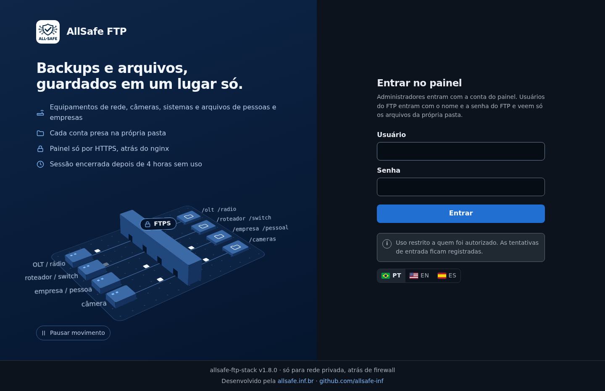</a>

<b>v1.9.0</b> · tela de entrada · captura de 2026-10-12

**Para que serve:** conferir o usuário e a senha antes de mostrar qualquer dado da stack. É a mesma tela para quem administra e para o usuário do FTP.

**Como chegar:** abra `https://<endereço do painel>:8443` no navegador. Sem sessão, qualquer endereço do painel leva a esta tela.

| Item da tela | O que faz |
|---|---|
| **Usuário** | Recebe o nome do administrador ou o nome do usuário do FTP. Na primeira instalação, o administrador é o de `PAINEL_ADMIN_USER` (`admin`, se não foi trocado) |
| **Senha** | Recebe a senha da conta. A do primeiro administrador está em `.secrets/painel-admin-inicial-senha.txt`; a do usuário do FTP é a mesma que o equipamento usa |
| **Entrar** | Confere a conta: o administrador vai para a aba Visão geral e o usuário do FTP, para a tela Meus arquivos. A conta que já tem o segundo fator passa antes pela tela [Código de verificação](#entrar); a que ainda não tem, com o segundo fator obrigatório, pela tela [Cadastre o segundo fator](#entrar) |
| Texto abaixo do título | Diz quem entra por esta tela. Com `PAINEL_ACESSO_USUARIOS_FTP=nao`, passa a ser `Painel de administração da stack.` |
| Nota abaixo do botão | Lembra que o uso é restrito a quem foi autorizado e que as tentativas de entrada ficam registradas. A tela de entrada não diz como a instalação está publicada: isso só o administrador lê, depois de entrar |
| **PT** · **EN** · **ES** | Trocam o idioma da tela antes da entrada; a escolha fica guardada no navegador: veja [Idioma](#idioma) |
| Lado esquerdo | Apresenta a stack: a chamada, três pontos (cada equipamento preso na própria pasta, painel só por HTTPS e o tempo de sessão sem uso) e a cena em que roteador, switch, OLT e rádio mandam o backup por FTPS para as pastas. Em tela estreita, ficam só a logo e a chamada |
| **Pausar movimento** | Para a animação da cena e a retoma; com o sistema configurado para reduzir movimento, a cena já abre parada |

Entrar ➜ Entrada recusada — clique para expandir

### Entrar ➜ Entrada recusada

<a href="imagens/entrar-recusada.png">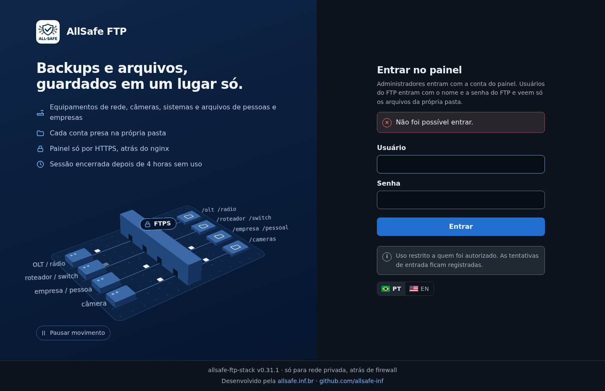</a>

<b>v1.9.0</b> · tela de entrada, entrada recusada · captura de 2026-10-12

| Mensagem | Quando aparece | O que fazer |
|---|---|---|
| Não foi possível entrar. | O usuário ou a senha estão errados; a tela não diz qual dos dois | Conferir os dois campos e tentar de novo |
| Muitas tentativas. Aguarde alguns minutos e tente de novo. | Cinco entradas erradas do mesmo endereço em 15 minutos | Esperar o bloqueio passar; a conta certa também é recusada enquanto ele dura |
| A página expirou. Tente de novo. | A tela ficou aberta tempo demais antes do envio | Enviar de novo |
| endereço bloqueado por excesso de erros de usuário e senha | O endereço está na lista da aba Bloqueios: por padrão, passou de 5 erros de usuário e senha em 24 horas, no FTP ou no painel. É um texto puro, sem a tela de entrada, em qualquer endereço do painel | Pedir o desbloqueio a um administrador: veja [Bloqueios](#bloqueios) |

Entrar ➜ Cadastre o segundo fator — clique para expandir

### Entrar ➜ Cadastre o segundo fator

<a href="imagens/entrar-cadastro.png">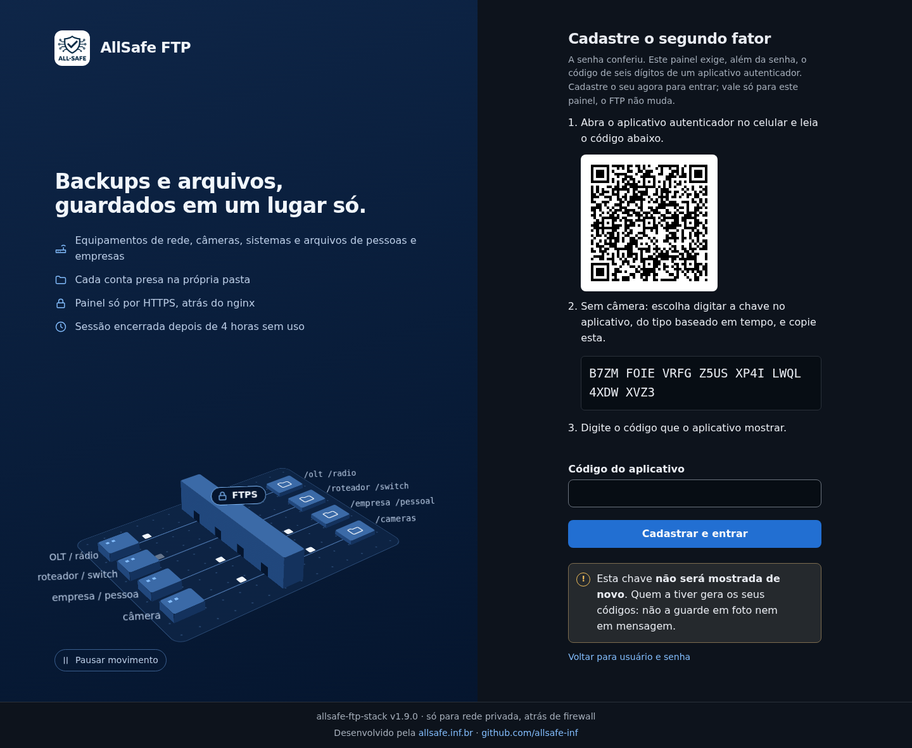</a>

<b>v1.9.0</b> · tela de entrada, cadastro do segundo fator, com uma chave de exemplo que não foi gravada · captura de 2026-10-12

Com `PAINEL_SEGUNDO_FATOR_OBRIGATORIO=sim`, que é o padrão, aparece logo depois da senha para toda conta que ainda não cadastrou um aplicativo autenticador, administrador ou usuário do FTP: a senha certa não abre o painel, leva a esta tela. Serve qualquer aplicativo de código por tempo (TOTP). Vale só para a entrada neste painel: o FTP não muda.

| Item da tela | O que faz |
|---|---|
| Código QR | É a chave, para o aplicativo ler pela câmera. A conta aparece nele como `AllSafe FTP:<conta>@<endereço do painel>` |
| Chave em grupos | A mesma chave, para digitar no aplicativo quando não há câmera, escolhendo o tipo baseado em tempo |
| **Código do aplicativo** | Recebe os seis dígitos que o aplicativo passou a mostrar: é a prova de que ele leu a chave |
| **Cadastrar e entrar** | Grava a chave, encerra as outras sessões da conta e abre o painel: a aba Visão geral para o administrador, a tela Meus arquivos para o usuário do FTP |
| **Voltar para usuário e senha** | Volta para a tela de entrada sem cadastrar nada |

**Resultado esperado:** o painel abre, e as próximas entradas da conta passam pela tela Código de verificação, abaixo.

| Mensagem | Quando aparece | O que fazer |
|---|---|---|
| O código não confere com a chave desta tela. Confira a hora do celular, espere o próximo código e tente de novo. | O código digitado não é o da chave mostrada. Nada é gravado, a tela volta com a mesma chave e o erro não conta como erro de usuário e senha | Esperar o próximo código. Se continuar, conferir a hora do celular |
| A página expirou. Tente de novo. | A tela ficou aberta tempo demais antes do envio | Enviar de novo |
| Muitas tentativas. Aguarde alguns minutos e tente de novo. | Cinco entradas erradas do mesmo endereço em 15 minutos, somando senhas e códigos | Esperar |

Depois de 10 minutos sem o primeiro código, a tela de entrada volta, sem mensagem, e a chave mostrada é descartada: a entrada seguinte mostra outra.

> ⚠️ **A chave aparece só nesta tela, até ser confirmada.** Quem a tiver gera os códigos da conta: não a guarde em foto nem em mensagem. Até a conta cadastrar o aplicativo dela, quem souber a senha faz o cadastro: veja [Painel web](../painel.md#segundo-fator).

Entrar ➜ Código de verificação — clique para expandir

### Entrar ➜ Código de verificação

<a href="imagens/entrar-codigo.png">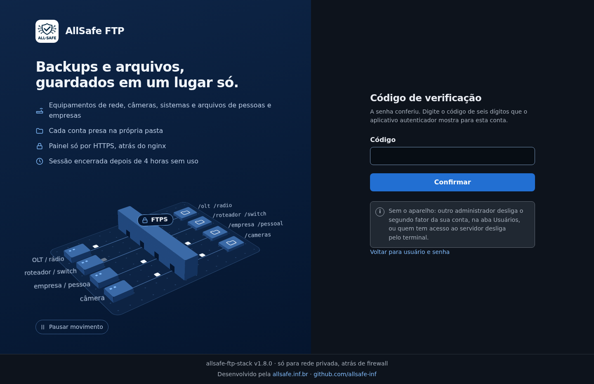</a>

<b>v1.9.0</b> · tela de entrada, código do segundo fator · captura de 2026-10-12

Aparece para toda conta que já tem o [segundo fator](#segundo-fator), administrador ou usuário do FTP: a senha certa não abre o painel, leva a esta tela. A conta que ainda não tem, com o segundo fator obrigatório, passa pela tela Cadastre o segundo fator, acima; com `PAINEL_SEGUNDO_FATOR_OBRIGATORIO=nao`, entra só com a senha.

| Item da tela | O que faz |
|---|---|
| **Código** | Recebe os seis dígitos que o aplicativo autenticador mostra para esta conta agora |
| **Confirmar** | Confere o código e abre o painel: a aba Visão geral para o administrador, a tela Meus arquivos para o usuário do FTP |
| Nota abaixo do botão | Diz a saída de quem está sem o aparelho: para o administrador, outro administrador desliga o segundo fator da conta, na aba Usuários, ou quem tem acesso ao servidor desliga pelo terminal; para o usuário do FTP, o administrador desliga. Com o segundo fator obrigatório, lembra que a entrada seguinte pede o cadastro de um aplicativo de novo |
| **Voltar para usuário e senha** | Volta para a tela de entrada sem abrir o painel |

| Mensagem | Quando aparece | O que fazer |
|---|---|---|
| O código não confere. Espere o aplicativo mostrar o próximo e tente de novo. | O código está errado, já venceu ou já foi usado uma vez | Esperar o próximo código. Se continuar, conferir a hora do celular |
| Não foi possível entrar. | Cinco códigos errados seguidos: a espera pelo código acaba e a tela de entrada volta. Depois de cinco minutos sem o código, a tela de entrada também volta, sem mensagem | Entrar de novo com usuário e senha, passado o bloqueio do endereço |
| Muitas tentativas. Aguarde alguns minutos e tente de novo. | Cinco entradas erradas do mesmo endereço em 15 minutos, somando senhas e códigos, ou dez códigos recusados para a mesma conta em 15 minutos, de qualquer endereço | Esperar, ou pedir a um administrador que desligue o segundo fator da conta |
| O segundo fator desta conta está ligado, mas o segredo dele não está no servidor. Um administrador ou quem tem acesso ao servidor precisa desligá-lo. | A chave da conta não está em `.secrets/segundo-fator/`: é o caso do servidor restaurado de uma cópia de segurança | Desligar o segundo fator da conta e cadastrar de novo: veja [Painel web](../painel.md#segundo-fator) |

Código errado conta como erro de usuário e senha do endereço, igual à senha errada.

Detalhe técnico — entrada e sessão

- Rota `GET /entrar` mostra o formulário; `POST /entrar` confere primeiro a conta de administrador, pelo hash `scrypt` de `DATA_DIR/painel/administradores`, e depois, se a entrada dos usuários do FTP estiver ligada, a conta do FTP, por um login no próprio servidor FTP.
- Resposta `401` para usuário ou senha errados, `429` para endereço bloqueado e `400` para formulário expirado. Cada caso grava `entrada_falha` ou `entrada_bloqueada` na [auditoria](../painel.md#auditoria), sem o nome digitado.
- Com o segundo fator ligado, o `POST /entrar` com a senha certa não cria sessão: grava `entrada_senha_ok` e leva a `GET /entrar/codigo`, com o cookie `__Host-etapa` (`Secure`, `HttpOnly`, `SameSite=Strict`), que vale 5 minutos e só do mesmo endereço. O `POST /entrar/codigo` responde `401` para o código errado (`entrada_codigo_recusado`), `429` para a conta em pausa e `503` para a conta ligada sem a chave no servidor (`entrada_fator_sem_segredo`); a sessão só nasce com o código aceito.
- Com `PAINEL_SEGUNDO_FATOR_OBRIGATORIO=sim`, a conta que ainda não tem o segundo fator também não ganha sessão com a senha certa: o `POST /entrar` grava `entrada_senha_ok` e leva a `GET /entrar/cadastro`, com o mesmo cookie `__Host-etapa`, que aqui vale 10 minutos. A chave mostrada fica só na memória dessa espera e é gravada no `POST /entrar/cadastro` que traz o primeiro código certo; ele grava `fator_cadastrado_na_entrada`, encerra as outras sessões e esperas da conta e abre a sessão. O código errado recebe `400`, sem evento e sem contar para o bloqueio do endereço. A espera de um caminho não serve ao outro: a do cadastro não confere código e a do código não cadastra; fora do caminho dela, a espera é encerrada e a resposta volta a `/entrar`.
- O endereço da lista de bloqueios recebe `403` em texto puro em toda rota, mesmo com sessão aberta, com o evento `recusa_endereco`: veja [Bloqueio por endereço](../seguranca.md#bloqueio-por-endereco).
- A entrada com a conta do FTP leva alguns segundos: é o tempo que o servidor FTP gasta para conferir a senha. Veja [Usuário do FTP no painel](../painel.md#usuario-ftp).
- A sessão fica no cookie `__Host-sessao` (`Secure`, `HttpOnly`, `SameSite=Strict`) e encerra com 4 horas sem uso ou em 12 horas, o que vier antes.
- O envio só é aceito quando parte do próprio painel: o cabeçalho `Origin` tem de ser o endereço do painel. Detalhes em [Painel web](../painel.md#protecoes).

---

## 📊 Visão geral

<b>v1.9.0</b> · menu Visão geral · captura de 2026-10-12

**Para que serve:** ver de uma vez se o FTP está no ar e quais dados digitar no equipamento que vai mandar o backup.

**Como chegar:** é a primeira tela do administrador depois da entrada; menu ➜ **Visão geral**.

| Item da tela | O que mostra |
|---|---|
| **Servidor FTP** | `No ar` ou `Fora do ar`, e o modo de TLS em uso, com atalho para a aba Segurança |
| **Usuários** | Quantidade de usuários do FTP, com atalho para a aba Usuários |
| **Espaço usado** | Soma das pastas dos usuários e o espaço livre no disco, com atalho para as pastas, na aba Arquivos |
| **Último envio** | Data do arquivo mais novo entre todas as pastas, com atalho para a aba Arquivos |
| **Certificado do FTP** | A data em que o certificado vence e quantos dias faltam, com atalho para a impressão digital, na aba Segurança |
| **Servidor e containers** | Processador e memória do servidor inteiro e dos três containers da stack, em uso e alocados, com atalho para a aba Servidor |
| **Arquivos recebidos por dia** | Uma coluna por dia dos últimos 14 dias, com o total do período em cima. Conta o que está nas pastas agora, pela data de cada arquivo: o que foi apagado ou substituído não entra |
| **Último envio por usuário** | Os usuários divididos pela data do arquivo mais novo da pasta de cada um: nas últimas 24 horas, entre 1 e 7 dias, há mais de 7 dias e sem arquivo na pasta. Embaixo, a lista de quem está há mais de 7 dias sem enviar, com atalho para a aba Usuários |
| **Espaço por pasta** | As pastas que mais ocupam, da maior para a menor, cada uma com a barra, o tamanho e a quantidade de arquivos, e o atalho para a pasta na aba Arquivos |
| **Atividade recente** | Os seis últimos registros do painel, com a hora e o endereço de quem fez, e o atalho para a aba Log |
| **Dados para configurar o equipamento** | Servidor, porta de controle, portas passivas, protocolo e de onde vem o usuário: o que preencher no equipamento |
| Menu de todas as telas | À esquerda, em tela de 1280 px de largura ou mais: o símbolo e o nome, as oito abas em dois grupos (**Operação** e **Sistema**), cada uma com o seu ícone e a aba em uso marcada, e, embaixo, os botões de idioma **PT**, **EN** e **ES**, o nome e o papel de quem entrou e o botão **Sair**. Em tela mais estreita, o menu vira uma faixa em cima, com as abas numa linha que rola para o lado. Com a instalação publicada, um sinal de alerta fica ao lado de **Segurança** |
| Título de cada aba | O nome da aba e uma frase que diz para que ela serve |
| Rodapé de todas as telas | A versão da stack, o lembrete de rede privada (ou, só para o administrador, como a instalação está publicada), a autoria e o endereço do repositório oficial |

Nada é alterado por esta aba.

Visão geral ➜ Alerta de usuário sem TLS — clique para expandir

### Visão geral ➜ Alerta de usuário sem TLS

<a href="imagens/visao-geral-alerta-tls.png">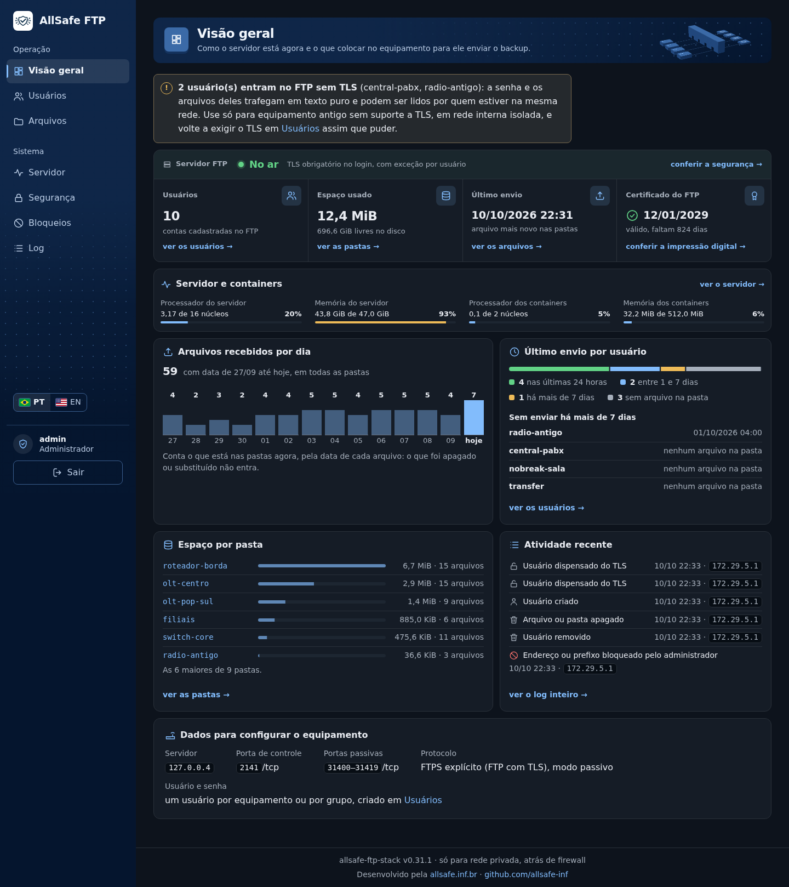</a>

<b>v1.9.0</b> · menu Visão geral, alerta de usuário sem TLS · captura de 2026-10-12

| Alerta no começo da tela | Quando aparece | Como some |
|---|---|---|
| Quantos e quais usuários entram no FTP sem TLS | Com pelo menos um usuário dispensado do TLS | Quando o último volta a ser obrigado a usar TLS, em [Usuários ➜ Exigir TLS](#usuarios) |
| O FTP aceita senha e arquivo em texto puro | Com `FTP_TLS_MODE` em `0` ou `1` | Quando a variável volta para `2` ou `3` |

O mesmo alerta abre a aba Segurança. As condições para dispensar um usuário estão em [TLS por usuário](../seguranca.md#tls-por-usuario) e as do FTP sem TLS, em [Equipamento sem TLS](../seguranca.md#ftp-sem-tls).

Detalhe técnico — de onde vem cada número

- Rota `GET /`.
- `No ar` é a resposta da porta de controle do serviço `ftp`, pela rede interna da stack (`ftp:2121`).
- Usuários vêm do cadastro do FTP (`DATA_DIR/auth`); espaço, quantidade de arquivos e último envio são lidos de `DATA_DIR/dados`.
- O cartão **Servidor e containers** mostra as mesmas leituras da [aba Servidor](#servidor).
- Servidor, porta e faixa passiva são os valores de `FTP_PASSIVE_IP`, `FTP_PORT` e `FTP_PASSIVE_PORT_*` do `.env`: veja [Configuração](../configuracao.md#rede-e-portas).

---

## 👥 Usuários

<b>v1.9.0</b> · menu Usuários · captura de 2026-10-12

**Para que serve:** criar a conta de cada equipamento ou pessoa, escolher o perfil dela, escolher e trocar a pasta em que ela fica presa, trocar a senha, dar limites próprios, permitir o envio de arquivo pelo painel, ligar a limpeza automática dos arquivos antigos, tirar o bloqueio por senha errada e remover a conta, com ou sem a pasta, sem linha de comando. É também onde ficam os administradores do painel.

**Como chegar:** menu ➜ **Usuários**.

| Item da tela | O que faz |
|---|---|
| **Novo usuário** | Abre o formulário de cadastro, de usuário do FTP ou de administrador |
| Usuário e perfil | Nome da conta e, embaixo, o perfil dela: Administrador, Completo, Envio, Só envio ou Leitura. A etiqueta `inicial` marca o usuário criado na instalação (`FTP_USER`) |
| Linhas de administrador | Ficam no começo da lista, sem pasta nem TLS, com a etiqueta `você` na conta em uso: veja [Administradores](#administradores) |
| Pasta | Onde os arquivos desse usuário ficam no servidor. O endereço abre a pasta na aba Arquivos |
| Etiqueta `dividida` | A pasta é alcançada por mais de um usuário: cada um mexe nos arquivos do outro até onde o perfil dele deixa |
| Etiqueta `limites` | O usuário tem limite próprio, gravado em **Editar**; passando o mouse, aparece cada um |
| Etiqueta `limpeza` | A limpeza automática está ligada para o usuário, em **Editar**: o painel apaga sozinho os arquivos antigos da pasta dele; passando o mouse, aparece a regra |
| Etiqueta `bloqueado` | O FTP está recusando o usuário por senhas erradas demais vindas de um endereço; sai sozinha no fim do prazo, ou em **Editar** |
| Uso · Arquivos · Último envio | Espaço ocupado, quantidade de arquivos e data do envio mais recente |
| Coluna TLS · **Dispensar TLS** · **Exigir TLS** | Como o usuário entra no FTP e o caminho para mudar: veja [Usuários ➜ TLS por usuário](#usuarios) |
| **Editar** | Abre a tela do usuário, com a troca do perfil e da pasta, os limites próprios, a limpeza automática e os bloqueios |
| **Trocar senha** | Abre o formulário de troca de senha daquele usuário |
| **Segundo fator** | Só aparece na linha do usuário que já cadastrou o segundo fator na entrada do painel: abre a tela que desliga o dele. Veja [Segundo fator do usuário do FTP](#segundo-fator) |
| **Remover** | Abre a confirmação de remoção daquele usuário, inclusive o inicial |
| **Como funcionam os perfis e as etiquetas** | Recolhido abaixo da lista: explica cada perfil, diz em que pasta do servidor os usuários ficam presos e o que querem dizer as etiquetas `dividida`, `limites`, `limpeza`, `bloqueado` e `sem TLS` |

O usuário inicial tem a senha e a pasta trocadas e é removido como os demais. Removido, ele não volta nas próximas subidas do FTP; para tê-lo de novo, crie um usuário com o mesmo nome. A senha trocada aqui vale até o arquivo `.secrets/ftp-usuario-inicial-senha.txt` ser alterado. Veja [Segredos](../segredos.md#trocar-a-senha).

O perfil decide o que a conta faz, no FTP e no painel:

| Perfil | No FTP | No painel |
|---|---|---|
| Administrador | Não é conta do FTP | Todas as abas: veja [Administradores](#administradores) |
| Completo | Lista, baixa, envia, cria pasta, renomeia, apaga e grava por cima | Tela Meus arquivos: navega, baixa, cria pasta, troca o nome e apaga; com a permissão, envia arquivo |
| Envio | Lista, baixa, envia e cria pasta. Não apaga, não renomeia e não grava por cima do que já chegou | Tela Meus arquivos: navega, baixa e cria pasta; com a permissão, envia arquivo |
| Só envio | Envia e cria pasta. Não lista e não baixa nada, nem o que ele mesmo enviou | Tela Envio de arquivos: os dados para enviar por FTP; com a permissão, envia arquivo por ela |
| Leitura | Só lista e baixa | Tela Meus arquivos: navega e baixa; não envia |

A permissão de enviar arquivo pelo painel é dada usuário por usuário, no cartão **Limites** da tela **Editar**: veja [Usuários ➜ Limites](#usuarios). Sem ela, a conta só envia por FTP.

A tela de cada perfil está em [Meus arquivos](#meus-arquivos); as regras, a pasta dividida e o que muda na troca, em [Painel web](../painel.md#perfis).

Usuários ➜ Novo usuário — clique para expandir

### Usuários ➜ Novo usuário

<a href="imagens/usuarios-novo.png">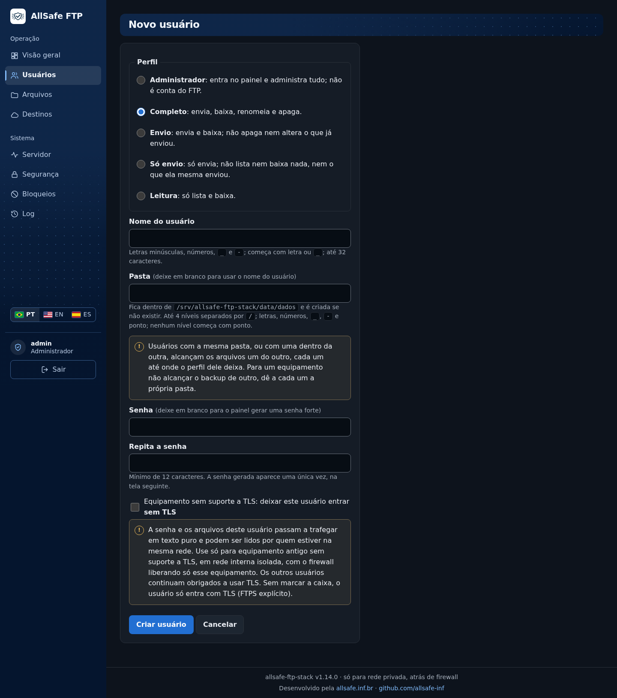</a>

<b>v1.9.0</b> · menu Usuários, formulário Novo usuário · captura de 2026-10-12

| Campo | Obrigatório | O que preencher |
|---|---|---|
| Perfil | Sim | Completo, Envio, Só envio ou Leitura, para a conta do FTP. Administrador cadastra quem administra o painel: veja [Administradores ➜ Novo administrador](#administradores) |
| Nome do usuário | Sim | Letras minúsculas, números, `_` e `-`; começa com letra ou `_`; até 32 caracteres |
| Pasta | Não | Em branco, é o nome do usuário. Escolhida, fica dentro de `DATA_DIR/dados`, com até 4 níveis separados por `/`, e é criada se não existir. O campo sugere as pastas que já existem |
| Senha | Não | 12 caracteres ou mais. Em branco, o painel gera uma senha forte |
| Repita a senha | Só com a senha preenchida | A mesma senha |
| Caixa **Equipamento sem suporte a TLS** | Não | Marque só para o equipamento antigo que não fala TLS: o usuário já nasce dispensado. Sem marcar, ele só entra com TLS |

**Resultado esperado:** a lista volta com a mensagem `Usuário criado.` e o usuário já entra por FTPS, sem reiniciar o FTP, preso na pasta escolhida e com o perfil escolhido.

> ⚠️ **Pasta dividida:** dois usuários com a mesma pasta, ou com uma dentro da outra, alcançam os arquivos um do outro, cada um até onde o perfil dele deixa. Na lista de usuários do começo desta seção, `filiais/olt-norte` fica dentro de `filiais`, a pasta de uma conta de consulta, de perfil Leitura, e as duas levam a etiqueta `dividida`: a conta de consulta baixa o que a OLT enviou e não grava nem apaga nada. Para um equipamento não alcançar o backup de outro, dê a cada um a própria pasta.

Usuários ➜ Novo usuário recusado — clique para expandir

### Usuários ➜ Novo usuário recusado

<a href="imagens/usuarios-novo-recusado.png">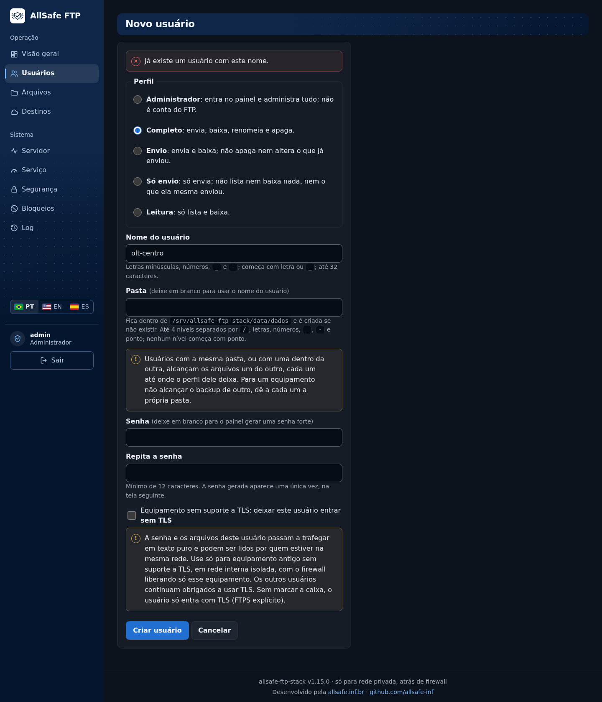</a>

<b>v1.9.0</b> · menu Usuários, cadastro recusado · captura de 2026-10-12

O painel devolve o formulário com o motivo no topo e nada é criado.

| Mensagem | Motivo |
|---|---|
| Nome inválido. Veja a regra abaixo do campo. | O nome foge da regra de letras, números, `_` e `-` |
| Já existe um usuário com este nome. | O nome já está em uso |
| Pasta inválida. Veja a regra abaixo do campo. | A pasta foge da regra, tem mais de 4 níveis ou um nível começa com ponto |
| As duas senhas não são iguais. | Os dois campos de senha diferem |
| A senha deve ter de 12 a 128 caracteres. | Senha curta ou longa demais |

Pasta que passa por link simbólico, ou por um nome que já é de um arquivo, também é recusada, com o motivo na mesma faixa.

Usuários ➜ Senha gerada pelo painel — clique para expandir

### Usuários ➜ Senha gerada pelo painel

<a href="imagens/usuarios-senha-gerada.png">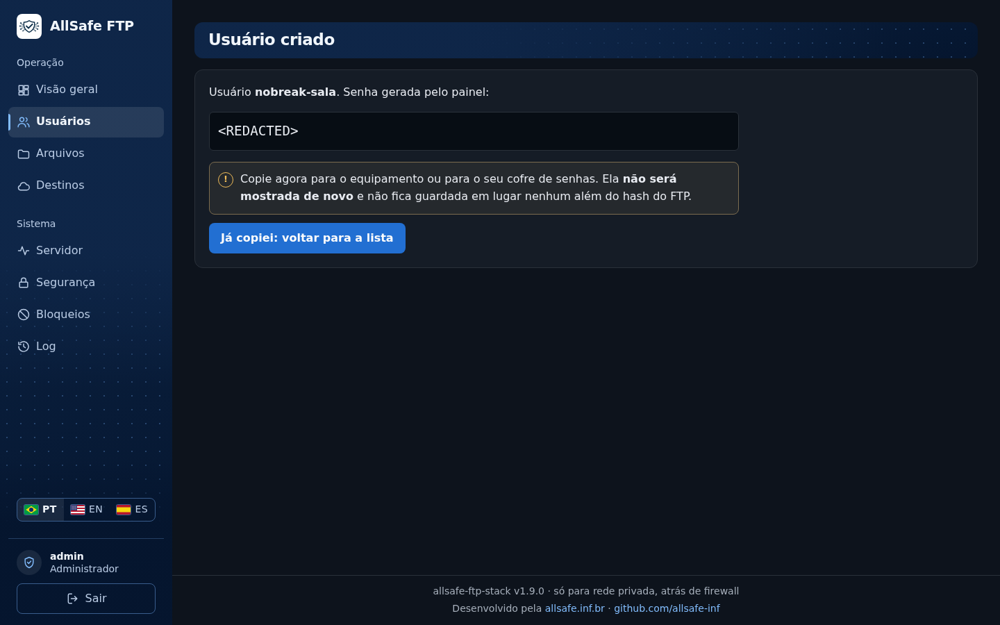</a>

<b>v1.9.0</b> · menu Usuários, senha gerada · captura de 2026-10-12

Aparece quando os dois campos de senha ficam em branco, no cadastro ou na troca de senha. A senha é mostrada **uma única vez**: copie para o equipamento ou para o cofre de senhas antes de sair da tela. Na foto, o valor foi trocado por `<REDACTED>`.

Usuários ➜ Editar — clique para expandir

### Usuários ➜ Editar

<b>v1.9.0</b> · menu Usuários, tela Editar usuário · captura de 2026-10-12

Reúne o que muda em um usuário sem criá-lo de novo. O nome não muda: é com ele que o equipamento entra no FTP.

| Cartão | O que faz |
|---|---|
| Topo | Mostra o usuário, leva a **Trocar senha** e volta para a lista |
| **Bloqueios** | Só aparece quando o FTP está recusando o usuário por senhas erradas demais: veja [Usuários ➜ Bloqueios](#usuarios) |
| **Perfil** | Mostra o perfil da conta e troca por outro dos quatro do FTP |
| **Pasta** | Mostra a pasta atual, com a quantidade de arquivos e o espaço ocupado, e troca a pasta do usuário |
| **TLS** | Diz se o usuário entra com ou sem TLS e leva à confirmação da troca: veja [Usuários ➜ TLS por usuário](#usuarios) |
| **Limites** | Grava os limites próprios do usuário e a permissão de enviar arquivo pelo painel: veja [Usuários ➜ Limites](#usuarios) |
| **Limpeza automática** | Liga, muda e desliga a regra que apaga sozinha os arquivos antigos da pasta do usuário: veja [Usuários ➜ Limpeza automática](#usuarios) |

**Troca de perfil:** marque o perfil e clique em **Gravar perfil**. A lista volta com a mensagem `Perfil trocado. Vale na próxima entrada do usuário no FTP.` A troca encerra a sessão do usuário no painel; a sessão de FTP que já está aberta segue com o perfil anterior até sair. O cartão lembra dois cuidados:

- **Envio:** o arquivo passa a ser do servidor assim que termina de chegar, e daí em diante o usuário não o apaga, não o renomeia e não grava por cima. Equipamento que envia sempre com o mesmo nome de arquivo precisa do perfil Completo.
- **Só envio:** nome repetido não substitui o anterior, e o novo é guardado com a data e a hora no nome. Equipamento que envia com um nome provisório e renomeia no fim, ou que confere o envio listando a pasta, precisa de outro perfil.

Administrador não está entre as opções: administrador e usuário do FTP são cadastros separados, e passar de um para o outro é remover a conta e criar a outra.

| Campo do cartão Pasta | Obrigatório | O que preencher |
|---|---|---|
| Pasta nova | Sim | A mesma regra do cadastro: dentro de `DATA_DIR/dados`, com até 4 níveis separados por `/`; é criada se não existir |

**Resultado esperado:** depois de **Trocar pasta**, a lista volta com a mensagem `Pasta trocada. Os arquivos da pasta anterior continuam nela.` O usuário entra na pasta nova no próximo login no FTP, e a sessão dele no painel é encerrada. Com a limpeza automática ligada, a troca desliga a regra, que era da pasta anterior, e a mensagem termina com `A limpeza automática foi desligada: a regra era da pasta anterior.`

| Mensagem | Motivo |
|---|---|
| Esta já é a pasta do usuário. | A pasta nova é igual à atual |
| Pasta inválida. Veja a regra abaixo do campo. | A pasta foge da regra, tem mais de 4 níveis ou um nível começa com ponto |

> ⚠️ **Os arquivos não acompanham a troca:** o que estava na pasta anterior continua nela, sem ser movido nem apagado, e o usuário deixa de alcançá-lo.

Usuários ➜ Limites — clique para expandir

### Usuários ➜ Limites

<a href="imagens/usuarios-limites-gravados.png">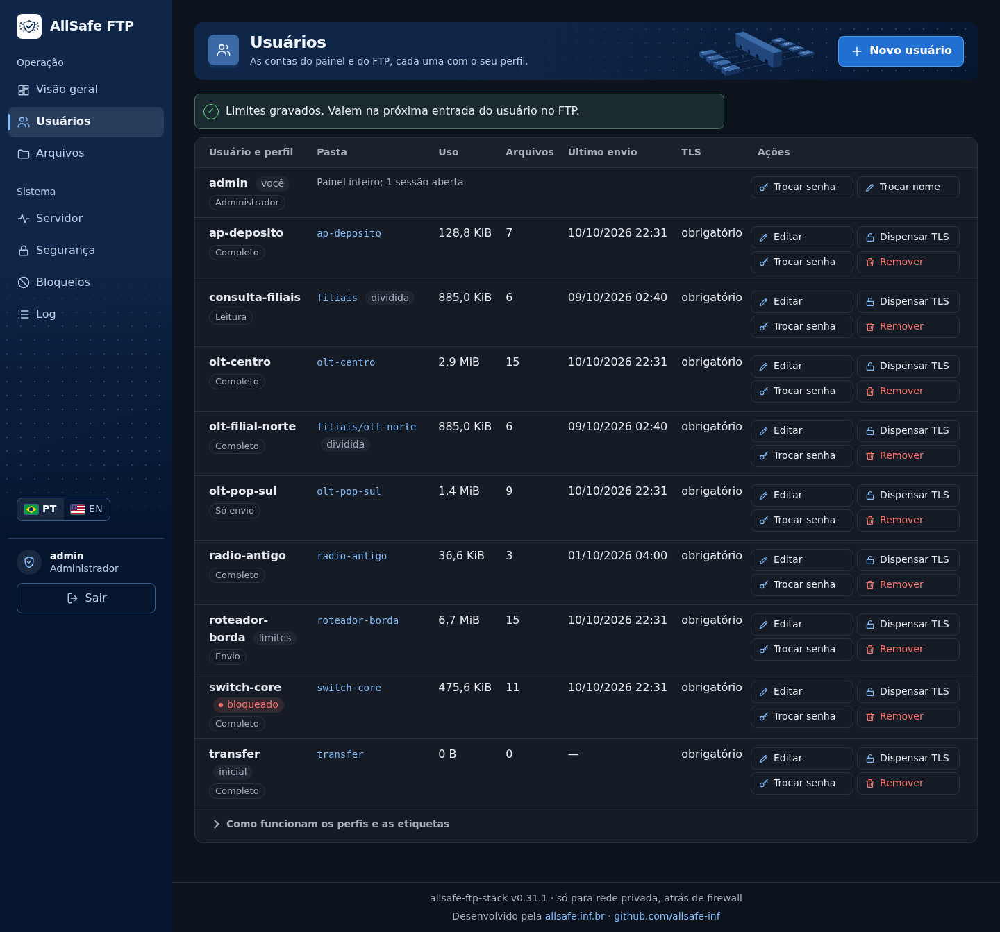</a>

<b>v1.9.0</b> · menu Usuários, limites gravados · captura de 2026-10-12

O cartão **Limites** da tela **Editar** vale só para aquele usuário, seja a conta de um equipamento, que só envia, seja a de uma pessoa, que entra, envia e baixa. Campo em branco quer dizer sem limite próprio: vale o da stack.

| Campo | Onde vale | O que preencher |
|---|---|---|
| Sessões ao mesmo tempo no FTP | FTP | De 1 ao `FTP_MAX_CLIENTS` da stack |
| Taxa de download, em KB por segundo | FTP e downloads dele pelo painel | De 1 a 10.000.000 |
| Taxa de envio, em KB por segundo | FTP e envios dele pelo painel | De 1 a 10.000.000 |
| Horário em que o FTP aceita a entrada: das · até as | FTP e entrada dele no painel | Início e fim, em horas e minutos; pode passar da meia-noite, como `22:00` às `06:00` |
| Downloads ao mesmo tempo pelo painel | Painel | De 1 a 8; em branco, 2 |
| Senhas erradas no FTP até o bloqueio | FTP | De 1 a 100; `0`: este usuário nunca é bloqueado; em branco, o padrão da stack |
| Minutos de bloqueio | FTP | De 1 a 1440; em branco, o padrão da stack |
| Caixa **Permitir que este usuário envie arquivo pelo painel**, para a pasta dele | Painel | Marcada, a conta envia arquivo pela tela dela, além do FTP. Vale para os perfis Completo, Envio e Só envio; o perfil Leitura não envia. Sem marcar, o usuário só envia por FTP |

**Resultado esperado:** depois de **Gravar limites**, a lista volta com a mensagem `Limites gravados. Valem na próxima entrada do usuário no FTP.` e a etiqueta `limites` ao lado do nome; passando o mouse sobre ela, aparece cada limite do usuário. Para tirar um limite, apague o campo e grave de novo.

A permissão de envio vale na hora. O arquivo enviado pelo painel tem até o tamanho de `PAINEL_ENVIO_MAX_MB` (1024 MB, por padrão), segue a taxa de envio do usuário e nunca substitui um arquivo que já existe: veja [Meus arquivos ➜ Enviar arquivo](#meus-arquivos).

Na foto da tela **Editar**, `roteador-borda` está com 2 sessões, 2048 KB por segundo de download, 1024 de envio, entrada das `22:00` às `06:00`, 1 download por vez pelo painel e bloqueio de 30 minutos na terceira senha errada.

> ⚠️ **Taxa de envio e arquivo pequeno:** com a taxa de envio definida, o servidor segura cada arquivo enviado por cerca de `256 ÷ taxa` segundos. Para equipamento que manda muitos arquivos pequenos, use uma taxa alta ou deixe em branco. Os valores e o que cada limite muda para o usuário estão em [Painel web](../painel.md#limites).

Usuários ➜ Limpeza automática — clique para expandir

### Usuários ➜ Limpeza automática

<a href="imagens/usuarios-editar-limpeza.png">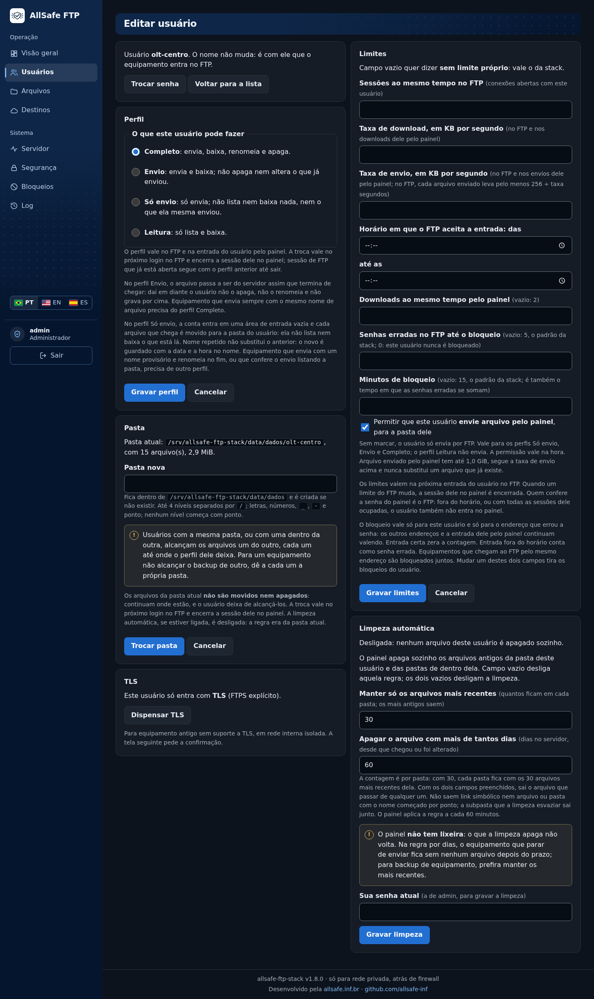</a>

<b>v1.9.0</b> · menu Usuários, cartão Limpeza automática · captura de 2026-10-12

O cartão **Limpeza automática** da tela **Editar** faz o painel apagar sozinho os arquivos antigos da pasta daquele usuário e das pastas de dentro dela. Nasce desligada: sem regra gravada, nenhum arquivo é apagado sozinho.

| Campo | Obrigatório | O que preencher |
|---|---|---|
| Manter só os arquivos mais recentes | Não | Quantos arquivos ficam em cada pasta, de 1 a 100.000; os mais antigos saem. A contagem é por pasta: com `30`, cada pasta fica com os 30 arquivos mais recentes dela |
| Apagar o arquivo com mais de tantos dias | Não | Dias no servidor, de 1 a 3.650, contados desde que o arquivo chegou ou foi alterado |
| Sua senha atual | Sim | A senha de quem está usando o painel, para confirmar |

Campo em branco desliga aquela regra, e os dois em branco desligam a limpeza. Com os dois preenchidos, sai o arquivo que passar de qualquer um.

<a href="imagens/usuarios-limpeza-gravada.png">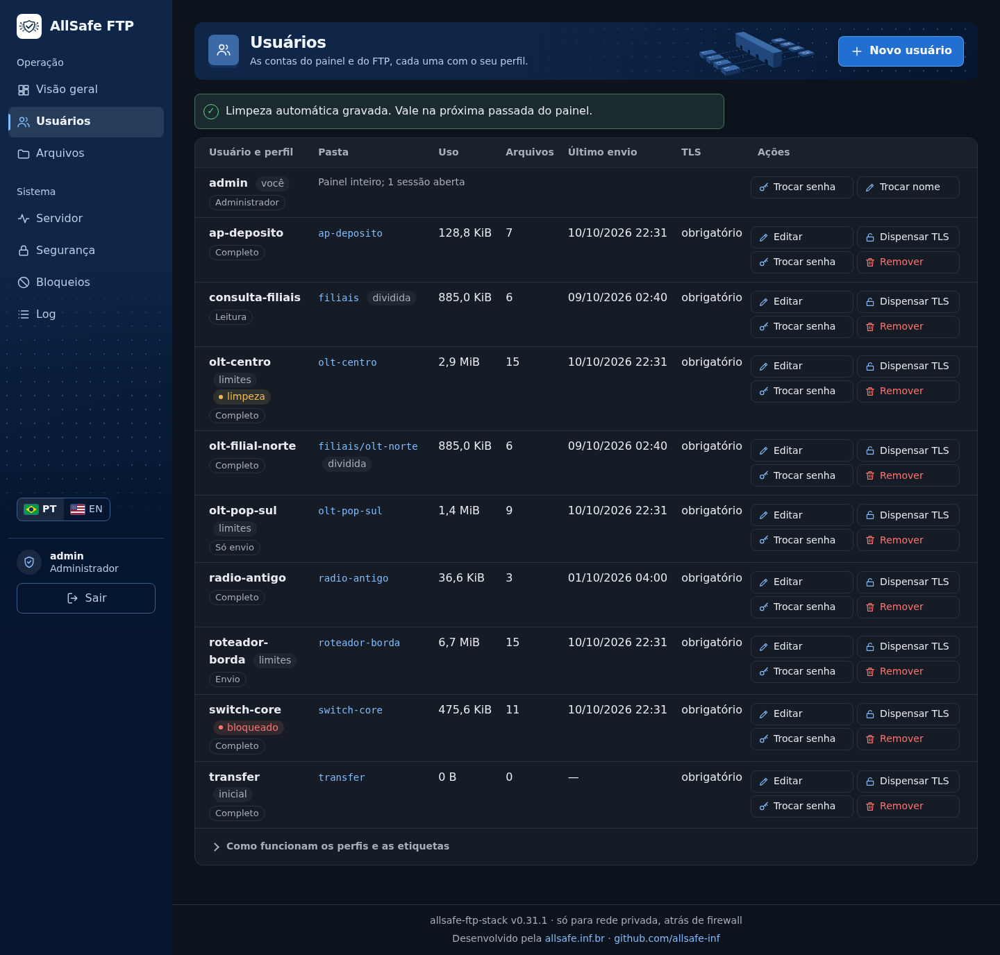</a>

<b>v1.9.0</b> · menu Usuários, limpeza automática gravada · captura de 2026-10-12

**Resultado esperado:** depois de **Gravar limpeza**, a lista volta com a mensagem `Limpeza automática gravada. Vale na próxima passada do painel.` e a etiqueta `limpeza` ao lado do nome; passando o mouse sobre ela, aparece a regra. Gravada com os dois campos em branco, a mensagem é `Limpeza automática desligada. Nenhum arquivo deste usuário é apagado sozinho.`

Na foto, `olt-centro` fica com os 30 arquivos mais recentes de cada pasta e sem arquivo com mais de 60 dias.

| O que a limpeza faz | Como |
|---|---|
| Quando roda | Sozinha, a cada `PAINEL_RETENCAO_MINUTOS` minutos (60, por padrão); com `0`, a regra fica gravada e não é aplicada, e o cartão avisa |
| O que nunca sai | Link simbólico e arquivo ou pasta com o nome começado por ponto |
| Subpasta | A que a limpeza esvaziar sai junto; a pasta do usuário fica |
| Pasta dividida | A regra apaga os arquivos antigos de todos os usuários que alcançam a pasta, e o cartão diz quem são |
| Troca de pasta | Desliga a regra, que era da pasta anterior |
| Registro | Cada passada que apaga algo fica na aba Log, com o usuário e a quantidade |

> ⚠️ **A limpeza não tem volta:** o painel não tem lixeira, e o que a limpeza apaga só volta de uma cópia de segurança. Na regra por dias, o equipamento que parar de enviar fica sem nenhum arquivo depois do prazo: para backup de equipamento, prefira manter os mais recentes. As regras completas estão em [Painel web](../painel.md#limpeza).

Usuários ➜ Bloqueios — clique para expandir

### Usuários ➜ Bloqueios

<a href="imagens/usuarios-editar-bloqueios.png">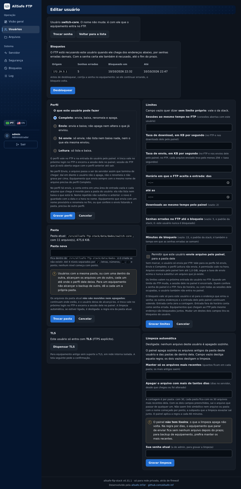</a>

<b>v1.9.0</b> · menu Usuários, cartão Bloqueios · captura de 2026-10-12

O endereço que erra a senha de um usuário no FTP vezes demais fica bloqueado para aquele usuário, pelo tempo configurado: até lá, nem a senha certa entra dali. Na lista, o nome ganha a etiqueta `bloqueado`; passando o mouse sobre ela, aparecem os endereços.

| Item do cartão | O que mostra |
|---|---|
| Origem | O endereço de onde vieram as senhas erradas |
| Senhas erradas | Quantas foram contadas até o bloqueio |
| Bloqueado em · Até | A hora do bloqueio e a hora em que ele sai sozinho |
| **Desbloquear** | Tira todos os bloqueios do usuário na hora |

1. Corrija a senha no equipamento: se ele continuar errando, o bloqueio volta.
2. Clique em **Desbloquear**.

<a href="imagens/usuarios-desbloqueado.png">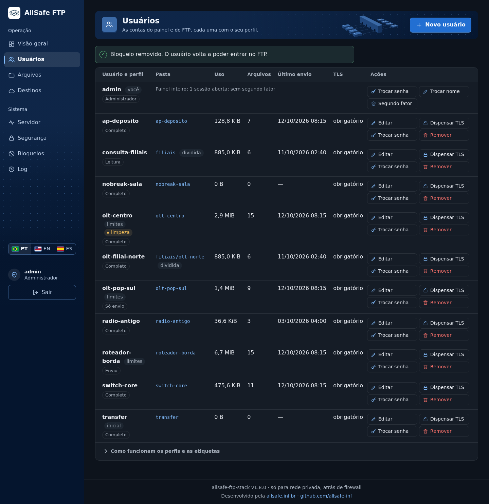</a>

<b>v1.9.0</b> · menu Usuários, depois do desbloqueio · captura de 2026-10-12

**Resultado esperado:** a lista volta com a mensagem `Bloqueio removido. O usuário volta a poder entrar no FTP.`, sem a etiqueta `bloqueado`, e a entrada seguinte do equipamento passa.

Na foto, a origem é o endereço do host na rede interna da stack fotografada, porque as senhas erradas partiram do próprio servidor. O que conta como senha errada está em [Segurança](../seguranca.md#bloqueio-por-tentativa).

Este é o bloqueio curto, de um usuário para um endereço. O endereço que erra demais, com qualquer conta, é bloqueado inteiro, no FTP e no painel: veja [Bloqueios](#bloqueios).

Usuários ➜ Trocar senha — clique para expandir

### Usuários ➜ Trocar senha

<a href="imagens/usuarios-trocar-senha.png">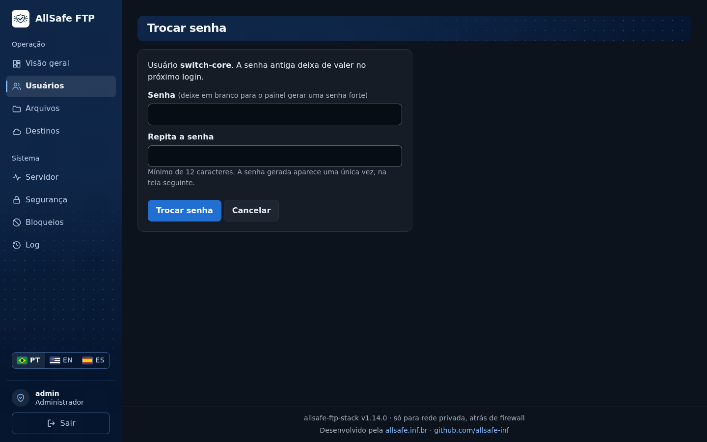</a>

<b>v1.9.0</b> · menu Usuários, formulário Trocar senha · captura de 2026-10-12

| Campo | Obrigatório | O que preencher |
|---|---|---|
| Senha | Não | 12 caracteres ou mais. Em branco, o painel gera uma senha forte |
| Repita a senha | Só com a senha preenchida | A mesma senha |

**Resultado esperado:** a lista volta com a mensagem `Senha trocada.`, a senha antiga deixa de valer no próximo login do equipamento e a sessão desse usuário no painel, se houver, é encerrada.

Usuários ➜ Remover — clique para expandir

### Usuários ➜ Remover

<a href="imagens/usuarios-remover.png">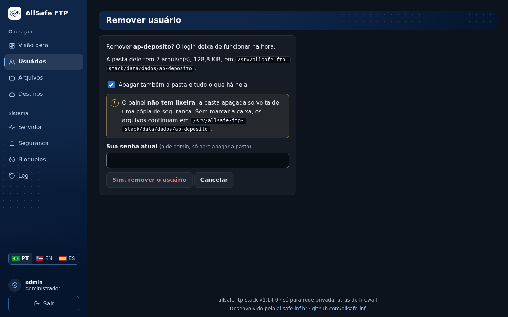</a>

<b>v1.9.0</b> · menu Usuários, confirmação de remoção · captura de 2026-10-12

| Item da tela | O que faz |
|---|---|
| Aviso dos arquivos | Mostra quantos arquivos o usuário tem, quanto ocupam e em que pasta eles continuam; em pasta dividida, diz quem mais a alcança |
| Caixa **Apagar também a pasta e tudo o que há nela** | Só aparece quando a pasta é só deste usuário. Marcada, a pasta sai junto com a conta, com tudo o que tem dentro e sem lixeira |
| **Sua senha atual** | Pedida só quando a caixa está marcada: é a senha de quem está usando o painel |
| **Sim, remover o usuário** | Apaga a conta: o login deixa de funcionar na hora |
| **Cancelar** | Volta para a lista sem alterar nada |

<a href="imagens/usuarios-removido.png">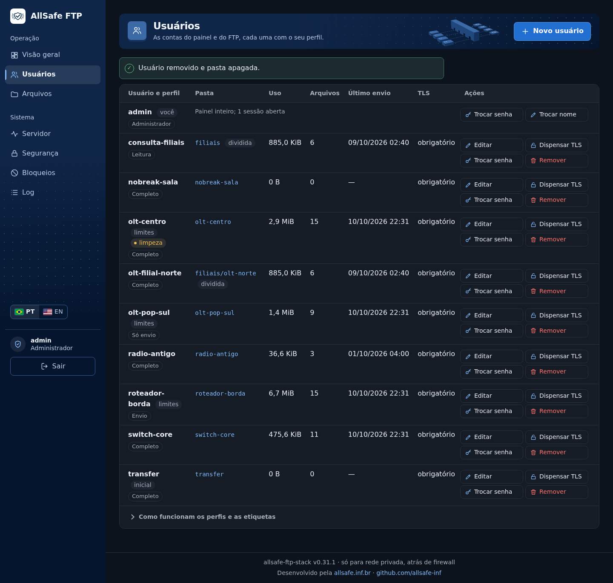</a>

<b>v1.9.0</b> · menu Usuários, depois da remoção · captura de 2026-10-12

**Resultado esperado:** com a caixa marcada e a senha certa, como na foto, a lista volta com a mensagem `Usuário removido e pasta apagada.` e a pasta some. Sem a caixa, a mensagem é `Usuário removido. Os arquivos continuam na pasta.`: a pasta fica em `DATA_DIR/dados` e continua visível na aba Arquivos, onde pode ser apagada depois.

<a href="imagens/usuarios-remover-inicial.png">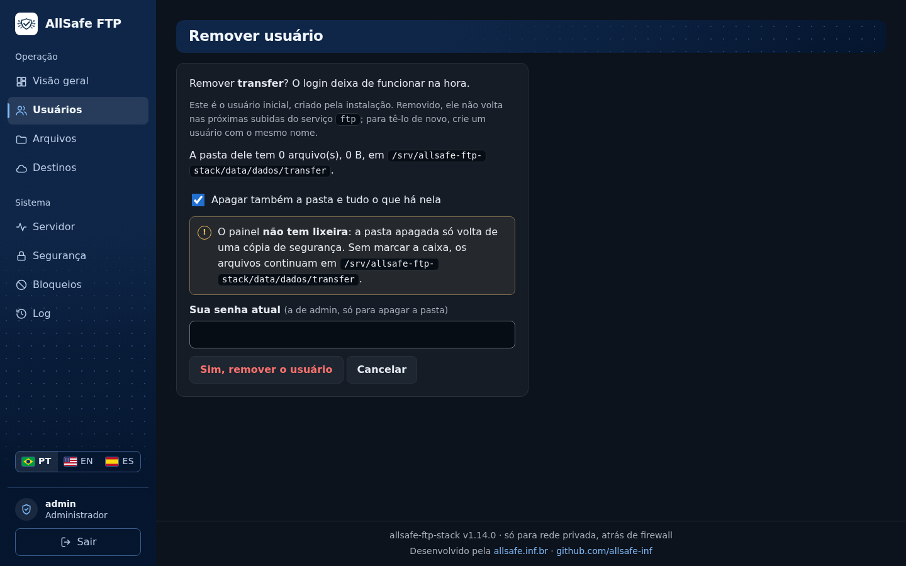</a>

<b>v1.9.0</b> · menu Usuários, remoção do usuário inicial · captura de 2026-10-12

O usuário inicial, o `FTP_USER` da instalação (`transfer`, no exemplo), é removido do mesmo jeito, com ou sem a pasta. A tela avisa que ele não volta nas próximas subidas do serviço `ftp`: para tê-lo de novo, crie um usuário com o mesmo nome.

Usuários ➜ TLS por usuário — clique para expandir

### Usuários ➜ TLS por usuário

<a href="imagens/usuarios-tls.png">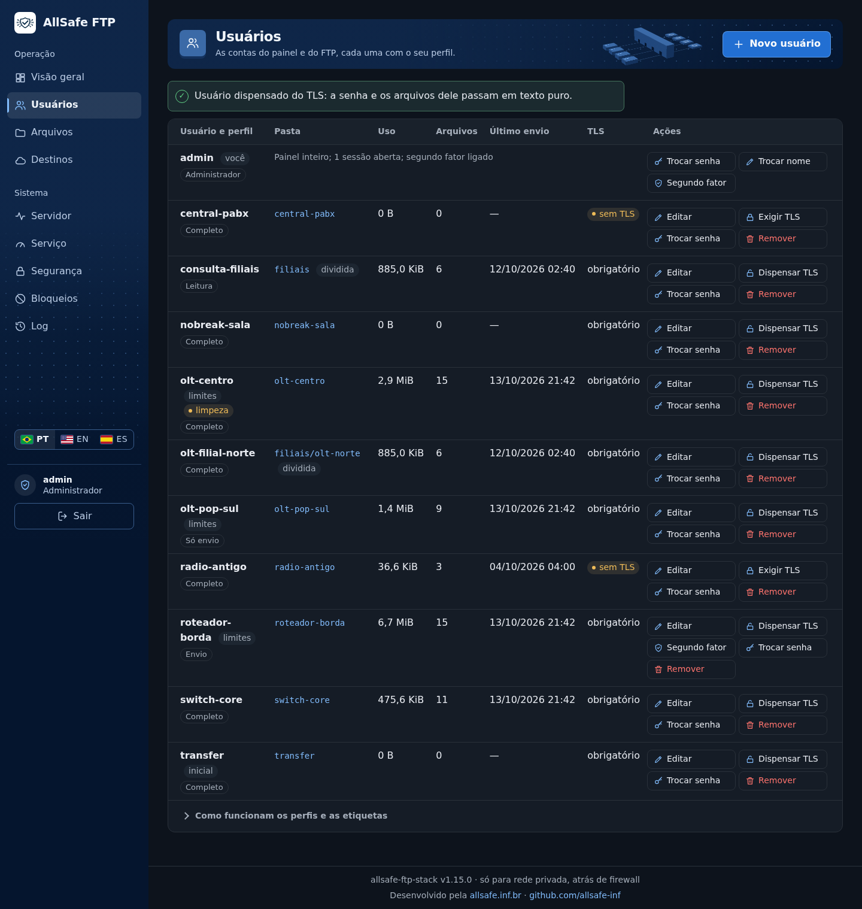</a>

<b>v1.9.0</b> · menu Usuários, coluna TLS · captura de 2026-10-12

A coluna e os dois botões servem para o equipamento antigo que não fala TLS: ele é dispensado sozinho, e os demais continuam obrigados. O mesmo se faz na criação, com a caixa **Equipamento sem suporte a TLS** do **Novo usuário**, e no cartão **TLS** da tela **Editar**.

| Item da tela | O que faz |
|---|---|
| Coluna TLS | `obrigatório` para quem só entra com TLS e `sem TLS` para quem foi dispensado |
| **Dispensar TLS** | Abre a confirmação para deixar aquele usuário entrar sem TLS |
| **Exigir TLS** | Abre a confirmação para voltar a exigir o TLS de quem está dispensado |
| Caixa **Equipamento sem suporte a TLS**, em **Novo usuário** | Cria o usuário já dispensado do TLS; sem marcar, ele só entra com TLS |
| Cartão **TLS**, em **Editar** | Diz como aquele usuário entra e leva à mesma confirmação |

<b>v1.9.0</b> · menu Usuários, usuário novo sem TLS · captura de 2026-10-12

Na criação, a caixa marcada grava o usuário já dispensado, e a lista volta com a mensagem `Usuário criado e dispensado do TLS: a senha e os arquivos dele passam em texto puro.`

<a href="imagens/usuarios-editar-tls.png">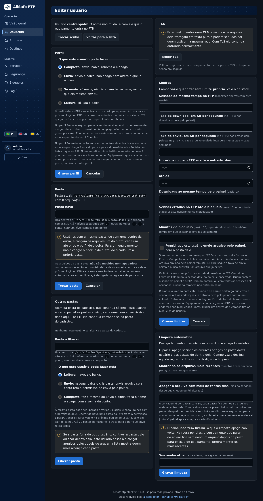</a>

<b>v1.9.0</b> · menu Usuários, cartão TLS da tela Editar · captura de 2026-10-12

Na tela **Editar**, o cartão **TLS** diz como o usuário entra e traz o botão para trocar: **Dispensar TLS** para quem é obrigado, **Exigir TLS** para quem está dispensado. Para o usuário que já existe, o botão abre a confirmação:

<a href="imagens/usuarios-tls-dispensar.png">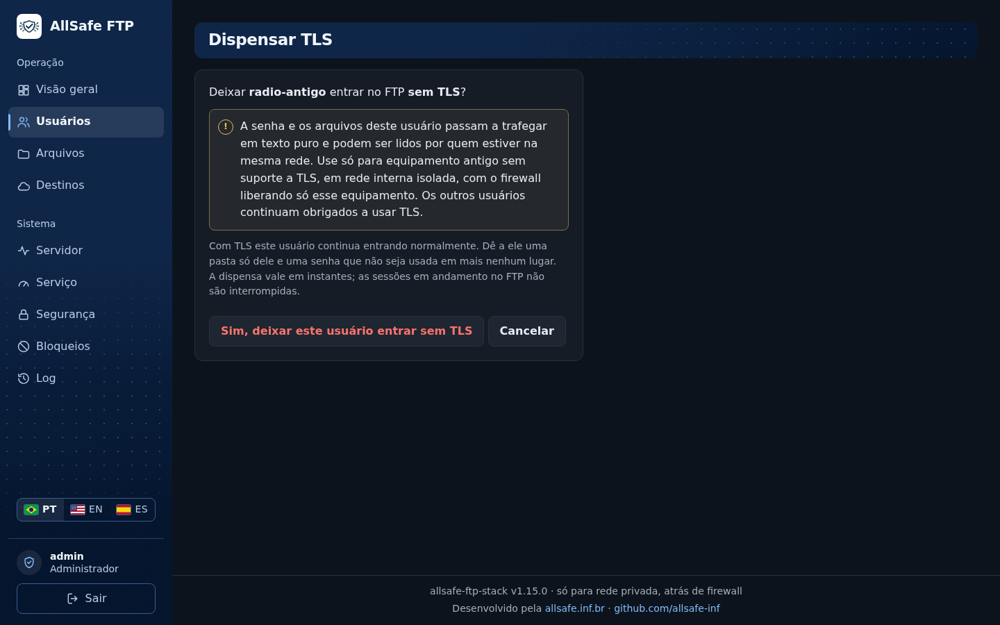</a>

<b>v1.9.0</b> · menu Usuários, confirmação da dispensa do TLS · captura de 2026-10-12

**Resultado esperado:** a lista volta com a mensagem `Usuário dispensado do TLS: a senha e os arquivos dele passam em texto puro.`, a linha dele mostra `sem TLS` e as abas Visão geral e Segurança abrem com o alerta. A dispensa vale em instantes, sem derrubar quem está conectado. Ao voltar a exigir, a mensagem é `O usuário volta a ser obrigado a usar TLS.`

> ⚠️ **Dispensa do TLS:** o usuário dispensado manda senha e arquivo em texto puro. Use só para o equipamento antigo que não fala TLS, em rede interna isolada, com pasta e senha só dele, e troque a senha quando voltar a exigir. As condições estão em [TLS por usuário](../seguranca.md#tls-por-usuario).

Detalhe técnico — rotas e comando usado

- Rotas: `GET /usuarios`, `/usuarios/novo`, `/usuarios/editar?usuario=<nome>`, `/usuarios/senha?usuario=<nome>`, `/usuarios/remover?usuario=<nome>` e `/usuarios/tls?usuario=<nome>`; o envio de cada formulário é um `POST` na mesma rota, com o token CSRF da sessão. A exceção é a tela Editar, que envia o perfil para `POST /usuarios/perfil`, a pasta para `POST /usuarios/pasta`, os limites para `POST /usuarios/limites`, a limpeza automática para `POST /usuarios/limpeza` e o desbloqueio para `POST /usuarios/desbloquear`.
- A dispensa do TLS vale com `FTP_TLS_EXCECOES=sim`, que é o padrão, `FTP_TLS_MODE=2` e sem `REDE_PERMITIR_IP_PUBLICO=sim`. Fora disso, a coluna, os botões e a caixa somem, a rota `/usuarios/tls` responde `404` e a lista dos dispensados fica guardada, sem valer.
- O painel chama o mesmo `allsafe-ftp-user` do [`manage-user.sh`](../../../manage-user.sh): painel e linha de comando alteram as mesmas contas. Veja [Operação](../operacao.md#usuarios).
- Cada alteração grava `usuario_criado`, `senha_trocada`, `pasta_trocada`, `perfil_trocado`, `limites_alterados`, `retencao_alterada`, `bloqueio_removido`, `usuario_removido`, `tls_dispensado` ou `tls_exigido` na [auditoria](../painel.md#auditoria), com o administrador que fez e sem a senha.
- A senha gerada tem 32 caracteres aleatórios e não fica guardada: só o hash vai para o cadastro do FTP.
- Sessões, taxas e horário ficam no cadastro do FTP, e é o `pure-ftpd` que os aplica a cada entrada; os downloads pelo painel e o bloqueio por tentativa ficam em arquivos próprios da stack: [Limites por usuário](../painel.md#limites).
- A regra da limpeza automática fica em arquivo próprio da stack, e quem a aplica é o painel, que grava `retencao_aplicada` a cada passada que apaga algo e `retencao_falhou` quando não conclui: [Limpeza automática](../painel.md#limpeza).
- Mudar as senhas erradas até o bloqueio ou os minutos de bloqueio tira os bloqueios do usuário; trocar a senha dele e removê-lo também.
- No formulário **Novo usuário**, os campos de cada tipo de conta aparecem conforme o perfil marcado, sem JavaScript; o envio é sempre `POST /usuarios/novo`.
- As regras da pasta e o que a marca `dividida` confere estão em [Usuários pelo painel](../painel.md#usuarios); como o perfil é aplicado no FTP, em [Perfis](../painel.md#perfis).

---

## 🛡️ Administradores

<a href="imagens/administradores.png">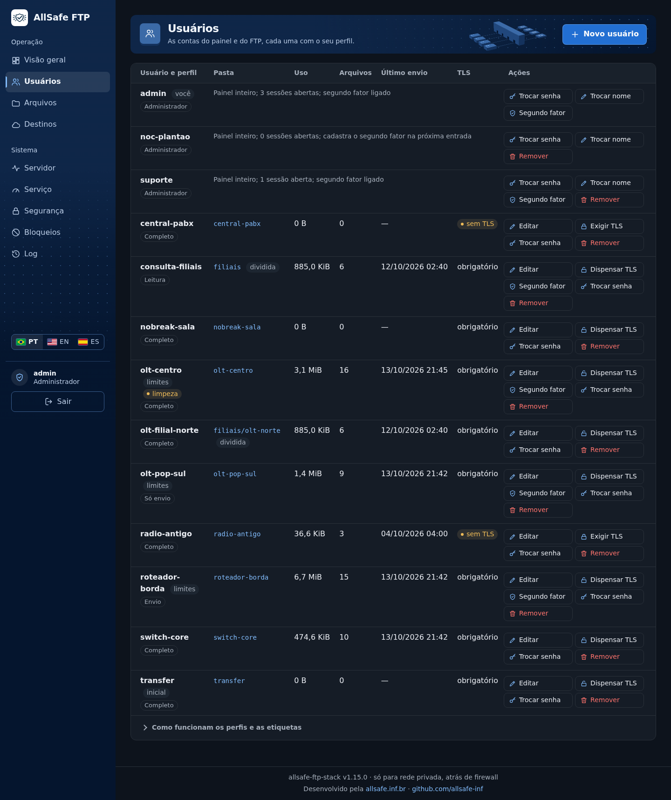</a>

<b>v1.9.0</b> · menu Usuários, administradores na lista · captura de 2026-10-12

**Para que serve:** dar a cada pessoa que administra o painel o próprio usuário e a própria senha, e trocar o usuário e a senha do primeiro administrador depois da instalação.

**Como chegar:** menu ➜ **Usuários**. Não há aba própria: os administradores ficam no começo da lista, antes dos usuários do FTP.

| Item da tela | O que faz |
|---|---|
| **Novo usuário** | Abre o cadastro; com o perfil **Administrador** marcado, a conta criada é de administrador |
| Usuário e perfil | Nome da conta, com `Administrador` embaixo. A etiqueta `você` marca a conta de quem está usando o painel |
| Pasta | No lugar da pasta, `Painel inteiro`, quantos navegadores estão com aquela conta dentro do painel agora e a situação do segundo fator: `segundo fator ligado`, `sem segundo fator` ou, com o segundo fator obrigatório, `cadastra o segundo fator na próxima entrada` |
| **Trocar senha** | Abre a troca de senha, a própria ou a de outro |
| **Trocar nome** | Abre a troca do nome de entrada, o próprio ou o de outro |
| **Segundo fator** | Na conta que tem o segundo fator, a própria ou a de outro administrador, abre a tela de desligar. Na própria conta sem segundo fator, abre a tela de ligar: é o caminho do segundo fator opcional e de quem desligou o próprio e quer cadastrar de novo sem sair do painel |
| **Remover** | Abre a confirmação de remoção. Não aparece na própria conta: assim sempre sobra um administrador |

Todos têm o mesmo acesso, e o que cada um faz fica na aba Log com o nome de quem fez. O painel aceita até 20 administradores. Administrador e usuário do FTP são cadastros separados: não há troca de um para o outro, só remover a conta e criar a outra.

Administradores ➜ Novo administrador — clique para expandir

### Administradores ➜ Novo administrador

<a href="imagens/administradores-novo.png">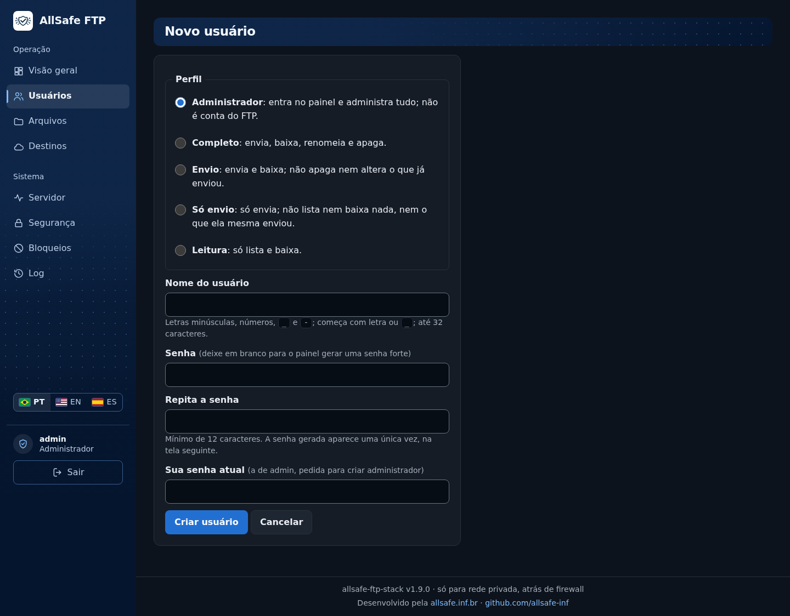</a>

<b>v1.9.0</b> · menu Usuários, formulário Novo usuário com o perfil Administrador · captura de 2026-10-12

Clique em **Novo usuário** e marque o perfil **Administrador**: os campos da pasta e do TLS dão lugar à sua senha atual.

| Campo | Obrigatório | O que preencher |
|---|---|---|
| Perfil | Sim | Administrador |
| Nome do usuário | Sim | Letras minúsculas, números, `_` e `-`; começa com letra ou `_`; até 32 caracteres |
| Senha | Não | 12 caracteres ou mais. Em branco, o painel gera uma senha forte e a mostra uma única vez |
| Repita a senha | Só com a senha preenchida | A mesma senha |
| Sua senha atual | Sim | A senha de quem está usando o painel, para confirmar |

**Resultado esperado:** a lista volta com a mensagem `Administrador criado.` e o administrador novo entra logo em seguida, sem reiniciar nada.

Administradores ➜ Trocar senha — clique para expandir

### Administradores ➜ Trocar senha

<a href="imagens/administradores-trocar-senha.png">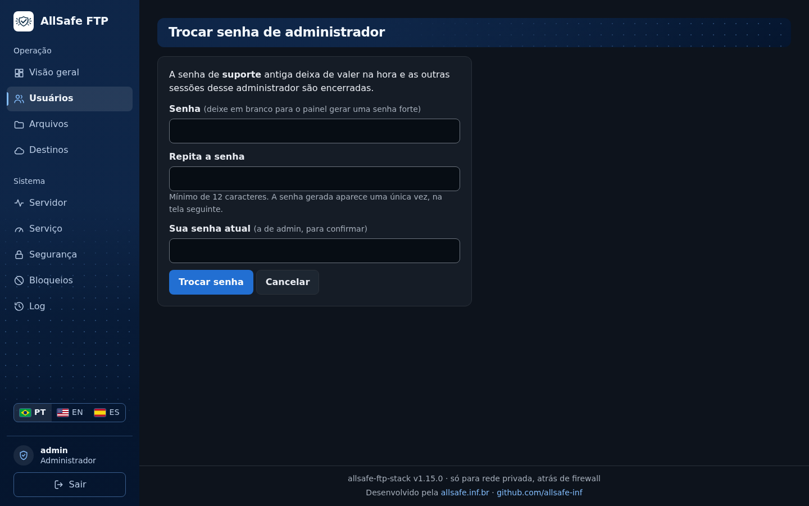</a>

<b>v1.9.0</b> · menu Usuários, formulário Trocar senha de administrador · captura de 2026-10-12

| Campo | Obrigatório | O que preencher |
|---|---|---|
| Senha | Não | A senha nova, com 12 caracteres ou mais. Em branco, o painel gera uma |
| Repita a senha | Só com a senha preenchida | A mesma senha |
| Sua senha atual | Sim | A senha de quem está usando o painel, para confirmar |

**Resultado esperado:** a lista volta com a mensagem `Senha trocada. As outras sessões desse administrador foram encerradas.` e a senha antiga deixa de valer na hora.

É por aqui que a senha inicial da instalação é trocada depois do primeiro acesso. Sem nenhum administrador que consiga entrar, a senha é redefinida pelo servidor: [Recuperar o acesso](../painel.md#senha).

Administradores ➜ Trocar nome — clique para expandir

### Administradores ➜ Trocar nome

<a href="imagens/administradores-trocar-nome.png">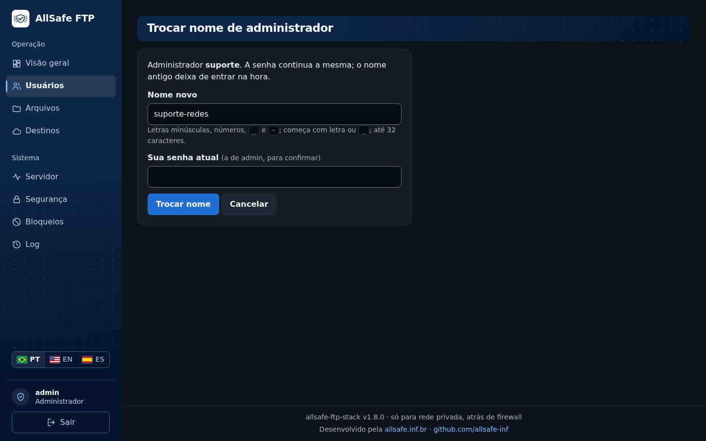</a>

<b>v1.9.0</b> · menu Usuários, formulário Trocar nome de administrador · captura de 2026-10-12

| Campo | Obrigatório | O que preencher |
|---|---|---|
| Nome novo | Sim | A mesma regra do nome do usuário; diferente do atual e de todos os outros administradores |
| Sua senha atual | Sim | A senha de quem está usando o painel, para confirmar |

**Resultado esperado:** a lista volta com a mensagem `Nome trocado. As outras sessões desse administrador foram encerradas.` A entrada passa a ser pelo nome novo, com a mesma senha.

Trocar o nome do primeiro administrador pelo painel não mexe no `.env`: o `PAINEL_ADMIN_USER` só é usado enquanto não existe nenhum administrador.

Administradores ➜ Remover — clique para expandir

### Administradores ➜ Remover

<a href="imagens/administradores-remover.png">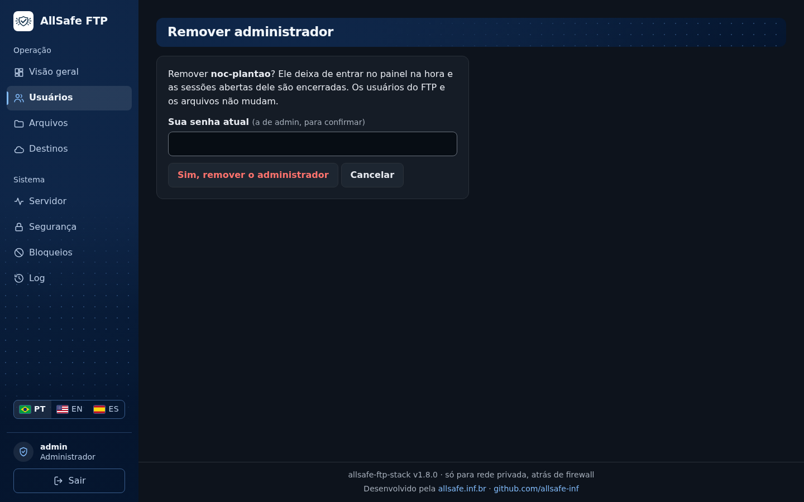</a>

<b>v1.9.0</b> · menu Usuários, confirmação de remoção de administrador · captura de 2026-10-12

| Item da tela | O que faz |
|---|---|
| Sua senha atual | Confirma que quem pede a remoção é o dono da sessão |
| **Sim, remover o administrador** | Apaga a conta: ela deixa de entrar na hora e as sessões abertas dela são encerradas |
| **Cancelar** | Volta para a lista sem alterar nada |

**Resultado esperado:** a lista volta com a mensagem `Administrador removido. As sessões dele foram encerradas.` Os usuários do FTP e os arquivos não mudam.

Administradores ➜ Segundo fator — clique para expandir

### Administradores ➜ Segundo fator

<a href="imagens/administradores-segundo-fator.png">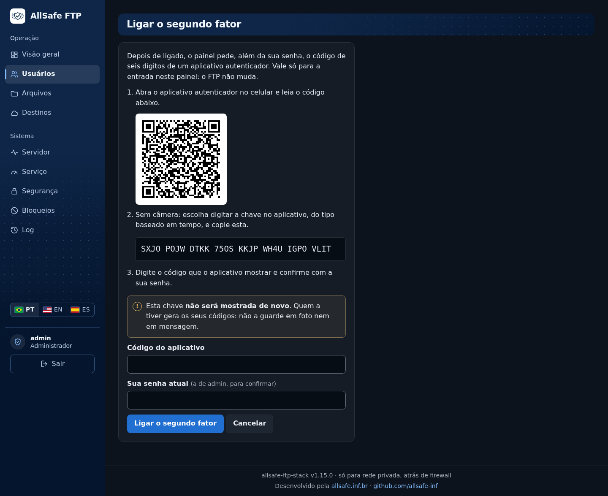</a>

<b>v1.9.0</b> · menu Usuários, tela Ligar o segundo fator, com o segundo fator opcional e uma chave de exemplo que não foi gravada · captura de 2026-10-12

Com o segundo fator obrigatório, que é o padrão, cada conta cadastra o dela na entrada: veja [Entrar ➜ Cadastre o segundo fator](#entrar). Esta tela é a do segundo fator opcional (`PAINEL_SEGUNDO_FATOR_OBRIGATORIO=nao`) e a de quem desligou o próprio e quer cadastrar de novo sem sair do painel: clique em **Segundo fator** na linha da própria conta. Cada administrador liga o dele, com qualquer aplicativo autenticador de código por tempo (TOTP).

| Item da tela | O que faz |
|---|---|
| Código QR | É a chave, para o aplicativo ler pela câmera. A conta aparece nele como `AllSafe FTP:<administrador>@<endereço do painel>` |
| Chave em grupos | A mesma chave, para digitar no aplicativo quando não há câmera, escolhendo o tipo baseado em tempo |
| **Código do aplicativo** | Recebe os seis dígitos que o aplicativo passou a mostrar: é a prova de que ele leu a chave |
| Sua senha atual | Confirma que quem liga é o dono da sessão |
| **Ligar o segundo fator** | Grava a chave e encerra as outras sessões da conta |
| **Cancelar** | Volta para a lista sem ligar nada |

**Resultado esperado:** a lista volta com a mensagem `Segundo fator ligado. A próxima entrada desta conta pede o código do aplicativo; as outras sessões dela foram encerradas.` e a linha da conta passa a dizer `segundo fator ligado`.

> ⚠️ **A chave aparece só nesta tela, até ser confirmada.** Quem a tiver gera os códigos da conta: não a guarde em foto nem em mensagem. Enquanto o primeiro código não chega, a tela aberta de novo mostra a mesma chave, por até 10 minutos; depois disso, uma nova.

### Administradores ➜ Desligar o segundo fator

<a href="imagens/administradores-segundo-fator-desligar.png">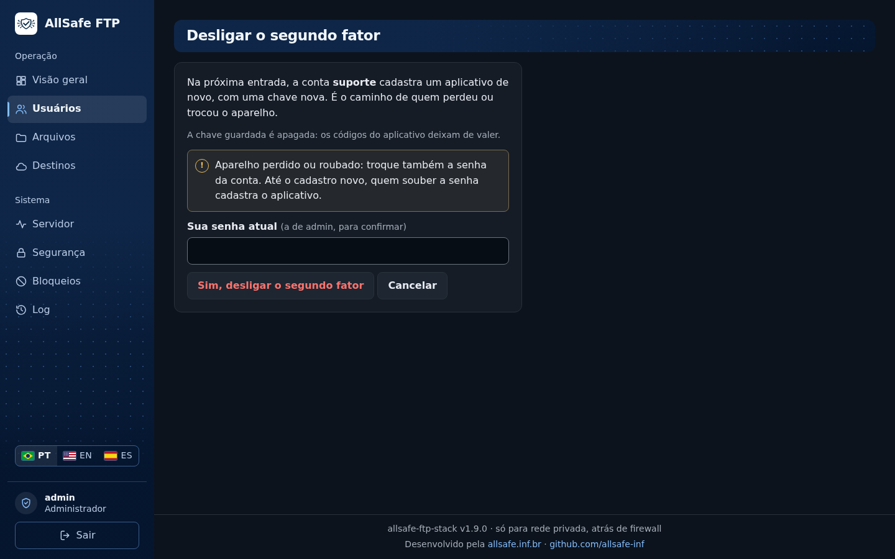</a>

<b>v1.9.0</b> · menu Usuários, tela Desligar o segundo fator, da conta de outro administrador · captura de 2026-10-12

Com o segundo fator ligado, o mesmo botão **Segundo fator** abre esta tela, na própria linha ou na de outro administrador: é o caminho de quem perdeu o aparelho. Com o segundo fator obrigatório, desligar é mandar a conta cadastrar de novo: na entrada seguinte, ela passa pela tela Cadastre o segundo fator, com uma chave nova.

| Item da tela | O que faz |
|---|---|
| Sua senha atual | Confirma que quem desliga é o dono da sessão; não é a senha da conta alterada |
| **Sim, desligar o segundo fator** | Apaga a chave guardada: os códigos do aplicativo deixam de valer. Com o segundo fator obrigatório, a conta cadastra um aplicativo de novo na entrada seguinte; com o opcional, volta a entrar só com usuário e senha |
| **Cancelar** | Volta para a lista sem alterar nada |

**Resultado esperado:** a lista volta com a mensagem `Segundo fator desligado. Na próxima entrada, a conta cadastra um aplicativo de novo.` ou, com o segundo fator opcional, `Segundo fator desligado. A conta volta a entrar só com usuário e senha.`; neste caso, para ligar de novo, o dono da conta repete o passo acima, com uma chave nova.

> ⚠️ **Aparelho perdido ou roubado: troque também a senha da conta.** Com o segundo fator obrigatório, até o cadastro novo, quem souber a senha cadastra o aplicativo.

### Usuários ➜ Segundo fator do usuário do FTP

<b>v1.9.0</b> · menu Usuários, tela Desligar o segundo fator, de um usuário do FTP · captura de 2026-10-12

O usuário do FTP cadastra o segundo fator dele na entrada do painel, e só lá. Depois disso, a linha dele na aba Usuários ganha o botão **Segundo fator**, que abre esta tela: o administrador só desliga, não vê a chave e não cadastra por ele. Vale só para o painel: no FTP, a conta continua entrando com a senha.

| Item da tela | O que faz |
|---|---|
| Sua senha atual | Confirma que quem desliga é o dono da sessão; não é a senha do usuário |
| **Sim, desligar o segundo fator** | Apaga a chave guardada do usuário. Com o segundo fator obrigatório, ele cadastra um aplicativo de novo na entrada seguinte; com o opcional, volta a entrar no painel só com usuário e senha |
| **Cancelar** | Volta para a lista sem alterar nada |

**Resultado esperado:** a lista volta com a mesma mensagem do desligamento de um administrador, e o botão **Segundo fator** sai da linha do usuário. Remover o usuário pelo painel também apaga o segundo fator dele.

Detalhe técnico — mensagens de recusa, rotas e arquivo

| Mensagem | Motivo |
|---|---|
| A sua senha atual não confere. Nada foi alterado. | O campo Sua senha atual está errado; cinco recusas em 15 minutos bloqueiam o endereço |
| Já existe um administrador com este nome. | O nome já está em uso |
| O nome novo é igual ao atual. | A troca de nome não mudou nada |
| Limite de 20 administradores atingido: remova um antes de criar outro. | O painel já tem 20 administradores |
| O código não confere com a chave desta tela. Confira a hora do celular, espere o próximo código e tente de novo. | O código digitado na tela Ligar o segundo fator não é o da chave mostrada |
| A chave mostrada venceu. Leia a nova no aplicativo e tente de novo. | A tela Ligar o segundo fator ficou mais de 10 minutos sem o primeiro código; a tela volta com outra chave |
| O segundo fator de (nome) está desligado. Só o próprio administrador liga o dele, porque a chave fica no aparelho de quem entra. | O endereço da tela foi aberto para a conta de outro administrador que está sem segundo fator |

- O cadastro é o `POST /usuarios/novo`, com o perfil `administrador`. Os endereços antigos continuam valendo: `GET /administradores` leva à aba Usuários e `GET /administradores/novo`, ao formulário com o perfil Administrador marcado.
- Rotas das outras telas: `GET /administradores/senha?admin=<nome>`, `/administradores/nome?admin=<nome>` e `/administradores/remover?admin=<nome>`; o envio de cada formulário é um `POST` na mesma rota, com o token CSRF da sessão.
- Segundo fator: `GET /administradores/fator?admin=<nome>` mostra a tela de ligar ou a de desligar; o envio é um `POST` em `/administradores/fator/ligar` ou `/administradores/fator/desligar`. Grava `admin_fator_ligado` ou `admin_fator_desligado`. A lista de quem ligou fica em `DATA_DIR/painel/segundo-fator` e a chave de cada um, em `.secrets/segundo-fator/<nome>.txt`. Usuário do FTP recebe `404` nessas rotas.
- Segundo fator do usuário do FTP: `GET /usuarios/fator?usuario=<nome>` mostra a tela de desligar e o envio é um `POST` em `/usuarios/fator/desligar`, que grava `usuario_fator_desligado`. A conta dele na lista é `ftp.<nome>` e a chave fica em `.secrets/segundo-fator/ftp.<nome>.txt`. Usuário do FTP também recebe `404` nessas rotas.
- Os administradores ficam em `DATA_DIR/painel/administradores` (`0600`, do `root`), uma linha `nome:hash` por conta. Só o hash `scrypt` é gravado.
- Cada alteração grava `admin_criado`, `admin_senha_trocada`, `admin_renomeado` ou `admin_removido` na [auditoria](../painel.md#auditoria), com quem fez e quem foi alterado; a senha atual errada grava `admin_senha_atual_recusada`.
- As regras completas estão em [Administradores do painel](../painel.md#administradores).

---

## 📁 Arquivos

<b>v1.9.0</b> · menu Arquivos · captura de 2026-10-12

**Para que serve:** ver o que cada equipamento enviou, baixar um backup pelo navegador, enviar um arquivo para qualquer pasta, criar a pasta de um usuário novo, trocar o nome e apagar arquivo e pasta, sem cliente de FTP.

**Como chegar:** menu ➜ **Arquivos**. Na aba Usuários, o endereço da coluna **Pasta** abre direto a pasta daquele usuário.

| Item da tela | O que faz |
|---|---|
| Caminho no alto da lista | Mostra a pasta aberta e volta a qualquer nível |
| Nome de uma pasta | Entra na pasta |
| Tamanho · Modificado | Tamanho do arquivo e data da última alteração |
| **Baixar** | Entrega o arquivo ao navegador, com o nome original |
| **Telegram** · **rclone** · **S3** | Com o destino gravado na aba Destinos, envia aquele arquivo ao destino na hora |
| **Renomear** | Abre a tela que troca o nome do arquivo ou da pasta, dentro da mesma pasta, e pede a sua senha atual; nome que já existe é recusado |
| **Apagar** | Abre a tela de confirmação: mostra o que vai sair, pede a caixa marcada e a sua senha atual e apaga de vez, sem lixeira |
| **Nova pasta** | Cria uma pasta vazia dentro da que está aberta |
| **Enviar arquivo** | Recebe um arquivo do navegador e o grava na pasta que está aberta; nome que já existe é recusado |
| **Novo usuário nesta pasta** | Dentro de uma pasta, abre o cadastro de usuário com o campo Pasta preenchido |

O painel navega, baixa, envia, cria pasta, troca o nome e apaga. Os equipamentos continuam enviando por FTP: o envio por aqui serve para o arquivo avulso, de quem está no navegador. A pasta de um usuário do FTP não é renomeada nem apagada por aqui: sai junto com o usuário, em [Usuários ➜ Remover](#usuarios). As regras e os limites estão em [Painel web](../painel.md#arquivos).

Arquivos ➜ Pasta de um usuário e download — clique para expandir

### Arquivos ➜ Pasta de um usuário e download

<a href="imagens/arquivos-pasta.png">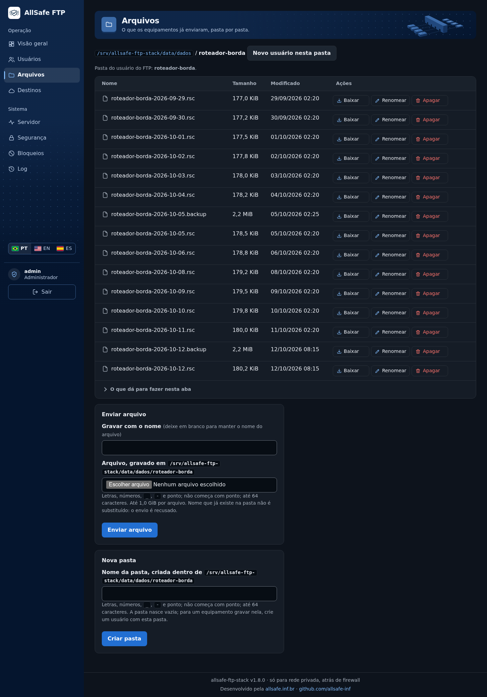</a>

<b>v1.9.0</b> · menu Arquivos, pasta de um usuário · captura de 2026-10-12

1. Clique no nome da pasta para entrar.
2. Confira, na linha `Pasta do usuário do FTP`, de quem é a pasta.
3. Clique em **Baixar** na linha do arquivo.

**Resultado esperado:** o navegador salva o arquivo com o nome original, idêntico ao que o equipamento enviou, e a aba Log ganha a linha `Arquivo baixado`, com o administrador, o caminho e o tamanho.

| Limite | Valor |
|---|---|
| Downloads ao mesmo tempo | 8, somando administradores e usuários do FTP; o seguinte recebe a tela `Muitos downloads ao mesmo tempo` |
| Itens mostrados por pasta | 2000, com um aviso quando há mais |
| Retomada | Não há: se a conexão cair, o download começa de novo |

Arquivos ➜ Nova pasta — clique para expandir

### Arquivos ➜ Nova pasta

<a href="imagens/arquivos-pasta-criada.png">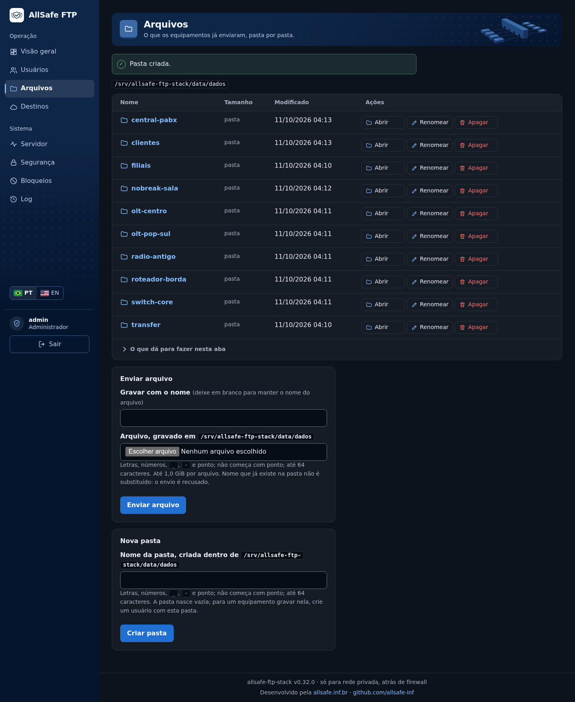</a>

<b>v1.9.0</b> · menu Arquivos, pasta criada · captura de 2026-10-12

| Campo | Obrigatório | O que preencher |
|---|---|---|
| Nome da pasta | Sim | Letras, números, `_`, `-` e ponto; não começa com ponto; até 64 caracteres. Uma pasta por vez: para criar `clientes/olt-01`, crie `clientes`, entre nela e crie `olt-01` |

**Resultado esperado:** a lista volta com a mensagem `Pasta criada.` e a pasta nova, vazia, já com o dono e a permissão que o FTP usa. Para um equipamento gravar nela, entre na pasta e clique em **Novo usuário nesta pasta**.

| Mensagem | Motivo |
|---|---|
| Caminho não aceito. | O nome foge da regra ou tenta sair da pasta dos dados |
| Já existe uma pasta ou um arquivo com este nome. | O nome já está em uso naquela pasta |
| Link simbólico não é seguido pelo painel. | O destino passa por um link simbólico |
| Pasta ou arquivo não encontrado. | A pasta de destino deixou de existir |

Arquivos ➜ Enviar arquivo — clique para expandir

### Arquivos ➜ Enviar arquivo

<a href="imagens/arquivos-enviado.png">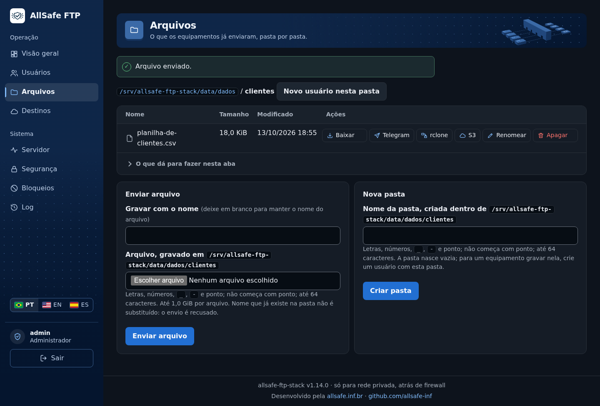</a>

<b>v1.9.0</b> · menu Arquivos, depois do envio · captura de 2026-10-12

1. Entre na pasta em que o arquivo deve ficar.
2. No cartão **Enviar arquivo**, escolha o arquivo.
3. Clique em **Enviar arquivo**.

| Campo | Obrigatório | O que preencher |
|---|---|---|
| Gravar com o nome | Não | O nome com que o arquivo fica no servidor: letras, números, `_`, `-` e ponto; não começa com ponto; até 64 caracteres. Em branco, fica o nome do arquivo escolhido |
| Arquivo | Sim | O arquivo a enviar, um por vez; o rótulo do campo diz em que pasta ele será gravado |

**Resultado esperado:** a pasta volta com a mensagem `Arquivo enviado.` e o arquivo na lista, já com o dono e a permissão que o FTP usa, e a aba Log ganha a linha `Arquivo enviado pelo painel`, com o administrador, o caminho e o tamanho.

| Limite | Valor |
|---|---|
| Tamanho de cada arquivo | O de `PAINEL_ENVIO_MAX_MB`: 1024 MB, por padrão |
| Envios ao mesmo tempo | 4, somando administradores e usuários do FTP; o seguinte recebe a tela `Muitos envios ao mesmo tempo` |
| Nome que já existe na pasta | Não é substituído: o envio é recusado |
| Retomada | Não há: se a conexão cair, o que chegou é descartado e o envio começa de novo |

| Mensagem ou tela | Motivo |
|---|---|
| Tela `Nenhum arquivo escolhido` | O formulário foi enviado sem arquivo |
| Tela `Nome não aceito` | O nome do arquivo, ou o do campo **Gravar com o nome**, foge da regra |
| Tela `Nome já usado` | Já existe uma pasta ou um arquivo com este nome naquela pasta; nada é substituído |
| Arquivo grande demais: o painel recebe até 1,0 GiB por arquivo. | O arquivo passa do tamanho de `PAINEL_ENVIO_MAX_MB`; o valor da mensagem acompanha a variável |
| Tela `Sem espaço` | O servidor não tem espaço livre para o arquivo |

Arquivos ➜ Enviar a um destino — clique para expandir

### Arquivos ➜ Enviar a um destino

<a href="imagens/arquivos-enviado-ao-destino.png">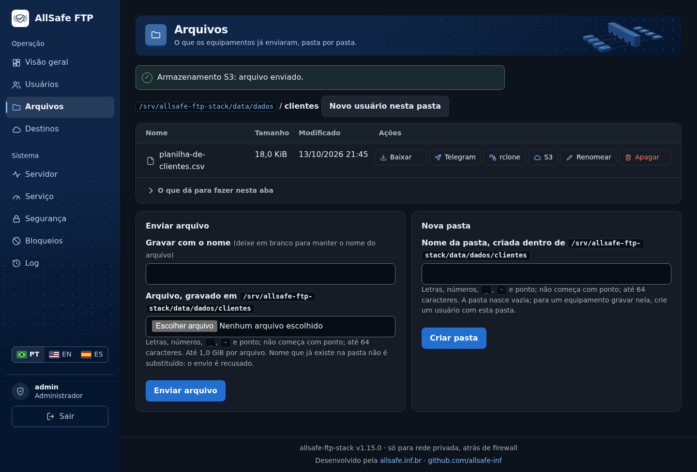</a>

<b>v1.9.0</b> · menu Arquivos, depois do envio a um destino · captura de 2026-10-12

Depois que um destino é gravado na aba [Destinos](#destinos), cada arquivo ganha um botão com o nome dele, **Telegram**, **rclone** ou **S3**, ao lado do **Baixar**. O botão envia aquele arquivo ao destino na hora, sem esperar a passada.

1. Entre na pasta do arquivo.
2. Na linha do arquivo, clique em **Telegram**, em **rclone** ou em **S3**.
3. Com mais de um destino pronto daquele tipo, escolha o **Destino que recebe** e clique em **Enviar**.

<a href="imagens/arquivos-escolher-destino.png">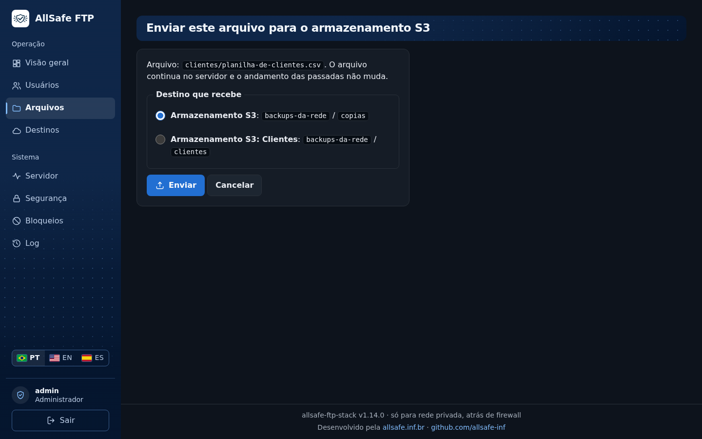</a>

<b>v1.9.0</b> · menu Arquivos, escolha do destino · captura de 2026-10-12

**Resultado esperado:** a tela volta para a mesma pasta com a mensagem `Armazenamento S3: arquivo enviado.`, `Remoto do rclone: arquivo enviado.` ou `Bot do Telegram: arquivo enviado.`, com o nome do destino quando ele tem um, e a aba Log ganha a linha `Arquivo enviado para o destino a pedido`, com o administrador, o destino e o arquivo.

| Item | Como funciona |
|---|---|
| Quando os botões aparecem | Só para o tipo que tem um destino gravado com os segredos; sem destino, a lista fica como antes |
| Quem tem os botões | Só o administrador: a tela Meus arquivos, do usuário do FTP, não os mostra |
| Arquivo de outra pasta | O botão serve para qualquer arquivo dos dados, dentro ou fora da pasta do destino, e funciona com o destino desligado |
| O arquivo no servidor | Nunca é apagado por esse envio, nem com o S3 em **Guardar no S3** |
| Enviar de novo | Pelo bot, a conversa recebe outra mensagem; no S3 e no rclone, o mesmo nome é gravado por cima |
| Caminho no remoto do rclone | O mesmo que o arquivo tem dentro dos dados, a partir da pasta no remoto |
| Remoto SFTP que ainda não passou pelo **Testar** | O envio não sai, e a mensagem diz que o painel ainda não guardou a chave do servidor |
| Envio demorado | Passando de 20 segundos, a mensagem diz que o envio continua em segundo plano, e o resultado aparece na aba Log |
| Envio que não dá certo | A mensagem traz o motivo em uma frase, como o arquivo vazio ou maior que o limite do bot |

Arquivos ➜ Renomear — clique para expandir

### Arquivos ➜ Renomear

<a href="imagens/arquivos-renomear.png">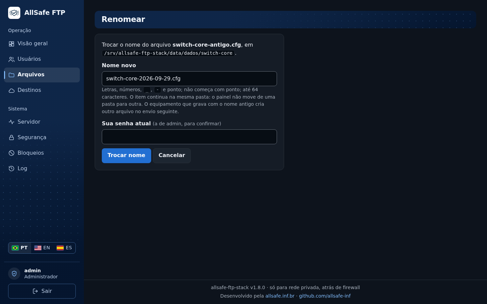</a>

<b>v1.9.0</b> · menu Arquivos, tela Renomear · captura de 2026-10-12

| Campo | Obrigatório | O que preencher |
|---|---|---|
| Nome novo | Sim | Letras, números, `_`, `-` e ponto; não começa com ponto; até 64 caracteres |
| Sua senha atual | Sim | A senha de quem está usando o painel, para confirmar |

<a href="imagens/arquivos-renomeado.png">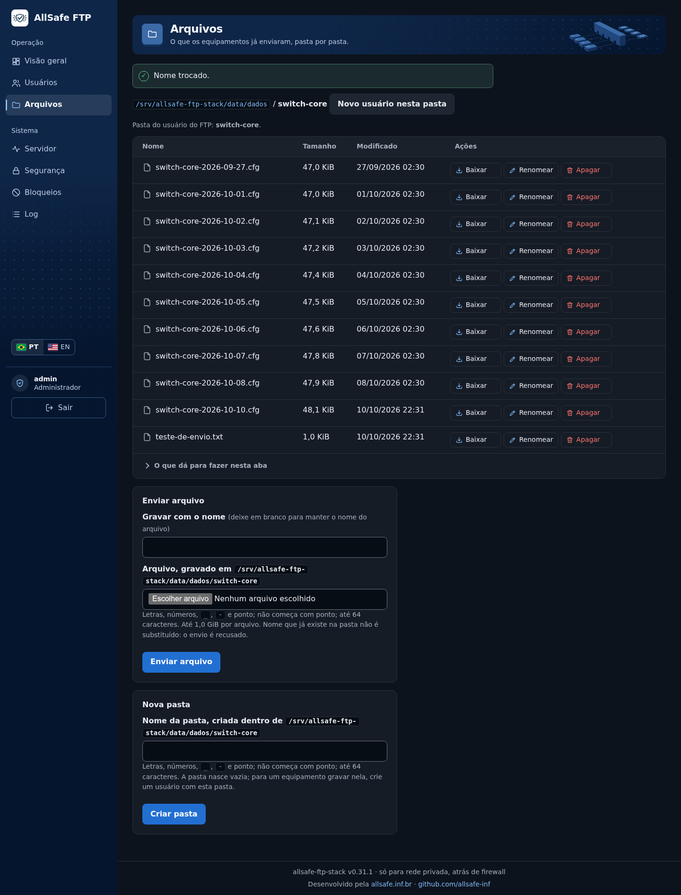</a>

<b>v1.9.0</b> · menu Arquivos, depois da troca de nome · captura de 2026-10-12

**Resultado esperado:** a pasta volta com a mensagem `Nome trocado.` e o item com o nome novo, no mesmo lugar. O painel não move de uma pasta para outra, e o equipamento que grava com o nome antigo cria outro arquivo no envio seguinte.

| Mensagem | Motivo |
|---|---|
| Nome não aceito. Veja a regra abaixo do campo. | O nome foge da regra |
| O item já tem este nome. | O nome novo é igual ao atual |
| Já existe uma pasta ou um arquivo com este nome. | O nome já está em uso naquela pasta; nada é substituído |
| A sua senha atual não confere. Nada foi alterado. | O campo Sua senha atual está errado; cinco recusas em 15 minutos bloqueiam o endereço |

Arquivos ➜ Apagar — clique para expandir

### Arquivos ➜ Apagar

<a href="imagens/arquivos-apagar.png">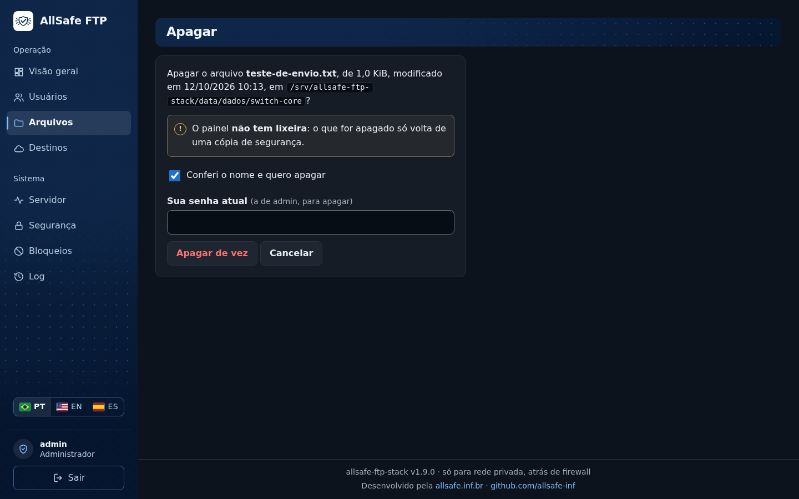</a>

<b>v1.9.0</b> · menu Arquivos, confirmação de apagar · captura de 2026-10-12

| Item da tela | O que faz |
|---|---|
| Primeira linha | Diz o que vai sair: o arquivo, com o tamanho e a data, ou a pasta, com a quantidade de arquivos e o espaço de tudo o que há dentro dela |
| Caixa **Conferi o nome e quero apagar** | Obrigatória: sem ela nada é apagado |
| **Sua senha atual** | A senha de quem está usando o painel, para confirmar |
| **Apagar de vez** | Apaga o arquivo, ou a pasta com tudo o que tem dentro |
| **Cancelar** | Volta para a pasta sem alterar nada |

<a href="imagens/arquivos-apagado.png">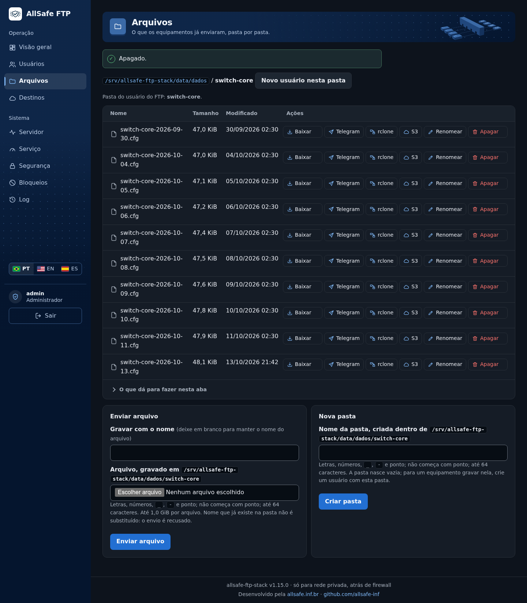</a>

<b>v1.9.0</b> · menu Arquivos, depois de apagar · captura de 2026-10-12

**Resultado esperado:** a pasta volta com a mensagem `Apagado.` e sem o item, e a aba Log ganha a linha `Arquivo ou pasta apagado`.

> ⚠️ **Apagar não tem volta:** o painel não tem lixeira, e o que foi apagado só volta de uma cópia de segurança. Veja [Backup](../backup.md).

| Mensagem ou tela | Motivo |
|---|---|
| Marque a caixa de confirmação. Nada foi apagado. | A caixa ficou desmarcada |
| A sua senha atual não confere. Nada foi apagado. | O campo Sua senha atual está errado; cinco recusas em 15 minutos bloqueiam o endereço |
| Tela `Apagado em parte` | A pasta tem mais do que o painel apaga em um pedido: repita para continuar |
| Tela `Nada foi apagado` | O painel já está apagando outra pasta, ou um item não pôde ser removido |

<a href="imagens/arquivos-pasta-de-usuario.png">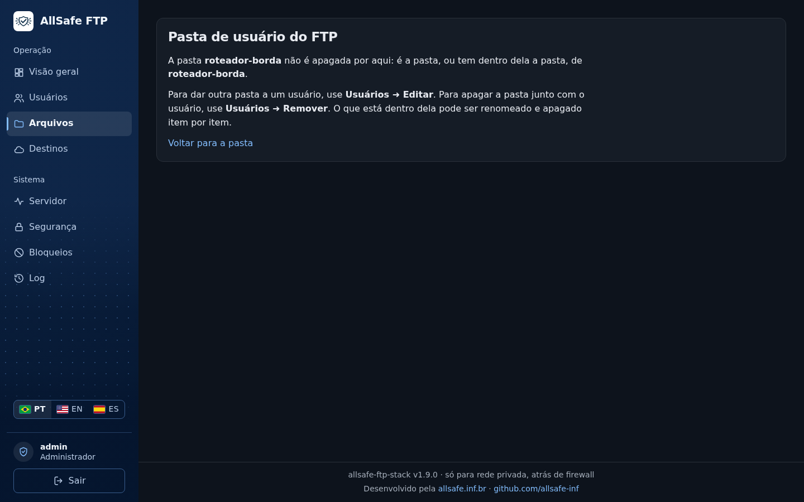</a>

<b>v1.9.0</b> · menu Arquivos, pasta de usuário recusada · captura de 2026-10-12

A pasta de um usuário do FTP, e a pasta que tem a de um usuário dentro, não é renomeada nem apagada pela aba Arquivos: o cadastro ficaria apontando para uma pasta que não existe. Para dar outra pasta ao usuário, use **Usuários ➜ Editar**; para apagar a pasta junto com ele, **Usuários ➜ Remover**. O que está dentro dela é renomeado e apagado item por item.

Detalhe técnico — rotas e proteções

- Rotas: `GET /arquivos?pasta=<caminho>` lista, `GET /arquivos/baixar?arquivo=<caminho>` entrega e `POST /arquivos/pasta` cria a pasta, com o token CSRF. `GET /arquivos/renomear?item=<caminho>` e `GET /arquivos/apagar?item=<caminho>` mostram a tela de cada ação, e o envio é um `POST` na mesma rota. `POST /arquivos/enviar` recebe o arquivo, em `multipart/form-data`, com o token CSRF.
- O caminho é sempre relativo a `DATA_DIR/dados`, aberto parte por parte e sem seguir link simbólico. Caminho com `..` recebe `400` e link simbólico, `403`, os dois com o evento `recusa_caminho`.
- O arquivo sai como anexo (`Content-Disposition: attachment`, RFC 6266 e RFC 8187), em blocos de 64 KiB, sem ser carregado na memória: o navegador salva e nunca abre.
- A pasta nova nasce com o dono `ftpdata` e o modo `0750`, os mesmos das pastas criadas pelo FTP.
- O arquivo enviado é gravado direto no disco, sem ser carregado na memória e sem nome, na própria pasta de destino, e só ganha nome quando chega inteiro, por `link()`, que não substitui o que existe. O envio cortado não deixa sobra na pasta, e o painel não abre nem interpreta o conteúdo.
- O nome é trocado por uma chamada só ao sistema, que recusa o nome que já existe; a pasta é esvaziada de dentro para fora, e um link simbólico dentro dela é apagado como link, sem tocar no destino.
- Um pedido de apagar remove até 50.000 itens ou trabalha por até 20 segundos, e o painel faz um apagamento por vez.
- A pasta de um usuário do FTP, ou a que tem uma dentro, responde `409` na tela e no envio.
- Os eventos `arquivo_baixado`, `arquivo_interrompido`, `arquivo_enviado`, `envio_interrompido`, `pasta_criada`, `item_renomeado` e `item_apagado` ficam na [auditoria](../painel.md#auditoria); o conteúdo do arquivo nunca é registrado.
- O funcionamento completo está em [Arquivos e download](../painel.md#arquivos) e em [Enviar arquivo](../painel.md#enviar-arquivo).

---

## 📥 Meus arquivos

<a href="imagens/meus-arquivos.png">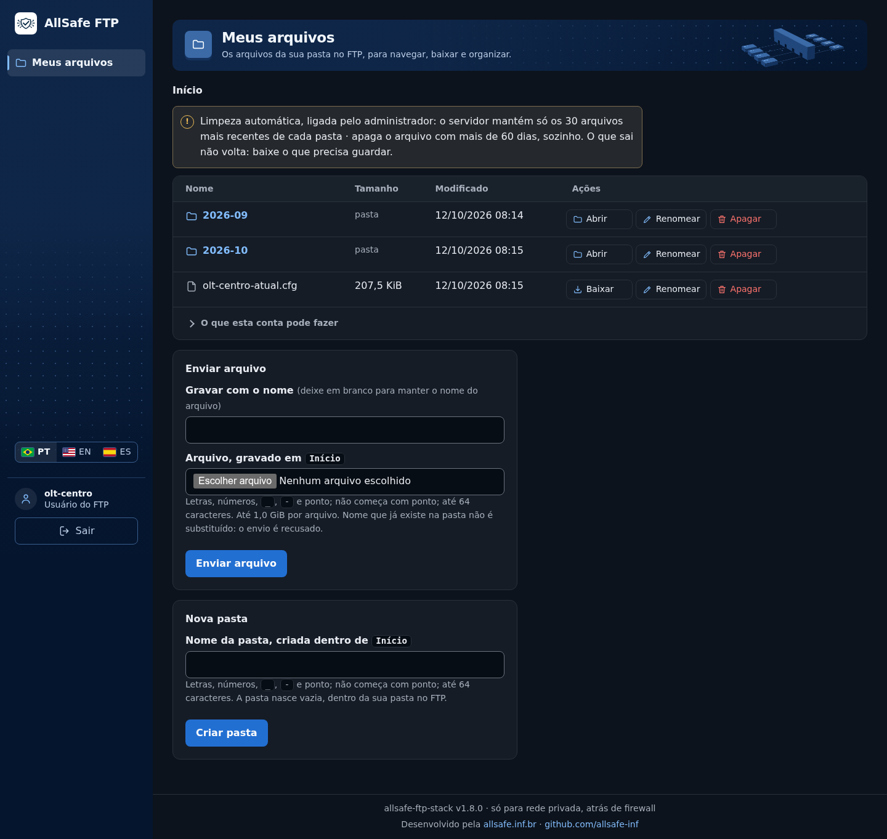</a>

<b>v1.9.0</b> · tela Meus arquivos, do usuário do FTP de perfil Completo · captura de 2026-10-12

**Para que serve:** o dono dos arquivos navega na própria pasta e baixa os backups pelo navegador, sem depender de quem administra e sem conta nova. O que mais ele faz depende do perfil da conta e, no envio de arquivo, da permissão que o administrador dá.

**Como chegar:** abra o endereço do painel e entre com **o nome e a senha do FTP**, os mesmos que o equipamento usa. É a única tela que o usuário do FTP vê.

| Item da tela | O que faz | Perfis que têm |
|---|---|---|
| Caminho no alto da lista | Mostra a pasta aberta, a partir de **Início**, e volta a qualquer nível | Completo, Envio e Leitura |
| Nome de uma pasta · **Abrir** | Entra na pasta | Completo, Envio e Leitura |
| Tamanho · Modificado | Tamanho do arquivo e data da última alteração | Completo, Envio e Leitura |
| **Baixar** | Entrega o arquivo ao navegador, com o nome original | Completo, Envio e Leitura |
| **Nova pasta** | Cria uma pasta vazia dentro da que está aberta | Completo e Envio |
| **Enviar arquivo** | Recebe um arquivo do navegador e o grava na pasta que está aberta | Completo, Envio e Só envio, com a permissão de envio pelo painel |
| **Renomear** | Abre a tela que troca o nome do arquivo ou da pasta, dentro da mesma pasta, e pede a senha do FTP da conta | Completo |
| **Apagar** | Abre a confirmação, que pede a senha do FTP da conta; apaga de vez, sem lixeira | Completo |
| Aviso de limpeza automática | Acima da lista, quando o administrador ligou a limpeza da pasta: diz a regra e lembra que o que sai não volta | Completo, Envio e Leitura |
| **O que esta conta pode fazer** | Recolhido abaixo da lista: diz o que o perfil da conta permite e se ela envia arquivo por aqui | Completo, Envio e Leitura |
| **PT** · **EN** · **ES** | Trocam o idioma da conta: veja [Idioma](#idioma) | Todos |
| **Sair** | Encerra a sessão na hora | Todos |

O usuário vê só a pasta do cadastro dele e o que há dentro dela. O caminho da pasta no servidor não aparece, e o menu traz só a tela da conta, sem as abas de administração, com o nome do usuário e o papel **Usuário do FTP**. O botão que o perfil não tem não aparece, e a ação pedida direto pelo endereço responde `404`. Enviar arquivo por aqui depende de uma permissão que o administrador dá a cada conta: sem ela, o cartão **Enviar arquivo** não aparece e o envio é só por FTP. A conta de perfil Só envio tem outra tela: veja [Meus arquivos ➜ Perfil Só envio](#meus-arquivos).

Meus arquivos ➜ Dentro de uma pasta — clique para expandir

### Meus arquivos ➜ Dentro de uma pasta

<a href="imagens/meus-arquivos-pasta.png">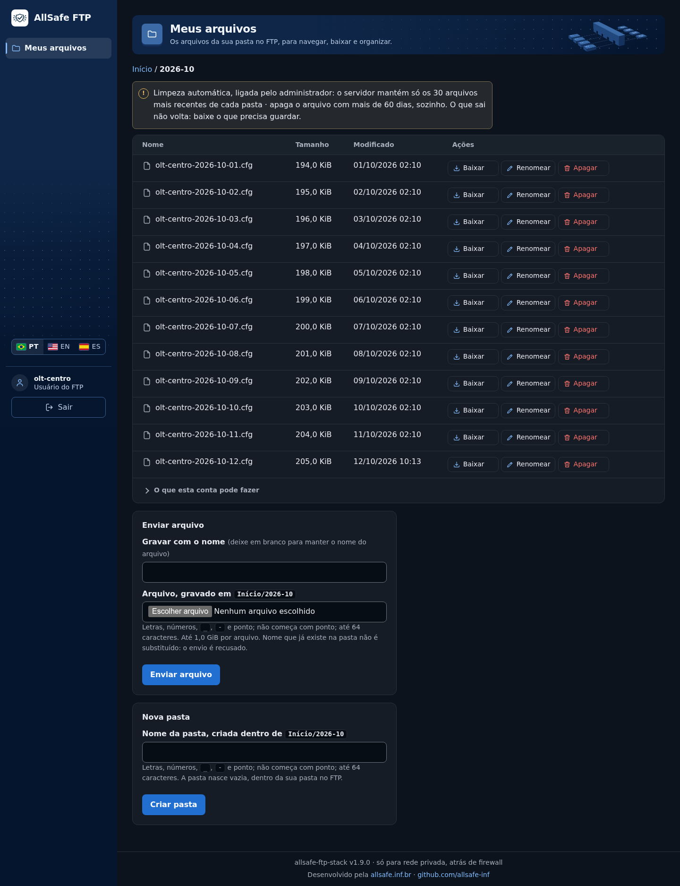</a>

<b>v1.9.0</b> · tela Meus arquivos, dentro de uma pasta · captura de 2026-10-12

1. Clique no nome da pasta para entrar.
2. Clique em **Baixar** na linha do arquivo.
3. Clique em **Início**, no caminho do alto, para voltar à pasta do usuário.

**Resultado esperado:** o arquivo salvo é idêntico ao que o equipamento enviou, e a aba Log, que só o administrador vê, ganha a linha `Arquivo baixado`, com o nome do usuário do FTP, o caminho e o tamanho.

| Limite | Valor |
|---|---|
| Sessões por usuário do FTP | 3; a quarta entrada encerra a mais antiga |
| Downloads ao mesmo tempo por usuário | 2, ou o número gravado nos limites dele; o seguinte recebe a tela `Muitos downloads ao mesmo tempo` |
| Depois de trocar a senha, a pasta ou o perfil, ou de remover o usuário | A sessão dele é encerrada no pedido seguinte |

Meus arquivos ➜ Enviar arquivo — clique para expandir

### Meus arquivos ➜ Enviar arquivo

<a href="imagens/meus-arquivos-enviado.png">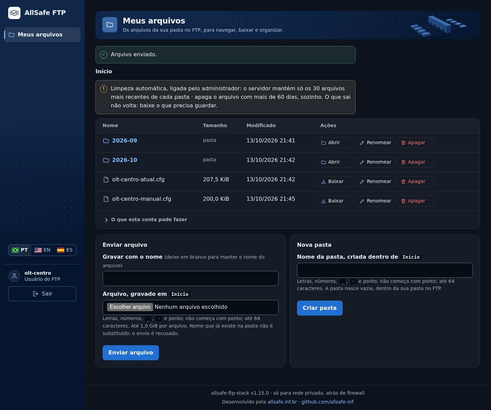</a>

<b>v1.9.0</b> · tela Meus arquivos, depois do envio · captura de 2026-10-12

O cartão **Enviar arquivo** aparece para a conta que tem a permissão **Permitir que este usuário envie arquivo pelo painel**, marcada pelo administrador em [Usuários ➜ Limites](#usuarios). O perfil Leitura não envia, com ou sem a permissão.

1. Entre na pasta em que o arquivo deve ficar.
2. No cartão **Enviar arquivo**, escolha o arquivo.
3. Clique em **Enviar arquivo**.

| Campo | Obrigatório | O que preencher |
|---|---|---|
| Gravar com o nome | Não | O nome com que o arquivo fica no servidor; em branco, fica o nome do arquivo escolhido |
| Arquivo | Sim | O arquivo a enviar, um por vez |

**Resultado esperado:** a pasta volta com a mensagem `Arquivo enviado.` e o arquivo na lista, e a aba Log, que só o administrador vê, ganha a linha `Arquivo enviado pelo painel`, com o nome do usuário do FTP, o caminho e o tamanho.

| Regra | Como vale |
|---|---|
| Tamanho de cada arquivo | O de `PAINEL_ENVIO_MAX_MB`: 1024 MB, por padrão |
| Envios ao mesmo tempo | Um por conta; o seguinte recebe a tela `Muitos envios ao mesmo tempo` |
| Taxa | A taxa de envio gravada nos limites do usuário, se houver |
| Nome que já existe | Nos perfis Completo e Envio, o envio é recusado e nada é substituído. No perfil Só envio, o arquivo novo é guardado com a data e a hora no nome |
| Sem a permissão | O envio pedido direto pelo endereço recebe a tela `Envio não permitido` e fica registrado |

Meus arquivos ➜ Perfil Envio — clique para expandir

### Meus arquivos ➜ Perfil Envio

<a href="imagens/meus-arquivos-envio.png">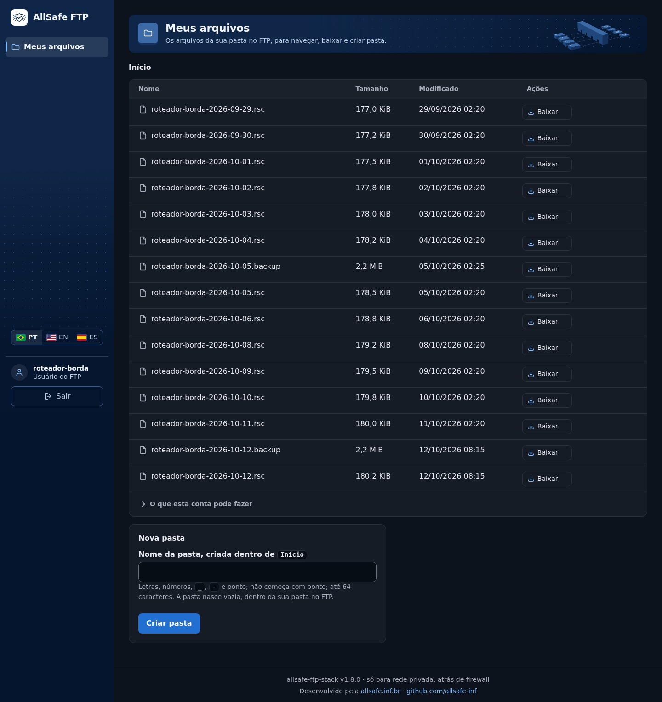</a>

<b>v1.9.0</b> · tela Meus arquivos, perfil Envio · captura de 2026-10-12

A conta de perfil Envio navega, baixa e cria pasta. Não há **Renomear** nem **Apagar**: o que já chegou ao servidor fica como chegou, no FTP e no painel. Na foto, `roteador-borda` não tem a permissão de envio pelo painel, e o cartão **Enviar arquivo** não aparece.

Meus arquivos ➜ Perfil Leitura — clique para expandir

### Meus arquivos ➜ Perfil Leitura

<a href="imagens/meus-arquivos-leitura.png">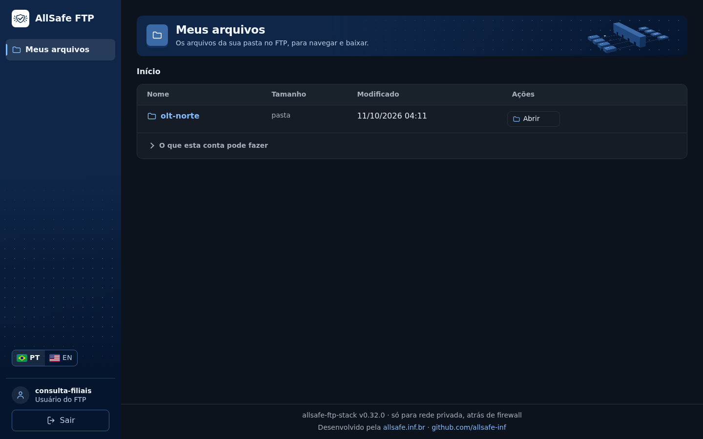</a>

<b>v1.9.0</b> · tela Meus arquivos, perfil Leitura · captura de 2026-10-12

A conta de perfil Leitura só navega e baixa, e não envia por nenhum caminho. Na foto, a pasta de `consulta-filiais` é `filiais`, que tem dentro a pasta de `olt-filial-norte`: a conta de consulta baixa o que a OLT enviou e não grava nada.

Meus arquivos ➜ Perfil Só envio — clique para expandir

### Meus arquivos ➜ Perfil Só envio

<a href="imagens/meus-arquivos-so-envio.png">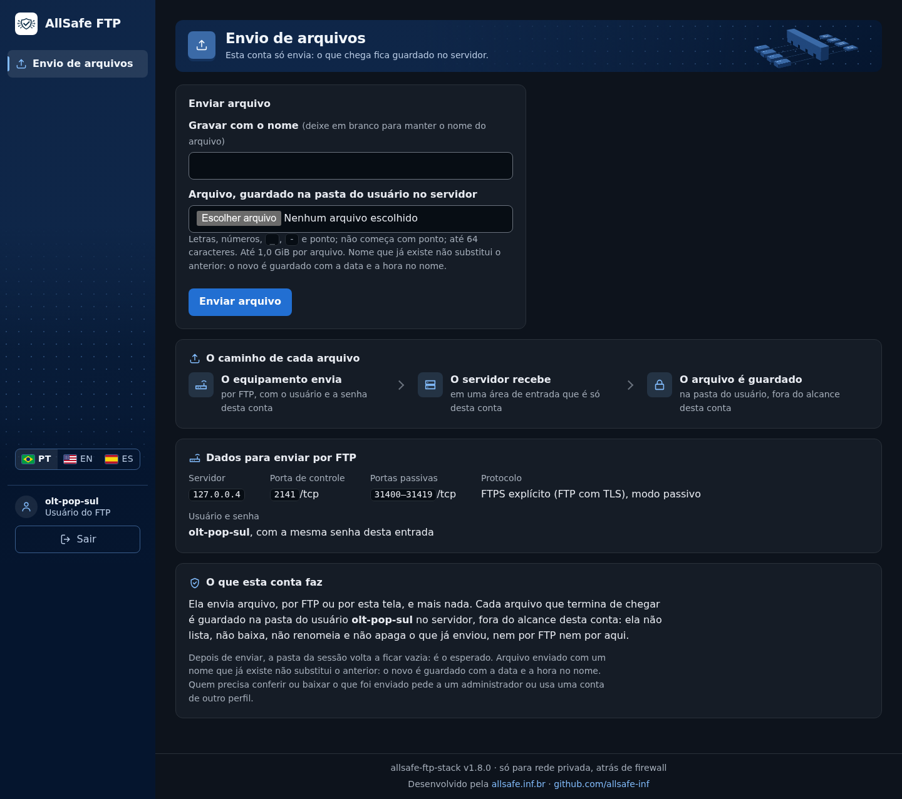</a>

<b>v1.9.0</b> · tela Envio de arquivos, perfil Só envio · captura de 2026-10-12

A conta de perfil Só envio não vê os backups, nem os que ela mesma enviou. No lugar de Meus arquivos, ela abre a tela **Envio de arquivos**, que explica o caminho do arquivo e traz os dados para configurar o equipamento.

| Cartão | O que mostra |
|---|---|
| **Enviar arquivo** | Só com a permissão de envio pelo painel: recebe um arquivo do navegador e o guarda na pasta do usuário, sem mostrar o que há nela |
| **O caminho de cada arquivo** | Três passos: o equipamento envia por FTP, o servidor recebe em uma área de entrada que é só daquela conta e o arquivo é guardado na pasta do usuário, fora do alcance dela |
| **Dados para enviar por FTP** | Servidor, porta de controle, portas passivas, protocolo e o usuário: o que preencher no equipamento |
| **O que esta conta faz** | Que ela só envia, que a pasta da sessão volta a ficar vazia depois de cada envio e que o arquivo de nome repetido é guardado com a data e a hora no nome, sem substituir o anterior |

Com a permissão, a conta envia por FTP ou por esta tela, e mais nada: a mensagem `Arquivo enviado.` confirma a chegada, e o arquivo de nome repetido volta com `Arquivo enviado. Já havia um com este nome: o novo foi guardado com a data e a hora no nome.`

Quem precisa conferir ou baixar o que foi enviado pede a um administrador ou usa uma conta de outro perfil. As regras deste perfil estão em [Painel web](../painel.md#perfis).

Detalhe técnico — o que a conta do FTP alcança

- Rotas da sessão do usuário do FTP, por perfil. Só envio: `GET /` (leva a `/meus-arquivos`), `GET /meus-arquivos`, `POST /idioma` e `POST /sair`. Leitura acrescenta `GET /meus-arquivos?pasta=<caminho>` e `GET /meus-arquivos/baixar?arquivo=<caminho>`. Envio acrescenta `POST /meus-arquivos/pasta`. Com a permissão de envio pelo painel, Só envio, Envio e Completo ganham `POST /meus-arquivos/enviar`; sem ela, a rota responde `403`, com o evento `recusa_envio`. Completo acrescenta `GET` e `POST` em `/meus-arquivos/renomear?item=<caminho>` e `/meus-arquivos/apagar?item=<caminho>`.
- Qualquer outra rota responde `404`. Quando é uma rota de administração, ou uma ação que o perfil da conta não tem, fica o evento `recusa_papel`, com o usuário, o caminho e o perfil.
- Renomear e apagar conferem a senha do FTP da conta; a senha errada grava `usuario_senha_atual_recusada`.
- Quem confere a senha é o `pure-ftpd`, por um login na rede interna da stack; o painel não lê o hash do cadastro.
- O caminho é sempre relativo à pasta do cadastro, que é a raiz dele, com as mesmas conferências da [aba Arquivos](#arquivos).
- `PAINEL_ACESSO_USUARIOS_FTP=nao` desliga esta entrada: o painel passa a aceitar só administradores.
- O funcionamento completo está em [Usuário do FTP no painel](../painel.md#usuario-ftp).

---

## ☁️ Destinos

<b>v1.9.0</b> · menu Destinos · captura de 2026-10-12

**Para que serve:** mandar sozinho, para fora do servidor, os arquivos que chegam em uma pasta. São três tipos de destino, com até 20 de cada um: o armazenamento S3, que guarda a segunda cópia ou fica com os arquivos e libera o disco, o remoto do rclone, que leva a pasta a um servidor de arquivos, a uma nuvem de arquivos, ao armazenamento de um provedor de nuvem ou a um serviço de transferência de arquivos, em 41 tipos, e o bot do Telegram, que entrega cada arquivo novo a uma pessoa, a um grupo ou a um canal.

**Como chegar:** menu ➜ **Destinos**. Só o administrador tem a aba.

| Item da tela | O que mostra ou faz |
|---|---|
| Etiqueta ao lado do nome | `não configurado`, `ligado`, `desligado` ou `faltam os segredos`; no remoto SFTP do rclone que ainda não passou pelo **Testar**, `falta testar` |
| Endereço · Bucket e prefixo · Região | Para onde o S3 envia, como foi gravado |
| Tipo do remoto · Pasta no remoto | No rclone, o tipo escolhido e a pasta do remoto em que os arquivos são gravados |
| Pasta enviada | A pasta dos dados que o destino acompanha, com as pastas de dentro dela |
| Passadas | De quanto em quanto tempo o painel confere a pasta |
| Depois do envio | No S3, **Copiar** ou **Guardar no S3**; no rclone, sempre **Copiar** |
| Maior arquivo que o bot envia · Idioma das mensagens | O limite de cada envio pelo bot e a língua da legenda e dos avisos |
| Chave de acesso e chave secreta · Acesso do remoto · Token do bot e conversa | Só dizem que os segredos estão gravados: o valor não aparece na tela |
| Chave do servidor | No remoto SFTP, depois do **Testar**: o tipo e a impressão digital da chave que o painel guardou, para conferir com a do servidor |
| Última passada | Quando foi e quantos arquivos saíram, com o tamanho somado; quando ela para antes do fim, o motivo em uma frase |
| Enviado desde que foi ligado | O total de arquivos e de tamanho que o destino já recebeu |
| Cartão **Cópia do sistema** | No alto da aba, recolhido: o título e a marca ficam à mostra, e um clique no título abre o cartão. Ele já vem aberto quando há cópia em andamento, cópia que não foi concluída ou segredos faltando. A marca é `não configurada`, `rotina ligada`, `só pelo botão`, `em andamento` ou `faltam os segredos`; o destino, o bucket e a pasta, a rotina e a última cópia, com a data, o tamanho, os arquivos e o nome do objeto |
| Copiar e enviar agora · Alterar | Pede a cópia do sistema na hora, em segundo plano · abre o formulário da cópia: o S3 que recebe, a pasta no bucket, os dias e a hora da rotina |
| Ainda chegando | Arquivos que mudaram há menos de dois minutos: saem em uma próxima passada |
| À espera de outro destino | No S3 em **Guardar no S3**, arquivos já gravados nele que só saem do servidor quando os outros destinos da pasta os entregarem |
| **Testar** | Grava um objeto pequeno no S3 ou um arquivo pequeno no remoto do rclone, ou envia a mensagem de teste pelo bot, com o que está gravado |
| **Enviar agora** | Pede uma passada fora de hora; atualize a tela para acompanhar |
| **Alterar** | Abre o formulário com o que está gravado; segredo em branco mantém o gravado |
| **Novo com o mesmo acesso** | Abre o formulário de um destino novo do mesmo tipo, com os segredos deste |
| **Remover** | Abre a confirmação que apaga a configuração, o andamento e os segredos daquele destino, e só dele |
| **Novo S3** · **Novo remoto** · **Novo bot** | No alto da tela, depois do primeiro destino do tipo: abrem o formulário em branco de mais um |
| **Como o painel envia** | No alto da tela, recolhido: abre com um clique e traz o resumo das regras: por onde o painel sai do servidor, só arquivo comum e onde os segredos ficam |

Cada destino tem a pasta, o intervalo e os segredos dele, e um não depende do outro. O S3 e o remoto do rclone enviam tudo o que está na pasta, inclusive o que já estava lá quando foram ligados, a cada intervalo. O bot envia só o que chega depois de ligado: em poucos segundos quando o arquivo chega inteiro por FTP ou pelo painel, e a cada intervalo o que apareceu na pasta de outro jeito. As regras completas estão em [Painel web](../painel.md#destinos).

Destinos ➜ Antes de configurar — clique para expandir

### Destinos ➜ Antes de configurar

<a href="imagens/destinos-sem-destino.png">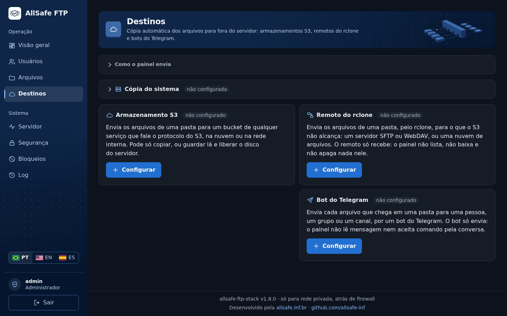</a>

<b>v1.9.0</b> · menu Destinos, sem destino gravado · captura de 2026-10-12

A instalação nasce sem destino: enquanto o administrador não gravar um, nada sai do servidor e o painel não abre conexão para fora. Cada cartão diz o que o destino faz e leva ao formulário dele, pelo botão **Configurar**.

Destinos ➜ Armazenamento S3 — clique para expandir

### Destinos ➜ Armazenamento S3

<a href="imagens/destinos-s3.png">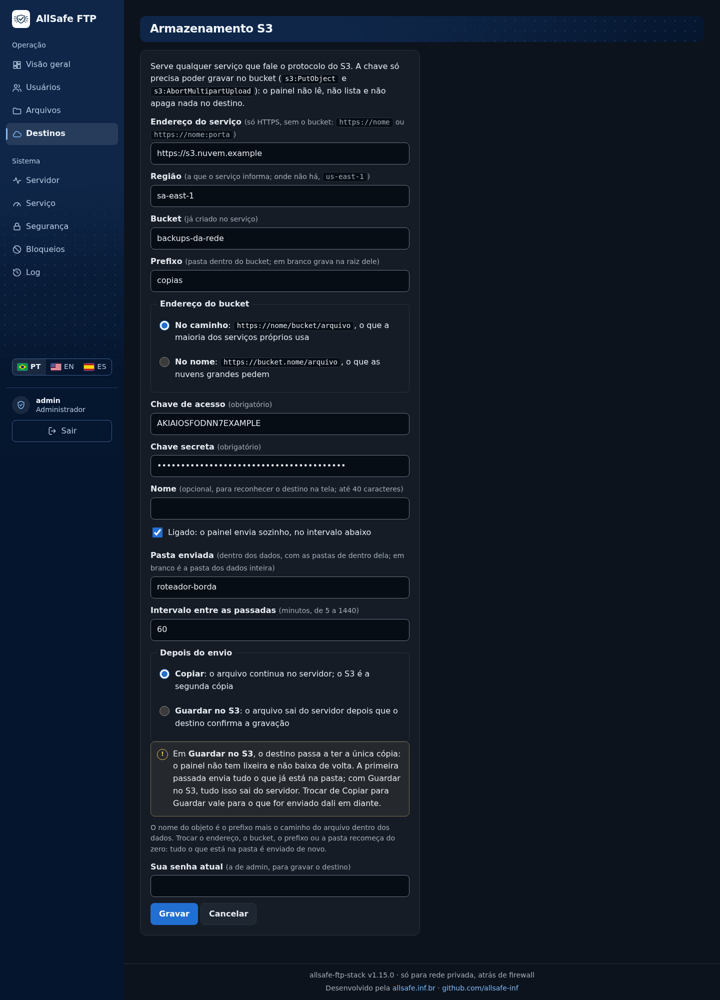</a>

<b>v1.9.0</b> · menu Destinos, formulário do S3 · captura de 2026-10-12

Serve qualquer serviço que fale o protocolo do S3, na nuvem ou na rede interna. Antes de começar, crie o bucket no serviço e uma chave que só possa gravar nele.

1. Na aba Destinos, clique em **Configurar** no cartão **Armazenamento S3**.
2. Preencha o endereço, a região, o bucket e as duas chaves.
3. Escolha a pasta enviada, o intervalo e o que acontece depois do envio.
4. Digite a sua senha e clique em **Gravar**.

| Campo | Obrigatório | O que preencher |
|---|---|---|
| Endereço do serviço | Sim | `https://nome` ou `https://nome:porta`, só HTTPS e sem o bucket |
| Região | Sim | A que o serviço informa; onde não há, `us-east-1` |
| Bucket | Sim | O nome do bucket, já criado no serviço |
| Prefixo | Não | A pasta dentro do bucket; em branco, grava na raiz dele |
| Endereço do bucket | Sim | **No caminho** (`https://nome/bucket/arquivo`) ou **No nome** (`https://bucket.nome/arquivo`), como o serviço pede |
| Chave de acesso | Sim | A chave que pode gravar no bucket. Em **Alterar**, em branco mantém a gravada |
| Chave secreta | Sim | A outra metade da chave. Em **Alterar**, em branco mantém a gravada |
| Nome | Não | Até 40 caracteres, para reconhecer o destino na tela quando há mais de um do tipo |
| Ligado | Não | Marcada, o painel envia sozinho; desmarcada, a configuração fica guardada e nada sai |
| Pasta enviada | Não | A pasta dentro dos dados, que precisa existir; em branco é a pasta dos dados inteira |
| Intervalo entre as passadas | Sim | Minutos, de 5 a 1440 |
| Depois do envio | Sim | **Copiar**: o arquivo continua no servidor. **Guardar no S3**: o arquivo sai do servidor depois que o destino confirma a gravação |
| Sua senha atual | Sim | A senha de quem está na sessão, para gravar o destino |

<a href="imagens/destinos-gravado.png">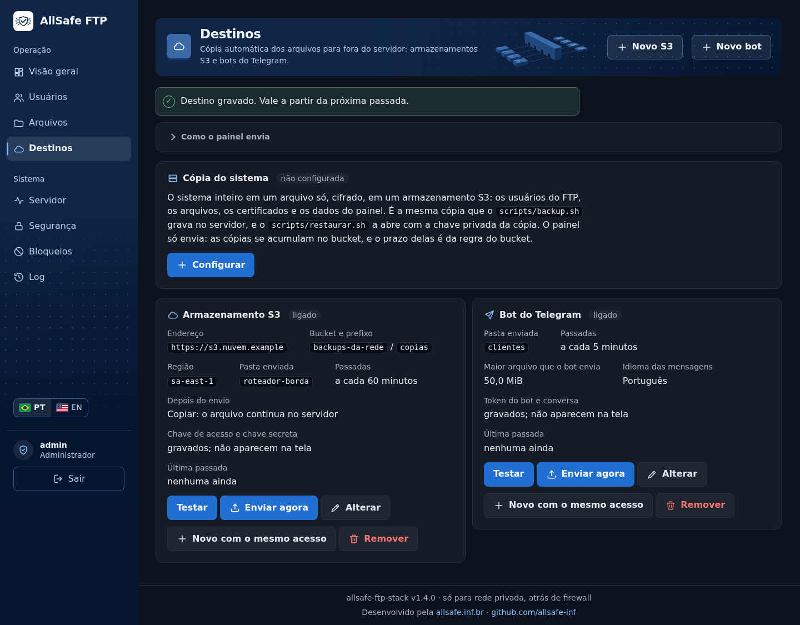</a>

<b>v1.9.0</b> · menu Destinos, depois de gravar · captura de 2026-10-12

**Resultado esperado:** a aba volta com o aviso `Destino gravado. Vale a partir da próxima passada.`, e o cartão mostra a etiqueta `ligado`, o endereço, o bucket, a pasta e que as chaves estão gravadas, sem mostrá-las. A primeira passada começa em até um minuto e envia tudo o que já está na pasta.

> ⚠️ **Guardar no S3 deixa uma cópia só:** o arquivo sai do servidor depois de gravado no destino, e o painel não tem lixeira nem baixa de volta. Comece com **Copiar**, confira os objetos no bucket e só então troque.

| Mensagem | Motivo |
|---|---|
| Endereço inválido: use https://nome ou https://nome:porta, em minúsculas e sem caminho. | O endereço não é HTTPS, tem maiúscula ou traz o bucket ou um caminho |
| Bucket inválido: de 3 a 63 caracteres, com letras minúsculas, números, ponto e hífen. | O nome do bucket foge da regra |
| A pasta não existe dentro dos dados. Crie em Arquivos ou confira o nome. | A pasta enviada não foi encontrada |
| Preencha os dois segredos do destino: nenhum deles está gravado ainda. | Na primeira gravação, uma das chaves ficou em branco |
| Intervalo inválido: de 5 a 1440 minutos. | O intervalo está fora da faixa |

Destinos ➜ Remoto do rclone — clique para expandir

### Destinos ➜ Remoto do rclone

<a href="imagens/destinos-rclone-tipo.png">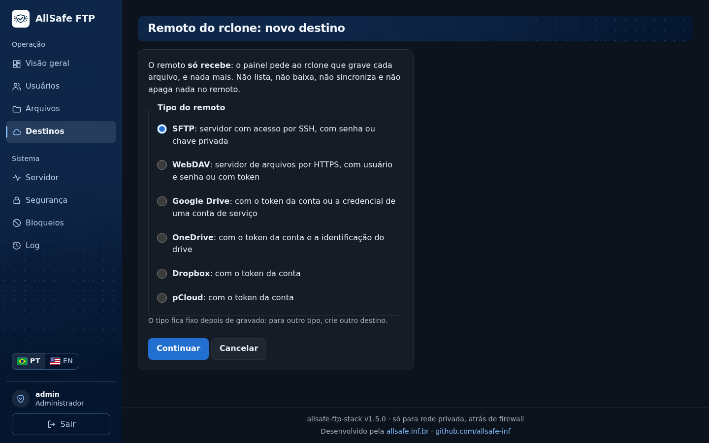</a>

<b>v1.10.0</b> · menu Destinos, escolha do tipo do remoto · captura de 2026-10-12

O rclone é o programa de envio de arquivos que vem dentro da imagem do painel. Por ele, a pasta vai para o que o S3 não alcança, em 41 tipos de remoto: servidores de arquivos (SFTP, WebDAV, FTP com TLS e Seafile), nuvens de arquivos (Google Drive, OneDrive, Dropbox, pCloud, Box, Mega e outras), armazenamento de provedores de nuvem e serviços de transferência de arquivos para empresas. O remoto só recebe: o painel não lista, não baixa, não sincroniza e não apaga nada nele.

1. Na aba Destinos, clique em **Configurar** no cartão **Remoto do rclone**.
2. Escolha o **Tipo do remoto** na lista, separada em quatro grupos, e clique em **Continuar**.

<a href="imagens/destinos-rclone.png">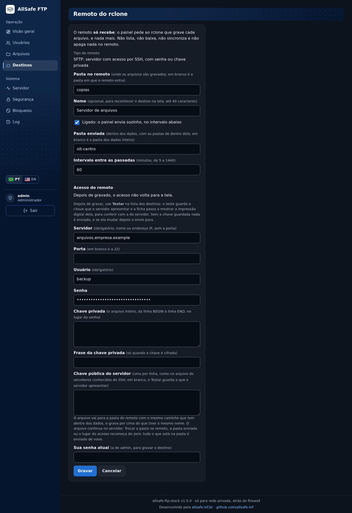</a>

<b>v1.9.0</b> · menu Destinos, formulário do remoto SFTP · captura de 2026-10-12

3. Preencha a **Pasta no remoto**, a **Pasta enviada** e o **Intervalo entre as passadas**.
4. Em **Acesso do remoto**, preencha os campos do tipo escolhido.
5. Digite a sua senha e clique em **Gravar**.

| Campo | Obrigatório | O que preencher |
|---|---|---|
| Pasta no remoto | Não | Onde os arquivos são gravados, com até 16 níveis separados por barra; em branco é a pasta em que o remoto entra |
| Nome | Não | Até 40 caracteres, para reconhecer o destino na tela quando há mais de um do tipo |
| Ligado | Não | Marcada, o painel envia sozinho; desmarcada, a configuração fica guardada e nada sai |
| Pasta enviada | Não | A pasta dentro dos dados, que precisa existir; em branco é a pasta dos dados inteira |
| Intervalo entre as passadas | Sim | Minutos, de 5 a 1440 |
| Servidor | Sim | No SFTP, o nome ou o endereço IP, sem a porta |
| Porta | Não | Em branco é a 22 |
| Usuário | Sim | A conta do servidor que recebe os arquivos |
| Senha | Uma das duas | A senha da conta, quando o acesso não é por chave |
| Chave privada | Uma das duas | O arquivo inteiro, da linha BEGIN à linha END, no lugar da senha |
| Frase da chave privada | Não | Só quando a chave é cifrada |
| Chave pública do servidor | Não | Uma por linha, como no arquivo de servidores conhecidos do SSH; em branco, o **Testar** guarda a que o servidor apresentar |
| Sua senha atual | Sim | A senha de quem está na sessão, para gravar o destino |

Os campos do acesso mudam com o tipo. Os dos outros 40 tipos estão em [Painel web](../painel.md#destinos). O formulário de cada tipo traz só os campos dele e, quando a conta tem alguma condição, o aviso dela. O do Mega, por exemplo, pede o usuário e a senha:

<a href="imagens/destinos-rclone-mega.png">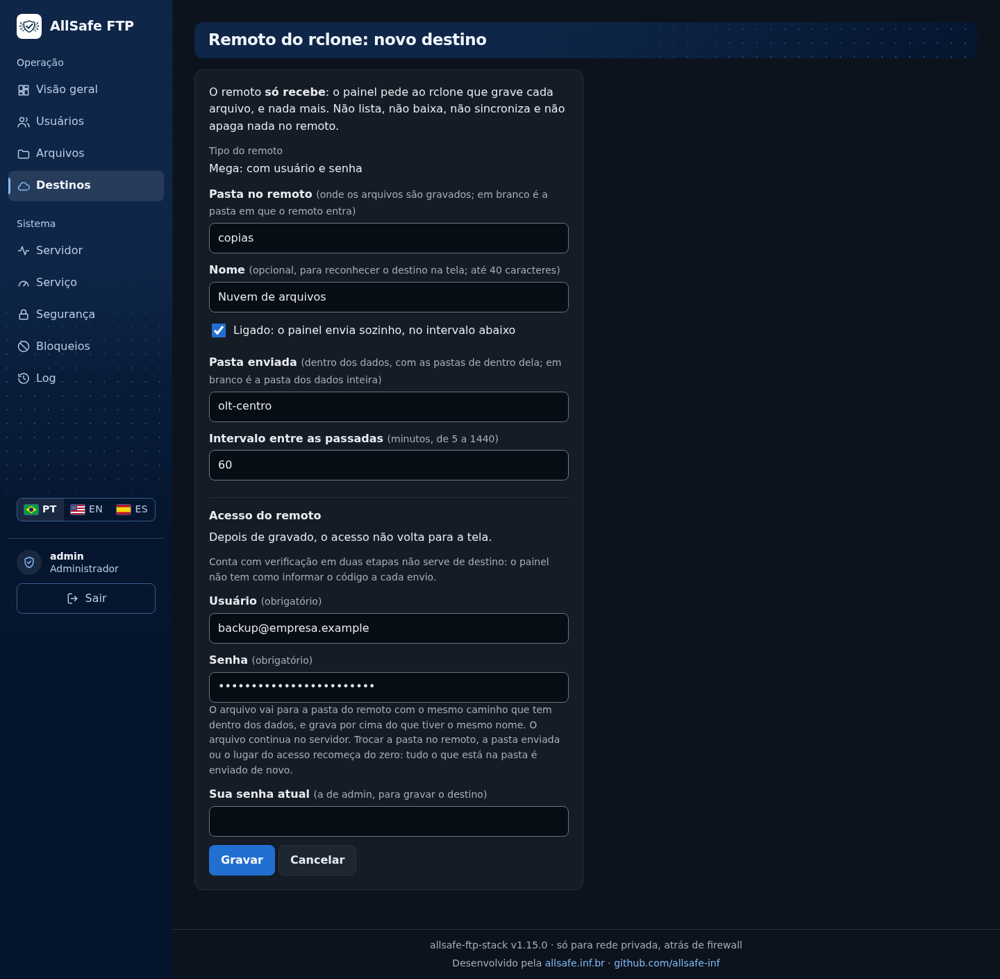</a>

<b>v1.10.0</b> · menu Destinos, formulário do remoto Mega, com uma conta de exemplo que não foi gravada · captura de 2026-10-12

<b>v1.9.0</b> · menu Destinos, remoto gravado e ainda sem o teste · captura de 2026-10-12

6. De volta à aba, clique em **Testar** no cartão do remoto.

<a href="imagens/destinos-rclone-testado.png">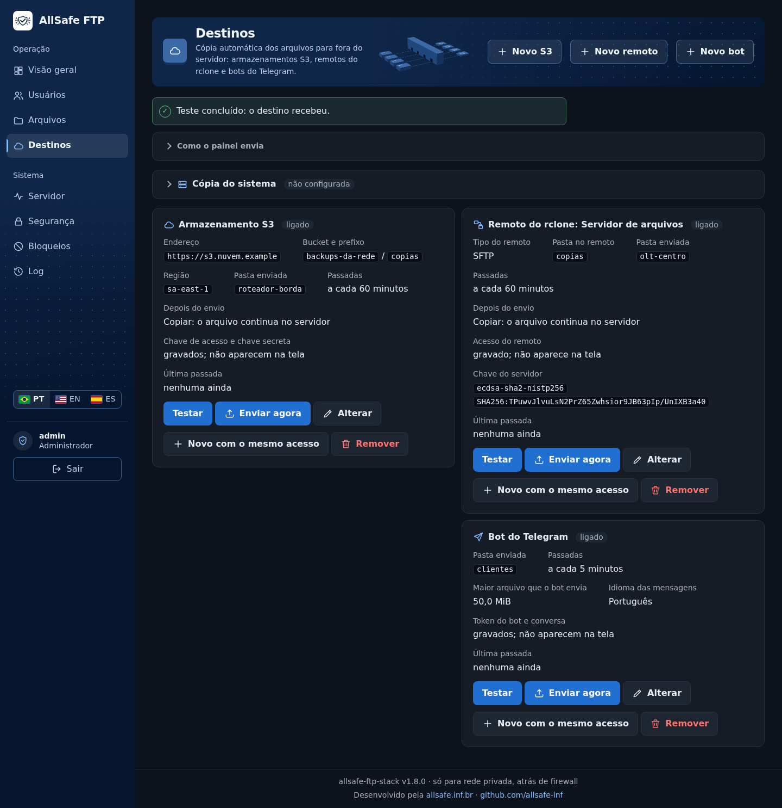</a>

<b>v1.9.0</b> · menu Destinos, remoto depois do teste · captura de 2026-10-12

**Resultado esperado:** ao gravar, a aba volta com o aviso `Destino gravado. Vale a partir da próxima passada.` e o cartão do remoto, com o tipo, a pasta no remoto, a pasta enviada e o acesso gravado, sem mostrá-lo. No SFTP, o cartão fica com a etiqueta `falta testar`. O teste grava o arquivo `allsafe-ftp-stack-teste.txt` na pasta do remoto e responde `Teste concluído: o destino recebeu.`; o cartão passa a `ligado` e ganha a linha **Chave do servidor**, com a impressão digital para conferir com a do servidor. A primeira passada começa em até um minuto e envia tudo o que já está na pasta.

| Situação | O que acontece |
|---|---|
| Remoto SFTP sem o **Testar** | Nada é enviado: o painel ainda não guardou a chave do servidor |
| Chave do servidor diferente da guardada | O envio para, e o cartão diz o motivo; se a troca foi do próprio servidor, grave o acesso de novo e teste |
| Tipo que pede o **Token da conta**, como Google Drive, OneDrive, Dropbox, pCloud e Box | O token é obtido fora do painel, com o comando `rclone authorize` que a tela mostra, em um computador com navegador, e colado no campo **Token da conta** |
| Remoto FTP | Só envia com TLS, explícito ou implícito, e com o certificado do servidor conferido |
| Mega e Proton Drive com verificação em duas etapas | A conta não serve de destino: o painel não tem como informar o código a cada envio |
| Tipo de bucket, como Backblaze B2 e Azure Blob Storage | A **Pasta no remoto** é obrigatória e começa pelo nome do bucket ou do contêiner, que já precisa existir |
| **Alterar** | O acesso gravado não volta para a tela: em branco, continua o gravado; para trocar qualquer parte dele, preencha o acesso inteiro de novo |
| Tipo do remoto | Fica fixo depois de gravado: para outro tipo, crie outro destino |
| Caminho no remoto | O mesmo que o arquivo tem dentro dos dados, a partir da pasta no remoto; grava por cima do que tiver o mesmo nome |
| O arquivo no servidor | Continua nele: o remoto recebe uma cópia, e o painel não apaga nada no remoto |

| Mensagem | Motivo |
|---|---|
| Escolha o tipo do remoto. | O **Continuar** foi clicado sem um tipo marcado |
| Pasta no remoto inválida: até 16 níveis separados por barra, com letras, números, espaço, _, - e ponto. | A pasta no remoto foge da regra |
| Acesso incompleto: informe a senha, a chave privada, o token ou a credencial com que o remoto é aberto. O acesso inteiro cabe em 16 KiB. | Faltou o segredo do acesso, ou ele passa do tamanho |
| A frase vale só para chave privada cifrada: a chave cifrada pede a frase, e a chave sem cifra não leva frase. | A frase foi preenchida sem chave cifrada, ou a chave cifrada veio sem a frase |
| Preencha o acesso do remoto: não há nenhum gravado para manter. | Na primeira gravação, os campos do acesso ficaram em branco |

Destinos ➜ Bot do Telegram — clique para expandir

### Destinos ➜ Bot do Telegram

<b>v1.9.0</b> · menu Destinos, formulário do bot · captura de 2026-10-12

Antes de começar, crie o bot no criador de bots do Telegram e guarde o token que ele entrega. Coloque o bot no grupo ou no canal que vai receber; para uma pessoa, ela precisa ter iniciado a conversa com o bot.

1. Na aba Destinos, clique em **Configurar** no cartão **Bot do Telegram**.
2. Preencha o token do bot e a conversa que recebe.
3. Escolha a pasta enviada, o intervalo e o idioma das mensagens.
4. Digite a sua senha e clique em **Gravar**.

| Campo | Obrigatório | O que preencher |
|---|---|---|
| Token do bot | Sim | O texto inteiro que o criador de bots entrega. Em **Alterar**, em branco mantém o gravado |
| Conversa que recebe | Sim | O número da pessoa ou do grupo (o de grupo começa com `-`) ou o `@nome` do canal. Em **Alterar**, em branco mantém a gravada |
| Nome | Não | Até 40 caracteres, para reconhecer o destino na tela quando há mais de um do tipo |
| Ligado | Não | Marcada, o painel envia sozinho; desmarcada, a configuração fica guardada e nada sai |
| Pasta enviada | Não | A pasta dentro dos dados, que precisa existir; em branco é a pasta dos dados inteira |
| Intervalo entre as passadas | Sim | Minutos, de 5 a 1440: é a conferência do que não saiu na hora |
| Idioma das mensagens | Sim | Português, English ou Español, para a legenda de cada arquivo e os avisos |
| Sua senha atual | Sim | A senha de quem está na sessão, para gravar o destino |

**Resultado esperado:** a aba volta com o aviso `Destino gravado. Vale a partir da próxima passada.` e o cartão com a etiqueta `ligado`. Dali em diante, cada arquivo que chega inteiro na pasta, por FTP ou pelo painel, vai para a conversa em poucos segundos, como documento, com o caminho, o tamanho e a data na legenda.

| Situação | O que o bot faz |
|---|---|
| Arquivo que já estava na pasta quando o destino foi ligado | Não envia: só vai o que chegar depois |
| Arquivo maior que o limite, de 50 MiB por padrão | Não envia o arquivo: a conversa recebe um aviso com o caminho, o tamanho e a data |
| Arquivo vazio | Não envia |
| Mensagem escrita na conversa | Nada: o bot só envia, não lê a conversa e não aceita comando |

Destinos ➜ Vários destinos do mesmo tipo — clique para expandir

### Destinos ➜ Vários destinos do mesmo tipo

<b>v1.9.0</b> · menu Destinos, destino novo com o acesso de outro · captura de 2026-10-12

Cada tipo aceita até 20 destinos. O destino novo pode usar o acesso de um que já funciona: serve para mandar outra pasta ao mesmo bucket, a mesma pasta a outro bucket, outra pasta ao mesmo servidor pelo rclone ou outra pasta a outro grupo pelo mesmo bot.

1. No cartão do destino que já funciona, clique em **Novo com o mesmo acesso**.
2. Dê um **Nome** ao destino e troque a **Pasta enviada** ou o lugar: o prefixo ou o bucket, no S3; a pasta no remoto, no rclone; a conversa, no bot.
3. Deixe os segredos em branco, digite a sua senha e clique em **Gravar**. No rclone, o acesso é um só: em branco vale o do destino de origem inteiro.

<b>v1.9.0</b> · menu Destinos, com dois destinos S3 · captura de 2026-10-12

**Resultado esperado:** a aba volta com o aviso `Destino gravado. Vale a partir da próxima passada.` e um cartão a mais, com o tipo e o nome dado. O segredo deixado em branco foi copiado do outro destino dentro do servidor, sem passar pelo navegador.

| Item | Como funciona |
|---|---|
| **Novo S3** · **Novo remoto** · **Novo bot** | Abrem o formulário em branco, para um destino com outras chaves, com outro acesso ou com outro bot |
| Mesma pasta no mesmo lugar | Recusado, com `Este destino já existe`: troque a pasta ou o lugar |
| Limite | 20 destinos por tipo; com os 20 gravados, os botões de destino novo somem até um ser removido |
| Andamento | Cada destino tem o dele: alterar, testar ou remover um não mexe nos outros |
| Vários destinos na mesma pasta | Os bots entregam primeiro, depois os remotos do rclone, os S3 que copiam e, por último, os que guardam; o que guarda só apaga do servidor depois que todos os outros entregaram |

Destinos ➜ Testar e Enviar agora — clique para expandir

### Destinos ➜ Testar e Enviar agora

<b>v1.9.0</b> · menu Destinos, depois do teste · captura de 2026-10-12

1. No cartão do destino, clique em **Testar**.
2. Para não esperar o intervalo, clique em **Enviar agora** e atualize a tela em seguida.

**Resultado esperado:** o teste responde `Teste concluído: o destino recebeu.`: no S3, ficou gravado o objeto `allsafe-ftp-stack-teste.txt` no prefixo escolhido; no remoto do rclone, o arquivo com o mesmo nome na pasta do remoto, e, no SFTP, o painel guardou a chave do servidor; pelo bot, a conversa recebeu a mensagem de teste do painel. **Enviar agora** responde `Passada pedida: o painel começa em instantes. Atualize a tela para acompanhar.`, e a linha **Última passada** passa a mostrar quantos arquivos saíram.

| Item | Como funciona |
|---|---|
| **Testar** com o destino desligado | Funciona: o teste usa o que está gravado e não envia nenhum arquivo |
| Teste que não dá certo | O aviso traz o nome do destino e o motivo em uma frase, como `o serviço recusou a credencial ou a permissão` |
| **Enviar agora** no S3 e no rclone | Respeita a espera de dois minutos do arquivo sem mudar; o que ainda está chegando fica na linha **Ainda chegando** |
| Senha | Nenhum dos dois botões pede a senha: não mudam a configuração |

O que cada motivo quer dizer e o que fazer está em [Solução de problemas](../solucao-de-problemas.md#destinos).

Destinos ➜ Cópia do sistema — clique para expandir

### Destinos ➜ Cópia do sistema

<b>v1.9.0</b> · menu Destinos, formulário da cópia do sistema · captura de 2026-10-12

O cartão **Cópia do sistema**, no alto da aba, manda o sistema inteiro, cifrado, para um dos armazenamentos S3 gravados. Ele fica recolhido: um clique no título o abre. Aberto, oferece o **Configurar** depois que existe um S3 com os segredos.

1. Clique no título do cartão **Cópia do sistema**, para abri-lo, e clique em **Configurar**.
2. Escolha o **Armazenamento S3 que recebe** e a **Pasta no bucket**.
3. Em **Rotina**, digite de quantos em quantos dias a cópia é feita, e a **Hora da rotina**; com `0`, só pelo botão.
4. Digite a sua senha e clique em **Gravar**.
5. De volta à aba, abra o cartão de novo, clique em **Copiar e enviar agora** e atualize a tela em seguida.

<b>v1.9.0</b> · menu Destinos, depois da cópia do sistema · captura de 2026-10-12

**Resultado esperado:** ao gravar, o aviso é `Cópia do sistema gravada. A rotina vale a partir de agora.`; depois do botão, `Cópia do sistema pedida: ela é feita em segundo plano. Atualize a tela para acompanhar.` No fim, a linha **Última cópia** traz a data, o tamanho, a quantidade de arquivos e o nome do objeto gravado no bucket.

| Item | Como funciona |
|---|---|
| O que vai | As pastas `auth`, `dados`, `certs` e `painel`, em um arquivo só, cifrado com a chave pública da cópia, mais o `.sha256` dele |
| O que não vai | O `.env` e os segredos da instalação e dos destinos: ficam guardados à parte, com a chave privada da cópia |
| Cópias antigas | O painel só envia: nenhuma é apagada, e o prazo delas é o da regra do bucket |
| Uma por vez | Com uma cópia em andamento, o cartão tem a marca `em andamento` e o botão some |
| Cópia que não termina | Nenhum objeto fica no destino, e o cartão diz o motivo em uma frase |
| Restaurar | Baixe os dois objetos e use o `scripts/restaurar.sh`: veja [Cópia no S3, pelo painel](../backup.md#no-s3) |

O funcionamento completo está em [Cópia do sistema para o S3](../painel.md#copia-do-sistema).

Destinos ➜ Remover — clique para expandir

### Destinos ➜ Remover

<b>v1.9.0</b> · menu Destinos, confirmação de remoção · captura de 2026-10-12

1. No cartão do destino, clique em **Remover**.
2. Digite a sua senha e clique em **Sim, remover o destino**.

**Resultado esperado:** a aba volta com o aviso `Destino removido: a configuração e os segredos dele foram apagados.` e o cartão como `não configurado`. O que já foi enviado continua no destino, e nenhum arquivo do servidor é apagado.

Detalhe técnico — rotas, segredos e eventos

- Rotas `GET /destinos`, `GET` e `POST /destinos/s3`, `/destinos/rclone` e `/destinos/telegram`, `POST /destinos/testar`, `POST /destinos/agora`, `GET` e `POST /destinos/arquivo`, `GET` e `POST /destinos/remover`, `GET` e `POST /destinos/copia` e `POST /destinos/copia/agora`. Todo `POST` leva o token da sessão; gravar e remover pedem também a senha atual. Para o usuário do FTP, todas respondem `404`.
- A configuração fica em `DATA_DIR/painel/destinos/<destino>.conf` e o andamento, em `<destino>.estado`. Os segredos ficam em `SECRETS_DIR/destinos`, um por arquivo, com modo `0600`, e não voltam para a tela, para a aba Log nem para a auditoria.
- O painel só sai do servidor por HTTPS, com o certificado conferido, e não segue redirecionamento. Pelo remoto do rclone, sai também por FTP com TLS, com o certificado conferido, e, no SFTP, por SSH, com a chave do servidor conferida.
- Os eventos `destino_gravado`, `destino_teste`, `destino_pedido`, `destino_arquivo`, `destino_enviado`, `destino_falhou`, `destino_pulado` e `destino_removido`, e os da cópia do sistema, `copia_gravada`, `copia_pedida`, `copia_enviada`, `copia_falhou` e `copia_sem_destino`, ficam na [auditoria](../painel.md#auditoria).
- Com `PAINEL_DESTINOS=nao` no `.env`, a aba sai do menu e nenhuma passada acontece: veja [Configuração](../configuracao.md#painel).
- O funcionamento completo está em [Destinos: S3, rclone e bot do Telegram](../painel.md#destinos), e o da cópia do sistema, em [Cópia do sistema para o S3](../painel.md#copia-do-sistema).

---

## 🖥️ Servidor

<b>v1.9.0</b> · menu Servidor · captura de 2026-10-12

**Para que serve:** acompanhar quanto cada container da stack usa do que foi alocado para ele e quanto sobra na máquina em que a stack roda.

**Como chegar:** menu ➜ **Servidor**; na Visão geral, o atalho `ver o servidor` do cartão **Servidor e containers**.

| Item da tela | O que mostra |
|---|---|
| **Atualizar sozinha** | Recarrega a aba a cada 10 segundos; ligada, vira **Parar a atualização**. A recarga automática não renova a sessão: sem uso de quem está na frente da tela, ela encerra no prazo de sempre |
| Linha de resumo | Quantos núcleos e quanta memória foram alocados aos três containers, quanto está em uso agora e o tamanho do servidor |
| **Servidor FTP** · **Painel** · **Frente web** | Um quadro por container (`ftp`, `painel` e `nginx`): `No ar` e há quanto tempo, processador, memória e processos, cada um com o uso e o limite alocado, e o gráfico do processador no último minuto, com o pico |
| Limite de processador atingido · Encerrado por falta de memória | Em que parte do período do gráfico a cota de processador do container acabou e quantas vezes ele foi encerrado por falta de memória desde que subiu |
| Última linha de cada quadro | O que é próprio do serviço: bloqueios de entrada em vigor, no FTP; sessões de administrador, no painel; validade do certificado, na frente web |
| **Recursos do servidor** ➜ Processador | Uso da máquina inteira, com a média de 1 minuto, a carga média, há quanto tempo ela está ligada e o modelo do processador |
| **Recursos do servidor** ➜ Memória | Em uso, disponível, em cache e swap |
| **Recursos do servidor** ➜ Disco | Uso do disco da pasta dos dados, separado em pastas do FTP, outros dados e livre |
| **Recursos do servidor** ➜ Rede do FTP | Quanto o FTP recebe e envia agora, os picos, os totais desde que o serviço iniciou e os erros e descartes |
| Linha `Lido às` | A hora da leitura que está na tela |
| **Como estas medidas são lidas** | Recolhido no fim da aba: de onde vem cada número e quanto tempo o histórico guarda |

Nada é alterado por esta aba, e só o administrador a vê. Os limites de cada container são os de `*_CPU_LIMIT`, `*_MEMORY_LIMIT` e `*_PIDS_LIMIT` do `.env`: veja [Configuração](../configuracao.md#limites-de-recurso-do-container).

Detalhe técnico — de onde vêm as medidas

- Rota `GET /servidor`; com `?auto=1`, a resposta leva o cabeçalho `Refresh` de 10 segundos. A página não usa JavaScript.
- Cada container lê o próprio uso e os limites que recebeu no `compose.yaml`; nenhum deles acessa o Docker do host.
- O histórico guarda os últimos 10 minutos, com uma leitura a cada 5 segundos, e recomeça quando o painel reinicia.
- A memória em uso não conta o cache de arquivo que o sistema solta quando precisa.
- O funcionamento completo está em [Painel web](../painel.md#servidor).

---

## 🔐 Segurança

<b>v1.9.0</b> · menu Segurança · captura de 2026-10-12

**Para que serve:** conferir, em uma tela, se a instalação está dentro do que a stack exige: rede privada, TLS, certificados válidos, painel isolado e contato de segurança publicado.

**Como chegar:** menu ➜ **Segurança**.

| Item da tela | O que mostra |
|---|---|
| Resumo no alto | Quantos itens foram conferidos, quantos estão em ordem, quantos pedem atenção, quantos têm problema e quantos o painel não confere ou não se aplicam |
| Endereço público | Se a stack recusa endereço público (o padrão) ou se ele foi aceito com `REDE_PERMITIR_IP_PUBLICO=sim`; com `PAINEL_AVISO_EXPOSICAO=nao`, é aqui que fica dito que o aviso do menu, do começo da aba e do rodapé está oculto |
| Painel por proxy ou túnel | Se o painel aceita o endereço do cliente informado por um proxy ou túnel (`PAINEL_PROXY_CONFIAVEL`) e de quais endereços ele aceita; em branco, que é o padrão, a linha diz que o painel não está publicado por esse caminho |
| Endereço do FTP · IP anunciado no modo passivo | Onde o FTP escuta e o IP que ele informa ao cliente, com a indicação de privado ou público |
| TLS do FTP | O modo em uso (`FTP_TLS_MODE`), se a exceção por usuário está ligada e quem está dispensado |
| Certificado do FTP · Certificado do painel | Validade e impressão digital SHA-256, para comparar com a que o cliente FTP e o navegador mostram |
| Endereço do painel · Frente web | Onde o nginx publica o painel e como ele repassa os pedidos |
| Quem pode abrir o painel | As redes de `PAINEL_REDES_PERMITIDAS`; rede pública na lista aparece destacada |
| Sessão | Tempo sem uso, tempo máximo e bloqueio por entrada errada |
| Segundo fator | Com o segundo fator obrigatório, diz que toda conta do painel, administrador ou usuário do FTP, passa pela senha e pelo código do aplicativo, e lista os administradores que ainda não cadastraram. Com o opcional, o item chama-se `Segundo fator dos administradores` e diz se todos entram com a senha e o código, ou quem entra só com a senha; pede atenção quando o painel é alcançado de fora da rede privada e alguém está sem. Nos dois casos, pede atenção quando uma conta está ligada sem a chave no servidor |
| Entrada dos usuários do FTP | Se os usuários do FTP entram no painel (`PAINEL_ACESSO_USUARIOS_FTP`) e como a senha deles é conferida |
| Bloqueio por tentativa no FTP | Quantas senhas erradas do mesmo endereço bloqueiam um usuário e por quanto tempo (`FTP_BLOQUEIO_TENTATIVAS` e `FTP_BLOQUEIO_MINUTOS`), e quem está bloqueado agora |
| Bloqueio por endereço | Quantos erros de usuário e senha, em quantas horas, bloqueiam um endereço no FTP e no painel, por quantos dias (`BLOQUEIO_ENDERECO_ERROS`, `BLOQUEIO_ENDERECO_HORAS` e `BLOQUEIO_ENDERECO_DIAS`), e quantos estão bloqueados agora, com o atalho para a aba Bloqueios |
| Custo das senhas do FTP | Se todas as senhas estão gravadas com o custo do porte atual, ou quais usuários ainda estão com o anterior |
| Contato de segurança | O e-mail publicado em `/.well-known/security.txt` (`SEGURANCA_CONTATO_EMAIL`), ou o aviso de que não há contato |
| Container do painel | Raiz somente leitura e sem acesso ao Docker do host |
| Firewall do host | Lembrete: o painel não enxerga o firewall; a conferência é de quem administra o servidor |

Nada é alterado por esta aba. As regras de firewall de exemplo estão em [Segurança](../seguranca.md#rede-privada).

Segurança ➜ Alerta de usuário sem TLS — clique para expandir

### Segurança ➜ Alerta de usuário sem TLS

<b>v1.9.0</b> · menu Segurança, alerta de usuário sem TLS · captura de 2026-10-12

Com pelo menos um usuário dispensado do TLS, a aba abre com o alerta e a linha **TLS do FTP** troca a marca de conferido pela de atenção, com a quantidade e os nomes de quem entra sem TLS.

**Resultado esperado:** depois de **Usuários ➜ Exigir TLS** no último usuário dispensado, o alerta some e a linha volta a dizer que todos entram com TLS.

Detalhe técnico — o que cada linha lê

- Rota `GET /seguranca`.
- As impressões digitais são calculadas dos arquivos `DATA_DIR/certs` (FTP) e `DATA_DIR/painel/tls` (painel), os mesmos que os serviços usam.
- As linhas com endereço e rede vêm do `.env`. Por padrão a stack recusa subir com valor que não seja privado; com `REDE_PERMITIR_IP_PUBLICO=sim`, o endereço e a rede públicos aparecem com a marca de atenção: [Segurança](../seguranca.md#ip-publico).
- O custo das senhas compara a memória gravada na senha de cada usuário com a do porte atual, calculada de `FTP_MAX_CLIENTS`; o hash não sai do cadastro: [Custo das senhas](../seguranca.md#custo-das-senhas).
- O contato é o valor de `SEGURANCA_CONTATO_EMAIL`; o arquivo `/.well-known/security.txt` segue a RFC 9116: [Contato de segurança](../seguranca.md#contato-de-seguranca).
- A última linha não tem marca de conferido de propósito: nenhum container da stack lê as regras de firewall do host.

---

## 🚫 Bloqueios

<b>v1.9.0</b> · menu Bloqueios · captura de 2026-10-12

**Para que serve:** acompanhar os endereços que erraram usuário e senha vezes demais, liberar um deles, bloquear por mais ou por menos tempo e bloquear um endereço novo, ou uma rede inteira, antes que ele erre.

**Como chegar:** menu ➜ **Bloqueios**; na aba Segurança, a linha **Bloqueio por endereço** diz quantos estão bloqueados.

| Item da tela | O que mostra ou faz |
|---|---|
| Frase abaixo do título | A regra em uso (quantos erros, em quantas horas e por quantos dias) e quantos endereços estão bloqueados agora |
| **Bloquear endereço** | Abre a tela que bloqueia um endereço novo ou um prefixo: veja [Bloqueios ➜ Bloquear endereço](#bloqueios) |
| Endereço ou prefixo | O endereço, IPv4 ou IPv6, ou a rede inteira que está sem entrar no FTP e no painel |
| Bloqueado por | Quantos erros foram contados e onde, `no FTP` ou `no painel`; `Administrador` no bloqueio feito por quem administra |
| Desde · Até | Quando o bloqueio começou e quando ele sai sozinho, com o prazo em dias |
| **Mudar prazo** | Abre a tela do endereço, no cartão **Prazo** |
| **Desbloquear** | Abre a mesma tela, no cartão **Desbloquear** |
| **Procurar endereço** | Campo de busca, que aparece quando a lista passa de 10 endereços |
| **Como funciona o bloqueio por endereço** | Recolhido abaixo da lista: o que o bloqueio recusa, o que zera a contagem dos erros e o que nunca é bloqueado sozinho |
| **Usuários bloqueados no FTP** | O bloqueio curto, de um usuário para um endereço, com o atalho **Abrir o usuário**: veja [Usuários ➜ Bloqueios](#usuarios) |

O endereço bloqueado é recusado com qualquer conta, mesmo com a senha certa, no FTP (com e sem TLS, em modo ativo ou passivo) e no painel. Por padrão, o bloqueio vem no sexto erro de usuário e senha em 24 horas e dura 120 dias: são os valores de `BLOQUEIO_ENDERECO_ERROS`, `BLOQUEIO_ENDERECO_HORAS` e `BLOQUEIO_ENDERECO_DIAS`, e com `BLOQUEIO_ENDERECO_ERROS=0` o bloqueio automático fica desligado. Vale para IPv4 e para IPv6. Sozinho, o bloqueio é sempre de um endereço, e a entrada com usuário e senha certos zera a contagem dos erros dele; prefixo, só o administrador bloqueia. Nunca são bloqueados sozinhos o próprio servidor, a rede interna da stack e os proxies de `PAINEL_PROXY_CONFIAVEL`. As regras estão em [Segurança](../seguranca.md#bloqueio-por-endereco).

> ⚠️ **Endereço dividido:** equipamentos que saem para o servidor pelo mesmo endereço, atrás de NAT, são bloqueados juntos. Antes de desbloquear, descubra qual deles está com a senha errada.

Bloqueios ➜ Bloquear endereço — clique para expandir

### Bloqueios ➜ Bloquear endereço

<b>v1.9.0</b> · menu Bloqueios, tela Bloquear endereço ou prefixo · captura de 2026-10-12

| Campo | Obrigatório | O que preencher |
|---|---|---|
| Endereço ou prefixo | Sim | Um endereço, IPv4 ou IPv6, como `203.0.113.7` ou `2001:db8::7`, ou uma rede inteira, como `203.0.113.0/24`. Prefixo de IPv4 vai de `/8` a `/31` e o de IPv6, de `/16` a `/127` |
| Manter bloqueado por | Sim | Dias contados de agora, de 1 a 3650; vem preenchido com o prazo do bloqueio automático |

<b>v1.9.0</b> · menu Bloqueios, depois do bloqueio · captura de 2026-10-12

**Resultado esperado:** depois de **Bloquear**, a lista volta com a mensagem `Bloqueio gravado: vale no FTP e no painel a partir do próximo pedido.` e a linha nova, com `Administrador` na coluna **Bloqueado por**. O que foi bloqueado não entra mais no FTP nem no painel, com conta nenhuma, até o prazo vencer ou alguém desbloquear. Endereço que já estava na lista só tem o prazo trocado, com a mensagem `Prazo do bloqueio alterado.`

| Mensagem | Motivo |
|---|---|
| Endereço ou prefixo inválido: use um IPv4, um IPv6 ou um prefixo, como 203.0.113.7, 2001:db8::7 ou 203.0.113.0/24. | O que foi digitado não é endereço nem prefixo, ou o prefixo é largo demais |
| Este endereço é do próprio servidor: não pode ser bloqueado. | O alvo é o próprio servidor |
| Prazo inválido: de 1 a 3650 dias. | O prazo está fora da faixa |
| Este bloqueio pegaria o endereço de onde você está usando o painel | O alvo é, ou contém, o endereço de quem está pedindo o bloqueio; a mensagem diz qual é e termina com `Nada foi bloqueado.` |
| Este bloqueio pegaria a rede interna da stack ou um proxy confiável | O alvo é, ou contém, a rede interna da stack ou um proxy de `PAINEL_PROXY_CONFIAVEL`, por onde chegam os visitantes |

> ⚠️ **Prefixo bloqueia todo mundo dentro dele:** uma rede inteira bloqueada leva junto os equipamentos que estão nela, inclusive os que entram com a senha certa. Confira o prefixo antes de gravar e prefira o endereço sozinho quando ele basta.

Bloqueios ➜ Mudar prazo — clique para expandir

### Bloqueios ➜ Mudar prazo

<b>v1.9.0</b> · menu Bloqueios, tela do endereço · captura de 2026-10-12

| Campo | Obrigatório | O que preencher |
|---|---|---|
| Manter bloqueado por | Sim | Dias contados de agora, de 1 a 3650. O prazo novo substitui o atual: serve para bloquear por mais tempo ou para encurtar o bloqueio |

<b>v1.9.0</b> · menu Bloqueios, depois da troca do prazo · captura de 2026-10-12

**Resultado esperado:** depois de **Gravar prazo**, a lista volta com a mensagem `Prazo do bloqueio alterado.` e a coluna **Até** mostra a data nova. Número fora da faixa devolve a tela com `Prazo inválido: de 1 a 3650 dias.`

Bloqueios ➜ Desbloquear — clique para expandir

### Bloqueios ➜ Desbloquear

1. Corrija a senha no equipamento: se ele continuar errando, o bloqueio volta.
2. Clique em **Desbloquear** na linha do endereço.
3. Na tela do endereço, clique em **Desbloquear**.

<b>v1.9.0</b> · menu Bloqueios, depois do desbloqueio · captura de 2026-10-12

**Resultado esperado:** a lista volta com a mensagem `Bloqueio desfeito: quem estava nele volta a entrar no FTP e no painel.`, o endereço volta a entrar no próximo pedido e a contagem dos erros dele recomeça. No prefixo, voltam a entrar todos os endereços dele. Se o bloqueio já tinha saído, a mensagem é `Este bloqueio não está mais em vigor.`

O administrador que ficou com o próprio endereço bloqueado não abre o painel: a liberação é pelo servidor, com `./manage-user.sh endereco-liberar <endereço>`.

Detalhe técnico — rotas e eventos

- Rotas: `GET /bloqueios` lista, com `?q=<trecho>` na busca; `GET /bloqueios/novo` mostra a tela de bloquear e `POST /bloqueios/novo` grava o bloqueio; `GET /bloqueios/endereco?ip=<endereço ou prefixo>` mostra a tela do endereço; `POST /bloqueios/prazo` grava o prazo e `POST /bloqueios/liberar` desbloqueia. Todo `POST` leva o token CSRF da sessão.
- A lista é uma só para o FTP e para o painel; pelo terminal, é a de `./manage-user.sh enderecos`, e o bloqueio manual é `./manage-user.sh endereco-bloquear <endereço ou prefixo> [dias]`.
- Ficam na [auditoria](../painel.md#auditoria) os eventos `endereco_bloqueado`, `endereco_bloqueado_manual`, `endereco_prazo`, `endereco_desbloqueado` e, a cada pedido recusado no painel, `recusa_endereco`.
- O funcionamento completo está em [Bloqueios](../painel.md#bloqueios).

---

## 📜 Log

<b>v1.9.0</b> · menu Log · captura de 2026-10-12

**Para que serve:** saber quem entrou no painel, de onde, o que foi alterado e quem baixou cada arquivo.

**Como chegar:** menu ➜ **Log**.

| Coluna | O que mostra |
|---|---|
| Quando | Data e hora do registro, do mais novo para o mais antigo |
| De onde | Endereço de quem fez o pedido, sempre inteiro e em uma linha só, seja IPv4 ou IPv6; `no servidor` no que o próprio painel registra, como a subida do serviço |
| O que aconteceu | O evento, em uma frase e com um ícone: a tabela abaixo lista os principais. Recusa e bloqueio saem em vermelho; alteração não concluída e download interrompido, em amarelo |
| Detalhe | Quem fez (`administrador` ou `usuário`), quem ou o que foi alterado, o caminho e o tamanho do arquivo. Senha e token nunca aparecem |

| O que aconteceu | Quando aparece |
|---|---|
| Painel iniciado · Administrador inicial criado | O serviço do painel subiu, com a versão, e a conta do primeiro administrador foi criada na instalação |
| Entrada · Entrada recusada · Entrada bloqueada pelo limite de tentativas · Saída | Alguém entrou, errou o usuário ou a senha, teve o endereço bloqueado ou saiu |
| Senha aceita, à espera do segundo fator · Código do segundo fator recusado · Entrada recusada: segundo fator ligado sem o segredo no servidor | Entrada de conta que tem, ou é obrigada a ter, o segundo fator: a senha conferiu, o código do aplicativo foi recusado, ou a chave da conta não está no servidor |
| Usuário criado · Senha trocada · Pasta do usuário trocada · Perfil do usuário trocado · Usuário removido | Alteração de usuário do FTP, com o administrador que fez |
| Limites do usuário alterados · Bloqueio do usuário no FTP removido | Limites gravados, com o valor de cada um, e bloqueio por senha errada tirado em **Editar** |
| Limpeza automática do usuário alterada · Limpeza automática: arquivos antigos apagados · Limpeza automática não concluída | A regra gravada ou desligada em **Editar**, com o administrador que fez; cada passada que apagou algo, com o usuário e a quantidade; e a passada que não terminou |
| Endereço bloqueado por erros de usuário e senha · Endereço ou prefixo bloqueado pelo administrador · Prazo do bloqueio de endereço alterado · Endereço desbloqueado · Pedido de endereço bloqueado | O painel bloqueou um endereço, um administrador bloqueou, mudou o prazo ou liberou na aba Bloqueios, e cada pedido recusado de um endereço bloqueado |
| Usuário dispensado do TLS · Usuário volta a exigir TLS | Alteração do TLS de um usuário |
| Arquivo baixado · Download interrompido | Download pela aba Arquivos ou pela tela Meus arquivos, completo ou cortado antes do fim |
| Arquivo enviado pelo painel · Envio interrompido · Envio pelo painel sem a permissão | Envio pela aba Arquivos, pela tela Meus arquivos ou pela tela Envio de arquivos, completo ou cortado antes do fim, e o envio pedido por uma conta que não tem a permissão |
| Destino de envio gravado · Teste de destino de envio · Envio para o destino pedido fora de hora · Destino de envio removido | Alteração, teste e passada pedida na aba Destinos, com o administrador que fez e o destino; segredo nenhum é registrado |
| Arquivos enviados para o destino · Arquivo enviado para o destino a pedido · Envio para o destino não concluído · Arquivo recusado pelo destino deixado para trás | Cada passada que enviou algo, com a quantidade e o tamanho; o envio pedido pelo botão de um arquivo; a passada que parou antes do fim, com o motivo; e o arquivo que o destino recusou três vezes |
| Pasta criada · Arquivo ou pasta renomeado · Arquivo ou pasta apagado | Alteração pela aba Arquivos ou pela tela Meus arquivos, com o caminho; o apagado aparece também quando a pasta sai junto com o usuário |
| Administrador criado · Senha de administrador trocada · Administrador renomeado · Administrador removido | Alteração de administrador, com quem fez e quem foi alterado |
| Segundo fator cadastrado na entrada · Segundo fator ligado · Segundo fator desligado · Segundo fator de usuário do FTP desligado · Segundo fator desligado pelo terminal | A conta cadastrou o dela na entrada; o administrador ligou o dele pela aba Usuários; um administrador desligou o próprio, o de outro administrador ou o de um usuário do FTP, com quem fez e de quem era; e o desligamento feito no servidor |
| Senha atual recusada | Alteração de administrador recusada pela senha de confirmação |
| Senha do FTP recusada na confirmação | Usuário do FTP errou a própria senha ao confirmar uma troca de nome ou um apagamento na tela Meus arquivos |
| Tela fora do papel ou do perfil pedida por usuário do FTP | Um usuário do FTP pediu uma aba de administração, ou uma ação que o perfil dele não tem, e recebeu `404` |
| Sessão de usuário do FTP encerrada | A senha, a pasta ou o perfil do usuário mudou, ou ele foi removido |
| Caminho de arquivo recusado | Pedido que tenta sair da pasta dos dados ou que passa por link simbólico |

A aba mostra os últimos 300 registros, e o recolhido **O que fica registrado**, abaixo da lista, resume o que entra neles. As transferências dos equipamentos por FTP não ficam aqui: estão no log do FTP, em [Operação](../operacao.md#logs).

Detalhe técnico — arquivo e eventos

- Rota `GET /atividade`.
- Os registros vêm de `DATA_DIR/painel/auditoria.log` (`0600`, do `root`). A lista completa de eventos, com o nome de cada um no arquivo, está em [Painel web](../painel.md#auditoria).
- O nome digitado em uma entrada recusada não é gravado: é comum a senha cair nesse campo por engano.
- Na foto, `172.29.5.1` é o endereço do host visto pela rede interna da stack fotografada: o acesso partiu do próprio servidor.

---

## 🌐 Idioma

<b>v1.9.0</b> · tela de entrada, em inglês · captura de 2026-10-12

**Para que serve:** usar o painel em português, em inglês ou em espanhol. Cada conta escolhe o seu, e a escolha de uma não muda a tela das outras.

**Como chegar:** botões **PT**, **EN** e **ES**, embaixo do menu de todas as telas e abaixo da nota da tela de entrada.

| Item | Como funciona |
|---|---|
| **PT** · **EN** · **ES** | Trocam o idioma na hora, na mesma tela. Português é o padrão |
| Na tela de entrada | A escolha fica guardada no navegador, por um ano |
| Depois da entrada | A escolha fica guardada no servidor, uma por conta, de administrador ou de usuário do FTP: vale em qualquer navegador em que a conta entrar |
| Conta que nunca escolheu | Entra no idioma que o navegador guardou e, sem isso, em português |
| Em inglês | A data vira `ano-mês-dia` e os números usam ponto decimal |
| Em espanhol | A data e os números ficam como em português |
| O que não muda | Nomes de usuário, de pasta e de arquivo, o arquivo de auditoria e as mensagens do FTP e dos scripts |

<b>v1.9.0</b> · menu Visão geral, em inglês · captura de 2026-10-12

<b>v1.9.0</b> · menu Usuários, em inglês · captura de 2026-10-12

<b>v1.9.0</b> · tela de entrada, em espanhol · captura de 2026-10-12

<b>v1.9.0</b> · menu Visão geral, em espanhol · captura de 2026-10-12

Detalhe técnico — onde a escolha fica

- A troca é um `POST /idioma`, com o token da sessão ou, na tela de entrada, o do formulário; por `GET` não há troca.
- Na tela de entrada, a escolha vai no cookie `__Host-idioma` (`Secure`, `HttpOnly`, `SameSite=Lax`), que só aceita `pt`, `en` ou `es`.
- Depois da entrada, fica em `DATA_DIR/painel/idiomas` (`0600`), uma linha por conta.
- A troca de idioma não gera registro de auditoria.
- O funcionamento completo está em [Idioma](../painel.md#idioma).

---

## 🎞️ Como as fotos foram feitas

Capturas reais do painel no ar, feitas com Playwright no Google Chrome, em 1440×900, tema escuro e português; três telas foram repetidas em inglês e duas em espanhol, para a seção [Idioma](#idioma). O guia em inglês tem as mesmas telas, fotografadas com o painel em inglês. A stack fotografada foi uma instalação de demonstração, separada da instalação em uso: subiu em `127.0.0.4`, com nomes de container, rede, pasta de dados e segredos próprios, e recebeu usuários e arquivos de exemplo por FTPS; os envios pelo painel usaram arquivos de exemplo, criados para a foto. Onde o painel diz a pasta do servidor, como na legenda da aba Usuários e na tela **Editar**, a demonstração mostra a pasta padrão do `.env.example`, no lugar da pasta temporária em que ela de fato subiu.

Os destinos das fotos são serviços de exemplo, que subiram junto com a demonstração e só existem na rede interna dela: os nomes terminam em `.example`, a chave de acesso é um identificador de exemplo, e nenhum arquivo saiu da máquina. O bot de exemplo só recebe o que o painel envia, e o servidor SFTP de exemplo do remoto do rclone é um container da própria demonstração.

Nenhuma senha aparece nas imagens: os campos de senha, de chave secreta e de token são mascarados pelo navegador e a senha gerada foi trocada por `<REDACTED>` antes da captura. A demonstração rodou com o segundo fator obrigatório, e as contas de exemplo cadastraram o delas na entrada; as chaves do segundo fator que aparecem, na tela de cadastro e na de ligar, são de exemplo e não foram gravadas, e a tela de ligar foi fotografada com o segundo fator opcional. As impressões digitais são dos certificados autoassinados da instalação fotografada; cada instalação gera os seus. O e-mail do contato de segurança é um endereço de exemplo.

Os endereços da aba Bloqueios são de documentação (RFC 5737 e `2001:db8::/32`, da RFC 3849) e entraram na lista pelo mesmo comando que o FTP e o painel usam para bloquear. `172.29.5.1` é o host visto pela rede interna da demonstração: o acesso e as senhas erradas partiram do próprio servidor. Na aba Servidor e no cartão **Servidor e containers**, os recursos do servidor são os da máquina em que a demonstração rodou.

Para abrir as imagens fora do GitHub, com aproximar e mover: [`imagens/visualizador.html`](imagens/visualizador.html).

---

⬅️ [Painel web](../painel.md) · 🏠 [Documentação](../README.md) · ➡️ [Solução de problemas](../solucao-de-problemas.md)
